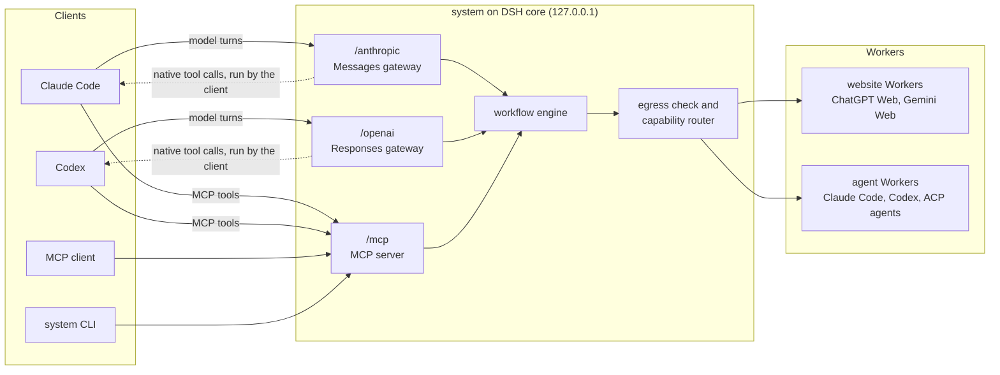

# system

`system` is a local-first, **tool-agnostic** harness for capability-routed AI
Workers and durable multi-agent workflows. It is built **on DSH core** as its own
DSH bundle and profile, reusing DSH plugins without being locked in. Every part of
it is a plugin.

- **Workers:** website Workers on browser-backed accounts (ChatGPT Web, Gemini
  Web), and agent Workers (Claude Code, Codex, ACP agents), and API and
  local-model Workers. The default composition serves website Workers only; the
  others are opt-in.
- **Workflows:** durable and reconcilable, built from Workers and teams.
- **Clients:** Claude Code, Codex, or any MCP client over MCP, and the `system`
  CLI. The calling agent is the Lead: it decides, and what `system` returns is
  advice to it. The Anthropic Messages and Responses gateways, which make a website
  Worker a client's model, are off by default.

> Right Worker, right job. Every effect reconciled, never blindly replayed.

## Why

1. **Save tokens.** Website chat quota (ChatGPT, Gemini) is counted separately
   from API and coding-agent quota. Research and reasoning go there.
2. **Use what the websites already have.** That includes Deep Research, web
   search, and the connectors, apps, and plugins enabled on the account.
3. **Right Worker, right job.** Website Workers search and synthesize. Local
   Workers (Claude Code, Codex, local tools) work on local code and data, which
   stays local.
4. **Right model, right job.** Cheap models handle low-level work such as triage,
   extraction, summaries, and formatting. Strong models are kept for hard
   reasoning and final synthesis.

Full statement: [docs/requirements/purpose.md](docs/requirements/purpose.md).

## Status

Milestones M0 to M5 are done apart from a few listed items, and M6 (second
domain and readiness) has started. PROP-0004 (the Claude Code-lead MVP) Phase 1
is in progress: the default composition leaves the agent Worker and model gateway
rows off until an operator
[turns one on](docs/operations/runbooks.md#turn-an-off-row-back-on). The
[roadmap](docs/proposals/roadmap.md) has the milestone table and what remains. What each package does today is in its own
`README.md`; what was verified on live accounts, and when, is in the
[release checklist](docs/validation/release-checklist.md).

Built today:

- website Workers on ChatGPT Web and Gemini Web, in an invisible headed Chrome,
  with saved accounts, receipts, and restart reconciliation;
- agent Workers on Claude Code, Codex, and ACP agents, held to each runtime's own
  sandbox;
- the workflow engine: capability routing with decision artifacts, acceptance
  contracts, graph growth with plan approval, teams that decide by sealed vote
  (`brainstorm`, `review`), Worker sessions with peer messages, and
  exact-subject review;
- profiles for scientific research (`research`, with a `deep` variant) and
  software development (`agent-review`, for agent Workers);
- the MCP server, the Anthropic Messages and Responses gateways, the `system`
  CLI, and an operator web page at `/ui`.

## Quick start (Linux)

Declare accounts in the operator's profile patch,
`~/.dsh/profiles/system/cordis.patch.yml`. Each tier maps to a mode preset of
the account's driver, and each mapped tier is one Worker. A tier left unmapped is
never served. A common pattern is two accounts:

```yaml
- id: accounts
  config:
    accounts:
      - id: chatgpt-main                 # every tier; Deep research needs frontier
        provider: chatgpt-web
        quotaClass: subscription-chat
        tiers: { economy: instant, standard: medium, frontier: high }
      - id: gemini-main                  # a team puts each member on another provider
        provider: gemini-web
        quotaClass: subscription-chat
        tiers: { economy: flash-lite, standard: flash, frontier: pro }
```

Agent Workers (Claude Code, Codex, ACP agents) are rows of the `agent-workers`
plugin ([configuration](docs/reference/configuration.md#agent-workers)), off by
default ([runbook](docs/operations/runbooks.md#agent-workers)).

```bash
alias system="node $PWD/packages/cli/lib/bin.js"
system init                          # profile, managed Chrome if needed, Xvfb/VNC check
system start &                       # the daemon on 127.0.0.1:47317
system account login chatgpt-main    # once per account: sign in through noVNC over ssh -L, then Save
system account probe chatgpt-main    # prove which website features the account offers
eval "$(system mcp-config claude)"   # Claude Code: MCP server "system" (token via headersHelper)
system mcp-config codex >> ~/.codex/config.toml   # Codex: runs the stdio shim (system mcp-stdio)
```

## What clients get

- **MCP tools:** `ask` (one turn on a website Worker), `research`,
  `brainstorm`, `review`, `vote` (break a team's tie), `run` (any workflow
  template), `result`, `usage`, `explain`, `status`, and sessions
  (`session_send`, `session_inbox`); operator tools for runs (`approve`,
  `stop`, `continue`, `supersede`, `delete`, `drain`, `resume`) and accounts
  (`account_*`). The full contracts are generated in
  [docs/reference/mcp-tools.md](docs/reference/mcp-tools.md).
- **`research`:** the scientific-research procedure: testable hypotheses, two
  cited literature reviews on two provider families (one with web search), an
  evidence table from both, an independent critique, and a conclusion per
  hypothesis. `system research --deep` (MCP
  `deep: true`) reviews with Deep research instead
  ([templates](docs/reference/workflow-templates.md)).
- **`brainstorm` and `review`:** a team of two members on two provider
  families proposes (or lists findings) independently, then votes by sealed
  ballot, debating once on a split. A tie comes back to the caller (`vote`).
  `review` reads text, or a public repository at one pinned commit; `system`
  checks every finding's quote, and a confirmed blocking finding decides
  `changes` ([teams](docs/design/teams.md)).
- **Website Workers as the model:** with a gateway row turned on,
  `system claude-env` and `system codex-env` print commands that run Claude Code
  or Codex on the gateways, with a website Worker as their model.
- **Inspection:** `system explain <runId>` shows why each step ran where it did,
  and `system usage` which quota class and tier served each step. `system ui`
  prints the link to the operator page.

## How it fits together



1. Sign in each provider account once through the remote-login page.
2. Point a client at `system`: over MCP, or through a gateway that makes a
   website Worker its model. Through a gateway, the model proposes the client's
   tool calls in text, and the client runs them locally
   ([ADR-0022](docs/decisions/adr/0022-text-protocol-tool-calls-for-website-models.md)).
3. Run a single turn, or a durable workflow such as `research` or a team
   `brainstorm`.

## Build / run / test

```sh
pnpm install && pnpm build && pnpm check && pnpm test
```

The toolchain, commands, and CI gates are in
[engineering](docs/engineering/development.md).

## Read next

- Humans and agents: [docs/README.md](docs/README.md) is the knowledge router.
- Coding agents: [AGENTS.md](AGENTS.md).
- Architecture at a glance: [docs/architecture/README.md](docs/architecture/README.md).
- Plugin model: [docs/architecture/plugin-model.md](docs/architecture/plugin-model.md).
