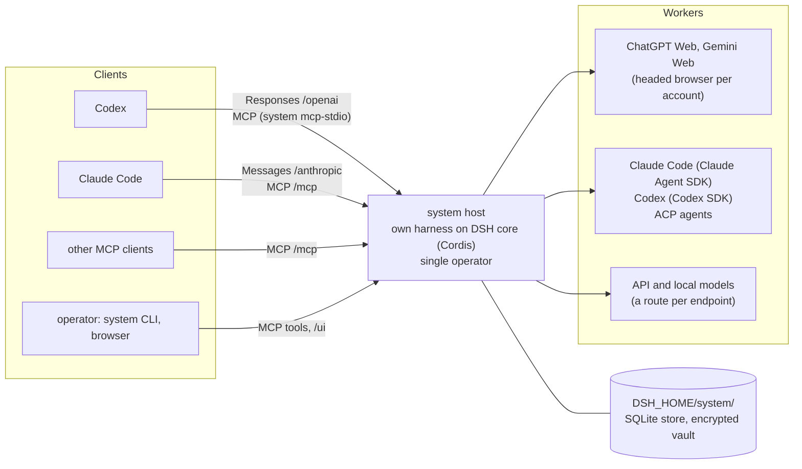
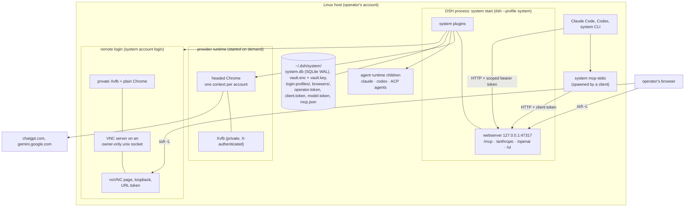

# Architecture

This area owns the **structure** of `system`: its context, layers, plugin seams, dependency
direction, data flow, deployment, and cross-cutting invariants. It says *where* behavior lives
and under which constraints. *How* each mechanism works belongs in [design](../design/README.md).

> Target state, proposed in [PROP-0001](../proposals/0001-unified-system-architecture.md).
> Diagrams mark what is **planned**; everything else is built. What each package does now is in
> its own `README.md`.

## Documents

| Document | Owns |
|---|---|
| this README | system context, the layer map, and the deployment view (canonical diagrams) |
| [invariants.md](invariants.md) | system-wide invariants (binding on all code) |
| [plugin-model.md](plugin-model.md) | everything-is-a-plugin: seam catalog, DSH reuse map, composition, plugin rules |
| [components.md](components.md) | each boundary: what it owns, what it does not own, its contracts |
| [data-flow.md](data-flow.md) | end-to-end flows across boundaries: turn, restart, gateway round trip, node lifecycle |
| [packages.md](packages.md) | every package, its layer, seams, and dependencies (generated from the code) |

## System context

The same agent can appear on both sides. Claude Code or Codex can *use* `system` as a client
and can *be used* by `system` as a Worker
([ADR-0009](../decisions/adr/0009-claude-and-codex-first-class.md)). No side is tied to a
particular tool ([INV-11](invariants.md#inv-11-no-tool-lock-in)).

The operator is trusted. Remote websites, tool output, repository content, model text, and
third-party plugins that the operator has not installed are not (see the
[threat model](../security/threat-model.md)).

## Layer map

Every box is a **plugin** that publishes a Cordis service, or *seam*, under a `ctx.*` key, or a
library beside them ([plugin model](plugin-model.md)). Consumers find a seam by key and never
reach into a provider's internals. Dependencies point **down**, with two deliberate inversions:
the Worker sources register with `ctx.workers` and ask `ctx.egress`, and plugins contribute
their tools to `ctx.mcp`. The generated [package graph](packages.md) lists every edge and each
inversion.

```mermaid
flowchart TB
  subgraph GW["Gateways"]
    direction LR
    mcp["ctx.mcp<br/>MCP server /mcp"]
    msg["gateway-anthropic<br/>/anthropic"]
    resp["gateway-responses<br/>/openai"]
    ui["web-ui /ui"]
    cli["system CLI"]
    gt["gateway-turns (library)"]
  end
  subgraph OR["Orchestration"]
    direction LR
    wf["ctx.workflow<br/>DAG engine, templates, teams"]
    ws["ctx.workerSessions<br/>sessions, mailboxes"]
    prof["profiles<br/>software-development,<br/>scientific-research"]
  end
  subgraph RT["Routing"]
    direction LR
    wk["ctx.workers<br/>sources, admission, router, acceptance"]
    eg["ctx.egress<br/>classification + secret scan"]
  end
  subgraph CAP["Capabilities: Worker sources"]
    direction LR
    turns["ctx.turns<br/>website Workers"]
    aw["ctx.agentWorkers<br/>agent Workers"]
    ar["ctx.agentRuntimes<br/>claude-agent-sdk, codex-sdk, acp"]
    mod["ctx.models<br/>model Workers"]
  end
  subgraph PR["Provider runtime"]
    direction LR
    prov["ctx.providers<br/>chatgpt-web, gemini-web drivers"]
    br["ctx.browser"]
    disp["ctx.display"]
    acc["ctx.accounts"]
    login["ctx.login"]
    rc["ctx.turnReceipts"]
    pc["provider-core, ui-ops (libraries)<br/>scheduler, completion, reconcile, UI maps"]
  end
  subgraph K["Kernel"]
    direction LR
    store["ctx.store"]
    art["ctx.artifacts"]
    ev["ctx.eventLog"]
    ls["ctx.leases"]
    cred["ctx.credentials<br/>(DSH seam, our vault)"]
    libs["libs (library)<br/>hashing, schemas, files"]
  end
  subgraph H["Host"]
    direction LR
    dsh["DSH core rows: timer, webserver, llm, llm-pi-ai"]
    bundle["system bundle + profile"]
  end
  GW --> OR --> RT --> CAP --> PR --> K --> H
```

The **host** holds no business logic. It is **DSH core** on Cordis: only the allow-listed DSH
rows, with no `dsh-base`, plus the `system` bundle, launched as the `system` profile
([ADR-0018](../decisions/adr/0018-build-on-dsh-core.md),
[ADR-0019](../decisions/adr/0019-explicit-minimal-dsh-core.md)). The
[DSH core reuse map](plugin-model.md#dsh-core-reuse-map) lists the rows. Teams are not a seam:
they are the `team` option of workflow nodes, unrolled by the engine, whose members are Worker
sessions. Profiles are plugins that contribute templates through `ctx.workflow.template`.
Which plugins run, and whether a gateway is enabled at all, is decided by configuration.

## Deployment view

One Linux host runs one `system` profile for one operator. Everything listens on loopback; the
operator reaches it locally or over `ssh -L`.

`DSH_HOME` defaults to `~/.dsh`. Each client holds only its scope's token: the CLI the
operator token, MCP clients the client token, and model clients the model token
([scopes](../../packages/plugins/mcp-server/README.md#scopes)). No token sits in a client's
configuration: Claude Code reads it through a headers helper, and other clients spawn
`system mcp-stdio`, which forwards to `/mcp` ([gateways](../design/gateways.md),
[browser runtime](../design/browser-runtime.md), [operations](../operations/README.md)).

## Where the ideas come from

Each layer combines the strongest ideas from the reference systems and removes their known
weaknesses. The full analysis lives in [research](../research/README.md).

| Concern | Primary source | Weakness removed |
|---|---|---|
| Host, plugin runtime, seams, composition, reusable plugins | DeepSeek Harness core / Cordis | used through `system` seams with pinned versions, so there is no lock-in ([ADR-0018](../decisions/adr/0018-build-on-dsh-core.md)) |
| Routing, teams | AgentOS | bound to an experimental harness API |
| Provider runtime, workflow durability | internet | no provider interface, lock-free JSON stores, two runtimes |
| Gateways | codex-chatgpt-web (studied, not ported) | Codex-only, unauthenticated control surfaces, monolithic modules |
