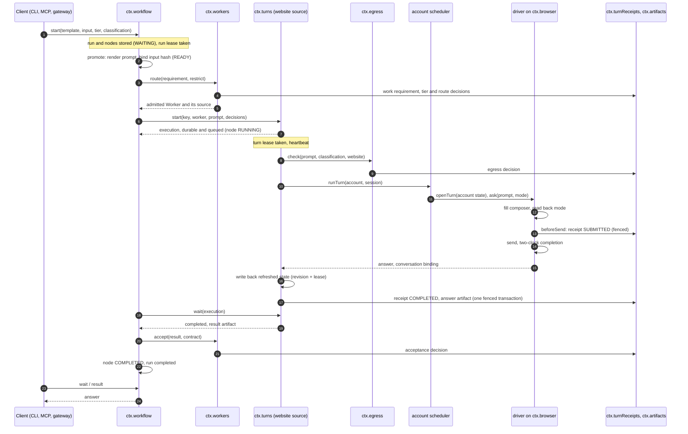
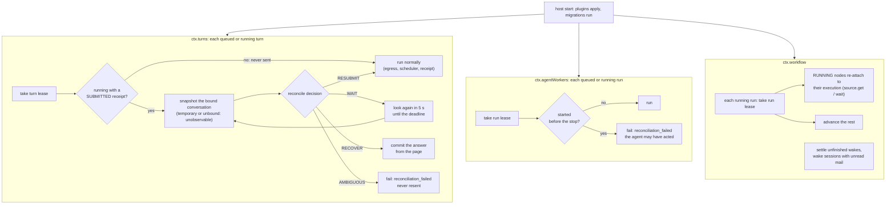
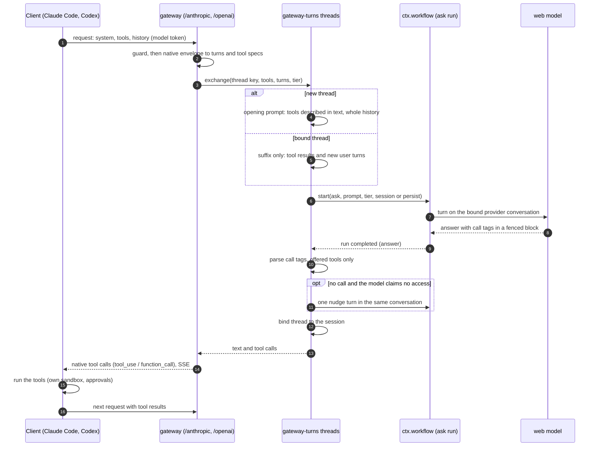
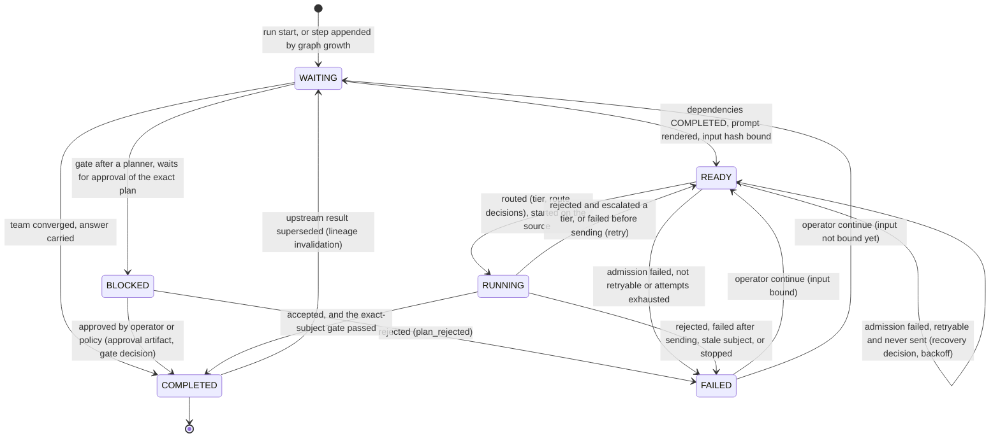

# Data flow

> Target state. Boundaries are defined in [components](components.md); mechanisms in
> [design](../design/README.md).

Every step below that chooses between alternatives (tier, route, admission, egress, reconcile,
accept, escalate, recover, grow, gate) writes a decision artifact before its effect
([INV-13](invariants.md#inv-13-every-decision-is-an-artifact)). `system explain <runId>` reads
the chain back.

## Turn

Every entry point (CLI, MCP tool, gateway) starts a workflow run; even a single `ask` is a run
on the engine. The website Worker source is shown; agent Workers take the same route through
the `agents` source, which checks the prompt at egress (Worker class `agent`: the agent runs
here, but its model is remote), runs `ctx.agentRuntimes` under an `agent-run:<id>` lease, and
marks a run as started before the agent acts.

A failure before the receipt is retryable by the engine; after it, nothing is resent
automatically except by the turn runtime's own bounded reconciliation
([provider turns](../design/provider-turns.md), [routing](../design/routing.md)).

## Restart

A start is reconciliation, not replay
([INV-4](invariants.md#inv-4-restart-is-reconciliation-not-replay)). Each owner looks at its own
durable rows under its own lease.

`RESUBMIT` is bounded (`maxResubmits`) and only when nothing new follows the receipt's boundary
and the page does not show the prompt. A lease held by another live process is re-checked when
it would expire ([scheduling and leases](../design/scheduling-and-leases.md)).

## Gateway round trip

Claude Code (`/anthropic`) and Codex (`/openai`) use a website model as their model. The web
model never runs a tool: it proposes calls in text, and the client runs them under its own
sandbox and approvals
([ADR-0022](../decisions/adr/0022-text-protocol-tool-calls-for-website-models.md),
[gateways](../design/gateways.md)).

A call tag looks like `<call tool="Read">{"file_path": "/abs/path"}</call>`. Each exchange is an
ordinary `ask` run, so it is routed, egress-checked, receipted, and explainable.

## Workflow node lifecycle

Node states are those of `workflow-node@1.0`. A run is `running` until every node is
`COMPLETED` (run `completed`) or one node is `FAILED` (run `failed`). The design's `RECOVERING`
is not a stored state: a recovery is a `recovery` decision that moves a node back to `READY`, and
after a restart a `RUNNING` node re-attaches to its execution.

- **Graph growth:** an accepted plan appends its steps and a gate; a review that requests changes
  appends a fix step and a new review, up to `maxReviewCycles` (a `graph-growth` decision).
- **Stop:** every unfinished node fails as `stopped`, and running executions are cancelled
  through their sources; nothing is resent.
- **Continue:** reopens one failed node, or every node a stop failed, as a new attempt.
- **Supersede:** replaces a completed node's result; every node downstream returns to `WAITING`
  with a `recovery` decision, so nothing stale is reused.

Details: [workflow engine](../design/workflow-engine.md), [teams](../design/teams.md).
