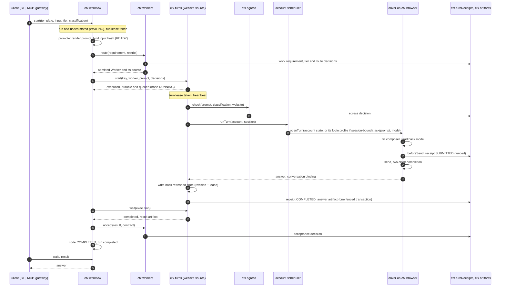
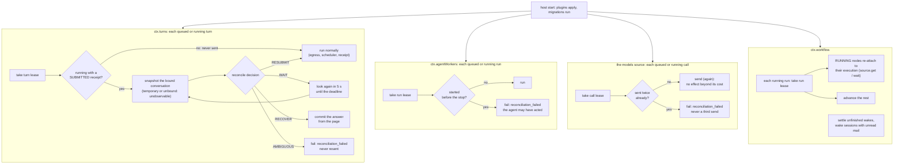
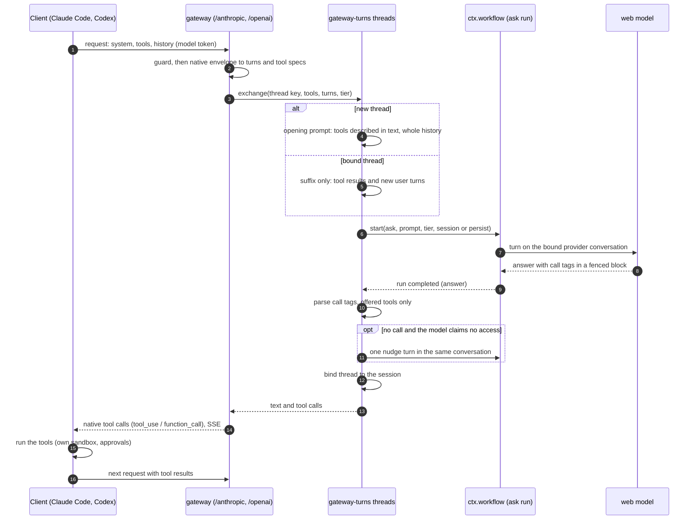
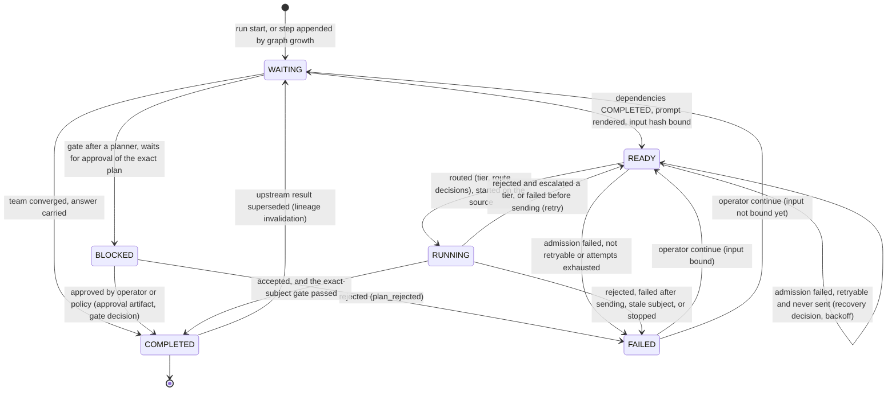

# Data flow

> Target state. Boundaries are defined in [components](components.md); mechanisms in
> [design](../design/README.md).

Every step below that chooses between alternatives (tier, route, admission, egress, budget,
reconcile, accept, escalate, recover, grow, gate) writes a decision artifact before its effect
([INV-13](invariants.md#inv-13-every-decision-is-an-artifact)). `system explain <runId>` reads
the chain back.

## Job

A job goes from intent to accepted result through the core and the plugin families
([core and plugins](README.md#core-and-plugins)). The flow and its failure rules are derived in
[PROP-0009](../proposals/0009-core-and-plugin-decomposition.md#flow-of-one-job-from-intent-to-result);
this table places each step on a concrete seam. The [turn](#turn) below is steps 3 to 8 for a
website Worker, as built today.

| Step | Class | Seam | Status | On failure |
|---|---|---|---|---|
| 1. Hand over intent | surface | `ctx.mcp`, gateways, CLI start a workflow run | built | — |
| 2. Intake: work kind, tier, data class, artifacts to read | decision | `ctx.decisions` ([PROP-0002](../proposals/0002-decision-assisted-routing.md)); today the run's input and template | planned | the work kind's default tier |
| 3. Policy and egress gate | core: gate | `ctx.egress`; `approvals` for actions that need a person | built | closed: deny, or queue for approval |
| 4. Choose a resource | core: resource ledger, gate | `ctx.workers` admission and routing; account cooldowns ([ADR-0034](../decisions/adr/0034-unsent-failover-to-a-sibling-account.md)); `resources` for limits and scarcity; a board task's budget lines reserved before each step ([a task's budget](../design/workflow-engine.md#a-tasks-budget)) | built | wait for the window, or another source; a spent budget starts no new step and blocks the task with a funding request |
| 5. Worker runs | Worker, context | a Worker source (`ctx.turns`, `ctx.agentWorkers`, `ctx.models`); `context` plugins at agent launch | Workers built, `context` planned | context plugin bypassed; Worker reconciled by the runner |
| 6. Record results | core: ledger of record | `ctx.artifacts`, `ctx.eventLog`, `ctx.turnReceipts`; usage to `resources` | built | the write fails closed |
| 7. Verify | verification | acceptance contracts through `workers.contract`; team quote checks | built | no verifier: no automatic acceptance |
| 8. Acceptance gate | core: gate | `workers.accept`, then the node's transition | built | retry or escalate, back to step 4 |
| 9. Digest | digest | `ctx.digests`, asked by the engine for a board task's result once it reached the board, or by the lead (`digests_request`) ([a digest of a task's result](../design/workflow-engine.md#a-digest-of-a-tasks-result)) | built | bypassed and recorded: the result keeps no digest, and the lead reads the artifact pointers |
| 10. Update the board | core: work state machine | `ctx.workflow` run and node states; `board` tasks and projects | built | — |

## Turn

Every entry point (CLI, MCP tool, gateway) starts a workflow run; even a single `ask` is a run
on the engine. The website Worker source is shown; agent Workers take the same route through
the `agents` source, which checks the prompt at egress (Worker class `agent`: the agent runs
here, but its model is remote), reads its account again and reserves on its pool when it has
one, runs `ctx.agentRuntimes` in its account's home under an `agent-run:<id>` lease, asks the
run's gate before each tool call, and marks a run as started before the agent acts.

A failure before the receipt is retryable by the engine; after it, nothing is resent
automatically except by the turn runtime's own bounded reconciliation
([provider turns](../design/provider-turns.md), [routing](../design/routing.md)).

## Restart

A start is reconciliation, not replay
([INV-4](invariants.md#inv-4-restart-is-reconciliation-not-replay)). Each owner looks at its own
durable rows under its own lease.

`RESUBMIT` is bounded (`maxResubmits`) and only when nothing new follows the receipt's boundary
and the page does not show the prompt. A lease held by another live process is re-checked when
it would expire ([scheduling and leases](../design/scheduling-and-leases.md)).

### Effect register

Every external effect, its [INV-4](invariants.md#inv-4-restart-is-reconciliation-not-replay)
class, and the crash test that kills the host at it. A new effect gets a row and a crash test;
the [roadmap](../proposals/roadmap.md) tracks the rows that have none yet.

| Effect | Class | What a restart does | Crash test |
|---|---|---|---|
| A prompt sent to a website | reconcile-before-repeat | the turn receipt's conversation is observed: WAIT, RECOVER, bounded RESUBMIT, or AMBIGUOUS (fails, never resent) | [restart.crash.ts](../../packages/system-bundle/tests/crash/restart.crash.ts): sent and bound, answered, sent but unbound, temporary chat |
| A team member's first step resent after the site's own error ([ADR-0062](../decisions/adr/0062-a-team-members-first-step-is-resent-once-after-a-sites-own-error.md)) | reconcile-before-repeat | the `resend` decision, the session's reset, and the node made ready are one transaction; after a restart the node's next attempt runs once, under its own execution key, in the new conversation; a `resend` on record means never again | [resend.crash.ts](../../packages/system-bundle/tests/crash/resend.crash.ts): killed between the decision and the new attempt |
| An agent run started on its workspace | block | the run fails as `reconciliation_failed`; the agent never starts again | [agent.crash.ts](../../packages/system-bundle/tests/crash/agent.crash.ts) |
| A prompt sent to an API or local model | safe-to-repeat, bounded cost | a recorded `reconciliation` decision sends the call once more (egress checked again), or, sent twice already, fails it as `reconciliation_failed`; at most `sends × attempts` billed requests | [model.crash.ts](../../packages/system-bundle/tests/crash/model.crash.ts): sent, killed before the answer, sent once more |
| A board task's run ended on a spent budget at its last attempt, and its report | reconcile-before-repeat | the engine's decision not to ask for funding, its row, and the run's failure are one transaction, so a restart decides again or finds all three; the report is read against the board's record first, so it moves the task once (`retries-spent`) and asks the operator nothing | [budget.crash.ts](../../packages/system-bundle/tests/crash/budget.crash.ts): killed inside that transaction, and as the report reaches the board |
| A node waiting for an assigned account's limit ([ADR-0052](../decisions/adr/0052-accounts-are-assigned-unless-pooling-is-recorded.md)) | safe-to-repeat (nothing was sent) | the wait is on the node's row (`not_before`, `limit_wait_since`), so the restarted engine waits on until the reset, then routes it as a new start of the same attempt | [wait.crash.ts](../../packages/system-bundle/tests/crash/wait.crash.ts): killed mid-wait, nothing sent before the reset, run once after it |
| A board task's earlier worktree committed, and the next attempt's worktree cut from it ([ADR-0061](../decisions/adr/0061-a-tasks-next-attempt-starts-from-the-work-its-previous-attempt-left.md), accepted 2026-10-25, D59) | reconcile-before-repeat | the carry is `due` on the run's row until settled, and runs before any step; asked again, the source finds its commit (clean, on the base, its trailers) and the worktree it cut, and gives a worktree it cut and had not filled the tree, or puts it back to its base when the tree can no longer be given; no agent runs in a worktree cut and not filled, and the retention and the operator's removal put it back to its base first, so nothing of it is ever committed on its branch; a branch an earlier retention committed such a tree on is never added again | [carry.crash.ts](../../packages/system-bundle/tests/crash/carry.crash.ts): killed between the new worktree's add and the reading of the tree, then past the retention ([agent-workers.spec.ts](../../packages/plugins/agent-workers/tests/agent-workers.spec.ts) asks again after each state a crash leaves) |
| A run's required checks run on its result's worktree ([ADR-0063](../decisions/adr/0063-a-runs-required-checks-run-on-its-exact-result.md)) | safe-to-repeat (a check changes nothing it checks: one that changes the tree is an `error`, and the source runs none on a tree that is not the result's) | nothing is on record until the acceptance decision, which is made after the checks in the run's same turn; the restarted engine advances the completed run again and asks for the checks again, on the same tree, before deciding; commands in flight die with the confinement's namespace | [checks.crash.ts](../../packages/system-bundle/tests/crash/checks.crash.ts): killed while a check runs, then accepted on the checks the restart ran |
| A peer message delivered | safe-to-repeat | delivery is idempotent by the sender's `messageId` | — |
| An account's usage report read ([ADR-0059](../decisions/adr/0059-quota-readings-from-each-accounts-own-usage-report.md)) | safe-to-repeat (a read: no model turn, no quota; the runtime may refresh the account's token and keep the figures in its home, as a run does) | nothing to reconcile: its readings are observations the ledger keeps by `observedAt`, a read cut off records nothing, and the restarted source reads each account again within seconds; a run cut off during its post-run read is reconciled as any started run | — (no reconcile point; [reports.spec.ts](../../packages/plugins/agent-workers/tests/reports.spec.ts) reads again after a restart) |
| A workflow node's result committed, graph growth | safe-to-repeat | one store transaction; a node re-attaches to its execution by key | — |
| A lease taken over | safe-to-repeat | the generation fence rejects a commit by the old holder | — |
| A gateway request in flight | reconcile-before-repeat | the website turn under it reconciles as above; the client's stream ends | — |
| A run expired, then artifacts collected | safe-to-repeat | each run's deletion and the collection are one transaction each; a crash between them leaves artifacts the next daily pass collects | — |
| A backup written | safe-to-repeat | the manifest is written last, so an interrupted backup has none and restore refuses it | [backup.spec.ts](../../packages/cli/tests/backup.spec.ts): a backup without its manifest is refused |

## Gateway round trip

Claude Code (`/anthropic`) and Codex (`/openai`) use a website model as their model. The web
model never runs a tool: it proposes calls in text, and the client runs them under its own
sandbox and approvals
([ADR-0022](../decisions/adr/0022-text-protocol-tool-calls-for-website-models.md),
[gateways](../design/gateways.md)).

A call tag looks like `<call tool="Read">{"file_path": "/abs/path"}</call>`. Each exchange is an
ordinary `ask` run, so it is routed, egress-checked, receipted, and explainable.

## Workflow node lifecycle

Node states are those of `workflow-node@1.0`. A run is `running` until every node is
`COMPLETED` (run `completed`) or one node is `FAILED` (run `failed`). The design's `RECOVERING`
is not a stored state: a recovery is a `recovery` decision that moves a node back to `READY`, and
after a restart a `RUNNING` node re-attaches to its execution.

- **Graph growth:** an accepted plan appends its steps and a gate; a review that requests changes
  appends a fix step and a new review, up to `maxReviewCycles` (a `graph-growth` decision).
- **Stop:** every unfinished node fails as `stopped`, and running executions are cancelled
  through their sources; nothing is resent.
- **Continue:** reopens one failed node, or every node a stop failed, as a new attempt.
- **Supersede:** replaces a completed node's result; every node downstream returns to `WAITING`
  with a `recovery` decision, so nothing stale is reused.

Details: [workflow engine](../design/workflow-engine.md), [teams](../design/teams.md).
