# Packages and dependencies

> Generated by `pnpm gen:packages` (`scripts/gen-packages.ts`) from each package's source and
> `package.json` and the rows of `packages/system-bundle/cordis.patch.yml`; do not edit by hand.
> CI fails when it is out of date. The layer of each package is the one hand-kept fact, in
> `LAYER_OF` in the script: a new package must be placed there, or the generator fails.

The layers are those of the [layer map](README.md#layer-map); seams are described in the
[seam catalog](plugin-model.md#seam-catalog). **Defines** marks the abstract `Service` class that
owns a key; **provides** is the plugin that registers it. **Consumes** is the `inject` list;
*optional* seams are taken with `ctx.inject([...])` or `ctx.get(...)` and used only when present.
**Imports** are workspace packages whose code is imported (a plugin package imported only for
its types is not listed).

A plugin may also consume a service of the dsh launcher itself, which no row provides: `loader`, the DSH loader (Cordis), which mounts the rows; `profileContext`, the dsh launcher's profile. The seam graph draws no edge to one.

## Packages

| Package | Layer | Defines / provides | Bundle row | Consumes | Imports |
|---|---|---|---|---|---|
| [cli](../../packages/cli/README.md) | gateways | — | — | — | `browser-patchright`, `libs`, `system-bundle` |
| [gateway-anthropic](../../packages/plugins/gateway-anthropic/README.md) | gateways | — | `gateway-anthropic` | `webServer`, `workflow`, `store` | `gateway-core`, `gateway-turns`, `libs` |
| [gateway-core](../../packages/gateway-core/README.md) | gateways | defines `mcp` | — | — | `libs` |
| [gateway-responses](../../packages/plugins/gateway-responses/README.md) | gateways | — | `gateway-responses` | `webServer`, `workflow`, `store` | `gateway-core`, `gateway-turns`, `libs` |
| [gateway-turns](../../packages/gateway-turns/README.md) | gateways | — | — | — | `gateway-core`, `libs` |
| [mcp-server](../../packages/plugins/mcp-server/README.md) | gateways | `mcp` | `mcp-server` | `webServer`, `accounts` (optional), `agentWorkers` (optional), `artifacts` (optional), `board` (optional), `browser` (optional), `credentials` (optional), `eventLog` (optional), `pluginHost` (optional), `providers` (optional), `resources` (optional), `store` (optional), `turns` (optional), `workers` (optional), `workflow` (optional) | `gateway-core`, `libs`, `plugin-host-core`, `resources-core` |
| [notify](../../packages/plugins/notify/README.md) | gateways | — | `notify` | `store`, `eventLog`, `credentials` (optional), `egress` (optional), `mcp` (optional) | `gateway-core`, `libs` |
| [report](../../packages/plugins/report/README.md) | gateways | — | `report` | `artifacts`, `eventLog`, `approvals` (optional), `board` (optional), `digests` (optional), `mcp` (optional), `resources` (optional) | `approvals-core`, `board-core`, `digest-core`, `gateway-core`, `libs`, `resources-core` |
| [web-ui](../../packages/plugins/web-ui/README.md) | gateways | — | `web-ui` | `webServer`, `workflow`, `accounts` (optional), `agentWorkers` (optional), `approvals` (optional), `artifacts` (optional), `board` (optional), `eventLog` (optional), `resources` (optional), `workers` (optional) | `approvals-core`, `board-core`, `gateway-core`, `libs`, `workers-core` |
| [board](../../packages/plugins/board/README.md) | orchestration | `board` | `board` | `store`, `artifacts`, `leases`, `approvals`, `eventLog` (optional), `mcp` (optional) | `approvals-core`, `board-core`, `gateway-core`, `leases`, `libs` |
| [board-core](../../packages/board-core/README.md) | orchestration | defines `board` | — | — | `approvals-core` |
| [decision-core](../../packages/decision-core/README.md) | orchestration | defines `dispatchAdvisor` | — | — | `libs` |
| [digest](../../packages/plugins/digest/README.md) | orchestration | `digests` | `digest` | `store`, `artifacts`, `leases`, `workers`, `eventLog` (optional), `mcp` (optional) | `digest-core`, `gateway-core`, `leases`, `libs`, `workers-core` |
| [digest-core](../../packages/digest-core/README.md) | orchestration | defines `digests` | — | — | `gateway-core`, `libs` |
| [digest-extractive](../../packages/plugins/digest-extractive/README.md) | orchestration | `digests` | `digest-extractive` | `store`, `artifacts`, `leases`, `workers`, `eventLog` (optional), `mcp` (optional) | `digest-core`, `gateway-core`, `leases`, `libs`, `workers-core` |
| [evaluations-core](../../packages/evaluations-core/README.md) | orchestration | defines `evaluations` | — | — | `experiments-core`, `libs` |
| [experiments-core](../../packages/experiments-core/README.md) | orchestration | defines `experiments` | — | — | `libs` |
| [landing-core](../../packages/landing-core/README.md) | orchestration | defines `landing` | — | — | — |
| [landing-local](../../packages/plugins/landing-local/README.md) | orchestration | `landing` | `landing-local` | `workers` | `landing-core`, `workers-core` |
| [profile-scientific-research](../../packages/plugins/profile-scientific-research/README.md) | orchestration | — | `profile-scientific-research` | `workflow`, `workers`, `artifacts`, `eventLog` | `libs` |
| [profile-software-development](../../packages/plugins/profile-software-development/README.md) | orchestration | — | `profile-software-development` | `workflow` | `workers-core`, `workflow` |
| [statistics](../../packages/statistics/README.md) | orchestration | — | — | — | — |
| [worker-sessions](../../packages/plugins/worker-sessions/README.md) | orchestration | `workerSessions` | `worker-sessions` | `store`, `artifacts`, `mcp` (optional), `workflow` (optional) | `gateway-core`, `libs` |
| [workflow](../../packages/plugins/workflow/README.md) | orchestration | `workflow` | `workflow` | `store`, `artifacts`, `eventLog`, `leases`, `egress`, `workers`, `workerSessions`, `agentWorkers` (optional), `approvals` (optional), `board` (optional), `digests` (optional), `dispatchAdvisor` (optional), `landing` (optional), `mcp` (optional), `resources` (optional) | `approvals-core`, `board-core`, `decision-core`, `digest-core`, `gateway-core`, `landing-core`, `leases`, `libs`, `provider-core`, `resources-core`, `worker-sessions`, `workers-core` |
| [approvals](../../packages/plugins/approvals/README.md) | routing | `approvals` | `approvals` | `store`, `artifacts`, `board` (optional), `eventLog` (optional), `mcp` (optional), `workflow` (optional) | `approvals-core`, `gateway-core`, `libs` |
| [approvals-core](../../packages/approvals-core/README.md) | routing | defines `approvals` | — | — | — |
| [egress](../../packages/plugins/egress/README.md) | routing | `egress` | `egress` | `artifacts` | `libs`, `provider-core` |
| [resources](../../packages/plugins/resources/README.md) | routing | `resources` | `resources` | `store`, `artifacts`, `board` (optional), `eventLog` (optional), `mcp` (optional), `workflow` (optional) | `gateway-core`, `libs`, `resources-core` |
| [resources-core](../../packages/resources-core/README.md) | routing | defines `resources` | — | — | — |
| [workers](../../packages/plugins/workers/README.md) | routing | `workers` | `workers` | `artifacts`, `resources` (optional) | `libs`, `workers-core` |
| [workers-core](../../packages/workers-core/README.md) | routing | defines `workers` | — | — | — |
| [agent-runtime-core](../../packages/agent-runtime-core/README.md) | capabilities | defines `agentRuntimes` | — | — | — |
| [agent-runtimes](../../packages/plugins/agent-runtimes/README.md) | capabilities | `agentRuntimes` | `agent-runtimes` | — | `agent-runtime-core`, `libs` |
| [agent-workers](../../packages/plugins/agent-workers/README.md) | capabilities | `agentWorkers` | `agent-workers` | `store`, `artifacts`, `leases`, `workers`, `agentRuntimes`, `egress`, `approvals` (optional), `credentials` (optional), `eventLog` (optional), `mcp` (optional), `resources` (optional), `workflow` (optional) | `agent-runtime-core`, `approvals-core`, `gateway-core`, `leases`, `libs`, `provider-core`, `resources-core`, `workers-core` |
| [models](../../packages/plugins/models/README.md) | capabilities | `models` | `models` | `llm`, `store`, `artifacts`, `leases`, `workers`, `egress`, `models`, `credentials` (optional), `eventLog` (optional), `mcp` (optional) | `gateway-core`, `leases`, `libs`, `models-core`, `provider-core`, `workers-core` |
| [models-core](../../packages/models-core/README.md) | capabilities | defines `models` | — | — | `workers-core` |
| [runtime-acp](../../packages/plugins/runtime-acp/README.md) | capabilities | — | `runtime-acp` | `agentRuntimes` | `agent-runtime-core`, `provider-core` |
| [runtime-antigravity-cli](../../packages/plugins/runtime-antigravity-cli/README.md) | capabilities | — | `runtime-antigravity-cli` | `agentRuntimes` | `agent-runtime-core`, `libs`, `provider-core` |
| [runtime-claude-agent-sdk](../../packages/plugins/runtime-claude-agent-sdk/README.md) | capabilities | — | `runtime-claude-agent-sdk` | `agentRuntimes` | `agent-runtime-core`, `libs`, `provider-core` |
| [runtime-codex-sdk](../../packages/plugins/runtime-codex-sdk/README.md) | capabilities | — | `runtime-codex-sdk` | `agentRuntimes` | `agent-runtime-core`, `libs`, `provider-core` |
| [turns](../../packages/plugins/turns/README.md) | capabilities | `turns` | `turns` | `store`, `artifacts`, `leases`, `egress`, `turnReceipts`, `accounts`, `browser`, `providers`, `workers`, `eventLog` (optional), `login` (optional), `mcp` (optional) | `gateway-core`, `leases`, `libs`, `provider-core`, `workers-core` |
| [accounts](../../packages/plugins/accounts/README.md) | provider runtime | `accounts` | `accounts` | `credentials` | `libs`, `provider-core` |
| [browser-patchright](../../packages/plugins/browser-patchright/README.md) | provider runtime | `browser` | `browser` | `display`, `eventLog` (optional) | `libs`, `provider-core` |
| [display-virtual](../../packages/plugins/display-virtual/README.md) | provider runtime | `display` | `display` | — | `libs`, `provider-core` |
| [login](../../packages/plugins/login/README.md) | provider runtime | `login` | `login` | `accounts`, `browser`, `providers`, `mcp` (optional) | `display-virtual`, `gateway-core`, `libs`, `provider-core` |
| [provider-chatgpt-web](../../packages/plugins/provider-chatgpt-web/README.md) | provider runtime | — | `provider-chatgpt-web` | `providers`, `artifacts` (optional), `eventLog` (optional) | `libs`, `provider-core`, `ui-ops` |
| [provider-core](../../packages/provider-core/README.md) | provider runtime | defines `browser`, defines `display`, defines `providers` | — | — | `libs` |
| [provider-gemini-web](../../packages/plugins/provider-gemini-web/README.md) | provider runtime | — | `provider-gemini-web` | `providers`, `artifacts` (optional), `eventLog` (optional) | `provider-core`, `ui-ops` |
| [providers](../../packages/plugins/providers/README.md) | provider runtime | `providers` | `providers` | — | `provider-core` |
| [turn-receipts](../../packages/plugins/turn-receipts/README.md) | provider runtime | `turnReceipts` | `turn-receipts` | `store`, `artifacts` | `libs`, `provider-core` |
| [ui-ops](../../packages/ui-ops/README.md) | provider runtime | — | — | — | `libs`, `provider-core` |
| [artifacts](../../packages/plugins/artifacts/README.md) | kernel | `artifacts` | `artifacts` | `store` | `libs` |
| [credentials-vault](../../packages/plugins/credentials-vault/README.md) | kernel | `credentials` | `credentials` | — | `libs` |
| [event-log](../../packages/plugins/event-log/README.md) | kernel | `eventLog` | `event-log` | `store` | `libs` |
| [leases](../../packages/plugins/leases/README.md) | kernel | `leases` | `leases` | `store` | `libs` |
| [plugin-host](../../packages/plugins/plugin-host/README.md) | kernel | `pluginHost` | `plugin-host` | `store`, `artifacts`, `loader`, `profileContext` (optional) | `plugin-host-core` |
| [plugin-host-core](../../packages/plugin-host-core/README.md) | kernel | defines `pluginHost` | — | — | `libs` |
| [store](../../packages/plugins/store/README.md) | kernel | `store` | `store` | — | `libs` |
| [libs](../../packages/libs/README.md) | host and libraries | — | — | — | — |
| [system-bundle](../../packages/system-bundle/README.md) | host and libraries | — | — | — | — |
| `@deepseek-ai/cordis-plugin-timer` (DSH row) | host and libraries | `timer` | `timer` | — | — |
| `@deepseek-ai/dsh-host-webserver` (DSH row) | host and libraries | `webServer` | `webserver` | — | — |
| `@deepseek-ai/dsh-llm` (DSH row) | host and libraries | `llm` | `llm` | — | — |
| `@deepseek-ai/dsh-llm-pi-ai` (DSH row) | host and libraries | — | `llm-pi-ai` | — | — |

## Seam graph

An arrow runs from a consumer to the package that provides the seam; a dotted arrow is an optional
seam. A seam with no provider yet (an optional seam, or one only a row that is off by default
requires) points to the package that defines it. A seam with an alternative provider, whose row is
off and which the operator swaps in by configuration, points to the provider whose row is on. Rows
of DSH core appear under host and libraries.

```mermaid
flowchart TB
  subgraph gateways ["gateways"]
    gateway_anthropic["gateway-anthropic"]
    gateway_responses["gateway-responses"]
    mcp_server["mcp-server<br/>ctx.mcp"]
    notify["notify"]
    report["report"]
    web_ui["web-ui"]
  end
  subgraph orchestration ["orchestration"]
    board["board<br/>ctx.board"]
    decision_core["decision-core<br/>defines dispatchAdvisor"]
    digest["digest<br/>ctx.digests"]
    digest_extractive["digest-extractive<br/>ctx.digests"]
    landing_local["landing-local<br/>ctx.landing"]
    profile_scientific_research["profile-scientific-research"]
    profile_software_development["profile-software-development"]
    worker_sessions["worker-sessions<br/>ctx.workerSessions"]
    workflow["workflow<br/>ctx.workflow"]
  end
  subgraph routing ["routing"]
    approvals["approvals<br/>ctx.approvals"]
    egress["egress<br/>ctx.egress"]
    resources["resources<br/>ctx.resources"]
    workers["workers<br/>ctx.workers"]
  end
  subgraph capabilities ["capabilities"]
    agent_runtimes["agent-runtimes<br/>ctx.agentRuntimes"]
    agent_workers["agent-workers<br/>ctx.agentWorkers"]
    models["models<br/>ctx.models"]
    runtime_acp["runtime-acp"]
    runtime_antigravity_cli["runtime-antigravity-cli"]
    runtime_claude_agent_sdk["runtime-claude-agent-sdk"]
    runtime_codex_sdk["runtime-codex-sdk"]
    turns["turns<br/>ctx.turns"]
  end
  subgraph provider_runtime ["provider runtime"]
    accounts["accounts<br/>ctx.accounts"]
    browser_patchright["browser-patchright<br/>ctx.browser"]
    display_virtual["display-virtual<br/>ctx.display"]
    login["login<br/>ctx.login"]
    provider_chatgpt_web["provider-chatgpt-web"]
    provider_gemini_web["provider-gemini-web"]
    providers["providers<br/>ctx.providers"]
    turn_receipts["turn-receipts<br/>ctx.turnReceipts"]
  end
  subgraph kernel ["kernel"]
    artifacts["artifacts<br/>ctx.artifacts"]
    credentials_vault["credentials-vault<br/>ctx.credentials"]
    event_log["event-log<br/>ctx.eventLog"]
    leases["leases<br/>ctx.leases"]
    plugin_host["plugin-host<br/>ctx.pluginHost"]
    store["store<br/>ctx.store"]
  end
  subgraph host_and_libraries ["host and libraries"]
    webserver["webserver<br/>ctx.webServer"]
    llm["llm<br/>ctx.llm"]
  end
  accounts --> credentials_vault
  agent_workers --> store
  agent_workers --> artifacts
  agent_workers --> leases
  agent_workers --> workers
  agent_workers --> agent_runtimes
  agent_workers --> egress
  agent_workers -.-> approvals
  agent_workers -.-> credentials_vault
  agent_workers -.-> event_log
  agent_workers -.-> mcp_server
  agent_workers -.-> resources
  agent_workers -.-> workflow
  approvals --> store
  approvals --> artifacts
  approvals -.-> board
  approvals -.-> event_log
  approvals -.-> mcp_server
  approvals -.-> workflow
  artifacts --> store
  board --> store
  board --> artifacts
  board --> leases
  board --> approvals
  board -.-> event_log
  board -.-> mcp_server
  browser_patchright --> display_virtual
  browser_patchright -.-> event_log
  digest --> store
  digest --> artifacts
  digest --> leases
  digest --> workers
  digest -.-> event_log
  digest -.-> mcp_server
  digest_extractive --> store
  digest_extractive --> artifacts
  digest_extractive --> leases
  digest_extractive --> workers
  digest_extractive -.-> event_log
  digest_extractive -.-> mcp_server
  egress --> artifacts
  event_log --> store
  gateway_anthropic --> webserver
  gateway_anthropic --> workflow
  gateway_anthropic --> store
  gateway_responses --> webserver
  gateway_responses --> workflow
  gateway_responses --> store
  landing_local --> workers
  leases --> store
  login --> accounts
  login --> browser_patchright
  login --> providers
  login -.-> mcp_server
  mcp_server --> webserver
  mcp_server -.-> accounts
  mcp_server -.-> agent_workers
  mcp_server -.-> artifacts
  mcp_server -.-> board
  mcp_server -.-> browser_patchright
  mcp_server -.-> credentials_vault
  mcp_server -.-> event_log
  mcp_server -.-> plugin_host
  mcp_server -.-> providers
  mcp_server -.-> resources
  mcp_server -.-> store
  mcp_server -.-> turns
  mcp_server -.-> workers
  mcp_server -.-> workflow
  models --> llm
  models --> store
  models --> artifacts
  models --> leases
  models --> workers
  models --> egress
  models --> models
  models -.-> credentials_vault
  models -.-> event_log
  models -.-> mcp_server
  notify --> store
  notify --> event_log
  notify -.-> credentials_vault
  notify -.-> egress
  notify -.-> mcp_server
  plugin_host --> store
  plugin_host --> artifacts
  profile_scientific_research --> workflow
  profile_scientific_research --> workers
  profile_scientific_research --> artifacts
  profile_scientific_research --> event_log
  profile_software_development --> workflow
  provider_chatgpt_web --> providers
  provider_chatgpt_web -.-> artifacts
  provider_chatgpt_web -.-> event_log
  provider_gemini_web --> providers
  provider_gemini_web -.-> artifacts
  provider_gemini_web -.-> event_log
  report --> artifacts
  report --> event_log
  report -.-> approvals
  report -.-> board
  report -.-> digest
  report -.-> mcp_server
  report -.-> resources
  resources --> store
  resources --> artifacts
  resources -.-> board
  resources -.-> event_log
  resources -.-> mcp_server
  resources -.-> workflow
  runtime_acp --> agent_runtimes
  runtime_antigravity_cli --> agent_runtimes
  runtime_claude_agent_sdk --> agent_runtimes
  runtime_codex_sdk --> agent_runtimes
  turn_receipts --> store
  turn_receipts --> artifacts
  turns --> store
  turns --> artifacts
  turns --> leases
  turns --> egress
  turns --> turn_receipts
  turns --> accounts
  turns --> browser_patchright
  turns --> providers
  turns --> workers
  turns -.-> event_log
  turns -.-> login
  turns -.-> mcp_server
  web_ui --> webserver
  web_ui --> workflow
  web_ui -.-> accounts
  web_ui -.-> agent_workers
  web_ui -.-> approvals
  web_ui -.-> artifacts
  web_ui -.-> board
  web_ui -.-> event_log
  web_ui -.-> resources
  web_ui -.-> workers
  worker_sessions --> store
  worker_sessions --> artifacts
  worker_sessions -.-> mcp_server
  worker_sessions -.-> workflow
  workers --> artifacts
  workers -.-> resources
  workflow --> store
  workflow --> artifacts
  workflow --> event_log
  workflow --> leases
  workflow --> egress
  workflow --> workers
  workflow --> worker_sessions
  workflow -.-> agent_workers
  workflow -.-> approvals
  workflow -.-> board
  workflow -.-> digest
  workflow -.-> decision_core
  workflow -.-> landing_local
  workflow -.-> mcp_server
  workflow -.-> resources
```

### Seam edges that point up a layer

Dependencies point down, except where a lower plugin registers into a registry above it or asks a
policy above it. Each such edge is listed here so a new one is a visible change.

| Consumer | Seam | Provider | Kind |
|---|---|---|---|
| `agent-workers` (capabilities) | `approvals` | `approvals` (routing) | optional |
| `agent-workers` (capabilities) | `egress` | `egress` (routing) | required |
| `agent-workers` (capabilities) | `mcp` | `mcp-server` (gateways) | optional |
| `agent-workers` (capabilities) | `resources` | `resources` (routing) | optional |
| `agent-workers` (capabilities) | `workers` | `workers` (routing) | required |
| `agent-workers` (capabilities) | `workflow` | `workflow` (orchestration) | optional |
| `approvals` (routing) | `board` | `board` (orchestration) | optional |
| `approvals` (routing) | `mcp` | `mcp-server` (gateways) | optional |
| `approvals` (routing) | `workflow` | `workflow` (orchestration) | optional |
| `board` (orchestration) | `mcp` | `mcp-server` (gateways) | optional |
| `digest-extractive` (orchestration) | `mcp` | `mcp-server` (gateways) | optional |
| `digest` (orchestration) | `mcp` | `mcp-server` (gateways) | optional |
| `login` (provider runtime) | `mcp` | `mcp-server` (gateways) | optional |
| `models` (capabilities) | `egress` | `egress` (routing) | required |
| `models` (capabilities) | `mcp` | `mcp-server` (gateways) | optional |
| `models` (capabilities) | `workers` | `workers` (routing) | required |
| `resources` (routing) | `board` | `board` (orchestration) | optional |
| `resources` (routing) | `mcp` | `mcp-server` (gateways) | optional |
| `resources` (routing) | `workflow` | `workflow` (orchestration) | optional |
| `turns` (capabilities) | `egress` | `egress` (routing) | required |
| `turns` (capabilities) | `mcp` | `mcp-server` (gateways) | optional |
| `turns` (capabilities) | `workers` | `workers` (routing) | required |
| `worker-sessions` (orchestration) | `mcp` | `mcp-server` (gateways) | optional |
| `workflow` (orchestration) | `mcp` | `mcp-server` (gateways) | optional |

## Library imports

An arrow runs from a package to a workspace package whose code it imports; `libs`, imported by
almost every package, is not drawn.

```mermaid
flowchart TB
  subgraph gateways ["gateways"]
    cli["cli"]
    gateway_anthropic["gateway-anthropic"]
    gateway_core["gateway-core<br/>defines mcp"]
    gateway_responses["gateway-responses"]
    gateway_turns["gateway-turns"]
    mcp_server["mcp-server<br/>ctx.mcp"]
    notify["notify"]
    report["report"]
    web_ui["web-ui"]
  end
  subgraph orchestration ["orchestration"]
    board["board<br/>ctx.board"]
    board_core["board-core<br/>defines board"]
    decision_core["decision-core<br/>defines dispatchAdvisor"]
    digest["digest<br/>ctx.digests"]
    digest_core["digest-core<br/>defines digests"]
    digest_extractive["digest-extractive<br/>ctx.digests"]
    evaluations_core["evaluations-core<br/>defines evaluations"]
    experiments_core["experiments-core<br/>defines experiments"]
    landing_core["landing-core<br/>defines landing"]
    landing_local["landing-local<br/>ctx.landing"]
    profile_software_development["profile-software-development"]
    worker_sessions["worker-sessions<br/>ctx.workerSessions"]
    workflow["workflow<br/>ctx.workflow"]
  end
  subgraph routing ["routing"]
    approvals["approvals<br/>ctx.approvals"]
    approvals_core["approvals-core<br/>defines approvals"]
    egress["egress<br/>ctx.egress"]
    resources["resources<br/>ctx.resources"]
    resources_core["resources-core<br/>defines resources"]
    workers["workers<br/>ctx.workers"]
    workers_core["workers-core<br/>defines workers"]
  end
  subgraph capabilities ["capabilities"]
    agent_runtime_core["agent-runtime-core<br/>defines agentRuntimes"]
    agent_runtimes["agent-runtimes<br/>ctx.agentRuntimes"]
    agent_workers["agent-workers<br/>ctx.agentWorkers"]
    models["models<br/>ctx.models"]
    models_core["models-core<br/>defines models"]
    runtime_acp["runtime-acp"]
    runtime_antigravity_cli["runtime-antigravity-cli"]
    runtime_claude_agent_sdk["runtime-claude-agent-sdk"]
    runtime_codex_sdk["runtime-codex-sdk"]
    turns["turns<br/>ctx.turns"]
  end
  subgraph provider_runtime ["provider runtime"]
    accounts["accounts<br/>ctx.accounts"]
    browser_patchright["browser-patchright<br/>ctx.browser"]
    display_virtual["display-virtual<br/>ctx.display"]
    login["login<br/>ctx.login"]
    provider_chatgpt_web["provider-chatgpt-web"]
    provider_core["provider-core<br/>defines browser, display, providers"]
    provider_gemini_web["provider-gemini-web"]
    providers["providers<br/>ctx.providers"]
    turn_receipts["turn-receipts<br/>ctx.turnReceipts"]
    ui_ops["ui-ops"]
  end
  subgraph kernel ["kernel"]
    leases["leases<br/>ctx.leases"]
    plugin_host["plugin-host<br/>ctx.pluginHost"]
    plugin_host_core["plugin-host-core<br/>defines pluginHost"]
  end
  subgraph host_and_libraries ["host and libraries"]
    system_bundle["system-bundle"]
  end
  accounts --> provider_core
  agent_runtimes --> agent_runtime_core
  agent_workers --> agent_runtime_core
  agent_workers --> approvals_core
  agent_workers --> gateway_core
  agent_workers --> leases
  agent_workers --> provider_core
  agent_workers --> resources_core
  agent_workers --> workers_core
  approvals --> approvals_core
  approvals --> gateway_core
  board --> approvals_core
  board --> board_core
  board --> gateway_core
  board --> leases
  board_core --> approvals_core
  browser_patchright --> provider_core
  cli --> browser_patchright
  cli --> system_bundle
  digest --> digest_core
  digest --> gateway_core
  digest --> leases
  digest --> workers_core
  digest_core --> gateway_core
  digest_extractive --> digest_core
  digest_extractive --> gateway_core
  digest_extractive --> leases
  digest_extractive --> workers_core
  display_virtual --> provider_core
  egress --> provider_core
  evaluations_core --> experiments_core
  gateway_anthropic --> gateway_core
  gateway_anthropic --> gateway_turns
  gateway_responses --> gateway_core
  gateway_responses --> gateway_turns
  gateway_turns --> gateway_core
  landing_local --> landing_core
  landing_local --> workers_core
  login --> display_virtual
  login --> gateway_core
  login --> provider_core
  mcp_server --> gateway_core
  mcp_server --> plugin_host_core
  mcp_server --> resources_core
  models --> gateway_core
  models --> leases
  models --> models_core
  models --> provider_core
  models --> workers_core
  models_core --> workers_core
  notify --> gateway_core
  plugin_host --> plugin_host_core
  profile_software_development --> workers_core
  profile_software_development --> workflow
  provider_chatgpt_web --> provider_core
  provider_chatgpt_web --> ui_ops
  provider_gemini_web --> provider_core
  provider_gemini_web --> ui_ops
  providers --> provider_core
  report --> approvals_core
  report --> board_core
  report --> digest_core
  report --> gateway_core
  report --> resources_core
  resources --> gateway_core
  resources --> resources_core
  runtime_acp --> agent_runtime_core
  runtime_acp --> provider_core
  runtime_antigravity_cli --> agent_runtime_core
  runtime_antigravity_cli --> provider_core
  runtime_claude_agent_sdk --> agent_runtime_core
  runtime_claude_agent_sdk --> provider_core
  runtime_codex_sdk --> agent_runtime_core
  runtime_codex_sdk --> provider_core
  turn_receipts --> provider_core
  turns --> gateway_core
  turns --> leases
  turns --> provider_core
  turns --> workers_core
  ui_ops --> provider_core
  web_ui --> approvals_core
  web_ui --> board_core
  web_ui --> gateway_core
  web_ui --> workers_core
  worker_sessions --> gateway_core
  workers --> workers_core
  workflow --> approvals_core
  workflow --> board_core
  workflow --> decision_core
  workflow --> digest_core
  workflow --> gateway_core
  workflow --> landing_core
  workflow --> leases
  workflow --> provider_core
  workflow --> resources_core
  workflow --> worker_sessions
  workflow --> workers_core
```

