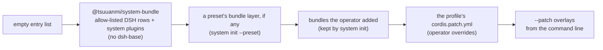

# Plugin model

> Target state. Decisions: [ADR-0007](../decisions/adr/0007-everything-is-a-plugin.md),
> [ADR-0036](../decisions/adr/0036-guarantee-core-and-capability-plugins.md) (guarantee core and
> capability plugins),
> [ADR-0018](../decisions/adr/0018-build-on-dsh-core.md) (build on DSH core),
> [ADR-0019](../decisions/adr/0019-explicit-minimal-dsh-core.md) (only the DSH core rows we use).
> Invariants: [INV-10](invariants.md#inv-10-everything-is-a-plugin),
> [INV-11](invariants.md#inv-11-no-tool-lock-in).

`system` follows the **Everything Is A Plugin** philosophy of DeepSeek Harness, and is built
**on DSH core**. `system` is its own harness: a DSH bundle and profile that mounts only the DSH
core rows it uses (no `dsh-base`), running on the same plugin runtime,
[Cordis](../research/dsh-analysis.md). Every part of the product is a plugin, including the
store, the provider drivers, the router, the workflow engine, and each gateway. There is no
privileged core to patch. You extend `system` by mounting a plugin beside the others, and every
registration is an effect that unwinds when its plugin unloads.

Plugins are not all equal, though. A **guarantee seam** carries a correctness or safety
guarantee and belongs to one of six core components; a **capability seam** only carries
capability and belongs to one of eight plugin families
([core and plugin classes](#core-and-plugin-classes)). Both are ordinary plugins; what differs
is how their contracts may change and how they fail.

## Vocabulary

| Term | Meaning |
|---|---|
| **plugin** | a module with `apply(ctx, config)`, optional `inject`, and a validated `Config`, or a Cordis `Service` subclass |
| **service** | a stable `ctx.<key>` claimed by one plugin. Consumers find it by key, never by importing an implementation |
| **seam** | a swappable capability with three roles: a **definition** (an abstract `Service` class that owns the key and its vocabulary types), one or more **providers**, and one or more **consumers** |
| **library** | a plain module with no `apply` and no service, used for pure logic that has nothing to swap |
| **profile** | a named, ordered composition of bundles plus the operator's patch file |
| **bundle** | a distributable set of config rows and the plugins they mount |

## Seam catalog

Each architectural boundary in [components](components.md) is published as one or more seams.
Status is one word: **built**, **defined** (an abstract definition, a protocol, and a conformance
suite that a fake provider passes, with no real provider yet), **planned**, or **not planned**. Who injects what is generated
from the code in [packages](packages.md); this table names the roles.

| Layer | Seam (`ctx.*`) | Class | Status | Definition and providers | Main consumers |
|---|---|---|---|---|---|
| Kernel | `store` | core: ledger of record | built | `system-store` (`node:sqlite`, WAL) | every stateful plugin |
| Kernel | `artifacts` | core: ledger of record | built | `system-artifacts`: envelope, ids, lineage, schema validation, decisions | every producer of results or decisions |
| Kernel | `eventLog` | core: ledger of record | built | `system-event-log` (named so because Cordis owns `ctx.events`) | append: workflow, turns, provider-chatgpt-web; listen: profile-scientific-research; query: workflow (the request a Worker's deferred call waits on), report (attempts, remediation, batches, and digests in a period) |
| Kernel | `leases` | core: work state machine | built | `system-leases` (generations, fencing) | workflow, turns, agent-workers |
| Kernel | `credentials` | core: ledger of record (secrets) | built | definition: **DSH** `dsh-credentials`; provider: `system-credentials-vault` (encrypted at rest) | accounts, `llm-pi-ai` (route keys by reference), models (`model_key`) |
| Provider runtime | `display` | plugin: Worker | built | `Display` in `system-provider-core`; `system-display-virtual` (Xvfb) | browser |
| Provider runtime | `browser` | plugin: Worker | built | `Browser` in `system-provider-core`; `system-browser-patchright` | turns, login |
| Provider runtime | `providers` | plugin: Worker | built | `ProviderRegistry` in `system-provider-core`; registry `system-providers`; drivers `provider-chatgpt-web`, `provider-gemini-web` register into it | turns, login |
| Provider runtime | `accounts` | plugin: Worker | built | `system-accounts` (records and grants in `ctx.credentials`) | turns, login |
| Provider runtime | `login` | plugin: Worker | built | `system-login`: login profiles, Save, remote login, credential sign-in | operators (MCP `account_*`), turns |
| Provider runtime | `turnReceipts` | core: runner | built | `system-turn-receipts` | turns |
| Capabilities | `turns` | plugin: Worker | built | `system-turns`: the `website` Worker source | `ctx.workers`, through the source it registers |
| Capabilities | `agentRuntimes` | plugin: Worker | built | `AgentRuntimes` in `system-agent-runtime-core`; registry `system-agent-runtimes`; providers `runtime-claude-agent-sdk`, `runtime-codex-sdk`, `runtime-acp`, `runtime-antigravity-cli`. A run may carry a per-tool-call gate (`RunSpec.toolGate`), asked (`askToolGate`: bounded, fail-closed) by a runtime that reports `gatesToolCalls` (Claude Code, Codex) and refused by one that cannot (ACP, and the Antigravity CLI until its tools are classified) ([tool gate](../design/agent-runtimes.md#tool-gate)) | agent-workers |
| Capabilities | `agentWorkers` | plugin: Worker | built | `system-agent-workers`: the `agents` Worker source | `ctx.workers`, through the source it registers |
| Capabilities | `models` | plugin: Worker | built | `Models` in `system-models-core`; provider `system-models` over **DSH** `ctx.llm` (`llm`, `llm-pi-ai`) ([models](../design/models.md)) | the `models` Worker source in `system-models` |
| Routing | `workers` | core: gate (admission, acceptance); its routing policy is a decision input | built | `Workers` in `system-workers-core`; `system-workers`. A start names the `brief` its source renders its prompt from ([briefs](../design/workflow-engine.md#briefs)). The optional `sources()` gives how each Worker source answered its last read, silent or failed included ([sources that do not answer](../design/routing.md#sources-that-do-not-answer)) | workflow, digests; profile-scientific-research adds acceptance contracts; mcp-server (health reads `sources()`) |
| Routing | `egress` | core: gate | built | `system-egress`: classification policy and credential scan (INV-12) | turns, agent-workers, models, workflow |
| Orchestration | `workflow` | core: work state machine, runner; templates are the workflow family | built | `system-workflow`; templates through `ctx.workflow.template` | gateways, web-ui, profiles |
| Orchestration | `workerSessions` | core: work state machine | built | `system-worker-sessions` ([design](../design/sessions-and-messaging.md)). Contract 1.1 adds the binding runtime `antigravity-cli` (`worker-session@1.1`; [ADR-0015](../decisions/adr/0015-worker-sessions-and-peer-messaging.md#amendment-2026-10-23-contract-11-names-the-antigravity-cli-runtime)) | workflow |
| Gateways | `mcp` | plugin: surface (its scope check is a gate rule) | built | `McpTools` in `system-gateway-core`; `system-mcp-server` (own: DSH has only an MCP client) | tool contributors: login, turns, workflow, worker-sessions, models, resources, approvals, board, digest, report; mcp-server adds `status`. Each tool declares its scope, `operator` by default ([ADR-0023](../decisions/adr/0023-scoped-control-credentials.md)) |
| Host | `pluginHost` | core: plugin host | built | `PluginHost` in `system-plugin-host-core` ([plugin host](../design/plugin-host.md)): every plugin of the composition with the manifest its package declares (`plugin-manifest@1.x`), and each plugin's lifecycle state, every change recorded first as a `lifecycle` decision; Base records and automates nothing. Contract 1.1 adds the manifest check: each plugin a row mounts without a valid manifest its configuration allows, or with a consumed seam its providers' manifests do not satisfy, is recorded once as a `gate` decision, listed, and makes health down; the host cannot refuse the row ([ADR-0048](../decisions/adr/0048-the-plugin-host-checks-the-composition-at-start.md)). Provider `system-plugin-host` (on `ctx.store`, the rows read from the DSH loader at start), its bundle row on | mcp-server (`status`) |
| Host | `webServer` | plugin: surface | built | **DSH** `dsh-host-webserver` (loopback) | mcp-server, gateway-anthropic, gateway-responses, web-ui |
| Routing | `resources` | core: resource ledger and metering | built | `Resources` in `system-resources-core` ([resources](../design/resources.md)): configured pools and their windows, limit readings, reservations before a run, deduplicated usage records from objective sources only; provider `system-resources` (on `ctx.store`) | agent-workers (reserve, record, observe, for a Worker with a pool), workers (routing by scarcity), workflow (run budgets), surfaces (reports, MCP `resources_*`) |
| Routing | `approvals` | core: gate | built | `Approvals` in `system-approvals-core` ([approvals](../design/approvals.md)): the autonomy policy and one batched approval queue for every action that needs a person, expiry denying; provider `system-approvals` (on `ctx.store`, the policies from its configuration or from a change the operator approved in the queue, kept while that configuration is unchanged, MCP `approvals_*` with `approvals_decide` and `approvals_policy_propose` at operator scope). Contract 1.1 adds the optional `proposePolicy` and `policyChanges` ([a policy change](../design/approvals.md#a-policy-change), [ADR-0041](../decisions/adr/0041-policy-changes-through-the-approval-queue.md)) | board; web-ui (the operator's queue and policy page, optional); agent-workers (each run's tool gate, optional: none, and no tool call runs); workflow (optional: a remediation fix's gate asks it, an approved deferred call's session is continued, a plain run that wrote records the checks still pending; none, and remediation waits for the operator's plan gate); surfaces |
| Routing | `decisions` | plugin: decision | planned | typed decisions with probabilities for intake and routing ([PROP-0002](../proposals/0002-decision-assisted-routing.md)) | workers, workflow |
| Orchestration | `board` | core: work state machine | built | `Board` in `system-board-core` ([board](../design/board.md)): projects (charter, milestones, funding rounds) and board tasks across runs, with leases and expiring waits; provider `system-board` (store-backed, `board_*` MCP tools, projected to `TASKS.md`), its bundle row on, over the approval queue | workflow, surfaces, the lead through `board_*` tools |
| Orchestration | `digests` | plugin: digest | built | `Digests` in `system-digest-core` ([digests](../design/digests.md)): cited `digest@1.0` summaries of raw artifacts, every claim quote-checked against the artifact it cites, failing open; provider `system-digest` (on `ctx.store`, a read-only Worker on the economy tier through `ctx.workers`, MCP `digests_*`), its bundle row on | the workflow engine (each board task's result, set on the task through the board's `attachDigest`); the lead, on request (`digests_request`); the report (the claims of the digests attached); it cooperates with the core by artifacts only |
| Orchestration | `experiments` | core: work state machine | defined | `Experiments` in `system-experiments-core` ([experiments](../design/experiments.md)): hypotheses and pre-registered experiments with their exact identity and structured fingerprint, the four registry answers each recorded as a `registration` decision, manual links, the evaluation engine's moves fenced by the evaluation that holds an experiment, and lessons whose applicability is computed when read; the fake `FakeExperiments`; no store-backed provider yet (PROP-0011 F3) | the evaluation engine (`ctx.evaluations`); later the `improve` template and MCP `experiments_*` (F3, F6) |
| Orchestration | `evaluations` | core: gate | defined | `Evaluations` in `system-evaluations-core` ([evaluations](../design/evaluations.md)): a pre-registered experiment run offline under its pins and seals as paired trials drawn from its seed, measured by collectors registered through `evaluations.collector` (the verification family) and by the resource ledger, analysed once at the horizon by the pinned statistics, and classified by the deterministic verdict rule as a `verdict` decision; it decides no promotion; the fake `FakeEvaluations`; no store-backed provider yet (F4) | later the `improve` template (F6); collectors register into it |
| Capabilities | `context` | plugin: context | planned | context plugins attached to an agent Worker at launch (tool search, output filters, symbol retrieval), each with a manifest | agent-workers |
| Kernel | `knowledge` | plugin: knowledge | planned | indexing and retrieval over artifacts (full text, local embeddings, re-check dates) | intake, research templates |
| — | `website` (Website Core) | — | not planned | replaced by `ctx.turns` and the engine's request keys and result reuse | — |
| — | `exec` (local tools) | — | not planned | agent runtimes run commands inside their own sandbox | — |
| — | `teams` | — | not planned | the `team` option of workflow nodes, unrolled by the engine; members are Worker sessions ([teams](../design/teams.md)) | — |
| — | `profiles` | — | not planned | profile plugins contribute templates through `ctx.workflow.template` | — |
| — | `clientProtocols` (turn broker) | — | not planned | gateways are plain plugins that share the `gateway-turns` library ([ADR-0022](../decisions/adr/0022-text-protocol-tool-calls-for-website-models.md)) | — |

Gateways (`gateway-anthropic`, `gateway-responses`, `web-ui`, `report`, the CLI) only consume services,
so they are plain plugins with no seam of their own. The two client-protocol gateways share
the library `gateway-turns`: the text tool protocol and threads bound to provider
conversations ([gateways](../design/gateways.md)). Every client endpoint, MCP included, shares
the request guard in the library part of `system-gateway-core`.

## Core and plugin classes

[ADR-0036](../decisions/adr/0036-guarantee-core-and-capability-plugins.md) classifies every
seam. A seam is a **guarantee seam** if a worse provider could make `system` incorrect (wrong
results, lost data, work done twice), unsafe (an unapproved irreversible action, leaked data),
or change every other component. Otherwise it is a **capability seam**: a worse provider only
makes `system` less efficient. The core decides *that* something happens; plugins decide *how*.
The `Class` column of the [seam catalog](#seam-catalog) gives each seam's class.

| Core component | Guarantees | Seams |
|---|---|---|
| ledger of record | append-only artifacts and events, provenance, every decision an artifact ([INV-13](invariants.md#inv-13-every-decision-is-an-artifact)) | `store`, `artifacts`, `eventLog`, `credentials` |
| work state machine | only valid, complete transitions; one writer per subject ([INV-15](invariants.md#inv-15-one-writer-per-subject)) | `workflow`, `workerSessions`, `leases`, `board`, `experiments` |
| runner | restart is reconciliation, not replay ([INV-4](invariants.md#inv-4-restart-is-reconciliation-not-replay)); everything is bounded ([INV-9](invariants.md#inv-9-everything-is-bounded)) | `workflow` (the engine), `turnReceipts` |
| gate | fail closed ([INV-2](invariants.md#inv-2-fail-closed)); explicit egress ([INV-12](invariants.md#inv-12-data-egress-is-explicit)); irreversible actions go to a person; acceptance needs verification | `egress`, `workers` (admission, acceptance), `approvals`, `evaluations` |
| resource ledger and metering | numbers from objective sources (usage fields, invoices, limit notices), never model self-reports | `resources` |
| plugin host | a plugin sees only what its seam allows; a failing plugin cannot damage the core; every plugin declares a manifest, and each lifecycle change is a decision | the host: DSH core and Cordis, the `system` bundle, the [plugin rules](#plugin-rules), conformance suites; `pluginHost`: the manifests and the lifecycle record ([plugin host](../design/plugin-host.md)) |

| Plugin family | Contract | Seams and providers |
|---|---|---|
| Worker | takes a brief and artifact pointers; returns result artifacts with usage | Worker sources `turns`, `agentWorkers`, `models`; their runtimes `agentRuntimes`, `providers`, `browser`, `display`, `accounts`, `login`; the plugins that register into them: `runtime-claude-agent-sdk`, `runtime-codex-sdk`, `runtime-acp`, `runtime-antigravity-cli`, `provider-chatgpt-web`, `provider-gemini-web` |
| decision | takes state and typed questions; returns typed answers with probabilities | the routing policy inside `workers`; model healing in `ui-ops`; `decisions` (planned) |
| verification | takes an artifact and criteria; returns pass or fail with evidence | acceptance contracts registered through `workers.contract`; metric collectors and validators registered through `evaluations.collector`; quote checks and tallies in team review |
| digest | takes raw artifacts; returns a cited summary | `digests`: `system-digest` |
| context | attached to a Worker at launch; reduces tokens entering context without changing results | `context` (planned) |
| workflow | template: job graph, team kind, milestones, default criteria | profiles through `workflow.template`: `profile-software-development`, `profile-scientific-research` |
| knowledge | indexing and retrieval over the ledger of record | `knowledge` (planned) |
| surface | reads from the core and presents it to the operator and the lead | `mcp`, `webServer`, `gateway-anthropic`, `gateway-responses`, `web-ui`, `report`, the CLI |

Rules for the two classes:

1. **Dependencies.** A capability plugin depends on seam definitions, never on another plugin's
   implementation. Across families it cooperates only through the core, by artifacts or events.
   Within one family, providers may build on each other's seams.
2. **Failure.** Capability plugins fail open: a context or digest plugin that fails is bypassed
   and the event recorded; a decision plugin that fails yields the deterministic default for the
   work kind; a Worker that fails is reconciled by the runner. Guarantee seams fail closed. A
   verification plugin that fails means no automatic acceptance.
3. **Change.** A guarantee seam's contract changes only through an ADR, as an invariant does. A
   capability seam's contract changes through a versioned definition and its conformance suite.

## What is not a plugin

A plugin exists only when something can really be swapped or scoped. These stay **libraries**:
canonical JSON and hashing, the pure reconciliation decision function, the failure-class
taxonomy, the timeout and deadline primitives, the per-account scheduler, the UI engine, and
the record schemas. These pieces have exactly one correct answer per process, and turning them
into services would make the kernel "know too much".

A plugin that registers only event listeners, such as a policy hook, is a plugin but not a
seam.

## DSH core reuse map

This table is the canonical **allow-list of DSH rows** that `system` mounts. The `system` bundle
inserts exactly the **mounted** rows. It does **not** use `dsh-base`, which mounts 94 rows
([ADR-0019](../decisions/adr/0019-explicit-minimal-dsh-core.md)). DSH services reach `system`
domain plugins only through `system` seams or `system-dsh-*` adapter plugins (lock-in safeguard
1 of [ADR-0018](../decisions/adr/0018-build-on-dsh-core.md)). Adding a row updates this table
and the composition test that asserts the exact row set.

| Status | DSH row (package) | Serves | Notes |
|---|---|---|---|
| **mounted** | `timer` (`@deepseek-ai/cordis-plugin-timer`) | the Cordis `timer` service | no `system` plugin injects it ([packages](packages.md)) |
| **mounted** | `credentials` (`dsh-credentials` seam) | secrets for `ctx.accounts` | provided by `system-credentials-vault`; `dsh-credentials-local` (plain YAML) is not used in any composition |
| **mounted** | `webserver` (`dsh-host-webserver`) | `/mcp`, `/anthropic`, `/openai`, `/ui` | loopback `127.0.0.1:47317` |
| not mounted | `approval`, `user-questions` | — | plan approval is the engine's own `approval@1.0` artifact bound to the exact plan |
| not mounted | `attachments` (`dsh-attachment-local`) | — | depends on the native `sharp`, requires a display name, and is not an allow-listed row |
| **mounted** | `llm` (`dsh-llm`), `llm-pi-ai` (`dsh-llm-pi-ai`) | `ctx.llm` under `ctx.models` ([models](../design/models.md)) | need only `ctx.credentials`; no route until the operator configures one; a route's key is a credential reference resolved through the vault |
| not mounted | `llm-retry` | — | injects the agent loop and session log (`agents`, `sessionProjections`), never inserted, and retries agent-loop steps only; `models` bounds its own re-attempts by the route's retry policy |
| planned (optional) | `dsh-acp` | ACP editor client gateway | — |
| optional | `hmr` | development reloads | — |
| not mounted | `subprocess`, `sandbox`, `sandbox-policy`, `shell`/`fs` providers | — | no `exec` seam; agent runtimes run commands in their own sandbox. `agent-runtime-core` imports only the `dsh-subprocess` library function `scrubbedParentEnv` for agent child environments |
| not mounted | `dsh-web-app` rows, `dsh-client-ui-*` | — | needs `dsh-base`; the operator UI is the small `/ui` page of `system-web-ui` |
| not mounted | `dsh-subagent-claude-code`, `-codex`, `-acp` | — | one-shot, no resume or probe, sandbox not held exactly; `ctx.agentRuntimes` uses the official SDKs ([dependency register](../engineering/dependencies.md)) |
| **never inserted** | telemetry (`otel`, `session-telemetry-otel`), DeepSeek account and default-model rows, agent loop, session log, tools, compaction, goals, skills, web search, plugin manager, config editor | — | inserted only when a requirement asks for them |
| **avoided** (experimental) | agent teams, hook bridges, browser-use and computer-use providers, webhooks | — | — |
| **not provided by DSH** | — | everything else in the [seam catalog](#seam-catalog) | `system` builds it ([dependency register](../engineering/dependencies.md)) |

One exact DSH version is pinned for every row.

## Composition

`system` is launched as a DSH profile through the `system` CLI wrapper: `system start` runs
`dsh --profile system`. What runs is decided entirely by configuration:

A patch can insert rows, or target a row by `id` to replace its `config`, set `disabled`, or
change `inject` or `isolate`. A targeted patch replaces the whole config of that row and does
not deep-merge. Removing a capability means disabling its row. Deleting code is never required.

Examples:

- To drop a website, disable its driver row (`provider-gemini-web`).
- To run with no Worker that drives a website, `system init --preset api-first` adds the preset's
  bundle layer right after the system bundle; it disables those rows and both model gateways
  ([ADR-0025](../decisions/adr/0025-api-first-composition.md)). The operator's own patch stays
  as it is.
- To swap the browser engine, disable the `browser` row and insert another provider of
  `ctx.browser`.
- To give part of the tree its own provider of a seam, mount it in an `isolate` scope. The
  parent scope is unaffected.

## Plugin rules

1. **Plugins, not core changes.** New behavior goes on a documented seam or event. A change to a
   seam definition updates this document and the seam's conformance suite.
2. **A seam is complete.** It is defined with all three roles: definition, provider, and
   consumer. A definition is an abstract `Service` class, not a bare TypeScript `interface`, so
   it can own its `ctx` key.
3. **Every registration has a disposer**, and disposal reaches quiescence. Nothing outlives its
   plugin.
4. **No hardcoded tunables.** Anything that varies by deployment is a validated `Config` field.
   Protocol constants, external specifications, and security invariants stay fixed in code.
5. **Events for interception and policy, service methods for direct calls.** An event's
   dispatch mode (`emit`, `waterfall`, `parallel`, `serial`, `bail`) is part of its public
   contract.
6. **Durable state lives in the store, not in service memory.** A plugin reload never loses
   committed state.
7. **Every seam ships a conformance suite.** Every provider, including fakes, passes the same
   suite ([testing](../engineering/testing.md)).

## Portability and exit path

`system` *is* a DSH bundle, so a DSH user can also mount `system` plugins in their own profile.
Moving off DSH is still possible, because every seam is defined by `system` and the runtime is
Cordis. It means replacing the `system-dsh-*` adapters and the composition root, while domain
plugins stay unchanged. Claude Code and Codex reach `system` through protocols (MCP and the
Responses and Messages gateways), so they are unaffected by the host choice
([INV-11](invariants.md#inv-11-no-tool-lock-in)).

## Seam definitions and conformance

Every new seam ships, with its first provider, an abstract definition, schemas for its records
and payloads, a written protocol, and a conformance suite
([ADR-0037](../decisions/adr/0037-schema-and-protocol-first.md)). Older seams with one provider
may still be concrete services; the guarantee seams among them have suites in the plugin that
provides them, run against that provider, with the documented contract's known gaps baselined.
Suites written since ADR-0037 run through the
[conformance runner](../../packages/libs/conformance/runner.ts), modelled on
`@modelcontextprotocol/conformance`: scenarios with stable ids, each applying from one contract
version on; a provider pins the contract version it implements; known failures are a baseline
that fails the run once the scenario passes.
Consumers depend on definitions only.

| Seam | Definition (abstract `Service`) | Conformance suite | Providers that run it |
|---|---|---|---|
| `display` | `Display` in `@tsuuanmi/system-provider-core` | `provider-core/conformance/display.ts` | `display-virtual` (real Xvfb), the test fake `KillableDisplay` |
| `browser` | `Browser<Page, Context>` in `@tsuuanmi/system-provider-core` (engine-neutral) | `provider-core/conformance/browser.ts` | `browser-patchright` |
| `providers` | `ProviderRegistry` in `@tsuuanmi/system-provider-core` | `provider-core/conformance/providers.ts` | `providers` |
| `mcp` | `McpTools` in `@tsuuanmi/system-gateway-core` | `gateway-core/conformance/mcp-tools.ts`, which also checks that a tool declaring no scope is listed to the operator only | `mcp-server` (listed through a real MCP client, per scope) |
| `workers` | `Workers` in `@tsuuanmi/system-workers-core` | `workers-core/conformance/workers.ts` | `workers` |
| `agentRuntimes` | `AgentRuntimes` in `@tsuuanmi/system-agent-runtime-core`, plus a provider suite | `agent-runtime-core/conformance/agent-runtimes.ts` | `agent-runtimes` (registry); `runtime-claude-agent-sdk`, `runtime-codex-sdk`, `runtime-acp`, `runtime-antigravity-cli` (against scripted streams, agents, and CLIs) |
| `models` | `Models` in `@tsuuanmi/system-models-core` | `models-core/conformance/models.ts` | the fake `FakeModels`; `models` (`LlmModels` over `llm` and `llm-pi-ai`, against a fake OpenAI-compatible server) |
| workflow templates | `ctx.workflow.template(name, nodes)` | `workflow/conformance/profiles.ts` | `profile-software-development`, `profile-scientific-research` |
| `approvals` | `Approvals` in `@tsuuanmi/system-approvals-core` | `approvals-core/conformance/approvals.ts` (contract 1.1) | `approvals` (store-backed), the fake `FakeApprovals` |
| `resources` | `Resources` in `@tsuuanmi/system-resources-core` | `resources-core/conformance/resources.ts` (contract 1.0) | `resources` (store-backed), the fake `FakeResources` |
| `board` | `Board` in `@tsuuanmi/system-board-core` | `board-core/conformance/board.ts` (contract 1.2, over any `ctx.approvals`) | `board` (over a real store, with `FakeApprovals` and with `approvals`), the fake `FakeBoard` |
| `digests` | `Digests` in `@tsuuanmi/system-digest-core` | `digest-core/conformance/digests.ts` (contract 1.1) | `digest` (over real routing, with a scripted Worker), the fake `FakeDigests` |
| `pluginHost` | `PluginHost` in `@tsuuanmi/system-plugin-host-core` | `plugin-host-core/conformance/plugin-host.ts` (contract 1.1) | `plugin-host` (over a stub of the DSH loader and installed package directories), the fake `FakePluginHost` |
| `experiments` | `Experiments` in `@tsuuanmi/system-experiments-core` | `experiments-core/conformance/experiments.ts` (contract 1.0) | the fake `FakeExperiments` |
| `evaluations` | `Evaluations` in `@tsuuanmi/system-evaluations-core` | `evaluations-core/conformance/evaluations.ts` (contract 1.0, beside a `ctx.experiments`, over a `World` that stands for the live environment, the suite, and each trial's run) | the fake `FakeEvaluations` (over `FakeExperiments`) |
| `store` | concrete `Store` in `@tsuuanmi/system-store` | `plugins/store/conformance/store.ts` (contract 1.0) | `store` |
| `eventLog` | concrete `EventLog` in `@tsuuanmi/system-event-log` | `plugins/event-log/conformance/event-log.ts` (contract 1.0) | `event-log` |
| `artifacts` | concrete `Artifacts` in `@tsuuanmi/system-artifacts` | `plugins/artifacts/conformance/artifacts.ts` (contract 1.0) | `artifacts` |
| `turnReceipts` | concrete `TurnReceipts` in `@tsuuanmi/system-turn-receipts` | `plugins/turn-receipts/conformance/turn-receipts.ts` (contract 1.0) | `turn-receipts` |
| `leases` | concrete `Leases` in `@tsuuanmi/system-leases` | `plugins/leases/conformance/leases.ts` (contract 1.0) | `leases` |
| `egress` | concrete `Egress` in `@tsuuanmi/system-egress` | `plugins/egress/conformance/egress.ts` (contract 1.0) | `egress` |
| `workerSessions` | concrete `WorkerSessions` in `@tsuuanmi/system-worker-sessions` | `plugins/worker-sessions/conformance/worker-sessions.ts` (contract 1.1) | `worker-sessions` |
| `workflow` | concrete `Workflow` in `@tsuuanmi/system-workflow` | `plugins/workflow/conformance/workflow.ts` (contract 1.3, over the store-backed `board` and `approvals`), beside the template suite `profiles.ts` | `workflow` |
