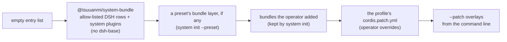

# Plugin model

> Target state. Decisions: [ADR-0007](../decisions/adr/0007-everything-is-a-plugin.md),
> [ADR-0036](../decisions/adr/0036-guarantee-core-and-capability-plugins.md) (guarantee core and
> capability plugins),
> [ADR-0018](../decisions/adr/0018-build-on-dsh-core.md) (build on DSH core),
> [ADR-0019](../decisions/adr/0019-explicit-minimal-dsh-core.md) (only the DSH core rows we use).
> Invariants: [INV-10](invariants.md#inv-10-everything-is-a-plugin),
> [INV-11](invariants.md#inv-11-no-tool-lock-in).

`system` follows the **Everything Is A Plugin** philosophy of DeepSeek Harness, and is built
**on DSH core**. `system` is its own harness: a DSH bundle and profile that mounts only the DSH
core rows it uses (no `dsh-base`), running on the same plugin runtime,
[Cordis](../research/dsh-analysis.md). Every part of the product is a plugin, including the
store, the provider drivers, the router, the workflow engine, and each gateway. There is no
privileged core to patch. You extend `system` by mounting a plugin beside the others, and every
registration is an effect that unwinds when its plugin unloads.

Plugins are not all equal, though. A **guarantee seam** carries a correctness or safety
guarantee and belongs to one of six core components; a **capability seam** only carries
capability and belongs to one of eight plugin families
([core and plugin classes](#core-and-plugin-classes)). Both are ordinary plugins; what differs
is how their contracts may change and how they fail.

## Vocabulary

| Term | Meaning |
|---|---|
| **plugin** | a module with `apply(ctx, config)`, optional `inject`, and a validated `Config`, or a Cordis `Service` subclass |
| **service** | a stable `ctx.<key>` claimed by one plugin. Consumers find it by key, never by importing an implementation |
| **seam** | a swappable capability with three roles: a **definition** (an abstract `Service` class that owns the key and its vocabulary types), one or more **providers**, and one or more **consumers** |
| **library** | a plain module with no `apply` and no service, used for pure logic that has nothing to swap |
| **profile** | a named, ordered composition of bundles plus the operator's patch file |
| **bundle** | a distributable set of config rows and the plugins they mount |

## Seam catalog

Each architectural boundary in [components](components.md) is published as one or more seams.
Status is one word: **built**, **defined** (an abstract definition, a protocol, and a conformance
suite that a fake provider passes, with no real provider yet), **planned**, or **not planned**. Who injects what is generated
from the code in [packages](packages.md); this table names the roles.

| Layer | Seam (`ctx.*`) | Class | Status | Definition and providers | Main consumers |
|---|---|---|---|---|---|
| Kernel | `store` | core: ledger of record | built | `system-store` (`node:sqlite`, WAL) | every stateful plugin |
| Kernel | `artifacts` | core: ledger of record | built | `system-artifacts`: envelope, ids, lineage, schema validation, decisions. Contract 1.1: `list` takes an optional `newest` (newest first), an additive field; 1.2: an optional `outcome` (only decisions with that outcome), additive too | every producer of results or decisions |
| Kernel | `eventLog` | core: ledger of record | built | `system-event-log` (named so because Cordis owns `ctx.events`). Contract 1.1 adds the optional newest-first read (`order: 'desc'`, `beforeSeq`), additive ([ADR-0036](../decisions/adr/0036-guarantee-core-and-capability-plugins.md)): a reader takes the latest entries of a run or a type and pages back, never reading the log forward | append: workflow, turns, agent-workers (a run's `usage.unknown` fact among others), models, approvals, board (a review held for the operator, and its end), resources, the `digests` providers, browser-patchright, both website drivers, notify (its delivery outcomes); listen: profile-scientific-research, notify (a wake-up only); query: workflow (the request a Worker's deferred call waits on), report (attempts, remediation, batches, and digests in a period), notify (after its own cursor), mcp-server (`events`, and the health checks of usage the ledger could not count and of notifications), web-ui (the activity since a time and the live view, newest first) |
| Kernel | `leases` | core: work state machine | built | `Leases` in `system-board-core`, provided by `system-leases` (generations, fencing). Contract 1.1: `hold` aborts `lost` only on a positive loss, never on a renewal that merely failed ([ADR-0056](../decisions/adr/0056-a-failed-lease-renewal-is-not-a-lost-lease-and-death-needs-a-verdict.md)) | workflow, turns, agent-workers, models, board, the `digests` providers |
| Kernel | `credentials` | core: ledger of record (secrets) | built | definition: **DSH** `dsh-credentials`; provider: `system-credentials-vault` (encrypted at rest) | accounts, `llm-pi-ai` (route keys by reference), models (`model_key`), agent-workers (the key of agent account ids) |
| Provider runtime | `display` | plugin: Worker | built | `Display` in `system-provider-core`; `system-display-virtual` (Xvfb) | browser |
| Provider runtime | `browser` | plugin: Worker | built | `Browser` in `system-provider-core`; `system-browser-patchright` | turns, login |
| Provider runtime | `providers` | plugin: Worker | built | `ProviderRegistry` in `system-provider-core`; registry `system-providers`; drivers `provider-chatgpt-web`, `provider-gemini-web` register into it. Optional, a driver's `title` for people (ChatGPT, Gemini), which its Workers carry (`capability-descriptor@1.8`) for the roster's display name, never a routing input ([driver interface](../design/provider-turns.md#driver-interface)). A driver marks the site's own error after the send (`ProviderError.siteError`, optional; [a site's own error](../design/provider-turns.md#a-sites-own-error-after-the-send)). `checkAuth` takes an optional `{ save }`, the operator's Save's check in the login profile (additive, [driver interface](../design/provider-turns.md#driver-interface)) | turns, login |
| Provider runtime | `accounts` | plugin: Worker | built | `system-accounts` (records and grants in `ctx.credentials`) | turns, login |
| Provider runtime | `login` | plugin: Worker | built | `system-login`: login profiles, Save, remote login, credential sign-in | operators (MCP `account_*`), turns |
| Provider runtime | `turnReceipts` | core: runner | built | `system-turn-receipts` | turns |
| Capabilities | `turns` | plugin: Worker | built | `system-turns`: the `website` Worker source | `ctx.workers`, through the source it registers |
| Capabilities | `agentRuntimes` | plugin: Worker | built | `AgentRuntimes` in `system-agent-runtime-core`; registry `system-agent-runtimes`; providers `runtime-claude-agent-sdk`, `runtime-codex-sdk`, `runtime-acp`, `runtime-antigravity-cli`. A run may carry a per-tool-call gate (`RunSpec.toolGate`), asked (`askToolGate`: bounded, fail-closed) by a runtime that reports `gatesToolCalls` (Claude Code, Codex, and the Antigravity CLI on an agy version verified live) and refused by one that cannot (ACP, and the Antigravity CLI on any other version) ([tool gate](../design/agent-runtimes.md#tool-gate)). Optional, a provider's `title` for people, shown by the roster and the account listing, never a routing input ([seam contract](../design/agent-runtimes.md#seam-contract)). Optional for several accounts per runtime ([ADR-0051](../decisions/adr/0051-agent-accounts-are-enrolled-slots-identified-by-their-login.md)): `RunSpec.home` and `probe({ home })` (refused by a provider that does not report `homes`: ACP and the Antigravity CLI), `identity(home, key)` (a keyed hash of who is signed in, never the principal), `loginCommand(home)`, and the provider's own `home` ([agent accounts](../design/agent-runtimes.md#agent-accounts)); Codex and Claude Code run and probe in a named home and read identity on a pinned version, the Antigravity CLI gives its sign-in command and reads none ([identity readers](../design/agent-runtimes.md#identity-readers)). Optional for the liveness verdict (PROP-0013): `run`'s `RunObserver` (`onProcess`, `onActivity`), reported by Claude Code ([restart and liveness](../design/agent-runtimes.md#restart-and-liveness)). Optional for each account's quota ([ADR-0059](../decisions/adr/0059-quota-readings-from-each-accounts-own-usage-report.md)): `limits({ home }, signal)`, the account's own usage report as limit observations or `unreadable` (never a throw), read on a checked runtime version only, without a model turn, and asked through `readLimits` (bounded, fail-closed); Claude Code (`get_usage`), Codex (the app server's rate limits), and the Antigravity CLI (`/usage`) read it ([an account's usage report](../design/agent-runtimes.md#an-accounts-usage-report)) | agent-workers |
| Capabilities | `agentWorkers` | plugin: Worker | built | `system-agent-workers`: the `agents` Worker source; agent accounts in enrollment slots, quarantined unless verified, a quarantine saying what its reading found (`agent-account@1.1`, `enrollment` decisions; [enrollment](../design/agent-runtimes.md#enrollment-and-quarantine)), no slot taken for a runtime with no identity reader, each account tool's output checked before its change commits; Workers derived as account × role, with per-account concurrency, `load`, `reserve`, and pools, an account's display label for people (`assignments[].label`), and the move from hand-named rows ([account × role](../design/agent-runtimes.md#workers--account--role)); a read-only Worker configured `reviewMember` takes a `review` team member's steps, and only those ([review members](../design/agent-runtimes.md#review-members)); its source tells its runs' liveness, and the operator frees what a run that ended `unknown` holds (`agent_run_free`, [freeing what a run holds](../design/agent-runtimes.md#freeing-what-a-run-holds)), lists the run worktrees, and removes the finished ones (`agent_worktrees`, `agent_worktrees_remove`, [the operator's removal](../design/agent-runtimes.md#the-operators-removal-of-run-worktrees)); it lands an accepted result made in a worktree it holds (`land`: commit on the run's branch, merge on approval; [landing a worktree](../design/agent-runtimes.md#landing-a-worktree)); it starts a board task's next attempt's worktree from the tree the previous attempt left (`carry`; [carrying an earlier run's work](../design/agent-runtimes.md#carrying-an-earlier-runs-work); ADR-0061, accepted 2026-10-25, D59) | `ctx.workers`, through the source it registers; mcp-server (health) |
| Capabilities | `models` | plugin: Worker | built | `Models` in `system-models-core`; provider `system-models` over **DSH** `ctx.llm` (`llm`, `llm-pi-ai`) ([models](../design/models.md)) | the `models` Worker source in `system-models` |
| Routing | `workers` | core: gate (admission, acceptance); its routing policy is a decision input | built | `Workers` in `system-workers-core`; `system-workers`. A start names the `brief` its source renders its prompt from ([briefs](../design/workflow-engine.md#briefs)). The optional `sources()` gives how each Worker source answered its last read, silent or failed included, and on a silent read the optional `describing` while none of the source's describes has landed yet ([sources that do not answer](../design/routing.md#sources-that-do-not-answer)). A descriptor may name its `account` (`id`, `group`, `assigned` or `pooled`): under `assigned`, a Worker at its limit holds its work off its group's other accounts (check `assignment`), and a refusal for such limits carries `limitUntil` ([assigned accounts](../design/routing.md#assigned-accounts), [ADR-0052](../decisions/adr/0052-accounts-are-assigned-unless-pooling-is-recorded.md)). The optional `held(sessionId)` says, from the source that owns a session, why it takes no input now (blocked on an open approval request, a run unfinished or not known to be gone); a caller that cannot ask it gives the session no automated input ([held sessions](../design/agent-runtimes.md#held-sessions), [ADR-0056](../decisions/adr/0056-a-failed-lease-renewal-is-not-a-lost-lease-and-death-needs-a-verdict.md)). The optional `liveness(query)` tells, from every source that does, the runs whose liveness needs the operator's look (stalled, being looked at, or ended not known to be gone and holding what they ran in), and names a source that could not tell, never read as having none ([what the operator sees](../design/agent-runtimes.md#what-the-operator-sees)). The optional `land(step)` has the source that holds a workflow run's worktree commit an accepted result on its branch, or merge that branch on the operator's `merge` approval, at exact SHAs ([landing a worktree](../design/agent-runtimes.md#landing-a-worktree), [ADR-0060](../decisions/adr/0060-an-accepted-result-lands-on-the-operators-merge-approval.md)). The optional `changes(runId)` reads a workflow run's change in each worktree a source holds, read only and bounded, naming a source that could not read its own, never read as no change ([a run's change](../design/agent-runtimes.md#a-runs-change-for-the-operators-review)). The optional `carry(step)` has the source that holds an earlier workflow run's worktree commit that tree on its branch and cut a run's worktree at the same base holding it, only while it is exactly the subject given and the HEAD has not moved ([carrying an earlier run's work](../design/agent-runtimes.md#carrying-an-earlier-runs-work), [ADR-0061](../decisions/adr/0061-a-tasks-next-attempt-starts-from-the-work-its-previous-attempt-left.md)). The optional `check(step, signal)` has the source that holds a workflow run's worktree run the run's required checks (`tests`, `typecheck`, `lint`) on the exact tree its result is on, each `passed`, `failed`, or `error`, with the evidence it recorded; a source that throws is a `failed` refusal, never a check passed ([a run's checks](../design/agent-runtimes.md#a-runs-checks), [ADR-0063](../decisions/adr/0063-a-runs-required-checks-run-on-its-exact-result.md)). An execution's error may carry the optional `siteError`: its input was sent and the site answered it with its own error in place of an answer, as its source read on the execution's own page ([ADR-0062](../decisions/adr/0062-a-team-members-first-step-is-resent-once-after-a-sites-own-error.md)) The optional `candidates(requirement, options)` lists every Worker with the checks admission fails it on, as `route` judges it under the same lock, with the router's own order after tier, reserving nothing and recording no decision ([candidates](../design/routing.md#candidates-without-a-reservation), [ADR-0064](../decisions/adr/0064-system-starts-ready-work-under-the-dispatch-action-class.md)) | workflow (and `explain` reads `liveness`; landing calls `land`; a task's next attempt calls `carry`; a written result's acceptance calls `check`; the dispatch pass calls `candidates`), digests; profile-scientific-research adds acceptance contracts; mcp-server (health reads `sources()` and `liveness()`; the roster); web-ui (the roster; a review's change reads `changes`) |
| Routing | `egress` | core: gate | built | `Egress` in `system-workers-core`, provided by `system-egress`: classification policy and credential scan (INV-12) | turns, agent-workers, models, workflow |
| Orchestration | `workflow` | core: work state machine, runner; templates are the workflow family | built | `system-workflow`; templates through `ctx.workflow.template`. Contract 1.4 states a board task's budget (held to its lines on the ledger before each step, a spent one blocking the task with a funding request, none on its last attempt), a run's question, and `TASKS.md` in a run's own worktree ([ADR-0053](../decisions/adr/0053-workflow-contract-states-task-budget-question-and-tasks-file.md)). Contract 1.5 states accounts: under assigned accounts, a node refused only for their limits waits for the reset (recovery `wait`, bounded by `maxLimitWaitHours`, no attempt spent), and an unsent failure never moves to another account of its group ([ADR-0052](../decisions/adr/0052-accounts-are-assigned-unless-pooling-is-recorded.md)); a team member avoids every Worker on an account another member holds (the held Worker's `siblings`, and any Worker naming the same `account`), and is refused with the cause when that account cannot be told apart ([distinct accounts](../design/teams.md#distinct-accounts)). Contract 1.6: a board task's next attempt never resumes a session its Worker source holds (`ctx.workers.held`), and an automated wake waits until the session takes input ([ADR-0056](../decisions/adr/0056-a-failed-lease-renewal-is-not-a-lost-lease-and-death-needs-a-verdict.md)). Contract 1.7: `usage` takes an optional filter, runs by state whenever they started and by when their state changed, and a task start an optional `revision`, refused once the task moved, additive ([ADR-0036](../decisions/adr/0036-guarantee-core-and-capability-plugins.md), T127). Contract 1.8: a team member's first step that the site answered with its own error after the send (an execution's optional `error.siteError`) is resent once, in a new conversation of its session, as a recovery decision `resend`; nothing else sent is started again ([ADR-0062](../decisions/adr/0062-a-team-members-first-step-is-resent-once-after-a-sites-own-error.md), D60). Contract 1.9: the dispatch pass starts ready board tasks by itself under the action class `dispatch`, the Worker of a task's writing step chosen by the quota score among those `candidates` admits, one request per start bound to the task, its attempt, and the Worker, adopted after a crash and started exactly as approved; bounded per account, project, repository, in total, and open asks; `sweepDispatch`, `dispatchStatus`, `pauseDispatch`, `resumeDispatch`, MCP `dispatch_status` (client) and `dispatch_pause`, `dispatch_resume` (operator) ([dispatch](../design/workflow-engine.md#dispatch-starting-ready-work-by-itself), [ADR-0064](../decisions/adr/0064-system-starts-ready-work-under-the-dispatch-action-class.md), D61). Contract 1.10 (PROP-0014 D2): a task's run says who started it, dispatch starts by itself under a policy of `auto` or `notify`, within an hourly bound, and pauses per project. Contract 1.11 (PROP-0015 J1), additive ([ADR-0036](../decisions/adr/0036-guarantee-core-and-capability-plugins.md)): every dispatch choice names an advice decision as its input, and `setDispatchAdvisor` swaps in the [dispatch advisor](#seam-catalog) the choice is recorded beside, never changed by. Contract 1.12 (ADR-0037, T228), additive: the engine consumes the seam `dispatchAdvisor` (optional): a provider registered there is asked in place of the configured advisor, and one set through `setDispatchAdvisor`, now a thin path, in place of both | gateways, web-ui, profiles |
| Orchestration | `leadInbox` | plugin: surface | built | `system-lead-inbox`: a project's lead inbox, `lead-notice@1.0` records from recorded events, read by MCP `lead_inbox`, `system lead wait`, and the `/ui` Lead panel, pushed to the project's sinks ([the lead's inbox](../design/notifications.md#the-leads-inbox)) | web-ui |
| Orchestration | `workerSessions` | core: work state machine | built | `system-worker-sessions` ([design](../design/sessions-and-messaging.md)). Contract 1.1 adds the binding runtime `antigravity-cli` (`worker-session@1.1`; [ADR-0015](../decisions/adr/0015-worker-sessions-and-peer-messaging.md#amendment-2026-10-23-contract-11-names-the-antigravity-cli-runtime)) | workflow |
| Gateways | `mcp` | plugin: surface (its scope check is a gate rule) | built | `McpTools` in `system-gateway-core`; `system-mcp-server` (own: DSH has only an MCP client) | tool contributors: login, turns, workflow, worker-sessions, models, resources, approvals, board, report, the provider of `digests` that runs (`digest` or `digest-extractive`, the seam's own tools), and agent-workers (`account_enroll`, `account_remove`, `account_agents`, `account_migrate`, `agent_run_free`, `agent_worktrees`, and `agent_worktrees_remove`); mcp-server adds `status`, `roster`, `events`, `evidence`, `artifact`, and the operator's runtime switches `plugin` and `enforce` (over `ctx.pluginHost`). Each tool declares its scope, `operator` by default ([ADR-0023](../decisions/adr/0023-scoped-control-credentials.md)) |
| Kernel | `pluginHost` | core: plugin host | built | `PluginHost` in `system-plugin-host-core` ([plugin host](../design/plugin-host.md)): every plugin of the composition with the manifest its package declares (`plugin-manifest@1.x`), and each plugin's lifecycle state, every change recorded first as a `lifecycle` decision; Base records and automates nothing. Contract 1.1 adds the manifest check: each plugin a row mounts without a valid manifest its configuration allows, or with a consumed seam its providers' manifests do not satisfy, is recorded once as a `gate` decision, listed, and makes health down; the host cannot refuse the row ([ADR-0048](../decisions/adr/0048-the-plugin-host-checks-the-composition-at-start.md)). Contract 1.2 adds the operator's runtime switches, each optional: `rows`, `turn` (an optional row off or on in the running host, kept in the profile's patch), `enforcement`, `setEnforce`, and `enforced` (a mechanism's live enforce mode) ([turning a plugin off](#turning-a-plugin-off), [ADR-0078](../decisions/adr/0078-a-plugin-or-a-mechanism-is-turned-off-at-runtime.md)). Provider `system-plugin-host` (on `ctx.store`, the rows read from the DSH loader at start), its bundle row on | mcp-server (`status`) |
| Host | `webServer` | plugin: surface | built | **DSH** `dsh-host-webserver` (loopback) | mcp-server, gateway-anthropic, gateway-responses, web-ui |
| Routing | `resources` | core: resource ledger and metering | built | `Resources` in `system-resources-core` ([resources](../design/resources.md)): configured pools and their windows, limit readings, reservations before a run, deduplicated usage records from objective sources only; contract 1.1 adds pool templates and the optional `declare`, one pool per template and account a Worker source declares ([pool templates](../design/resources.md#pool-templates), [ADR-0052](../decisions/adr/0052-accounts-are-assigned-unless-pooling-is-recorded.md)); contract 1.2 adds the optional `quota()`, the operator's quota settings (the reserve of every window dispatched work never starts into, 20 % by default, D63; when a reading is stale), validated when the row loads ([quota settings](../design/resources.md#quota-settings), [ADR-0064](../decisions/adr/0064-system-starts-ready-work-under-the-dispatch-action-class.md)); contract 1.3: `record` takes `usage-record@1.1`, whose `partial` keeps a lower bound one, and a cap of its run's scope stays refused until a whole record ([ADR-0065](../decisions/adr/0065-a-cap-fails-closed-on-usage-the-ledger-could-not-count.md)); provider `system-resources` (on `ctx.store`) | agent-workers (reserve, record, observe, for a Worker with a pool; declares its ready assigned accounts), workers (routing by scarcity), workflow (run budgets; the dispatch pass reads `pools()` and `quota()`), surfaces (reports, health, MCP `resources_*`) |
| Routing | `approvals` | core: gate | built | `Approvals` in `system-approvals-core` ([approvals](../design/approvals.md)): the autonomy policy and one batched approval queue for every action that needs a person, expiry denying; provider `system-approvals` (on `ctx.store`, the policies from its configuration or from a change the operator approved in the queue, kept while that configuration is unchanged, MCP `approvals_*` with `approvals_decide` and `approvals_policy_propose` at operator scope). Contract 1.1 adds the optional `proposePolicy` and `policyChanges` ([a policy change](../design/approvals.md#a-policy-change), [ADR-0041](../decisions/adr/0041-policy-changes-through-the-approval-queue.md)). The provider may also propose one itself, never apply it: a commands line from repeated identical approvals, off unless configured ([the queue proposes a policy change](../design/approvals.md#the-queue-proposes-a-policy-change), [ADR-0050](../decisions/adr/0050-the-queue-proposes-a-policy-change-from-repeated-approvals.md)). Its vocabulary gains the action class `dispatch`, System starting a ready task's attempt by itself, not in `ALWAYS_ASK` ([a start System proposes](../design/approvals.md#a-start-system-proposes), [ADR-0064](../decisions/adr/0064-system-starts-ready-work-under-the-dispatch-action-class.md)) | board; web-ui (the operator's queue and policy page, optional); agent-workers (each run's tool gate, optional: none, and no tool call runs); workflow (optional: a remediation fix's gate asks it, an approved deferred call's session is continued, a written result's required checks are asked of it, a plain run that wrote records the checks still pending; none, and remediation waits for the operator's plan gate); surfaces |
| Orchestration | `dispatchAdvisor` (the dispatch advisor) | plugin: decision | built | `DispatchAdvisor` in `system-decision-core`, with the call every provider answers (`Advisor`), its vocabulary, and its conformance suite ([ADR-0037](../decisions/adr/0037-schema-and-protocol-first.md); [the dispatch advisor in shadow](../design/workflow-engine.md#the-dispatch-advisor-in-shadow), PROP-0015 J1); the package is where PROP-0002's `decisions` is planned too. Contract 1.0: asked once per dispatch choice, after the choice is made, with frozen features only (`dispatch-features@1`, D73) and an `AdvisorSignal` (not an `AbortSignal`: its stop listeners run inside a guard, so one that throws is recorded, never uncaught); it answers `dispatch-advice@1` (three probabilities per candidate alias under a pinned model version) or `unavailable` with why. Fails open: an error, a timeout, a malformed answer, or the hourly bound is recorded as `unavailable` and the choice stands; nothing it says changes a choice. Providers: none by default (`dispatch.advisor.provider` `none`); the workflow engine's `local` (a logistic regression fitted on this host's recorded outcomes) and `model` (a configured model Worker through `ctx.workers`), each only when configured; a plugin that provides `ctx.dispatchAdvisor`, asked in place of the configured one while it is registered; or one set through `ctx.workflow.setDispatchAdvisor`, the thin path, in place of both (workflow contract 1.12) | the dispatch pass (optional); the report (its calibration) |
| Orchestration | `landing` | core: gate | built | `Landing` in `system-landing-core` ([PROP-0017](../proposals/0017-github-front-door.md#one-landing-seam-two-providers) L0, [ADR-0037](../decisions/adr/0037-schema-and-protocol-first.md); [landing an accepted result](../design/workflow-engine.md#landing-an-accepted-result)), with the calls every provider answers (`LandingProvider`) and its conformance suite. Contract 1.0: what happens to an accepted result after its commit (and after ADR-0068's rebase and checks run again, which stay in the engine, the same for every provider): `prepare` gives the subject a `merge` approval binds and what an approval and a denial do, changing nothing; `land`, only on an approval of that exact subject, puts it on its target and reports the target's new head, or finds a landing done before (`already`) and never lands twice; a moved target or head, another subject (`unbound`), a dirty checkout, or a conflict is a typed refusal that changes nothing; `status` never says landed before it is, or says it cannot tell without acting (`unknown`). Provider: `system-landing-local` (its row on), today's local merge through `workers.land` in the operator's checkout ([ADR-0060](../decisions/adr/0060-an-accepted-result-lands-on-the-operators-merge-approval.md)), never a push. The engine consumes the definition only, and lands on the subject the approved request names, only while the provider in force prepares that same subject (else it asks again); with no provider registered, a landing waits, never landing some other way. A code host's provider is PROP-0017 G2's, and its own ADR | workflow (optional: each landing's merge request and merge) |
| Routing | `decisions` | plugin: decision | planned | typed decisions with probabilities for intake and routing ([PROP-0002](../proposals/0002-decision-assisted-routing.md)) | workers, workflow |
| Orchestration | `board` | core: work state machine | built | `Board` in `system-board-core` ([board](../design/board.md)): projects (charter, milestones, funding rounds) and board tasks across runs, with leases and expiring waits; contract 1.3 adds a spent budget's optional `unreleased`, the reservations its holder could not release, named in its funding request ([ADR-0054](../decisions/adr/0054-a-funding-request-names-the-holds-the-ledger-did-not-release.md)); provider `system-board` (store-backed, `board_*` MCP tools, projected to `TASKS.md`), its bundle row on, over the approval queue | workflow, surfaces, the lead through `board_*` tools |
| Orchestration | `digests` | plugin: digest | built | `Digests` in `system-digest-core` ([digests](../design/digests.md)): cited `digest@1.0` summaries of raw artifacts, every claim quote-checked against the artifact it cites, failing open, and the MCP tools `digests_*` every provider serves; contract 1.2: a request's optional `check`, run before it is recorded, through which `digests_request` checks its output; provider `system-digest` (on `ctx.store`, a read-only Worker on the economy tier through `ctx.workers`), its bundle row on; an alternative provider `system-digest-extractive` ([extractive-first](../design/digests.md#extractive-first): verbatim spans selected by code before the Worker writes), its row off, swapped in by configuration | the workflow engine (each board task's result, set on the task through the board's `attachDigest`); the lead, on request (`digests_request`); the report (the claims of the digests attached); it cooperates with the core by artifacts only |
| Orchestration | `experiments` | core: work state machine | defined | `Experiments` in `system-feedback-core` ([experiments](../design/experiments.md)): hypotheses and pre-registered experiments with their exact identity and structured fingerprint, the four registry answers each recorded as a `registration` decision, manual links, the evaluation engine's moves fenced by the evaluation that holds an experiment, and lessons whose applicability is computed when read; the fake `FakeExperiments` | the evaluation engine (`ctx.evaluations`); the `improve` template and MCP `experiments_*` (planned) |
| Orchestration | `evaluations` | core: gate | defined | `Evaluations` in `system-feedback-core` ([evaluations](../design/evaluations.md)): a pre-registered experiment run offline under its pins and seals as paired trials drawn from its seed, measured by collectors registered through `evaluations.collector` (the verification family) and by the resource ledger, analysed once at the horizon by the pinned statistics, and classified by the deterministic verdict rule as a `verdict` decision; it decides no promotion; the fake `FakeEvaluations` | the `improve` template (planned); collectors register into it |
| Capabilities | `context` | plugin: context | planned | context plugins attached to an agent Worker at launch (tool search, output filters, symbol retrieval), each with a manifest | agent-workers |
| Kernel | `knowledge` | plugin: knowledge | planned | indexing and retrieval over artifacts (full text, local embeddings, re-check dates) | intake, research templates |
| — | `website` (Website Core) | — | not planned | replaced by `ctx.turns` and the engine's request keys and result reuse | — |
| — | `exec` (local tools) | — | not planned | agent runtimes run commands inside their own sandbox | — |
| — | `teams` | — | not planned | the `team` option of workflow nodes, unrolled by the engine; members are Worker sessions ([teams](../design/teams.md)) | — |
| — | `profiles` | — | not planned | profile plugins contribute templates through `ctx.workflow.template` | — |
| — | `clientProtocols` (turn broker) | — | not planned | gateways are plain plugins that share the `gateway-turns` library ([ADR-0022](../decisions/adr/0022-text-protocol-tool-calls-for-website-models.md)) | — |

Gateways (`gateway-anthropic`, `gateway-responses`, `web-ui`, `report`, `notify`, the CLI) only consume services,
so they are plain plugins with no seam of their own. The two client-protocol gateways share
the library `gateway-turns`: the text tool protocol and threads bound to provider
conversations ([gateways](../design/gateways.md)). Every client endpoint, MCP included, shares
the request guard in the library part of `system-gateway-core`.

## Core and plugin classes

[ADR-0036](../decisions/adr/0036-guarantee-core-and-capability-plugins.md) classifies every
seam. A seam is a **guarantee seam** if a worse provider could make `system` incorrect (wrong
results, lost data, work done twice), unsafe (an unapproved irreversible action, leaked data),
or change every other component. Otherwise it is a **capability seam**: a worse provider only
makes `system` less efficient. The core decides *that* something happens; plugins decide *how*.
The `Class` column of the [seam catalog](#seam-catalog) gives each seam's class.

| Core component | Guarantees | Seams |
|---|---|---|
| ledger of record | append-only artifacts and events, provenance, every decision an artifact ([INV-13](invariants.md#inv-13-every-decision-is-an-artifact)) | `store`, `artifacts`, `eventLog`, `credentials` |
| work state machine | only valid, complete transitions; one writer per subject ([INV-15](invariants.md#inv-15-one-writer-per-subject)) | `workflow`, `workerSessions`, `leases`, `board`, `experiments` |
| runner | restart is reconciliation, not replay ([INV-4](invariants.md#inv-4-restart-is-reconciliation-not-replay)); everything is bounded ([INV-9](invariants.md#inv-9-everything-is-bounded)) | `workflow` (the engine), `turnReceipts` |
| gate | fail closed ([INV-2](invariants.md#inv-2-fail-closed)); explicit egress ([INV-12](invariants.md#inv-12-data-egress-is-explicit)); irreversible actions go to a person; acceptance needs verification | `egress`, `workers` (admission, acceptance), `approvals`, `evaluations`, `landing` |
| resource ledger and metering | numbers from objective sources (usage fields, invoices, limit notices), never model self-reports | `resources` |
| plugin host | a plugin sees only what its seam allows; a failing plugin cannot damage the core; every plugin declares a manifest, and each lifecycle change is a decision | the host: DSH core and Cordis, the `system` bundle, the [plugin rules](#plugin-rules), conformance suites; `pluginHost`: the manifests and the lifecycle record ([plugin host](../design/plugin-host.md)) |

| Plugin family | Contract | Seams and providers |
|---|---|---|
| Worker | takes a brief and artifact pointers; returns result artifacts with usage | Worker sources `turns`, `agentWorkers`, `models`, and `workers-fake` (scripted Workers for the `system-test` profile's canary, T323; off in the bundle); their runtimes `agentRuntimes`, `providers`, `browser`, `display`, `accounts`, `login`; the plugins that register into them: `runtime-claude-agent-sdk`, `runtime-codex-sdk`, `runtime-acp`, `runtime-antigravity-cli`, `provider-chatgpt-web`, `provider-gemini-web` |
| decision | takes state and typed questions; returns typed answers with probabilities | the routing policy inside `workers`; model healing in `ui-ops`; `dispatchAdvisor` (defined in `decision-core`; its providers `local` and `model` in the workflow engine); `decisions` (planned) |
| verification | takes an artifact and criteria; returns pass or fail with evidence | acceptance contracts registered through `workers.contract`; metric collectors and validators registered through `evaluations.collector`; quote checks and tallies in team review |
| digest | takes raw artifacts; returns a cited summary | `digests`: `system-digest` (on by default), `system-digest-extractive` (off, its alternative) |
| context | attached to a Worker at launch; reduces tokens entering context without changing results | `context` (planned) |
| workflow | template: job graph, team kind, milestones, default criteria | profiles through `workflow.template`: `profile-software-development`, `profile-scientific-research` |
| knowledge | indexing and retrieval over the ledger of record | `knowledge` (planned) |
| surface | reads from the core and presents it to the operator and the lead | `mcp`, `webServer`, `gateway-anthropic`, `gateway-responses`, `web-ui`, `report`, `notify` (out-of-band notices from the event log, its row off; [notifications](../design/notifications.md)), `lead-inbox` (a project's lead inbox from the event log, pushed to its sinks; [the lead's inbox](../design/notifications.md#the-leads-inbox)), the CLI |

Rules for the two classes:

1. **Dependencies.** A capability plugin depends on seam definitions, never on another plugin's
   implementation. Across families it cooperates only through the core, by artifacts or events.
   Within one family, providers may build on each other's seams.
2. **Failure.** Capability plugins fail open: a context or digest plugin that fails is bypassed
   and the event recorded; a decision plugin that fails yields the deterministic default for the
   work kind; a Worker that fails is reconciled by the runner. Guarantee seams fail closed. A
   verification plugin that fails means no automatic acceptance.
3. **Change.** A guarantee seam's contract changes only through an ADR, as an invariant does. A
   capability seam's contract changes through a versioned definition and its conformance suite.
4. **Alternatives.** A capability seam may have more than one provider package, each its own bundle
   row passing the seam's conformance suite at one contract: exactly one row is on by default, and
   the others are off, for the operator to swap in by configuration
   ([composition](#composition)). One provider runs at a time (INV-1): Cordis refuses a second
   registration of a service, so with two such rows on, the second to register does not start and
   health `plugins` is down, naming it. A guarantee seam has one provider; replacing it takes an
   ADR. `pnpm check:packages` and `pnpm check:manifests` hold both rules.

### Package classes

`pnpm check:deps` (run by `pnpm check`) holds the dependency rules (operator, 2026-10-27: plugins are
testable on their own and removable with System still working, so plugins depend only on the core, and
added plugins depend on each other as little as possible). This table is its one source: the check reads
it, and fails when a package is missing from it or named without existing. Each package is one class:

- **kernel**: the libraries, the host (`cli`, `system-bundle`), and the `*-core` seam definitions.
  Anyone may import a kernel package.
- **guarantee**: a provider of a guarantee seam, the [required rows](#required-and-optional-rows).
- **capability**, **surface**, **profile**: the optional rows.

The **family** is the seam a group of plugins registers into, where one may build on another's seam
(rule 1: "within one family providers may build on each other's seams"). Empty (`—`) means none.

| Class | Family | Packages |
|---|---|---|
| kernel | — | `libs`, `system-bundle`, `cli`, `ui-ops`, `gateway-turns`, `ledger-core`, `plugin-host-core`, `provider-core`, `workers-core`, `approvals-core`, `resources-core`, `board-core`, `digest-core`, `decision-core`, `landing-core`, `feedback-core`, `models-core`, `gateway-core`, `agent-runtime-core` |
| guarantee | — | `credentials-vault`, `store`, `event-log`, `leases`, `artifacts`, `plugin-host`, `resources`, `approvals`, `turn-receipts`, `egress`, `workers`, `worker-sessions`, `landing-local`, `workflow`, `board` |
| capability | agent-runtimes | `agent-runtimes`, `runtime-claude-agent-sdk`, `runtime-codex-sdk`, `runtime-acp`, `runtime-antigravity-cli` |
| capability | web-providers | `providers`, `provider-chatgpt-web`, `provider-gemini-web` |
| capability | digests | `digest`, `digest-extractive` |
| capability | — | `display-virtual`, `browser-patchright`, `accounts`, `login`, `turns`, `workers-fake`, `agent-workers`, `models` |
| surface | — | `lead-inbox`, `report`, `notify`, `gateway-anthropic`, `gateway-responses`, `web-ui`, `mcp-server` |
| profile | — | `profile-software-development`, `profile-scientific-research` |

The check reads each package's imports from its `src/` (tests excluded), type and value apart (`import
type`, a list of only `type` specifiers, `export type … from`, and `import('x').T` are type), and refuses:

1. `guarantee-provider`: any import of a guarantee provider's package by another package. A seam's
   definition lives in a `*-core` package and the consumer imports that. Some definitions still live in
   their provider (`leases`, `egress`, `turn-receipts`, `worker-sessions`, `workflow`); an import of one
   is a violation, in the baseline, until the definition moves to a `*-core`.
2. `plugin-to-plugin`: a plugin importing another plugin's package, type or value, unless both are in one
   family of the table. Plugins cooperate through the core, by a seam, an artifact, or an event.

`scripts/dependency-baseline.json` lists today's violations, one `from -> to [rule]` per package pair. It
may only shrink: a violation it lacks fails the check, naming the import and the rule, and a line that is
no longer a violation is stale and fails too (`pnpm check:deps --shrink` drops it). To fix a violation,
move the definition to a `*-core` package or reach the seam through `ctx`; to allow one, change this
table in a change the review reads. `pnpm gen:deps` writes the layers, the edges by kind and the counts to
[dependency-graph](dependency-graph.md), and the check holds it up to date.

## Required and optional rows

The `system` bundle's rows, split by the `Class` column of the [seam catalog](#seam-catalog)
(operator, 2026-10-27: "when a plugin is removed, System still works normally"). A **required**
row provides a guarantee seam, or is the host the rows mount on; with one off, System is not the
product it promises, and the plugin host and each consumer say so. An **optional** row provides a
capability or a surface (or a driver, runtime, or profile that registers into one): turn it off, by
disabling its row, and System still works. What the row did is then absent, and what needs it
says so: a request that needs the removed row's seam fails with the reason that the seam is not
mounted, never with a crash, a hang, or a health check that is down. The
[removability matrix](../engineering/testing.md#removability-matrix) holds this, one row at a time,
and reads the two lists below (one row id per backtick; a new bundle row is in exactly one, or the
matrix fails).

- **Required** rows (the host, and the guarantee seams): `timer`, `webserver` (the DSH host every
  surface mounts on), `credentials`, `store`, `event-log`, `leases`, `artifacts`, `plugin-host`,
  `resources`, `approvals`, `turn-receipts`, `egress`, `workers`, `worker-sessions`, `landing-local`,
  `workflow`, `board`.
- **Optional** rows (capability and surface): `lead-inbox`, `display`, `browser`, `providers`,
  `provider-chatgpt-web`, `provider-gemini-web`, `accounts`, `login`, `turns`, `workers-fake`, `agent-runtimes`,
  `runtime-claude-agent-sdk`, `runtime-codex-sdk`, `runtime-acp`, `runtime-antigravity-cli`,
  `agent-workers`, `llm`, `llm-pi-ai`, `models`, `digest`, `digest-extractive`, `report`, `notify`,
  `profile-software-development`, `profile-scientific-research`, `gateway-anthropic`,
  `gateway-responses`, `web-ui`, `mcp-server`.

`mcp-server` is optional as a surface: with it off there is no MCP endpoint, so the matrix reads
health from the host and runs work through the engine directly. A required row that happens to
tolerate its own absence (the board, the landing) makes no promise by it.

The plugin host tells the two apart by the same rule at run time: a row whose plugin's manifest
declares a core class is required, one of a plugin family optional, and one with no manifest
required unless the `plugin-host` row names its package in `optionalWithoutManifest` (the bundle
names `llm` and `llm-pi-ai`). The removability spec holds the host's answer to these two lists.

## Turning a plugin off

Operator, 2026-10-27 (D108): "if something is not right, just turn it off as DSH plugins do; with it
off System still works, without many restarts." Two switches do it, neither needing a restart or a
code change ([ADR-0078](../decisions/adr/0078-a-plugin-or-a-mechanism-is-turned-off-at-runtime.md)):

- **A row.** `system plugin off <row> [reason]` and `system plugin on <row>` (MCP `plugin`,
  operator). The plugin host records the turn as a `lifecycle` decision with the reason first, then
  turns the row in the DSH loader of the running daemon: its plugin is disposed, and the turn waits,
  within `quiesceSeconds`, until its disposers ran, each finishing or handing back its in-flight work
  as its seam says (plugin rule 3); on, until it applied. Then the row's `disabled` is written into
  the profile's patch, so a restart keeps it. A required row, an unknown one, and a patch the host
  cannot edit by lines are refused before anything is recorded; a plugin that does not stop within
  the bound is put back, and a decision chained to the turn's records that it did not complete.
  So is a row whose plugin serves the switches themselves (it provides `ctx.mcp`: `mcp-server`): a
  switch never removes its own control surface, since nothing could turn it on again; its patch turns
  it off, with a restart.
  `system plugin list` shows each row on or off, required or optional, and its last turn with why.
- **A mechanism.** A gate-like mechanism has an enforce switch, `on` (it refuses), `warn` (it records
  what it would refuse and lets it through), or `off` (it does not run), as far as it takes that mode.
  Its owning row's `enforce.<key>` gives its start value; `system enforce set <mechanism> <mode>`
  (MCP `enforce`) sets a live override the plugin host keeps, recorded as a `gate` decision, and the
  mechanism reads it at each use. The mechanisms and the modes each takes are `MECHANISMS` in the
  libs: `evidence-gate` (off, warn, on), `handbook-bound` (warn, on; `handbook.enabled: false` gives
  no slice at all), `review-guides` (off, on), and `lead-rights` (on only: every refusal is a bound
  of authority, INV-6; revoke the lead's token instead). Red-on-base is not built yet: it lands
  behind such a switch.

**The rule for a new mechanism** (its check: the review; no automated check yet):

1. It lands as an optional row (its bundle row off, or on with nothing depending on it), or behind
   an enforce switch whose default is `off` or `warn`.
2. It moves to `on` only after **7 days** clean: no refusal it recorded in warn that the operator
   judged wrong. The number is the operator's (D108) and lives here until the autonomy policy has a
   field for it.
3. Turning it off never breaks System: the removability matrix turns every optional row off and on
   again at run time and smokes after each turn, and a mechanism off or in warn refuses nothing.

## What is not a plugin

A plugin exists only when something can really be swapped or scoped. These stay **libraries**:
canonical JSON and hashing, the pure reconciliation decision function and the liveness verdict
(`livenessOf`, pinned by version), the failure-class
taxonomy, the timeout and deadline primitives, the per-account scheduler, the UI engine, the
evaluation engine's statistics (pinned by version in each experiment), and the record schemas.
These pieces have exactly one correct answer per process, and turning them
into services would make the kernel "know too much".

A plugin that registers only event listeners, such as a policy hook, is a plugin but not a
seam.

## DSH core reuse map

This table is the canonical **allow-list of DSH rows** that `system` mounts. The `system` bundle
inserts exactly the **mounted** rows. It does **not** use `dsh-base`, which mounts 94 rows
([ADR-0019](../decisions/adr/0019-explicit-minimal-dsh-core.md)). DSH services reach `system`
domain plugins only through `system` seams or `system-dsh-*` adapter plugins (lock-in safeguard
1 of [ADR-0018](../decisions/adr/0018-build-on-dsh-core.md)). Adding a row updates this table
and the composition test that asserts the exact row set.

| Status | DSH row (package) | Serves | Notes |
|---|---|---|---|
| **mounted** | `timer` (`@deepseek-ai/cordis-plugin-timer`) | the Cordis `timer` service | no `system` plugin injects it ([packages](packages.md)) |
| **mounted** | `credentials` (`dsh-credentials` seam) | secrets for `ctx.accounts` | provided by `system-credentials-vault`; `dsh-credentials-local` (plain YAML) is not used in any composition |
| **mounted** | `webserver` (`dsh-host-webserver`) | `/mcp`, `/anthropic`, `/openai`, `/ui` | loopback `127.0.0.1:47317` |
| not mounted | `approval`, `user-questions` | — | plan approval is the engine's own `approval@1.0` artifact bound to the exact plan |
| not mounted | `attachments` (`dsh-attachment-local`) | — | depends on the native `sharp`, requires a display name, and is not an allow-listed row |
| **mounted** | `llm` (`dsh-llm`), `llm-pi-ai` (`dsh-llm-pi-ai`) | `ctx.llm` under `ctx.models` ([models](../design/models.md)) | need only `ctx.credentials`; no route until the operator configures one; a route's key is a credential reference resolved through the vault |
| not mounted | `llm-retry` | — | injects the agent loop and session log (`agents`, `sessionProjections`), never inserted, and retries agent-loop steps only; `models` bounds its own re-attempts by the route's retry policy |
| planned (optional) | `dsh-acp` | ACP editor client gateway | — |
| optional | `hmr` | development reloads | — |
| not mounted | `subprocess`, `sandbox`, `sandbox-policy`, `shell`/`fs` providers | — | no `exec` seam; agent runtimes run commands in their own sandbox. `agent-runtime-core` imports only the `dsh-subprocess` library function `scrubbedParentEnv` for agent child environments |
| not mounted | `dsh-web-app` rows, `dsh-client-ui-*` | — | needs `dsh-base`; the operator UI is the small `/ui` page of `system-web-ui` |
| not mounted | `dsh-subagent-claude-code`, `-codex`, `-acp` | — | one-shot, no resume or probe, sandbox not held exactly; `ctx.agentRuntimes` uses the official SDKs ([dependency register](../engineering/dependencies.md)) |
| **never inserted** | telemetry (`otel`, `session-telemetry-otel`), DeepSeek account and default-model rows, agent loop, session log, tools, compaction, goals, skills, web search, plugin manager, config editor | — | inserted only when a requirement asks for them |
| **avoided** (experimental) | agent teams, hook bridges, browser-use and computer-use providers, webhooks | — | — |
| **not provided by DSH** | — | everything else in the [seam catalog](#seam-catalog) | `system` builds it ([dependency register](../engineering/dependencies.md)) |

One exact DSH version is pinned for every row.

## Composition

`system` is launched as a DSH profile through the `system` CLI wrapper: `system start` runs
`dsh --profile system`. What runs is decided entirely by configuration:

A patch can insert rows, or target a row by `id` to replace its `config`, set `disabled`, or
change `inject` or `isolate`. A targeted patch replaces the whole config of that row and does
not deep-merge. Removing a capability means disabling its row. Deleting code is never required.

Examples:

- To drop a website, disable its driver row (`provider-gemini-web`).
- To run with no Worker that drives a website, `system init --preset api-first` adds the preset's
  bundle layer right after the system bundle; it disables those rows and both model gateways
  ([ADR-0025](../decisions/adr/0025-api-first-composition.md)). The operator's own patch stays
  as it is.
- To swap the browser engine, disable the `browser` row and insert another provider of
  `ctx.browser`.
- To replace the digest provider, turn the `digest` row off and the `digest-extractive` row on in
  one patch ([swap the digest provider](../operations/runbooks.md#swap-the-digest-provider)). No
  other row or file changes: its consumers reach `ctx.digests` through the definition, and the MCP
  tools are the seam's (Base exit criterion 6).
- To give part of the tree its own provider of a seam, mount it in an `isolate` scope. The
  parent scope is unaffected.

## Plugin rules

1. **Plugins, not core changes.** New behavior goes on a documented seam or event. A change to a
   seam definition updates this document and the seam's conformance suite.
2. **A seam is complete.** It is defined with all three roles: definition, provider, and
   consumer. A definition is an abstract `Service` class, not a bare TypeScript `interface`, so
   it can own its `ctx` key.
3. **Every registration has a disposer**, and disposal reaches quiescence. Nothing outlives its
   plugin.
4. **No hardcoded tunables.** Anything that varies by deployment is a validated `Config` field.
   Protocol constants, external specifications, and security invariants stay fixed in code.
5. **Events for interception and policy, service methods for direct calls.** An event's
   dispatch mode (`emit`, `waterfall`, `parallel`, `serial`, `bail`) is part of its public
   contract.
6. **Durable state lives in the store, not in service memory.** A plugin reload never loses
   committed state.
7. **Every seam ships a conformance suite.** Every provider, including fakes, passes the same
   suite ([testing](../engineering/testing.md)).

## Portability and exit path

`system` *is* a DSH bundle, so a DSH user can also mount `system` plugins in their own profile.
Moving off DSH is still possible, because every seam is defined by `system` and the runtime is
Cordis. It means replacing the `system-dsh-*` adapters and the composition root, while domain
plugins stay unchanged. Claude Code and Codex reach `system` through protocols (MCP and the
Responses and Messages gateways), so they are unaffected by the host choice
([INV-11](invariants.md#inv-11-no-tool-lock-in)).

## Seam definitions and conformance

Every new seam ships, with its first provider, an abstract definition, schemas for its records
and payloads, a written protocol, and a conformance suite
([ADR-0037](../decisions/adr/0037-schema-and-protocol-first.md)). Older seams with one provider
may still be concrete services; the guarantee seams among them have suites in the plugin that
provides them, run against that provider, with the documented contract's known gaps baselined.
Suites written since ADR-0037 run through the
[conformance runner](../../packages/libs/conformance/runner.ts), modelled on
`@modelcontextprotocol/conformance`: scenarios with stable ids, each applying from one contract
version on; a provider pins the contract version it implements; known failures are a baseline
that fails the run once the scenario passes.
Consumers depend on definitions only.

| Seam | Definition (abstract `Service`) | Conformance suite | Providers that run it |
|---|---|---|---|
| `display` | `Display` in `@tsuuanmi/system-provider-core` | `provider-core/conformance/display.ts` | `display-virtual` (real Xvfb), the test fakes `KillableDisplay` and the file display (`fileDisplay`, one Xvfb per test file) |
| `browser` | `Browser<Page, Context>` in `@tsuuanmi/system-provider-core` (engine-neutral) | `provider-core/conformance/browser.ts` | `browser-patchright` |
| `providers` | `ProviderRegistry` in `@tsuuanmi/system-provider-core` | `provider-core/conformance/providers.ts` | `providers` |
| `mcp` | `McpTools` in `@tsuuanmi/system-gateway-core` | `gateway-core/conformance/mcp-tools.ts`, which also checks that a tool declaring no scope is listed to the operator only | `mcp-server` (listed through a real MCP client, per scope) |
| `workers` | `Workers` in `@tsuuanmi/system-workers-core` | `workers-core/conformance/workers.ts` | `workers` |
| `agentRuntimes` | `AgentRuntimes` in `@tsuuanmi/system-agent-runtime-core`, plus a provider suite, an identity suite, and a usage report suite | `agent-runtime-core/conformance/agent-runtimes.ts` | `agent-runtimes` (registry); `runtime-claude-agent-sdk`, `runtime-codex-sdk`, `runtime-acp`, `runtime-antigravity-cli` (against scripted streams, agents, and CLIs; the usage report suite by Claude Code, Codex, and the Antigravity CLI, against a scripted SDK, an app-server stand-in, and a scripted agy); the fake `FakeAgentRuntime` (scripted homes and reports), which also passes the identity and usage report suites |
| `models` | `Models` in `@tsuuanmi/system-models-core` | `models-core/conformance/models.ts` | the fake `FakeModels`; `models` (`LlmModels` over `llm` and `llm-pi-ai`, against a fake OpenAI-compatible server) |
| workflow templates | `ctx.workflow.template(name, nodes)` | `workflow/conformance/profiles.ts` | `profile-software-development`, `profile-scientific-research` |
| `approvals` | `Approvals` in `@tsuuanmi/system-approvals-core` | `approvals-core/conformance/approvals.ts` (contract 1.1) | `approvals` (store-backed), the fake `FakeApprovals` |
| `resources` | `Resources` in `@tsuuanmi/system-resources-core` | `resources-core/conformance/resources.ts` (contract 1.3) | `resources` (store-backed), the fake `FakeResources` |
| `board` | `Board` in `@tsuuanmi/system-board-core` | `board-core/conformance/board.ts` (contract 1.5, over any `ctx.approvals`) | `board` (over a real store, with `FakeApprovals` and with `approvals`), the fake `FakeBoard` |
| `digests` | `Digests` in `@tsuuanmi/system-digest-core` | `digest-core/conformance/digests.ts` (contract 1.2) | `digest` and `digest-extractive` (each over real routing, with the seam's scripted Worker), the fake `FakeDigests` |
| `pluginHost` | `PluginHost` in `@tsuuanmi/system-plugin-host-core` | `plugin-host-core/conformance/plugin-host.ts` (contract 1.2) | `plugin-host` (over a stub of the DSH loader and installed package directories), the fake `FakePluginHost` (at 1.1: it holds no loader, so no runtime switch) |
| `experiments` | `Experiments` in `@tsuuanmi/system-feedback-core` | `feedback-core/conformance/experiments.ts` (contract 1.0) | the fake `FakeExperiments` |
| `evaluations` | `Evaluations` in `@tsuuanmi/system-feedback-core` | `feedback-core/conformance/evaluations.ts` (contract 1.0, beside a `ctx.experiments`, over a `World` that stands for the live environment, the suite, and each trial's run) | the fake `FakeEvaluations` (over `FakeExperiments`) |
| `store` | `Store` in `@tsuuanmi/system-ledger-core` | `ledger-core/conformance/store.ts` (contract 1.0) | `store` |
| `eventLog` | `EventLog` in `@tsuuanmi/system-ledger-core` | `ledger-core/conformance/event-log.ts` (contract 1.1) | `event-log` |
| `artifacts` | `Artifacts` in `@tsuuanmi/system-ledger-core` | `ledger-core/conformance/artifacts.ts` (contract 1.2) | `artifacts` |
| `turnReceipts` | concrete `TurnReceipts` in `@tsuuanmi/system-turn-receipts` | `plugins/turn-receipts/conformance/turn-receipts.ts` (contract 1.0) | `turn-receipts` |
| `leases` | `Leases` in `@tsuuanmi/system-board-core` | `board-core/conformance/leases.ts` (contract 1.1) | `leases` |
| `egress` | `Egress` in `@tsuuanmi/system-workers-core` | `workers-core/conformance/egress.ts` (contract 1.0) | `egress` |
| `workerSessions` | concrete `WorkerSessions` in `@tsuuanmi/system-worker-sessions` | `plugins/worker-sessions/conformance/worker-sessions.ts` (contract 1.1) | `worker-sessions` |
| `workflow` | concrete `Workflow` in `@tsuuanmi/system-workflow` | `plugins/workflow/conformance/workflow.ts` (contract 1.12, over the store-backed `board`, `approvals`, and `resources`), beside the template suite `profiles.ts` | `workflow` |
| `landing` | `Landing` (and the calls `LandingProvider`) in `@tsuuanmi/system-landing-core` | `landing-core/conformance/landing.ts` (contract 1.0, over a `World`: the repository a provider lands in, read and moved from outside it; `MemoryRepository` is one in memory, with the local merge's semantics) | the fake `FakeLanding`; `landing-local`, as the provider of `ctx.landing` and as a plain call (`localLanding`), over a Worker source that merges in a `MemoryRepository` as the `agents` source does |
| `dispatchAdvisor` | `DispatchAdvisor` (and the call `Advisor`) in `@tsuuanmi/system-decision-core` | `decision-core/conformance/dispatch-advisor.ts` (contract 1.0, over a dispatch harness the test supplies; the workflow engine's is `plugins/workflow/conformance/advisor.ts`) | `local` (fitted, and with too few labelled attempts), `model` (over a scripted model Worker), and a fake whose advice opposes every choice, each set through `setDispatchAdvisor` and as the provider of `ctx.dispatchAdvisor`, in `workflow/tests/dispatch.spec.ts` |
