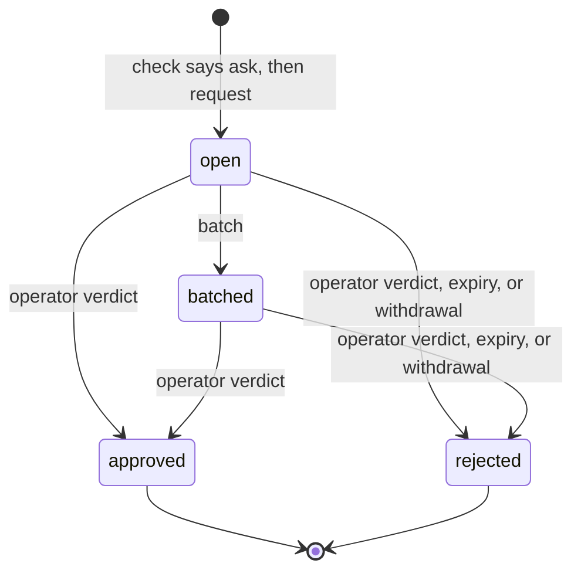
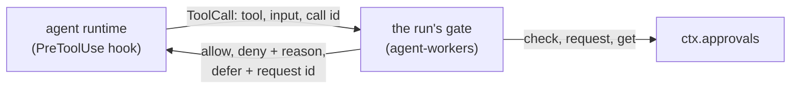

# Approvals

> Target state. Boundary: [routing](../architecture/components.md#routing), core component
> *gate* ([ADR-0036](../decisions/adr/0036-guarantee-core-and-capability-plugins.md)). Proposals:
> [PROP-0010](../proposals/0010-base-version.md),
> [PROP-0008](../proposals/0008-studio-operating-model.md#fewer-approvals-reliable-results).
> Records: [`autonomy-policy@1.0`](../reference/schemas.md#autonomy-policy),
> [`approval-request@1.1`](../reference/schemas.md#approval-request),
> [`policy-change@1.1`](../reference/schemas.md#policy-change); verdicts stay
> [`approval@1.0`](../reference/schemas.md#approval). Decisions:
> [ADR-0039](../decisions/adr/0039-base-guarantee-seam-contract-changes.md),
> [ADR-0041](../decisions/adr/0041-policy-changes-through-the-approval-queue.md),
> [ADR-0050](../decisions/adr/0050-the-queue-proposes-a-policy-change-from-repeated-approvals.md).
>
> Implemented in [`approvals`](../../packages/plugins/approvals/README.md) (definition
> [`approvals-core`](../../packages/approvals-core/README.md)); the operator's queue is on `/ui`
> ([`web-ui`](../../packages/plugins/web-ui/README.md), [API](../reference/web-ui.md)); a
> Worker's tool calls pass the gate of [`agent-workers`](../../packages/plugins/agent-workers/README.md),
> which [`runtime-claude-agent-sdk`](../../packages/plugins/runtime-claude-agent-sdk/README.md)
> compiles to a PreToolUse hook, and
> [`runtime-codex-sdk`](../../packages/plugins/runtime-codex-sdk/README.md) and
> [`runtime-antigravity-cli`](../../packages/plugins/runtime-antigravity-cli/README.md) ask through
> a command hook bridged to the run; a repository's worktree setup asks it too
> ([below](#a-worktrees-setup)). The [workflow engine](workflow-engine.md) consumes it too: a
> remediation fix's gate asks it ([remediation on the queue](workflow-engine.md#remediation-on-the-approval-queue)),
> an approved deferred call's session is continued
> ([a deferred tool call](workflow-engine.md#a-deferred-tool-call)), an accepted result's merge is
> asked as a `merge` request ([below](#a-landing)), a start its dispatch pass proposes as a
> `dispatch` request ([below](#a-start-system-proposes)), and a plain run that wrote
> records the checks still pending ([a plain run's acceptance](workflow-engine.md#a-plain-runs-acceptance)).
> Differs from target: with no queue loaded, remediation falls back to the operator's plan gate
> (`approval@1.0` by `approve`), and a planner's plan gate is still the operator's; a
> Worker's tool calls are judged under the studio policy only, since no trusted envelope names an
> agent run's project yet; a deferred agent run fails as `config_error`, since the workers seam
> has no waiting status, and only the workflow engine waits on the request and continues the
> session once approved (a board task's step waits in its live run, a plain run fails until then)
> ([below](#where-a-workers-gate-leaves-room)).

Every action that needs a person goes through one queue, in batches, and nothing else asks the
operator. The autonomy policy decides which actions those are; an action that is reversible and
verified runs without asking. Code decides, never a model.

## Seam

`ctx.approvals` (`Approvals` in `@tsuuanmi/system-approvals-core`), contract 1.1:

| Method | Does |
|---|---|
| `policy(projectId?)` | the studio policy, the project's, and the effective mode per action class; from 1.1, the set in force (`set`) |
| `check(action)` | classify one action; records an `autonomy` decision. Its `mode` is the mode once the required checks pass ([below](#a-verdict-is-not-yet-a-permission)) |
| `request(request)` | queue a request for an action the loaded policies still say `ask` for, as its recorded verdict says |
| `get`, `list` | read the queue |
| `batch(at)` | group open requests into batches by the policy's batch rule |
| `decide(verdicts)` | the operator's verdicts, each bound to its request's exact subject |
| `withdraw(requestId)` | close a request whose waiting work ended |
| `sweep(at)` | reject every request unanswered at `at`, then withdraw every open one the loaded policies no longer ask for |
| `proposePolicy(proposal)` | 1.1, optional: the operator's proposed record, asked as one `policy-change` request on the hash of the set it makes, applied only on approval ([below](#a-policy-change)) |
| `policyChanges(filter?)` | 1.1, optional: the policy changes, newest first |

`at` is a test seam, here and in `request`, `batch`, `decide`, and `withdraw`: the MCP tools, the
web UI, the board, and the queue's own passes fill it from the wall clock, and no core caller
passes another time. A provider trusts it: a caller that passed a time far ahead would make a
request that never expires (INV-9).

## The autonomy policy

| Mode | Effect |
|---|---|
| `auto` | the action runs and is recorded, once the rule's required checks pass |
| `notify` | the same, and the operator is shown it afterwards |
| `ask` | an approval request; the action waits for the verdict |
| `forbid` | denied |

- The effective mode is the strictest of the studio policy and the project's, which constrains
  only the classes it names. A class no rule names takes the stricter `default`, which is `ask`
  or `forbid`.
- Irreversible effects (`external-send`, `deploy`, `delete-data`, `spend`), the investor's
  decisions (`charter`, `funding`, `policy-change`), `remediation` (a fix that writes, or a
  lost run going on, waits for a person: the workflow's remediation gate and the board ask the
  queue about it), `promotion` (a plugin moved to `default` on an accepted evaluation, so the
  feedback loop never approves its own change:
  [ADR-0045](../decisions/adr/0045-feedback-loop-guarantee-seams.md)), and `merge` (a merge
  always asks the operator, D56:
  [ADR-0060](../decisions/adr/0060-an-accepted-result-lands-on-the-operators-merge-approval.md))
  are never `auto` or `notify` (`ALWAYS_ASK`).
  The schema refuses a policy that says so (for `remediation` and `merge`, which the schema
  predates, a load-time rule does), and the provider raises each of them to at least `ask`
  whatever a rule says.
- `dispatch` ([ADR-0064](../decisions/adr/0064-system-starts-ready-work-under-the-dispatch-action-class.md)):
  System starting a ready board task's attempt with no person or lead asking for it
  ([below](#a-start-system-proposes)). It is reversible (the run can be stopped, nothing lands
  without `merge`), so it is not in `ALWAYS_ASK`. A policy that names no rule for it takes its
  `default`: the bundle's studio policy names none and asks. Under `auto` or `notify` the dispatch
  pass asks the queue nothing: the queue's seam is unchanged, it is simply not asked (D2).
- A failed required check sends the action back to the lead as work, not to the operator. A
  check nobody reported is not a failure: the board holds such a review for the operator's own
  acceptance ([board](board.md#required-checks-bind-at-acceptance)).
- A wait for a person on a class lasts the shortest `expiresSeconds` of the rules that apply to
  it, else the stricter `expiry.defaultSeconds`, never more than the stricter `expiry.maxSeconds`
  (`waitSeconds` in `approvals-core`): a request's `expiresAt`, and a review the board holds for
  the operator.
- A `command` is judged by its exact argv. An argv equal, word for word and with nothing more,
  to a line on every applying commands list is judged as `workspace-write` (unless `command` is
  `forbid`); any other is the `command` class. An argv with a word that holds a shell
  metacharacter (`; & | $`, the backquote, `< > ( ) { } [ ] * ? ~`, quotes, backslash, newline,
  carriage return, tab, NUL) is `forbid`, whatever its class: argv is matched, never parsed by a
  shell. A list entry with an empty word or a metacharacter refuses its policy at load.
- On a Claude Code Worker the policy compiles to a PreToolUse hook: `forbid` → `deny`, `ask` →
  `defer`, `notify` and `auto` → `allow`. `canUseTool` is never the gate, because tools allowed by
  a rule or a permissive mode never reach it (B5). How a tool call becomes an action, and what a
  deferred call does, is [below](#a-workers-tool-calls).

### A verdict is not yet a permission

> **`mode` is the mode once the required checks pass.** `check` returns `auto` or `notify` for an
> action whose rule allows it, even when its required checks did not pass; `failedChecks` names
> those. A rule's `requires` are checks the **result** must pass before it is accepted, never
> preconditions of each step of the work that produces it:
>
> - A caller that **accepts or applies a result** (the board's `accept`, an acceptance gate)
>   passes the checks it ran (`action.checks`) and treats a non-empty `failedChecks` as **not yet
>   allowed**: a failed check is work for the lead, never a reason to accept the result or to ask
>   the operator. Such a caller that reads `mode` alone fails open. The workflow engine runs the
>   required checks that are commands on the result's exact tree first, and reports those
>   ([a run's required checks](workflow-engine.md#a-runs-required-checks)).
> - A caller that gates the work **while it runs** (a board task becoming ready, a Worker's tool
>   call) cannot have run them: it lets the work go on under `auto` or `notify`, records the
>   checks as pending (the `autonomy` decision's `failedChecks`, and its own record), and they
>   bind when the result is accepted
>   ([board](board.md#required-checks-bind-at-acceptance), [below](#a-workers-tool-calls)).
>
> Everything else still fails closed: `forbid` denies, `ask` waits for the operator, and a
> class no rule names takes the stricter `default`.

## A request

PROP-0010's sketch shows `expired` as a state before `rejected`. Here they are one transaction:
the request becomes `rejected` with cause `expired`, and the decision's outcome is
`denied:expired`.

| From → to | Who | Records | On failure |
|---|---|---|---|
| — → open | `request`, by a core component (board, workflow, a Worker's hook, resources) | the request, with the `autonomy` decision that said ask and `expiresAt`; an `approvals.requested` event (the request id, class, `expiresAt`, requester component, and project, never the summary, consequences, or command), which [notifications](notifications.md) read | refused (`not-asked`) unless the verdict cites an `autonomy` decision a policy made that says ask, of the policy the verdict names (the request takes its policy from the decision), under the project's policies as loaded now (each policy at its current version, the set's `decider.hash`), and judging the action again (its class, `command`, and project) says ask for the class the decision names; an invalid request, or a subject with no `version` (except an `artifact` subject by its `sha256:` id), is refused (`invalid`) |
| open → batched | `batch`, when the group (one per project) reaches `maxSize` or its oldest request waited `maxWaitSeconds` | `batchId`; an `approvals.batched` event | — |
| open or batched → approved | `decide`, from the operator's channel only: the queue on the web UI (`/ui`, operator token) or MCP `approvals_decide` (operator scope) | an `approval@1.0` artifact by `operator` on the request's subject, and an `approval` decision (`approved`) | a verdict for a changed subject, an expired or resolved request, or an unknown one is refused and changes nothing; one the provider cannot apply (an error) is refused as `failed`, logged; the other verdicts of the call apply. Through `approvals_decide` its output is checked before anything commits: the call's verdicts apply in one transaction, and an output its schema refuses (a defect) applies none of them |
| open or batched → rejected (verdict) | `decide` | the same, with `rejected` | as above |
| open or batched → rejected (expired) | `sweep`, at `expiresAt` | an `approval` decision `denied:expired` (decider rule `approvals.expiry`) | — |
| open or batched → rejected (withdrawn) | `withdraw`, by the requester, when its work ended | an `approval` decision `withdrawn` (decider rule `approvals.withdraw`) | a resolved request is returned unchanged |
| open or batched → rejected (policy changed) | the provider, at load and on every `sweep`, for an unexpired request whose policy is not current at its version, or whose class (and the class its decision judged it as) the loaded policies no longer ask for | an `approval` decision `withdrawn` (decider rule `approvals.policy`), its reason naming what changed | one that fails is logged and left for the next sweep |

Every resolution, by verdict, expiry, or withdrawal, also appends an `approvals.resolved` event in
its transaction (the request id, its state, cause, and option, naming the `approval` decision). The
event log is optional to the queue, and an append that fails is logged: the change stands.

A policy change takes effect through a `policy-change` approval while `system` runs
([below](#a-policy-change)), or by configuration at a start
([the configuration and the stored set](#the-configuration-and-the-stored-set)). Either way, open
requests are judged again under the new set. Cause `withdrawn` covers it, and
the resolution's decision tells it from the requester's own withdrawal by its decider rule
(`approvals.policy`, not `approvals.withdraw`). The requester sees its request rejected with no
verdict and puts the action to the new policy again:

- The board does so on its next sweep, as a fresh gate
  ([board](board.md#where-the-tables-leave-room)). A task waiting for approval becomes ready when
  the new policy gives its class `auto` or `notify`, waits on one new request on the same exact
  subject when it still says `ask`, and is cancelled (`forbidden`) on `forbid`. A spent budget or
  a lost run asks again on `ask` and otherwise waits for input, since it goes on only with a
  person. A charter is asked about again, or refused (a first charter abandons its project, an
  amendment is dropped) when no request can be opened. A request the board withdrew itself
  changes nothing there.
- A Worker's deferred call is denied when its session runs it again, as for any withdrawn
  request, and nothing new is queued for that call ([below](#a-deferred-call)). A board task's
  step waiting on it ends its attempt when the new policy forbids the call's class, and otherwise
  continues its session once, told the call was denied; a run outside the board continues nothing.
- A workflow run's remediation gate closes (`plan_rejected`), and the fix does not run;
  `continue` puts the plan to the policy loaded now on a new request
  ([remediation on the queue](workflow-engine.md#remediation-on-the-approval-queue)).

### Where the tables leave room

The store-backed provider settles these cases so that the [fail-closed rules](#fail-closed-rules)
hold. The fake provider does not check them, and the suite does not test them.

- A batch holds at most the batch rule's `maxSize` requests, oldest first: a group with more
  open requests makes several batches, and only its last, smaller one waits for
  `maxWaitSeconds`. An open request already expired is not batched; the sweep rejects it.
- The batch rule of a project's requests is the first policy's that names one, the studio's
  first; with none, each request is its own batch at once. At load, a batch rule whose
  `maxWaitSeconds` is not under the shortest expiry a request it batches can get is refused: a
  lone request would expire before the operator is shown it.
- A malformed verdict, or a named request whose stored record fails its schema, refuses the
  whole `decide` call before any verdict applies.
- At load, two policies with one id, or two for one project, are refused too.
- Withdrawal on a policy change needs the request's classes: its own, and the class its
  decision judged it as. A listed command's argv is not kept, so its request is withdrawn
  unless both `command` and the class it was judged as still ask.
- The queue sweeps, then batches, once at start and every `sweepSeconds` (1 to 3600, never off);
  nothing else calls them in production.
- A withdrawn request is not a verdict. A request the requester withdrew itself changes nothing
  more; one the queue withdrew on a policy change is put to the new policy again by the board on
  its next sweep ([above](#a-request)), while a Worker's gate denies the same call again in that
  session ([a deferred call](#a-deferred-call)).

## A Worker's tool calls

Every tool call of an agent run passes the run's gate before it runs. The boundary:

- **The contract** is runtime-neutral, in
  [`agent-runtime-core`](../../packages/agent-runtime-core/README.md): `RunSpec.toolGate`, given
  the tool's name and input, answers `allow`, `deny` with a reason, or `defer` with a reason and
  the request id. A runtime that can ask it before every tool call reports `gatesToolCalls`; the
  `agents` source admits no Worker whose runtime does not, and such a runtime refuses a run that
  carries a gate. The runtime plugin never reads `ctx.approvals`: the source that owns runs builds
  each run's gate from it.
- **On Claude Code** the gate is one PreToolUse hook with no matcher: every tool, subagents'
  included. `deny` and `defer` are the hook's own decisions, which hold in every permission
  mode. `allow` returns no decision: a hook's `allow` would skip the workspace-scoped
  pre-approvals, so the runtime's own policy still decides, and a call outside the workspace
  stays refused. A gate that throws, answers with an unknown verdict, or takes longer than 30 s
  is a deny.
- **On Codex** the gate is one PreToolUse hook on every tool (`*`), a command Codex runs, which
  reaches the run's gate through a private channel of the run
  ([Codex's gate](agent-runtimes.md#codexs-gate)). `deny` and `defer` block the call with the
  reason; `allow` prints no decision, so Codex's own sandbox still decides. The hook blocks on any
  failure of its own, since Codex runs the tool when a hook fails, and the probe proves the hook
  answers before a tool call on the host before any Codex Worker is admitted.
- **On the Antigravity CLI** the hook is a command agy runs before each tool call, which the
  runtime bridges to the run (a socket in an owner-only directory, a per-run token; any failure
  on the way is a deny). The runtime's own rules come first, since agy has no workspace-scoped
  permission of its own; then the gate, bounded the same way. `allow` is the hook's allow (the
  rules already held the call to the workspace); `deny` its deny; `defer` is a deny too (agy
  cannot wait on a call), and the run ends there as above. agy runs the tool when a hook exits 0
  printing nothing, so the hook's command prints a deny itself whenever the run's hook gives no
  answer. The runtime gates only on an agy version a supervised live check verified, whose tool
  names are in the table below
  ([ADR-0043](../decisions/adr/0043-antigravity-cli-workers-gated-on-a-version-verified-live.md),
  [its README](../../packages/plugins/runtime-antigravity-cli/README.md)).

### How a call is classified

By code, from the tool's name and input only, never by a model's judgment; a call the table does
not cover is denied. The table is keyed by the tool names the runtimes report: Claude Code's
built-in tools, Codex's as its hook reports them (Codex 0.164), and the Antigravity CLI's as its
hook reports them (agy 1.4.6 with `gemini-3.8-flash`, recorded in a supervised live check). Each
tool in the table takes only the input fields its Claude Agent SDK type declares (`MultiEdit`,
`NotebookRead`, and `LS`, which the SDK no longer declares, their last published shapes), or
Codex's or agy's hook reports, each of its declared type: an unknown field, or a known one of
another type, is denied, its reason naming the field.

| Tool | Action |
|---|---|
| `Read`, `NotebookRead`, `LS`, `Glob`, `Grep`, `view_image` | `read`, for a path inside the run's workspace (absent for `Glob` and `Grep`: the workspace); a `Glob` pattern whose literal leading directory is outside it, or that climbs with `..`, is denied |
| `mcp__workspace__read_file`, `mcp__workspace__list_dir`, `mcp__workspace__search` | `read`: the three tools of System's own [workspace reads server](agent-runtimes.md#the-workspace-reads-server) (T200b), which run no program, only for a run whose runtime reports it gives its agent that server (`workspaceReads`; elsewhere every `mcp__workspace__…` tool is denied, `unclassified-tool`); for the `path` they name inside the workspace (absent or empty for `list_dir` and `search`: the workspace), with no `..` segment and not in git's own data. Their other fields are the server's own: `read_file`'s `startLine` and `endLine` (numbers), `search`'s `pattern` (text) and `regex` and `ignoreCase` (booleans). Any other tool of that server (`mcp__workspace__…`) is denied by name (`unclassified-tool`); a `..` segment is `outside-workspace`, git's data `git-data` |
| `read_file` | `read`, for the file `Path` names inside the workspace; its other fields are `StartLine`, `EndLine`, and `ByteOffset` (numbers) |
| `Write`, `Edit`, `MultiEdit`, `NotebookEdit` | `workspace-write`, for a file inside the workspace; outside it is denied (and refused by the runtime), and so is a file in git's own data (`.git` anywhere in its path, as written or on disk; the same for `write_file`, `edit_file`, and `apply_patch`), whose configuration a git command would run |
| `write_file`, `edit_file` | `workspace-write`, for the file `Path` names inside the workspace; `write_file`'s other fields are `Content` (text), `Append`, and `Overwrite` (booleans), `edit_file`'s `Target` and `Replacement` (text); `ArtifactMetadata`, which writes one of agy's own artifacts, is denied |
| `apply_patch` | `workspace-write`, when its patch (`command`) reads strictly in the patch grammar (`*** Begin Patch`; `Add File` with `+` lines, `Delete File`, `Update File` with an optional `Move to`, `@@`, ` `, `+`, `-`, and empty lines, and `*** End of File`; `*** End Patch`) and every file a header names (added, deleted, updated, or moved to) is inside the workspace; a `***` line the grammar does not allow where it stands, a carriage return, or a name with surrounding spaces denies the whole patch |
| `Bash` | Only where the run's runtime itself starts every call's shell non-login and non-interactive, with no startup file or startup variable, in a shell the agent cannot choose (`cleanShells`, [agent runtimes](agent-runtimes.md#an-agents-shells-read-no-startup-code), T198), can a `Bash` call be a `read`: elsewhere a function or an alias a startup file defined, or a shell the call picked, could run in place of the program a word names, so each of the forms below is the `command` it is. Neither Codex (each call picks its shell and login mode) nor Claude Code (each command sources its shell snapshot) enforces it, so under both every `Bash` call is a `command`. Under a runtime that does: `read`, for a probe that can do nothing: `echo` with zero or more words (any word, `-e` and `-n` included), `pwd` with no argument, `true`, and `false`, each a shell builtin that reads no file and changes nothing (with no metacharacter it only prints its words, the working directory's name, or nothing), so a Worker's probe never waits on the operator; any argument to `pwd`, `true`, or `false` leaves it `command`. `read` also for a fixed read-only inspection command inside the workspace, each word matched exactly ([Codex's gate](agent-runtimes.md#codexs-gate): `cat`, `head`, `tail`, `wc`, `ls`, `stat`, `file`, `sed -n <range>p`, `rg`, `grep`, and `find` without actions, every path absolute and at least one named, since the gate does not see the directory a command runs in; a relative path, a form with no path, and `git` stay `command`); otherwise `command`, its argv the command split on single spaces, so the [exact-argv rule](#the-autonomy-policy) applies as written: a listed argv is judged as `workspace-write`. A word with a shell metacharacter (the policy's own set, `SHELL_METACHARACTER`), or an empty word (a doubled, leading, or trailing space), is denied by the gate before the policy is asked; the policy forbids the former too. Its input fields are `command`, `description`, `timeout`, and `run_in_background`: `dangerouslyDisableSandbox` is denied. Codex reports its `exec_command` as `Bash` with `command` alone |
| `WebFetch`, `WebSearch` | `external-send`, which always asks |
| any other tool (the Antigravity CLI's `run_command` among them: no confinement of its commands is proven), or an input that is not an object | denied by the gate's own rule |

A path is inside the workspace when it is both as written and on disk: its real location, every
symlink followed and `..` resolved on disk, is inside the workspace's real path. A path that does
not exist yet (a write target) is placed by its deepest existing ancestor's real path, the rest
appended, which must hold no `..`; a path that cannot be resolved (a dangling symlink, a loop, a
permission error) is not inside, and a home path (`~`) never is. A `file:` URI is the path it
names, checked the same way; one that names no local path (another host, an encoded slash) is
not inside. A symlink created after the
check is [the runtime's confinement's to bound](#where-a-workers-gate-leaves-room). The runtime's
pre-approvals still bind each tool to the workspace on disk.

### What each verdict does

`check` judges the action under the studio policy, and records the `autonomy` decision.

| Verdict | The call | Recorded |
|---|---|---|
| `forbid` | denied; the agent is told the decision's reason | the `autonomy` decision |
| `auto` | allowed | the `autonomy` decision |
| `notify` | allowed, and an `agent-workers.tool.notified` event names the decision, the run, and the tool: the operator reads it in the event log (MCP `events` by type) and the decision itself (`system explain <decision>`, MCP `artifact`) | the `autonomy` decision |
| `auto` or `notify` with `failedChecks` | allowed: the rule's required checks are the result's, and no tool call carries them ([a verdict is not yet a permission](#a-verdict-is-not-yet-a-permission)). They stay pending, and bind when the result is accepted. The first such call of a class in a run appends `agent-workers.tool.checks-pending` naming them (a `notify` event names them too); a pending check that no rule can require is a deny | the `autonomy` decision, its `failedChecks` the pending checks |
| `ask` | one approval request on the exact call, then `defer` | the `autonomy` decision, then the request |

A gate outcome the policy did not give (no `ctx.approvals`, a call the gate does not classify, a
run that already stopped, an `ask` in a run with no session, a gate that failed) is a deny,
recorded as a `gate` decision of rule `agent-workers.tool-gate`. A denied or deferred call also
appends an `agent-workers.tool.denied` or `agent-workers.tool.deferred` event; events carry
ids, never the call's input.

### Why a call was denied

Every `agent-workers.tool.denied` event says why (T207), so a denial that repeats is seen and its
cause fixed rather than asked again. Its data adds, to the agent run, the Worker, and the tool:
`reason`, a stable code; `explanation`, the code's fixed plain sentence (at most 300 characters,
never the call's input: the agent's own reason and the decision name the path or command);
`workerKind`, the Worker's runtime; `actionClass`, once the call was classified; and `decision`,
the decision behind it, also on the entry itself. A `gate` decision's outcome detail names the
code too. The codes ([events reference](../reference/schemas.md#event)):

| Code | The call |
|---|---|
| `metacharacter`, `empty-word` | a `Bash` word holds a shell metacharacter, or is empty; denied before the policy is asked |
| `outside-workspace` | names a path outside the workspace, as written or on disk, or a `Glob` pattern that reaches out |
| `git-data` | writes git's own data (`.git`), or reads it through the workspace reads server |
| `unclassified-tool` | a tool the gate does not classify (a workspace reads server tool under a runtime that gives no such server among them) |
| `unsupported-field` | an input field the gate does not classify, or one of another type |
| `invalid-input`, `invalid-patch` | an input that is no object or names nothing where it must; a patch outside the grammar |
| `policy-forbid` | the policy forbids its class |
| `not-listed` | a command no line of the studio policy's commands list matches, under a policy that forbids every other command |
| `request-rejected`, `request-expired`, `request-withdrawn`, `workflow-denied` | its request for exactly this call was rejected, expired, or withdrawn, or the engine denied it: denied for good in its session |
| `request-mismatch`, `request-unreadable` | the request recorded for it is for another call, or cannot be read |
| `no-session`, `run-stopped`, `review-member`, `no-approvals` | an `ask` with no session to resume; a run already stopped at a deferred call; a review member's run; no queue |
| `unknown-checks`, `unknown-mode`, `gate-error` | a verdict the gate does not know, or a gate that failed |

A code is never renamed or reused; a new cause gets a new code. Health's `tool-denials` check
counts the denials of its window (`driftWindowHours`, default 24) by reason code per Worker kind
per UTC day, an event from before the codes as `unrecorded`; it is a notice, never degraded. The
event's data is declared by `agent-tool-event@1.0` (T211; [schemas](../reference/schemas.md#event)):
an entry that is not a valid denial (a code the schema does not list, an explanation past 300
characters, a field no denial carries) is counted apart, never by reason.

### A deferred call

- **The request** binds to the exact call (INV-5): subject `{ type: content, ref:
  agent-tool-call:<agent run>:<tool>, version: <content id of the canonical tool input> }`;
  requester `worker`, with the agent run, its session, and the runtime's call id
  (`toolUseId`); summary and consequences say what runs if it is approved, and that it is denied
  if rejected or unanswered. Its classification is the run's.
- **The run stops there.** The runtime runs no further tool call (each is denied) and ends the
  run, which fails as `config_error` naming the request, whatever the runtime reported: a
  deferred run never completes, and `config_error` is never retried. On Claude Code a `defer`
  ends the headless query with the call kept in the session's transcript. On Codex the call is
  blocked, its output in the thread naming the request, and the runtime stops Codex; in the later
  run the model makes the call again.
- **Resume.** The same session continues in a later run (by its native handle): the workflow
  engine starts it by itself once the request is approved, once per approval. A board task's step
  waits on the request in its live run meanwhile, a `command` call at most
  `deferredCommandMinutes` (default 10; 0 waits until the request expires), after which the engine
  withdraws the request and treats that call alone as denied. The bound is derived from the request
  (its class and creation): when the queue cannot be read as the step starts to wait,
  `gateTimeoutHours` bounds it, and the first read that finds the request applies the bound after
  all, a second `wait` decision with `boundMinutes` and the bounded deadline on the node's row, in
  one transaction, so a restart keeps it and it is applied once (T209). A denied call (rejected, expired,
  withdrawn, unanswered past that bound or the request's expiry, whether or not the queue's sweep
  recorded the expiry yet, or approved only after that deadline) does not end the attempt: the
  session continues once, its brief saying the call was denied and why, and the gate denies that
  exact call there, so the agent's tool result is the denial and it works on without it. The
  attempt ends for the operator only when the policy now forbids the call's class or the session
  cannot resume ([a deferred tool call](workflow-engine.md#a-deferred-tool-call)).
- **A denied call stays denied in its session.** Before it allows any call, `auto` and `notify`
  included, the gate looks up the request it last opened for that exact call in that session: one
  rejected, expired, or withdrawn denies the call; and so does any request of the session for that
  call the engine denied. The engine keeps its denial on the gate's own row of the request (the
  `recovery` decision `deny` and its cause, written in the transaction that records the decision,
  through `ctx.agentWorkers.denyToolCall`; with nothing to keep it, the attempt ends instead), and
  the gate reads it from the store by session, never from the event log, whose retention may drop
  the `workflow.run.continued` event. So a policy change that lists the command, an approval given
  after the step's deadline, or a later attempt or chained task that continues the session in
  another workflow run never runs a call the session was told was denied, across restarts too. The hook
  runs again on the deferred call. The gate finds the request opened for that exact call in
  that session, and checks it in full before using it: subject type `content`, ref
  `agent-tool-call:<the agent run that opened it>:<tool>`, version the input's content id, the
  action class, and requester `worker` with that agent run and this session. Any difference is a
  deny, never a new request. While it is open, the call defers again on the same request, and nothing new is
  queued; approved, the call runs, once (the approval is then used, and the same call asks
  again); rejected, expired, or withdrawn, it is denied, and nothing new is queued. A different
  input is a different call, with a request of its own.
- **A run with no session** cannot be continued, so an `ask` there is denied, not deferred, and
  nothing is queued: the operator is never asked for an approval no run could use.
- **Asking less.** Every Worker but a review member (whose gate allows no call) is given, with
  every turn's prompt, one Tools section (T199, extended by T207) from its gate, its sandbox, its
  runtime's evidence, and the policy as it stands (`ctx.approvals.policy()`): its workspace path;
  under a runtime that gives its agent the
  [workspace reads server](agent-runtimes.md#the-workspace-reads-server) (T200b), to read with
  its `read_file`, `list_dir`, and `search`, never with a shell; for a read-only sandbox, that no
  tool call writes a file (it is then given no writing tool); the calls its gate lets run
  unasked, reading tools when `read` runs unasked (the workspace reads server's where the runtime
  gives it, else the runtime's own; and the read-only inspection commands of the table above
  only under a runtime that enforces clean shells, where the gate takes them for reads; elsewhere
  it says no `Bash` command is a read), writing tools when `workspace-write` does (never in a
  read-only sandbox), and the studio policy's commands list, its exact lines (at most 50 shown),
  when `workspace-write` runs unasked and `command` is not forbidden, whatever the sandbox, since
  the gate runs a listed command unasked in either (every command when `command` itself runs
  unasked), or that none runs unasked; that a word with a shell metacharacter or an empty word is
  refused, and that a relative path makes no command a read; and whether an approval resumes the
  step (the run has a session) or a call that would ask is denied at once (it has none). At most
  4,000 characters: the commands list is cut first, its rest counted. Nothing it names as
  unasked is a call the policy asks about now; the gate still judges every call. With no queue,
  or a policy that cannot be read, the prompt goes without it.
  For `Bash` the section follows the policy's rule that a command on the commands list is judged
  as `workspace-write`, unless `command` is forbidden, and any other command as `command` (T209):
  - `command` `auto` or `notify`: every other command runs unasked; when `workspace-write` does
    not, the listed commands are named as the exception (at most 50 lines);
  - `command` `ask`: the listed commands' exact lines (at most 50) when `workspace-write` runs
    unasked; any other command waits for the operator;
  - `command` `forbid`: no list; any other command is denied.

  With a list (and `command` not forbidden) it says that a listed command is judged as a workspace
  write, and what that does now: runs unasked, waits for the operator (so with `workspace-write`
  `ask` it still asks, even where other commands run unasked), or is denied; and under `command`
  `auto` or `notify` it never says that other commands wait.

### Where a Worker's gate leaves room

- **Symlinks after the check.** The gate resolves a path when the call comes. A symlink the
  agent creates or changes between that check and the tool's own open (by a `Bash` command, say),
  or one a recursive `Glob` or `Grep` walks into below the path it names, is not the gate's to
  see. The runtime's own confinement bounds it, which the gate does not replace: the host read
  confinement ([ADR-0024](../decisions/adr/0024-agent-workers-confined-for-reads.md)) and the
  SDK sandbox ([ADR-0038](../decisions/adr/0038-confined-commands-for-claude-code-workers.md)).
- **Project.** Every call is judged under the studio policy. A project policy only narrows it,
  so a project's stricter rule does not reach a Worker's tool calls until a trusted envelope
  (the run's `WorkerStart`) names the run's project.
- **Waiting.** The workers seam's statuses are `queued`, `running`, `completed`, and `failed`;
  a run that waits on the operator is `failed` (`config_error`, the request in its message). A
  waiting status would change that guarantee seam's contract.
- **The later run.** Whoever owns the work starts the run that continues the session; the gate
  does not. For a workflow run the engine does, once the request is approved: it reopens the node
  that deferred as a new attempt on the same session, at most once per approval, with a
  `recovery` decision ([a deferred tool call](workflow-engine.md#a-deferred-tool-call)). A board
  task's step waits on the request in its live run, so the task's attempt is not spent on the
  wait (a `command` call at most `deferredCommandMinutes`), and a denied call continues the
  session once, told so, a `recovery` decision `deny`; a run outside the board fails until the
  verdict, and a denial continues nothing there. When a board task's attempt ends without
  a verdict, the engine withdraws the requests its Workers left open, so none is left on a session
  no later attempt resumes. The engine finds the request from the gate's
  `agent-workers.tool.deferred` event and checks it through `ctx.approvals`, so `WorkerStart` and
  the workers seam stay as they are.
- **Where pending checks bind.** The bundle's studio policy gives `workspace-write` `auto` with
  `tests` and `lint` required, so a Claude Code Worker reads and writes inside its workspace,
  those checks pending. They bind at the board's acceptance of the task's result. Before it, the
  run runs those that are commands on the result's exact tree, with the commands the operator
  configured for the repository, and its acceptance reports each that ran to an exit code
  ([a run's required checks](workflow-engine.md#a-runs-required-checks)); a Worker's own account of
  a command never counts. A check sees the result read-only, so it cannot pass on code it swapped in
  for a while; one whose command was never executed (the exec itself tells), or a nonzero exit whose command reports its
  nested bubblewrap refused, is an infrastructure `error`, pending for the operator, never a failed
  check sent back as another attempt (any other nonzero exit is `failed`); and each check's outcome,
  even one a stop of the run came after or killed, is stored on its subject and reused, never run
  again to replace it ([a run's checks](agent-runtimes.md#a-runs-checks)). A run outside the board applies nothing, so they never block it: when it
  wrote, its completion records them as passed, failed, or pending on an `acceptance` decision
  (rule `workflow.run-acceptance`) for the operator to see
  ([a plain run's acceptance](workflow-engine.md#a-plain-runs-acceptance)), and they bind
  wherever its result is applied.

## A worktree's setup

A repository's [worktree setup](agent-runtimes.md#a-worktrees-setup)
([ADR-0058](../decisions/adr/0058-a-run-worktree-is-set-up-offline-before-its-agent-starts.md),
proposed) runs commands the operator declared in a workflow run's new worktree, before its agent
starts. The `agents` source judges each one as the gate judges a Worker's `Bash` call: `check` with
class `command` and the command's exact argv (its words split on single spaces), under the studio
policy.

| Verdict | The command | Recorded |
|---|---|---|
| `forbid` | the setup is refused, and the run fails at start | the `autonomy` decision, then the setup's `gate` decision (`refuse`) |
| `auto`, `notify` | runs; a rule's required checks stay pending, bound when the run's result is accepted (a pending check no rule can require refuses) | the `autonomy` decision, the setup's `gate` decision (`start`, naming them) |
| `ask` | one request for this command of this setup in this worktree; the run fails at start, waiting on it | the `autonomy` decision, the request, the setup's `gate` decision (`refuse`, naming the request) |

- **The request** binds to exactly that (INV-5): subject `{ type: content, ref:
  agent-worktree-setup:<repository key>/<workflow run>:<n>, version: <the setup's hash> }`, class
  `command`, its argv the command's, requester `worker` with the agent run that needed the setup
  (and its session, if any); its summary names the repository, the workflow run, and the command,
  and its consequences how it runs (confined, no network) and what approving or not does. The setup's
  hash covers its whole definition (repository, commands, views, deadline), so a changed setup is
  another subject.
- **Approved**, the next run of that workflow run (the operator's `system continue <runId>`, or a
  task's next attempt) takes it, once: an approval covers one setup of one worktree, under one
  definition. While open, a run waits again on the same request, and nothing new is queued.
  Rejected, expired, or withdrawn: that worktree's setup is refused, and nothing new is queued; a
  new workflow run's worktree, or a changed setup, asks again. Several commands that ask are asked
  together, and their approvals are taken together, only when all are approved.
- **A standing permission** is the policy's, as for any command: list the command line in the studio
  policy's `commands` ([a policy change](#a-policy-change)); it then runs as `workspace-write`. These
  requests are studio `command` requests of one argv, so the queue may
  [propose that line itself](#the-queue-proposes-a-policy-change) after repeated approvals.
- With no queue loaded, no setup command runs (fail-closed rule 5). The requests are kept with the
  gate's (`agent_tool_requests`, scope the worktree, tool `worktree-setup:<n>`, the setup's hash).

## A landing

The workflow engine [lands](workflow-engine.md#landing-an-accepted-result) a board task's accepted
result made in a run's worktree
([ADR-0060](../decisions/adr/0060-an-accepted-result-lands-on-the-operators-merge-approval.md),
accepted): once the result is committed on the run's branch, it judges `merge` with `check` for the
task's project. A merge always asks the operator, whatever the policy's mode for `merge` (D56):
`merge` is in `ALWAYS_ASK`, so the verdict is `ask` or `forbid`.

| Verdict | The merge | Recorded |
|---|---|---|
| `forbid` | refused; nothing is asked | the `autonomy` decision, the landing's `gate` decision (`refuse`) |
| `ask` | one request; merged once it is approved | the `autonomy` decision, the request, the operator's `approval` decision, the `gate` decision (`merge`) |
| `auto`, `notify` | never given (`ALWAYS_ASK`); a provider that gave one is refused, and nothing is merged | the `autonomy` decision, the landing's `gate` decision (`refuse`) |

- **The request** binds to exactly that (INV-5): subject `{ type: git-head, ref: system/run/<runId>,
  version: landing:merge:<base head>:<branch head> }`, class `merge`, requester `workflow` with the
  run, its final step, the task, and the project; its summary names the task and the base branch,
  its consequences the SHAs, what approving and denying do, that a merge always asks the operator
  (D56), and the `git diff --stat`.
- **Approved**, the branch is merged only while both heads are still the version's; a base that
  moved is refused and asked again on a new request. Rejected or expired: nothing is merged. Withdrawn
  on a policy change: put to the policy in force again, as the board does.
- `merge` joined `ALWAYS_ASK` by the operator's decision D56 (2026-10-24), which answers
  [PROP-0013](../proposals/0013-feedback-from-work.md#open-questions)'s open question 5: a policy
  that gives `merge` `auto` or `notify` is refused when loaded, and a proposed change that would is
  refused too.

## A start System proposes

The workflow engine's [dispatch pass](workflow-engine.md#dispatch-starting-ready-work-by-itself)
([ADR-0064](../decisions/adr/0064-system-starts-ready-work-under-the-dispatch-action-class.md),
accepted) judges `dispatch` with `check` for the task's project before it starts a ready task on the
free Worker it chose.

| Verdict | The start | Recorded |
|---|---|---|
| `forbid` | not dispatched in that project; the lead and the operator still start its tasks by hand | the `autonomy` decision; the pass's reason for the task |
| `ask` | one request; started once it is approved, exactly as asked | the `autonomy` decision, the `dispatch.select` and `dispatch.choice` decisions, the request, the operator's `approval` decision |
| `auto` | started with no request (PROP-0014 D2, D70): the queue is not asked, and nothing enters it; the start is shown on Home under *Started by itself* | the `autonomy` decision (the start's go), the `dispatch.select` and `dispatch.choice` decisions |
| `notify` | the same, and a notice of the start (`workflow.dispatch.notice`, told by the notifier as `dispatch.started`) | the same, and the notice |

- **The request** binds to exactly that start (INV-5): subject `{ type: content, ref:
  dispatch:<taskId>:attempt:<n>, version: quota-score@2:<sha256 of the Worker and the score's
  inputs> }` (`n`, the attempts already made), class `dispatch`, requester `workflow` with the task
  and project; its summary names the task, the attempt, the Worker, and each window it would draw on,
  its consequences what each verdict does and why that Worker.
- **Approved**, the run starts on that Worker while the task is still ready at that attempt and the
  Worker free, within `dispatch.approvedHoldMinutes`; otherwise it is used for nothing and a new
  choice asks again. Rejected or expired: nothing starts, and dispatch never asks again for that
  attempt. Withdrawn on a policy change: put to the policy in force at the next pass. The engine
  withdraws a request itself when the task moves on or dispatch is paused.
- **The board's gate counts** (D62): an attempt the operator approved through the board's own
  request on `board-task:<id>:attempt:<n>` starts with no `dispatch` request, a `gate` decision
  (rule `dispatch.approval`) naming that approval.
- With no queue loaded, nothing is dispatched (fail-closed rule 5).

## A policy change

The operator changes the autonomy policy while `system` runs through the queue itself
([ADR-0041](../decisions/adr/0041-policy-changes-through-the-approval-queue.md)): the safety layer
never changes itself, and what the operator approves is exactly what comes into force.

```mermaid
stateDiagram-v2
  [*] --> asked: the operator proposes one record; the set it makes loads; the policy asks
  asked --> applied: the operator approves its request, its base still in force
  asked --> declined: rejected, expired, or withdrawn
  applied --> retired: a configuration supersedes it at a start
  declined --> [*]
  applied --> [*]
  retired --> [*]
```

| From → to | Who | Records | On failure |
|---|---|---|---|
| — → asked | `proposePolicy`, from the operator's channels only: the policy page on `/ui` (operator token) or MCP `approvals_policy_propose` (operator scope) | the `autonomy` decision for `policy-change` (under the studio's set, or the project's for a project's policy); in one transaction, the `policy-change@1.0` record (the proposed record, the record it replaces, the whole set, its hash, the base set's hash, the configured set's hash, and every effective mode it moves) and an `approval-request@1.1` on `{content, autonomy-policy-set, <hash>}`, requester `approvals` naming the change, its consequences listing the modes that move | a record that is not valid, a version not above the one in force, a changed scope or project, a new studio policy, or a set the load-time rules refuse is refused (`invalid`) and nothing is stored; `forbid` refuses it (`not-asked`); another change in force meanwhile refuses it (`invalid`); through `approvals_policy_propose`, an output its schema refuses (a defect), checked in that transaction before it commits, stores nothing |
| asked → applied | `decide`, the operator's approval of its request on its subject, while the set it was proposed on is still in force | in the verdict's transaction: the `approval` artifact and decision, a `decision@1.6` `policy-change` (decider rule `approvals.policy-change`; candidates the old and new hash; inputs the request's `autonomy` decision, the approval, and its decision), and the change `applied`; then every open request is judged again as at load | the base no longer in force: the verdict is refused (`subject-changed`) and changes nothing; a set that no longer loads: refused (`failed`), logged |
| asked → declined | `decide` (rejected), `sweep` (expired, or withdrawn: its base no longer in force, or its set no longer loads), `withdraw` | the request's `approval` decision, named on the change with its cause | — |
| applied → retired | the provider at a start, when the configuration's `supersedes` names the stored set's hash and that set no longer applies | a `decision@1.6` `policy-change` (decider rule `approvals.configuration`), the change `retired` | — |

- **The whole set is the subject.** A proposal names one record, but the request binds to the
  hash of the whole set it makes (the studio policy, then the project policies by project id), and
  the change applies only onto the set it was proposed on. A second proposal on the same base is
  withdrawn when the first comes into force, so an approval never reverts a change it did not show.
- **After the change**, open requests are put to the new set exactly as at load: one its policy
  version or its class no longer asks for is withdrawn (decider rule `approvals.policy`), and its
  requester puts the action to the new policy, as [above](#a-request) (the board on its next sweep).
- **History:** `policyChanges` lists the changes, newest first; `policy()` names the set in force
  (`set`). The policy page on `/ui` shows both, a proposed record's diff, and each change's diff in
  its queue entry ([web UI API](../reference/web-ui.md#autonomy-policy)).

### The queue proposes a policy change

The queue can propose, never apply, a policy change itself, from approvals the operator gave the
same exact shape again and again (PROP-0008, [ADR-0050](../decisions/adr/0050-the-queue-proposes-a-policy-change-from-repeated-approvals.md)).
It is off unless the row's `repeatedApprovals.enabled` is true, and the bundle leaves it off.

- **The shape.** Only a studio `command` request (no project) that is not `local-private`, judged
  as the `command` class, has one: its exact argv, as a commands line (words joined by single
  spaces; no empty word, no shell metacharacter, at most 200 characters). The provider stores it
  with the request, in the transaction that writes it (`request_shapes`). No other request is ever
  counted: the policy can say nothing narrower than a class for them, and a class-wide change
  would widen beyond what was approved.
- **The rule.** On each of the queue's own passes (after the sweep, before the batch), when no
  policy change is asked and the policy asks for `policy-change`: a shape the operator approved at
  least `approvals` times (default 5, 3 to 100) among the requests made in the last
  `windowSeconds` (default 604800, a week; 3600 to 7776000), none of whose requests there was
  rejected by a verdict or expired (withdrawn and open ones count neither way), is proposed, the
  one approved most often first, at most one per pass.
- **The change.** The studio policy in force at its next version with that one line appended to
  its `commands`, nothing else: only when the argv then runs as `workspace-write` under `auto` or
  `notify`, no class's effective mode moves, neither class is in `ALWAYS_ASK`, and the set loads.
  It goes through the path of [a policy change](#a-policy-change): a `policy-change@1.1` with its
  `origin` (the rule, the shape, the approvals counted, the window, and the decision) and an
  `approval-request@1.1` on the exact hash of the set, whose summary and consequences say the
  queue proposed it and why. Only the operator's approval applies it.
- **Never again.** A shape whose queue proposal was asked, applied, retired, rejected, or expired
  is never proposed again; the operator can still propose it on the policy page. A withdrawn one
  (another change came into force first) may be proposed again on the set in force.

| From → to | Who | Records | On failure |
|---|---|---|---|
| — → asked | the queue's own pass (`proposeRepeated`), when the rule holds | in one transaction: the `policy-change` request, a `decision@1.6` `policy-change` (decider rule `approvals.repeated-approvals`; candidates the proposed set's hash, selected, and the set in force, kept until the operator approves; inputs the `autonomy` decision that said ask and the operator's approvals it counted, the newest 100), and the `policy-change@1.1` with its `origin` | a change asked meanwhile, the shape barred, or its requests in the window no longer read as they were counted (one rejected, expired, or approved since), refuses it under the write lock and nothing is stored; a pass that fails is logged and the next pass tries again: the queue goes on |

The pass is deterministic from the store: a restart, or a second process over the same store,
proposes nothing twice. A stored request that fails its schema leaves its shape out.

### The configuration and the stored set

An applied change is kept in the store, so a restart keeps it. At a start the provider decides
which set is in force:

| The latest applied change | In force |
|---|---|
| none, or retired | the configured set |
| derived from the configuration as it is now (its `configHash` is the configured set's hash), or its set is the configured set | the stored set |
| derived from another configuration, or its set no longer loads, and `supersedes` names its hash | the configured set; the change is retired, recorded |
| derived from another configuration, or its set no longer loads, and no `supersedes` names it | none: the plugin is refused, naming both hashes and the remedy, so every action that needs a person waits |

Neither set wins silently (INV-2): the operator approved both, so only the operator chooses,
either by restoring the configuration the change was derived from, or by naming the stored set in
`supersedes` ([runbook](../operations/runbooks.md#change-the-autonomy-policy)). Every call reads
which change is in force from the store, so a provider never judges under a set another process
replaced.

### Where a policy change leaves room

- Only the operator and the queue's own pass propose. A lead that wants a policy change asks the
  operator. The queue turns repeated identical approvals into a proposal only for a studio
  command's exact argv ([above](#the-queue-proposes-a-policy-change)): a project's command, and any
  other class, keep asking, since the policy cannot say anything that narrow for them.
- A rejected or expired queue proposal bars its command for good, not for a cooldown: the queue
  never asks again about what the operator declined.
- An approved queue proposal raises the studio policy's version, so open requests made under the
  old one are withdrawn and asked again, as for any studio change.
- `system check` cannot see the store, so a configuration that no longer matches the stored set
  is reported at the start that refuses it, in the log, not before.
- An upgrade whose bundle changes the default policy refuses the queue where the operator applied
  a change, until the operator chooses one of the two sets.
- A provider at contract 1.0 (none in the bundle) takes no proposal: its policy changes by
  configuration and a restart.

## Fail-closed rules

1. Only an operator verdict approves. Expiry and withdrawal only reject.
2. A verdict binds to the exact subject the operator was shown; the request's subject, action,
   and expiry never change after it is created
   ([INV-5](../architecture/invariants.md#inv-5-exact-subject-binding)).
3. A verdict comes only from the operator's channel, never from model text
   ([INV-6](../architecture/invariants.md#inv-6-authority-comes-from-trusted-envelopes)).
4. Every request expires, and an unanswered request is denied.
5. With `ctx.approvals` unavailable, an action that needs a person waits; one that does not
   still needs its `autonomy` decision, so nothing runs: a Worker's gate denies every tool call,
   reads included.
6. The policy set changes only by the operator: an approved `policy-change` request on the exact
   set, or the configuration at a start. A stored set the configuration no longer matches is never
   used and never dropped silently.

## Conformance

[`approvals-core/conformance/approvals.ts`](../../packages/approvals-core/conformance/approvals.ts),
20 scenarios at contract 1.1 (five of them since 1.1: a policy change asked, applied, declined,
refused, and withdrawn on a stale base), run against the fake provider and the store-backed
provider. The
board's suite also runs over the store-backed provider, as the bundle composes them, and changes
its policies there: the fake's `reload` stands for the new configuration and a restart, after
which its sweeps withdraw what the policies no longer ask for, as the store-backed provider's do.
