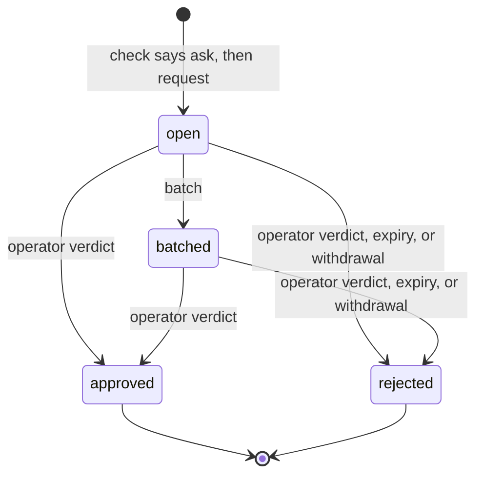

# Approvals

> Target state. Boundary: [routing](../architecture/components.md#routing), core component
> *gate* ([ADR-0036](../decisions/adr/0036-guarantee-core-and-capability-plugins.md)). Proposals:
> [PROP-0010](../proposals/0010-base-version.md),
> [PROP-0008](../proposals/0008-studio-operating-model.md#fewer-approvals-reliable-results).
> Records: [`autonomy-policy@1.1`](../reference/schemas.md#autonomy-policy),
> [`approval-request@1.0`](../reference/schemas.md#approval-request); verdicts stay
> [`approval@1.0`](../reference/schemas.md#approval).
>
> Implemented in [`approvals`](../../packages/plugins/approvals/README.md) (definition
> [`approvals-core`](../../packages/approvals-core/README.md)); the operator's queue is on `/ui`
> ([`web-ui`](../../packages/plugins/web-ui/README.md), [API](../reference/web-ui.md)). Differs
> from target: no Worker-side hook enforces verdicts yet (the PreToolUse hook), and remediation
> still uses the plan gate (`approval@1.0`).

Every action that needs a person goes through one queue, in batches, and nothing else asks the
operator. The autonomy policy decides which actions those are; an action that is reversible and
verified runs without asking. Code decides, never a model.

## Seam

`ctx.approvals` (`Approvals` in `@tsuuanmi/system-approvals-core`), contract 1.0:

| Method | Does |
|---|---|
| `policy(projectId?)` | the studio policy, the project's, and the effective mode per action class |
| `check(action)` | classify one action; records an `autonomy` decision. Its `mode` is the mode once the required checks pass ([below](#a-verdict-is-not-yet-a-permission)) |
| `request(request)` | queue a request for an action the loaded policies still say `ask` for, as its recorded verdict says |
| `get`, `list` | read the queue |
| `batch(at)` | group open requests into batches by the policy's batch rule |
| `decide(verdicts)` | the operator's verdicts, each bound to its request's exact subject |
| `withdraw(requestId)` | close a request whose waiting work ended |
| `sweep(at)` | reject every request unanswered at `at`, then withdraw every open one the loaded policies no longer ask for |

`at` is a test seam, here and in `request`, `batch`, `decide`, and `withdraw`: the MCP tools, the
web UI, the board, and the queue's own passes fill it from the wall clock, and no core caller
passes another time. A provider trusts it: a caller that passed a time far ahead would make a
request that never expires (INV-9).

## The autonomy policy

| Mode | Effect |
|---|---|
| `auto` | the action runs and is recorded, once the rule's required checks pass |
| `notify` | the same, and the operator is shown it afterwards |
| `ask` | an approval request; the action waits for the verdict |
| `forbid` | denied |

- The effective mode is the strictest of the studio policy and the project's, which constrains
  only the classes it names. A class no rule names takes the stricter `default`, which is `ask`
  or `forbid`.
- Irreversible effects (`external-send`, `deploy`, `delete-data`, `spend`), the investor's
  decisions (`charter`, `funding`, `policy-change`), and `remediation` (the workflow's
  remediation already waits on an operator gate) are never `auto` or `notify` (`ALWAYS_ASK`).
  The schema refuses a policy that says so (`remediation` from `autonomy-policy@1.1`; a `1.0`
  policy that says so is refused when it loads), and the provider raises each of them to at least
  `ask` whatever a rule says.
- A failed required check sends the action back to the lead as work, not to the operator.
- A `command` is judged by its exact argv. An argv equal, word for word and with nothing more,
  to a line on every applying commands list is judged as `workspace-write` (unless `command` is
  `forbid`); any other is the `command` class. An argv with a word that holds a shell
  metacharacter (`; & | $`, the backquote, `< > ( ) { } [ ] * ? ~`, quotes, backslash, newline,
  carriage return, tab, NUL) is `forbid`, whatever its class: argv is matched, never parsed by a
  shell. A list entry with an empty word or a metacharacter refuses its policy at load.
- On a Claude Code Worker the policy compiles to a PreToolUse hook: `forbid` → `deny`, `ask` →
  `defer`, `notify` and `auto` → `allow`. `canUseTool` is never the gate, because tools allowed by
  a rule or a permissive mode never reach it (B5).

### A verdict is not yet a permission

> **`mode` is the mode once the required checks pass.** `check` returns `auto` or `notify` for an
> action whose rule allows it, even when its required checks did not pass; `failedChecks` names
> those. A caller that acts on a verdict must pass the checks it ran (`action.checks`) and treat a
> non-empty `failedChecks` as **not yet allowed**: the lead runs the checks first, and a failed
> one is work for the lead, never a reason to run the action or to ask the operator. A caller
> that reads `mode` alone fails open.

## A request

PROP-0010's sketch shows `expired` as a state before `rejected`. Here they are one transaction:
the request becomes `rejected` with cause `expired`, and the decision's outcome is
`denied:expired`.

| From → to | Who | Records | On failure |
|---|---|---|---|
| — → open | `request`, by a core component (board, workflow, a Worker's hook, resources) | the request, with the `autonomy` decision that said ask and `expiresAt` | refused (`not-asked`) unless the verdict cites an `autonomy` decision a policy made that says ask, of the policy the verdict names (the request takes its policy from the decision), under the project's policies as loaded now (each policy at its current version, the set's `decider.hash`), and judging the action again (its class, `command`, and project) says ask for the class the decision names; an invalid request, or a subject with no `version` (except an `artifact` subject by its `sha256:` id), is refused (`invalid`) |
| open → batched | `batch`, when the group (one per project) reaches `maxSize` or its oldest request waited `maxWaitSeconds` | `batchId`; an `approvals.batched` event | — |
| open or batched → approved | `decide`, from the operator's channel only: the queue on the web UI (`/ui`, operator token) or MCP `approvals_decide` (operator scope) | an `approval@1.0` artifact by `operator` on the request's subject, and an `approval` decision (`approved`) | a verdict for a changed subject, an expired or resolved request, or an unknown one is refused and changes nothing; one the provider cannot apply (an error) is refused as `failed`, logged; the other verdicts of the call apply |
| open or batched → rejected (verdict) | `decide` | the same, with `rejected` | as above |
| open or batched → rejected (expired) | `sweep`, at `expiresAt` | an `approval` decision `denied:expired` (decider rule `approvals.expiry`) | — |
| open or batched → rejected (withdrawn) | `withdraw`, by the requester, when its work ended | an `approval` decision `withdrawn` (decider rule `approvals.withdraw`) | a resolved request is returned unchanged |
| open or batched → rejected (policy changed) | the provider, at load and on every `sweep`, for an unexpired request whose policy is not current at its version, or whose class (and the class its decision judged it as) the loaded policies no longer ask for | an `approval` decision `withdrawn` (decider rule `approvals.policy`), its reason naming what changed | one that fails is logged and left for the next sweep |

A policy change takes effect by configuration and a restart. Cause `withdrawn` covers it: the
requester sees its request rejected, as when its own work ended, and asks anew if the new policy
still asks.

### Where the tables leave room

The store-backed provider settles these cases so that the [fail-closed rules](#fail-closed-rules)
hold. The fake provider does not check them, and the suite does not test them.

- A batch holds at most the batch rule's `maxSize` requests, oldest first: a group with more
  open requests makes several batches, and only its last, smaller one waits for
  `maxWaitSeconds`. An open request already expired is not batched; the sweep rejects it.
- The batch rule of a project's requests is the first policy's that names one, the studio's
  first; with none, each request is its own batch at once. At load, a batch rule whose
  `maxWaitSeconds` is not under the shortest expiry a request it batches can get is refused: a
  lone request would expire before the operator is shown it.
- A malformed verdict, or a named request whose stored record fails its schema, refuses the
  whole `decide` call before any verdict applies.
- At load, two policies with one id, or two for one project, are refused too.
- Withdrawal on a policy change needs the request's classes: its own, and the class its
  decision judged it as. A listed command's argv is not kept, so its request is withdrawn
  unless both `command` and the class it was judged as still ask.
- The queue sweeps, then batches, once at start and every `sweepSeconds` (1 to 3600, never off);
  nothing else calls them in production.

## Fail-closed rules

1. Only an operator verdict approves. Expiry and withdrawal only reject.
2. A verdict binds to the exact subject the operator was shown; the request's subject, action,
   and expiry never change after it is created
   ([INV-5](../architecture/invariants.md#inv-5-exact-subject-binding)).
3. A verdict comes only from the operator's channel, never from model text
   ([INV-6](../architecture/invariants.md#inv-6-authority-comes-from-trusted-envelopes)).
4. Every request expires, and an unanswered request is denied.
5. With `ctx.approvals` unavailable, an action that needs a person waits; one that does not
   still needs its `autonomy` decision, so nothing runs.

## Conformance

[`approvals-core/conformance/approvals.ts`](../../packages/approvals-core/conformance/approvals.ts),
15 scenarios at contract 1.0, run against the fake provider and the store-backed provider. The
board's suite also runs over the store-backed provider, as the bundle composes them.
