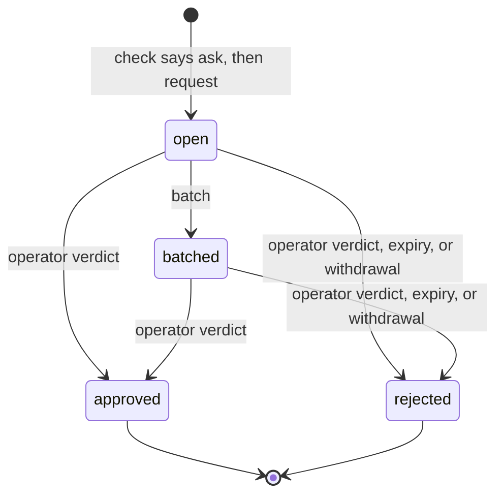
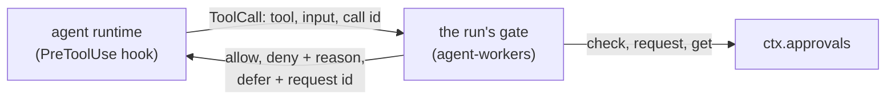

# Approvals

> Target state. Boundary: [routing](../architecture/components.md#routing), core component
> *gate* ([ADR-0036](../decisions/adr/0036-guarantee-core-and-capability-plugins.md)). Proposals:
> [PROP-0010](../proposals/0010-base-version.md),
> [PROP-0008](../proposals/0008-studio-operating-model.md#fewer-approvals-reliable-results).
> Records: [`autonomy-policy@1.0`](../reference/schemas.md#autonomy-policy),
> [`approval-request@1.0`](../reference/schemas.md#approval-request); verdicts stay
> [`approval@1.0`](../reference/schemas.md#approval).
>
> Implemented in [`approvals`](../../packages/plugins/approvals/README.md) (definition
> [`approvals-core`](../../packages/approvals-core/README.md)); the operator's queue is on `/ui`
> ([`web-ui`](../../packages/plugins/web-ui/README.md), [API](../reference/web-ui.md)); a
> Worker's tool calls pass the gate of [`agent-workers`](../../packages/plugins/agent-workers/README.md),
> which [`runtime-claude-agent-sdk`](../../packages/plugins/runtime-claude-agent-sdk/README.md)
> compiles to a PreToolUse hook. Differs from target: remediation still uses the plan gate
> (`approval@1.0`); a Worker's tool calls are judged under the studio policy only, since no
> trusted envelope names an agent run's project yet; a deferred run fails as `config_error`,
> since the workers seam has no waiting status, and nothing yet starts the later run of its
> session once its request is approved; the workflow engine's acceptance does not yet bind a
> rule's required checks, which a Worker's calls leave pending
> ([below](#where-a-workers-gate-leaves-room)).

Every action that needs a person goes through one queue, in batches, and nothing else asks the
operator. The autonomy policy decides which actions those are; an action that is reversible and
verified runs without asking. Code decides, never a model.

## Seam

`ctx.approvals` (`Approvals` in `@tsuuanmi/system-approvals-core`), contract 1.0:

| Method | Does |
|---|---|
| `policy(projectId?)` | the studio policy, the project's, and the effective mode per action class |
| `check(action)` | classify one action; records an `autonomy` decision. Its `mode` is the mode once the required checks pass ([below](#a-verdict-is-not-yet-a-permission)) |
| `request(request)` | queue a request for an action the loaded policies still say `ask` for, as its recorded verdict says |
| `get`, `list` | read the queue |
| `batch(at)` | group open requests into batches by the policy's batch rule |
| `decide(verdicts)` | the operator's verdicts, each bound to its request's exact subject |
| `withdraw(requestId)` | close a request whose waiting work ended |
| `sweep(at)` | reject every request unanswered at `at`, then withdraw every open one the loaded policies no longer ask for |

`at` is a test seam, here and in `request`, `batch`, `decide`, and `withdraw`: the MCP tools, the
web UI, the board, and the queue's own passes fill it from the wall clock, and no core caller
passes another time. A provider trusts it: a caller that passed a time far ahead would make a
request that never expires (INV-9).

## The autonomy policy

| Mode | Effect |
|---|---|
| `auto` | the action runs and is recorded, once the rule's required checks pass |
| `notify` | the same, and the operator is shown it afterwards |
| `ask` | an approval request; the action waits for the verdict |
| `forbid` | denied |

- The effective mode is the strictest of the studio policy and the project's, which constrains
  only the classes it names. A class no rule names takes the stricter `default`, which is `ask`
  or `forbid`.
- Irreversible effects (`external-send`, `deploy`, `delete-data`, `spend`), the investor's
  decisions (`charter`, `funding`, `policy-change`), and `remediation` (the workflow's
  remediation already waits on an operator gate) are never `auto` or `notify` (`ALWAYS_ASK`).
  The schema refuses a policy that says so (for `remediation`, which the schema predates, a
  load-time rule does), and the provider raises each of them to at least `ask` whatever a rule
  says.
- A failed required check sends the action back to the lead as work, not to the operator. A
  check nobody reported is not a failure: the board holds such a review for the operator's own
  acceptance ([board](board.md#required-checks-bind-at-acceptance)).
- A wait for a person on a class lasts the shortest `expiresSeconds` of the rules that apply to
  it, else the stricter `expiry.defaultSeconds`, never more than the stricter `expiry.maxSeconds`
  (`waitSeconds` in `approvals-core`): a request's `expiresAt`, and a review the board holds for
  the operator.
- A `command` is judged by its exact argv. An argv equal, word for word and with nothing more,
  to a line on every applying commands list is judged as `workspace-write` (unless `command` is
  `forbid`); any other is the `command` class. An argv with a word that holds a shell
  metacharacter (`; & | $`, the backquote, `< > ( ) { } [ ] * ? ~`, quotes, backslash, newline,
  carriage return, tab, NUL) is `forbid`, whatever its class: argv is matched, never parsed by a
  shell. A list entry with an empty word or a metacharacter refuses its policy at load.
- On a Claude Code Worker the policy compiles to a PreToolUse hook: `forbid` → `deny`, `ask` →
  `defer`, `notify` and `auto` → `allow`. `canUseTool` is never the gate, because tools allowed by
  a rule or a permissive mode never reach it (B5). How a tool call becomes an action, and what a
  deferred call does, is [below](#a-workers-tool-calls).

### A verdict is not yet a permission

> **`mode` is the mode once the required checks pass.** `check` returns `auto` or `notify` for an
> action whose rule allows it, even when its required checks did not pass; `failedChecks` names
> those. A rule's `requires` are checks the **result** must pass before it is accepted, never
> preconditions of each step of the work that produces it:
>
> - A caller that **accepts or applies a result** (the board's `accept`, an acceptance gate)
>   passes the checks it ran (`action.checks`) and treats a non-empty `failedChecks` as **not yet
>   allowed**: a failed check is work for the lead, never a reason to accept the result or to ask
>   the operator. Such a caller that reads `mode` alone fails open.
> - A caller that gates the work **while it runs** (a board task becoming ready, a Worker's tool
>   call) cannot have run them: it lets the work go on under `auto` or `notify`, records the
>   checks as pending (the `autonomy` decision's `failedChecks`, and its own record), and they
>   bind when the result is accepted
>   ([board](board.md#required-checks-bind-at-acceptance), [below](#a-workers-tool-calls)).
>
> Everything else still fails closed: `forbid` denies, `ask` waits for the operator, and a
> class no rule names takes the stricter `default`.

## A request

PROP-0010's sketch shows `expired` as a state before `rejected`. Here they are one transaction:
the request becomes `rejected` with cause `expired`, and the decision's outcome is
`denied:expired`.

| From → to | Who | Records | On failure |
|---|---|---|---|
| — → open | `request`, by a core component (board, workflow, a Worker's hook, resources) | the request, with the `autonomy` decision that said ask and `expiresAt` | refused (`not-asked`) unless the verdict cites an `autonomy` decision a policy made that says ask, of the policy the verdict names (the request takes its policy from the decision), under the project's policies as loaded now (each policy at its current version, the set's `decider.hash`), and judging the action again (its class, `command`, and project) says ask for the class the decision names; an invalid request, or a subject with no `version` (except an `artifact` subject by its `sha256:` id), is refused (`invalid`) |
| open → batched | `batch`, when the group (one per project) reaches `maxSize` or its oldest request waited `maxWaitSeconds` | `batchId`; an `approvals.batched` event | — |
| open or batched → approved | `decide`, from the operator's channel only: the queue on the web UI (`/ui`, operator token) or MCP `approvals_decide` (operator scope) | an `approval@1.0` artifact by `operator` on the request's subject, and an `approval` decision (`approved`) | a verdict for a changed subject, an expired or resolved request, or an unknown one is refused and changes nothing; one the provider cannot apply (an error) is refused as `failed`, logged; the other verdicts of the call apply |
| open or batched → rejected (verdict) | `decide` | the same, with `rejected` | as above |
| open or batched → rejected (expired) | `sweep`, at `expiresAt` | an `approval` decision `denied:expired` (decider rule `approvals.expiry`) | — |
| open or batched → rejected (withdrawn) | `withdraw`, by the requester, when its work ended | an `approval` decision `withdrawn` (decider rule `approvals.withdraw`) | a resolved request is returned unchanged |
| open or batched → rejected (policy changed) | the provider, at load and on every `sweep`, for an unexpired request whose policy is not current at its version, or whose class (and the class its decision judged it as) the loaded policies no longer ask for | an `approval` decision `withdrawn` (decider rule `approvals.policy`), its reason naming what changed | one that fails is logged and left for the next sweep |

A policy change takes effect by configuration and a restart. Cause `withdrawn` covers it: the
requester sees its request rejected, as when its own work ended, and asks anew if the new policy
still asks.

### Where the tables leave room

The store-backed provider settles these cases so that the [fail-closed rules](#fail-closed-rules)
hold. The fake provider does not check them, and the suite does not test them.

- A batch holds at most the batch rule's `maxSize` requests, oldest first: a group with more
  open requests makes several batches, and only its last, smaller one waits for
  `maxWaitSeconds`. An open request already expired is not batched; the sweep rejects it.
- The batch rule of a project's requests is the first policy's that names one, the studio's
  first; with none, each request is its own batch at once. At load, a batch rule whose
  `maxWaitSeconds` is not under the shortest expiry a request it batches can get is refused: a
  lone request would expire before the operator is shown it.
- A malformed verdict, or a named request whose stored record fails its schema, refuses the
  whole `decide` call before any verdict applies.
- At load, two policies with one id, or two for one project, are refused too.
- Withdrawal on a policy change needs the request's classes: its own, and the class its
  decision judged it as. A listed command's argv is not kept, so its request is withdrawn
  unless both `command` and the class it was judged as still ask.
- The queue sweeps, then batches, once at start and every `sweepSeconds` (1 to 3600, never off);
  nothing else calls them in production.

## A Worker's tool calls

Every tool call of an agent run passes the run's gate before it runs. The boundary:

- **The contract** is runtime-neutral, in
  [`agent-runtime-core`](../../packages/agent-runtime-core/README.md): `RunSpec.toolGate`, given
  the tool's name and input, answers `allow`, `deny` with a reason, or `defer` with a reason and
  the request id. A runtime that can ask it before every tool call reports `gatesToolCalls`; the
  `agents` source admits no Worker whose runtime does not, and such a runtime refuses a run that
  carries a gate. The runtime plugin never reads `ctx.approvals`: the source that owns runs builds
  each run's gate from it.
- **On Claude Code** the gate is one PreToolUse hook with no matcher: every tool, subagents'
  included. `deny` and `defer` are the hook's own decisions, which hold in every permission
  mode. `allow` returns no decision: a hook's `allow` would skip the workspace-scoped
  pre-approvals, so the runtime's own policy still decides, and a call outside the workspace
  stays refused. A gate that throws, answers with an unknown verdict, or takes longer than 30 s
  is a deny.

### How a call is classified

By code, from the tool's name and input only, never by a model's judgment; a call the table does
not cover is denied.

| Tool | Action |
|---|---|
| `Read`, `NotebookRead`, `LS`, `Glob`, `Grep` | `read`, for a path inside the run's workspace (absent for `Glob` and `Grep`: the workspace); a `Glob` pattern that is absolute outside it, or climbs with `..`, is denied |
| `Write`, `Edit`, `MultiEdit`, `NotebookEdit` | `workspace-write`, for a file inside the workspace; outside it is denied (and refused by the runtime) |
| `Bash` | `command`, its argv the command split on single spaces, so the [exact-argv rule](#the-autonomy-policy) applies as written: a listed argv is judged as `workspace-write`, and a word with a shell metacharacter is `forbid`. An input field beyond `command`, `description`, `timeout`, and `run_in_background` is denied |
| `WebFetch`, `WebSearch` | `external-send`, which always asks |
| any other tool, or an input that is not an object | denied by the gate's own rule |

Paths are judged lexically against the workspace; a home path (`~`) is never inside it. The
runtime's pre-approvals still bind each tool to the workspace on disk.

### What each verdict does

`check` judges the action under the studio policy, and records the `autonomy` decision.

| Verdict | The call | Recorded |
|---|---|---|
| `forbid` | denied; the agent is told the decision's reason | the `autonomy` decision |
| `auto` | allowed | the `autonomy` decision |
| `notify` | allowed, and an `agent-workers.tool.notified` event names the decision, the run, and the tool: the operator reads it in the event log (MCP `events` by type) and the decision itself (`system explain <decision>`, MCP `artifact`) | the `autonomy` decision |
| `auto` or `notify` with `failedChecks` | allowed: the rule's required checks are the result's, and no tool call carries them ([a verdict is not yet a permission](#a-verdict-is-not-yet-a-permission)). They stay pending, and bind when the result is accepted. The first such call of a class in a run appends `agent-workers.tool.checks-pending` naming them (a `notify` event names them too); a pending check that no rule can require is a deny | the `autonomy` decision, its `failedChecks` the pending checks |
| `ask` | one approval request on the exact call, then `defer` | the `autonomy` decision, then the request |

A gate outcome the policy did not give (no `ctx.approvals`, a call the gate does not classify, a
run that already stopped, an `ask` in a run with no session, a gate that failed) is a deny,
recorded as a `gate` decision of rule `agent-workers.tool-gate`. A denied or deferred call also
appends an `agent-workers.tool.denied` or `agent-workers.tool.deferred` event; events carry
ids, never the call's input.

### A deferred call

- **The request** binds to the exact call (INV-5): subject `{ type: content, ref:
  agent-tool-call:<agent run>:<tool>, version: <content id of the canonical tool input> }`;
  requester `worker`, with the agent run, its session, and the runtime's call id
  (`toolUseId`); summary and consequences say what runs if it is approved, and that it is denied
  if rejected or unanswered. Its classification is the run's.
- **The run stops there.** The runtime runs no further tool call (each is denied) and ends the
  run, which fails as `config_error` naming the request, whatever the runtime reported: a
  deferred run never completes, and `config_error` is never retried. On Claude Code a `defer`
  ends the headless query with the call kept in the session's transcript.
- **Resume.** The same session continues in a later run (by its native handle), and the hook
  runs again on the deferred call. The gate finds the request opened for that exact call in
  that session: while it is open, the call defers again on the same request, and nothing new is
  queued; approved, the call runs, once (the approval is then used, and the same call asks
  again); rejected, expired, or withdrawn, it is denied, and nothing new is queued. A different
  input is a different call, with a request of its own.
- **A run with no session** cannot be continued, so an `ask` there is denied, not deferred, and
  nothing is queued: the operator is never asked for an approval no run could use.

### Where a Worker's gate leaves room

- **Project.** Every call is judged under the studio policy. A project policy only narrows it,
  so a project's stricter rule does not reach a Worker's tool calls until a trusted envelope
  (the run's `WorkerStart`) names the run's project.
- **Waiting.** The workers seam's statuses are `queued`, `running`, `completed`, and `failed`;
  a run that waits on the operator is `failed` (`config_error`, the request in its message). A
  waiting status would change that guarantee seam's contract.
- **The later run.** Whoever owns the work (the board's `blocked` → `ready` on the verdict, the
  lead) starts the run that continues the session; the gate does not.
- **Where pending checks bind.** The bundle's studio policy gives `workspace-write` `auto` with
  `tests` and `lint` required, so a Claude Code Worker reads and writes inside its workspace,
  those checks pending. They bind at the board's acceptance of the task's result. The workflow
  engine's acceptance does not consult the policy yet, so for a run outside the board they are
  recorded (the decision, the event) and not yet enforced when its result is accepted.

## Fail-closed rules

1. Only an operator verdict approves. Expiry and withdrawal only reject.
2. A verdict binds to the exact subject the operator was shown; the request's subject, action,
   and expiry never change after it is created
   ([INV-5](../architecture/invariants.md#inv-5-exact-subject-binding)).
3. A verdict comes only from the operator's channel, never from model text
   ([INV-6](../architecture/invariants.md#inv-6-authority-comes-from-trusted-envelopes)).
4. Every request expires, and an unanswered request is denied.
5. With `ctx.approvals` unavailable, an action that needs a person waits; one that does not
   still needs its `autonomy` decision, so nothing runs: a Worker's gate denies every tool call,
   reads included.

## Conformance

[`approvals-core/conformance/approvals.ts`](../../packages/approvals-core/conformance/approvals.ts),
15 scenarios at contract 1.0, run against the fake provider and the store-backed provider. The
board's suite also runs over the store-backed provider, as the bundle composes them.
