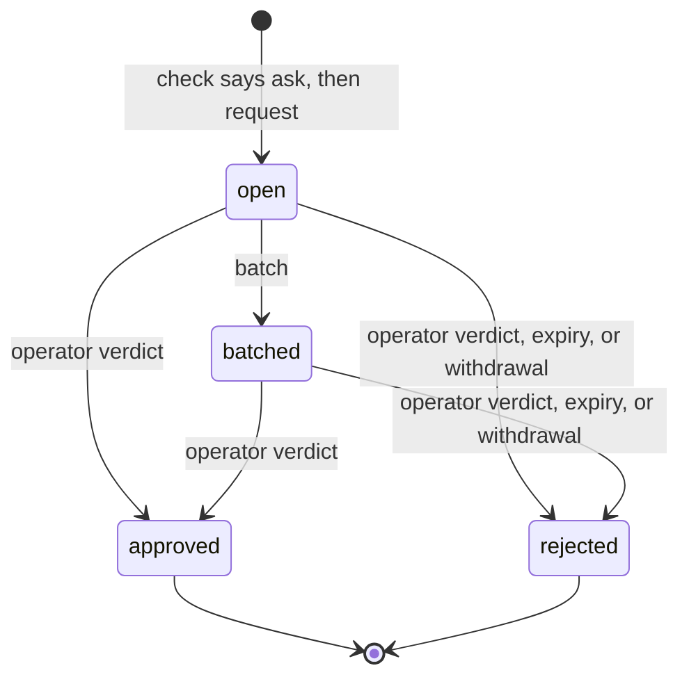

# Approvals

> Target state. Boundary: [routing](../architecture/components.md#routing), core component
> *gate* ([ADR-0036](../decisions/adr/0036-guarantee-core-and-capability-plugins.md)). Proposals:
> [PROP-0010](../proposals/0010-base-version.md),
> [PROP-0008](../proposals/0008-studio-operating-model.md#fewer-approvals-reliable-results).
> Records: [`autonomy-policy@1.0`](../reference/schemas.md#autonomy-policy),
> [`approval-request@1.0`](../reference/schemas.md#approval-request); verdicts stay
> [`approval@1.0`](../reference/schemas.md#approval).
>
> Implemented in [`approvals`](../../packages/plugins/approvals/README.md) (definition
> [`approvals-core`](../../packages/approvals-core/README.md)); differs from target: no
> Worker-side hook enforces verdicts yet (the PreToolUse hook), and remediation still uses the
> plan gate (`approval@1.0`).

Every action that needs a person goes through one queue, in batches, and nothing else asks the
operator. The autonomy policy decides which actions those are; an action that is reversible and
verified runs without asking. Code decides, never a model.

## Seam

`ctx.approvals` (`Approvals` in `@tsuuanmi/system-approvals-core`), contract 1.0:

| Method | Does |
|---|---|
| `policy(projectId?)` | the studio policy, the project's, and the effective mode per action class |
| `check(action)` | classify one action; records an `autonomy` decision |
| `request(request)` | queue a request for an action whose recorded verdict is `ask` |
| `get`, `list` | read the queue |
| `batch(at)` | group open requests into batches by the policy's batch rule |
| `decide(verdicts)` | the operator's verdicts, each bound to its request's exact subject |
| `withdraw(requestId)` | close a request whose waiting work ended |
| `sweep(at)` | reject every request unanswered at `at` |

## The autonomy policy

| Mode | Effect |
|---|---|
| `auto` | the action runs and is recorded, once the rule's required checks pass |
| `notify` | the same, and the operator is shown it afterwards |
| `ask` | an approval request; the action waits for the verdict |
| `forbid` | denied |

- The effective mode is the strictest of the studio policy and the project's, which constrains
  only the classes it names. A class no rule names takes the stricter `default`, which is `ask`
  or `forbid`.
- Irreversible effects (`external-send`, `deploy`, `delete-data`, `spend`) and the investor's
  decisions (`charter`, `funding`, `policy-change`) are never `auto` or `notify`; the schema
  refuses a policy that says so.
- A failed required check sends the action back to the lead as work, not to the operator.
- On a Claude Code Worker the policy compiles to a PreToolUse hook: `forbid` → `deny`, `ask` →
  `defer`, `notify` and `auto` → `allow`. `canUseTool` is never the gate, because tools allowed by
  a rule or a permissive mode never reach it (B5).

## A request

PROP-0010's sketch shows `expired` as a state before `rejected`. Here they are one transaction:
the request becomes `rejected` with cause `expired`, and the decision's outcome is
`denied:expired`.

| From → to | Who | Records | On failure |
|---|---|---|---|
| — → open | `request`, by a core component (board, workflow, a Worker's hook, resources) | the request, with the `autonomy` decision that said ask and `expiresAt` | a verdict that is not a recorded `ask` is refused (`not-asked`); an invalid request is refused (`invalid`) |
| open → batched | `batch`, when the group (one per project) reaches `maxSize` or its oldest request waited `maxWaitSeconds` | `batchId`; an `approvals.batched` event | — |
| open or batched → approved | `decide`, from the operator's channel only (MCP `approvals_decide`, operator scope) | an `approval@1.0` artifact by `operator` on the request's subject, and an `approval` decision (`approved`) | a verdict for a changed subject, an expired or resolved request, or an unknown one is refused and changes nothing; the other verdicts of the call apply |
| open or batched → rejected (verdict) | `decide` | the same, with `rejected` | as above |
| open or batched → rejected (expired) | `sweep`, at `expiresAt` | an `approval` decision `denied:expired` (decider rule `approvals.expiry`) | — |
| open or batched → rejected (withdrawn) | `withdraw`, by the requester, when its work ended | an `approval` decision `withdrawn` | a resolved request is returned unchanged |

### Where the tables leave room

The store-backed provider settles these cases so that the [fail-closed rules](#fail-closed-rules)
hold. The fake provider does not check them, and the suite does not test them.

- A batch holds at most the batch rule's `maxSize` requests, oldest first: a group with more
  open requests makes several batches, and only its last, smaller one waits for
  `maxWaitSeconds`. An open request already expired is not batched; the sweep rejects it.
- The batch rule of a project's requests is the first policy's that names one, the studio's
  first; with none, each request is its own batch at once.
- A command is on a commands list when its argv starts with the listed line word for word. An
  argv whose words only join to a listed line (`["pnpm test"]`, `["pnpm", "test; rm -rf /"]`)
  is the `command` class.
- `request` takes the policy and version from the `autonomy` decision the verdict cites, and
  refuses (`not-asked`) a verdict that names another.
- A malformed verdict, or a named request whose stored record fails its schema, refuses the
  whole `decide` call before any verdict applies.
- At load, two policies with one id, or two for one project, are refused too.
- The queue sweeps, then batches, once at start and every `sweepSeconds`; nothing else calls
  them in production.

## Fail-closed rules

1. Only an operator verdict approves. Expiry and withdrawal only reject.
2. A verdict binds to the exact subject the operator was shown; the request's subject, action,
   and expiry never change after it is created
   ([INV-5](../architecture/invariants.md#inv-5-exact-subject-binding)).
3. A verdict comes only from the operator's channel, never from model text
   ([INV-6](../architecture/invariants.md#inv-6-authority-comes-from-trusted-envelopes)).
4. Every request expires, and an unanswered request is denied.
5. With `ctx.approvals` unavailable, an action that needs a person waits; one that does not
   still needs its `autonomy` decision, so nothing runs.

## Conformance

[`approvals-core/conformance/approvals.ts`](../../packages/approvals-core/conformance/approvals.ts),
12 scenarios at contract 1.0, run against the fake provider and the store-backed provider. The
board's suite also runs over the store-backed provider, as the bundle composes them.
