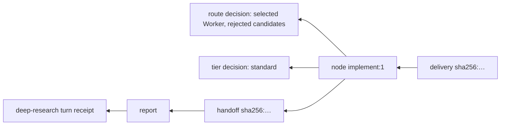

# Artifacts and decision records

> Target state. Decision: [ADR-0013](../decisions/adr/0013-typed-artifacts-and-decision-records.md).
> Invariant: [INV-13](../architecture/invariants.md#inv-13-every-decision-is-an-artifact).
> Exact shapes: [`schemas/`](../../schemas/README.md) (canonical), with semantics in
> [reference: schemas](../reference/schemas.md).
>
> Implemented in [`artifacts`](../../packages/plugins/artifacts/README.md); differs from target:
> bodies are inline only (no large-body store); no `spec-admission` decision is recorded; the
> store does not itself reject a transition without a decision id.

An **artifact** is an immutable, typed, content-addressed record. The work that
`system` produces is artifacts, and so is the record of how `system` decided.
Workflow state (node status, leases) is mutable and points at artifacts.
Artifacts themselves never change.

## Envelope

Every artifact shares one envelope
([`artifact-envelope.v1.json`](../../schemas/artifact-envelope.v1.json)):

| Field | Meaning |
|---|---|
| `schema` | `"<name>@<major>.<minor>"` of the envelope |
| `id` | `sha256:` of the canonical JSON of `{kind, body, inputs, lineage, subject}`; equal content means an equal id |
| `kind` | one of the kinds below |
| `bodySchema` | schema of the body, e.g. `decision@1.0` |
| `body` or `blob` | inline body, or a SHA-256 ref to a large body (planned) |
| `classification` | `public`, `operator-shared`, or `local-private`; drives egress ([INV-12](../architecture/invariants.md#inv-12-data-egress-is-explicit)) |
| `producer` | who made it: `{ type: node, worker, policy, operator, system; ref }` |
| `subject` | what it is about, when exact-subject binding applies (e.g. a git head SHA) |
| `inputs` | artifact refs it was derived from |
| `lineage` | `supersedes`, `invalidates` refs |
| `runId`, `nodeId` | where it was produced, if inside a workflow |
| `createdAt` | timestamp (not part of `id`) |

## Kinds

| Family | Kind | Produced by | Example |
|---|---|---|---|
| domain | `objective`, `criteria` | admission | the accepted goal and acceptance criteria |
| domain | `plan` | planner node | proposed nodes for graph growth ([ADR-0012](../decisions/adr/0012-dag-execution-model.md)) |
| domain | `finding`, `evidence` | research Workers, engine | a cited claim, a source excerpt, a test log; what a review's members read (`source-snapshot@1.0`) |
| domain | `assessment` | review Workers | a verdict against criteria on an exact subject |
| domain | `report`, `handoff` | synthesis, team decision, compaction | a compact, cited synthesis passed downstream; a team's result (`team-result`) |
| domain | `delivery` | implementation Workers | a PR, a patch, or a dataset output, with its subject |
| control | `decision` | routing, engine, policies, operator | see below |
| control | `receipt` | provider runtime, engine | provider turn receipt, node input and output receipts |
| control | `approval` | operator | a human approval bound to an exact subject |
| control | `message` | worker sessions | a peer message in a session mailbox ([sessions](sessions-and-messaging.md)) |

## Decision artifacts

A decision artifact records **one decision**
([`decision.v1.json`](../../schemas/decision.v1.json)):

```jsonc
{
  "decisionType": "route",                 // see table below
  "question": "Which Worker runs node research:1?",
  "inputs": ["sha256:…work-requirement", "sha256:…worker-snapshot"],
  "candidates": [
    { "option": "worker:chatgpt-thinker/deep-research", "selected": true,
      "reasons": ["capabilities proven", "tier=frontier", "quota=subscription-chat"] },
    { "option": "worker:gemini-thinker/deep-research", "selected": false,
      "reasons": ["account state: reauth-required"] }
  ],
  "decider": { "type": "policy", "id": "routing.default", "version": "3", "hash": "sha256:…" },
  "modelAnswers": [],                      // filled when a decision model contributed (PROP-0002)
  "outcome": { "option": "worker:chatgpt-thinker/deep-research" },
  "deterministic": true,
  "rationale": "lowest admissible tier, preferred quota class"
}
```

| `decisionType` | Made by | Outcome example |
|---|---|---|
| `admission` | routing | Worker admitted or rejected for the requirement, with per-capability evidence |
| `route` | routing | the selected Worker, with every rejected candidate and its reason |
| `tier` | routing or decision model | `economy`, `standard`, or `frontier` |
| `escalation` | routing policy | the next tier after an acceptance rejection |
| `egress` | egress policy | payload permitted or blocked, with the artifact refs checked |
| `acceptance` | routing, engine | accepted or rejected against the acceptance contract; what a review's source step read (`workflow.source-snapshot`) |
| `gate` | engine | exact-subject gate passed or failed |
| `reconciliation` | provider runtime | WAIT, RECOVER, RESUBMIT, or AMBIGUOUS, with snapshot hashes |
| `graph-growth` | engine | `plan` artifact accepted (nodes appended) or rejected; a team's debate appended |
| `recovery` | engine | failure class and retry disposition |
| `spec-admission` | engine | the workflow spec accepted, with the provenance of each value |
| `vote` | engine, caller, or operator | a team's tally of one round, or its decision: an option or `inconclusive` ([teams](teams.md#the-record); `decision@1.1`, `@1.2` with a review's checked findings) |

Rules:

1. **Every decision that changes what runs, where, or whether it is accepted
   produces a decision artifact before its effect is committed.** The state
   transition stores the decision's id. A transition without a decision id is
   rejected by the store.
2. Rejected candidates are recorded with reasons, not only the winner.
3. A decision made by a model also records the model receipt (provider, pinned
   version, answers, confidence). Its `deterministic` flag is `false`, and reuse
   by input hash makes it reproducible.
4. Decision artifacts are `operator-shared` by default. They reference private
   inputs but never inline them.

## Lineage and invalidation

`inputs` and `lineage` form a graph over artifacts. A node's frozen **input
bundle** is the set of artifact refs it consumed. When an artifact is
superseded, every node whose bundle depends on it, directly or transitively, is
fenced and becomes re-runnable. Its replacement execution records a `recovery`
decision that points at the superseding artifact.

The operator's `supersede` on a workflow node starts this
([workflow](../../packages/plugins/workflow/README.md)).

## Explain

Because every effect points at a decision and every decision points at its
inputs, the CLI can answer "why?" by walking backwards:



`system explain <runId>` gives each step's egress, tier, route (or admission), and acceptance
or recovery decisions with their reasons, and a vote decision's ballots; `system explain <artifact id>` walks that artifact's
inputs, within `explainDepth` and `explainBudget`.

## Reading

The operator reads any artifact with `system artifact <id>` (MCP `artifact`, operator scope
only, so no client model receives a local-private answer:
[INV-12](../architecture/invariants.md#inv-12-data-egress-is-explicit)). It is how a rejected
attempt's answer is read: `system explain <runId>` names, on each acceptance decision, the
`result` it judged.

- **Header:** kind, body schema, classification, producer, run and node, creation time, inputs.
- **Window:** the body's `text` when it has one (an answer), else the body as JSON, counted in
  characters (code points, so a window never splits one), from `offset` (default 0), at most
  `max` (default 20,000, at most 200,000; INV-9). It says the whole length and whether more
  follows.
- **Ids:** anything but a content id (`sha256:` and 64 lowercase hex digits) is refused before any
  lookup.
- **Not stored:** `expired` when a stored artifact still names it (collected by retention, which
  records no time of its own: the read names that artifact and when it was recorded), else
  `unknown`.

## Storage

Envelopes and their bodies are stored in `ctx.store`, indexed by id, kind,
`runId`, `nodeId`, subject, and decision type. A store for large bodies, addressed
by the envelope's `blob` ref, is planned. Retention follows the workflow retention
rules. A decision artifact is kept for as long as any artifact or state that
references it.

**Collection** (`collect`, after the workflow expires runs). The roots are every
content id written in any store table except the artifacts' own and the event log
(so events and artifacts never keep each other alive): a plugin that keeps an
artifact id in its rows keeps the artifact, without registering anything.
Marking follows each kept envelope's `inputs` and lineage. An artifact is deleted
only when it is unmarked, older than `collectGraceHours` (so one recorded but not
yet referenced is never taken), and linked to no run whose id still appears in
any table. `explain` shows a collected input as `expired` with its id.

The scan reads the store a page at a time (1000 rows), outside any transaction,
yielding between pages, so writers and the event loop keep running; deletion
then runs in short transactions of `collectBatch` (default 1000), each first
re-checking what was written since the scan began: a new artifact's inputs and
lineage, and a new run link. That covers every way a writer reaches an old id
today (from a row the scan marked, or through a `put`, which refuses a missing
input); a writer that copied a raw id from a row the scan had not yet read while
that row was deleted is the case left, and no writer does that. On a synthetic
267 MB store with 200,000 artifacts, a pass that removed 100,000 took 12 s; the
longest write transaction was 112 ms and the longest stall of the event loop
317 ms (marking).
