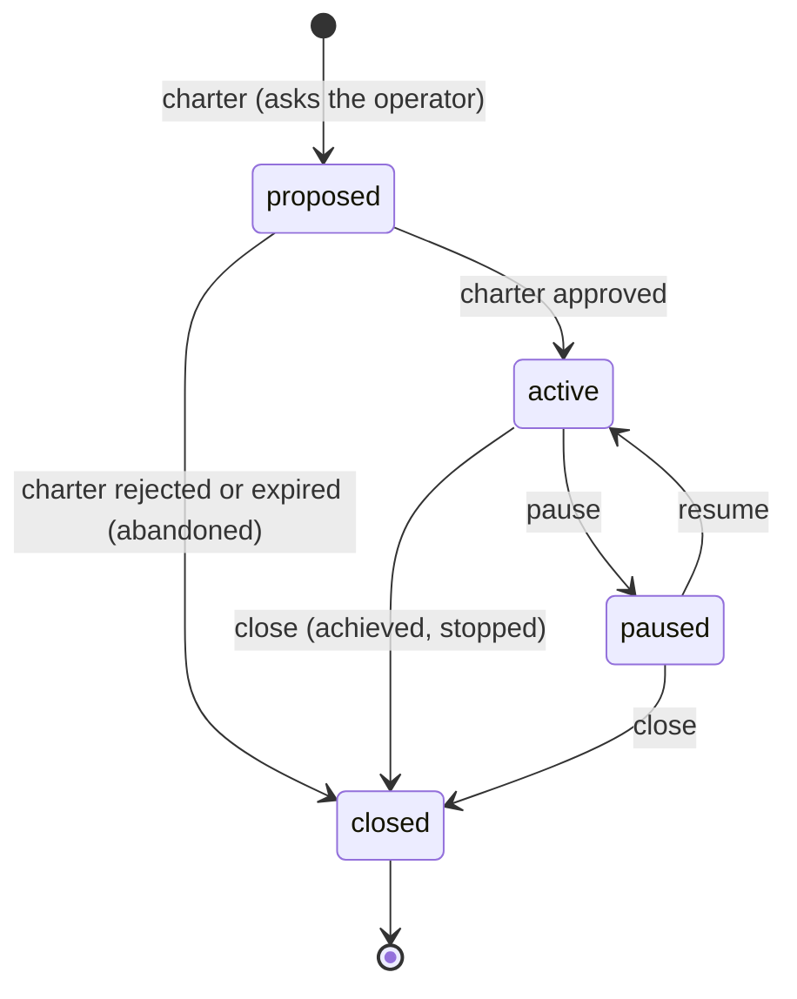
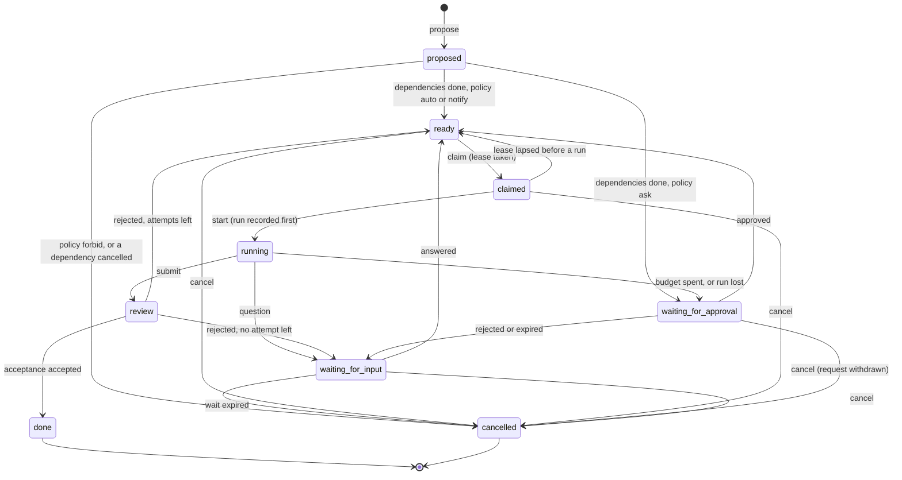

# Board

> Target state. Boundary: [orchestration](../architecture/components.md#orchestration), core
> component *work state machine*
> ([ADR-0036](../decisions/adr/0036-guarantee-core-and-capability-plugins.md)). Proposal:
> [PROP-0010](../proposals/0010-base-version.md). Records: [`project@1.0`](../reference/schemas.md#project),
> [`board-task@1.0`](../reference/schemas.md#board-task).
>
> Defined in [`board-core`](../../packages/board-core/README.md); differs from target: only the
> fake provider exists, so nothing is stored, no MCP tool is served, and no `TASKS.md` is
> projected (milestone B4).

The board holds work that outlives a run: projects with charters, and their tasks. A run of the
[workflow engine](workflow-engine.md) serves one attempt of one task. Only the board moves a
task or a project, and each move names the decision that caused it
([INV-13](../architecture/invariants.md#inv-13-every-decision-is-an-artifact)). It never asks
the operator itself: every move that needs a person goes through the
[approval queue](approvals.md).

## Seam

`ctx.board` (`Board` in `@tsuuanmi/system-board-core`), contract 1.0:

| Method | Does |
|---|---|
| `charter(input)` | found a project or amend its charter; opens a `charter` approval request |
| `project`, `projects` | read projects |
| `pause`, `resume`, `close` | the operator's project moves |
| `propose(input)` | add a task in `proposed` |
| `task`, `tasks` | read tasks |
| `claim`, `renew` | take and renew a task's lease |
| `start`, `submit` | record the run before it starts; record its result |
| `accept(taskId, acceptance)` | apply the `acceptance` decision on the result |
| `block`, `answer` | interrupt a running task; answer a waiting one |
| `cancel` | cancel a task that is not running or in review |
| `sweep(at)` | make every move due at `at`: dependencies met, approvals resolved, leases lost, waits expired |

Time-driven moves happen only in `sweep(at)`, so a restart is a sweep, not a replay
([INV-4](../architecture/invariants.md#inv-4-restart-is-reconciliation-not-replay)).

## Project

An amendment (a pivot) does not change the project's state: the new charter waits in
`proposedCharter` and replaces `charter` once approved, or is dropped when refused.

| From → to | Who | Records | On failure |
|---|---|---|---|
| — → proposed | `charter`, by the lead or the operator | the `autonomy` decision (`charter` always asks) and an approval request on the charter's exact version | a charter carrying an approval, or a wrong version, is refused (`invalid`) |
| proposed → active | `sweep`, on an approved request | the request's `approval` decision; `charter.approval` names the verdict | none: until approved nothing starts |
| proposed → closed | `sweep`, on a rejected or expired request | `closure: abandoned` with that decision | — |
| active ↔ paused | `pause`, `resume` | a `board` decision | other states refused (`invalid-transition`) |
| active or paused → closed | `close` | a `board` decision and `closure`; open tasks are cancelled (`project-closed`) | refused while a task runs or is in review |

## Task

The states follow A2A's split into active (`ready`, `claimed`, `running`, `review`),
interrupted (`waiting-for-input`, `waiting-for-approval`), and terminal (`done`, `cancelled`).
Unlike A2A, every interrupted state has an expiry.

| From → to | Who | Records | On failure |
|---|---|---|---|
| proposed → ready | `sweep`, when every dependency is done and the project is active | a `board` decision (outcome `ready`), after the `autonomy` decision for the task's action class | a paused or proposed project starts nothing |
| proposed → waiting-for-approval | `sweep`, when the policy says ask | the `autonomy` decision; an approval request on `board-task:<id>:attempt:<n>` | the wait expires with the request |
| proposed → cancelled | `sweep`: the policy forbids it, or a dependency was cancelled | the `autonomy` decision (`forbidden`) or a `board` decision (`dependency-cancelled`) | — |
| ready → claimed | `claim`, by the engine or the lead | a `board` decision; a lease of a new generation | a task not ready, or of a project not active, is refused |
| claimed → ready | `sweep`, the lease lapsed and no run started | a `board` decision | the old generation is fenced out (`stale-generation`) |
| claimed → running | `start`, with the holder's generation | a `board` decision; `run` is written before the run starts, and the attempt counted | a stale generation or lapsed lease is refused |
| running → review | `submit` | a `board` decision; `result` | unknown result artifacts are refused |
| running → waiting-for-approval | `block` (`budget-spent`: action class `funding`), or `sweep` when the holder's lease lapsed mid-run (`reconciliation-failed`: `remediation`) | the `autonomy` decision and an approval request | the run is never started again on its own (INV-4) |
| running → waiting-for-input | `block` with questions | a `board` decision | a question wait without questions is refused |
| review → done | `accept` with an `acceptance` decision whose outcome is `accept` | that decision; `result.acceptance` | a decision of another type is refused; a result without its subject cannot be done |
| review → ready / waiting-for-input | `accept` with a `reject` outcome | that decision; another attempt while `count < max`, else `retries-spent` | — |
| waiting-for-approval → ready / waiting-for-input | `sweep`, on the request's resolution | the request's `approval` decision | rejection and expiry never start work: the task waits for input (`rejected`) |
| waiting-for-input → ready | `answer`, every question answered | a `board` decision | partial answers are refused |
| waiting-for-input → cancelled | `sweep`, its wait expired | a `board` decision (`input-expired`) | — |
| any not running or in review → cancelled | `cancel` (`operator`, `lead`, `superseded`) | a `board` decision; a pending approval request is withdrawn; dependents are cancelled on the next sweep | a running task or one in review is refused |

## Fail-closed rules

1. No task starts outside an active project with an approved charter.
2. No task starts unless the policy's verdict on its action class allows it, or an operator
   approved it. A rejected or expired approval never starts work.
3. A started run is recorded before it starts, and a run whose holder was lost is never started
   again without an approval.
4. Every interrupted state expires, and expiry never starts work: an approval wait follows its
   request, an input wait cancels the task (INV-9).
5. A task is done only by an accepting `acceptance` decision on a result with its exact subject.
   The board never accepts by default: with no verification, the task stays in review.
6. One task at a time holds write authority over a subject (`writes`), and every write presents
   the holder's generation ([INV-15](../architecture/invariants.md#inv-15-one-writer-per-subject)).
7. With `ctx.approvals` unavailable, every move that needs it fails and nothing moves.

## Conformance

[`board-core/conformance/board.ts`](../../packages/board-core/conformance/board.ts), 15
scenarios at contract 1.0, run against the fake provider over the approvals fake.
