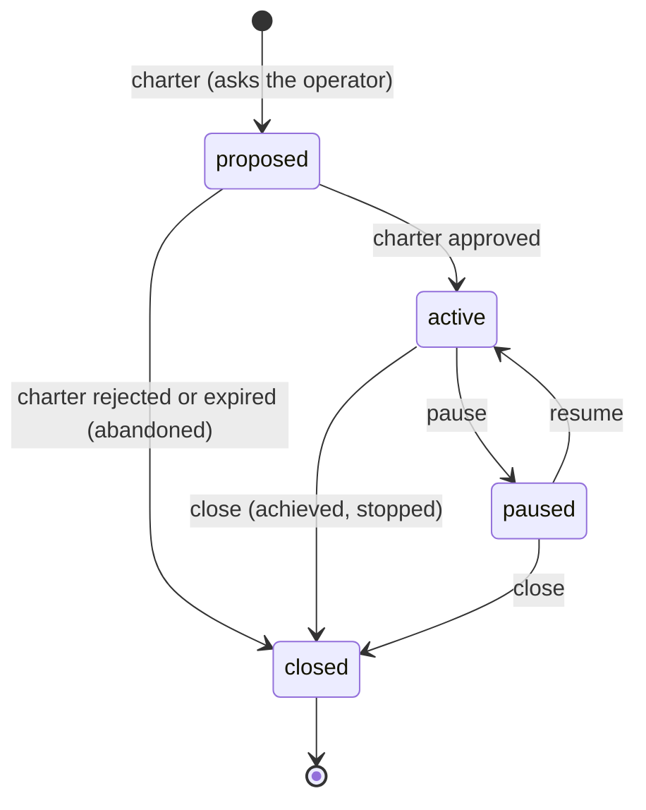
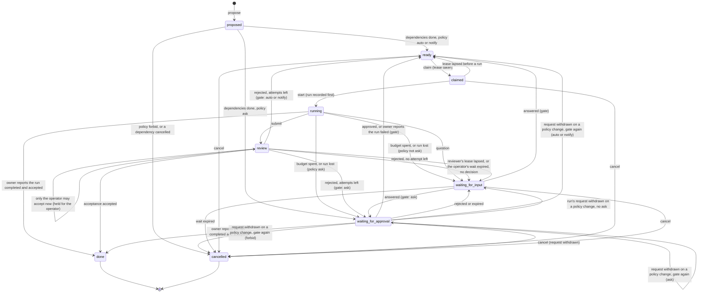

# Board

> Target state. Boundary: [orchestration](../architecture/components.md#orchestration), core
> component *work state machine*
> ([ADR-0036](../decisions/adr/0036-guarantee-core-and-capability-plugins.md)). Proposal:
> [PROP-0010](../proposals/0010-base-version.md). Records: [`project@1.0`](../reference/schemas.md#project),
> [`board-task@1.0`](../reference/schemas.md#board-task).
>
> Implemented in [`board`](../../packages/plugins/board/README.md) (definition
> [`board-core`](../../packages/board-core/README.md)); its bundle row is on, over the
> [approval queue](../../packages/plugins/approvals/README.md); the
> [workflow engine](workflow-engine.md#board-tasks) runs a task's attempts (MCP `run` or
> `system run --task`): it reserves a task's budget lines on the ledger before its run starts
> work, and a spent one blocks the task (`budget-spent`,
> [a task's budget](workflow-engine.md#a-tasks-budget)); a step that cannot finish without a
> person's answer blocks it on its questions (`question`,
> [a question from a run](workflow-engine.md#a-question-from-a-run)); and the `TASKS.md`
> projection (`renderTasks` in [`board-core`](../../packages/board-core/README.md)) is written
> into a task run's own worktree ([TASKS.md in a run's workspace](workflow-engine.md#tasksmd-in-a-runs-workspace)).
> Differs from target: a budget is enforced before a run, never during it, so a run can overdraw
> its last lines; only a Worker source with a worktree per run writes `TASKS.md`. The operator
> accepts or rejects a review, and pauses, resumes, or closes a project, on `/ui`
> ([`web-ui`](../../packages/plugins/web-ui/README.md)).

The board holds work that outlives a run: projects with charters, and their tasks. A run of the
[workflow engine](workflow-engine.md) serves one attempt of one task. Only the board moves a
task or a project, and each move names the decision that caused it
([INV-13](../architecture/invariants.md#inv-13-every-decision-is-an-artifact)). It never asks
the operator itself: every move that needs a person goes through the
[approval queue](approvals.md).

## Seam

`ctx.board` (`Board` in `@tsuuanmi/system-board-core`), contract 1.1:

| Method | Does |
|---|---|
| `charter(input)` | found a project or amend its charter; opens a `charter` approval request |
| `project`, `projects` | read projects |
| `pause`, `resume`, `close` | the operator's project moves |
| `propose(input)` | add a task in `proposed` |
| `task`, `tasks` | read tasks |
| `claim`, `renew` | take and renew a task's lease |
| `start`, `submit` | record the run before it starts; record its result |
| `accept(taskId, acceptance)` | apply the `acceptance` decision on the result |
| `block`, `answer` | interrupt a running task; answer a waiting one |
| `reconcileRun(taskId, runId, outcome)` | the run's owner reports the outcome of a run whose holder was lost |
| `cancel` | cancel a task that is not running or in review |
| `attachDigest(taskId, digest)` | set the result's `digest`, once (1.1, optional: a provider at 1.0 has none) |
| `sweep(at)` | make every move due at `at`: dependencies met, approvals resolved, leases lost, waits expired |

Time-driven moves happen only in `sweep(at)`, so a restart is a sweep, not a replay
([INV-4](../architecture/invariants.md#inv-4-restart-is-reconciliation-not-replay)).

The holder's moves (`start`, `renew`, `submit`, `block`) and the run owner's (`accept` of its
result, `reconcileRun`) belong to the run that serves the attempt: the
[workflow engine](workflow-engine.md#board-tasks) makes them, as that run's owner, so one attempt
has one writer ([INV-15](../architecture/invariants.md#inv-15-one-writer-per-subject)). A lead
takes a task with `board_claim` and hands that claim to the run; no MCP tool makes those moves.

## Project

An amendment (a pivot) does not change the project's state: the new charter waits in
`proposedCharter` and replaces `charter` once approved, or is dropped when refused or expired.

| From → to | Who | Records | On failure |
|---|---|---|---|
| — → proposed | `charter`, by the lead or the operator | the `autonomy` decision (`charter` always asks) and an approval request on the charter's exact version | a charter carrying an approval, or a wrong version, is refused (`invalid`) |
| proposed → active | `sweep`, on an approved request | the request's `approval` decision; `charter.approval` names the verdict | none: until approved nothing starts |
| proposed → proposed / closed, amendment kept / dropped | `sweep`, on a request the queue withdrew on a policy change (decider rule `approvals.policy`): the charter is put to the policy again, as `charter` did | a `board` decision naming the withdrawal and the `autonomy` decision; on `ask`, a new request on the same charter version (an open one adopted), which the project now waits on; on any other verdict no request can be opened, so nothing can approve it: a first charter is abandoned (its open tasks cancelled, `project-closed`), an amendment dropped | the charter keeps waiting until its new request is resolved or expires |
| proposed → closed | `sweep`, on a rejected or expired request; at the request's expiry the board applies it itself when the queue has not resolved it, the board withdrew it, or the queue no longer knows it | `closure: abandoned` with the request's `approval` decision, or the board's own (`board`, cause `expired`); its open tasks are cancelled (`project-closed`) in the same transaction, which frees the subjects they would write | — |
| active ↔ paused | `pause`, `resume`, by the operator | a `board` decision | other states refused (`invalid-transition`) |
| active or paused → closed | `close`, by the operator | a `board` decision and `closure`; open tasks are cancelled (`project-closed`) in the same transaction, and the requests they and a pending amendment waited on are withdrawn after it | refused while a task runs or is in review |

### The operator's project moves

`pause`, `resume`, and `close` are the operator's: no lead or Worker moves a project
([INV-6](../architecture/invariants.md#inv-6-authority-comes-from-trusted-envelopes)). The
operator makes them on `/ui`, the board page, where each move opens a confirmation of what it
does to that project and is sent with the project revision shown, so a project changed since is
refused ([web UI API](../reference/web-ui.md#projects)); or with the MCP tools `board_pause`,
`board_resume`, and `board_close`, which the host serves to the operator token only and which
refuse any other caller themselves. Each records a `board` decision whose candidates say why
([INV-13](../architecture/invariants.md#inv-13-every-decision-is-an-artifact)).

- **Pause** (active → paused): until it is resumed, no task of the project is claimed or started
  (rule 1, also one claimed before the pause) and no proposed task is put to the policy. A running
  attempt goes on to its outcome: its run renews, submits, and reports as usual, and a next
  attempt goes through the gate as usual, then waits, unclaimed. Every wait keeps its expiry, and a
  request answered meanwhile still applies. An amendment may still be asked about.
- **Resume** (paused → active): the approved charter still holds. The next sweep puts the proposed
  tasks whose dependencies are done to the policy, and ready tasks may be claimed again; a task
  already ready is not asked about again.
- **Close** (active or paused → closed, as `achieved` or `stopped`): refused while a task runs or
  is in review, since its run's outcome or its acceptance would be lost. Stop the run first
  (`system stop`: its owner reports it failed, and the task waits or is ready again) or decide the
  review. Otherwise, in one transaction, every open task is cancelled (`project-closed`), a claimed
  one's lease released; once that commits, the requests those tasks and a pending amendment
  waited on are withdrawn, so the queue no longer shows them. A closed project takes no task and
  no amendment.

## Task

The states follow A2A's split into active (`ready`, `claimed`, `running`, `review`),
interrupted (`waiting-for-input`, `waiting-for-approval`), and terminal (`done`, `cancelled`).
Unlike A2A, every interrupted state has an expiry.

### Where the tables leave room

The store-backed provider settles these cases so that the [fail-closed rules](#fail-closed-rules)
hold. The suite tests, and the fake provider checks too, the acceptance binding, the required
checks, the gate per attempt, founding milestones, the written subject, the board's own expiry
of a wait, a wait the board withdrew itself kept, and a wait put to the policy again after a
policy change; the other cases only the store-backed provider checks.

- `start` outside an active project is refused (`invalid-transition`), also for a task claimed
  before a pause (rule 1).
- An `acceptance` decision applies only when it binds to the task's exact result: its
  `outcome.detail` names the task (`taskId`) and the result's exact subject (`subject`, its
  version included), its inputs hold every artifact of the result and its digest, and its
  outcome is `accept` or `reject`; anything else is refused (`invalid`, rule 5). A run owner's
  report is checked the same way before anything moves, so a refused report changes nothing.
- [Required checks bind at acceptance](#required-checks-bind-at-acceptance).
- One approval covers one attempt. Every return to ready for a new attempt goes through the
  gate again: after a rejected review, a run its owner reports failed or rejected, an approval to
  go on after a spent budget or a lost run, and an answered question, the board asks the policy
  about the task's action class for the next attempt. `ask` opens a new request on
  `board-task:<id>:attempt:<n>` (`n`, the attempts already made) and the task waits for approval
  (`approval-needed`); `forbid` cancels it (`forbidden`); `auto` or `notify` makes it ready. The
  move's `board` decision names the decision that caused it and the `autonomy` decision. A claim
  whose lease lapsed before any run returns to ready without asking: it made no attempt.
- A move that ends a wait on an approval request (`reconcileRun`, `cancel`, `close`) reads the
  request first, so with the queue unavailable nothing moves (rule 7), then commits, and
  withdraws the request only after: a crash between the two leaves an open request that nothing
  waits on, which expires on its own and moves nothing if approved. A request the board withdrew
  itself (decider rule `approvals.withdraw`) is therefore no verdict: the sweep leaves a task
  still waiting on one as it is, since that is the same crash the other way round, and the run's
  owner may still report.
- The queue also withdraws a request when a policy change means the loaded policies no longer ask
  for it ([approvals](approvals.md#a-request)). The board tells the two apart by the resolution's
  `approval` decision: decider rule `approvals.policy`. Such a request gets no verdict, so the
  sweep runs the wait's gate again under the policy loaded now, exactly as a fresh gate: an
  `approval-needed` wait becomes ready on `auto` or `notify`, waits on a new request on the same
  exact subject on `ask` (adopting an open one, so a crash in between asks once), and is
  cancelled (`forbidden`) on `forbid`; a `budget-spent` or `reconciliation-failed` wait asks
  again on `ask` and otherwise waits for input (`rejected`), since such a run goes on only with a
  person; a charter is asked about again on `ask` and otherwise abandoned (a first charter) or
  dropped (an amendment). Every outcome records a `board` decision that names the withdrawal and
  the `autonomy` decision, with a reason on every candidate. A wait's expiry does not end it
  first: the queue withdraws only an unexpired request, so the withdrawal came before the wait
  would have expired.
- No move makes a task ready once its attempts are spent: an approval to go on, or an answered
  question, with no attempt left leaves it waiting for input (`retries-spent`, with a `board`
  decision whose candidates both say why), so `attempts.count` never exceeds `attempts.max` and a
  task that can never start never sits in `ready`, which does not expire (INV-9).
- One amendment waits at a time: another is refused (`invalid-transition`) until it is approved,
  refused, or expired, so a verdict binds the charter it was asked about. An amendment changes the
  charter only.
- Answering a question wait records the questions and answers in the `board` decision's detail,
  which becomes the task's `lastDecision`. Every move back to `ready` clears `run`.
- [A digest attaches to a result](#a-digest-on-a-result) once, and never while the reviewer
  holds the review.
- A task's `milestone` is one of its project's milestones. A founding call declares every
  milestone `planned` with no `funding` (`invalid` otherwise): the charter's approval does not
  fund one.
- A task that `writes` a subject takes a result (`submit`, or a run owner's completed report)
  only on that subject's type and ref (`invalid` otherwise), so the result it leaves is the
  subject it held (INV-15).
- The board adopts its own request on the exact subject when it is open or already approved, so
  a move retried after a crash asks the operator once, and an approval given while the board was
  down still applies; the subject is per attempt and per charter version, so this never carries
  an approval across them. Founding under a `clientRequestId` derives the project's id from it
  for the same reason.

| From → to | Who | Records | On failure |
|---|---|---|---|
| proposed → ready | `sweep`, when every dependency is done and the project is active | a `board` decision (outcome `ready`), after the `autonomy` decision for the task's action class | a paused or proposed project starts nothing |
| proposed → waiting-for-approval | `sweep`, when the policy says ask | the `autonomy` decision; an approval request on `board-task:<id>:attempt:<n>` | the wait expires with the request |
| proposed → cancelled | `sweep`: the policy forbids it, or a dependency was cancelled | the `autonomy` decision (`forbidden`) or a `board` decision (`dependency-cancelled`) | — |
| ready → claimed | `claim`, by the engine or the lead | a `board` decision; a lease of a new generation | a task not ready, or of a project not active, is refused |
| claimed → ready | `sweep`, the lease lapsed and no run started | a `board` decision | the old generation is fenced out (`stale-generation`) |
| claimed → running | `start`, with the holder's generation | a `board` decision; `run` is written before the run starts, and the attempt counted | a stale generation or lapsed lease is refused |
| running → review | `submit`, with the result's exact subject (a commit, or the result artifact) | a `board` decision; `result` | unknown result artifacts are refused |
| running → waiting-for-approval | `block` (`budget-spent`: action class `funding`), or `sweep` when the holder's lease lapsed mid-run (`reconciliation-failed`: `remediation`), on an `ask` verdict | the `autonomy` decision and an approval request | the run is never started again on its own (INV-4) |
| running → waiting-for-input (`rejected`) | the same, on any other verdict: `forbid`, and also `auto` or `notify`, since the queue takes a request only on `ask` | a `board` decision naming the `autonomy` decision | a spent or lost run is never readied or cancelled by the policy alone, so it waits for a person; the wait expires (`input-expired`) |
| running → waiting-for-input | `block` with questions | a `board` decision | a question wait without questions is refused |
| running or waiting-for-approval (`reconciliation-failed`) → done, ready, or waiting-for-input | `reconcileRun` by the run's owner (the workflow engine), after it reconciled the recorded run | the acceptance decision of a completed run, or a `board` decision for a failed one; the pending approval request is withdrawn once the move committed | an outcome for another run id is refused; an unknown outcome is never reported, so the task keeps waiting for approval |
| review → review (held for the operator) | `accept` (or a run owner's completed report) with an accepting decision that is not the operator's, while the class's required checks have not passed or the policy forbids the class | a `board` decision naming the acceptance and the `autonomy` decision; the lease released; `waiting` (`operator-review`, the checks still pending, and the policy's wait for the class) | only the operator's acceptance accepts it now: another such decision is refused (`invalid`); a rejection, or one with the checks passed, applies |
| review → waiting-for-input | `sweep`, the reviewer's lease lapsed with no decision, or a review held for the operator reached `waiting.expiresAt` | a `board` decision (`review-expired`) | the wait expires and cancels the task |
| review → done | `accept` with an `acceptance` decision whose outcome is `accept` | that decision; `result.acceptance`; the run and subject stay | a decision of another type, or one not bound to the task's exact result, is refused; one not the operator's needs the required checks passed |
| review → ready / waiting-for-approval / waiting-for-input | `accept` with a `reject` outcome | while `count < max`, another attempt through the gate: a `board` decision naming that decision and the `autonomy` decision (ready, or `approval-needed` with a new request); else that decision and `retries-spent` | an approval of an earlier attempt never covers this one |
| waiting-for-approval → ready / waiting-for-approval / waiting-for-input | `sweep`, on the request's resolution (an approval to go on after `budget-spent` or `reconciliation-failed` goes through the gate for the next attempt); at `waiting.expiresAt` (or the request's expiry, if earlier) the board applies the expiry itself when the queue has not resolved the request, the board withdrew it, or the queue no longer knows it | the request's `approval` decision, or the board's own (`board`, cause `expired`), after which it withdraws a request still open | rejection and expiry never start work: the task waits for input (`rejected`) |
| waiting-for-approval → ready / waiting-for-approval / cancelled (`approval-needed`), or waiting-for-approval / waiting-for-input (`budget-spent`, `reconciliation-failed`) | `sweep`, on a request the queue withdrew on a policy change (decider rule `approvals.policy`): the wait's gate runs again under the policy loaded now, as when it first asked (the class: the task's, `funding`, or `remediation`) | a `board` decision naming the withdrawal and the `autonomy` decision, a reason on every outcome the wait has; `approval-needed`: ready on `auto` or `notify` (pending checks recorded), a new request on the same exact subject on `ask` (an open one adopted), `forbidden` on `forbid`; a spent budget or a lost run: a new request on `ask`, else a wait for input (`rejected`), the run kept | a move that cannot commit withdraws the new request; the run's owner may still report a lost run |
| waiting-for-input → ready / waiting-for-approval | `answer`, every question of a `question` wait answered; the next attempt goes through the gate, and with no attempt left the task waits for input (`retries-spent`) instead | a `board` decision with the questions and answers | partial answers, and answers to any other wait, are refused |
| waiting-for-input → cancelled | `sweep`, its wait expired | a `board` decision (`input-expired`) | — |
| any not running or in review → cancelled | `cancel` (`operator`, `lead`, `superseded`) | a `board` decision; a pending approval request is withdrawn once the move committed; dependents are cancelled on the next sweep | a running task or one in review is refused |

### What ends an input wait

Only a question wait takes input. The other input waits record why a person is needed, and no
input revives them: `answer` refuses them (`invalid`), and they only expire to `cancelled`
(`input-expired`), or end earlier by `cancel`. To go on, the lead or the operator proposes the
work again as a new task.

| `waiting.reason` | From | Revived by | Otherwise |
|---|---|---|---|
| `question` | `block` with questions | `answer` (`board_update` answers), every question by index: the next attempt, through the gate; with no attempt left, `retries-spent` instead | expires: `input-expired` |
| `rejected` | an approval refused or expired, or none could be asked | nothing | expires: `input-expired` |
| `retries-spent` | review rejected the last attempt, a failed run with none left, or an approval to go on or an answered question with none left | nothing | expires: `input-expired` |
| `review-expired` | the reviewer's lease lapsed, or a review held for the operator expired, with no acceptance decision | nothing | expires: `input-expired` |

### A digest on a result

`result.digest` is a cited summary of the result's artifacts ([digests](digests.md)), which a
lead, the operator, and the next attempt's or a dependent task's brief read in place of the raw
artifacts. A digest is a capability: it never accepts anything, and a result with none is
complete. `attachDigest(taskId, digest)` (contract 1.1, an optional method: a provider at 1.0 has
none, and its results keep no digest) sets it; the [workflow engine](workflow-engine.md#a-digest-of-a-tasks-result)
calls it once a digest of a run's result is written:

- the digest is a stored `digest@1.0` report whose sources are exactly the result's artifacts
  (`invalid` otherwise), so it binds to that result and no other (INV-5);
- once: the same digest again changes nothing, another is refused (`invalid-transition`);
- not while the task has no result, and not while the reviewer holds the review
  (`invalid-transition`): the acceptance being made binds to the whole result, digest included,
  so a digest attached under it would refuse it. A review held for the operator takes one, and
  the operator's acceptance then names it among its inputs (the web UI reads the task when it
  records the operator's decision);
- in any other state with a result (done, or back to ready or waiting after a rejection, until the
  next attempt's `start` clears the result) it attaches. A done task's acceptance stands on the
  raw artifacts it named;
- no state moves and no `board` decision is made: the digest's own settling decision records it,
  and the record's revision moves on.

### Required checks bind at acceptance

A policy rule `auto` or `notify` may require checks (`requires`, for example tests and lint for
`workspace-write`). Nothing has run when a task becomes ready, so readiness does not wait on
them: the readiness decision records the rule's checks still to run (`pendingChecks`). They bind
when the result is accepted:

- An accepting `acceptance` decision that is not the operator's (its decider and its envelope's
  producer are both `operator`) applies only when `ctx.approvals.check` on the task's action
  class, given the checks the decision reports in `outcome.detail.checks` (check name → passed),
  gives no `failedChecks` and does not forbid the class. Otherwise the board holds the review for
  the operator, whose own acceptance decision is the only one that accepts it now: `accept` (and a
  run owner's completed report, which records the result) releases the reviewer's lease and
  records `waiting` with reason `operator-review`, the checks still pending, and an expiry the
  policy's wait for the class sets (`waitSeconds`: the shortest applying rule's `expiresSeconds`,
  else the stricter `expiry.defaultSeconds`, as an approval request's), so the operator's review
  outlives the run that held the lease. At that expiry the task waits for input
  (`review-expired`). The board opens no approval request for this, since the queue takes a
  request only on an `ask` verdict; the operator decides on `/ui`, the human channel (INV-6).
- A `reject` applies with or without checks: a failed check goes back to the lead as another
  attempt ([approvals](approvals.md#the-autonomy-policy)).
- A class the policy asks about needs no check here: the operator approved the attempt before it
  started.

## Fail-closed rules

1. No task starts outside an active project with an approved charter.
2. No task starts unless the policy's verdict on its action class allows it, or an operator
   approved it. A rejected or expired approval never starts work.
3. A started run is recorded before it starts, and a run whose holder was lost is never started
   again without an approval. Its owner reconciles it first; only an unknown outcome reaches the
   operator.
4. Every interrupted state expires, and expiry never starts work: an approval wait follows its
   request, an input wait cancels the task (INV-9). The board does not depend on the queue for
   this: it applies an unresolved or unknown request's expiry itself, for a task and a charter.
5. A task is done only by an accepting `acceptance` decision on a result with its exact subject.
   The board never accepts by default, and review is bounded by the reviewer's lease, or, held
   for the operator, by the policy's wait for the class.
6. One task at a time holds write authority over a subject (`writes`), and every write presents
   the holder's generation ([INV-15](../architecture/invariants.md#inv-15-one-writer-per-subject)).
7. With `ctx.approvals` unavailable, every move that needs it fails and nothing moves.

## Conformance

[`board-core/conformance/board.ts`](../../packages/board-core/conformance/board.ts), 26
scenarios at contract 1.1 (`board.digest-attached` since 1.1), run against the fake provider and the store-backed provider, both over
the approvals fake, and against the store-backed provider over the store-backed approval queue.
Contract 1.0 is unreleased and amended in place
([ADR-0039](../decisions/adr/0039-base-guarantee-seam-contract-changes.md)); the last amendment
adds `board.policy-change-asks-again`, for which each harness changes the queue's policies
(`changePolicies`: the fake's `reload`, or a restart of the store-backed queue over the same
store).
