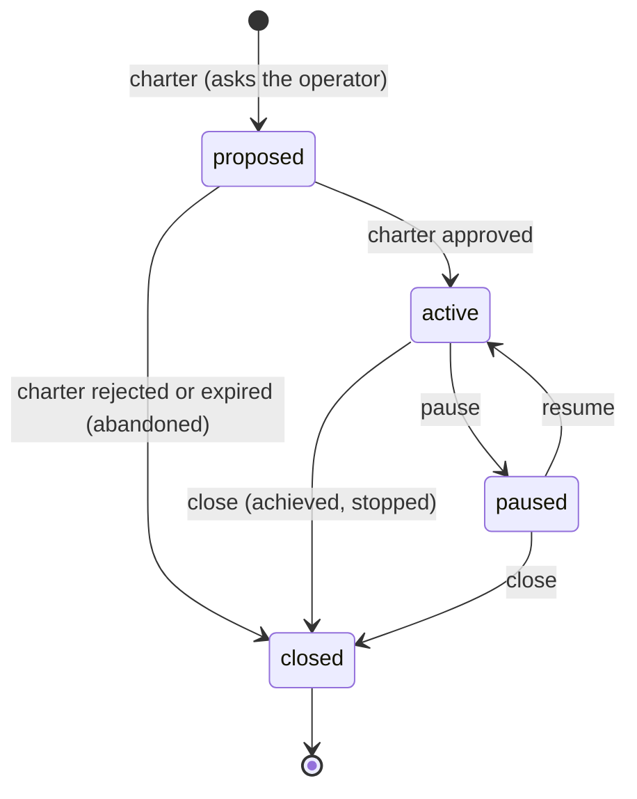
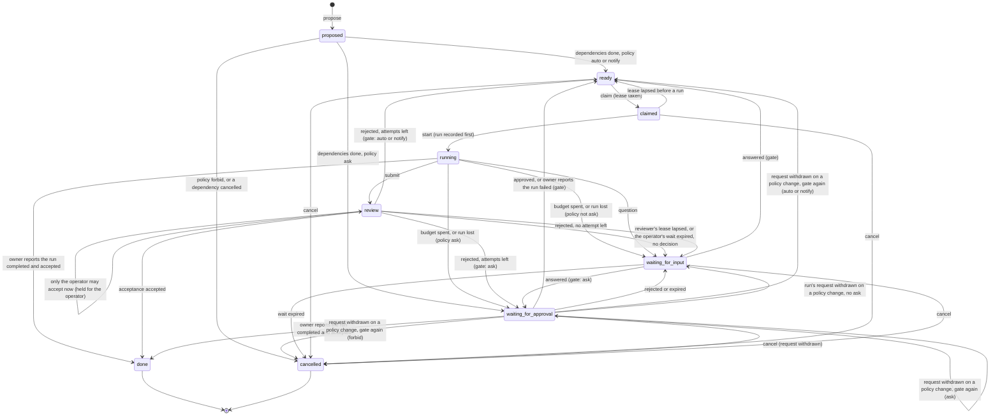

# Board

> Target state. Boundary: [orchestration](../architecture/components.md#orchestration), core
> component *work state machine*
> ([ADR-0036](../decisions/adr/0036-guarantee-core-and-capability-plugins.md)). Proposal:
> [PROP-0010](../proposals/0010-base-version.md). Records: [`project@1.0`](../reference/schemas.md#project),
> [`board-task@1.1`](../reference/schemas.md#board-task). Decisions:
> [ADR-0039](../decisions/adr/0039-base-guarantee-seam-contract-changes.md),
> [ADR-0044](../decisions/adr/0044-funding-raises-a-spent-task-budget.md).
>
> Implemented in [`board`](../../packages/plugins/board/README.md) (definition
> [`board-core`](../../packages/board-core/README.md)), its bundle row on over the
> [approval queue](../../packages/plugins/approvals/README.md); the
> [workflow engine](workflow-engine.md#board-tasks) runs a task's attempts, and its dispatch pass
> asks the operator to start a ready task on a free Worker chosen by quota
> ([dispatch](workflow-engine.md#dispatch-starting-ready-work-by-itself); the board reads nothing
> new); the operator starts a ready task's run (as the lead does with MCP `run` and `task`), accepts or rejects a
> review, and pauses, resumes, or closes a project, on `/ui`
> ([`web-ui`](../../packages/plugins/web-ui/README.md)); differs from target: a budget is
> enforced before each step of a run, never inside one, so a step in flight can overdraw its last
> lines ([ADR-0047](../decisions/adr/0047-a-run-stops-at-a-boundary-once-its-task-budget-is-spent.md));
> only a Worker source with a worktree per run writes `TASKS.md`
> ([TASKS.md in a run's workspace](workflow-engine.md#tasksmd-in-a-runs-workspace)).

The board holds work that outlives a run: projects with charters, and their tasks. A run of the
[workflow engine](workflow-engine.md) serves one attempt of one task. Only the board moves a
task or a project, and each move names the decision that caused it
([INV-13](../architecture/invariants.md#inv-13-every-decision-is-an-artifact)). It never asks
the operator itself: every move that needs a person goes through the
[approval queue](approvals.md).

## Seam

`ctx.board` (`Board` in `@tsuuanmi/system-board-core`), contract 1.5:

| Method | Does |
|---|---|
| `charter(input)` | found a project or amend its charter; opens a `charter` approval request |
| `project`, `projects` | read projects |
| `pause`, `resume`, `close` | the operator's project moves |
| `propose(input)` | add a task in `proposed`, with the attempts it names (`maxAttempts`), else the provider's for its template, else its default ([attempts](#attempts)) |
| `task`, `tasks` | read tasks |
| `claim`, `renew` | take and renew a task's lease |
| `start`, `submit` | record the run before it starts; record its result |
| `accept(taskId, acceptance)` | apply the `acceptance` decision on the result |
| `block`, `answer` | interrupt a running task, a spent budget naming the funding it asks for (`funding`, 1.2, optional) and the ledger's reservations its holder could not release (`unreleased`, 1.3, optional: [funding a spent budget](#funding-a-spent-budget)); answer a waiting one |
| `reconcileRun(taskId, runId, outcome)` | the run's owner reports the outcome of a run whose holder was lost, or that failed; a failed run that failed only on the infrastructure (`infrastructure`, 1.5) is not counted, within a bound ([attempts](#an-attempt-not-spent-on-the-infrastructure)) |
| `cancel` | cancel a task that is not running or in review |
| `attachDigest(taskId, digest)` | set the result's `digest`, once (1.1, optional: a provider at 1.0 has none) |
| `reopen(taskId, { runId, acceptance, decision, reason })` | send a `done` task's accepted result back as another attempt, when its landing found it cannot land on its target as that is now (1.4, optional: [ADR-0068](../decisions/adr/0068-an-accepted-result-is-rebased-onto-its-target-and-checked-again-before-it-lands.md)): only while it is done on exactly that run's result and acceptance; the move a rejected attempt makes (through the gate again, or `retries-spent` with none left), its `board` decision naming `decision`; it counts no attempt |
| `sweep(at)` | make every move due at `at`: dependencies met, approvals resolved, leases lost, waits expired |

Time-driven moves happen only in `sweep(at)`, so a restart is a sweep, not a replay
([INV-4](../architecture/invariants.md#inv-4-restart-is-reconciliation-not-replay)).

The holder's moves (`start`, `renew`, `submit`, `block`) and the run owner's (`accept` of its
result, `reconcileRun`) belong to the run that serves the attempt: the
[workflow engine](workflow-engine.md#board-tasks) makes them, as that run's owner, so one attempt
has one writer ([INV-15](../architecture/invariants.md#inv-15-one-writer-per-subject)). A lead
takes a task with `board_claim` and hands that claim to the run; no MCP tool makes those moves.

A `board_*` tool that changes the board (`board_charter`, `board_propose`, `board_claim`,
`board_update`, `board_cancel`, and the operator's moves) checks the output it would give inside
the move's store transaction, before it commits: an output its schema refuses (a defect) is
refused with nothing moved, decided, or withdrawn, and a request the move opened on the queue is
withdrawn ([INV-2](../architecture/invariants.md#inv-2-fail-closed),
[INV-14](../architecture/invariants.md#inv-14-every-record-has-a-versioned-schema)).

## Project

An amendment (a pivot) does not change the project's state: the new charter waits in
`proposedCharter` and replaces `charter` once approved, or is dropped when refused or expired.

| From → to | Who | Records | On failure |
|---|---|---|---|
| — → proposed | `charter`, by the lead or the operator | the `autonomy` decision (`charter` always asks) and an approval request on the charter's exact version | a charter carrying an approval, or a wrong version, is refused (`invalid`) |
| proposed → active | `sweep`, on an approved request | the request's `approval` decision; `charter.approval` names the verdict | none: until approved nothing starts |
| proposed → proposed / closed, amendment kept / dropped | `sweep`, on a request the queue withdrew on a policy change (decider rule `approvals.policy`): the charter is put to the policy again, as `charter` did | a `board` decision naming the withdrawal and the `autonomy` decision; on `ask`, a new request on the same charter version (an open one adopted), which the project now waits on; on any other verdict no request can be opened, so nothing can approve it: a first charter is abandoned (its open tasks cancelled, `project-closed`), an amendment dropped | the charter keeps waiting until its new request is resolved or expires |
| proposed → closed | `sweep`, on a rejected or expired request; at the request's expiry the board applies it itself when the queue has not resolved it, the board withdrew it, or the queue no longer knows it | `closure: abandoned` with the request's `approval` decision, or the board's own (`board`, cause `expired`); its open tasks are cancelled (`project-closed`) in the same transaction, which frees the subjects they would write | — |
| active ↔ paused | `pause`, `resume`, by the operator | a `board` decision | other states refused (`invalid-transition`) |
| active or paused → closed | `close`, by the operator | a `board` decision and `closure`; open tasks are cancelled (`project-closed`) in the same transaction, and the requests they and a pending amendment waited on are withdrawn after it | refused while a task runs or is in review |

### The operator's project moves

`pause`, `resume`, and `close` are the operator's: no lead or Worker moves a project
([INV-6](../architecture/invariants.md#inv-6-authority-comes-from-trusted-envelopes)). The
operator makes them on `/ui`, the board page, where each move opens a confirmation of what it
does to that project and is sent with the project revision shown, so a project changed since is
refused ([web UI API](../reference/web-ui.md#projects)); or with the MCP tools `board_pause`,
`board_resume`, and `board_close`, which the host serves to the operator token only and which
refuse any other caller themselves. Each records a `board` decision whose candidates say why
([INV-13](../architecture/invariants.md#inv-13-every-decision-is-an-artifact)).

- **Pause** (active → paused): until it is resumed, no task of the project is claimed or started
  (rule 1, also one claimed before the pause) and no proposed task is put to the policy. A running
  attempt goes on to its outcome: its run renews, submits, and reports as usual, and a next
  attempt goes through the gate as usual, then waits, unclaimed. Every wait keeps its expiry, and a
  request answered meanwhile still applies. An amendment may still be asked about.
- **Resume** (paused → active): the approved charter still holds. The next sweep puts the proposed
  tasks whose dependencies are done to the policy, and ready tasks may be claimed again; a task
  already ready is not asked about again.
- **Close** (active or paused → closed, as `achieved` or `stopped`): refused while a task runs or
  is in review, since its run's outcome or its acceptance would be lost. Stop the run first
  (`system stop`: its owner reports it failed, and the task waits or is ready again) or decide the
  review. Otherwise, in one transaction, every open task is cancelled (`project-closed`), a claimed
  one's lease released; once that commits, the requests those tasks and a pending amendment
  waited on are withdrawn, so the queue no longer shows them. A closed project takes no task and
  no amendment.

## Task

The states follow A2A's split into active (`ready`, `claimed`, `running`, `review`),
interrupted (`waiting-for-input`, `waiting-for-approval`), and terminal (`done`, `cancelled`).
Unlike A2A, every interrupted state has an expiry.

### Where the tables leave room

The store-backed provider settles these cases so that the [fail-closed rules](#fail-closed-rules)
hold. The suite tests, and the fake provider checks too, the acceptance binding, the required
checks, the gate per attempt, founding milestones, the written subject, the board's own expiry
of a wait, a wait the board withdrew itself kept, and a wait put to the policy again after a
policy change; the other cases only the store-backed provider checks.

- `start` outside an active project is refused (`invalid-transition`), also for a task claimed
  before a pause (rule 1).
- An `acceptance` decision applies only when it binds to the task's exact result: its
  `outcome.detail` names the task (`taskId`) and the result's exact subject (`subject`, its
  version included), its inputs hold every artifact of the result and its digest, and its
  outcome is `accept` or `reject`; anything else is refused (`invalid`, rule 5). A run owner's
  report is checked the same way before anything moves, so a refused report changes nothing.
- [Required checks bind at acceptance](#required-checks-bind-at-acceptance).
- [System accepts a listed branch's result](#system-accepts-a-listed-branchs-result) (`autoAccept`, D80).
- One approval covers one attempt. Every return to ready for a new attempt goes through the
  gate again: after a rejected review, a run its owner reports failed or rejected, an approval to
  go on after a spent budget or a lost run, and an answered question, the board asks the policy
  about the task's action class for the next attempt. `ask` opens a new request on
  `board-task:<id>:attempt:<n>` (`n`, the attempts already made) and the task waits for approval
  (`approval-needed`); `forbid` cancels it (`forbidden`); `auto` or `notify` makes it ready. The
  move's `board` decision names the decision that caused it and the `autonomy` decision. A claim
  whose lease lapsed before any run returns to ready without asking: it made no attempt.
- A move that ends a wait on an approval request (`reconcileRun`, `cancel`, `close`) reads the
  request first, so with the queue unavailable nothing moves (rule 7), then commits, and
  withdraws the request only after: a crash between the two leaves an open request that nothing
  waits on, which expires on its own and moves nothing if approved. A request the board withdrew
  itself (decider rule `approvals.withdraw`) is therefore no verdict: the sweep leaves a task
  still waiting on one as it is, since that is the same crash the other way round, and the run's
  owner may still report.
- The queue also withdraws a request when a policy change means the loaded policies no longer ask
  for it ([approvals](approvals.md#a-request)). The board tells the two apart by the resolution's
  `approval` decision: decider rule `approvals.policy`. Such a request gets no verdict, so the
  sweep runs the wait's gate again under the policy loaded now, exactly as a fresh gate: an
  `approval-needed` wait becomes ready on `auto` or `notify`, waits on a new request on the same
  exact subject on `ask` (adopting an open one, so a crash in between asks once), and is
  cancelled (`forbidden`) on `forbid`; a `budget-spent` or `reconciliation-failed` wait asks
  again on `ask` and otherwise waits for input (`rejected`), since such a run goes on only with a
  person; a charter is asked about again on `ask` and otherwise abandoned (a first charter) or
  dropped (an amendment). Every outcome records a `board` decision that names the withdrawal and
  the `autonomy` decision, with a reason on every candidate. A wait's expiry does not end it
  first: the queue withdraws only an unexpired request, so the withdrawal came before the wait
  would have expired.
- No move makes a task ready once its attempts are spent: an approval to go on, or an answered
  question, with no attempt left leaves it waiting for input (`retries-spent`, with a `board`
  decision whose candidates both say why), so `attempts.count` never exceeds `attempts.max` and a
  task that can never start never sits in `ready`, which does not expire (INV-9).
- One amendment waits at a time: another is refused (`invalid-transition`) until it is approved,
  refused, or expired, so a verdict binds the charter it was asked about. An amendment changes the
  charter only.
- Answering a question wait records the questions and answers in the `board` decision's detail,
  which becomes the task's `lastDecision`. Every move back to `ready` clears `run`.
- [A digest attaches to a result](#a-digest-on-a-result) once, and never while the reviewer
  holds the review.
- A task's `milestone` is one of its project's milestones. A founding call declares every
  milestone `planned` with no `funding` (`invalid` otherwise): the charter's approval does not
  fund one.
- A task that `writes` a subject takes a result (`submit`, or a run owner's completed report)
  only on that subject's type and ref (`invalid` otherwise), so the result it leaves is the
  subject it held (INV-15).
- The board adopts its own request on the exact subject when it is open or already approved, so
  a move retried after a crash asks the operator once, and an approval given while the board was
  down still applies; the subject is per attempt and per charter version, so this never carries
  an approval across them. Founding under a `clientRequestId` derives the project's id from it
  for the same reason.

| From → to | Who | Records | On failure |
|---|---|---|---|
| proposed → ready | `sweep`, when every dependency is done and the project is active | a `board` decision (outcome `ready`), after the `autonomy` decision for the task's action class | a paused or proposed project starts nothing |
| proposed → waiting-for-approval | `sweep`, when the policy says ask | the `autonomy` decision; an approval request on `board-task:<id>:attempt:<n>` | the wait expires with the request |
| proposed → cancelled | `sweep`: the policy forbids it, or a dependency was cancelled | the `autonomy` decision (`forbidden`) or a `board` decision (`dependency-cancelled`) | — |
| ready → claimed | `claim`, by the engine or the lead | a `board` decision; a lease of a new generation | a task not ready, or of a project not active, is refused |
| claimed → ready | `sweep`, the lease lapsed and no run started | a `board` decision | the old generation is fenced out (`stale-generation`) |
| claimed → running | `start`, with the holder's generation | a `board` decision; `run` is written before the run starts, and the attempt counted | a stale generation or lapsed lease is refused |
| running → review | `submit`, with the result's exact subject (a commit, or the result artifact) | a `board` decision; `result` | unknown result artifacts are refused |
| running → waiting-for-approval | `block` (`budget-spent`: action class `funding`), or `sweep` when the holder's lease lapsed mid-run (`reconciliation-failed`: `remediation`), on an `ask` verdict | the `autonomy` decision and an approval request; a spent budget's `funding` ask is bound by the request's subject and kept in `waiting.funding` ([funding a spent budget](#funding-a-spent-budget)) | the run is never started again on its own (INV-4); an invalid ask is refused (`invalid`) and nothing changes |
| running → waiting-for-input (`rejected`) | the same, on any other verdict: `forbid`, and also `auto` or `notify`, since the queue takes a request only on `ask`; or a `funding` ask past the bound per task, which no request is opened for | a `board` decision naming the `autonomy` decision, or the ask and the bound | a spent or lost run is never readied or cancelled by the policy alone, so it waits for a person; the wait expires (`input-expired`) |
| running → waiting-for-input | `block` with questions | a `board` decision | a question wait without questions is refused |
| running or waiting-for-approval (`reconciliation-failed`) → done, ready, or waiting-for-input | `reconcileRun` by the run's owner (the workflow engine), after it reconciled the recorded run | the acceptance decision of a completed run, or a `board` decision for a failed one; a failed run that failed only on the infrastructure, with a free retry left, is not counted (`attempts.count` back by one, the same attempt through the gate, the kind and reason in the decision; [attempts](#an-attempt-not-spent-on-the-infrastructure)); the pending approval request is withdrawn once the move committed | an outcome for another run id is refused; an unknown outcome is never reported, so the task keeps waiting for approval; a malformed `infrastructure` is refused (`invalid`) |
| review → review (held for the operator) | `accept` (or a run owner's completed report) with an accepting decision that is not the operator's, while the class's required checks have not passed or the policy forbids the class | a `board` decision naming the acceptance and the `autonomy` decision; the lease released; `waiting` (`operator-review`, the checks still pending, and the policy's wait for the class) | only the operator's acceptance accepts it now: another such decision is refused (`invalid`); a rejection, or one with the checks passed, applies |
| review → waiting-for-input | `sweep`, the reviewer's lease lapsed with no decision, or a review held for the operator reached `waiting.expiresAt` | a `board` decision (`review-expired`) | the wait expires and cancels the task |
| review → done | `accept` with an `acceptance` decision whose outcome is `accept` | that decision; `result.acceptance`; the run and subject stay; under `autoAccept`, a `board` decision of rule `board.auto-accept` naming the acceptance, the review, and the check-run record ([System accepts a listed branch's result](#system-accepts-a-listed-branchs-result)) | a decision of another type, or one not bound to the task's exact result, is refused; one not the operator's needs the required checks passed, and under `autoAccept` the rule's conditions met, else it is held for the operator |
| review → ready / waiting-for-approval / waiting-for-input | `accept` with a `reject` outcome | while `count < max`, another attempt through the gate: a `board` decision naming that decision and the `autonomy` decision (ready, or `approval-needed` with a new request); else that decision and `retries-spent` | an approval of an earlier attempt never covers this one |
| waiting-for-approval → ready / waiting-for-approval / waiting-for-input | `sweep`, on the request's resolution (an approval to go on after `budget-spent` or `reconciliation-failed` goes through the gate for the next attempt, a `funding` ask's lines added to the budget first, in the same transaction); at `waiting.expiresAt` (or the request's expiry, if earlier) the board applies the expiry itself when the queue has not resolved the request, the board withdrew it, or the queue no longer knows it | the request's `approval` decision, or the board's own (`board`, cause `expired`), after which it withdraws a request still open; a raise: `funding` and its `board` decision, which the gate's decision names | rejection and expiry never start work, and raise nothing: the task waits for input (`rejected`) |
| waiting-for-approval → ready / waiting-for-approval / cancelled (`approval-needed`), or waiting-for-approval / waiting-for-input (`budget-spent`, `reconciliation-failed`) | `sweep`, on a request the queue withdrew on a policy change (decider rule `approvals.policy`): the wait's gate runs again under the policy loaded now, as when it first asked (the class: the task's, `funding`, or `remediation`) | a `board` decision naming the withdrawal and the `autonomy` decision, a reason on every outcome the wait has; `approval-needed`: ready on `auto` or `notify` (pending checks recorded), a new request on the same exact subject on `ask` (an open one adopted), `forbidden` on `forbid`; a spent budget or a lost run: a new request on `ask`, else a wait for input (`rejected`), the run kept | a move that cannot commit withdraws the new request; the run's owner may still report a lost run |
| waiting-for-input → ready / waiting-for-approval | `answer`, every question of a `question` wait answered; the next attempt goes through the gate, and with no attempt left the task waits for input (`retries-spent`) instead | a `board` decision with the questions and answers | partial answers, and answers to any other wait, are refused |
| waiting-for-input → cancelled | `sweep`, its wait expired | a `board` decision (`input-expired`) | — |
| any not running or in review → cancelled | `cancel` (`operator`, `lead`, `superseded`) | a `board` decision; a pending approval request is withdrawn once the move committed; dependents are cancelled on the next sweep | a running task or one in review is refused |

### What ends an input wait

Only a question wait takes input. The other input waits record why a person is needed, and no
input revives them: `answer` refuses them (`invalid`), and they only expire to `cancelled`
(`input-expired`), or end earlier by `cancel`. To go on, the lead or the operator proposes the
work again as a new task.

| `waiting.reason` | From | Revived by | Otherwise |
|---|---|---|---|
| `question` | `block` with questions | `answer` (`board_update` `answers`, one `{question, answer}` per question, `question` its index from 0 in `waiting.questions`), every question once: the next attempt, through the gate; with no attempt left, `retries-spent` instead | expires: `input-expired` |
| `rejected` | an approval refused or expired, or none could be asked (a policy that does not ask, or a funding ask past the bound) | nothing | expires: `input-expired` |
| `retries-spent` | review rejected the last attempt, a failed run with none left (an infrastructure failure too, once the task's free retries are used, its decision saying so with the reason), or an approval to go on or an answered question with none left | nothing | expires: `input-expired` |
| `review-expired` | the reviewer's lease lapsed, or a review held for the operator expired, with no acceptance decision | nothing | expires: `input-expired` |

### Funding a spent budget

A task's `budget` lines cap what its attempts draw, together, as the
[resource ledger](resources.md) counts them for the task. A spent line blocks the task
(`budget-spent`), and only an approved `funding` request lets it go on. From contract 1.2 the
request names the exact lines it would add, and the approval adds exactly those
([ADR-0044](../decisions/adr/0044-funding-raises-a-spent-task-budget.md)). The holder computes
them: the [workflow engine](workflow-engine.md#funding-a-spent-task) takes them from the ledger's
count, never from a model.

| Step | Who | Records | On failure |
|---|---|---|---|
| asked | the holder's `block` with `reason: budget-spent` and `funding`: 1 to 16 lines, at most one per pool and unit of the task's budget, each above zero | on `ask`, one request on `board-task:<id>:attempt:<n>` at version `budget-spent:<sha256 of the lines' canonical JSON>`, its summary naming the lines and its consequences the budget they make; `waiting.funding`, which `TASKS.md` shows under the wait; the record is `board-task@1.1` | an invalid ask is refused (`invalid`), and nothing changes; an ask past the bound opens no request: the task waits for input (`rejected`), with a `board` decision naming the ask and the bound; on a verdict other than `ask`, the task waits for input, as without an ask |
| funded | `sweep`, on the operator's approval of that request, while an attempt is left | in one transaction: the lines added to every budget line of their pool and unit; `funding` gains `{lines, approval, decision, at}`, its `board` decision (`budget-spent` → `funded`) naming the approval and its `approval` decision; then the next attempt through the gate, its decision naming the raise | a request whose subject does not bind the stored lines (INV-5), or lines past the bound in force now: nothing raised, the task waits for input (`rejected`); a crash before the commit leaves the task waiting on the approved request, and the next sweep applies it once, adopting the request the gate opened (INV-4) |
| not funded | `sweep`: rejected, expired, or approved with no attempt left | as for any `budget-spent` wait: waiting for input (`rejected`, or `retries-spent` with no attempt left) | the budget never changes |
| asked again | `sweep`, on a request the queue withdrew on a policy change | a new request on the same subject, the wait keeping its lines | as for any `budget-spent` wait |

- **The bound** (INV-9) is the provider's configuration: what all of a task's raises add to one of
  its lines may not exceed `fundingMaxPercent` (default 100) of the amount the task declared,
  which is the line less what raises added; nor may a line pass 10^12. It is checked when the
  task is blocked and again when an approval is applied. Each raise follows a spent run, which is
  an attempt, so a task is raised at most `attempts.max - 1` times. The suite tests an ask past
  any bound a provider may set; the store-backed provider's tests cover the bound across raises
  and one lowered before an approval is applied.
- **Exact lines.** The board applies only the lines its wait stored, and only on a request whose
  subject's version is their hash, so what the operator approved is what is added.
- A `budget-spent` block without `funding` asks only to go on, as at 1.1. The engine sends none when
  the ledger cannot count the task's usage, or when no line is reached by recorded usage.
- **Reservations not released** (1.3, [ADR-0054](../decisions/adr/0054-a-funding-request-names-the-holds-the-ledger-did-not-release.md)):
  a `budget-spent` block may name `unreleased`, 1 to 8 of the ledger's reservations its holder
  could not release (each a run id and a step of 1 to 200 characters, `run` for a run's one
  reservation, and an ISO date `expiresAt` when known); a malformed list, or one on another wait,
  is refused (`invalid`) and nothing changes. They still count against the task's budget until they
  expire, so they may be what refused the step. The request's consequences name each one and say
  that the next attempt may be refused again before then; its summary counts them. They change
  neither the request's subject nor the wait, and nothing is released or raised for them. A
  request asked again after a policy change does not name them, since the wait does not keep them.
- The workflow engine makes no `budget-spent` block on a task's last attempt, since no approval
  could serve it: it reports the run failed (`reconcileRun`), and the task waits for input
  (`retries-spent`) with nothing asked ([funding a spent task](workflow-engine.md#funding-a-spent-task)).
  A block another holder makes then is approved to no effect, as the "not funded" row says.

### A digest on a result

`result.digest` is a cited summary of the result's artifacts ([digests](digests.md)), which a
lead, the operator, and the next attempt's or a dependent task's brief read in place of the raw
artifacts. A digest is a capability: it never accepts anything, and a result with none is
complete. `attachDigest(taskId, digest)` (contract 1.1, an optional method: a provider at 1.0 has
none, and its results keep no digest) sets it; the [workflow engine](workflow-engine.md#a-digest-of-a-tasks-result)
calls it once a digest of a run's result is written:

- the digest is a stored `digest@1.0` report whose sources are exactly the result's artifacts
  (`invalid` otherwise), so it binds to that result and no other (INV-5);
- once: the same digest again changes nothing, another is refused (`invalid-transition`);
- not while the task has no result, and not while the reviewer holds the review
  (`invalid-transition`): the acceptance being made binds to the whole result, digest included,
  so a digest attached under it would refuse it. A review held for the operator takes one, and
  the operator's acceptance then names it among its inputs (the web UI reads the task when it
  records the operator's decision);
- in any other state with a result (done, or back to ready or waiting after a rejection, until the
  next attempt's `start` clears the result) it attaches. A done task's acceptance stands on the
  raw artifacts it named;
- no state moves and no `board` decision is made: the digest's own settling decision records it,
  and the record's revision moves on.

### Required checks bind at acceptance

A policy rule `auto` or `notify` may require checks (`requires`, for example tests and lint for
`workspace-write`). Nothing has run when a task becomes ready, so readiness does not wait on
them: the readiness decision records the rule's checks still to run (`pendingChecks`). They bind
when the result is accepted:

- An accepting `acceptance` decision that is not the operator's (its decider and its envelope's
  producer are both `operator`) applies only when `ctx.approvals.check` on the task's action
  class, given the checks the decision reports in `outcome.detail.checks` (check name → passed),
  gives no `failedChecks` and does not forbid the class. Otherwise the board holds the review for
  the operator, whose own acceptance decision is the only one that accepts it now: `accept` (and a
  run owner's completed report, which records the result) releases the reviewer's lease and
  records `waiting` with reason `operator-review`, the checks still pending, and an expiry the
  policy's wait for the class sets (`waitSeconds`: the shortest applying rule's `expiresSeconds`,
  else the stricter `expiry.defaultSeconds`, as an approval request's), so the operator's review
  outlives the run that held the lease. At that expiry the task waits for input
  (`review-expired`). The board opens no approval request for this, since the queue takes a
  request only on an `ask` verdict; the operator decides on `/ui`, the human channel (INV-6).
- A `reject` applies with or without checks: a failed check goes back to the lead as another
  attempt ([approvals](approvals.md#the-autonomy-policy)).
- The workflow engine's acceptance reports, beside `schema` and `review`, the required checks that
  are commands (`tests`, `typecheck`, `lint`) its run ran on the result's exact tree, by their exit
  codes ([a run's required checks](workflow-engine.md#a-runs-required-checks)); one that could not
  run is not reported, so it stays pending here. A task with no write subject (rule 6 lets the
  lead run several on one repository at once) gets them too: when they ran on its run's git
  working tree, its result is on that tree (`git-head` at its version, a commit's subject in
  `submit`), so the acceptance that reports them binds to it; nothing about the board changes.
- A class the policy asks about needs no check here: the operator approved the attempt before it
  started.

### System accepts a listed branch's result

Under the store-backed provider's `autoAccept: { projects, branches }` (off by default; D80,
[ADR-0067](../decisions/adr/0067-system-accepts-a-listed-branchs-result-on-its-review-and-checks.md)),
an accepting decision that is not the operator's, for a task of a listed project whose result is on
a git working tree, applies only when, besides the policy letting it apply as above, every condition
holds, each read from the record the decision names, never from its own account:

| Condition | Read from | Holds when |
|---|---|---|
| the run owner's | the decision's envelope | a rule's decision the system produced |
| the last review approved | `outcome.detail.review.assessment`, among its inputs | an `assessment@1.0` of the result's exact tree, verdict `approve`, no blocking finding |
| the checks passed | `outcome.detail.checkRun.evidence`, among its inputs | a `check-run@1.0` of the result's exact tree showing each command check the decision reports passed as `passed` (every one the policy requires, since it saw none failed) |
| it lands on a listed branch | `outcome.detail.landing.branch` | a branch `autoAccept.branches` names |

- Met, the task is `done` on a `board` decision of rule `board.auto-accept`, which names the
  acceptance, the review, the check-run record, and the autonomy decision (INV-13);
  `result.acceptance` is the acceptance it applied. Its landing then asks for the merge as any other
  ([landing an accepted result](workflow-engine.md#landing-an-accepted-result)).
- Not met, the review is held for the operator as above, with `pendingChecks` the policy's (none
  when only the rule held it), and the hold's `board` decision lists every condition that failed
  (`outcome.detail.autoAccept`), a blocking finding left at the review cycle bound among them. Only
  the operator's acceptance accepts it then.
- A rejection, the operator's decision, another project's task, and a result on no working tree go as
  without the setting. The workflow engine's task acceptance names the run's last review and its
  landing target (`workflow.task-acceptance` version 3,
  [a board task's run](workflow-engine.md#a-runs-required-checks)).
- **A heavy result** ([ADR-0071](../decisions/adr/0071-a-changes-risk-tier-comes-from-the-policys-path-map.md),
  [process tiered by risk](workflow-engine.md#process-tiered-by-risk)) is never accepted unattended,
  with or without the setting: an accepting decision that is not the operator's and names a risk
  tier (`outcome.detail.risk`, version 4) is held for the operator when the `workflow.risk-tier`
  decision it names among its inputs says `heavy`, or when it names none there (INV-2); the hold's
  decision says why (`outcome.detail.heavy`). Only the operator's acceptance accepts it.
- The setting is validated when the board starts: project ids, plain branch names (no patterns), at
  most 64 each, no repeats; off unless both lists name one.

A `done` task is terminal here. What happens to its result outside the board is the run owner's:
the workflow engine lands a result made in a run's worktree, committing it on the run's branch and
asking a `merge` request of its own on the queue
([landing an accepted result](workflow-engine.md#landing-an-accepted-result)); the board moves
nothing for it, and a task-level `merge` action class still gates a task's attempt, not a landing.

### A review held for the operator

A held review waits for the operator alone, and expires unseen if no one looks (T99 D6). So the
store-backed provider says when one starts and ends, as events in the move's transaction, for the
surfaces to tell the operator before it expires:

| Event | When | Data |
|---|---|---|
| `board.review.held` | a move leaves the task in `review` waiting `operator-review` that was not | the task, its project, `expiresAt`, the checks still pending, and the run, naming the move's `board` decision |
| `board.review.ended` | a move takes a held review out of it: the operator's acceptance (done), a rejection (another attempt, or a wait for input), its expiry (`review-expired`) | the task, its project, the state it went to, and the wait's reason |

- Ids, states, and times only. The event log is optional to the board, as to the approval queue:
  an append that fails is logged, and the move stands.
- The notifier tells a held review `expiryLeadMinutes` before it expires (`review.expiring`), at
  once when it expires sooner, and forgets it when it ends ([notifications](notifications.md)).
  `system status`, the baseline report's attention section, and Home on `/ui` show each held review
  with when it expires.

### Attempts

A task makes at most `attempts.max` attempts, each a run that serves it (a rejected review
included). The engine may start an attempt from the work the attempt before it left, when that one
failed only after its writing step
([starting from the previous attempt's work](workflow-engine.md#starting-from-the-previous-attempts-work));
the board decides and counts attempts as always, and reads nothing new. The proposal names it (`maxAttempts`, 1 to 10; MCP `board_propose` since `mcp-board`
1.2); else the provider's configuration for the task's template (`templateAttempts`, by template
name), else its `maxAttempts` (3). The lead names more where one attempt tests one hypothesis and a
few may miss; the count never changes once the task is proposed.

#### An attempt not spent on the infrastructure

`start` counts an attempt when it records the run. A run that then fails only on the
infrastructure is given it back (contract 1.5,
[ADR-0069](../decisions/adr/0069-an-attempt-is-not-spent-on-an-infrastructure-failure.md); operator
D82 #3): its owner reports it failed with `infrastructure`, a kind and a reason
([how the engine tells](workflow-engine.md#an-attempt-not-spent-on-the-infrastructure)):

| Kind | What happened |
|---|---|
| `host-stopped` | the host's drain or restart stopped the run: a step in flight at the stop that its Worker source says the stop alone ended, or the holder's lease that lapsed while the host was down (a restart alone is no proof: a step that outlived it and failed for its own reason counts) |
| `unsent` | nothing of the run was sent to any Worker, every execution unsubmitted, and every step that failed failed on a Worker's own failure before the send (its network, overload, session, account limit, sign-out, or challenge, in routing or in its execution); a refusal by the task's own budget, policy, input, or configuration is never one, and counts |
| `worker-unavailable` | a step failed only because a Worker it needed became unavailable while the run ran: before anything of it was sent, or after, when its Worker source says that alone ended it |

- **Not counted, within a bound.** While the task has free retries left (`board.maxFreeRetries`,
  default 3, 0 to 10, validated when the board loads; INV-9), `reconcileRun` sets
  `attempts.count` back by one and the task goes back for the same attempt through the gate (ready,
  or `approval-needed` on that attempt's subject, `board-task:<id>:attempt:<n>`). The free retries
  a task used are kept beside its record (`board_tasks.free_retries`), so the bound holds across
  restarts and over the task's whole life; the move reads them in its own transaction, so its
  decision's numbers are exact (a count that changed while the board waited on the approval queue
  is a `conflict`, and nothing moves).
- **Recorded.** The move's `board` decision says why it did not count, with the kind and the
  reason, and names the free retries used and allowed (`outcome.detail.infrastructure`,
  `outcome.detail.freeRetry`, `counted: false`). A decision's reason is clamped, so it says the
  outcome first and the owner's reason last; the detail keeps the reason whole.
- **Past the bound** the failure counts like any other, and its decision says why, with the reason
  (`counted: true`): an infrastructure failure that persists still ends the task waiting for input
  (`retries-spent`), never a loop.
- **After the sweep found the run lost.** When the policy gives `remediation` no ask, the sweep (or
  a policy change's regate) leaves a lost run's task waiting for input (`rejected`), its run still
  recorded, and its `board` decision saying so (`outcome.detail.reason` `reconciliation-failed`).
  `reconcileRun` still takes the run's report from that wait, only a failure only on the
  infrastructure with a free retry left: the attempt is given back as above. Any other report to
  that wait (another outcome, or past the bound) is `invalid-transition`, nothing moves, and the
  task keeps waiting for a person. A wait the operator's denial made is not such a wait.
- **The count is not the run's identity.** A run not counted leaves `attempts.count` where it was
  before it, so the next run serves the same attempt number; whoever reads the previous run (as
  the engine does to [carry its work](workflow-engine.md#starting-from-the-previous-attempts-work))
  finds it by its own record, never by the count.
- A failed run without `infrastructure`, a rejected result, a question, and a spent budget count
  as before; so does a run the operator stopped, even before anything of it was sent (its owner
  never reports a stop as the infrastructure's). A malformed `infrastructure` (another kind, a reason that is empty or over 500
  characters, any other field) is `invalid`, and nothing moves.

## Fail-closed rules

1. No task starts outside an active project with an approved charter.
2. No task starts unless the policy's verdict on its action class allows it, or an operator
   approved it. A rejected or expired approval never starts work.
3. A started run is recorded before it starts, and a run whose holder was lost is never started
   again without an approval. Its owner reconciles it first; only an unknown outcome reaches the
   operator.
4. Every interrupted state expires, and expiry never starts work: an approval wait follows its
   request, an input wait cancels the task (INV-9). The board does not depend on the queue for
   this: it applies an unresolved or unknown request's expiry itself, for a task and a charter.
5. A task is done only by an accepting `acceptance` decision on a result with its exact subject.
   The board never accepts by default, and review is bounded by the reviewer's lease, or, held
   for the operator, by the policy's wait for the class.
6. One task at a time holds write authority over a subject (`writes`), and every write presents
   the holder's generation ([INV-15](../architecture/invariants.md#inv-15-one-writer-per-subject)).
7. With `ctx.approvals` unavailable, every move that needs it fails and nothing moves.

## Conformance

[`board-core/conformance/board.ts`](../../packages/board-core/conformance/board.ts), 31
scenarios at contract 1.5 (`board.digest-attached` since 1.1, `board.funding-raises-budget` since
1.2, `board.budget-spent-names-unreleased` since 1.3, `board.reopen-sends-back` since 1.4,
`board.infrastructure-failure-not-counted` and `board.infrastructure-failure-after-lost-run-wait`
since 1.5), run against the fake provider and the store-backed provider, both over
the approvals fake, and against the store-backed provider over the store-backed approval queue.
Contract 1.0 is unreleased and amended in place
([ADR-0039](../decisions/adr/0039-base-guarantee-seam-contract-changes.md)); the last amendment
adds `board.policy-change-asks-again`, for which each harness changes the queue's policies
(`changePolicies`: the fake's `reload`, or a restart of the store-backed queue over the same
store). 1.1 adds `attachDigest`, 1.2 the optional `funding` of a `budget-spent` block
([ADR-0044](../decisions/adr/0044-funding-raises-a-spent-task-budget.md)), 1.3 its optional
`unreleased` ([ADR-0054](../decisions/adr/0054-a-funding-request-names-the-holds-the-ledger-did-not-release.md)),
1.4 the optional `reopen` ([ADR-0068](../decisions/adr/0068-an-accepted-result-is-rebased-onto-its-target-and-checked-again-before-it-lands.md)),
and 1.5 a failed run's optional `infrastructure`
([ADR-0069](../decisions/adr/0069-an-attempt-is-not-spent-on-an-infrastructure-failure.md)), all
minors.
