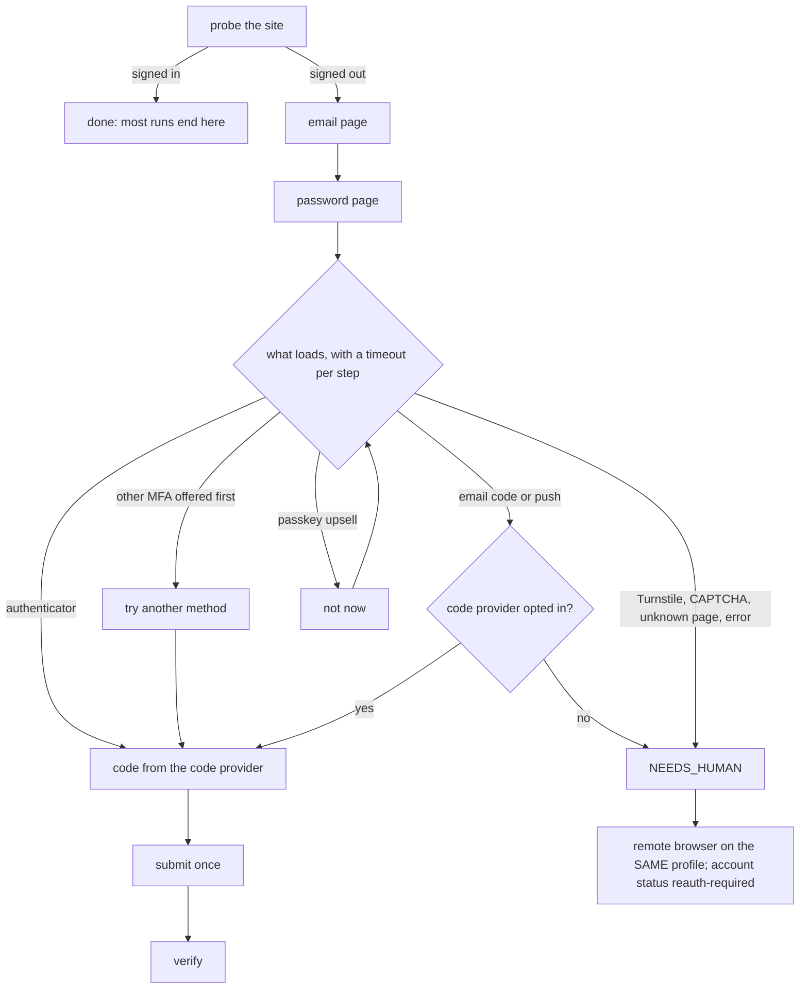

# Browser runtime and account vault

> Target state. Seams: `ctx.browser`, `ctx.display`, `ctx.accounts`
> ([plugin model](../architecture/plugin-model.md#seam-catalog)).
> Decision: [ADR-0016](../decisions/adr/0016-invisible-headed-browser-and-portable-accounts.md).
> Requirements: REQ-ACC-1..9. Shape: [`account.v1.json`](../../schemas/account.v1.json).
> Evidence: how [internet](../research/internet-analysis.md) and
> [codex-chatgpt-web](../research/codex-chatgpt-web-analysis.md) run their browsers.
>
> Implemented in [`display-virtual`](../../packages/plugins/display-virtual/README.md),
> [`browser-patchright`](../../packages/plugins/browser-patchright/README.md),
> [`accounts`](../../packages/plugins/accounts/README.md),
> [`login`](../../packages/plugins/login/README.md), and
> [`credentials-vault`](../../packages/plugins/credentials-vault/README.md); differs from
> target: Linux only (no `offscreen`); `system account remove`, retained pages per session,
> sleep prevention, the challenge reload outside a turn, the `imap` code provider, and flagging
> accounts with equal identity hashes are planned.

## Principle: a genuine browser, headed but invisible

Provider websites are consumer UIs. A headless browser behaves differently from
the browser the operator uses: rendering, feature flags, and automation signals
all differ. Sites can detect it, degrade it, or block it. The runtime therefore
always drives a **real, headed system Chrome** that the operator **does not
see**. It never uses headless mode for provider turns.

Neither reference repository runs provider turns headless:

- internet runs headed Chrome on an Xvfb virtual display on Linux, and in an
  off-screen window elsewhere;
- codex-chatgpt-web keeps its Electron views drawable but positioned outside the
  window. A truly hidden view collapses to a 0×0 viewport and breaks rendering.

"Genuine" means no disguise. The runtime runs an unmodified system Chrome with
the operator's real locale and time zone, does not override the user agent, does
not spoof fingerprints, and does not solve challenges automatically (CON-3). It
removes *automation leaks*, such as the `--enable-automation` flag and the
webdriver marker, so the browser behaves like the operator's own. It does not
pretend to be a different machine.

## Display modes (`ctx.display`)

`ctx.display.prepare('invisible')` returns the platform's invisible kind
(`virtual` on Linux, `offscreen` elsewhere). `prepare('visible')` returns the
operator's screen. `headless` is never offered for provider turns.

| Mode | How | Default on | Use |
|---|---|---|---|
| `virtual` | headed Chrome on a plugin-owned **Xvfb** (`-screen 0 1920x1080x24 -nolisten tcp`, `-displayfd`, `-auth` with a private cookie); window `--window-size=1920,1080` | **Linux** (including servers without a display) | provider turns |
| `offscreen` | headed window at `--window-position=-10000,-10000` with an explicit size (≥ 1280×900) | **macOS, Windows** (out of scope: PROP-0004 is Linux only) | provider turns |
| `visible` | a normal on-screen window | — | interactive login, debugging, resolving a challenge |
| `headless` | Chrome headless | **never** | not offered |

Rules for invisible modes, so pages render and update as if they were in the
foreground:

- Use an explicit window size and viewport. A window is never minimized or
  hidden, because a hidden view collapses its viewport.
- Enable focus emulation (`Emulation.setFocusEmulationEnabled`) so that
  background windows accept input and focus events. The engine (Playwright and
  patchright on Chromium) enables it on every page; a real-browser test guards it.
- Disable background throttling (`--disable-background-timer-throttling`,
  `--disable-renderer-backgrounding`, `--disable-backgrounding-occluded-windows`).
- Prevent system sleep while turns are active.
- Xvfb is health-monitored. Every prepared display carries a `lost` signal and a
  `generation`. If Xvfb dies, the signal aborts with `session_broken`, every
  browser on it is closed, and in-flight turns go through receipt reconciliation
  (INV-4). The next `prepare` starts a new Xvfb with the next generation; a
  startup failure is not cached, so the next turn retries.
- `invisible` fails closed: when Xvfb cannot start, the turn fails with
  `config_error`. It never falls back to the operator's `DISPLAY` or to headless.

## Browser launch (`ctx.browser`)

- **Engine:** `patchright-core` driving the **system Chrome stable channel**.
  The search order is the configured path, then `CHROME_PATH`, then a system
  Chrome no older than the engine's Chromium, then the **managed** Chrome for
  Testing build pinned in `chrome.lock.json`, which `system init` installs under
  `<DSH_HOME>/system/browsers` ([ADR-0020](../decisions/adr/0020-pinned-managed-chrome.md)).
  When none is usable, the turn fails closed with `config_error`.
- **Flags:** no `--enable-automation`, no `--no-sandbox` for headed runs, and the
  OS keyring is kept, without `--password-store=basic` or `--use-mock-keychain`.
- **No exposed debugging port.** Contexts are owned in-process. If a CDP endpoint
  is ever needed, it is loopback-only, uses a random port, and requires a token
  ([threat model](../security/threat-model.md)).
- **Input:** prompts are inserted with an insert-text method that does not
  trigger editor shortcuts, read back, and compared by hash before sending
  ([provider turns](provider-turns.md#submission)).

## Accounts (`ctx.accounts`): provider-agnostic, multi-account

An **account** is a named identity bound to exactly one provider. The vault is
generic. Everything provider-specific comes from the provider driver
([ADR-0005](../decisions/adr/0005-provider-runtime-interface.md)):

```ts
interface ProviderAccountSupport {          // part of ProviderDriver
  loginUrl: string;
  stateOrigins: string[];                   // origins whose cookies, localStorage, IndexedDB are kept
  checkAuth(page): Promise<AuthState>;      // signed-in | signed-out (with evidence) | unknown
  identity(page): Promise<string>;          // stable identity hint; only its hash is stored
}
```

| Concern | Design |
|---|---|
| Catalog | accounts are **configuration**: id, provider, label, roles, quota class, and tier-to-mode map. Any number per provider, for example `chatgpt-main`, `chatgpt-2`, `gemini-main` |
| Portable state | per account: cookies, localStorage, and **IndexedDB** for `stateOrigins` only, in one revisioned record ([`account.v1.json`](../../schemas/account.v1.json)). If IndexedDB is too large to capture, the previous IndexedDB is kept and a warning is recorded |
| Login profile | a per-account native Chrome profile directory, machine-local, used for interactive login and re-auth. Automated turns never use it, except on a **session-bound** account, which does all its work there (see [context lifecycle](#context-lifecycle), [ADR-0030](../decisions/adr/0030-session-bound-accounts-use-their-login-profile.md)) |
| Storage | account records and login credentials are encrypted grant records in `ctx.credentials`, provided by the AES-256-GCM vault (canonical: [credentials vault](../../packages/plugins/credentials-vault/README.md)) |
| Isolation | one browser process, scheduler, and set of conversation bindings per account. Ports are allocated dynamically, not by index. Two accounts never share a context |
| Distinct identities | at save time, `identity()` is hashed. Accounts whose hashes match are flagged, which REQ-TEAM-4 needs for independent team members |
| Write-back | after each turn, and after a sign-in check that finds the account signed in, refreshed state is written only if both the account revision and the scheduler lease generation are current ([scheduling](scheduling-and-leases.md)). A Save or relogin made while the turn ran has a newer revision, so the turn's write-back is skipped and the newer sign-in wins. A session-bound account writes nothing back: its session lives in its profile |
| Re-auth | only **positive** signed-out evidence (a login URL or login surface) sets `reauth-required`. A challenge or an unknown state never does |
| Removal | `system account remove <id>` (planned) deletes the record and the login profile after confirmation |

## Login flows

Decision: [ADR-0017](../decisions/adr/0017-credential-login-and-linux-remote-browser.md).
Every account has a **login mode**: `manual` (the default) or `credentials`
(opt-in).

### Interactive login (`manual`, and the fallback for everything)

A **plain Chrome with no automation attached** opens the account's login
profile, so the operator signs in exactly as usual, including SSO popups and 2FA.

| Flow | Platform | How |
|---|---|---|
| **remote** | **Linux (MVP)** | **ported from tsuuanmi/internet**: `system account login <id>` opens Chrome on its own X-authenticated Xvfb, with `x0vncserver` or `x11vnc` on an owner-only unix socket and a token-gated **noVNC** page on 127.0.0.1. The operator runs `ssh -L <port>:127.0.0.1:<port> host` and opens the printed URL. The page has Save and Cancel (paste-from-host is not built yet). The session is started on demand and expires after a short TTL |
| **visible** | desktop (v1.0) | Chrome opens on screen with the account's login profile |

### Credential login (`credentials`, opt-in)

A deterministic state machine runs on the **persistent login profile**, so the
device stays recognized. It starts **only after positive sign-out evidence**,
never on a schedule:



- **Steps are matched by URL path and accessible role**, not brittle CSS.
  The language is forced to `en-US`. DOM fixtures cover every page, and drift
  fails closed with `CONFIG_FIX` ([UI operations](ui-operations.md)).
- **Code providers:**
  - `totp-local` computes RFC 6238 locally with `otpauth`. If fewer than 5 seconds
    remain in the window, it waits for the next window. Codes are never reused.
  - `manual`: the operator runs `system account code <id> <code>`, or types the
    code in the remote view.
  - `imap` (later, opt-in) reads the one-time code from the operator's own mailbox.
- **Same identity:** a credential login never switches accounts. If it signs in
  as a different identity than the one saved, it is refused (`reauth_required`)
  and nothing is stored, so a changed credential cannot redirect the account.
  Only a manual Save at the remote login may switch it.
- **Bounds:** at most 2 submission attempts per login, then `NEEDS_HUMAN`.
  Nothing is retried in a way that could lock the account. Challenges are never
  solved (CON-3).
- **Secrets:** the email, password, and TOTP secret live in an **encrypted
  credential record** in the vault, whose key handling is described in the
  [credentials vault](../../packages/plugins/credentials-vault/README.md). Values
  are decrypted only in memory and never logged, sent to a model, or stored in an
  artifact. **A TOTP secret is never sent to any website
  or service** (for example 2fa.live), because that would hand over the second
  factor permanently.

### Save (both modes)

1. Close Chrome gracefully and wait for the profile lock to release.
2. Reopen the profile headed in the invisible display.
3. Capture the state for `stateOrigins`, including IndexedDB.
4. Verify it with `checkAuth` in a **fresh** context built from the captured state.
   A session-bound account skips this step: its sign-in and identity were already
   verified in the profile in step 3, and a copy is not how it works.
5. Hash `identity()`, then write the record with `revision + 1`. For a session-bound
   account, the state is kept only as the identity record.

A failed verification saves nothing. When the pool already holds a session-bound
account's profile open, Save reads it in place, in a page of its own.

## Context lifecycle

- **One browser process per account**, closed after `closeAfterMs` idle
  (default 30 minutes).
- **Default: a fresh context per turn**, created from the portable state. The
  turn opens the bound conversation URL, and the context is closed in `finally`.
  This gives isolation and a clean recovery path.
- **Session-bound accounts: pages of the login profile**
  ([ADR-0030](../decisions/adr/0030-session-bound-accounts-use-their-login-profile.md)).
  A driver declares `sessionBound` when its site ties a session to the profile that
  signed in. Copies of such a session die while the profile stays signed in. For
  such an account, every operation opens a page (`openTurn(account, { profile })`)
  in one persistent context on its login profile:
  - turns and their reconciliation;
  - verify, probe and the sign-in check;
  - conversation inspection and deletion.

  Portable state is neither loaded nor written back.
  - **Lifecycle.**
    - The context opens lazily, one launch at a time, with session restore so
      session-only cookies survive; the restored tabs are blanked.
    - It closes after `closeAfterMs` idle. A close waits until its Chrome has
      exited, and stops one that has not within 10 s.
    - If the browser dies, in-flight operations fail, and a submitted turn
      reconciles by its receipt.
  - **Who holds a profile.** A process on this host whose command line names
    the profile (`/proc` on Linux), never a lock file alone. Only a browser
    `system` started (it carries `--system-owned-profile`) is ever stopped, for
    example one a crash left. Any other process blocks the account until it
    closes, and health shows it (`login-profiles`).
  - **The operator first.**
    - A remote login reserves the profile (`reserveProfile`). It is refused while
      operations run, and it returns only after the idle context's browser has
      exited.
    - Until the login ends, operations fail as `overloaded` (backoff).
    - A second login for the account joins the first.
    - Saves, and with them automated sign-ins, run one at a time per account.
  - **Pacing.** The opens of the account's pages are spaced by the driver's
    `pageGapMs`; navigations within a page are not.
  - **Kept tabs** (ADR-0030's amendment).
    - A persistent session's page stays open between its turns
      (`openTurn(account, { profile: { keep: sessionId } })`). The next turn gets it back, in
      front, with no new page. A driver does not reload a page that already shows the
      conversation, and checks the sign-in on the page as it is.
    - The page is kept, before the turn completes, only when the turn succeeded and the page is
      idle and clean (the driver's `pageIdle`). Otherwise it is discarded.
    - At most 4 per account (least recently used out). Kept tabs close with their session
      (release, reset), with the context, and on a reservation, which they never refuse.
    - Temporary turns open a page each.
  - Sessions stay apart by conversation, each in its own tab, so one account still
    serves several team members.
- **Retained page per session** (planned), opt-in per capability. For long sessions and
  Deep Research, one page stays bound to a `SessionId`
  ([sessions](sessions-and-messaging.md)), with a TTL, a cap per account, and
  heartbeat sweeps. Eviction falls back to the fresh-context path.
- **Concurrency:** `maxConcurrentTurnsPerAccount` defaults to 2, and turns in one
  session run strictly in order ([scheduling](scheduling-and-leases.md)).

## Challenges and errors

| Situation | Handling |
|---|---|
| Cloudflare challenge response (`cf-mitigated: challenge`) **outside** an active turn | reload once, then confirm with a 2xx |
| a challenge during a turn, or after the reload | turn fails as `USER_ACTION` (`challenge`). The operator resolves it through the `visible` or `remote` view. Nothing is auto-solved |
| signed out (positive evidence) | `reauth-required`; queued work for the account fails closed (REQ-ACC-5) |
| UI drift (no candidate resolves) | bounded self-heal ([UI operations](ui-operations.md#self-heal)); if it fails, the turn fails closed with `CONFIG_FIX` and a diagnostic bundle, and a health alert is raised |
