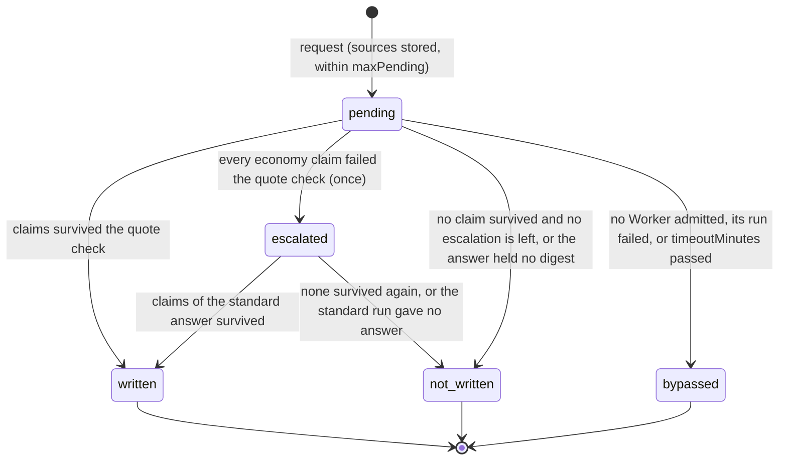

# Digests

> Target state. Boundary: [orchestration](../architecture/components.md#orchestration), plugin
> family *digest* ([ADR-0036](../decisions/adr/0036-guarantee-core-and-capability-plugins.md)).
> Proposals: [PROP-0010](../proposals/0010-base-version.md),
> [PROP-0008](../proposals/0008-studio-operating-model.md#mechanism-1-the-digest-layer).
> Records: [`digest@1.0`](../reference/schemas.md#digest), [`brief@1.1`](../reference/schemas.md#brief);
> MCP tools [`digests_*`](../reference/schemas.md#mcp-tools-digests_).
>
> Defined in [`digest-core`](../../packages/digest-core/README.md); provided by
> [`digest`](../../packages/plugins/digest/README.md) on `ctx.store`, its bundle row on. Differs
> from target: a digest is written on request only (nothing digests a run's results on its own,
> and the board's `result.digest` is not filled yet); no test output is parsed before the model
> reads it.

A digest is a cited summary of raw artifacts (test logs, agent results, reports), so the lead
reads a page instead of the raw material, and every claim on that page can be checked. A cheap
Worker writes it; code keeps only the claims whose quotes are verbatim in the artifact they cite.

## Seam

`ctx.digests` (`Digests` in `@tsuuanmi/system-digest-core`), contract 1.1, a capability seam:

| Method | Does |
|---|---|
| `request({ sources, key? })` | ask for a digest of 1 to 64 stored artifacts; durable at once, settled in the background; the same `key` returns the same request |
| `get(requestId)` | the request as it stands |
| `wait(requestId, timeoutMs)` | wait until it settles or the time passes |

The definition also holds what every provider applies the same way: the quote check
(`quoteCheck`), the one escalation (`escalation`, contract 1.1), and the decision that settles a
request (`settlement`). A provider depends on
seam definitions only: `ctx.workers` for its Worker, `ctx.artifacts` for what it reads and
writes. It cooperates with the core by artifacts.

## A request

`escalated` is not a state of its own: the request stays `pending`, names its `escalation`
decision, and runs once more on the standard tier.

| From → to | Who | Records | On failure |
|---|---|---|---|
| — → pending | `request`, by the lead (`digests_request`) or a plugin | the request row | refused (`invalid`, nothing recorded): no source, a repeated source, more than 64, a source that is not a stored artifact, a key reused for other sources; `overloaded` at `maxPending` pending |
| pending (routed and started) | the provider, under the request's lease | a `brief@1.1` (`objective`) recorded before the run, its sources by content id; the execution named on the request in the same transaction | no Worker admitted: bypassed, naming the `admission` decision; a start refused: bypassed |
| pending → written | the provider, once the run completed | the `digest@1.0` report (its envelope's inputs are the sources), the `acceptance` decision that names it, and `digests.settled`, in one transaction | — |
| pending (escalated) | the provider, when every claim of the economy answer failed the quote check and the request has not escalated | the `escalation` decision (rule `digests.escalation`) and the request's new tier, in one transaction under the lease; then a brief and a start as above, on the standard tier, with a key of its own | no standard Worker admitted, a start refused, or its run failed or timed out: `not-written` on the economy answer's check, saying why the escalation gave no answer |
| pending → not-written | the same | the `acceptance` decision with why, and the claims dropped; after an escalation its inputs name the `escalation` decision | — |
| pending → bypassed | the same, when the run failed, its execution is gone, its source is no longer registered, or `timeoutMinutes` passed (the run is cancelled) | the `acceptance` decision with why | — |

Every settlement is one `acceptance` decision (rule `digests.quote-check`) with three candidates,
`written`, `not-written`, and `bypassed`, each saying why (INV-13). Its inputs are the sources,
the Worker's answer or the admission decision that found no Worker, and the digest when written.

**Restart is reconciliation** (INV-4). A request is driven under the lease `digest:<requestId>`.
The brief, the Worker's start, and the execution's id on the request commit together, so a
restart finds either nothing started (it routes again) or the execution (it waits for it); a run
is never started twice.

**Bounded** (INV-9): at most `maxPending` requests pending (default 4), each for at most
`timeoutMinutes` (default 30, both runs together) and two Worker runs (one escalation); at most 64
sources, 50 claims checked, `maxClaims` kept (default 20).

## The Worker

The provider asks `ctx.workers` for work, never for a Worker by name (INV-11): capabilities
`review` and `local-data`, which only a read-only agent Worker proves today
([routing](routing.md#capability-vocabulary)), on the configured tier as both its minimum and its
maximum (`tier`, default `economy`; [once on `standard`](#one-escalation) after an escalation), at
the sources' strictest classification. With the agent
rows on and a read-only Claude Code Worker configured on the economy tier, that is the Worker
PROP-0010 names; with none, the request is bypassed.

Its brief points at each source by content id and never carries their content
([briefs](workflow-engine.md#briefs)). The Worker's source renders it at start, each artifact
between `<artifact id="…">` tags, followed by the `digest@1.0` schema, and checks egress on what
it rendered, at the sources' strictest classification: an agent Worker refuses `local-private`
work by default, which bypasses the request. A digest of `local-private` sources (website answers
are stored `local-private`) is written only by a Worker the egress policy allows for them.

## The quote check

The Worker's answer is untrusted model output. From the JSON object it ends with:

- the digest's `sources` are the request's, never the answer's;
- a claim is kept only when it is well formed (id `C1` to `C999`, not taken; kind; text; quote of
  1 to 500 characters), cites one of the sources, and its quote occurs verbatim in that source's
  text (its body's `text`, else its canonical JSON), at `offset` in code points when it gives
  one;
- a claim that fails is dropped and recorded, with why, first in the digest's `dropped`, then in
  the decision's detail; so is every claim past `maxClaims`, and claims past the first 50 are not
  checked;
- an answer with no status or summary, or whose claims are all dropped, gives no digest: the
  request settles `not-written`.

`confidence` is kept as the Worker gave it and decides nothing.

## One escalation

A cheap Worker that paraphrases instead of quoting gives claims that all fail the check. The
request then runs once more on the standard tier ([PROP-0008](../proposals/0008-studio-operating-model.md#mechanism-1-the-digest-layer):
"escalation to `standard` when the quote check fails"); the rule is `escalation` of the definition,
contract 1.1, the same for every provider:

- only when the answer had claims and none survived the quote check (`QuoteCheck.failure` is
  `quote-check`); an answer with no JSON, no status or summary, or no claim is not escalated, since
  a stronger Worker does not make a missing answer checkable;
- only from the economy tier, only to `standard`, and only once: a request configured on the
  standard tier or above never escalates, and an escalated request never escalates again;
- the `escalation` decision (`digests.escalation`; inputs: the sources and the economy answer;
  detail: from, to, and the dropped claims) is recorded, and the request's tier changed, in one
  transaction under its lease, before the second run is routed (INV-13). The second run's start
  has its own key, so a restart routes and starts it once (INV-4);
- the request then settles on the second answer: `written` if claims survive, else `not-written`
  saying it was given up after one escalation. When the second run gives no answer (no standard
  Worker admitted, a start refused, a failed run, `timeoutMinutes` passed), the economy answer
  stands: `not-written` on its check, never `bypassed`, since a Worker did answer;
- the settling decision's inputs name the `escalation` decision, and the request names it
  (`escalation`).

## Failing open

A digest is a capability, not a guarantee (ADR-0036, plugin rule 2): a digest that cannot be
written is bypassed and recorded, and nothing waits on it. A request no Worker serves still
settles, with its decision and reason. The bundle row is therefore on: with the agent rows off,
every request settles `bypassed`. A digest never accepts anything: a lead or a reviewer still
judges the work, and the raw artifacts stay one `artifact` call away.

## Trigger

On request only, conservatively: the lead (or a plugin) asks with `digests_request` for the
artifacts it wants digested, typically a run's result artifacts, and reads the digest with the
`artifact` tool. Nothing digests on its own after a run: an automatic digest would spend the
economy tier on every run, and putting it on the board's `result.digest` would make a capability
part of a task's acceptance inputs, which needs the board's contract to say how a missing digest
is treated.

## Configuration

`digest` row: `tier`, `maxClaims`, `maxPending`, `timeoutMinutes`
([configuration](../reference/configuration.md)).

## Conformance

[`digest-core/conformance/digests.ts`](../../packages/digest-core/conformance/digests.ts), 12
scenarios at contract 1.1 (three of them, the escalation, since 1.1), run against the fake
provider and against the store-backed provider over real routing with a scripted Worker on each
tier.
