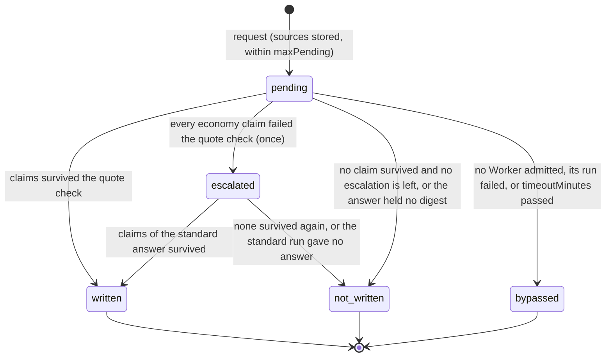

# Digests

> Target state. Boundary: [orchestration](../architecture/components.md#orchestration), plugin
> family *digest* ([ADR-0036](../decisions/adr/0036-guarantee-core-and-capability-plugins.md)).
> Proposals: [PROP-0010](../proposals/0010-base-version.md),
> [PROP-0008](../proposals/0008-studio-operating-model.md#mechanism-1-the-digest-layer).
> Records: [`digest@1.0`](../reference/schemas.md#digest), [`brief@1.1`](../reference/schemas.md#brief),
> [`digest-extract@1.0`](../reference/schemas.md#digest-extract) (the extractive provider's);
> MCP tools [`digests_*`](../reference/schemas.md#mcp-tools-digests_).
>
> Defined in [`digest-core`](../../packages/digest-core/README.md); provided by
> [`digest`](../../packages/plugins/digest/README.md) on `ctx.store`, its bundle row on, or, in its
> place, by [`digest-extractive`](../../packages/plugins/digest-extractive/README.md)
> ([extractive-first](#extractive-first)), its row off. Differs from target: only a board task's
> results are digested on their own (a run outside the board is digested on request only); no test
> output is parsed before the model reads it (the extractive provider selects lines by signal words,
> it does not parse a runner's output).

A digest is a cited summary of raw artifacts (test logs, agent results, reports), so the lead
reads a page instead of the raw material, and every claim on that page can be checked. A cheap
Worker writes it; code keeps only the claims whose quotes are verbatim in the artifact they cite.

## Seam

`ctx.digests` (`Digests` in `@tsuuanmi/system-digest-core`), contract 1.2, a capability seam:

| Method | Does |
|---|---|
| `request({ sources, key?, check? })` | ask for a digest of 1 to 64 stored artifacts; durable at once, settled in the background; the same `key` returns the same request; `check` (1.2) sees the request as it would be returned, before it is recorded |
| `get(requestId)` | the request as it stands |
| `wait(requestId, timeoutMs)` | wait until it settles or the time passes |

The definition also holds what every provider applies the same way: the quote check
(`quoteCheck`), the one escalation (`escalation`, contract 1.1), the decision that settles a
request (`settlement`), and the MCP tools `digests_*` (`registerDigestTools`), so replacing the
provider keeps the lead's tools. A provider depends on
seam definitions only: `ctx.workers` for its Worker, `ctx.artifacts` for what it reads and
writes. It cooperates with the core by artifacts.

## A request

`escalated` is not a state of its own: the request stays `pending`, names its `escalation`
decision, and runs once more on the standard tier.

| From → to | Who | Records | On failure |
|---|---|---|---|
| — → pending | `request`, by the lead (`digests_request`) or a plugin | the request row; its `check`, when given, runs on the request in the same transaction, before it commits | refused (`invalid`, nothing recorded): no source, a repeated source, more than 64, a source that is not a stored artifact, a key reused for other sources; `overloaded` at `maxPending` pending; a `check` that throws: its error, nothing recorded, no key taken, no Worker asked |
| pending (routed and started) | the provider, under the request's lease | a `brief@1.1` (`objective`) recorded before the run, its sources by content id; the execution named on the request in the same transaction | no Worker admitted: bypassed, naming the `admission` decision; a start refused: bypassed |
| pending → written | the provider, once the run completed | the `digest@1.0` report (its envelope's inputs are the sources), the `acceptance` decision that names it, and `digests.settled`, in one transaction | — |
| pending (escalated) | the provider, when every claim of the economy answer failed the quote check and the request has not escalated | the `escalation` decision (rule `digests.escalation`) and the request's new tier, in one transaction under the lease; then a brief and a start as above, on the standard tier, with a key of its own | no standard Worker admitted, a start refused, or its run failed or timed out: `not-written` on the economy answer's check, saying why the escalation gave no answer |
| pending → not-written | the same | the `acceptance` decision with why, and the claims dropped; after an escalation its inputs name the `escalation` decision | — |
| pending → bypassed | the same, when the run failed, its execution is gone, its source is no longer registered, or `timeoutMinutes` passed (the run is cancelled) | the `acceptance` decision with why | — |

Every settlement is one `acceptance` decision (rule `digests.quote-check`) with three candidates,
`written`, `not-written`, and `bypassed`, each saying why (INV-13). Its inputs are the sources,
the Worker's answer or the admission decision that found no Worker, and the digest when written.

**Restart is reconciliation** (INV-4). A request is driven under the lease `digest:<requestId>`.
The brief, the Worker's start, and the execution's id on the request commit together, so a
restart finds either nothing started (it routes again) or the execution (it waits for it); a run
is never started twice.

**Bounded** (INV-9): at most `maxPending` requests pending (default 4), each for at most
`timeoutMinutes` (default 30, both runs together) and two Worker runs (one escalation); at most 64
sources, 50 claims checked, `maxClaims` kept (default 20).

## The Worker

The provider asks `ctx.workers` for work, never for a Worker by name (INV-11): capabilities
`review` and `local-data`, which only a read-only agent Worker proves
([routing](routing.md#capability-vocabulary)), on the configured tier as both its minimum and its
maximum (`tier`, default `economy`; [once on `standard`](#one-escalation) after an escalation), at
the sources' strictest classification. With the agent
rows on and a read-only Claude Code Worker configured on the economy tier, that is the Worker
PROP-0010 names; with none, the request is bypassed.

Its brief points at each source by content id and never carries their content
([briefs](workflow-engine.md#briefs)). The Worker's source renders it at start, each artifact
between `<artifact id="…">` tags, followed by the `digest@1.0` schema, and checks egress on what
it rendered, at the sources' strictest classification: an agent Worker refuses `local-private`
work by default, which bypasses the request. A digest of `local-private` sources (website answers
are stored `local-private`) is written only by a Worker the egress policy allows for them.

## The quote check

The Worker's answer is untrusted model output. From the JSON object it ends with:

- the digest's `sources` are the request's, never the answer's;
- a claim is kept only when it is well formed (id `C1` to `C999`, not taken; kind; text; quote of
  1 to 500 characters), cites one of the sources, and its quote occurs verbatim in that source's
  text (its body's `text`, else its canonical JSON), at `offset` in code points when it gives
  one;
- a claim that fails is dropped and recorded, with why, first in the digest's `dropped`, then in
  the decision's detail; so is every claim past `maxClaims`, and claims past the first 50 are not
  checked;
- an answer with no status or summary, or whose claims are all dropped, gives no digest: the
  request settles `not-written`.

`confidence` is kept as the Worker gave it and decides nothing.

## One escalation

A cheap Worker that paraphrases instead of quoting gives claims that all fail the check. The
request then runs once more on the standard tier ([PROP-0008](../proposals/0008-studio-operating-model.md#mechanism-1-the-digest-layer):
"escalation to `standard` when the quote check fails"); the rule is `escalation` of the definition,
contract 1.1, the same for every provider:

- only when the answer had claims and none survived the quote check (`QuoteCheck.failure` is
  `quote-check`); an answer with no JSON, no status or summary, or no claim is not escalated, since
  a stronger Worker does not make a missing answer checkable;
- only from the economy tier, only to `standard`, and only once: a request configured on the
  standard tier or above never escalates, and an escalated request never escalates again;
- the `escalation` decision (`digests.escalation`; inputs: the sources and the economy answer;
  detail: from, to, and the dropped claims) is recorded, and the request's tier changed, in one
  transaction under its lease, before the second run is routed (INV-13). The second run's start
  has its own key, so a restart routes and starts it once (INV-4);
- the request then settles on the second answer: `written` if claims survive, else `not-written`
  saying it was given up after one escalation. When the second run gives no answer (no standard
  Worker admitted, a start refused, a failed run, `timeoutMinutes` passed), the economy answer
  stands: `not-written` on its check, never `bypassed`, since a Worker did answer;
- the settling decision's inputs name the `escalation` decision, and the request names it
  (`escalation`).

## Failing open

A digest is a capability, not a guarantee (ADR-0036, plugin rule 2): a digest that cannot be
written is bypassed and recorded, and nothing waits on it. A request no Worker serves still
settles, with its decision and reason. The bundle row is therefore on: with the agent rows off,
every request settles `bypassed`. A digest never accepts anything: a lead or a reviewer still
judges the work, and the raw artifacts stay one `artifact` call away.

## Extractive-first

[`digest-extractive`](../../packages/plugins/digest-extractive/README.md) provides the same seam
another way: code reads first, and the Worker writes from what code selected. Its row is off; the
operator swaps it in for `digest` ([replacing the provider](#replacing-the-provider)).

1. **Select.** Before routing, the rule `digest-extractive.select` 1 splits each source's text (the
   text the quote check reads: its body's `text`, else its canonical JSON) into spans, each
   non-blank line without its surrounding whitespace, a line longer than a quote may be cut into
   parts of at most 500 characters, and keeps at most `maxExtracts` (default 40): each source's
   first span, so no source goes unseen; then failures, risks, decisions, and metrics, each signal
   taken across the sources in turn; then each source's last span; then results; then the rest,
   while there is room. It reads at most the first 1,000,000 characters of a source, and says so.
   The extract is recorded as [`digest-extract@1.0`](../reference/schemas.md#digest-extract), an
   `evidence` artifact whose envelope inputs are the sources, as strict as the strictest.
   Deterministic: the same sources give the same artifact, so a restart records nothing new.
   Sources with nothing to quote ask no Worker: the request is bypassed.
2. **Write.** The brief points at the extract alone, never at a source. The Worker reads the
   extract's text, the sources by number and each span with its id (`E1`, `E2`, …), and a short
   example of the answer instead of the whole `digest@1.0` schema, and cites each claim by a
   span's id (`"extract": "E3"`).
3. **Check.** A claim citing a span is given that span's source, quote, and offset from the
   extract, never from the answer, so its quote is verbatim by construction; one citing a span it
   was not given cites no source, and the quote check drops it, saying so; one that quotes a source
   itself is checked as it is. Then the seam's quote check reads the sources, as for any provider;
   the escalation (with the same extract) and the settling decision are the seam's, and the
   settling decision's inputs also name the extract.

| | `digest` | `digest-extractive` |
|---|---|---|
| The Worker reads | every source, whole, and the `digest@1.0` schema | the extract (at most `maxExtracts` spans) and a short example of the answer |
| A claim's quote | copied by the Worker, checked against its source | filled from the extract by code, checked against its source |
| Left out | nothing the Worker was given | the spans the rule did not keep; the extract's header says how many, and the raw artifacts stay one `artifact` call away |
| Requests, escalation, restart, bounds, failing open, MCP tools | the seam's | the same; its own table, request ids `dgx-…` |

What it trades: the Worker sees only what the rule kept, so a finding in a span left out is not in
the digest. What it buys: fewer characters sent per digest when the sources are longer than the
extract, and claims that cannot misquote.

## Replacing the provider

Base exit criterion 6 ([release scope](../requirements/release-scope.md#base-exit-criteria)): the
digest provider is replaced through its manifest, with no core change, with metrics before and
after.

- **By configuration only.** One patch turns the `digest` row off and the `digest-extractive` row
  on ([runbook](../operations/runbooks.md#swap-the-digest-provider)). Both manifests provide
  `digests` at contract 1.2, so every consumer's range (`^1.2.0`) accepts either, and the plugin
  host's manifest check finds nothing; it records the swap as two `lifecycle` decisions (`digest`
  to `candidate`, `digest-extractive` to `default`). The workflow engine and the report reach the
  seam through its definition, and the MCP tools are the seam's, so no other row and no file of
  the install changes. One provider runs at a time: with both rows on, the second to register does
  not start, and health `plugins` is down, naming it.
- **What each provider keeps.** A provider's requests live in its own table. After a swap, a
  request the other provider settled is unknown to the one loaded: `digests_get` refuses it
  (`unknown-request`), a board task waiting on it keeps no digest (recorded with why), and a
  report counts its attachment but not its claims, and says so in its notes
  ([reports](reports.md#what-it-counts)). Its `digest@1.0` and settling decision stay in the
  ledger of record, and swapping back finds it again.
- **Measured, in CI.** The bundle's evolution test
  ([`digest-swap.spec.ts`](../../packages/system-bundle/tests/evolution/digest-swap.spec.ts))
  composes the bundle's own rows, as shipped and with the operator's patch, names no provider (it
  mounts the row whose manifest provides `digests`), digests the same five fixtures (a test
  runner's log of 8,506 characters, a pytest log, a benchmark with its validation report, an
  attempt's three results, a short validation report) with the same scripted Worker, which answers
  from the prompt it was given, and reads every figure from the settling and escalation decisions.
  Its record ([`digest-swap.record.json`](../../packages/system-bundle/tests/evolution/digest-swap.record.json)),
  before and after:

  | Scripted Worker | Written | Claims kept (pass rate) | Escalations | Characters sent to the Worker | Characters it answered |
  |---|---|---|---|---|---|
  | copies quotes verbatim | 5 and 5 | 30 of 30 (1.0) and 30 of 30 (1.0) | 0 and 0 | 31,035 and 16,234 (−48%) | 8,499 and 4,001 |
  | paraphrases on the economy tier | 5 and 5 | 23 of 30 (0.767) and 30 of 30 (1.0) | 0 and 0 | 31,035 and 16,234 | 8,472 and 4,001 |

  Every request sends fewer characters after the swap, the short report's too (3,781 and 1,932):
  the extract replaces the sources, and a short example of the answer replaces the `digest@1.0`
  schema. These are characters of a scripted Worker's prompts and answers, not a model's tokens,
  and the paraphrasing Worker is a stand-in for the failure the escalation exists for; a change in
  either provider that moves a figure fails the test until the record is regenerated and reviewed.
  The end-to-end test boots the shipped profile with the same patch through the real launcher: the
  new provider serves the lead's tools, and the plugin host records the swap and finds nothing.
- **Measured live.** The same comparison on the operator's live Worker, in tokens from the
  resource ledger, is a check of the [release checklist](../validation/release-checklist.md).

## The lead's tools

`digests_request` and `digests_get` are the seam's own (`registerDigestTools`), so every provider
serves them the same way. Each call's input and output are checked against
[`mcp-digests.v1.json`](../reference/schemas.md#mcp-tools-digests_). `digests_request` checks the
output it would give through the request's `check` (contract 1.2), inside the transaction that
records the request, before it commits: an output its schema refuses (a defect) is refused with
nothing recorded, no key taken, and no Worker asked (INV-2, INV-14). A request waited on
(`waitSeconds`) is checked again as it stands after the wait.

## Trigger

- **A board task's result**, on its own: once a workflow run's result reached its task, the
  [workflow engine](workflow-engine.md#a-digest-of-a-tasks-result) asks for a digest of the
  result's artifacts, after the report so it never blocks the acceptance, one per attempt and at
  most `digestsPerHour` (default 6) in any hour, and sets the written digest on the task's
  `result.digest` through the board's [`attachDigest`](board.md#a-digest-on-a-result). The
  board's contract says how a missing digest is treated: a result with none is complete, and a
  digest never accepts anything. One the operator's held review shows is named by the operator's
  acceptance.
- **On request**: the lead (or a plugin) asks with `digests_request` for the artifacts it wants
  digested, and reads the digest with the `artifact` tool.

Nothing else digests on its own: a run outside the board would spend the economy tier on every
run, with no task to put the digest on.

## Configuration

`digest` row: `tier`, `maxClaims`, `maxPending`, `timeoutMinutes`; `digest-extractive` row: the
same, and `maxExtracts` ([configuration](../reference/configuration.md)). A row's configuration is
its own: an operator who set the `digest` row sets the same on `digest-extractive` when swapping.

## Conformance

[`digest-core/conformance/digests.ts`](../../packages/digest-core/conformance/digests.ts), 13
scenarios at contract 1.2 (three of them, the escalation, since 1.1; the request's `check` since
1.2), run against the fake
provider and against both store-backed providers over real routing with the seam's scripted Worker
([`conformance/worker.ts`](../../packages/digest-core/conformance/worker.ts)) on each tier.
