# Evaluations

> Target state. Boundary: [orchestration](../architecture/components.md#orchestration), core
> component *gate* ([ADR-0036](../decisions/adr/0036-guarantee-core-and-capability-plugins.md),
> [ADR-0045](../decisions/adr/0045-feedback-loop-guarantee-seams.md)). Proposal:
> [PROP-0011](../proposals/0011-feedback-loop.md). Records:
> [`evaluation@1.0`](../reference/schemas.md#evaluation) and the `verdict` decision of
> [`decision@1.7`](../reference/schemas.md#decision), under an
> [`objective-contract@1.0`](../reference/schemas.md#objective-contract) and an
> [`experiment@1.0`](../reference/schemas.md#experiment).
>
> Defined in [`evaluations-core`](../../packages/evaluations-core/README.md), contract 1.0, its
> suite passed by the fake `FakeEvaluations` over the experiments fake. Differs from target: no
> store-backed provider and no bundle row yet (F4); the statistics library
> ([statistics](statistics.md)) has one method, `sign-flip`, so a protocol naming `bootstrap` or
> `bayesian` cannot start; no collector (F5); how a trial's run is fixed to its arm's Workers is
> open ([where the tables leave room](#where-the-tables-leave-room)).

The evaluation engine is the loop's judge. It runs a pre-registered experiment offline, under the
pins and seals the experiment froze, as paired trials whose order is drawn from the experiment's
seed; each trial is measured by the collectors the contract names and by the resource ledger; at
the horizon it analyses once, by the methods the protocol declared; and it classifies the result
by a deterministic rule, recorded as a `verdict` decision. It decides no promotion: a supported
verdict is evidence a promotion request cites, and the operator decides
([`promotion` always asks](approvals.md#the-autonomy-policy)).

## Seam

`ctx.evaluations` (`Evaluations` in `@tsuuanmi/system-evaluations-core`), contract 1.0:

| Method | Does |
|---|---|
| `collector(collector)` | register a collector or validator (the verification family) for as long as its plugin lives; the disposer removes it; a second with the same id is refused |
| `start(experimentId)` | check everything a start needs, schedule every trial, and take the experiment to `running` ([an evaluation](#an-evaluation)); idempotent for a running one |
| `sweep(at)` | make every move due: reconcile, run and measure trials, end, record, decide |
| `get(evaluationId)`, `list(filter?)` | read evaluations |

Time-driven moves happen only in `sweep(at)`, so a restart is a sweep, not a replay
([INV-4](../architecture/invariants.md#inv-4-restart-is-reconciliation-not-replay)). v1
evaluates each revision of an experiment once, as `<experimentId>:r<revision>`.

## An evaluation

```mermaid
stateDiagram-v2
  [*] --> running: start (pins, seals, judge, families, collectors, methods checked; trials scheduled)
  running --> running: sweep (a trial started, measured, or reconciled)
  running --> evaluated: horizon reached, budget spent, integrity breach, or hard constraint broken (record written)
  evaluated --> closed: verdict recorded
  closed --> [*]
```

| Step | Does | Fails closed when |
|---|---|---|
| check pins | compares the experiment's pinned environment with the live one (`pinProblems`) | anything pinned differs: nothing starts (`pins-changed`), or, before a later trial, the evaluation ends `invalid` |
| seal | compares each pinned partition's hash with the suite's (`sealProblems`); held-out cases are read by the engine only | a hash differs or a partition is gone: nothing starts (`seal-broken`), or the evaluation ends `invalid` |
| guard the judge | the candidate's changes must name none of its judge: its contract, its suite, a collector it needs, the engine itself (`judgeTouched`) | one does: nothing starts (`touches-judge`) |
| check families | maker, reviewers, and model-based validators pairwise different; a model-based collector only of a declared validator's family, never the maker's, a reviewer's, or an arm's | otherwise: nothing starts (`not-independent`) |
| check measurement | every collected metric and hard constraint has a registered collector at the pinned version that declares it (`collectorProblems`); every method the protocol names is in the pinned statistics library | otherwise: nothing starts (`unmeasurable`, `unavailable`) |
| schedule | every case of the partitions used, at each repetition, in both arms, ordered from the seed (`schedule`); recorded, then the experiment `begin`s | the schedule is not the pre-registered horizon: nothing starts |
| run | before each trial: pins, seal, and the budget (`canAfford`); the trial is recorded `started` before its run starts | the next trial's reservation does not fit: the evaluation ends on its budget |
| measure | each collector reads the trial's result artifacts; cost metrics are the ledger's usage for the trial; the route is checked (`trialInvalid`) | a value missing, a contaminated trial, a same-family fallback, a run outside its arm, or another model version: the evaluation ends `invalid`; a hard constraint broken: it ends `refuted` |
| record | the `evaluation` artifact, then `settle` | — |
| analyse | at the horizon only, with every check passed: each declared method on paired values per case | — |
| verdict | the [rule](#the-verdict-rule), recorded as a `verdict` decision, then `close` | the decision cannot be recorded: the evaluation stays `evaluated` for the next sweep |

A refused start leaves the experiment `preregistered`. Its pins are frozen, so an experiment whose
environment moved on is not run under the old pins: the lead or the operator registers its next
revision, which supersedes it ([experiments](experiments.md#an-experiment)).

### The schedule

`schedule` (version 1) makes one pair per case of the partitions used (by partition, then id) and
repetition; shuffles the pairs with a Fisher-Yates driven by the seed; and puts one arm first in
each pair by a draw from the seed, so the arms interleave and neither always runs first. The draws
are the first 48 bits of `sha256(version, seed, counter)`. The same cases, repetitions, and seed
give the same order; the order is recorded at `start`.

### A trial

| State | Means |
|---|---|
| `scheduled` | in the schedule, not started |
| `started` | recorded before its run starts; after a restart, reconciled before anything else |
| `completed`, `failed` | its run ended and was measured: a failed run is an outcome too (a stall is a metric) |
| `lost` | it started and its outcome is unknown: never run again (INV-4); the evaluation ends `invalid` (`trials`) |
| `skipped` | the evaluation ended before it started |

A trial is invalid when its run fell back to one family
([ADR-0029](../decisions/adr/0029-opt-in-same-family-fallback.md)), whatever the profile allows
elsewhere; ran on a Worker or a family outside its arm, or named no Worker; showed a model version
other than the pinned one, or none where one is pinned; or a collector found it contaminated (its
answer cites the fix). An invalid trial fails its check (`families`, `arms`, `pins`, `judge`) and
ends the evaluation at once: nothing more is spent on an evaluation that can only be `invalid`.

### Collectors

Collectors and validators are the verification family: capability plugins that register through
`evaluations.collector`, as acceptance contracts register through `workers.contract`, each with an
id, a version the experiment pins, the metrics it measures, and the hard constraints it validates.
A collector fails open in the capability sense only: a value it does not return, or a call that
throws, is missing, with why, and a trial missing any metric or constraint the contract defines
makes the evaluation `invalid`, never a pass. A deterministic collector has no family; a
model-based one has the family of its model and must be a declared validator's.

### Cost

Cost comes from the resource ledger's usage records, never from a model's report: the usage the
ledger attributes to each trial's run, and to the runs cited as the candidate's provenance, summed
per pool and unit, per phase (`evaluation`; `implementation` for the provenance), sunk or
projected. The budget's `perTrial` lines are what each trial reserves before it starts; what was
recorded plus the next reservation must stay within the funded lines.

## The verdict rule

`verdictOf` (rule `evaluations.verdict`, version 1), deterministic:

| Outcome | When |
|---|---|
| `invalid` | an integrity check failed or is not recorded (`pins`, `seal`, `arms`, `families`, `metrics`, `judge`, `trials`), or a judged metric or a hard constraint has no result |
| `refuted` | a hard constraint broke (at any time); or, at the horizon, a guardrail is wholly past its margin or floor, or the primary's interval excludes the declared comparison |
| `supported` | at the horizon, every hard constraint held, every guardrail cleared, and the primary's interval clears the declared comparison |
| `inconclusive` | anything else: an interval that neither clears nor excludes its threshold, or a horizon not reached (a spent budget) |

- Each interval is oriented so that larger is better: the candidate's improvement over the
  baseline, negated for a metric that should decrease. A non-inferiority margin `m` clears when
  the lower bound is above `−m` and excludes when the upper bound is below it. A superiority
  comparison is read against the contract's minimum practical effect: it clears above it and is
  excluded below it, so a tiny effect with high confidence still fails. A floor reads the
  candidate's own level (a ceiling, for a metric that should decrease).
- v1 has a fixed horizon and one analysis at its end: no interval is read before the horizon, so
  an evaluation that ended on its budget is at most `inconclusive`. INCONCLUSIVE is never read as
  equivalence, and a non-significant difference never as "no difference".
- The decision's candidates are the four outcomes, each with why; its decider hash is the
  experiment's protocol hash; its detail names each judged metric with its interval, threshold,
  and result.
- **Net benefit** (`netBenefit`) is N·s − C over a stated horizon, with s the saving per eligible
  task at its lower bound, N the eligible volume projected low, and C the experiment's cost plus
  the deployment's at its upper bound; the forward figure leaves out the sunk experiment cost.
  It informs the operator's promotion decision and never changes the verdict.

## Where the tables leave room

- **How a trial's run is fixed to its arm's Workers** is open
  ([PROP-0011](../proposals/0011-feedback-loop.md#open-questions), Q2): the proposal's trusted
  envelope would change the `workflow` contract, an ADR of F4 or F5. Until then the engine checks
  every run's route against its arm and makes a trial outside it invalid.
- **The candidate's changes** are names (paths, package or record ids) the provider reads from
  the candidate's diff against the baseline; which paths stand for the contract, the suite, and
  the collectors is the store-backed provider's to define (F4).
- **Every metric the contract defines is needed**, reported or judged: a contract names what it
  needs measured, and the engine refuses to guess which values it could do without.

## Fail-closed rules

1. With the engine unavailable, no evaluation or verdict is recorded and no promotion can be
   asked; nothing starts unless every check of a start passes, and a start that is refused changes
   nothing.
2. An evaluation is valid only for its pinned candidate, baseline, suite, contract, and
   environment ([INV-5](../architecture/invariants.md#inv-5-exact-subject-binding),
   [ADR-0046](../decisions/adr/0046-evaluation-and-promotion-integrity.md)); a pin or seal that
   moves, a run outside its arm, or a same-family fallback makes it `invalid`.
3. A trial is recorded before its run starts and is never started twice; a run whose outcome is
   unknown is lost, never repeated.
4. A missing value is missing, never a pass: a trial lacking a metric or constraint the contract
   needs makes the evaluation `invalid`.
5. Every trial is funded before it starts; a spent budget ends the evaluation at most
   `inconclusive`.
6. The verdict follows the pre-registered thresholds only, read once at the horizon, recorded as a
   decision before the experiment closes; the engine never promotes.

## Conformance

[`evaluations-core/conformance/evaluations.ts`](../../packages/evaluations-core/conformance/evaluations.ts),
8 scenarios at contract 1.0, run against the fake engine over the experiments fake; a
store-backed provider (F4) will run the same suite, its `World` backed by board tasks served by
workflow runs on scripted Workers.
