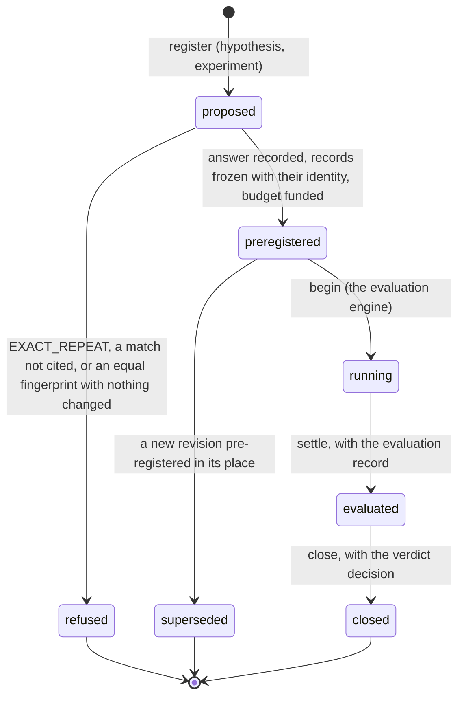

# Experiments

> Target state. Boundary: [orchestration](../architecture/components.md#orchestration), core
> component *work state machine*
> ([ADR-0036](../decisions/adr/0036-guarantee-core-and-capability-plugins.md),
> [ADR-0045](../decisions/adr/0045-feedback-loop-guarantee-seams.md)). Proposal:
> [PROP-0011](../proposals/0011-feedback-loop.md). Records:
> [`hypothesis@1.0`](../reference/schemas.md#hypothesis),
> [`experiment@1.0`](../reference/schemas.md#experiment),
> [`lesson@1.0`](../reference/schemas.md#lesson), read under an
> [`objective-contract@1.0`](../reference/schemas.md#objective-contract), and the `registration`
> decision of [`decision@1.7`](../reference/schemas.md#decision).
>
> Defined in [`experiments-core`](../../packages/experiments-core/README.md), contract 1.0, its
> suite passed by the fake `FakeExperiments`. Differs from target: no store-backed provider, no
> bundle row, and no MCP `experiments_*` tools yet (F3); nothing registers an experiment yet (the
> `improve` template is F6). Status audited 2026-10-27: nothing of this seam changed from T236 to
> T295; the reviewer eval's measured runs (`9df2529c`) are records of
> [validation](../validation/experiments/README.md), not of this registry.

The experiment registry remembers what was tried. Every experiment is registered with the
hypothesis it tests; the registry identifies it exactly and fingerprints it semantically, answers
whether it repeats, relates to, or retries a recorded one, and pre-registers it or refuses it,
each answer a `registration` decision. While the [evaluation engine](evaluations.md) runs an
experiment, the registry holds its state; once its verdict is recorded, lessons drawn from it are
kept here too, and whether one still applies is computed when it is read.

## Seam

`ctx.experiments` (`Experiments` in `@tsuuanmi/system-experiments-core`), contract 1.0:

| Method | Does |
|---|---|
| `lookup(registration)` | what `register` would answer now, with the matches it found; records nothing |
| `register(registration)` | record the hypothesis and the experiment, answer, and pre-register or refuse it ([a registration](#a-registration)) |
| `get(experimentId, revision?)`, `list(filter?)` | read experiments: one as it stands (its live revision, else its latest) or at a revision, or every revision, refused and superseded ones included |
| `link(link)` | link two recorded experiments by hand, by the lead or the operator ([manual links](#manual-links)) |
| `begin`, `settle`, `close` | the evaluation engine's moves, fenced by the evaluation that holds the experiment ([an experiment](#an-experiment)) |
| `recordLesson(lesson, producer)` | record a lesson whose evidence holds ([lessons](#lessons)) |
| `lessons(filter, current)` | the lessons about some experiments, split into those that apply now and those that are possibly stale |

`at` is a test seam, as in the board: the core callers fill it from the wall clock.

## Two keys

The registry identifies an experiment twice, by pure functions pinned by their versions; a record
names the version it was computed with, and changing what either reads or how is a new version.

- **Exact identity** (`identityOf`, version 1): the sha256 of the canonical JSON of the normalized
  hypothesis (its target with its version, its fingerprint's mechanism and intervention, the
  expected effect's metric and direction, its workload), the candidate's and the baseline's exact
  subjects, the comparison, the objective contract (id, version, hash), the suite (id, version,
  each partition's hash, the partitions used), the environment's hash (`environmentHash`: every
  list sorted, absent fields null), the protocol, the stopping rule, and the families of maker,
  reviewers, and validators. Prose, ids, revisions, the budget, the seed, and the candidate's
  provenance are not read: a reworded, re-seeded, or re-funded copy is the same experiment.
- **Structured fingerprint** (`fingerprintOf`, version 1): the target's kind and ref, the
  mechanism and the intervention as the vocabulary's canonical tags, and the expected effect's
  metric and direction; its `hash` is the sha256 of those four fields. Equal fingerprints suggest
  the same idea; only the exact identity refuses an experiment outright. Embedding or model
  similarity may suggest a related experiment to the lead or the operator later (the knowledge
  family); it never establishes equivalence and never refuses one.

The **vocabulary** is the registry's configuration, never a model's: mechanism and intervention
terms, each with the aliases it also accepts. A hypothesis whose tag the vocabulary does not hold
is refused, since a fingerprint outside it could not be matched; a word naming two terms makes the
vocabulary unusable, and the registry refuses every registration until it is fixed
(`unavailable`). The sha256 of the vocabulary's canonical form is the registration decision's
decider hash, so a decision shows which vocabulary normalized its fingerprint.

## An experiment

`proposed` exists only inside `register`: the records and the registration decision commit
together, so a reader never sees it, and a crash before the commit leaves nothing.

| From → to | Who | Records | On failure |
|---|---|---|---|
| — → proposed → preregistered or refused | `register`, by the controller (a workflow node), the lead, or the operator | the `hypothesis` (criteria) and `experiment` (plan) artifacts, then the `registration` decision, whose inputs are both, every experiment matched, and the revision superseded | an invalid registration records nothing (`invalid`); with the registry unavailable nothing is pre-registered |
| preregistered → superseded | `register` of the next revision, pre-registered | the next revision's experiment artifact supersedes this one's (`lineage.supersedes`), and its registration decision names it | a refused next revision leaves this one as it was |
| preregistered → running | `begin(experimentId, evaluationId)`, by the evaluation engine only | the engine's schedule ([evaluations](evaluations.md#an-evaluation)) | another state, or another evaluation, is `invalid-transition`; beginning again under the same evaluation returns the entry |
| running → evaluated | `settle(experimentId, {evaluationId, evaluation})` | the `evaluation` artifact, which must be of this evaluation and this experiment at its identity (INV-5) | another evaluation, or a record about another subject, is refused and the state stays |
| evaluated → closed | `close(experimentId, {evaluationId, verdict})` | the `verdict` decision, which must be about this evaluation and cite its record | a verdict that cannot be recorded or bound leaves the experiment `evaluated` for the engine's next sweep |

The engine's moves apply to the live revision, the latest one neither refused nor superseded. One
evaluation holds an experiment from `begin` on, so one evaluation writes its state
([INV-15](../architecture/invariants.md#inv-15-one-writer-per-subject)).

## A registration

A registration is a hypothesis as its author gives it, an experiment as its author gives it, the
experiments it cites by id, the retry predicates it names as changed, why the earlier evidence may
no longer apply, and its producer. The registry, in one transaction:

1. **Checks** it, refusing it as `invalid` with nothing recorded when it is no valid record (each
   checked against its schema with stand-ins for what the registry computes); a tag is outside the
   vocabulary; its objective contract is not a recorded `objective-contract` the operator wrote,
   or its hash or version differ; the contract cannot judge it (`contractProblems`: an undefined
   metric, a judged metric with no method, a ratio of a ratio, a guarded primary); its protocol is
   less strict than the contract's (`protocolProblems`); its partitions, cases, or horizon
   disagree with its protocol and suite; an arm has no Worker; its hypothesis is about a metric
   the contract does not measure; its budget passes the contract's cost ceiling, a trial reserves
   a line it has none of, or it names no funding round the operator approved; its families are
   not independent (`independenceProblems`); it cites an experiment that was never
   pre-registered; or its revision is not the next one or would replace a revision that is not
   pre-registered.
2. **Answers** it against the recorded experiments ([the four answers](#the-four-answers)).
3. **Admits** it or refuses it: an exact repeat is always refused; every match must be cited; an
   equal fingerprint against which no retry predicate changed in the records is refused, cited or
   not; every predicate it names must have changed against a match; and a CONTEXT_CHANGED answer
   must name, against each equal fingerprint, a predicate that changed, and say why.
4. **Records** the hypothesis (its fingerprint computed), the experiment (its environment hash,
   identity, answer, citations, and named predicates filled in), and the `registration` decision,
   whose two candidates, `preregistered` and `refused`, each say why. A refused registration is
   kept as history and never counts against later ones; the earlier experiment, its verdict, and
   its lessons are returned with it.

A registration retried with the same content (its canonical JSON, `registrationHash`) returns the
entry already recorded; the same revision with other content is `invalid`, since a change is a new
revision.

### The four answers

Only pre-registered experiments that were not replaced count (`preregistered`, `running`,
`evaluated`, `closed`), and an experiment's own revisions never count against it. A recorded
experiment matches a registration as `exact` (an equal identity), `equal-fingerprint`, `shared`
(the same target and mechanism), or `linked` (named in the hypothesis's prior evidence, or
linked by hand to an experiment matched otherwise).

| Answer | When | What may follow |
|---|---|---|
| `EXACT_REPEAT` | a match is exact | refused; the earlier experiment, its verdict, and its lessons are returned |
| `CONTEXT_CHANGED` | a match has an equal fingerprint, and against every such match a retry predicate changed in the records | pre-registered only if it cites every match, names against each equal fingerprint a predicate the records confirm, and says why |
| `RELATED` | anything else matched: a shared target and mechanism, a link, or an equal fingerprint with no predicate changed | pre-registered only if it cites every match and no equal fingerprint is left with nothing changed |
| `NOVEL` | nothing matched | pre-registered |

A deliberate replication (the same identity, run again on purpose) is refused as an exact repeat,
as the proposal suggests; whether the operator may allow one is open
([PROP-0011](../proposals/0011-feedback-loop.md#open-questions), Q7).

### Retry predicates

Each predicate is checked against the two experiments' records (`changedPredicates`), never taken
on the registrant's word:

| Predicate | Changed when the records differ in |
|---|---|
| `model-version` | the families the arms run on, or the model version a family's Worker shows |
| `workload` | the environment's workload |
| `objective-version` | the objective contract, or its version |
| `suite-version` | the suite, or its version |
| `mechanism` | the fingerprint's mechanism (so never against an equal fingerprint) |
| `measurement-defect` | a collector, or its version: a measurement defect is fixed by a new collector version |
| `cost-structure` | the environment's cost model, such as a price table's version |

### Manual links

The lead or the operator links two recorded experiments (`link`), with why. A link is undirected
and idempotent, and reaches one hop: a registration that matches one of them also matches the
other, as `linked`, and must cite it. Naming an earlier experiment in a hypothesis's prior
evidence is the author's own link. A link never refuses anything by itself; it asks for a
citation.

### Where the tables leave room

The registry settles these cases so that the [fail-closed rules](#fail-closed-rules) hold; the
suite tests each.

- **A refused revision is terminal.** A retry with a citation is a new experiment id, or the next
  revision of a pre-registered one; a revision takes the next number after every recorded one,
  refused ones included, and replaces the live revision.
- **Funding.** The registry checks that the budget names an operator's approval that approved;
  that the approval funds the milestone it names is the board's to check, once experiments are
  board milestones ([PROP-0011](../proposals/0011-feedback-loop.md#open-questions), Q9).
- **A lookup never changes anything**, and is refused exactly as a registration would be.

## Lessons

A lesson is knowledge drawn from verdicts ([`lesson@1.0`](../reference/schemas.md#lesson)). The
registry records it (a `finding` artifact whose inputs are the verdicts and experiments it cites)
only when every verdict it cites is a recorded `verdict` decision with the lesson's outcome, about
an experiment it cites, and every experiment it cites is closed with one of those verdicts. Who may
write one is open ([PROP-0011](../proposals/0011-feedback-loop.md#open-questions), Q11); the
artifact's producer records who did.

Whether a lesson applies is computed when it is read, from its `invalidatedBy` predicates against
the current environment the caller gives, and never stored. A lesson applies only while every
predicate is checkably unchanged; one that fired, or that the current environment cannot confirm,
makes it history, shown as possibly stale:

| Predicate | Fires when the current environment |
|---|---|
| `model-version` | shows the family with another model version, or does not show the family |
| `objective-version`, `suite-version` | has no contract or suite of that id at that version |
| `mechanism` | has no such tag in its vocabulary |
| `measurement-defect` | has the collector at another version, or not at all |
| `cost-structure` | has another cost model |
| `expiry` | is at or past the date |

## Fail-closed rules

1. Nothing is pre-registered without its registration decision, recorded in the same transaction
   ([INV-13](../architecture/invariants.md#inv-13-every-decision-is-an-artifact)); with the
   registry unavailable, nothing is.
2. An exact repeat is always refused; a related or retried experiment is pre-registered only with
   its citations and, for an equal fingerprint, a changed predicate the records confirm.
3. The fingerprint and the identity are computed by the registry, never taken from the caller,
   and only from the vocabulary the operator configured.
4. An experiment is judged only under a contract the operator wrote, at the version and hash it
   names, and only with a protocol at least as strict.
5. Only the evaluation that holds an experiment moves it, and only with records bound to its
   exact identity ([INV-5](../architecture/invariants.md#inv-5-exact-subject-binding)).
6. A lesson stands only on verdicts with its outcome; one whose envelope cannot be confirmed is
   shown as possibly stale, never as applying.

## Conformance

[`experiments-core/conformance/experiments.ts`](../../packages/experiments-core/conformance/experiments.ts),
11 scenarios at contract 1.0, run against the fake provider; a store-backed provider (F3) will run the same
suite.
