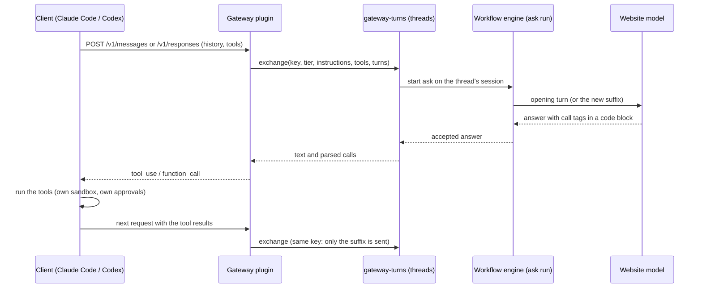

# Gateways

> Boundary: [gateways](../architecture/components.md#gateways).
> Requirements: REQ-GW-1..5, REQ-HOST-1, REQ-HOST-3. Security: [threat model](../security/threat-model.md).
> Decisions: [ADR-0009](../decisions/adr/0009-claude-and-codex-first-class.md),
> [ADR-0022](../decisions/adr/0022-text-protocol-tool-calls-for-website-models.md).
> Wire details: [gateway compatibility](../reference/gateways.md).
>
> Implemented in [`gateway-anthropic`](../../packages/plugins/gateway-anthropic/README.md),
> [`gateway-responses`](../../packages/plugins/gateway-responses/README.md),
> [`gateway-turns`](../../packages/gateway-turns/README.md), and
> [`gateway-core`](../../packages/gateway-core/README.md) (the guard); differs from target: see
> [Target (not built)](#target-not-built).

The gateways let Claude Code and Codex use website Workers **as their model**. They are plain
consumer plugins at the edge, not providers of a seam:

- `gateway-anthropic` serves the Anthropic Messages API under `/anthropic`, for Claude Code;
- `gateway-responses` serves the OpenAI Responses API under `/openai`, for Codex.

Each plugin owns only its wire format. Everything else is the shared library
[`gateway-turns`](../../packages/gateway-turns/README.md): the text tool protocol and the
threads that bind a client conversation to a provider conversation. The request guard is the
one every client endpoint shares
([`gateway-core`](../../packages/gateway-core/README.md#the-request-guard)).

Each client request is an exchange on a thread, and each exchange is an `ask` run on the
[workflow engine](workflow-engine.md). It is therefore routed, egress-checked, receipted, and
explainable like any other run, and drain applies to it.

## Text tool protocol

A website model cannot call the client's tools natively. Following
[ADR-0022](../decisions/adr/0022-text-protocol-tool-calls-for-website-models.md), the turn
describes the client's tools in text, and the model answers with call tags:

1. **Opening turn.** The gateway renders the protocol, a compact list of the client's tools,
   the agent's instructions, the history, and a closing that quotes the user's request.
2. **Calls.** The model answers with `<call tool="X">{json}</call>` tags, all in one fenced
   code block, one per line. A fenced block keeps the arguments' whitespace, which the site's
   prose renderer collapses. A tag counts only when it names an offered tool and its arguments
   are a JSON object.
3. **Native tool calls.** The gateway ends the client response with the client's own tool-call
   items: `tool_use` (with `stop_reason: tool_use`) for Messages, `function_call` or
   `custom_tool_call` for Responses.
4. **The client runs them** under its own sandbox and approvals, and sends the results
   (`tool_result` or `function_call_output`).
5. **Suffix only.** The next request sends only what follows the last assistant turn, as
   `TOOL_RESULT <tool> (<id>)` lines, in the same provider conversation, which already holds
   the model's earlier replies.

When the model claims it cannot reach the user's files, the exchange sends at most one nudge:
the client runs the tools, so write the call tag.

## Threads

A thread binds one client conversation to one persistent provider conversation, in the table
`gateway_threads` (scope, key). The key includes the tier:

- **Messages** is stateless, because the client resends history. The key is a hash of the
  system text and the first message.
- **Responses** binds on `prompt_cache_key` when the client sends one, and otherwise on the
  instructions and the first user turn.

A key alone never resumes a conversation. The binding stores a fingerprint of what the
provider conversation saw: user text, tool results, and the assistant's text and call ids (call
ids are random per reply). A request resumes only when its history up to the last assistant
turn matches it exactly. Otherwise, for another client with the same opening or a rewound or
edited history, a fresh conversation opens with the whole history.

A model name selects the tier: `system-<tier>`, else the plugin's `models` patterns, else
`standard`. `GET /v1/models` lists `system-economy`, `system-standard`, and
`system-frontier`.

## Responses gateway (Codex)

An OpenAI Responses-compatible endpoint on the loopback webserver.

- **Routes:** `POST /v1/responses` (SSE or one JSON response) and `GET /v1/models`.
  `HEAD`, `GET /`, and `GET /healthz` answer 200 without authentication.
- **Transport:** a WebSocket attempt on `GET /v1/responses` receives HTTP 426, which makes
  the client fall back to SSE. While a turn runs, `response.in_progress` keeps the client's idle
  timer from firing.
- **Authentication:** every other route passes the shared guard: a loopback `Host`, no browser
  `Origin`, and the model scope's token
  ([scopes](../../packages/plugins/mcp-server/README.md#scopes)). On plain HTTP on a non-loopback
  host the route is not registered, so the token never crosses a network in clear text.
- **Event mapping:** prose becomes output text, and tool requests become `function_call` (or
  `custom_tool_call` for freeform tools). Status rows are not mapped.
- **Compaction:** Codex compacts locally for a custom provider. Its summary request continues
  the bound conversation, and the compacted history, which has no assistant turn, opens a new
  one.
- **Retries:** `system codex-env` sets Codex's request and stream retries to zero, because a
  retried request would send a website turn again.

## Anthropic Messages gateway (Claude Code)

An Anthropic Messages-compatible endpoint on the same listener.

- **Routes:** `POST /v1/messages` (SSE or one JSON message), `POST /v1/messages/count_tokens`
  (an estimate), and `GET /v1/models`. The guard is the same as for Responses.
- **Client setup:** `system claude-env` prints a command that points Claude Code's base URL at
  the gateway and reads the model token through a helper.
- **Event mapping:** prose becomes `text` blocks and tool requests become `tool_use` blocks. A
  request for thinking is not answered with `thinking` blocks.

## Authority

Filesystem scope, working directory, and sandbox mode come only from the client's native
envelope or from operator configuration. Text such as `<environment_context>` inside a prompt
is data, never authority
([INV-6](../architecture/invariants.md#inv-6-authority-comes-from-trusted-envelopes)). Model
text only proposes calls; the client decides and runs them.

## Drain

Every entry point (gateways, MCP, CLI) admits work through `workflow.start`, so drain is an
engine operation (REQ-HOST-1):

- `drain()` admits no new run, which answers as `overloaded` (a gateway returns 529 or
  `response.failed`), and reports the runs still executing. `resume()` undoes it.
- Both are MCP tools. `system drain` and `system shutdown` poll `drain` until nothing is
  executing or the deadline passes. `shutdown` then stops the profile.
- A gateway request ends with its run, so the in-flight HTTP count follows the run count.
- Runs still executing at the deadline are durable, and resume on the next start (REQ-WF-4).

## MCP server (capabilities)

Separately from the gateways, the MCP server exposes `system` capabilities (ask, research,
runs, operator controls, accounts, sessions) as native MCP tools to any MCP client
([MCP tools](../reference/mcp-tools.md)).

## Target (not built)

The gateways above differ from the target in these ways. Each item is planned.

- **MCP tool inversion** (below) instead of the text protocol, for accounts and hosts that
  can reach a local MCP server through a website connector.
- **Journaled client configuration edits** instead of printed commands (below).
- **Status rows** mapped to Responses reasoning summaries and Messages `thinking` blocks.
- **`POST /v1/responses/compact`** (remote compaction).
- **`/admin/*` routes** (drain, resume, cancel, interrupt, shutdown); drain is an engine
  operation today.
- **`previous_response_id`** served from a local cache bounded by entries, age, and bytes.
- **A measured model catalog:** Workers listed as models with measured context windows and
  composer budgets, and a request over budget refused in preflight, before a provider turn
  opens.

### MCP tool inversion

A remote Worker, such as a web model, would use the *client's* tools through MCP, while the
client keeps its own sandbox and approvals (REQ-GW-2):

1. Each turn prompt embeds a random **turn token**. The MCP server accepts tool calls only with
   a live token, and only for tools the current client turn advertised.
2. The **turn broker** (a private Unix socket or named pipe between the MCP server process and
   the host) queues the call.
3. **Causal barrier:** before tools are emitted, the provider runtime checkpoints the response
   text produced so far.
4. The gateway ends the current client response with the client's native tool-call items.
5. The client runs the tools and sends the results. The gateway requires the result count to
   equal the outstanding count.
6. The broker completes the calls, and the MCP calls return inside the **same** remote turn.
   One remote turn can therefore span many client requests.
7. **Two-phase completion fence:** the turn completes only on a new, stable final answer
   produced after the last checkpoint, observed under a monotonic `activityRevision` that tool
   activity advances.

### Client configuration edits

When the host configures a client, for example by pointing Codex's model provider or Claude
Code's base URL at the gateway, the edit is surgical and preserves formatting. It is journaled
with the previous bytes, and restored byte for byte on disconnect (REQ-HOST-3).
