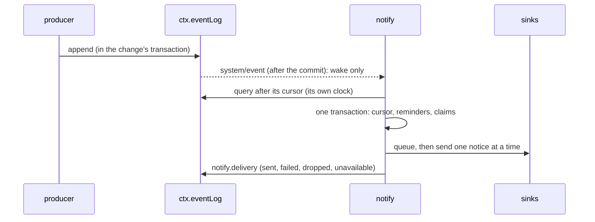

# Notifications

> Target state. Boundary: [gateways](../architecture/components.md#gateways), plugin family
> *surface* ([ADR-0036](../decisions/adr/0036-guarantee-core-and-capability-plugins.md)). Roadmap:
> [B5](../proposals/roadmap.md) (PROP-0010). Requirement: REQ-HOST-9. Record:
> [`notification@1.2`](../reference/schemas.md#notification).
>
> Implemented in [`notify`](../../packages/plugins/notify/README.md), its bundle row off; differs
> from target: no notice when a request expires (it is denied by then, and the waiting work's own
> notice, a run that failed, follows), and a host that was stopped notifies nothing of what it
> recorded before it stopped once that is older than `maxAgeMinutes`.

An approval request that nobody answers expires, and expiry denies it
([approvals](approvals.md#a-request)): a request the operator never saw is lost work. The same holds
for a board task's review held for the operator, a run that waits for the operator, a step waiting
out an account's limit, or an account whose Workers stopped taking work. `/ui` and `system health` show all of these, but only to an operator
who looks. Notifications tell the operator out of band, on the desktop or through a webhook they
choose, with the exact command to act.

PROP-0003 listed an in-app notifier as a non-goal, leaving notification to systemd's `OnFailure=`
units around `system health`. That covers a host that is unhealthy, not a request that waits: a
healthy host with an open request is not a failure any unit sees. This plugin is the operator's
answer for B5 (T75); systemd units stay the answer for a host that is down.

## What it is

A surface plugin: it reads the core and presents it to the operator. It reads **recorded events
only**, from `ctx.eventLog`, and nothing else of any plugin: the producers append the events (each in
the transaction of the change it names), and the notifier reads them after its own cursor. It writes
only its own tables and its delivery events, decides nothing, and fails open: a notice that cannot
be sent is recorded and shown in health, and nothing else changes. It is no seam; nothing consumes
it. Its row is off by default; the operator turns it on
([runbook](../operations/runbooks.md#get-notified)).

## What each event tells

| Notice (`kind`) | Event | Producer | Subject (deduplicated by) | The commands to act |
|---|---|---|---|---|
| `approval.opened` | `approvals.requested` | `approvals`, with the request | the request id | `system ui` (the queue), MCP `approvals_get`, `approvals_decide` |
| `approval.expiring` | the reminder of an `approvals.requested`, `expiryLeadMinutes` (60) before its `expiresAt` | the notifier | the request id | the same |
| `run.user-action` | `workflow.node.failed` or `workflow.run.failed` with `disposition: USER_ACTION` | `workflow` | the run id | `system explain <run>`, `system continue <run> <node>` (a step), `system ui` |
| `run.escalated` | `workflow.node.escalated` (a rejected result runs again at a higher tier) | `workflow` | the run id | `system explain <run>`, `system stop <run>` |
| `run.waiting` | `workflow.node.waiting` (ADR-0052 recovery `wait`: assigned accounts at their limit) | `workflow` | the run id | `system explain <run>`, `system account list`, `system stop <run>` |
| `pool.limited` | `resources.pool.limited` (a reading closed a pool that was open) | `resources` | the pool id | `system health`, MCP `resources_pools` |
| `worker.quarantined` | `agent-workers.account.quarantined` (a slot newly quarantined, PROP-0012 E) | `agent-workers` | the account id, or `<provider>:slot-<n>` | `system account list`, `system account verify …` (`--accept` for `changed`), `system account login …` |
| `dispatch.started` (`notification@1.2`) | `workflow.dispatch.notice`: the dispatch pass started a ready board task's run by itself where the project's policy gives `dispatch` `notify` ([dispatch](workflow-engine.md#dispatch-starting-ready-work-by-itself), PROP-0014 D2); `auto` makes no notice | `workflow`, with the start | the run id | `system explain <run>`, `system stop <run>`, `system dispatch pause --project <id>` |
| `review.expiring` (`notification@1.1`) | the reminder of a `board.review.held` (a board task's review held for the operator), `expiryLeadMinutes` (60) before its `expiresAt`, or at once when it expires sooner; a `board.review.ended` read first cancels it | the notifier, from `board`'s events ([a review held for the operator](board.md#a-review-held-for-the-operator)) | the task id | `system ui` (Reviews: Accept or Reject), MCP `board_task` |

- **The events** are part of this change, each additive: `approvals.requested` names the request,
  its class, expiry, requester component, and project; `approvals.resolved` its state, cause, and
  option, with the `approval` decision; `resources.pool.limited` the pool, account, window, until,
  source, and the reading's evidence, once when a reading closes a pool that was open;
  `agent-workers.account.quarantined` the provider, slot, account id, reason, and the Workers
  that take no work, with the `enrollment` decision; every `workflow.node.failed` now says its
  `disposition`, and `workflow.run.failed` its `kind` and `disposition`. A producer whose append
  fails logs it, and its change is made all the same. None carries a request's summary,
  consequences, or command, a principal, a prompt, or an answer.
- **A reminder** is kept for an open request when its expiry less the lead time is after its
  making; a request that expires within the lead time is told once, as it opens. An
  `approvals.resolved` entry read before the reminder is due cancels it. A reminder due after its
  request expired is dropped.
- **A review held for the operator** (T99 D6) makes no notice when it starts (the Reviews list on
  `/ui`, Home, `system status`, and the report show it); its reminder, kept under `review:<task>`,
  comes `expiryLeadMinutes` before the hold expires, or at once when the hold is shorter than that,
  and a `board.review.ended` read first cancels it. Unanswered, the review expires and the task
  waits for input (`review-expired`), which nothing revives, so this is the notice that matters.
  It is `notification@1.1`, the record that names the kind.
- **Content** is made by code from ids, classes, kinds, and times. A value the event gives that is
  not an id (`common@1`) or a word is left out, never quoted; each field is cut to its bound, and
  the notice validated against `notification@1.x` before it is queued (one that fails is a defect,
  logged, never sent). Its egress classification is `operator-shared`. The `link` is the `/ui`
  page without its token: it opens where the browser already holds one, and `system ui` prints
  the link with it. A `link` configured with a fragment, a user, or a password is refused at start.

## A pass

- **Never blocks or alters a producer.** The notifier runs on its own timer. A committed event
  (`system/event`, mode `emit`, after the commit) only schedules a pass; nothing of a pass runs in
  the producer's call, and a sink that hangs holds only the notifier's queue.
- **One transaction per pass:** the events after the cursor (at most 10 pages of 1000; a longer
  backlog is read by the next passes, at once), the reminders due, and each notice's claim on its
  window. The notices are queued only after it commits. A pass that fails changes nothing and is
  logged; the next reads the same events again. Every `pollSeconds` (15) a pass runs anyway, for
  the reminders.
- **Durable state in the store** (plugin rule 6): the cursor, the claims, the reminders. A restart
  reads on from the cursor and tells nothing twice within a window. A notice queued when the host
  stops is not sent after the restart (its event is behind the cursor); the queue is in memory.
- **Stale events:** an event older than `maxAgeMinutes` (60) when read makes no notice: a row
  turned on after weeks off reads its backlog without telling it. An open request's reminder is
  still kept from such an event.
- **Kinds:** `kinds` (default every one) chooses which notices are sent; the reminders are kept
  regardless.

## Deduplication and bounds

- At most one notice per `(kind, subject)` in `dedupMinutes` (10): a step's failure and its run's
  failure are one `run.user-action`; another kind of the same subject is its own notice. The claim
  is made in the pass's transaction, when the notice is queued, never for a notice dropped.
- **The queue** holds at most `maxQueue` (50) notices waiting; one more is dropped, logged, and
  recorded (`dropped`), and claims no window, so the next event of that subject is told.
- At most 10 000 reminders; one more is logged and gets none. Claims past their window and
  reminders past their request's expiry are deleted on every pass (INV-9).

## Sinks

Each notice goes to every sink that is on, one sink at a time, **once**: a failure is logged and
recorded, never retried (the reminder is the one second chance an approval request gets). Each
delivery is bounded by `timeoutSeconds` (10). A sink never throws, and what it says of a failure
never holds a secret.

- **desktop** (`desktop`, on by default): `notify-send` (libnotify), looked up on `PATH` at start,
  run without a shell, given only the environment it needs to reach the session's notification
  daemon (`PATH`, `HOME`, the locale, `DBUS_SESSION_BUS_ADDRESS`, `DISPLAY`, `WAYLAND_DISPLAY`,
  `XDG_RUNTIME_DIR`), `--` before the title and the body (the text, each command, the link).
  `approval.expiring` and `review.expiring` are `critical`, the rest `normal`. Without `notify-send` the sink is a no-op:
  `unavailable` recorded at start and each notice `failed`, so health says so; on a headless host
  the operator turns it off (`desktop: false`) and uses the webhook.
- **webhook** (`webhook.enabled`, off by default): a JSON `POST` of the `notification@1.0` record,
  following no redirect, its answer's body discarded; any `2xx` is sent.
  - **Declared egress (INV-12).** Before anything leaves, `ctx.egress.check` runs on the exact body
    (classification `operator-shared`, class `webhook`), recorded as an `egress` decision. The
    egress row's default policy lets **nothing** leave for `webhook`: the operator declares
    `webhook: [operator-shared]` in that row's `workerClasses` (which replaces the default, so it
    lists every class). Without the declaration, or with no egress gate loaded, nothing is sent and
    the refusal is recorded. The credential scan runs on the body too.
  - **The URL is a secret** (it usually carries a token), so it is kept in `ctx.credentials` under
    the reference `webhook.credential` (`SYSTEM_NOTIFY_WEBHOOK_URL`), never in configuration;
    stored by MCP `notify_webhook` (operator scope) or `system notify webhook < file`, read at
    each delivery (a changed URL needs no restart). It must be https, or http to this machine, with
    no user or password. It is never logged or recorded: a failure says the HTTP status or the
    error's code, never its message.

## Health

Each outcome is a `notify.delivery` event: `sent` or `failed` per sink and notice, `dropped`, and
`unavailable` per sink at start, with the kind, subject, notice id, and why. The surface reads the
events, never the plugin: MCP `status` health (`system health`) shows `notifications` once there is
one within `driftWindowHours` (24), **degraded** while a sink's latest outcome there is `failed` or
`unavailable` (naming the sink, why, and how many failed) or a notice was dropped, else `ok` with how
many were sent. A failure the next delivery to the same sink outlived is over. Past 10 000 entries
in the window it is degraded, never `ok` on part of them
([mcp-server](../../packages/plugins/mcp-server/README.md)).

## What it does not do

- It never approves, retries, continues, or stops anything: each notice names the operator's own
  command. It is no channel for a verdict (INV-6).
- It sends nothing remote by default: the webhook is opt-in twice, in its own row and in the egress
  row.
- It has no seam, so nothing else can depend on it; its record is the event log.
