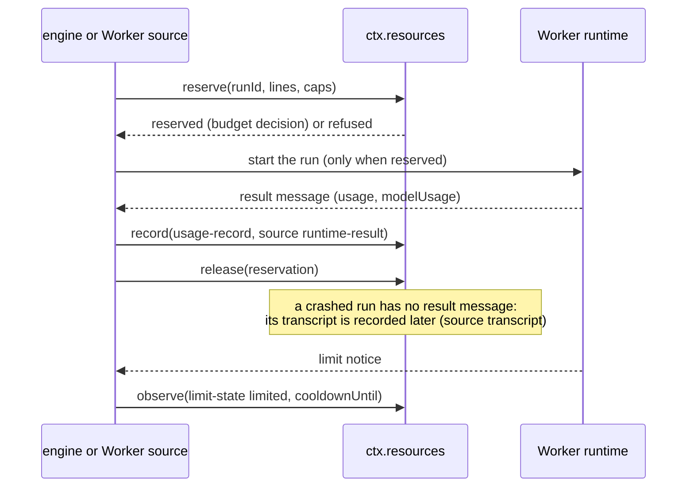
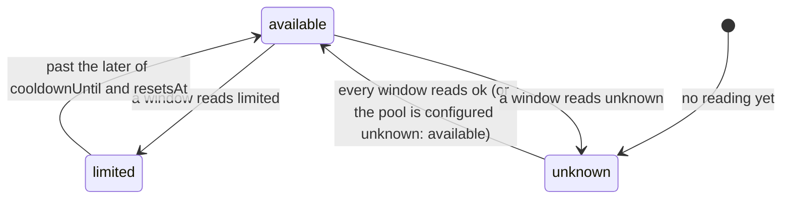

# Resources

> Target state. Boundary: [routing](../architecture/components.md#routing), core component
> *resource ledger and metering*
> ([ADR-0036](../decisions/adr/0036-guarantee-core-and-capability-plugins.md)). Proposals:
> [PROP-0010](../proposals/0010-base-version.md),
> [PROP-0008](../proposals/0008-studio-operating-model.md#resource-management-and-token-optimization).
> Records: [`usage-record@1.0`](../reference/schemas.md#usage-record),
> [`limit-state@1.0`](../reference/schemas.md#limit-state).
>
> Defined in [`resources-core`](../../packages/resources-core/README.md); provided by
> [`resources`](../../packages/plugins/resources/README.md) on `ctx.store`, with the MCP tools
> `resources_pools` and `resources_usage`. Agent Workers configured with a pool reserve, record,
> and observe through it ([agent runtimes](agent-runtimes.md#metering)), naming the board task
> their brief serves; the workflow engine reserves a board task's budget lines before each step of
> the task's run starts work ([a task's budget](workflow-engine.md#a-tasks-budget)), and asks to fund a spent
> one by lines it computes from the ledger's count of the task's usage
> ([funding a spent task](workflow-engine.md#funding-a-spent-task)). Differs from target: no
> other Worker source reports, no transcript is reconciled, the engine reserves only for a
> task that declares a budget, the bundle configures no pool, no metering oracle checks recorded
> usage, and usage the ledger cannot count counts as 0 against a cap: it is recorded and shown,
> and no cap fails closed on it ([usage the ledger cannot count](#usage-the-ledger-cannot-count)).

The resource ledger knows what each configured pool has left and what every run consumed. Its
numbers come from objective sources only: a runtime's result message, a provider's usage
fields, an agent's session transcript, a limit notice, an invoice. A model's report of its own
usage is never one. Pools and their windows are operator configuration, because plan terms
change: an account can have an interactive window, a programmatic credit, and an API key, and a
Claude Code Worker run through the Agent SDK may draw on a different pool than interactive use.

## Seam

`ctx.resources` (`Resources` in `@tsuuanmi/system-resources-core`), contract 1.1:

| Method | Does |
|---|---|
| `pools(filter?, at?)` | every configured pool (and every pool made from a template for a declared account), the latest reading of each window, and whether it is available at `at` |
| `observe(reading)` | record a `limit-state` reading |
| `reserve(request, at?)` | reserve before a run; records a `budget` decision |
| `release(reservationId)` | release a reservation once the run's usage is recorded, or it never started |
| `record(usage)` | record one unit's `usage-record`, deduplicated |
| `usage(filter?)` | the counted records and their totals per pool |
| `declare?(source, accounts)` | optional, contract 1.1 ([ADR-0052](../decisions/adr/0052-accounts-are-assigned-unless-pooling-is-recorded.md)): a Worker source's accounts, replacing what it declared before; one pool per [template](#pool-templates) and account; returns their ids |

## A run's budget

| Step | Who | Records | On failure |
|---|---|---|---|
| observe | a Worker source or runtime, from a status line, limit notice, response headers, or result | the reading as an `evidence` artifact; the window's latest reading by `observedAt`; a `resources.pool.limited` event (pool, account, window, `until`, source, the evidence) when the reading closes a window that was open, which [notifications](notifications.md) read | a reading for a pool or window not configured is refused (`unknown-pool`) |
| reserve | the engine before each step of a board task's run, or a Worker source before a run | a `budget` decision, `reserved` or `refused` with a reason per pool or cap | refused when a pool is not configured, or unavailable, or a cap would be exceeded |
| record | the Worker source, after the run | the record as a `receipt` artifact | refused for an unknown pool (`unknown-pool`), a schema violation, or cached input above the input (`invalid`) |
| release | whoever reserved | the hold is removed | an unknown reservation is refused; an expired one releases quietly |
| expiry | none: time | a hold nobody released (a crashed run) stops counting at its `expiresAt` (`holdSeconds`, the provider's default 4 hours) | — |

## Pools and availability

A window with no reading yet is `unknown`, like an explicit `unknown` reading: missing telemetry
is not capacity. A pool with an unknown window is unavailable unless its configuration says
`unknown: available` (a pool that never reports, such as a local model). For a plan window that
reports only after a first response, the operator configures the pool as available, or the
first reading comes from the runtime's result. Every reading field is optional.

### Pool templates

Several accounts of one provider each have their own windows, so a limit on one never closes
another's (PROP-0012 phase F). The operator configures a **template** once (`templates` on the
`resources` row: `template`, `group`, `kind`, `windows`, `unknown`), and a Worker source
**declares** its accounts (`declare(source, [{ account, group }])`): the ledger makes, of every
template whose `group` is the account's, the pool `<template>/<account>` with `account` the
account. It is listed, reserved, read, and recorded as a configured pool is; `resources_pools`
shows each account's own windows and resets.

- A declaration replaces the source's previous one: a withdrawn account's pool is no longer
  listed, and a record or reading for it is refused (`unknown-pool`); its readings and records
  stay, under their ids, and stand again once it is declared again.
- Declarations are in memory: the source declares again after a restart. The `agents` source
  declares its ready assigned accounts of metered providers
  ([agent runtimes](agent-runtimes.md#workers--account--role)).
- Refused (`invalid`), changing nothing: an account that is not an id or a group that is not a
  name; a pool that is configured or another source's; more pools, configured and declared, than
  `resources_pools` lists (64). A template's id and group are names without `/` or `:`, so a pool
  id names one template and one account.
- The pool id is `<template>/<account>`, not the proposal's `<template>@<account>`: `@` is not an
  id character (`common@1`).

### Readings from an account's usage report

> Proposed: [ADR-0059](../decisions/adr/0059-quota-readings-from-each-accounts-own-usage-report.md),
> from the operator's request of 2026-10-24 (T96;
> [research](../research/quota-builtins-2026-10-24.md)). Not built: today an account's windows are
> read only from its runs ([limit readings](agent-runtimes.md#limit-readings)), so a Claude Code
> window's used share is usually unknown, and an idle account's windows are as its last run left
> them.

Each account's pool is fed by that account's own readings, so its windows show its own plan and
its own use, with no plan written into configuration:

| When | What is read | Recorded as |
|---|---|---|
| during a run | the runtime's own events (Claude Code's `rate_limit_event`; Codex's limit message) | as now |
| after each metered run, once, before its usage is recorded | the account's usage report (`limits({ home })` on the agent runtime: Claude Code's `get_usage`, the Codex app server's `account/rateLimits/read`, the Antigravity CLI's `/usage` JSON), in the account's home, without a model turn | `limit-state@1.0` readings of the mapped windows, `source: runtime-result` |
| every `limitReadSeconds` (the provider entry; default 600, `0` off) for each ready, assigned account with a declared pool, unless a report of it is newer | the same report | the same |

- **Pools come from enrollment, as now.** A newly enrolled account assigned a role is declared, so
  it gets `<template>/<accountId>`, and its first report fills its windows. Two Claude Code accounts
  on different plans read different shares from their own reports; nothing is configured per plan.
- **Fail closed.** A report never opens a window that a `limited` reading closed before that
  reading's reset or cooldown (rule 2 below); a report that cannot be read, or is on a runtime
  version whose format was not checked, records nothing, and the window keeps its last reading with
  its `observedAt`. A report that says a window has nothing left closes it until its reset.
- **What stays unknown:** absolute amounts (reports give shares); windows a runtime does not report;
  accounts on an API key (no plan windows); the Antigravity CLI beyond its one home; website
  accounts and the Gemini API, which tell a limit only when it is hit.
- **The seam does not change** (ADR-0036): `observe` takes these readings as it takes a run's; the
  roster already shows each window's `used`, `resets`, and `observedAt`, which the Workers tab
  renders as "used 42 % of 5 h, resets 14:20 (read 14:05)".

## Counting

- One record per `(source, requestId)`; a duplicate is stored as an artifact but not counted.
- A unit is counted once across sources: a `transcript` record of a run that has a
  `runtime-result` record is a duplicate.
- A cap counts, for its scope (a task, else a project), every counted record of its pool in its
  unit, plus every unexpired reservation held for that scope: `tokens` are input plus output, `usd` the
  record's cost, `turns` its turns, `runs` one per record, `minutes` its duration.
- A record counts for a task when it names the task or its run was reserved for it: an agent
  Worker's record names the task its brief serves, and a task's run is reserved for its task. A
  board task's brief counts more: the workflow engine also reads the records of the runs that served
  the task and of the executions they started, each record once
  ([usage spent on a task](workflow-engine.md#a-board-tasks-brief)); a cap does not.

## Usage the ledger cannot count

Some usage reaches no counted figure, and a cap counts it as 0:

| Case | Counts against a cap |
|---|---|
| a counted record without the figure of a cap's unit (no token counts, no `cost`, no `turns`, no `durationMs`) | 0 of that unit; the record's other figures, and `runs` 1 |
| a run whose runtime reported neither tokens nor turns, so no record can be written | nothing |
| a run the host stopped while it ran: no result came | nothing |
| a record the ledger refused (`unknown-pool`, `invalid`), or a `record()` that failed | nothing |

The operator decided (D25, 2026-10-23) to keep counting these as 0, so this seam's cap semantics
and its contract do not change, and to make each one visible and durable instead:

- **A record without a figure** is its own fact: it names its run, Worker, pool, and task, and the
  figure it lacks is missing from it. The [report](reports.md) counts the records without token
  counts, a cost, or turns per pool (an agent Worker's record always carries its duration).
- **A run with no counted record** is recorded by the Worker source that meters it, as a
  `usage.unknown` event, its data a
  [`usage-unknown@1.0`](../reference/schemas.md#usage-unknown) record: the run, Worker, pool,
  account, session, board task and project, how it ended, and its kind (`not-reported`,
  `interrupted`, `refused`, `failed`) with why; the event names the workflow run, whose view maps
  the run to its step. Nothing estimates its usage. A run may get two (a stop aborted it before it
  reported anything, then the restart found it interrupted): readers count it once, by its first.
- **A failed `record()` is never lost silently.** What can be recorded is: a record refused as
  `invalid` with a per-model split is offered again with its totals alone, which are what a cap
  counts. Still refused, the record is kept as an `evidence` artifact (when it is a valid
  `usage-record@1.0`) that the fact names, with the ledger's failure. A fact that cannot be
  appended either (no event log, or the store failing) is logged.
- **Reconciled:** a unit is reconciled once the ledger counts a usage record of its run in its
  pool, which is what transcript reconciliation will write (`source: transcript`; a crashed run's
  record written before the crash counts too).
- **Shown** in the [report](reports.md#what-it-counts) (per pool: the runs whose usage is unknown
  and not reconciled, the records without a figure; in all: each kind, and how many were
  reconciled since), per step in `system usage` (MCP `usage`), and in health: the `usage` check is
  degraded while a configured pool has a run whose usage is unknown and not reconciled in its
  current window, naming the pool and the count; while such a run names a pool the ledger does not
  configure; and when there are more entries than it reads (it is never `ok` on part of them). A
  pool's current window is its longest configured window, back from now; a pool with a window of
  no length (a credit balance) never resets, so every such run counts until it is reconciled or
  the event log's retention removes it ([runbook](../operations/runbooks.md#usage-the-ledger-could-not-count)).

**Deferred: failing closed for metered pools** (D25's third option). A cap could refuse its
scope's next reservation while a run of a pool whose kind requires counted usage (a metered pool)
is unreconciled, keeping 0 for subscription pools with windows. That changes this guarantee seam's
cap semantics, so it needs its own ADR (ADR-0036), and it waits until transcript reconciliation
exists: before then, nothing could reconcile such a run, and its scope would stay refused for good.

## Fail-closed rules

1. No run starts without a reservation; with `ctx.resources` unavailable, none is made and no
   run starts (INV-2).
2. A limited pool admits no new work until its window resets, and a limit hit is never retried
   on the same pool (PROP-0008: switch account or wait). The wait lasts until the reset its
   runtime read from the agent's own report
   ([limit readings](agent-runtimes.md#limit-readings)), else for the Worker's cooldown; a
   reading that cannot be read never opens a pool.
3. Usage is never estimated from a model's own report. A missing number stays missing: a cap
   counts it as 0, and it is recorded and shown ([above](#usage-the-ledger-cannot-count)).
4. Every cap is enforced before the run, never after, and every hold expires (INV-9).

## Conformance

[`resources-core/conformance/resources.ts`](../../packages/resources-core/conformance/resources.ts),
14 scenarios at contract 1.1 (1.1 adds `templates-per-account`: one pool per template and declared
account, a limit on one never closing another's), run against the fake provider and the store-backed one. The
metering oracle against `ccusage --json` comes with the first Worker that reports usage (B2).
