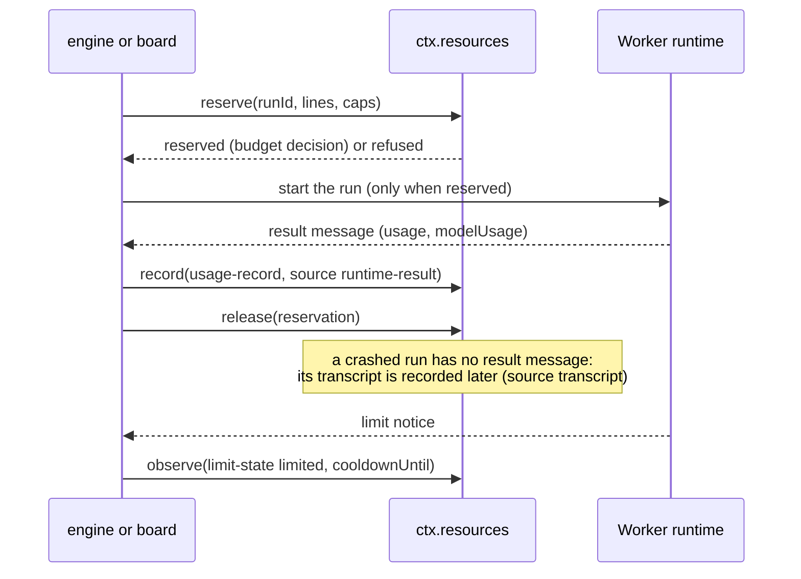
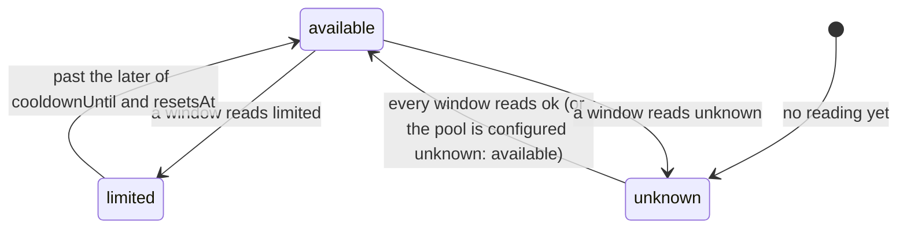

# Resources

> Target state. Boundary: [routing](../architecture/components.md#routing), core component
> *resource ledger and metering*
> ([ADR-0036](../decisions/adr/0036-guarantee-core-and-capability-plugins.md)). Proposals:
> [PROP-0010](../proposals/0010-base-version.md),
> [PROP-0008](../proposals/0008-studio-operating-model.md#resource-management-and-token-optimization).
> Records: [`usage-record@1.0`](../reference/schemas.md#usage-record),
> [`limit-state@1.0`](../reference/schemas.md#limit-state).
>
> Defined in [`resources-core`](../../packages/resources-core/README.md); provided by
> [`resources`](../../packages/plugins/resources/README.md) on `ctx.store`, with the MCP tools
> `resources_pools` and `resources_usage`. Differs from target: no Worker reports usage or
> readings to it yet (B2 part U2), the engine does not reserve before a run yet, and the bundle
> configures no pool.

The resource ledger knows what each configured pool has left and what every run consumed. Its
numbers come from objective sources only: a runtime's result message, a provider's usage
fields, an agent's session transcript, a limit notice, an invoice. A model's report of its own
usage is never one. Pools and their windows are operator configuration, because plan terms
change: an account can have an interactive window, a programmatic credit, and an API key, and a
Claude Code Worker run through the Agent SDK may draw on a different pool than interactive use.

## Seam

`ctx.resources` (`Resources` in `@tsuuanmi/system-resources-core`), contract 1.0:

| Method | Does |
|---|---|
| `pools(filter?, at?)` | every configured pool, the latest reading of each window, and whether it is available at `at` |
| `observe(reading)` | record a `limit-state` reading |
| `reserve(request, at?)` | reserve before a run; records a `budget` decision |
| `release(reservationId)` | release a reservation once the run's usage is recorded, or it never started |
| `record(usage)` | record one unit's `usage-record`, deduplicated |
| `usage(filter?)` | the counted records and their totals per pool |

## A run's budget

| Step | Who | Records | On failure |
|---|---|---|---|
| observe | a Worker source or runtime, from a status line, limit notice, response headers, or result | the reading as an `evidence` artifact; the window's latest reading by `observedAt` | a reading for a pool or window not configured is refused (`unknown-pool`) |
| reserve | the engine before a run, or the board before an attempt | a `budget` decision, `reserved` or `refused` with a reason per pool or cap | refused when a pool is not configured, or unavailable, or a cap would be exceeded |
| record | the Worker source, after the run | the record as a `receipt` artifact | refused for an unknown pool (`unknown-pool`), a schema violation, or cached input above the input (`invalid`) |
| release | whoever reserved | the hold is removed | an unknown reservation is refused; an expired one releases quietly |
| expiry | none: time | a hold nobody released (a crashed run) stops counting at its `expiresAt` (`holdSeconds`, the provider's default 4 hours) | — |

## Pools and availability

A window with no reading yet is `unknown`, like an explicit `unknown` reading: missing telemetry
is not capacity. A pool with an unknown window is unavailable unless its configuration says
`unknown: available` (a pool that never reports, such as a local model). For a plan window that
reports only after a first response, the operator configures the pool as available, or the
first reading comes from the runtime's result. Every reading field is optional.

## Counting

- One record per `(source, requestId)`; a duplicate is stored as an artifact but not counted.
- A unit is counted once across sources: a `transcript` record of a run that has a
  `runtime-result` record is a duplicate.
- A cap counts, for its scope (a task, else a project), every counted record of its pool in its
  unit, plus every unexpired reservation held for that scope: `tokens` are input plus output, `usd` the
  record's cost, `turns` its turns, `runs` one per record, `minutes` its duration.

## Fail-closed rules

1. No run starts without a reservation; with `ctx.resources` unavailable, none is made and no
   run starts (INV-2).
2. A limited pool admits no new work until its window resets, and a limit hit is never retried
   on the same pool (PROP-0008: switch account or wait).
3. Usage is never estimated from a model's own report. A missing number stays missing.
4. Every cap is enforced before the run, never after, and every hold expires (INV-9).

## Conformance

[`resources-core/conformance/resources.ts`](../../packages/resources-core/conformance/resources.ts),
10 scenarios at contract 1.0, run against the fake provider and the store-backed one. The
metering oracle against `ccusage --json` comes with the first Worker that reports usage (B2).
