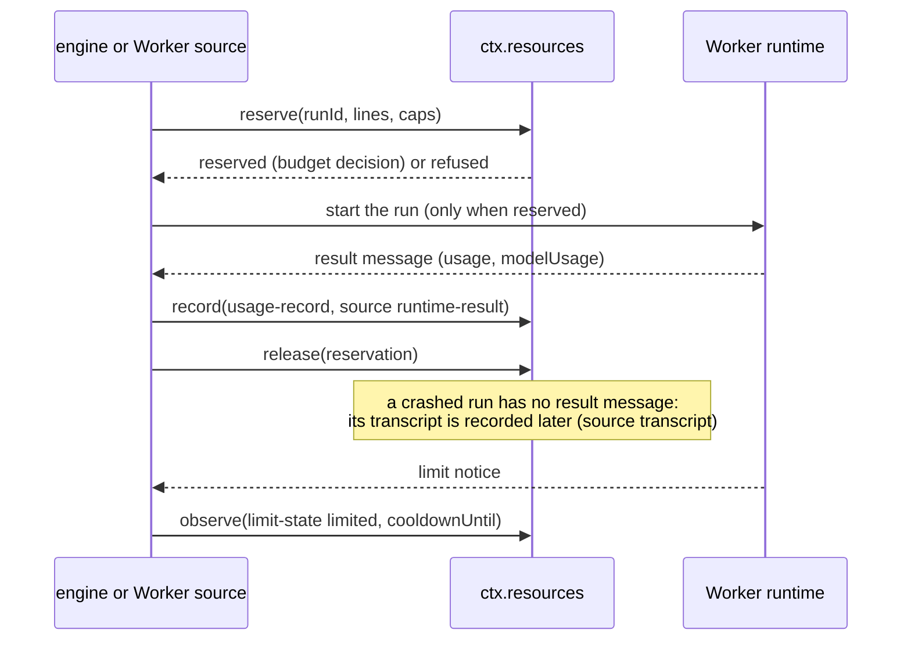
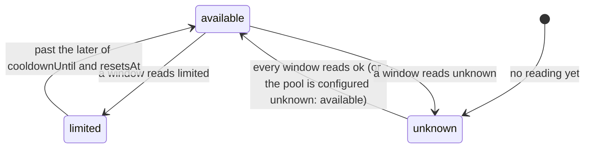
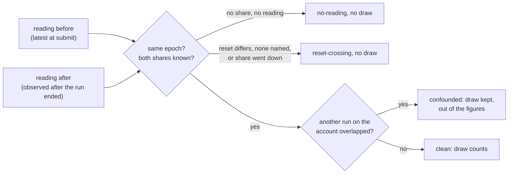

# Resources

> Target state. Boundary: [routing](../architecture/components.md#routing), core component
> *resource ledger and metering*
> ([ADR-0036](../decisions/adr/0036-guarantee-core-and-capability-plugins.md)). Proposals:
> [PROP-0010](../proposals/0010-base-version.md),
> [PROP-0008](../proposals/0008-studio-operating-model.md#resource-management-and-token-optimization).
> Records: [`usage-record@1.0`](../reference/schemas.md#usage-record),
> [`limit-state@1.0`](../reference/schemas.md#limit-state),
> [`quota-draw@1.0`](../reference/schemas.md#quota-draw).
>
> Defined in [`resources-core`](../../packages/resources-core/README.md); provided by
> [`resources`](../../packages/plugins/resources/README.md) on `ctx.store`, with the MCP tools
> `resources_pools` and `resources_usage`. Agent Workers configured with a pool reserve, record,
> and observe through it ([agent runtimes](agent-runtimes.md#metering)), naming the board task
> their brief serves; the workflow engine reserves a board task's budget lines before each step of
> the task's run starts work ([a task's budget](workflow-engine.md#a-tasks-budget)), and asks to fund a spent
> one by lines it computes from the ledger's count of the task's usage
> ([funding a spent task](workflow-engine.md#funding-a-spent-task)). Differs from target: no
> other Worker source reports, no transcript is reconciled, the engine reserves only for a
> task that declares a budget, the bundle configures no pool, no metering oracle checks recorded
> usage, and usage the ledger cannot count counts as 0 against a cap: it is recorded and shown,
> and no cap fails closed on it ([usage the ledger cannot count](#usage-the-ledger-cannot-count)).
>
> Built since 2026-10-25: a model's own pools per account, so one model's limit closes only its
> tiers (T261, `a89c5bd4`, ADR-0073); a quota limit or a restart spends no attempt (T272b,
> `6baddb75`); a step the host's stop cut resumes (T283, `313448de`); a website Worker whose windows
> have no reading yet takes work one at a time (T294, `c3ee0771`).

The resource ledger knows what each configured pool has left and what every run consumed. Its
numbers come from objective sources only: a runtime's result message, a provider's usage
fields, an agent's session transcript, a limit notice, an invoice. A model's report of its own
usage is never one. Pools and their windows are operator configuration, because plan terms
change: an account can have an interactive window, a programmatic credit, and an API key, and a
Claude Code Worker run through the Agent SDK may draw on a different pool than interactive use.

## Seam

`ctx.resources` (`Resources` in `@tsuuanmi/system-resources-core`), contract 1.3:

| Method | Does |
|---|---|
| `pools(filter?, at?)` | every configured pool (and every pool made from a template for a declared account), the latest reading of each window, and whether it is available at `at` |
| `observe(reading)` | record a `limit-state` reading |
| `reserve(request, at?)` | reserve before a run; records a `budget` decision |
| `release(reservationId)` | release a reservation once the run's usage is recorded, or it never started |
| `record(usage)` | record one unit's `usage-record`, deduplicated; contract 1.3 ([ADR-0065](../decisions/adr/0065-a-cap-fails-closed-on-usage-the-ledger-could-not-count.md)): a `usage-record@1.1` with `partial` is a lower bound of its run, kept so, and a cap of its scope and pool is refused while the run has no whole record there |
| `usage(filter?)` | the counted records and their totals per pool |
| `declare?(source, accounts)` | optional, contract 1.1 ([ADR-0052](../decisions/adr/0052-accounts-are-assigned-unless-pooling-is-recorded.md)): a Worker source's accounts, replacing what it declared before; one pool per [template](#pool-templates) and account; returns their ids |
| `quota?()` | optional, contract 1.2 ([ADR-0064](../decisions/adr/0064-system-starts-ready-work-under-the-dispatch-action-class.md)): the operator's [quota settings](#quota-settings), as validated when the provider loaded |

## A run's budget

| Step | Who | Records | On failure |
|---|---|---|---|
| observe | a Worker source or runtime, from a status line, limit notice, response headers, or result | the reading as an `evidence` artifact; the window's latest reading by `observedAt`; a `resources.pool.limited` event (pool, account, window, `until`, source, the evidence) when the reading closes a window that was open, which [notifications](notifications.md) read | a reading for a pool or window not configured is refused (`unknown-pool`) |
| reserve | the engine before each step of a board task's run, or a Worker source before a run | a `budget` decision, `reserved` or `refused` with a reason per pool or cap | refused when a pool is not configured, or unavailable, or a cap would be exceeded |
| record | the Worker source, after the run | the record as a `receipt` artifact | refused for an unknown pool (`unknown-pool`), a schema violation, or cached input above the input (`invalid`) |
| release | whoever reserved | the hold is removed | an unknown reservation is refused; an expired one releases quietly |
| expiry | none: time | a hold nobody released (a crashed run) stops counting at its `expiresAt` (`holdSeconds`, the provider's default 4 hours) | — |

## Pools and availability

A window with no reading yet is `unknown`, like an explicit `unknown` reading: missing telemetry
is not capacity. A pool with an unknown window is unavailable unless its configuration says
`unknown: available` (a pool that never reports, such as a local model). For a plan window that
reports only after a first response, the operator configures the pool as available, or the
first reading comes from the runtime's result. Every reading field is optional.

### Pool templates

Several accounts of one provider each have their own windows, so a limit on one never closes
another's (PROP-0012 phase F). The operator configures a **template** once (`templates` on the
`resources` row: `template`, `group`, `kind`, `windows`, `unknown`), and a Worker source
**declares** its accounts (`declare(source, [{ account, group }])`): the ledger makes, of every
template whose `group` is the account's, the pool `<template>/<account>` with `account` the
account. It is listed, reserved, read, and recorded as a configured pool is; `resources_pools`
shows each account's own windows and resets.

- A declaration replaces the source's previous one: a withdrawn account's pool is no longer
  listed, and a record or reading for it is refused (`unknown-pool`); its readings and records
  stay, under their ids, and stand again once it is declared again.
- Declarations are in memory: the source declares again after a restart. The `agents` source
  declares its ready assigned accounts of metered providers
  ([agent runtimes](agent-runtimes.md#workers--account--role)).
- Refused (`invalid`), changing nothing: an account that is not an id or a group that is not a
  name; a pool that is configured or another source's; more pools, configured and declared, than
  `resources_pools` lists (64). A template's id and group are names without `/` or `:`, so a pool
  id names one template and one account.
- The pool id is `<template>/<account>`, not the proposal's `<template>@<account>`: `@` is not an
  id character (`common@1`).

### Readings from an account's usage report

> Decision: [ADR-0059](../decisions/adr/0059-quota-readings-from-each-accounts-own-usage-report.md)
> (accepted 2026-10-24, D55), from the operator's request of 2026-10-24 (T96;
> [research](../research/quota-builtins-2026-10-24.md)). Implemented in the agent runtimes'
> `limits` ([an account's usage report](agent-runtimes.md#an-accounts-usage-report)) and the
> `agents` source ([`agent-workers`](../../packages/plugins/agent-workers/README.md)). Differs
> from target: each reader is checked on the installed versions and fixtures, not yet on a live
> account ([release checklist](../validation/release-checklist.md)); website accounts and the
> Gemini API have no report to read.

Each account's pool is fed by that account's own readings, so its windows show its own plan and
its own use, with no plan written into configuration:

| When | What is read | Recorded as |
|---|---|---|
| during a run | the runtime's own events (Claude Code's `rate_limit_event`; Codex's limit message) | readings of the mapped windows, `source: runtime-result` |
| after each run of a derived Worker on a declared pool, and after any run that hit a limit, once, before its usage is recorded and its reservation released | the account's usage report (`limits({ home })` on the agent runtime: Claude Code's `get_usage`, the Codex app server's `account/rateLimits/read`, the Antigravity CLI's `/usage` JSON), in the home the run ran in, without a model turn | `limit-state@1.0` readings of the mapped windows, `source: runtime-result`, after the run's own; with no pool, a rejected window's reset ends the account's cooldown |
| every `limitReadSeconds` (the provider entry; default 600, 60 to 86400, `0` off) for each ready, assigned account with a declared pool, unless a read of it is less than that old; one periodic read in flight per runtime | the same report | the same |

- **Pools come from enrollment, as now.** A newly enrolled account assigned a role is declared, so
  it gets `<template>/<accountId>`, and its first report fills its windows. Two Claude Code accounts
  on different plans read different shares from their own reports; nothing is configured per plan.
- **A Claude Code account is judged by its five-hour window only** (the operator, D70,
  2026-10-25). Its usage report gives no seven-day reading (the field is null server-side), and a
  spent seven-day quota shows as an unusable five-hour window, so the five-hour window alone tells
  whether the account can work. A window that is never read is never headroom: a Claude pool
  template that declares a seven-day window has a window with no reading, so its pools fail closed
  and dispatch never picks a Claude account (the live patch declared one until 2026-10-25). Its
  template declares `five-hour` only, and its provider entry maps `five_hour` only.
- **Fail closed.** A report never opens a window that a `limited` reading closed before the later
  of that reading's reset and cooldown (without end when it names neither; rule 2 below): that
  `ok` reading is not recorded, and is logged. A report that cannot be read, or is on a runtime
  version whose format was not checked, records nothing, and the window keeps its last reading with
  its `observedAt`. A report that says a window has nothing left closes it until its reset; one
  used up in a window the provider's `windows` does not map closes every window of the pool.
- **What stays unknown:** absolute amounts (reports give shares); windows a runtime does not report;
  accounts on an API key (no plan windows); the Antigravity CLI beyond its one home; website
  accounts and the Gemini API, which tell a limit only when it is hit.
- **The seam does not change** (ADR-0036): `observe` takes these readings as it takes a run's
  (contract 1.1, `limit-state@1.0`); the roster already shows each window's `used`, `resets`, and
  `observedAt` (`mcp-roster@1.1`), which the Workers tab renders as "5 h: used 42 % — resets 14:20
  (read 14:05)" ([roster](roster.md#surfaces)).

### Quota settings

> Decision: [ADR-0064](../decisions/adr/0064-system-starts-ready-work-under-the-dispatch-action-class.md)
> (accepted 2026-10-25, D61, D63). Contract 1.2.

The `resources` row's `quota` holds what the quota score (`quota-score@2`,
[routing](routing.md#quota-in-every-route)) reads besides the pools, each a whole number
validated when the row loads; one out of its range refuses the row with its path. The ledger itself
counts, reserves, and closes nothing by them: they are read through `quota()`. One implementation in
`libs` turns them and the pools into each account's headroom and its order (T185,
[ADR-0066](../decisions/adr/0066-every-route-orders-workers-by-their-accounts-quota-headroom.md)): dispatch's
choice, every route's order, and the roster's capacity now all read it.

| Key | Default | Range | Meaning |
|---|---|---|---|
| `reservePercent` | 20 (D63) | 0 to 90 | share of every window kept for the operator's own use: work System starts by itself never starts into it, and every route ranks a Worker whose account is over it (used above `100 − reservePercent` % of a window, or at its limit) last while another admitted Worker has headroom, so it gets no new step then. It refuses nothing: a run that crosses into it keeps going, and a Worker over it still takes work when no other can |
| `useSoonMinutes` | 90 | 0 to 1440 | a window that resets this soon, with headroom, is used first; 0 never |
| `minHeadroomPercent` | 10 | 1 to 100 | the headroom a window about to reset needs to be used first |
| `headroomBucketPercent` | 5 | 1 to 25 | headroom is compared in buckets this wide |
| `staleReadingSeconds` | 1800 | 60 to 86400 | a reading older than this leaves its window unknown, never capacity; keep it above the agent providers' `limitReadSeconds` (default 600), so the account's own report keeps windows fresh |

- A ledger without `quota()` keeps no reserve: the dispatch pass then finds no Worker free (INV-2).
  Routing and the roster read the defaults then (the 20 % reserve), so the order still keeps it.
- A window with no reading, a stale, `unknown`, or `limited` one, one with no used share, or one
  whose reading is from before its reset is not known, and a pool configured `unknown: available`
  is never read as having headroom. Such a pool with no reading at all is **unread**: dispatch
  admits its account at a bound (`dispatch.maxRunningUnreadPerAccount`, one run at a time), after
  every account with headroom, so a website Worker that has never been read still takes work
  (T294); a reading replaces the bound.
- **The canonical gauge** of an account is the windows its pool lists, which the operator
  configures. A Claude Code plan's pool lists only its five-hour window (operator D70): its weekly
  windows are not read into headroom
  ([read each account's quota](../operations/runbooks.md#read-each-accounts-quota)).
- A per-template reserve and dispatch onto metered pools are not built (PROP-0014; D65: never).

### Quota drawn per run

> Proposal: [PROP-0015](../proposals/0015-right-worker-right-job.md) E2. Record:
> [`quota-draw@1.0`](../reference/schemas.md#quota-draw). Implemented in the `agents` source
> ([`agent-workers`](../../packages/plugins/agent-workers/README.md)), the rule in
> [`libs`](../../packages/libs/README.md) (`drawEntries`, `drawFigures`), shown by `system usage`
> and the [report](reports.md#what-it-counts). Differs from target: authoritative consumption in
> units (`units-only`) is not recorded, since no runtime reports it; nothing reads the draws for a
> start yet (E3's fit).

For each run of a derived Worker on a declared pool, the `agents` source records what the run drew
from each window of its account's pool, from the readings the ledger already holds:

| When | What is kept |
|---|---|
| before the run is submitted | each window's latest reading (`pools()`), and the start of a watch of the other runs on the same account |
| after the run, once the account's usage report after it was recorded ([above](#readings-from-an-accounts-usage-report)) | each window's latest reading again, and how many other runs on the account overlapped it |

- **One entry per window**, never one figure for the account. A draw is the rise of the used share
  in **percentage points** of the window's allowance, so it compares with headroom
  (`100 − used − reservePercent`).
- **Same window epoch.** Both readings name the same reset, read as `accountQuotaOf` reads it (the
  later of `resetsAt` and `cooldownUntil`). Otherwise the entry is `reset-crossing`, with no draw:
  the epochs differ, either reading names no reset, or the share went down. A draw is never negative.
- **Nothing is estimated** (rule 3 below). A window with no reading before, none observed after the
  run ended (its report could not be read), or one with no used share is `no-reading`, with no draw.
- **Confounded.** Another run on the same account in flight at any time from this run's reading
  before to its reading after makes its draws `confounded` (`overlapping` counts them): kept, never
  in a figure. The watch is in memory, as the runs are: a run a restart interrupted gets no reading
  after, so no record, and nothing is replayed (INV-4).
- **Recorded** as an `evidence` artifact under the run's workflow run and step, and one
  `quota.draw` event whose data is the record. It names the run, Worker, account, pool, the kind of
  work it was admitted for (`WorkRequirement.kind`) and the template step it served
  (`WorkerStart.step`, from the engine's own record), its board task, and how it ended. Recording
  never changes the run's outcome: a failure is logged.
- **Shown** per kind and window, and per kind, template step, and window: the clean draws counted,
  their median and 90th percentile (nearest rank), and the entries left out by state. `system
  usage` (MCP `usage`, `draws`) reads the latest 1,000 records; the report reads the period's
  (`mcp-report` 1.4, `usage.draws`).

## Counting

- One record per `(source, requestId)`; a duplicate is stored as an artifact but not counted.
- A unit is counted once across sources: a `transcript` record of a run that has a
  `runtime-result` record is a duplicate.
- A cap counts, for its scope (a task, else a project), every counted record of its pool in its
  unit, plus every unexpired reservation held for that scope: `tokens` are input plus output, `usd` the
  record's cost, `turns` its turns, `runs` one per record, `minutes` its duration.
- A record counts for a task when it names the task or its run was reserved for it: an agent
  Worker's record names the task its brief serves, and a task's run is reserved for its task. A
  board task's brief counts more: the workflow engine also reads the records of the runs that served
  the task and of the executions they started, each record once
  ([usage spent on a task](workflow-engine.md#a-board-tasks-brief)); a cap does not.

## Usage the ledger cannot count

Some usage reaches no counted figure, or only a lower bound of one:

| Case | A cap of its scope and pool |
|---|---|
| a counted record without the figure of a cap's unit (no token counts, no `cost`, no `turns`, no `durationMs`) | counts 0 of that unit; the record's other figures, and `runs` 1 |
| a run that ended before its runtime's final count (a stop, a timeout, a drain at the host's stop, a deferred call), whose runtime reported some usage while it ran | its record of that lower bound is counted, and the cap is refused until the run is reconciled |
| a run whose runtime reported neither tokens nor turns (nor any number above 0 before it ended), so no record can be written | is refused until the run is reconciled |
| a run the host stopped while it ran: no result came | is refused until the run is reconciled |
| a record the ledger refused (`unknown-pool`, `invalid`), or a `record()` that failed | is refused until the run is reconciled |

**Why a run goes `not-reported`.** Its runtime's numbers come from its final message: the Claude
Agent SDK's `result` (its `modelUsage` and `num_turns`), Codex's turns and the tokens their
`turn.completed` events report. A run that ends before
that message (stopped by the operator, past its `runTimeoutMs`, stopped by the host's stop or a
drain at restart, or at a call its gate deferred) has none. What the runtime did report while it
ran is not dropped ([metering](agent-runtimes.md#metering)): the Claude Agent SDK provider sums the
`usage` of the assistant messages it streamed (each response once, at its largest counts; the main
loop's responses are its turns), and Codex counts the turns it completed and sums their tokens. That
is a lower bound (the response or turn in flight is not in it), marked `partial` with why, never an
estimate.

**Codex's tokens.** A Codex run's record carries `turns` and token counts, never a `cost`: Codex
reports no charge, so its cost stays unknown, and a cap on cost counts it as a record without that
figure (above). Of Codex's per-turn counts, `cached_input_tokens` and `cache_write_input_tokens` are
parts of `input_tokens`, and `reasoning_output_tokens` is a part of `output_tokens`; no part is added
to its whole ([Codex metering](agent-runtimes.md#codex-metering)). A Codex subscription's capacity
is still judged by its windows (the account's usage report, above); the per-run token totals are
recorded so a later forecast can use them.

The operator decided first (D25, 2026-10-23) to count these as 0 and make each one visible and
durable; then that a cap never counts unknown usage as 0, for every pool kind (INV-2,
[ADR-0065](../decisions/adr/0065-a-cap-fails-closed-on-usage-the-ledger-could-not-count.md)). Each
case is visible and durable:

- **A record without a figure** is its own fact: it names its run, Worker, pool, and task, and the
  figure it lacks is missing from it. The [report](reports.md) counts the records without token
  counts, a cost, or turns per pool (an agent Worker's record always carries its duration).
- **A run with no counted record** is recorded by the Worker source that meters it, as a
  `usage.unknown` event, its data a
  [`usage-unknown@1.0`](../reference/schemas.md#usage-unknown) record: the run, Worker, pool,
  account, session, board task and project, how it ended, and its kind (`not-reported`,
  `interrupted`, `refused`, `failed`) with why. The reason says, in plain words, how the run ended
  (`it completed`, `it was stopped: cancelled by the operator`, `it ran past its timeout of … ms
  and was stopped`, `the host stopped while it ran, and stopped it (a drain at stop or restart)`,
  `it stopped at a Bash call that waits for approval request apr-…`, `it failed (…)`) and what its
  runtime reported. The event names the workflow run, whose view maps the run to its step. Nothing
  estimates its usage. A run may get two (a stop aborted it before it reported anything, then the
  restart found it interrupted): readers count it once, by its first.
- **A run the host's stop cut that runs again** (T283: resumed in its native session, or started
  again in its worktree) keeps the fact its cut execution got. What its runtime reports after the
  restart is only what it used since, so its record is a lower bound of the run (`partial`: it ran
  again after the host's stop cut it), a unit of its own (without the runtime's own result id, its
  `requestId` is the run's with `:again-<n>`), and never reconciles the run: what it used before the
  stop is left to transcript reconciliation, never invented.
- **A run with a lower bound counted** (it ended before its runtime's final count, and its runtime
  reported some usage while it ran) gets its record of that lower bound, `usage-record@1.1` whose
  `partial` says why it is one, and a `not-reported` fact (`usage-unknown@1.1`) whose `partial`
  names that record. A partial report with no number above 0 gets no record: a reported 0 would
  read as known. Its own record never reconciles it (INV-2: a lower bound is not its usage). The
  record says it is a lower bound itself, in the ledger's one write of it, so a crash or a failed
  append before its fact never leaves it reading as the run's usage, through a restart too; a fact
  that cannot be appended is logged, saying the record keeps the caps closed (health and the report,
  which read the facts, then do not name the run). A later `transcript` record of the same run is a duplicate of its
  `runtime-result` one, so transcript reconciliation will have to replace the lower bound.
- **A cap fails closed** (ADR-0065): the store-backed ledger refuses a reservation whose caps have
  a scope (a task, else a project) while a run of that scope, by its fact or else by its
  reservation, has a fact in a capped pool and is not reconciled, or has only lower bounds
  (`partial`) counted in a capped pool, fact or none (at most 100 such runs named), naming each such
  run, its Worker, and why in the `budget` decision. It refuses too when no event log is loaded, when more than
  10,000 `usage.unknown` entries are kept, or when an entry is not a valid record: whether such a
  run exists is then unknown. A request without caps, or caps without a scope, is not concerned. It
  holds for every pool kind; nothing reconciles a run until transcript reconciliation exists, so the
  way out is the runbook's ([runbook](../operations/runbooks.md#usage-the-ledger-could-not-count)).
- **A failed `record()` is never lost silently.** What can be recorded is: a record refused as
  `invalid` with a per-model split is offered again with its totals alone, which are what a cap
  counts. Still refused, the record is kept as an `evidence` artifact (when it is a valid
  `usage-record@1.0`) that the fact names, with the ledger's failure. A fact that cannot be
  appended either (no event log, or the store failing) is logged.
- **Reconciled:** a unit is reconciled once the ledger counts a usage record of its run in its
  pool that is not a lower bound (no `partial`; `countedWhole` in libs), which is what transcript reconciliation will
  write (`source: transcript`; a crashed run's record written before the crash counts too).
- **Shown** in the [report](reports.md#what-it-counts) (per pool: the runs whose usage is unknown
  and not reconciled, the records without a figure; in all: each kind, and how many were
  reconciled since), per step in `system usage` (MCP `usage`), and in health: the `usage` check is
  degraded while a configured pool has a run whose usage is unknown and not reconciled in its
  current window, naming the pool, the count, and its latest three runs, each with its Worker, its
  kind, whether a lower bound was counted, and its reason; while such a run names a pool the ledger does not
  configure; and when there are more entries than it reads (it is never `ok` on part of them). A
  pool's current window is its longest configured window, back from now; a pool with a window of
  no length (a credit balance) never resets, so every such run counts until it is reconciled or
  the event log's retention removes it ([runbook](../operations/runbooks.md#usage-the-ledger-could-not-count)).

**Failing closed** (D25's third option, taken for every pool kind by
[ADR-0065](../decisions/adr/0065-a-cap-fails-closed-on-usage-the-ledger-could-not-count.md)): until
transcript reconciliation exists, nothing reconciles such a run, so its scope's capped pool stays
refused; the seam's conformance suite gains the rule once its fake ledger reads the event log.

## Fail-closed rules

1. No run starts without a reservation; with `ctx.resources` unavailable, none is made and no
   run starts (INV-2).
2. A limited pool admits no new work until its window resets, and a limit hit is never retried
   on the same pool (PROP-0008: switch account or wait). The wait lasts until the reset its
   runtime read from the agent's own report
   ([limit readings](agent-runtimes.md#limit-readings)), else for the Worker's cooldown; a
   reading that cannot be read never opens a pool.
3. Usage is never estimated from a model's own report. A missing number stays missing: a run whose
   usage the ledger could not count refuses a cap of its scope and pool until it is reconciled,
   and it is recorded and shown ([above](#usage-the-ledger-cannot-count), ADR-0065).
4. Every cap is enforced before the run, never after, and every hold expires (INV-9).

## Conformance

[`resources-core/conformance/resources.ts`](../../packages/resources-core/conformance/resources.ts),
15 scenarios at contract 1.2 (1.1 adds `templates-per-account`: one pool per template and declared
account, a limit on one never closing another's; 1.2 adds `quota-settings`: the settings in their
ranges, the defaults when none is configured), run against the fake provider and the store-backed one. The
metering oracle against `ccusage --json` comes with the first Worker that reports usage (B2).
