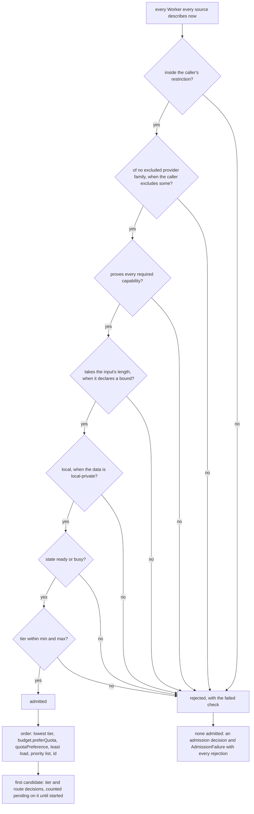

# Routing

> Target state. Boundary: [routing](../architecture/components.md#routing).
> Purpose: [P1–P4](../requirements/purpose.md). Requirements: REQ-WRK-1..10.
>
> Implemented in [`workers`](../../packages/plugins/workers/README.md) (admission, order,
> decisions, acceptance) and [`workflow`](../../packages/plugins/workflow/README.md) (tier
> escalation); differs from target: `connector:<name>` is not proven by any Worker; nothing sets
> a Worker `quota-exhausted`, and usage is reported per run step, not estimated per account; the
> resume conformance test behind `persistent-conversation` and egress exceptions naming exact
> artifacts are planned.

Routing turns a **work requirement**
([`work-requirement.v1.json`](../../schemas/work-requirement.v1.json)) into exactly
one admitted Worker, or into a typed admission failure. Every admission, route,
tier, escalation, egress, and acceptance outcome is recorded as a decision
artifact listing every candidate and the reason it was rejected
([artifacts](artifacts.md#decision-artifacts)). It is deterministic: the same configuration, the same
Worker states, and the same requirement always give the same result
([INV-2](../architecture/invariants.md#inv-2-fail-closed)).

## Work requirement

```ts
WorkRequirement {                    // work-requirement@1.0
  objective: string;
  capabilities: Capability[];        // all must be proven
  data: { classification: "public" | "operator-shared" | "local-private";
          refs: ArtifactRef[] };      // what the work must read
  egressPolicy: string;              // policy id from a trusted envelope (INV-6, INV-12)
  boundaries?: string[];             // what the Worker must not do or touch
  effort?: { maxToolCalls?, maxSubWorkers?, maxMinutes? };
  writes?: { type, ref, version? };  // the subject the work writes, if any
  tier: { min: Tier; max?: Tier;     // "economy" | "standard" | "frontier"   (P4)
          source: "profile" | "caller" | "decision" | "default"; decision?: ArtifactRef };
  budget?: { maxTokens?, preferQuota?: QuotaClass[] };
  acceptance: { contract: string; resultSchema?: string; maxEscalations?: number };
}
```

## Capability vocabulary

Capabilities are named semantics. They are never tool names
([INV-11](../architecture/invariants.md#inv-11-no-tool-lock-in)). A Worker proves
each one with evidence from the sources shown below.

| Capability | Meaning | Typical evidence |
|---|---|---|
| `reason` | general reasoning and synthesis | provider driver conformance (website Workers); a route probe (model Workers, [models](models.md)) |
| `web-search` | search the live web with citations | feature probe on the account |
| `deep-research` | provider-native multi-step research report | plan + feature probe (P2) |
| `connector:<name>` | a website connector or app enabled on the account, e.g. `connector:github` | connector probe on the account (P2) |
| `persistent-conversation` | resumable multi-turn identity | driver conformance (website Workers); the runtime probe's `resume` flag (agent Workers). A resume conformance test for agent runtimes is planned |
| `local-data` | can read local files and datasets in place | runs on this machine; sandbox policy allows the paths |
| `develop`, `validate` | edit code, run tests in a workspace | agent-runtime probe + writable sandbox; `validate` also needs `executes` |
| `review` | assess a provided subject against criteria | a read-only agent Worker (runtime probe + read-only sandbox) |

Profiles express each node as capabilities, not Worker kinds. A research node
requires `deep-research` or `web-search` together with `reason`. An agent review
node requires `review` and `local-data`. Only agent Workers prove `local-data`,
`develop`, `validate`, and `review`, and their rows are off in the default composition
([turn them on](../operations/runbooks.md#turn-an-off-row-back-on)).

## Algorithm



The checks, in order, are `restricted`, `diversity`, `capability`, `input`, `locality`, `state`,
and `tier`; a rejected Worker carries each check it failed, with its reason.

**Input length** ([ADR-0032](../decisions/adr/0032-admission-refuses-input-longer-than-a-worker-takes.md)).
A descriptor may declare `maxInputChars` (`capability-descriptor@1.2`): the longest input the
Worker takes, in characters of what it is sent. The caller passes `input: { chars }` in the route
options, measured on what it rendered; the workflow engine measures a node's prompt, a review's
shown source included. A longer input fails the `input` check. A source that replays history
bounds it itself. With no Worker left for its length, a node fails unsent as `invalid_input`, and
the engine names the bound that sized it (a review's `repositories.maxSourceChars`).

**Load** ([ADR-0033](../decisions/adr/0033-least-busy-routing.md)). A descriptor may carry
`load` (`capability-descriptor@1.3`): the turns `running` in its runtime's `slots`, `queued`, and
routed to it but not started (`pending`). The Workers of one account report the same numbers,
since they share its scheduler. Among Workers equal in tier and quota class, the least loaded
comes first (running, queued, and pending together); then the `priority` list and the id decide
as before, and a source that reports no load reads 0. A Worker at its limit reads `busy`, which
stays admissible: it only orders it later.

- **Pending.** The router asks the chosen Worker's source to `reserve` it, so the admission
  counts in that Worker's `pending` until the caller calls `release()` on what `route` returned:
  once the work is started, or on any path that will not start it. The workflow engine releases it
  with its routing turn, on every path. Starting is synchronous, so the work is queued by then. A
  restart drops pending counts; the schedulers hold the real load.
- **One route at a time.** `route` runs under one lock across every caller, so two routes never
  read the same counts: two nodes of a run, or two runs started together, land on two accounts.
- **Recorded.** The route decision gives the chosen Worker's load ("load 1 of 2, 1 queued, 1
  pending"), and an admitted Worker that lost on load says so ("w:b is less busy (load 0 of 2;
  this one load 2 of 2)"). The load read is part of the decision's input (REQ-WRK-2).

Quota and health are inputs **before** admission. Once a turn starts on a Worker,
it is never moved to another one. Running out of quota mid-turn is a classified
failure (`USER_ACTION` or `BACKOFF`), not a silent switch to a different provider.

## Provider diversity

A step can be required to run on a different provider from other steps of its run, such as
`research`'s second literature review
([templates](../reference/workflow-templates.md#research)) or each later member of a
[team](teams.md#membership-model-a). [ADR-0027](../decisions/adr/0027-provider-diversity-in-routing.md) decides how,
without naming a provider ([INV-11](../architecture/invariants.md#inv-11-no-tool-lock-in)).

- **Provider family.** A capability descriptor may carry `family`
  (`capability-descriptor@1.1`): an opaque string for who ultimately serves the work, set by
  the Worker source. A website Worker's family is its account's provider, an agent Worker's is
  its runtime, and a model Worker's is its catalog entry's `family`, by default its route
  ([models](models.md#the-catalog-and-the-routes)).
- **Exclusion.** A caller passes `exclude: { families, reason }` in the route options. The
  `diversity` check then rejects a Worker of an excluded family (`same provider family
  (<reason>)`), and a Worker that declares no family, which cannot be shown to differ
  (`declares no provider family, so it cannot differ (<reason>)`). With no Worker left, the
  admission fails closed ([INV-2](../architecture/invariants.md#inv-2-fail-closed)).
- **Inequality only.** Routing compares families only for inequality. It never names, ranks,
  or prefers one, and the `reason` names the steps to differ from (`differs from node
  literature:1`), never a family, so route and admission decisions carry no family value. An
  architecture test refuses a family literal in routing, workflow, profile, and models code.
- The workflow engine builds the exclusion from a node's `differentFrom`
  ([workflow engine](workflow-engine.md#different-provider-families)). Routing itself never
  lifts it; an operator opt-in lets the engine route again without it, recorded
  ([ADR-0029](../decisions/adr/0029-opt-in-same-family-fallback.md)).

## Data locality policy

- Work whose `data.classification` is `local-private` is admitted only to Workers
  that run locally, unless the egress policy names the exact artifacts that may
  be sent, and to which Worker classes.
- Before content reaches a remote Worker, the egress check runs on the **actual
  payload**: the rendered prompt plus its attachments. Each artifact ref is
  checked against the policy. A payload that is not permitted fails closed
  ([INV-12](../architecture/invariants.md#inv-12-data-egress-is-explicit)).
  The check runs inside the Worker source, after `workers.route`, before
  anything is sent.
- An **agent Worker** runs locally, so routing admits `local-private` work to it,
  but its model is remote. Its source therefore checks egress too, for the Worker
  class `agent`, which by default receives `public` and `operator-shared` only.
  An operator whose agent model runs on this machine widens that class.
- A **model Worker** ([models](models.md)) checks egress for the Worker class `model` (an API
  model: `public` and `operator-shared` by default) or `model-local` (a model on this machine,
  which may also receive `local-private`). Its catalog entry's `locality` decides both the
  class and the locality routing sees.
- **Phase separation.** A Worker that browses the web or calls remote connectors
  never holds local-private content in the same execution. Untrusted web content
  can carry prompt-injection payloads. Research and private-data processing are
  separate nodes, joined only through artifacts.
- What goes back the other way is not restricted. Results from website Workers
  flow freely to local Workers as cited artifacts.

## Intelligence tiers

- Each Worker *configuration* declares its tier. A tier belongs to a Worker plus
  its mode, so the same website account can provide an `economy` Worker (instant
  mode) and a `frontier` Worker (highest effort or Deep Research). The provider
  driver verifies the mode before every send (REQ-PRV-3), so a declared tier is
  always the tier that actually runs.
- Profiles declare each node's minimum tier, for example triage → `economy`,
  research → `frontier`, compacting a handoff → `economy`.
- **Escalation:** if acceptance rejects a result, the workflow engine opens a
  *new* execution of the node at the next tier above the one that served it, at
  most `maxEscalations` times (per node, default 1, at most 3). The rejected
  result stays as evidence. The choice is an `escalation` decision either way,
  and it is never applied to a running turn.
- Planning may use a higher tier than the steps it coordinates,
  in line with "spend intelligence where intelligence matters".

Inferring the tier for work that does not declare one, using a decision model, is
under consideration in
[PROP-0002](../proposals/0002-decision-assisted-routing.md). It is not current
design.

## Quota and cost policy

- Each account and runtime declares a **quota class**: `subscription-chat` for
  website accounts, `agent-plan` for Claude Code and Codex plans, `metered` for
  API models, and `local` for models on this machine. The order is configuration
  (`quotaPreference`, REQ-WRK-8). The default composition prefers
  `subscription-chat`, then `local`, `agent-plan`, and `metered`. Agent Workers never
  offer plain `reason`, so `agent-plan` quota is spent only on capabilities only
  they prove, such as `develop`, `review`, and `local-data` (P1). Tier comes before
  quota, so a model Worker the operator declares at a lower tier than every website
  Worker serves the `economy` work (P4).
- The `api-first` preset ([ADR-0025](../decisions/adr/0025-api-first-composition.md)) orders
  `local`, `metered`, `agent-plan`, `subscription-chat`, and mounts no website Worker. Work that
  needs a capability only website Workers prove (`web-search`, `deep-research`) then fails
  admission: the failure names each required capability no Worker proves.
- Usage is recorded per account from observable signals (turn counts and
  estimated tokens) and treated as an estimate (CON-4). A provider "limit
  reached" state marks the account temporarily not ready, and routing excludes
  it.
- **Context economy.** Handoffs carry the synthesized, hash-bound result, not the
  research transcript. Retained conversations receive only new suffixes. Node
  results are reused by input hash.
