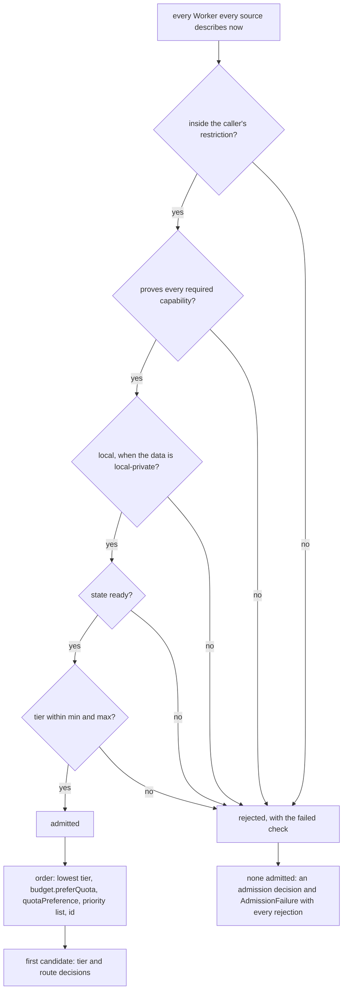

# Routing

> Target state. Boundary: [routing](../architecture/components.md#routing).
> Purpose: [P1–P4](../requirements/purpose.md). Requirements: REQ-WRK-1..9.
>
> Implemented in [`workers`](../../packages/plugins/workers/README.md) (admission, order,
> decisions, acceptance) and [`workflow`](../../packages/plugins/workflow/README.md) (tier
> escalation); differs from target: `connector:<name>` is not proven by any Worker; nothing sets
> a Worker `quota-exhausted`, and usage is reported per run step, not estimated per account; the
> resume conformance test behind `persistent-conversation` and egress exceptions naming exact
> artifacts are planned.

Routing turns a **work requirement**
([`work-requirement.v1.json`](../../schemas/work-requirement.v1.json)) into exactly
one admitted Worker, or into a typed admission failure. Every admission, route,
tier, escalation, egress, and acceptance outcome is recorded as a decision
artifact listing every candidate and the reason it was rejected
([artifacts](artifacts.md#decision-artifacts)). It is deterministic: the same configuration, the same
Worker states, and the same requirement always give the same result
([INV-2](../architecture/invariants.md#inv-2-fail-closed)).

## Work requirement

```ts
WorkRequirement {                    // work-requirement@1.0
  objective: string;
  capabilities: Capability[];        // all must be proven
  data: { classification: "public" | "operator-shared" | "local-private";
          refs: ArtifactRef[] };      // what the work must read
  egressPolicy: string;              // policy id from a trusted envelope (INV-6, INV-12)
  boundaries?: string[];             // what the Worker must not do or touch
  effort?: { maxToolCalls?, maxSubWorkers?, maxMinutes? };
  writes?: { type, ref, version? };  // the subject the work writes, if any
  tier: { min: Tier; max?: Tier;     // "economy" | "standard" | "frontier"   (P4)
          source: "profile" | "caller" | "decision" | "default"; decision?: ArtifactRef };
  budget?: { maxTokens?, preferQuota?: QuotaClass[] };
  acceptance: { contract: string; resultSchema?: string; maxEscalations?: number };
}
```

## Capability vocabulary

Capabilities are named semantics. They are never tool names
([INV-11](../architecture/invariants.md#inv-11-no-tool-lock-in)). A Worker proves
each one with evidence from the sources shown below.

| Capability | Meaning | Typical evidence |
|---|---|---|
| `reason` | general reasoning and synthesis | provider driver conformance (website Workers) |
| `web-search` | search the live web with citations | feature probe on the account |
| `deep-research` | provider-native multi-step research report | plan + feature probe (P2) |
| `connector:<name>` | a website connector or app enabled on the account, e.g. `connector:github` | connector probe on the account (P2) |
| `persistent-conversation` | resumable multi-turn identity | driver conformance (website Workers); the runtime probe's `resume` flag (agent Workers). A resume conformance test for agent runtimes is planned |
| `local-data` | can read local files and datasets in place | runs on this machine; sandbox policy allows the paths |
| `develop`, `validate` | edit code, run tests in a workspace | agent-runtime probe + writable sandbox; `validate` also needs `executes` |
| `review` | assess a provided subject against criteria | a read-only agent Worker (runtime probe + read-only sandbox) |

Profiles express each node as capabilities, not Worker kinds. A research node
requires `deep-research` or `web-search` together with `reason`. An implementation
node requires `develop` and `local-data`.

## Algorithm



Quota and health are inputs **before** admission. Once a turn starts on a Worker,
it is never moved to another one. Running out of quota mid-turn is a classified
failure (`USER_ACTION` or `BACKOFF`), not a silent switch to a different provider.

## Data locality policy

- Work whose `data.classification` is `local-private` is admitted only to Workers
  that run locally, unless the egress policy names the exact artifacts that may
  be sent, and to which Worker classes.
- Before content reaches a remote Worker, the egress check runs on the **actual
  payload**: the rendered prompt plus its attachments. Each artifact ref is
  checked against the policy. A payload that is not permitted fails closed
  ([INV-12](../architecture/invariants.md#inv-12-data-egress-is-explicit)).
  The check runs inside the Worker source, after `workers.route`, before
  anything is sent.
- An **agent Worker** runs locally, so routing admits `local-private` work to it,
  but its model is remote. Its source therefore checks egress too, for the Worker
  class `agent`, which by default receives `public` and `operator-shared` only.
  An operator whose agent model runs on this machine widens that class.
- **Phase separation.** A Worker that browses the web or calls remote connectors
  never holds local-private content in the same execution. Untrusted web content
  can carry prompt-injection payloads. Research and private-data processing are
  separate nodes, joined only through artifacts.
- What goes back the other way is not restricted. Results from website Workers
  flow freely to local Workers as cited artifacts.

## Intelligence tiers

- Each Worker *configuration* declares its tier. A tier belongs to a Worker plus
  its mode, so the same website account can provide an `economy` Worker (instant
  mode) and a `frontier` Worker (highest effort or Deep Research). The provider
  driver verifies the mode before every send (REQ-PRV-3), so a declared tier is
  always the tier that actually runs.
- Profiles declare each node's minimum tier, for example triage → `economy`,
  research → `frontier`, compacting a handoff → `economy`, final synthesis →
  `frontier`.
- **Escalation:** if acceptance rejects a result, the workflow engine opens a
  *new* execution of the node at the next tier above the one that served it, at
  most `maxEscalations` times (per node, default 1, at most 3). The rejected
  result stays as evidence. The choice is an `escalation` decision either way,
  and it is never applied to a running turn.
- Planning and synthesis may use a higher tier than the steps they coordinate,
  in line with "spend intelligence where intelligence matters".

Inferring the tier for work that does not declare one, using a decision model, is
under consideration in
[PROP-0002](../proposals/0002-decision-assisted-routing.md). It is not current
design.

## Quota and cost policy

- Each account and runtime declares a **quota class**: `subscription-chat` for
  website accounts, `agent-plan` for Claude Code and Codex plans, and `metered`
  for APIs. The routing order prefers `subscription-chat`, then `local`,
  `agent-plan`, and `metered` (`quotaPreference`). Agent Workers never offer plain
  `reason`, so `agent-plan` and `metered` are spent only on capabilities only they
  prove, such as `develop`, `review`, and `local-data` (P1).
- Usage is recorded per account from observable signals (turn counts and
  estimated tokens) and treated as an estimate (CON-4). A provider "limit
  reached" state marks the account temporarily not ready, and routing excludes
  it.
- **Context economy.** Handoffs carry the synthesized, hash-bound result, not the
  research transcript. Retained conversations receive only new suffixes. Node
  results are reused by input hash.
