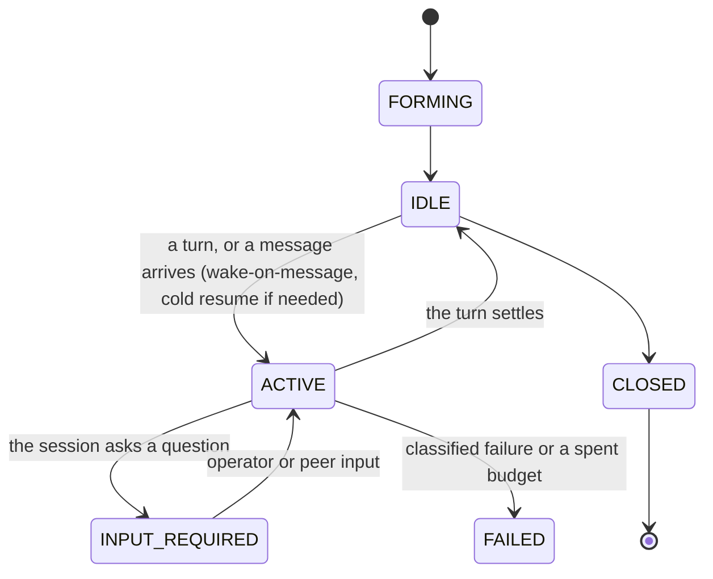

# Worker sessions, direct messaging, and long-running work

> Target state. Seam: `ctx.workerSessions` ([plugin model](../architecture/plugin-model.md#seam-catalog)).
> Decision: [ADR-0015](../decisions/adr/0015-worker-sessions-and-peer-messaging.md).
> Requirements: REQ-SES-1..8. Shapes: [`worker-session.v1.json`](../../schemas/worker-session.v1.json),
> [`message.v1.json`](../../schemas/message.v1.json).
>
> Implemented in [`worker-sessions`](../../packages/plugins/worker-sessions/README.md) (sessions,
> groups, mailboxes, budgets) and [`workflow`](../../packages/plugins/workflow/README.md)
> (wake-on-message, checkpoints, compaction); differs from target: Workers message only through
> the engine (a member's answer, or a `To m<k>: …` line), and `session_send` is the operator's;
> sessions start `IDLE` at their first admission (no `FORMING`) and are never `CLOSED`; a group
> lives for its run, not inside one `team` node; the A2A adapter is planned.

## Concepts

| Concept | Meaning | Lifetime |
|---|---|---|
| **Session** | one Worker's durable participation, with its own `SessionId`, role, and policy | from formation until it is closed; survives restarts |
| **Activation** | the live process, browser context, or SDK client currently serving a session | disposable, recreated on demand |
| **Execution binding** | `SessionId → { nativeHandle, generation }` | updated on every re-activation; the generation fences stale activations |
| **Session group** | sessions that may message each other under one policy, such as a team | the lifetime of its DAG node |
| **Mailbox** | the durable, ordered inbox of a session | the lifetime of the session |

This is AgentOS's Model A, generalized beyond DSH. The session *is* the
collaboration identity, and it is chosen through admission once, at formation
([teams](teams.md#membership-model-a)).

## Native handle mapping

| Worker runtime | Native handle bound to `SessionId` | Resume mechanism |
|---|---|---|
| ChatGPT / Gemini Web | canonical conversation URL plus the last receipt | open the URL in a fresh context; reconcile the receipt ([provider turns](provider-turns.md)) |
| Claude Agent SDK | SDK session id | SDK resume |
| Codex SDK | thread id | resume thread |
| ACP agent | ACP `sessionId` | `session/resume` (v2) or `session/load` (v1) |
| A2A remote agent (planned) | `contextId` (+ current `taskId`) | `SubscribeToTask` / Get Task |

A Worker can serve a session only if it proves `persistent-conversation`
([routing](routing.md#capability-vocabulary)).

## Session states

`INPUT_REQUIRED` maps to A2A's `TASK_STATE_INPUT_REQUIRED` and to a node in
`BLOCKED`/`USER_ACTION` when the input must come from the operator.

## Direct messaging

1. A session sends `message(to: SessionId | group, body, inReplyTo?, refs[])`.
   - A Worker's outgoing messages come from its response: a team member's
     accepted answer is its message to the team, and a `To m<k>: …` line is a
     direct message to one member. Incoming messages are injected as its next
     turn.
   - The operator sends with the MCP tool `session_send` and reads with
     `session_inbox`.
2. **Policy check.** The group policy decides whether the sender may address the
   target, whether a barrier is open, whether the message and turn budgets have
   room, and whether egress allows it (a remote Worker must not receive
   local-private refs). A rejection is recorded as a decision artifact.
3. **Persist, then deliver.** The message is a `message` artifact, appended to
   the target mailbox with a sequence number. Delivery is at least once, and the
   receiver deduplicates by `messageId`.
4. **Wake.** An `IDLE` target is activated, cold-resumed if necessary, and
   receives its unread messages in order as one turn.
5. The engine **records** every message but **never relays or rewrites**
   content. The lead controls the procedure, not the conversation.

Barriers (the independent-first rule in [teams](teams.md)) are mailbox gates.
Messages to a member are held until the barrier opens. A team's barrier opens
as soon as every member has finished round 1, even when no later round runs (a
lead closed the team, or it has a single round), so later messages still reach
the members.

## Long-running mechanics

| Concern | Mechanism |
|---|---|
| Survive restarts | session, bindings, mailbox, and receipts are durable; on start, sessions that were `ACTIVE` reconcile their last turn, then resume |
| No polling between peers | wake-on-message; the operator and clients subscribe to session events |
| Progress visibility | the session emits a `report` checkpoint artifact at least every `checkpointEvery` turns or minutes |
| Context growth | engine-owned compaction: at a token threshold, an economy-tier step writes a `handoff` summary artifact (decisions, open questions, state), and the session continues from the summary plus refs. Memory is never left to the model alone |
| Liveness | per-turn two-clock completion; a session heartbeat lease; a stale activation is fenced by generation |
| Bounds | `maxLifetime`, `maxTurns`, `maxMessages`, `maxIdle`, token and quota budget per session; exceeding one is a classified failure |
| Clients waiting on long work | MCP and CLI calls return a `SessionId` or run id at once. Clients poll `status` or stream events; they never block for the duration |
| Human in the loop | `INPUT_REQUIRED` with a question artifact; the answer is an `approval` or a message artifact |

## Relation to the DAG

A session group lives **inside** one node with executor `team` or `session`.
The node is `RUNNING` while its sessions work, and it completes when the group's
procedure reaches acceptance. The node's output is the accepted synthesis
artifact. The DAG gives the durable macro structure. Sessions give long-running,
conversational work inside a node
([ADR-0012](../decisions/adr/0012-dag-execution-model.md)).

## A2A alignment (for the planned adapter)

| `system` | A2A 1.0 |
|---|---|
| `SessionId` | `contextId` |
| one activation turn or execution | `Task` (`id`) |
| `message` artifact (`messageId`, `inReplyTo`, `refs`) | `Message` (`messageId`, `referenceTaskIds`, `parts`) |
| domain artifacts | `Artifact` |
| `INPUT_REQUIRED`, `CLOSED`, `FAILED` | `TASK_STATE_INPUT_REQUIRED`, `COMPLETED`, `FAILED` / `CANCELED` |
| wake-on-message, session events | streaming, `SubscribeToTask`, push notifications |
