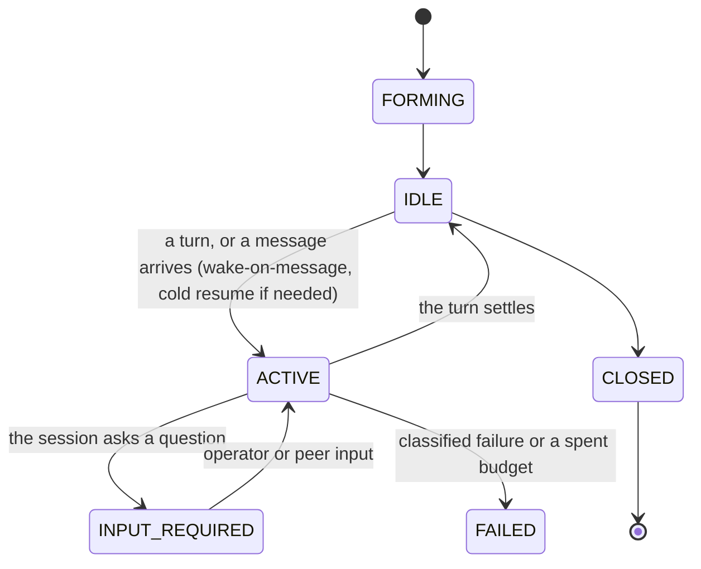

# Worker sessions, direct messaging, and long-running work

> Target state. Seam: `ctx.workerSessions` ([plugin model](../architecture/plugin-model.md#seam-catalog)).
> Decision: [ADR-0015](../decisions/adr/0015-worker-sessions-and-peer-messaging.md); for Workers that
> share no session, [ADR-0070](../decisions/adr/0070-workers-that-share-no-session-work-through-a-tasks-dossier.md).
> Requirements: REQ-SES-1..8. Shapes: [`worker-session.v1.json`](../../schemas/worker-session.v1.json),
> [`message.v1.json`](../../schemas/message.v1.json), [`task-dossier-entry.v1.json`](../../schemas/task-dossier-entry.v1.json).
>
> Implemented in [`worker-sessions`](../../packages/plugins/worker-sessions/README.md) (sessions,
> groups, mailboxes, budgets) and [`workflow`](../../packages/plugins/workflow/README.md)
> (wake-on-message, checkpoints, compaction); differs from target: a Worker sends a message only
> as its reply to a wake, and `session_send` is the operator's or a client's;
> sessions start `IDLE` at their first admission (no `FORMING`) and are never `CLOSED`; a group
> lives for its run, not inside one `team` node; the A2A adapter is planned.

## Concepts

| Concept | Meaning | Lifetime |
|---|---|---|
| **Session** | one Worker's durable participation, with its own `SessionId`, role, and policy | from formation until it is closed; survives restarts |
| **Activation** | the live process, browser context, or SDK client currently serving a session | disposable, recreated on demand |
| **Execution binding** | `SessionId → { nativeHandle, generation }` | the generation advances on every activation, and the activation's settle presents it, so a stale activation is refused |
| **Session group** | sessions under one policy, such as a team's members | the lifetime of its DAG node |
| **Mailbox** | the durable, ordered inbox of a session | the lifetime of the session |

This is AgentOS's Model A, generalized beyond DSH. The session *is* the
collaboration identity, and it is chosen through admission once, at formation
([teams](teams.md#membership-model-a)).

## Native handle mapping

| Worker runtime | Native handle bound to `SessionId` | Resume mechanism |
|---|---|---|
| ChatGPT / Gemini Web | canonical conversation URL plus the last receipt | open the URL in a fresh context (a session-bound account: a page of its login profile); reconcile the receipt ([provider turns](provider-turns.md)) |
| Claude Agent SDK | SDK session id | SDK resume |
| Codex SDK | thread id | resume thread |
| Antigravity CLI | conversation id | none: `resume` is not proven, so it serves a continued session only as a review member, by replay (the row below; its [README](../../packages/plugins/runtime-antigravity-cli/README.md)) |
| ACP agent | ACP `sessionId` | `session/resume` (v2) or `session/load` (v1) |
| An agent runtime that cannot resume (the Antigravity CLI), as a review member only | none | a replay, not a resume: the `agents` source sends the session's earlier turns, exactly as recorded, before each new one, and records them with the answer ([review members](agent-runtimes.md#review-members)) |
| Model Worker | none | the `models` source replays the session's transcript ([ADR-0031](../decisions/adr/0031-model-worker-sessions-by-replay.md)) |
| A2A remote agent (planned) | `contextId` (+ current `taskId`) | `SubscribeToTask` / Get Task |

A Worker can serve a session only if it proves `persistent-conversation`
([routing](routing.md#capability-vocabulary)), for that work when its offer is scoped to one kind
of work ([scoped offers](routing.md#scoped-offers)).

## Session states

`INPUT_REQUIRED` maps to A2A's `TASK_STATE_INPUT_REQUIRED` and to a node in
`BLOCKED`/`USER_ACTION` when the input must come from the operator.

## Direct messaging

1. A session sends `message(to: SessionId | group, body, inReplyTo?, refs[])`.
   - Incoming messages are injected as the target's next turn. A team's
     members do not message each other: the engine composes their prompts from
     sealed records ([teams](teams.md#membership-model-a)).
   - The operator sends with the MCP tool `session_send` and reads with
     `session_inbox`.
2. **Policy check.** The group policy decides whether the sender may address the
   target, whether a barrier is open, whether the message and turn budgets have
   room. A rejection is recorded as a decision artifact. Egress is checked where content leaves
   for the receiver: a message artifact is at least as strict as its refs, and the receiver's
   turn carries the strictest classification of the messages it delivers, so the turn's egress
   check (the one authority, [routing](routing.md)) refuses local-private content to a remote
   Worker before anything is sent.
3. **Persist, then deliver.** The message is a `message` artifact, appended to
   the target mailbox with a sequence number. Delivery is at least once, and the
   receiver deduplicates by `messageId`.
4. **Wake.** An `IDLE` target is activated, cold-resumed if necessary, and
   receives its unread messages in order as one turn. A session that takes no input now is not
   woken: its Worker source holds it (`ctx.workers.held`) while its latest run waits on an open
   approval request, has not finished, or is not known to be gone. Its messages stay durable and
   unread, and it is woken once it takes input; the only input it takes meanwhile is that
   request's resolution (PROP-0013,
   [ADR-0056](../decisions/adr/0056-a-failed-lease-renewal-is-not-a-lost-lease-and-death-needs-a-verdict.md);
   [a deferred tool call](workflow-engine.md#a-deferred-tool-call)).
5. The engine **records** every message but **never relays or rewrites**
   content.

Barriers are mailbox gates. Messages to a member of a group with a closed
barrier are held until it opens.

## Long-running mechanics

| Concern | Mechanism |
|---|---|
| Survive restarts | session, bindings, mailbox, and receipts are durable; on start, sessions that were `ACTIVE` reconcile their last turn, then resume |
| No polling between peers | wake-on-message; the operator and clients subscribe to session events |
| Progress visibility | the session emits a `report` checkpoint artifact at least every `checkpointEvery` turns or minutes |
| Context growth | engine-owned compaction: at a token threshold, an economy-tier step writes a `handoff` summary artifact (decisions, open questions, state), and the session continues from the summary plus refs. Memory is never left to the model alone |
| Liveness | per-turn two-clock completion; a session heartbeat lease; a stale activation is fenced by generation |
| Bounds | `maxLifetime`, `maxTurns`, `maxMessages`, `maxIdle`, token and quota budget per session; exceeding one is a classified failure |
| Clients waiting on long work | MCP and CLI calls return a `SessionId` or run id at once. Clients poll `status` or stream events; they never block for the duration |
| Human in the loop | `INPUT_REQUIRED` with a question artifact; the answer is an `approval` or a message artifact |

## Relation to the DAG

A team's session group spans the steps its node is unrolled into: each
member's steps run in its own session, and the team's `team` steps tally the
ballots and decide ([teams](teams.md#procedure)). The decision step's output is
the team's result. The DAG gives the durable macro structure. Sessions give
long-running, conversational work inside it
([ADR-0012](../decisions/adr/0012-dag-execution-model.md)).

### A step its session's Worker cannot take

A session stays on its Worker: a template's later step on the run's one
conversation (`persistent`, `caller`) routes only to the Workers the session's
source names (`affinity`). When every one of them is refused for a reason no
wait can change (its input bound, a capability it does not prove, its tier,
where it runs), the step does not fail for that alone (board T230; live
2026-10-26, a research run whose session stayed on a website that takes 30,000
characters, and whose evidence step was 56,350). It runs this once off the
session, on any other Worker admission takes, with the rest of its rules
(provider diversity, an assigned account) kept:

- **sessionless**, when its brief already quotes every earlier turn of the
  session (a template's step points at the results it builds on,
  `{{node:<id>}}`): it does not need the conversation, so it starts without it;
- **handoff**, otherwise: its brief carries, as `prior` pointers, the results of
  the session's earlier turns it does not quote, from this run and from earlier
  runs on the same session (what the conversation held that the step could
  need, as a compaction's `handoff` summary carries a conversation forward).

The session itself does not move: it keeps its Worker and its conversation. A
later step that runs on it again is handed the results of the steps of its run
that ran off it, so its conversation lacks nothing it needs. The choice is a
`route` decision by `workflow.session-move` (`stay`, `sessionless`, `handoff`,
`fail`, each with why), named by the execution's decisions, beside the
`workflow.node.session-moved` event. A Worker of the session that is busy, at its
limit, signed out, or not listed now is a wait, not a move: the step waits or
fails as before. A team member's session never moves (Model A). A step no
Worker takes off the session either still fails, its message naming both
refusals; a handoff that would point at more artifacts than a brief holds does
not move, and says so. Code: `packages/plugins/workflow/src/session-moves.ts`.

### A review fix continues its author's session

One task, one author session (board T232; operator 2026-10-26: "when a fix is
needed, message it; after a review, message that session directly to update;
the whole task stays in one session while still getting outside information
from an independent reviewer"). A review's fix is not routed like any step to a
fresh context: it takes the session of the step that wrote the change, and the
review's findings are that session's next message, on its Worker, resuming its
native conversation. The author fixes its own work on top of what it did, its
earlier turns in view; the reviewer stays independent, in a session of its own,
never the author's ([review cycles](workflow-engine.md#review-cycles)).

When the author's Worker cannot take the fix, the fix never starts fresh in
silence. Each path is a `route` decision by `workflow.fix-session`:

| Path | When | What happens |
|---|---|---|
| `continue` | the session's Worker takes it, and keeps a native session to resume | the fix is the session's next message there |
| `wait` | the session's Worker cannot take it now (out of quota, signed out, not listed) | the fix waits for it, sending nothing and spending no attempt, at most `fixSessionWaitMinutes` (default 60; INV-9) from its first wait; recorded once |
| `handoff` (session lost) | no Worker keeps the session, or it keeps no native session to resume | the fix starts a new conversation of the same session, its brief carrying the session's earlier turns as `prior` pointers |
| handoff (moved) | the session's Worker can never take it, or the wait passed its bound | the step moves off the session for this execution ([above](#a-step-its-sessions-worker-cannot-take), a `workflow.session-move` `handoff`, its `stay` reason saying the bounded wait ended) |

A later fix of the same task continues the same session again, and is handed
what ran off it. Each fix's result is kept as its own commit of the run's
review history (`refs/system/reviews/<runId>`), never on the worktree's HEAD,
which stays the commit the task binds its result to
([review cycles](workflow-engine.md#review-cycles)).

### Workers that share no session: the task's dossier

A step that moves off its session, a fix that cannot continue its author's session, a new attempt, and a review
(which never shares the author's conversation) all reach a Worker that cannot be messaged and never
saw the conversation. For a board task they work through one artifact instead, the task's
[dossier](task-dossier.md) ([ADR-0070](../decisions/adr/0070-workers-that-share-no-session-work-through-a-tasks-dossier.md)):
an append-only chain of entries (`plan`, `progress`, `review`, `response`, `evidence`), carried
across the task's attempts. Each step's brief points at a bounded slice of it, and the whole of it is
readable on demand. A continued session keeps writing it; a handoff's `prior` pointers still carry
the session's earlier results, and the dossier carries what the Workers wrote about the work. A
reviewer reads the dossier, never the author's conversation. A Worker appends through a narrow,
gated tool its run holds (`dossier_append`, with `dossier_read`), bound by its source to the step it
runs and its execution, never named by the Worker: an agent Worker's host tools where its runtime
offers them (Claude Code). The engine writes the evidence, and the entry of a step that wrote none (a
website Worker's answer as it is).

## A2A alignment (for the planned adapter)

| `system` | A2A 1.0 |
|---|---|
| `SessionId` | `contextId` |
| one activation turn or execution | `Task` (`id`) |
| `message` artifact (`messageId`, `inReplyTo`, `refs`) | `Message` (`messageId`, `referenceTaskIds`, `parts`) |
| domain artifacts | `Artifact` |
| `INPUT_REQUIRED`, `CLOSED`, `FAILED` | `TASK_STATE_INPUT_REQUIRED`, `COMPLETED`, `FAILED` / `CANCELED` |
| wake-on-message, session events | streaming, `SubscribeToTask`, push notifications |
