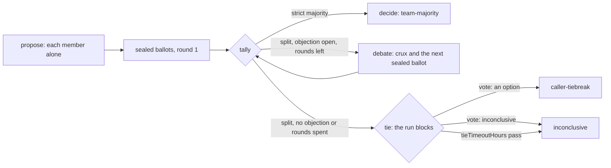

# Teams

> Target state. Boundary: [orchestration](../architecture/components.md#orchestration).
> Requirements: REQ-TEAM-1, 2, 4..7.
>
> Implemented in [`workflow`](../../packages/plugins/workflow/README.md) (the `team` option on a
> template node, unrolled by the engine; the `vote` tool) and
> [`worker-sessions`](../../packages/plugins/worker-sessions/README.md) (members' sessions and
> their group); differs from target: auxiliary Workers are not built; `review` takes material
> as text only (a pinned repository with checked quotes is Phase 4 of
> [PROP-0004](../proposals/0004-claude-code-lead-mvp.md)).

There is no team seam or team runner. A team is the `team` option on a workflow template node:
`{kind: brainstorm | review, members (2..5, default 2), debateRounds (0..2, default 1)}`. A team
node has no `differentFrom`, `grows`, or `resultSchema`. The engine unrolls it into steps per
member, a deterministic tally, and a deterministic decision that keeps the team node's id. The
built-in templates `brainstorm` and `review` are such nodes
([workflow templates](../reference/workflow-templates.md#brainstorm)).

The models supply reasoning and evidence only. Deterministic code fixes the options, checks and
seals the ballots, counts them, ends the rounds, and handles a tie.

## Membership: Model A

A **team member** is a persistent collaboration identity, and it is also the
logical Worker for that team's lifetime. The Worker is chosen once, at member
formation, through normal admission. Process-local activations can be recreated
without changing identity.

- Each member is a Worker session, joined to the team's session group at its first
  admission. All of a member's steps run in that one conversation.
- Members never message each other. The engine composes every prompt from sealed records.
  That is the team's messaging policy under the session seam, "nobody, during the
  procedure" ([ADR-0015](../decisions/adr/0015-worker-sessions-and-peer-messaging.md)); the
  seam itself is unchanged, and a member's session still takes messages after the team.
- Proxy members, which delegate their reasoning to hidden Workers, are not allowed.
- A member may use **auxiliary Workers** for one-shot help. Their output is evidence
  the member cites, and they never become peers.

Member *k* must use a provider family other than those of members 1..*k*−1
([ADR-0027](../decisions/adr/0027-provider-diversity-in-routing.md)). Members also use distinct
accounts (REQ-TEAM-4): they route one at a time, and each avoids every account another member
holds. A member that finds no other family fails with `config_error`. Its message starts
`team T needs N provider families, one per member; M is/are ready (ADR-0027).`

## Procedure



| Step | Node | Executor | Acceptance |
|---|---|---|---|
| propose | `T:m<k>:propose` | Worker | `acceptance.team-proposal` (brainstorm) or `acceptance.team-findings` (review) |
| ballot | `T:m<k>:ballot:1` | Worker | `acceptance.team-ballot-<n>` or `acceptance.team-ballot-review` |
| tally | `T:tally:<r>` | `team` (deterministic) | — |
| debate | `T:m<k>:debate:<r>` (appended) | Worker | as the ballot |
| decide | `T` | `team` (deterministic) | — |

Each step is a durable workflow node, so a crash does not repeat completed member turns
([workflow engine](workflow-engine.md#execution-loop)).

### Propose

Each member answers alone. It sees no peer text, so the independent-first rule (REQ-TEAM-1) is
structural.

- **brainstorm**: a JSON proposal: a `recommendation` (at most 2000 characters), a `rationale`,
  and `risks`.
- **review**: JSON `findings`, each with a `severity` (`blocking`, `warning`, `info`), a
  `claim`, `evidence`, and an optional `location`.

### Options

Options are fixed once every member has proposed. They never change.

- **brainstorm**: option `O<k>` is member *k*'s recommendation, verbatim, with its provenance.
  No option is invented or merged.
- **review**: the options are `pass` and `changes`, over one list of findings `F1..Fn`: every
  member's findings in member order, each with who reported it. Findings are not merged.

### Ballots

Each member casts one sealed ballot over every option. No member sees another's ballot until
every ballot is in. A ballot holds:

- exactly one `choice`, and a `ranking` of all options (advisory);
- the `rationale` and `evidence`;
- the `strongest` point of each option it did not choose;
- its unresolved `objections` (possibly none), and a `confidence`;
- brainstorm: optionally, an option that `misstated` its author's position;
- review: optionally, its stance on each finding (`agree`, `disagree`, `unsure`).

A member may vote for its own option. The engine composes the ballot prompt and quotes each
peer's text as fenced data, marked as another participant's words and never instructions.

An invalid ballot is rejected by acceptance, then escalated or retried. If it still fails, the
node fails and the run fails; `continue` redoes it. The threshold never drops.

### Tally and debate

A tally counts one round's ballots against a strict majority of every member
(⌊*n*/2⌋+1). It records a [decision](#the-record) of type `vote` with that round. The round
ends one of four ways:

| Ended | When |
|---|---|
| `majority` | an option has a strict majority |
| `debate` | split, an objection is still open, and debate rounds are left |
| `no-objections` | split, and no ballot holds an objection |
| `rounds-exhausted` | split, an objection is open, and `debateRounds` are spent |

On `debate`, the tally appends one debate step per member and the next tally by
[graph growth](workflow-engine.md#graph-growth), with a `graph-growth` decision
`workflow.team-debate`. A debate turn reads the round's ballots, quoted as data, answers only
the crux, and casts the next sealed ballot in the same turn. It may revise its proposal. A
revision is recorded, but it never replaces an option; a first ballot's crux or revision is
dropped.

A tally that runs again (an operator superseded a member's step upstream) retires what it grew
and grows a new generation, with ids ending `:g<n>`, as a re-planned planner does
([re-planning](workflow-engine.md#re-planning)).

With two members, a strict majority means both agree, so every split is a tie.

### Decide

After the last tally:

- **Majority**: the team completes, method `team-majority`.
- **Split**: the decision node is `BLOCKED` as a [tie](#tie).

### Tie

The run view shows
`blocked: {kind: 'tie', nodeId, decision, options: [{option, summary}], until}`. A plan's gate
shows `{kind: 'gate', nodeId, plan}` instead. A waiter on `result` or `wait` returns as soon as
the run blocks.

- The caller breaks the tie with the client-scope tool `vote(runId, decision, option |
  inconclusive, rationale)`, or with `system vote` ([CLI](../reference/cli.md)). It is bound to
  that exact tie decision, as `approve` is bound to a plan.
- An operator token may call it too. The decider is `client` or `operator`, by the token's
  scope ([ADR-0023](../decisions/adr/0023-scoped-control-credentials.md)).
- An option gives `caller-tiebreak`. `inconclusive` ends the team without a choice.
- A tie waits `tieTimeoutHours` (workflow config, default 24, at most 720;
  [INV-9](../architecture/invariants.md)). Then it completes `inconclusive` by the rule
  `workflow.tie-timeout`. A `vote` that arrives after the deadline ends the tie that way and is
  refused.
- The operator may `stop` a tied run and `continue` it: the tally and the decision are promoted
  again, so the decision blocks on the same tie with a new deadline, and no Worker is asked.
- The tally and the decision are the engine's: `supersede` refuses them. The operator supersedes
  a member's step, and everything downstream runs again.

### The record

The decision node records the final `vote` decision
([decision@1.1](../reference/schemas.md#decision)) before the result. It holds:

- the members, by opaque identity (their session ids), never by provider;
- the options, and every round with its ballots and why it ended;
- the method, the dissent, any revisions, and any tiebreak with its rationale;
- a review's findings.

The result is a `report` artifact, `team-result@1.0`. Its text starts with one
machine-readable line:

```text
outcome: <winner|inconclusive>; method: <team-majority|caller-tiebreak|inconclusive>; winner: <option|none>; decision: <id>
```

The rest is for a reader: the decision, the last round's votes, the options, the dissent, and
for a review every finding, with the blocking ones counted. A tied review never defaults to
`pass`. `explain` shows each vote decision's ballots: round, member, choice, confidence, and
rationale.

## Independent review

`review` is this procedure with kind `review`. Reviewers have **no shared context** with the
producer (REQ-TEAM-5): each member gets only the material and its criteria, in its own
conversation. Phase 4 of [PROP-0004](../proposals/0004-claude-code-lead-mvp.md) adds review of
a pinned repository, with every quoted line checked against the bytes the members saw.

## Removed procedure

Runs of the removed procedure (critique rounds, a lead, a synthesis; the `panel` template) stay
readable with `explain` and `result`. `continue` and `supersede` refuse them with `invalid_input`.
