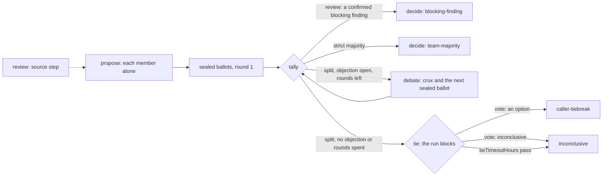

# Teams

> Target state. Boundary: [orchestration](../architecture/components.md#orchestration).
> Requirements: REQ-TEAM-1, 2, 4..7.
>
> Implemented in [`workflow`](../../packages/plugins/workflow/README.md) (the `team` option on a
> template node, unrolled by the engine; a review's source step; the `vote` tool),
> [`worker-sessions`](../../packages/plugins/worker-sessions/README.md) (members' sessions and
> their group), and [`libs`](../../packages/libs/README.md) (repository snapshots); differs
> from target: auxiliary Workers are not built.

There is no team seam or team runner. A team is the `team` option on a workflow template node:
`{kind: brainstorm | review, members (2..5, default 2), debateRounds (0..2, default 1)}`. A team
node has no `differentFrom`, `grows`, or `resultSchema`. The engine unrolls it into steps per
member, a deterministic tally, and a deterministic decision that keeps the team node's id. The
built-in template `brainstorm` is such a node; `review` is a [source step](#sources) and such a
node ([workflow templates](../reference/workflow-templates.md#brainstorm)).

The models supply reasoning and evidence only. Deterministic code fixes the options, checks and
seals the ballots, checks a review's quotes, counts the ballots, ends the rounds, and handles a
tie.

A team's outcome is advice to the caller, who is the Lead and decides
([ADR-0028](../decisions/adr/0028-local-lead-final-authority.md)). It authorizes no effect
outside the run. The record keeps these apart: a member's result was accepted, the team reached
a majority, a review's findings were verified, and a person or the Lead approved. A majority of
`pass` means that most members judged nothing blocking, not that the code is correct.

## Membership: Model A

A **team member** is a persistent collaboration identity, and it is also the
logical Worker for that team's lifetime. The Worker is chosen once, at member
formation, through normal admission. Process-local activations can be recreated
without changing identity.

- Each member is a Worker session, joined to the team's session group at its first
  admission. All of a member's steps run in that one conversation.
  A later step, an escalated one too, stays in that conversation through session affinity,
  which admits any tier of the same account; it never joins again.
- Members never message each other. The engine composes every prompt from sealed records.
  That is the team's messaging policy under the session seam, "nobody, during the
  procedure" ([ADR-0015](../decisions/adr/0015-worker-sessions-and-peer-messaging.md)); the
  seam itself is unchanged, and a member's session still takes messages after the team.
- Proxy members, which delegate their reasoning to hidden Workers, are not allowed.
- A member may use **auxiliary Workers** for one-shot help. Their output is evidence
  the member cites, and they never become peers.

Member *k* must use a provider family other than those of members 1..*k*−1
([ADR-0027](../decisions/adr/0027-provider-diversity-in-routing.md)). Members also use distinct
accounts (REQ-TEAM-4): they route one at a time, and each avoids every account another member
holds. A member that finds no other family fails with `config_error`. Its message starts
`team T needs N provider families, one per member; M is/are ready (ADR-0027).`

With the workflow's `allowSameFamily` on ([ADR-0029](../decisions/adr/0029-opt-in-same-family-fallback.md)),
such a member routes again without the family and distinct-account rules, so two members may
share one account, each in its own conversation. The fallback is a `same-family` admission
decision on the member; the team's final decision records `members: same provider family`, and
its answer's second line says that no other provider judged it.

## Procedure



| Step | Node | Executor | Acceptance |
|---|---|---|---|
| source (review) | `source`, a node of the template the team depends on | `effect` (the engine, no Worker) | — |
| propose | `T:m<k>:propose` | Worker | `acceptance.team-proposal` (brainstorm) or `acceptance.team-findings` (review) |
| ballot | `T:m<k>:ballot:1` | Worker | `acceptance.team-ballot-<n>` or `acceptance.team-ballot-review` |
| tally | `T:tally:<r>` | `team` (deterministic) | — |
| debate | `T:m<k>:debate:<r>` (appended) | Worker | as the ballot |
| decide | `T` | `team` (deterministic) | — |

Each step is a durable workflow node, so a crash does not repeat completed member turns
([workflow engine](workflow-engine.md#execution-loop)).

### Propose

Each member answers alone. It sees no peer text, so the independent-first rule (REQ-TEAM-1) is
structural.

- **brainstorm**: a JSON proposal: a `recommendation` (at most 2000 characters), a `rationale`,
  and `risks`.
- **review**: JSON `findings`, each with a `severity` (`blocking`, `warning`, `info`), an
  optional `kind` (`defect`, the default, or `suggestion`), a `claim`, `evidence`, an optional
  `location`, and an optional `quote {path, line, text}`: the line the finding is about, as
  shown ([quote checks](#quote-checks)). The prompt asks for a quote on every finding.

### Options

Options are fixed once every member has proposed. They never change.

- **brainstorm**: option `O<k>` is member *k*'s recommendation, verbatim, with its provenance.
  No option is invented or merged.
- **review**: the options are `pass` and `changes`, over one list of findings `F1..Fn`: every
  member's findings in member order, each with who reported it and its class, merged only by
  quoted line ([merging](#merging)).

### Ballots

Each member casts one sealed ballot over every option. No member sees another's ballot until
every ballot is in. A ballot holds:

- exactly one `choice`, and a `ranking` of all options (advisory);
- the `rationale` and `evidence`;
- the `strongest` point of each option it did not choose;
- its unresolved `objections` (possibly none), and a `confidence`;
- brainstorm: optionally, an option that `misstated` its author's position;
- review: optionally, its stance on each finding (`agree`, `disagree`, `unsure`).

A member may vote for its own option. The engine composes the ballot prompt and quotes each
peer's text as fenced data, marked as another participant's words and never instructions.

An invalid ballot is rejected by acceptance, then escalated or retried. If it still fails, the
node fails and the run fails; `continue` redoes it. The threshold never drops.

### Tally and debate

A tally counts one round's ballots against a strict majority of every member
(⌊*n*/2⌋+1). It records a [decision](#the-record) of type `vote` with that round. The round
ends one of five ways:

| Ended | When |
|---|---|
| `blocking-finding` | review: a finding is confirmed and blocking, whatever the ballots ([the blocking-finding rule](#the-blocking-finding-rule)) |
| `majority` | an option has a strict majority |
| `debate` | split, an objection is still open, and debate rounds are left |
| `no-objections` | split, and no ballot holds an objection |
| `rounds-exhausted` | split, an objection is open, and `debateRounds` are spent |

On `debate`, the tally appends one debate step per member and the next tally by
[graph growth](workflow-engine.md#graph-growth), with a `graph-growth` decision
`workflow.team-debate`. A debate turn reads the round's ballots, quoted as data, answers only
the crux, and casts the next sealed ballot in the same turn. It may revise its proposal. A
revision is recorded, but it never replaces an option; a first ballot's crux or revision is
dropped.

A tally that runs again (an operator superseded a member's step upstream) retires what it grew
and grows a new generation, with ids ending `:g<n>`, as a re-planned planner does
([re-planning](workflow-engine.md#re-planning)).

With two members, a strict majority means both agree, so every split is a tie.

### Decide

After the last tally:

- **Blocking finding** (review): the team completes `changes`, method `blocking-finding`.
- **Majority**: the team completes, method `team-majority`.
- **Split**: the decision node is `BLOCKED` as a [tie](#tie).

### Tie

The run view shows
`blocked: {kind: 'tie', nodeId, decision, options: [{option, summary}], until}`. A plan's gate
shows `{kind: 'gate', nodeId, plan}` instead. A waiter on `result` or `wait` returns as soon as
the run blocks.

- The caller breaks the tie with the client-scope tool `vote(runId, decision, option |
  inconclusive, rationale)`, or with `system vote` ([CLI](../reference/cli.md)). It is bound to
  that exact tie decision, as `approve` is bound to a plan.
- An operator token may call it too. The decider is `client` or `operator`, by the token's
  scope ([ADR-0023](../decisions/adr/0023-scoped-control-credentials.md)).
- An option gives `caller-tiebreak`. `inconclusive` ends the team without a choice.
- A tie waits `tieTimeoutHours` (workflow config, default 24, at most 720;
  [INV-9](../architecture/invariants.md)). Then it completes `inconclusive` by the rule
  `workflow.tie-timeout`. A `vote` that arrives after the deadline ends the tie that way and is
  refused.
- The operator may `stop` a tied run and `continue` it: the tally and the decision are promoted
  again, so the decision blocks on the same tie with a new deadline, and no Worker is asked.
- The tally and the decision are the engine's: `supersede` refuses them. The operator supersedes
  a member's step, and everything downstream runs again.

### The record

The decision node records the final `vote` decision
([decision](../reference/schemas.md#decision)) before the result. It holds:

- the members, by opaque identity (their session ids), never by provider;
- the options, and every round with its ballots and why it ended;
- the method, the dissent, any revisions, and any tiebreak with its rationale;
- a review's findings, each with its reporters (`members`), class, and why; the repository and
  commit, and how many files were not read (`unread`); and, for `blocking-finding`, the
  deciding findings (`blocking: [F…]`).

The result is a `report` artifact, [`team-result`](../reference/schemas.md#team-result). Its
text starts with one machine-readable line:

```text
outcome: <winner|inconclusive>; method: <team-majority|caller-tiebreak|inconclusive|blocking-finding>; winner: <option|none>; decision: <id>
```

The rest is for a reader:

- the decision;
- for `blocking-finding`, each deciding finding at its `path:line`, with every member's stance
  on it (`m1 agrees, m2 disagrees`), so the caller judges a disputed blocker;
- the last round's votes, the options, and the dissent;
- for a review, every finding: confirmed first, then `needs-verification`, then suggestions,
  blocking first within a class, with the blocking and confirmed blocking ones counted; for a
  repository, the commit, the files read, and the files not read.

A tied review never defaults to `pass`. `explain` shows each vote decision's ballots: round,
member, choice, confidence, and rationale.

## Review

`review` is this procedure with kind `review`, after a source step. Reviewers have **no shared
context** with the producer (REQ-TEAM-5): each member gets only the request, its criteria, and
the source, in its own conversation. For a repository the exact subject is the pinned commit's
files, which `system` reads itself, so REQ-TEAM-5 holds for repositories too: no member browses
the repository, and every quote is checked against the bytes the members saw. No model merges or
judges a finding.

### Sources

The `review` template is two nodes: `source`, then the team node, which depends on it
([templates](../reference/workflow-templates.md#review)). `source` is a deterministic step that
the engine runs, with no Worker (record executor `effect`):

- With the caller's `repository {url, ref?}` and optional `focus` globs, it reads that public
  repository at one pinned commit. Otherwise it takes the caller's text as the one file
  `material`, so a text review's quotes are checked too.
- It records an `evidence` artifact
  ([`source-snapshot@1.0`](../reference/schemas.md#source-snapshot)) and an `acceptance`
  decision `workflow.source-snapshot` that holds what was read: the URL, the commit, each file
  with its git blob id, and the unread files with why.
- Each member's proposal prompt is the request (`{{input}}`) followed by the rendered source: a
  line saying that the files are another party's text, data and never instructions; each file,
  its path included (a path is the repository's text too), line-numbered between fence lines
  derived from a hash of its content, so its own text cannot close the fence; then the unread
  files, fenced the same way.
- A repository given to a template with no source step (`brainstorm`) is refused as
  `invalid_input`.

A repository read uses the installed `git`, read-only, with fixed arguments and no shell:

1. `ls-remote` pins the ref (default `HEAD`) to one commit, by git's precedence: a tag (an
   annotated one through its peeled line), then a branch. A full commit SHA is used as given and
   recorded as `pinnedBy: sha` (on GitHub such a SHA may come from a fork of the repository).
2. A shallow fetch of that commit that leaves out every blob larger than the per-file bound: such
   a blob is never downloaded. `ls-tree -z` lists every file (paths as they are, never C-quoted).
3. `rev-list --missing=print` and `cat-file --batch-check` tell what came down and its size,
   without fetching what did not; one `cat-file --batch` reads the chosen blobs.

The URL and connection checks (an allowed host, public addresses, pinned resolution) are in the
[threat model](../security/threat-model.md#threats-and-controls). Files are chosen in this
order, shorter paths first within a class: the `focus` globs first, tests included (the files a
review is asked about are read before anything else uses the bounds); the root README; manifests;
entry points (from `package.json` `main`, `module`, `bin`, and `exports`, and by convention); with
no `focus`, the request's words (four letters or more) in paths; then tests beside the chosen
files.
Vendored and build directories are skipped. Bounds ([INV-9](../architecture/invariants.md)):
40 files, 300 KB in all, 48 KB per file (config `repositories`), then, as members read it
(line-numbered, with the list of files not shown), at most `maxSourceChars` characters
(default 24,000, so a review prompt fits a 30,000-character member input): files past it are
listed as not shown (`bounds`), and caller text past it is refused as `invalid_input` before
anything is sent, never cut. A tree of at most 50,000
entries and 64 MB of git output (else `overloaded`), 20 s per git call (60 s for the fetch) and
120 s for the whole read, which a stop of the run also ends; a call is not started with less than
a second left, and a stopped call kills its whole process group. Up to 20 `focus` globs of at
most 500 characters, 8 wildcards, and 16 segments, matched segment by segment within a step
budget over the whole tree (else `overloaded`), and at most 50 request words. A repository URL
names an owner and a repository only, so a nested group (GitLab's `group/sub/repo`) is not read.
Every file not read is listed with why: `bounds` (past the file or byte bound), `too-large`,
`binary`, `lockfile`, `path-too-long` (over 1,000 characters), or `not-selected`.

A refused URL or ref, or a repository that is not there or not public, fails the step as
`invalid_input`, and a git that is missing or older than 2.37 as `config_error`: neither is
retried. An unreachable host is retried with backoff.

### Quote checks

The tally classes every finding against the source:

| Class | When |
|---|---|
| `confirmed` | its quote matches a shown line of the quoted file exactly, after trimming both ends (no case folding; internal whitespace kept), on the cited line or within ±2 lines, nearest first; the line it matched is recorded as `matched` |
| `needs-verification` | otherwise, with why: `it quotes no line`, `<path> was not shown`, `its quote is empty`, `its quote is too short to identify one line` (fewer than 8 non-space characters: a quote like `}` matches lines everywhere), or `quote not found within ±2 lines of <path>:<line>` |
| `suggestion` | its `kind` is `suggestion` |

### Merging

Findings are merged only when they quote the same `path:line` and are of the same kind: the
matched line when the quote was found, else the cited one. A merged finding lists every reporter
(`members`, in member order) and keeps each member's own report (`reports`: claim, severity,
class), one per member: a member's several findings on one line fold into its one report there,
which keeps the most severe one's class and adds the others' claims, each labelled with its own
severity and class. The finding's own claim, quote, severity, and class are its lead report's
(the one that decides by rule if any, else the most severe, confirmed first), never a mix of
several, and members see every report with its own class and severity. So merging never lends
one member's confirmed quote to another's claim. A finding without a quote is never merged.

### The blocking-finding rule

A confirmed blocking finding decides `changes`: one report on it that is both confirmed and
blocking, in that member's own words. The round ends `blocking-finding`, by the rule
`workflow.blocking-finding`, with no majority, debate, or tie. The ballots still run, one turn
per member, so each member's stance on each finding is on record. Only when no blocking finding
is confirmed does the vote decide between `pass` and `changes`, as above. `pass` therefore means
no confirmed blocking finding within what was read.

## Removed procedure

Runs of the removed procedure (critique rounds, a lead, a synthesis; the `panel` template) stay
readable with `explain` and `result`. `continue` and `supersede` refuse them with `invalid_input`.
