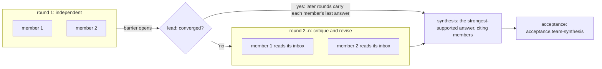

# Teams

> Target state. Boundary: [orchestration](../architecture/components.md#orchestration).
> Requirements: REQ-TEAM-1..5.
>
> Implemented in [`workflow`](../../packages/plugins/workflow/README.md) (the `team` option on a
> template node, unrolled by the engine) and
> [`worker-sessions`](../../packages/plugins/worker-sessions/README.md) (members and their
> mailboxes); differs from target: the only procedure is critique rounds (the `panel` template);
> auxiliary Workers are not built; independent review is the engine's exact-subject review on a
> read-only Worker, not a team procedure.

There is no team seam or team runner. A team is the `team` option on a workflow template node
(`members`, `rounds`, `distinctAccounts`, `synthesisTier`, `lead`). The engine unrolls it into
member nodes per round, optional lead nodes, and a synthesis node that keeps the team node's
id. Each member is a Worker session.

## Membership: Model A

A **team member** is a persistent collaboration identity, and it is also the
logical Worker for that team's lifetime. The Worker is chosen once, at member
formation, through normal admission. Process-local activations can be recreated
without changing identity.

Proxy members, which delegate their reasoning to hidden Workers, are not allowed.
A member may use **auxiliary Workers** for one-shot help. Their output is evidence
the member cites, and they never become peers.

Members of an independence-sensitive team must be backed by distinct accounts
(REQ-TEAM-4). Admission enforces this.

## Plan

A team run follows a deterministic plan:

The lead is optional (`team.lead`). Without it, every round runs.

- The **independent-first barrier** guarantees no member sees a peer's output
  before every member has produced an independent result. It opens once they
  all have, whether or not another round follows.
- Debate, critique, and plain parallel review are *procedures* that a profile
  selects. The engine's unrolling provides critique rounds; the others are
  planned.
- Each member step is a durable workflow node, so a crash mid-round does not repeat
  completed member turns
  ([workflow-engine](workflow-engine.md#execution-loop)).

## Independent review

Reviewers are a team procedure with **no shared context** with the producer
(REQ-TEAM-5). They receive the exact subject, the acceptance criteria, and the
relevant decision artifacts, and nothing from the producer's conversation.
Findings are `assessment` artifacts, each with a severity (`blocking`,
`warning`, or `info`), bound to the subject version.

## Lead

The lead controls the procedure and observes durable state. It does not relay
content between members. Each member is a durable session with its own
`SessionId`, and peers **message each other directly** through the session
mailbox, under the group policy and barriers
([sessions and messaging](sessions-and-messaging.md)). Rounds are the
procedure's checkpoints, not the only channel.

- A lead step sits after each round but the last. It is a cheap `reason` step
  (default tier `economy`) in a temporary conversation.
- It reads the members' current answers and decides only whether they have
  converged (`acceptance.team-lead`). It never answers the question.
- Its decision is a `gate` decision decided by a model, with its answer
  recorded.
- When the members have converged, the later rounds run nothing: each member
  keeps its last answer, with the lead's decision as the cause. The synthesis
  then reads those answers.
