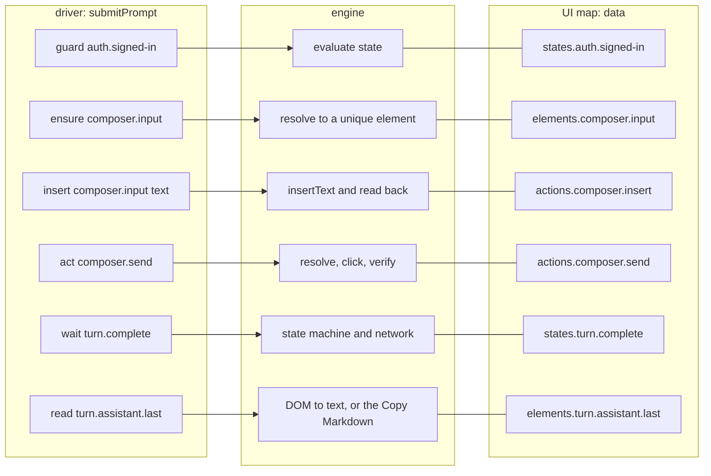
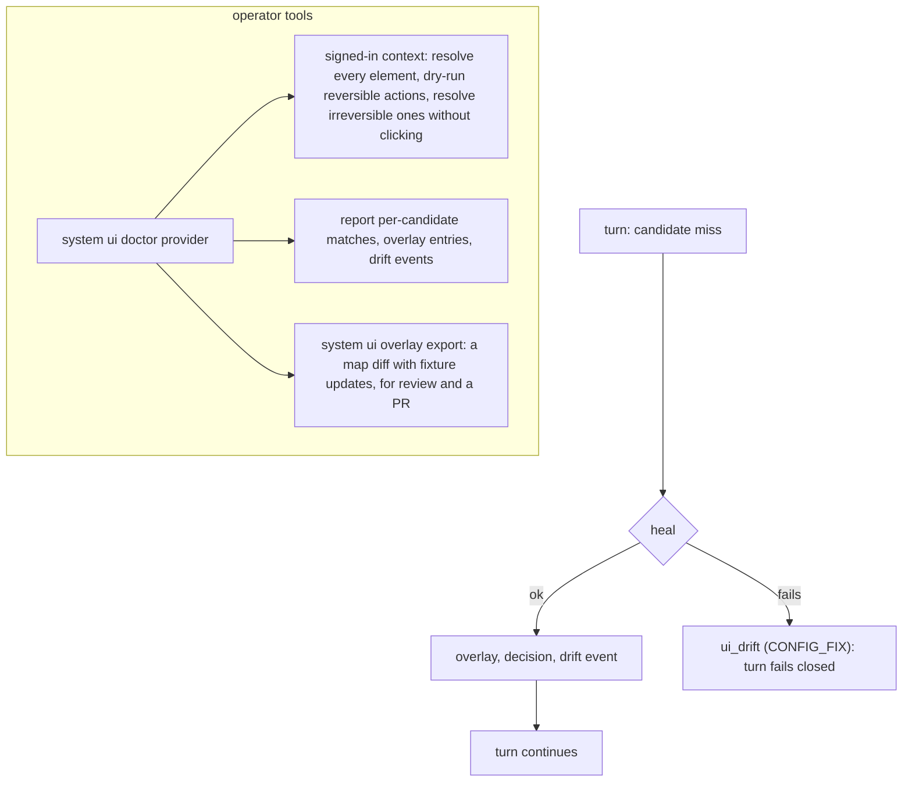

# UI operations: maps, engine, and self-healing

> Target state. Decision: [ADR-0021](../decisions/adr/0021-ui-operations-as-data.md).
> Status audited 2026-10-27: nothing of this mechanism changed from T236 to T295.
> Shape: [`ui-map.v1.json`](../../schemas/ui-map.v1.json). Evidence:
> [research](../research/browser-interaction-and-self-healing.md). Used by the
> provider drivers on [`ctx.browser`](browser-runtime.md).
>
> Implemented in [`ui-ops`](../../packages/ui-ops/README.md), with the heal audit in
> [`provider-chatgpt-web`](../../packages/plugins/provider-chatgpt-web/README.md); differs from
> target: every heal is deterministic (`heal: model` is parsed but acts as `deterministic`: the
> heal engine does not use the `ctx.models` seam); `sideEffect` is parsed but caps neither healing
> nor failure handling; there is no `system ui doctor`, `system ui overlay export`, or diagnostic
> bundle, and no attachments; the Gemini driver runs with healing off.

## How a driver uses a website

A driver procedure is a short sequence of **operation ids**. The engine turns each
id into an element on the page by using the provider's UI map:



The ChatGPT driver's procedures are `checkAuth`, `identity`, `open` (new or bound
conversation, Chat mode, Temporary chat), `selectMode` (model and Power, read
back), `ask` (Deep research tool, insert, send, wait, read), `snapshot`, and
`binding` (URL `/c/<id>`). They hold no selectors.

## UI map (`ui-map@1.1`)

One YAML file per provider, shipped with the driver package (for example,
`packages/plugins/provider-chatgpt-web/ui/chatgpt-web.ui.yaml`). It is validated
against the JSON Schema at load. What each minor adds, from `frames` at 1.1 to error rules on an
answer at 1.4, is in [reference: schemas](../reference/schemas.md#ui-map); the example below is
a 1.1 map.

```yaml
schema: ui-map@1.1
provider: chatgpt-web
uiRevision: '2026-10-09'          # when the map was last checked against the live site
locales: [en, vi]                  # localized names are listed per locale
elements:
  composer.form:
    candidates:
      - { css: 'form[data-type="unified-composer"]' }
      - { role: form, name: { en: '^Chat with ChatGPT$' } }
  composer.input:
    scope: composer.form
    candidates:
      - { testId: prompt-textarea }
      - { role: textbox }
    fingerprint: { role: textbox }
  composer.send:
    scope: composer.form
    candidates:
      - { testId: send-button }
      - { role: button, name: { en: '^Send prompt$', vi: '^Gửi lời nhắc$' } }
    fingerprint: { role: button, name: { en: 'send' } }
actions:
  composer.send:
    do: click
    target: composer.send
    require: [enabled]
    fallback: { press: Enter, on: composer.input }
    verify: { anyOf: [{ network: conversation.post }, { countIncreased: turn.user }] }
    sideEffect: irreversible
    heal: deterministic
    timeouts: { resolveMs: 5000, verifyMs: 20000 }
network:
  conversation.post: { method: POST, url: '/backend-api/(f/)?conversation$' }
  challenge: { header: { name: cf-mitigated, equals: challenge } }
states:
  turn.running: { visible: composer.stop }          # the action slot shows Stop
  turn.idle: { allOf: [{ hidden: composer.stop }, { anyOf: [{ visible: composer.send }, { visible: composer.voice }] }] }
  turn.complete:
    allOf: [{ state: turn.idle }, { visible: turn.assistant.last.actions }, { stableTextMs: 1500, of: turn.assistant.last }]
```

| Field | Meaning |
|---|---|
| `candidates` | ordered locators. Kinds: `testId`, `role` + `name` (a regex per locale), `label`, `text`, and `css`, which comes last. Every kind compiles to a Playwright locator |
| `scope` | another element that must resolve first; the search runs inside it |
| `frames` | `any`: search every frame, for content rendered in iframes such as a research report (1.1) |
| `cardinality` | `one` (default: zero or several matches is a failure, never a guess) or `many` (lists such as turns) |
| `fingerprint` | what the element *is* (role, name keywords, nearby role), used only by the heal matcher |
| `require` | preconditions checked on the resolved element: `visible` (always), `enabled`, `editable` |
| `verify` | the postcondition that proves the action worked. Conditions: `visible`, `hidden`, `countIncreased`, `attr`, `url`, `network`, `anyOf`, `allOf`, `not`, `stableTextMs` |
| `sideEffect` | `none` (reads), `reversible` (opening a menu, choosing a mode: undone by a fresh context), `irreversible` (sending a prompt) |
| `heal` | `off`, `deterministic`, or `model`; target: capped by the side-effect class (below) |
| `fallback` | a non-locator alternative, such as pressing Enter in the composer |

**Error rules** (`errors`) map a page condition to a failure kind. Each is a guard checked
before every action (`on: act`, the default), or checked on a turn's answer once the driver has
read it (`on: answer`, `ui-map@1.4`): the site answered with its own usage limit, so the turn was
sent and fails without a resend. A `quota_exhausted` rule may name the `feature` its limit applies
to; the website runtime then cools that feature, or the whole account, for a while
([ADR-0034](../decisions/adr/0034-unsent-failover-to-a-sibling-account.md)). An answer rule's
elements are looked for inside the answer just read only, so a limit an earlier answer of the
conversation gave, still on the page, never counts again.

The local **overlay** may add candidates to the map's elements, elements the map does not define,
and error rules after the shipped ones. A site's limit text can so be recognized without a
release; the merged map is validated as a whole.

`uiRevision` and the map's content hash (after the overlay is merged) are recorded
in every heal decision and diagnostic bundle, so a drift can be traced to the
exact map in use.

## Resolution engine

For an element:

1. Check **guards** first: the login surface and challenge states. If either is
   showing, the turn fails as `USER_ACTION`, and no healing is attempted.
2. Resolve the scope, then try the candidates in order on each poll tick, until
   one has **exactly one** visible match or `resolveMs` expires. Shipped
   candidates come before overlay candidates.
3. Check `require` on the match.
4. For an action, run it, then poll `verify` until `verifyMs` expires.
5. If a non-primary candidate won, try the candidates once more after a short
   settle (250 ms): a page still rendering shows some elements a moment before
   others, such as Gemini's prompt host before its bubble, or a menu still
   opening. If a non-primary candidate still wins, report drift (`onDrift`,
   logged as `ui.drift`). The turn still succeeds; the event feeds the health view and
   `system ui doctor`. An action whose target no candidate finds
   (with no heal or fallback), or that misses its postcondition, is reported
   too before it fails, each with [drift evidence](#drift-evidence).

### Drift evidence

A drift report carries a structural **outline** of the region (`ui-outline@1.0`),
so a stale element can be mapped again without opening the operator's browser:

- **Region:** the found element's parent on a fallback; an unresolved element's
  scope; otherwise the page body. A page-wide outline (that one, and a stall's)
  folds each element marked `role="navigation"` into one node, without its
  contents, so a site's sidebar never spends the node budget the content needs
  (live 2026-10-18, two outlines that ran out inside a sidebar).
- **Content:** per node, the tag, role, `aria-label` (not on links, whose labels
  are often content such as chat titles; at most 40 characters), a link's target
  as a kind, never the URL (`external`, `site`, or `none`; `ui-outline@1.1`), the `aria-*`
  states, the test id, the names of other `data-*` attributes, the id, up to five
  classes, whether it is editable, and its visible text length. Never text,
  input values, or URLs.
- **Redaction:** any value that holds an email address, or the account's own
  name or address as its driver reads them from the page, is masked whole as
  `[redacted]`. An outline carries no identity by construction.
- **Where and what was found:** the event names the page's path (`url`, never its query, as a
  stall's does), so a page the site sent elsewhere shows. For an unresolved element it also gives
  `matches`: per candidate, in the map's order, how many elements it finds where the element is
  looked for (its scope, or the page), hidden ones too (`found`), and how many of those are
  visible (`shown`). Counts only. A candidate that finds the element and shows none of it means
  the page hides the control; none found means it was renamed or removed. The outline alone cannot
  tell these apart for a control with no text, such as an account button that is a link (live
  2026-10-24: Gemini's account button was in the outline, the same as on working pages, and still
  did not resolve).
- **Bounds:** only nodes that carry one of those marks (wrappers are skipped),
  like siblings folded into one node with a count, at most 200 nodes and 12
  levels.
- **Record:** the provider plugin stores it as a local-private `evidence`
  artifact, which never leaves the machine
  ([INV-12](../architecture/invariants.md#inv-12-data-egress-is-explicit)), and
  the `ui.drift` event names it (`outline`). Each element and kind is reported
  once per page. An outline that cannot be read is left out; it never fails
  the turn.

The playbook says how to turn an outline into a map candidate
([playbooks](../operations/playbooks.md#a-provider-ui-change)).

Prompt text is inserted with an insert-text method that does not trigger editor
shortcuts, read back, and compared by hash before sending
([provider turns](provider-turns.md#submission)).

### Network observation

The engine subscribes to `request`, `response`, `requestfinished`, and
`requestfailed` on the turn's page and matches them against the map's `network`
patterns. It only observes; it never sends requests of its own to private
endpoints. Uses:

- **not for running:** on ChatGPT the conversation's event stream stays open
  after the answer is complete, so "running" and "complete" come from the DOM
  ([two-clock completion](provider-turns.md#two-clock-completion));
- **submission evidence:** the conversation POST proves that a send happened,
  which the turn receipt records
  ([reconciliation](provider-turns.md#reconciliation));
- **typed failures:** `cf-mitigated: challenge` is `challenge`, HTTP 413 is
  `invalid_input`, and an SSE `error_code` maps through the map's error table.

## Self-heal

The heal step runs only when every candidate fails, the guards (the map's
`errors` conditions, such as the login surface) are clear, and the operation's
heal policy allows it. An action's `fallback` (for example, Enter in the composer)
runs only when healing is not allowed or finds no confident match, so a heal
can repair the map while the fallback keeps the turn working.

1. **Snapshot.** Take `ariaSnapshot({ mode: 'ai' })` of the operation's scope (or
   the page), which yields `[ref=eN]` references.
2. **Deterministic match.** Score each node against the fingerprint: role
   equality, accessible-name similarity across the locale variants (normalized
   Levenshtein), test-id similarity, and the nearby role. Accept the best node
   only if its score is at least `τ` (default 0.8) and it beats the second best by
   a margin (default 0.15).
3. **Model proposal** (only with `heal: model`). An **economy-tier** model receives the trimmed snapshot, the
   operation description, and the fingerprint, and returns one ref. It is reached
   only through the `ctx.models` seam; no model is named in the map or code (INV-11).
4. **Verify.** Resolve the ref, check that the match is unique, then check the
   role and `require`. Turn it into a durable locator with `normalize()`, run
   the action, and check `verify`.
5. **Record.** Before the healed element is acted on, write a `recovery`
   **decision artifact** (INV-13), decided by `ui-ops.heal.deterministic`. It
   records the operation, the map and snapshot hashes, the top candidate scores,
   and the chosen locator. If the record cannot be written, nothing is clicked.
   A rejected heal is recorded too, with `fail-closed` as its outcome. Heal and
   drift outcomes go to the event log (`ui.heal`, `ui.drift`). Without a
   decision store, healing is off.
6. **Overlay.** On success, append the normalized locator to the provider's
   local overlay with `source: healed`, the decision id, and `verifiedCount`.
   The overlay is `<DSH_HOME>/system/ui/<provider>.overlay.yaml`, owner-only and
   written durably. The shipped map is never modified at run time.

Cap by side-effect class:

| Side-effect class | Heal allowed | On failed verification |
|---|---|---|
| `none` | deterministic or model | the turn fails with `ui_drift` (`CONFIG_FIX`) |
| `reversible` | deterministic or model | the context is discarded and the turn fails with `ui_drift` |
| `irreversible` | **deterministic only**, never a model | no retry: the receipt goes through reconciliation, since the send may have happened |

## Drift workflow



The **diagnostic bundle** (planned; saved under the turn's artifacts, classified
`local-private`) holds:
- match counts for every candidate of every operation the procedure used;
- the scoped ARIA snapshot;
- the page URL;
- the recent network events that matched the map;
- a screenshot, only when the operator opted in.

It never includes cookies or prompt text beyond the prompt's hash.

## Tests

- **Schema:** every shipped map validates against `ui-map.v1.json`.
- **Fixtures:**
  - recorded and sanitized pages under `fixtures/<provider>/*.html` drive the
    engine in a real headed browser;
  - each map edit must keep every fixture green;
  - *drifted* fixtures (renamed test ids, moved buttons, translated labels) prove
    that resolution falls back and that healing finds the right control without
    touching a decoy.
- **Conformance:** the engine features that rely on internal selectors (such as
  `aria-ref=`) are pinned by tests against the locked patchright version.
