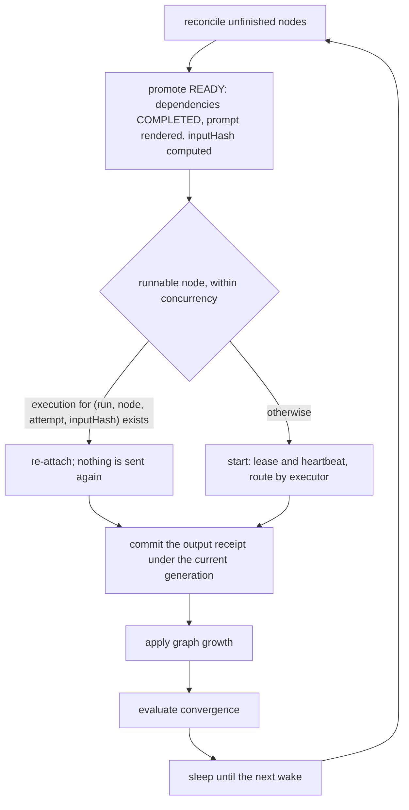
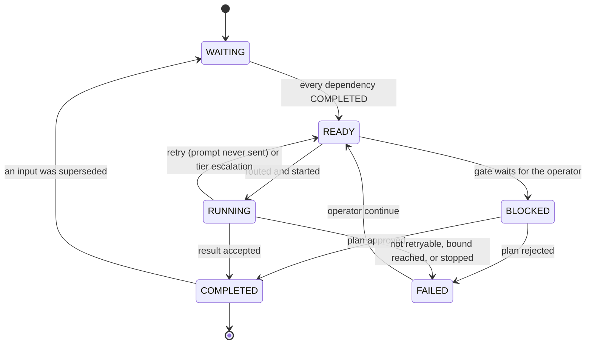
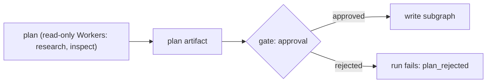

# Workflow engine

> Target state. Boundary: [orchestration](../architecture/components.md#orchestration).
> Requirements: REQ-WF-1..11. Decision: [ADR-0004](../decisions/adr/0004-single-workflow-runtime.md).
> Templates: [workflow templates](../reference/workflow-templates.md).
>
> Implemented in [`workflow`](../../packages/plugins/workflow/README.md); differs from target:
> admission has preflight and a spec hash but no provenance or confirmation step; only `worker`
> and `gate` nodes run (teams are unrolled into `worker` nodes); `RECOVERING` is not used;
> a scheduler exception fails the run as `internal` (`CODE_FIX`) instead of blocking it;
> handoff envelopes, the plan's side-effect classes, convergence blocker reports, and
> re-planning after a superseded input are planned.

There is one engine, and every multi-step job runs on it as an append-only DAG
([ADR-0012](../decisions/adr/0012-dag-execution-model.md)). It combines three
ideas: a **semantic DAG** whose nodes
declare objectives and capability requirements, **durable nodes addressed by
input hash** so completed work is never redone, and **artifact lineage** so
superseded evidence invalidates dependent work.

## Admission

Lifecycle: `draft → preflight → confirm → accepted → active`.

- Each spec value carries its provenance: `user-explicit`, `interpreted`, or
  `policy-default`. Interpreted values that matter are confirmed before acceptance.
- Preflight validates the spec: acyclic, unique node ids, known executors,
  admissible capability requirements, and bounds within limits.
- The accepted spec is canonicalized and hashed. The run binds to that hash and
  to the profile version.

## Graph model

Exact shape: [`workflow-node.v1.json`](../../schemas/workflow-node.v1.json).

```ts
WorkflowNode {
  nodeId;                      // deterministic, e.g. "review:cycle:2:B:round:1:member:2"
  objective; executor: "team" | "worker" | "effect" | "gate";
  requires: CapabilityRequirement[];
  dependsOn: NodeId[];
  state: WAITING | READY | RUNNING | RECOVERING | COMPLETED | FAILED | BLOCKED;
  inputReceipt?:  { inputHash, dependencyOutputHashes };
  outputReceipt?: { resultId, outputHash };
  execution?:     { executionId, attempt, owner, lease, generation };
}
```

`inputHash` covers the canonical node definition, the fully rendered prompt or
input bundle, and the output hashes of its dependencies.

## Execution loop



Node lifecycle (the states of [`workflow-node.v1.json`](../../schemas/workflow-node.v1.json)):



A scheduler exception moves the run to `BLOCKED` with `CODE_FIX_REQUIRED`. It
never crash-loops.

## Graph growth

Each graph snapshot is acyclic. Loops are unrolled into new nodes with ordinal ids. Growth
comes from two sources, and both are recorded as `graph-growth` decision artifacts:

- **`plan` artifacts** emitted by a planner node (dynamic). The engine validates a plan
  (acyclic, admissible capabilities, within bounds) before appending its nodes.
- **Engine rules** (static), the same for every profile. The one rule today is
  **remediation**: when a node that requires the `review` capability is bound to an exact
  subject, its assessment requests changes with blocking findings, and a step it depends on
  wrote the change (`develop`), the engine appends a fix step (on that step's capabilities) and
  a re-review bound to the new subject. Whatever waited for the review waits for both. Cycles are bounded by the engine
  configuration `maxReviewCycles` (default 3, the first review included).

A profile contributes templates only; it declares no growth rules of its own.

## Plan approval gate

A subgraph that holds write authority over a subject
([INV-15](../architecture/invariants.md#inv-15-one-writer-per-subject)) is
preceded by a gate node:



- The plan lists files or targets, intended changes, side-effect classes, and a
  confidence level.
- **Auto-approve** only when policy allows it, confidence is high, and every step
  is `none` or `idempotent`. Otherwise the run waits in `BLOCKED` with
  `USER_ACTION` until the operator approves, edits, or rejects the plan through
  the CLI or Web UI.
- The approval is an `approval` artifact bound to the exact plan id. An edited
  plan is a new artifact that needs a new approval.
- A verdict names the plan the operator read. With several plans waiting, a
  verdict that names none is refused and lists them, so a plan that arrived later
  is never approved unseen. The gate is read and decided under the run's lease.

## Handoffs

A handoff passes an upstream result verbatim to a downstream executor, bound by
SHA-256. Along with the result, the receiver gets the **decision artifacts the
result depends on**, such as chosen options and rejected alternatives, so that
implicit decisions become explicit inputs instead of being lost between
Workers. Delivery is at least once, and acknowledgement is idempotent. Trusted
control messages, such as `START_IMPLEMENTATION` and `APPLY_REVIEWS {
expectedHeadSha }`, are separate from the model payload
([INV-6](../architecture/invariants.md#inv-6-authority-comes-from-trusted-envelopes)).

## Exact-subject gates

A review must report `reviewedSubject === currentSubject`, for example
`reviewedHeadSha === pr.headSha`. Remediation must keep the subject's identity, such
as the same PR, and must advance its version, such as a new head. The next cycle
binds to the new version. Mismatches fail the gate.

For a local agent's change, the subject is the working tree's git subject,
`git:<HEAD>:<hash of every change on top>`. The `assessment` is stored only when it
names that subject and the tree is still it, as an exact-subject `gate` decision;
otherwise the step fails as `stale_subject`.

## Artifacts, lineage, invalidation

Node results, receipts, and every engine decision (spec admission, gate, graph
growth, recovery) are artifacts. Their model, lineage, and invalidation rules are
canonical in [artifacts](artifacts.md). Every node state transition references
the decision artifact that caused it.

## Recovery

| Failure class | Disposition |
|---|---|
| transient provider / network | `IMMEDIATE` or `BACKOFF` |
| browser session or conversation broken | `RECREATE_SESSION` |
| auth lost, confirmation needed, quota | `USER_ACTION` |
| contract violation, scheduler exception, internal programming error (`internal`) | `CODE_FIX` |
| website UI drift that self-heal could not resolve | `CONFIG_FIX` (update the UI map; [UI operations](ui-operations.md)) |
| invalid input, rejected by acceptance | `NONE` |

Attempts are bounded (default 3). The operator command `continue` reopens exactly
one `FAILED` node.

## Convergence

A run is complete only when it has no blockers. Possible blockers are unmet
criteria, open blocking findings, missing deliverables, pending authority gates,
missing receipts, incomplete dependencies, and incomplete plan tasks. Status
reports list the blockers explicitly, not just a percentage.

## Retention

Cleanup is explicit and operator-only. A preview lists the affected runs, and
deletion is keyed on the exact `runId` and `updatedAt`. What expires on its own
is private text only: after a retention period, a finished run's input and
rendered prompts are cleared, and the run and its records stay.
