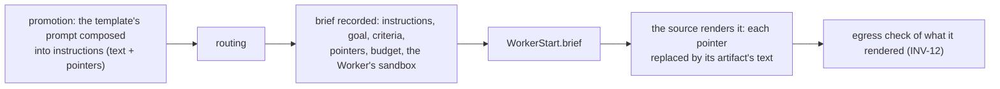
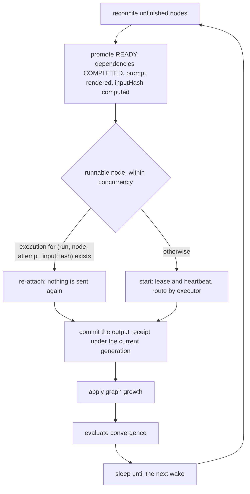
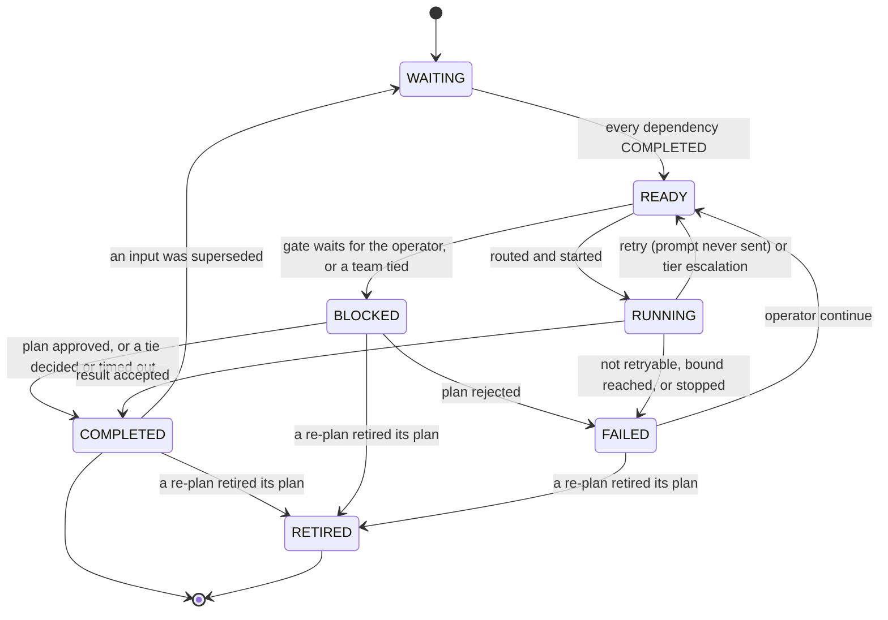
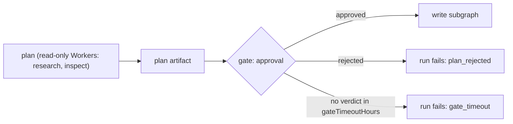
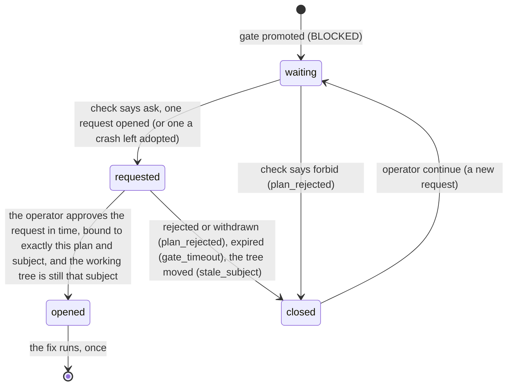
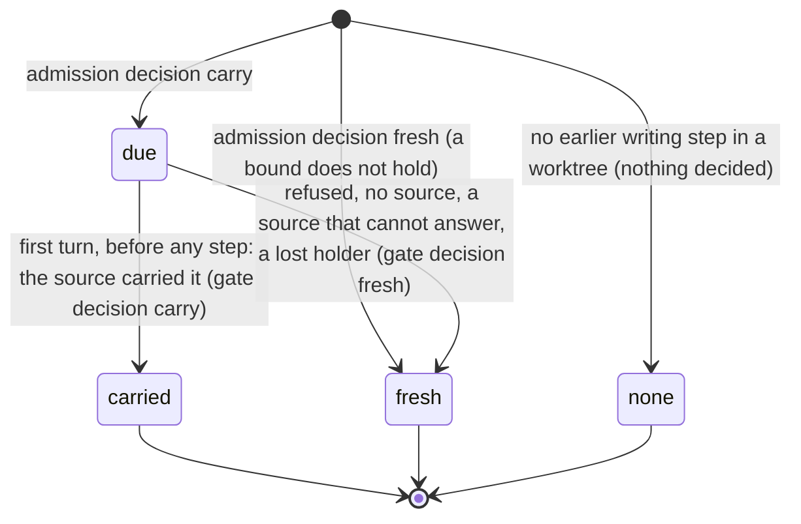
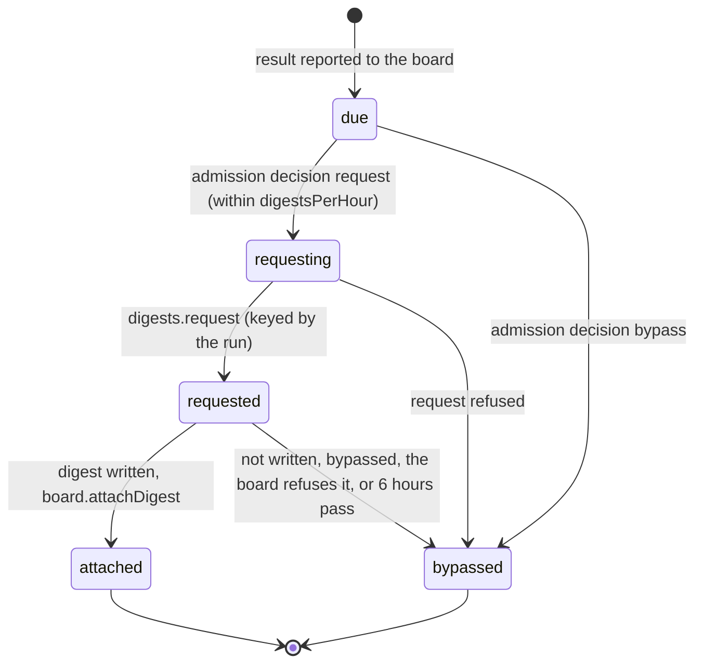
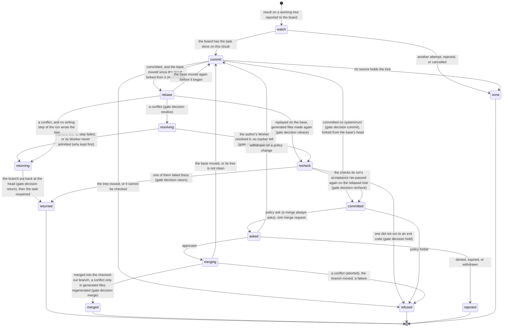

# Workflow engine

> Target state. Boundary: [orchestration](../architecture/components.md#orchestration).
> Requirements: REQ-WF-1..11, REQ-WF-13..16. Decision: [ADR-0004](../decisions/adr/0004-single-workflow-runtime.md).
> Templates: [workflow templates](../reference/workflow-templates.md).
>
> Implemented in [`workflow`](../../packages/plugins/workflow/README.md); differs from target:
> admission has preflight and a spec hash but no provenance or confirmation step; only `worker`,
> `gate`, and `team` nodes run (a team is unrolled into `worker` steps and its `team` tally and
> decision), and one `effect`, a review's [source step](teams.md#sources); `RECOVERING` is not used;
> a scheduler exception fails the run as `internal` (`CODE_FIX`) instead of blocking it;
> handoff envelopes, the plan's side-effect classes, and convergence blocker reports are
> planned. A board task's `run.brief` is not set: each execution names its own
> [brief](#briefs). Only a remediation fix's gate asks the [approval queue](#remediation-on-the-approval-queue);
> a planner's plan gate is still the operator's `approve`. A task's budget is checked before each
> step of its run, never inside one: an agent run is not stopped at its next turn or tool boundary
> ([a task's budget](#a-tasks-budget)).

There is one engine, and every multi-step job runs on it as an append-only DAG
([ADR-0012](../decisions/adr/0012-dag-execution-model.md)). It combines three
ideas: a **semantic DAG** whose nodes
declare objectives and capability requirements, **durable nodes addressed by
input hash** so completed work is never redone, and **artifact lineage** so
superseded evidence invalidates dependent work.

## Admission

Lifecycle: `draft → preflight → confirm → accepted → active`.

- Each spec value carries its provenance: `user-explicit`, `interpreted`, or
  `policy-default`. Interpreted values that matter are confirmed before acceptance.
- Preflight validates the spec: acyclic, unique node ids, known executors,
  admissible capability requirements, and bounds within limits.
- The accepted spec is canonicalized and hashed. The run binds to that hash and
  to the profile version. A run keeps its resolved spec, so a template removed
  later still answers `explain` and `result` for the runs it started; a new run
  of it is refused as an unknown template.
- Two bounds admit a run (INV-9). Both refuse with `overloaded` and say which one was hit.
  - `maxActiveRuns` bounds the unfinished runs that execute.
  - A run whose only unfinished work waits on someone is not one of them. Such a run has a
    `BLOCKED` node (a gate's approval or a tie's vote) and no `READY` or `RUNNING` node.
    These runs count against `maxWaitingRuns`: with `maxActiveRuns + maxWaitingRuns`
    unfinished runs in all, no new run is admitted.
  - An approval or a vote is never refused to free a slot. A run it resumes can push the
    executing runs above `maxActiveRuns` until they finish, never above the sum.

### Variants

A template node may declare named variants:
`variants: { <name>: { objective?, prompt?, capabilities?, tier?, kind?, conversation?, acceptance? } }`.

- The caller names at most one variant at start (MCP `run` `variant`, CLI
  `system run --variant`; `research` also takes `deep`). Its fields replace the node's own before the spec is
  checked and hashed, so the chosen fields are part of the `specHash`.
- A variant the template does not define is refused with `invalid_input`:
  `template <t> has no variant <v> (it has: …)`. Nothing is sent.
- A variant changes only those seven fields: it never adds a team, a planner's
  growth policy, or `differentFrom`. Each value is checked: a tier, a kind of work, a
  conversation, non-empty capabilities, non-empty text. Every variant is resolved when the template
  is added, so a broken variant is refused then, not at a run's start. The variants
  today are `research`'s `deep` ([templates](../reference/workflow-templates.md#research)) and
  `algorithm-development`'s `docs` and `tests`, which change its develop step's kind of work
  ([templates](../reference/workflow-templates.md#algorithm-development)).

### Kinds of work

A node may name the `kind` of work it is (`code`, `docs`, …; [ADR-0057](../decisions/adr/0057-route-work-by-kind.md)).
Its requirement carries it (`work-requirement@1.2`), set from the admitted spec only (INV-6), and
routing gives it only to a Worker that takes it ([work kinds](routing.md#work-kinds)). Preflight
refuses a kind that is no label, and one on a team or a source step. A remediation fix has the
kind of the step whose change it fixes, and its re-review the review's; a planner's step has
none. A board task's next attempt resumes the earlier session only on a Worker that takes the
kind of every step that would continue it; otherwise it starts fresh, given its brief.

### Conversations

A node's `conversation` is `temporary` (one-shot), `persistent` or `caller` (the run's
one session, or the caller's), or `own`: a new persistent conversation of that node
alone. Nodes on the run's one session take turns. Preflight refuses two that could run
at once (`give one of them conversation: own`), since they would interleave in one
conversation and bind it to one Worker. Parallel steps that each need a persistent
conversation, such as Deep research reviews, use `own`.

A step on the run's session routes only to the Workers the session stays on. When every
one of them is refused for a reason no wait can change (its input bound, a capability,
its tier, its locality), the step does not fail for that alone: it runs once off the
session on another admissible Worker, without the session when its brief already quotes
every earlier turn of it, else through a handoff (its brief carries those turns' results
as `prior` pointers). A later step back on the session is handed what ran off it. The
choice is a `route` decision by `workflow.session-move`; a step no Worker takes off the
session either still fails, naming both refusals
([sessions](sessions-and-messaging.md#a-step-its-sessions-worker-cannot-take)).

Every route decision states the brief's size against its Worker's input bound: on the
chosen Worker, `input N characters, within its bound of M` (or `declares no input bound`),
and, when other Workers that could take the step were refused for their bound alone, how
many and the largest of those bounds, so the lead reading the route sees a brief that has
outgrown the Workers that could take it ([ADR-0032](../decisions/adr/0032-admission-refuses-input-longer-than-a-worker-takes.md)).

### Different provider families

A template node may declare `differentFrom: [nodeId, …]`: its Worker must be of another
provider family than the Workers that served those nodes
([provider diversity](routing.md#provider-diversity), [ADR-0027](../decisions/adr/0027-provider-diversity-in-routing.md)).

- Preflight refuses a node that names itself, an unknown node, or a team node (a team has
  several Workers).
- Preflight also refuses a `differentFrom` that would make a node wait for itself: a
  mutual pair, or a named node that depends on this one.
- The node is promoted together with or after the nodes it names, never before (promotion
  repeats until nothing more is ready, so listing order never serializes branches). It runs
  only beside those nodes and waits until each has a Worker, so parallel branches still
  start together, one routing turn apart. A named node that is not running (it backs off
  before a retry) never holds it: the node gives its turn back to the run loop, and both
  run again.
- The engine reads those Workers' families from their current descriptors and routes the
  node with them as `exclude`, the reason naming the nodes (`differs from node
  literature:1`). The relation holds both ways: a node routing again (a retry, an
  escalation, a `continue`) also excludes the families of the routed nodes that name it.
  A node that routes again forgets its old Worker, so no peer differs from a stale one.
- With `allowSameFamily` on ([ADR-0029](../decisions/adr/0029-opt-in-same-family-fallback.md)), a
  node that no Worker of another family admits routes again without the exclusion (a team
  member, also without the distinct-account rule; a session's own Worker still binds it, and
  the operator's `teams.excludeWorkers` still keeps a member off the Workers it leaves out of
  teams; a team that exclusion leaves too few families fails before this fallback,
  [teams](teams.md#workers-left-out-of-teams)). The
  fallback is an `admission` decision (`workflow.same-family`, outcome `same-family`) kept among
  the node's decisions, and the run's answer starts with a line naming those steps (`Same
  provider family (allowSameFamily): …`; a team says it in its own answer). Off by default:
  then the node fails as above.
- A node may set `diversity: preferred` (default `required`; operator decision D89, for a
  provider that is often down, such as Gemini web). With no Worker of another family admitted,
  it routes again without the family rule, still without the Workers that failed it, and runs
  in a conversation of its own; an `admission` decision (`workflow.diversity`, outcome
  `single-family`) names why. When the Worker of another family that took it fails its
  execution, sent or not (a stall, the infrastructure, the site's own error), a `recovery`
  decision `single-family` readies it again at once, before any retry, failover, or resend, with
  that Worker and its account left out for good (never resent there) and, for an `own`
  conversation, a new session; it then routes as above. Once per step: an attempt that was the
  fallback ends the step on any failure, and once a fallback was admitted the family rule is
  never lifted again, at any escalation: a fallback whose result was rejected escalates only onto
  another family, if one is admitted, or the step fails. Each later step built on it is told in its brief (`Single family: …`),
  and the run's answer starts with `Single family: …`. It decides before `allowSameFamily`, and
  never applies to a team member or a heavy change's second review (`./single-family.ts`).
- If a named node failed, the node sends nothing and the run fails on that node. If a named
  node's Worker declares no family or is no longer listed, no Worker can be shown to differ:
  the node fails as `config_error`, with nothing sent (fail closed). With only Workers of the
  excluded families, it fails admission with the `diversity` reasons.

## Briefs

Every Worker execution the engine starts is given a `brief@1.1` (`@1.2` for a board task's run,
with its `ask` and `files`, `@1.3` when a criterion of its task names what checks it;
[`brief`](../reference/schemas.md#brief)): an `objective` artifact recorded before the execution
starts, in the transaction that starts it, and named by it (`workflow-node@1.2`
`execution.brief`, the node's view, and the `workflow.node.started` event). The engine composes
the record; the Worker source renders it into its own prompt
([PROP-0010](../proposals/0010-base-version.md),
[ADR-0040](../decisions/adr/0040-briefs-on-the-workers-and-workflow-seams.md)).



- **Composed at promotion.** When a node becomes `READY`, its template's prompt becomes the
  brief's `instructions`: the template's text and the caller's input as text, and every
  dependency's result (`{{node:<id>}}`) and each planned step's result under its objective
  (`{{grown}}`) as a pointer by content id, role `input`. The input hash covers the text these
  instructions render to, so a node's execution key is what it was. A plan step's prompt is model
  text and a remediation fix's prompt the engine's own: each is used as it is, never expanded. A
  re-review is worded as the review it re-runs ([graph growth](#graph-growth)). Where the prompt
  places a source step's snapshot of the caller's own text (a text review), that text is already
  there, line-numbered: `{{input}}` composes to one line naming its file instead, so the text is
  shown and counted once ([sources](teams.md#sources)).
- **Every placeholder filled.** A template's text may hold only `{{input}}`, `{{node:<id>}}` of a
  node it depends on, and `{{grown}}` after a planner (and the engine's own `{{team}}` in a team's
  ballot and debate). Any other `{{` (an unknown name, another spelling, no closing `}}`) refuses
  the template at preflight. A Worker never reads a placeholder as it is (INV-2): at promotion, a
  placeholder the engine cannot fill for the node fails it as `config_error` with nothing sent, on a
  `gate` decision (rule `workflow.instructions`) naming the placeholders, and before each Worker
  execution starts the engine checks again that the node's instructions are what its wording
  composes to (a node an earlier version promoted with a template's text stored as it is fails the
  same way, without its input receipt, so `continue` composes it again). Text the engine never
  expands (the caller's input, a dependency's result, a plan step's model text, a fix's quoted
  findings, a diff) is data: a `{{…}}` in it is sent as written.
- **Recorded at the start.** After routing, the brief takes the routed Worker's confinement:
  `sandbox` as its source declares it (`WorkerSource.sandbox`), or, for a source that declares
  none, a Worker that runs nothing here: read-only, no commands, network only as the egress
  policy allows. Its `goal` is the node's objective and its `acceptance` names the node's
  contract, result schema, and exact subject; a node of a board task's run takes the task's goal
  and criteria instead ([below](#a-board-tasks-brief)). A node on a session the Worker keeps
  natively names that session (`resume`). Its classification is the run's, raised to the
  strictest artifact it points at, and its envelope's inputs are every pointer, so an unknown
  pointer is refused (INV-12). A plain run's budget is empty.
- **Rendered by the source.** The start names the brief (`WorkerStart.brief`); the source reads
  it at start, resolves each pointer to its artifact's text (the body's `text`, else its
  canonical JSON), and renders its prompt: the website, model, and agent sources share the
  default text rendering (`renderBrief` in [libs](../../packages/libs/README.md)). It checks
  egress on what it rendered at the requirement's classification, the work's own, as for any
  prompt (a brief's record may be stricter for storage: a website answer is stored
  `local-private`, and was always forwarded at the run's classification). A brief it cannot render (a pointer no longer stored) refuses the start as
  `invalid_input`, with nothing sent. Admission measures the length of that rendering
  ([ADR-0032](../decisions/adr/0032-admission-refuses-input-longer-than-a-worker-takes.md)).
- **What the Worker reads.** For a plain run, exactly the prompt the template words: the
  instructions in order, each pointer replaced verbatim and never expanded again. A brief for a
  board task, or one without instructions, first states the task and attempt, the goal, the
  acceptance criteria, open questions, and, for a board task (`brief@1.2` `ask`), how to answer
  with questions instead ([below](#a-question-from-a-run)); pointers the instructions do not place follow
  (`Read these too`), each with its role and note.
- **Pointers, never content.** The text of the instructions is the template's, the caller's, and
  what the engine composes: a team's ballot and debate prompt, which quotes its peers' sealed
  records as the [teams](teams.md) protocol does; a remediation step's prompt, which quotes the
  review's findings; a result schema; a review's exact subject with its diff. No dependency's
  result is copied in.
- **Retention.** A finished run's composed instructions are cleared with its prompts after
  `retainDays`. Its briefs are artifacts of the run: they stay until the run is deleted
  (`retainRunsDays`), the caller's input in them included.

### A board task's brief

A run for a [board task](#board-tasks) fixes, when it is admitted, what every brief it writes
adds: the project, the task, and the attempt the run will be; the task's goal and acceptance
criteria, each with what checks it when the task names that (`brief@1.3` `check`); the task's
budget lines less the usage spent on the task (the brief informs; the run's
[reservation](#a-tasks-budget) enforces), counted for each step when it starts, after its
reservation, so a step's brief states what is left after the steps before it, in this attempt and
the earlier ones (the operator's decision of 2026-10-24, D31; a step still in flight beside it has
recorded nothing yet, and with no ledger able to count it the brief keeps what was left when the
run was admitted, never more); and at most 16
pointers, never content: the accepted results of the tasks it depends on (their digests when
they have one, role `input`), and on a later attempt the previous attempt's result (`prior`; for
an attempt a spent budget stopped between steps, the result of each step it completed) and
the decision behind this attempt (`review`: a rejection's reasons, the answers to its questions).
A run whose worktree starts from the previous attempt's work points first at the decision that
carried it (`prior`, its note saying the worktree already holds that change;
[below](#starting-from-the-previous-attempts-work)).

**Usage spent on a task.** The [ledger](resources.md) counts usage by run: a record names the
task (or the run was reserved for it), the workflow run, or the Worker's own execution (an agent
Worker's run id). The engine knows which runs served the task (`workflow_tasks`) and which
executions they started (each start's `workflow.node.started` event, and each node's current
execution), so it reads the ledger for the task and for each of those ids, counts each record
once by its `(source, requestId)`, and totals it per line: `tokens` input plus output, `usd` the
cost, `turns`, `runs` one per record; `minutes` stay as declared. A run deleted by retention no
longer counts. A step's brief takes the run's caps (the task's lines when it was admitted) less
this count, read when the step starts. This informs the brief; the run's
[reservation](#a-tasks-budget) is what enforces the lines, by the ledger's own count.

**Resume from a brief.** A task's next attempt, or the first attempt of a task that depends on
exactly one other (a chain), resumes the session of the run before it when:

- the template keeps a conversation across its steps (a node on the run's session);
- that session's Worker keeps a native session (`ctx.workers.handle`) and can resume it now: it
  is listed, ready or busy, and proves `persistent-conversation`;
- the session takes input now: its Worker source does not hold it (`ctx.workers.held`). A
  source holds a session whose latest run stopped on a tool call whose approval request is still
  open, or has not finished, or is not known to be gone
  ([held sessions](agent-runtimes.md#held-sessions)). Such a session takes no input but that
  request's resolution ([a deferred tool call](#a-deferred-tool-call)), so the attempt never
  resumes it. A provider of `ctx.workers` without `held`, or one that fails, cannot show the
  session free (PROP-0013,
  [ADR-0056](../decisions/adr/0056-a-failed-lease-renewal-is-not-a-lost-lease-and-death-needs-a-verdict.md),
  workflow contract 1.6);
- the session has served fewer than `maxSessionRuns` runs (default 5, INV-9).

The run then continues that session, and the new brief is its next message, so the Worker keeps
the context it built (an agent Worker resumes its SDK session). Otherwise the run starts a fresh
session, given the brief, which points at the earlier work. The choice is an `admission`
decision (`workflow.task-session`) whose detail names the run and session it resumed from, made
before the task is taken, so a failure there claims nothing. A caller that names a session keeps
it.

## Graph model

Exact shape: [`workflow-node.v1.json`](../../schemas/workflow-node.v1.json).

```ts
WorkflowNode {
  nodeId;                      // deterministic, e.g. "review:cycle:2:B:round:1:member:2"
  objective; executor: "team" | "worker" | "effect" | "gate";
  requires: CapabilityRequirement[];
  dependsOn: NodeId[];
  state: WAITING | READY | RUNNING | RECOVERING | COMPLETED | FAILED | BLOCKED | RETIRED;
  inputReceipt?:  { inputHash, dependencyOutputHashes };
  outputReceipt?: { resultId, outputHash };
  execution?:     { executionId, attempt, owner, lease, generation };
}
```

`inputHash` covers the canonical node definition, the fully rendered prompt or
input bundle, and the output hashes of its dependencies.

## Execution loop



Node lifecycle (the states of [`workflow-node.v1.json`](../../schemas/workflow-node.v1.json)):



A completed execution is judged by its acceptance contract first. Only a rejected result
reads what else it needs: the Workers its session holds it to, for its escalation
([routing](routing.md#intelligence-tiers)). A listing that fails then (a Worker source that
cannot describe itself) leaves those Workers unknown: the node is not escalated and fails as
`acceptance_rejected`, never as a scheduler exception. An accepted result reads nothing more,
so a source that cannot describe itself never fails a step that already answered.

A scheduler exception while a node executes fails that node as `internal` with
disposition `CODE_FIX`, and the run fails on it. Once the code is fixed, the operator's
`continue` reopens the node. It never crash-loops. A node whose Worker source is no longer
registered (its row is off) fails as `config_error`. Its execution is never guessed at. Once
the row is back on, `continue` runs the node again as a new attempt, recorded as the operator's
decision.

## Graph growth

Each graph snapshot is acyclic. Loops are unrolled into new nodes with ordinal ids. Growth
comes from two sources, and both are recorded as `graph-growth` decision artifacts:

- **`plan` artifacts** emitted by a planner node (dynamic). The engine validates a plan
  (acyclic, admissible capabilities, within bounds) before appending its nodes.
- **Engine rules** (static), the same for every profile. A team's tally appends a
  **debate** and the next tally on a split vote, bounded by `debateRounds`
  ([teams](teams.md#tally-and-debate)). The other rule is **remediation**: when a node that requires the `review` capability is bound to an exact
  subject, its assessment has blocking findings (important findings a second reviewer confirmed,
  [below](#severity-and-verification)), and a step it depends on
  wrote the change (`develop`), the engine appends a fix step (on that step's capabilities) and
  a re-review bound to the new subject, after the review's verification step. The re-review is worded as the review the cycles started
  from: that review's prompt, composed again, so `{{input}}` is the caller's text and each
  `{{node:<id>}}` points at the result that review read, except the step that wrote the change,
  whose place the fix that wrote the new subject takes; a plan step's review stays the step's model
  text. The fix writes, so it waits behind a gate for a person's
  approval of exactly that fix (a `plan` artifact), never approved by policy
  ([ADR-0028](../decisions/adr/0028-local-lead-final-authority.md), INV-15): through the
  approval queue ([below](#remediation-on-the-approval-queue)), or, with none loaded, the
  operator's plan gate. Each cycle is grown by the review that asked for it, so
  superseding an earlier fix retires the later cycles with the review that runs again.
  Whatever waited for the review waits for all three. Cycles are bounded by the engine
  configuration `maxReviewCycles` (default 3, the first review included).

A profile contributes templates only; it declares no growth rules of its own.

### Review cycles

One task, one author session (board T232): a review's findings go to the author, as messages to
its session, and an independent reviewer judges each result. Code:
`packages/plugins/workflow/src/fix-sessions.ts`.

- **The fix continues the author's session.** When the step that wrote the change ran in a
  session (`conversation: persistent` or `caller`; a fix's author is its own author's), the fix
  takes that session (`author`, `session.sessionId`): it routes only to the session's Worker, and
  its brief resumes the session's native conversation, so the fix is that session's next message
  (the findings as data, the subject the reviewer read, and what to change) and the author fixes
  its own work, its earlier turns in view. A team member's session is never taken. When the
  session's Worker cannot take the fix, the fix waits or is handed off
  ([sessions](sessions-and-messaging.md#a-review-fix-continues-its-authors-session)), never
  started fresh in silence. Which path it took is a `route` decision by `workflow.fix-session`
  (`continue`, `wait`, `handoff`).
- **The reviewer stays independent.** Every review and re-review runs in a session of its own,
  never the author's, and resumes nothing; its prompt says it sees none of the producer's
  conversation. A template that wants it on another provider family says so (`differentFrom`).
- **Each fix is its own commit.** Before a fix is first sent, the tree its review read (the
  author's change, or the previous fix's) is kept as a commit of the run's review history, the
  ref `refs/system/reviews/<runId>` of its repository; after the fix completes, its result is,
  on top. The source that holds the worktree makes each (its `land` `record` step), only while
  the tree is still exactly that subject, in an index of its own: the worktree's HEAD, branch,
  index, and files never move. That matters: a board task binds its result and the run's required
  checks to the commit it writes (`writes.ref`, the worktree's HEAD), so a commit on the run's
  branch mid-run would leave the run no result it could bind. Each commit, or why none was made,
  is a `gate` decision by `workflow.fix-commit`. With no source that holds the tree (`land`),
  nothing is recorded and the cycle goes on.
- **A re-review reads only the new diff.** Its exact-subject block names the subject the last review
  read and shows only the change since then (between the history's commits of that tree and the
  fix's result, while the tree it reads is still that result; else against the HEAD when that tree was
  the HEAD unchanged), with the **open findings** (those confirmed in the last round and sent to the
  fix: it says whether each is fixed) and the **answered findings** (every other finding of the earlier
  rounds: it never raises them again). When no commit holds the last subject, it says so and shows
  the whole change (against the commit the first review's tree started from) instead. From cycle 3
  on, it is also asked whether the approach should change, and answers in the assessment's
  `approach`.

### Severity and verification

A review converges when only a checked defect costs a round ([ADR-0075](../decisions/adr/0075-a-review-finding-has-a-severity-and-only-a-verified-important-one-blocks.md),
board T266). Code: `packages/plugins/workflow/src/review.ts`, `spec.ts`.

- **Severity and evidence.** Every finding is `important` (a real defect of this change: wrong
  behaviour, a broken invariant, a security or data risk, a missing required test or doc), `nit`
  (style, naming, wording, a small improvement), or `pre-existing` (a defect the change did not
  introduce), with its `file`, `line`, `evidence` (what fails), and optionally its `class`. An
  important or pre-existing finding without a file, a line, and evidence is read as a nit (`demoted`).
  The old severities are read as their new ones (`blocking` is important, verified like any).
- **The assessment** (`assessment@1.1`) gives each finding an id (`f1`…) and opens its `summary` with
  the count: `2 important, 3 nits`, or `no issues`. Its verdict is `changes-requested` only while a
  confirmed important finding stands (one waiting for its verification requests nothing); the
  reviewer's own verdict is kept as `said` when it differs.
- **Verification.** A review with an important finding grows `<review>:verify`, a second reviewer on
  the review's capabilities, preferring another provider family (`differentFrom` the review,
  `diversity: preferred`: else the same family in a fresh session, recorded), bound to the exact tree
  the review read. It votes `confirm` or `reject` with a reason on each important finding. Its gate
  records a `workflow.verification` decision (confirmed, rejected, unverified), stores the review's
  assessment again with the votes and its verdict read anew, and records a new exact-subject gate on
  the review naming it; that latest assessment is what the risk tier, the task's acceptance, and the
  board's auto-accept read. A finding without a vote stays unverified and does not block.
- **What blocks.** Only a confirmed important finding: it grows the fix, its gate, and the re-review
  after the verification step. Rejected and unverified ones are recorded and shown, never sent as
  work. The fix's prompt names each confirmed finding with its evidence and the verifier's reason, its
  class (fix every instance), and the review's nits once, as optional notes (one dossier response line
  each). When no fix runs, the nits reach the author once as a dossier entry. A nit never starts a fix
  round and never holds auto-accept. The verification is not a cycle: `maxReviewCycles` counts reviews.
- **Pre-existing findings** each propose a follow-up board task (state `proposed`, in the task's
  project, naming the finding and where it was found), after the review's transaction, linked from the
  dossier and never a dependency; once per finding, by a `workflow.follow-up` decision.
- **Repeats.** A re-review finding with the file and title of an answered one is marked `repeated`
  (`<review>#<id>`): shown, never counted, verified, or sent.
- **Shown.** The dossier's review entry, `explain` (each review step's `review`: summary, findings by
  severity, votes and reasons), the CLI, and `/ui`'s review show the findings by severity with their
  votes.

## Plan approval gate

A subgraph that holds write authority over a subject
([INV-15](../architecture/invariants.md#inv-15-one-writer-per-subject)) is
preceded by a gate node:



- The plan lists files or targets, intended changes, side-effect classes, and a
  confidence level.
- **Auto-approve** only when policy allows it, confidence is high, and every step
  is `none` or `idempotent`. Otherwise the run waits in `BLOCKED` with
  `USER_ACTION` until the operator approves, edits, or rejects the plan through
  the CLI or Web UI, for at most `gateTimeoutHours` (default 24; INV-9). Then the
  gate closes by rule and the run fails as `gate_timeout`; `continue` waits again.
- The approval is an `approval` artifact bound to the exact plan id. An edited
  plan is a new artifact that needs a new approval.
- A verdict names the plan the operator read. With several plans waiting, a
  verdict that names none is refused and lists them, so a plan that arrived later
  is never approved unseen. The gate is read and decided under the run's lease.

### Remediation on the approval queue

A remediation fix's gate is the one gate the [approval queue](approvals.md) decides: the
remediation is a `remediation` action, which always asks (`ALWAYS_ASK`). A planner's plan gate
stays the operator's (`approve`).



| Step | Records | On failure |
|---|---|---|
| put to the queue | `approvals.check({ class: 'remediation' })` (the run's project for a board task's run), then one `approvals.request` on the exact subject `{ type: artifact, ref: <plan content id>, version: <the reviewed subject, git:<HEAD>:<hash>> }` (that subject's content id when it is longer than 128 characters), requester `workflow` with the run and the gate; a `gate` decision `wait` (rule `workflow.remediation-approval`) naming the request; the request id on the gate's row, in the same transaction; `workflow.gate.requested`. The gate then waits until the request's `expiresAt`, the policy's wait for `remediation` | the queue unreadable: the gate waits, logged; once its deadline passes it closes as `gate_timeout` (a `gate` decision `closed` naming the request), read or not, and withdraws the request if it can; any mode but `ask`: the gate closes (`plan_rejected`), and nothing is asked |
| a crash before the request id is stored | on restart, the gate adopts its own most recent request in any state (class `remediation`, requester `workflow`, the run, the gate, the exact subject) that no `wait` decision of the gate names, and applies its outcome on the next pass: open, it waits; approved, rejected, withdrawn, or expired, it opens or closes as below. It asks again only when there is none (INV-4). A request a `wait` decision names was the gate's before it was reopened, and is never adopted again | — |
| approved | the request is checked first, then the working tree: the approval was the operator's verdict (`cause: verdict`) given no later than the request's `expiresAt`, an `approval@1.0` by `operator` approving exactly the gate's subject, resolved by an `approval` decision `approved`; then the reviewed working tree is captured again as the exact-subject review captures it, and must still be the reviewed subject. A `gate` decision `open` naming the request and the operator's `approval@1.0`, which becomes the gate's result; `workflow.gate.opened` (`by: queue`) | a request or approval that does not bind this gate's plan, subject, run, and node closes the gate (`plan_rejected`, INV-5); an approval given after the expiry (the queue refuses one; checked again in defence) closes it as `gate_timeout`; a working tree that moved since the review, or can no longer be captured, closes it as `stale_subject` with an exact-subject `gate` decision (rule `workflow.exact-subject`, naming the reviewed subject and the one now): the fix never acts on a tree other than the one approved (INV-5). The approved request is left as it is |
| rejected (verdict, withdrawal) or expired | a `gate` decision `closed`; the run fails as `plan_rejected`, or `gate_timeout` for an expiry; `workflow.gate.closed` (`by: queue`) | — |
| no verdict by the deadline | the gate closes (`gate_timeout`) even if the queue's own sweep has not yet expired the request, and withdraws it | a withdrawal that fails leaves the request to expire on its own |

- The engine reads the queue while the run waits, every `approvalPollSeconds` (default 15,
  INV-9), under the run's lease. Nothing runs on a request that is not approved.
- The gate's view (`blocked`) names `approvalRequest`, and the operator decides it in the queue
  (`/ui`, MCP `approvals_decide`). The engine's `approve` refuses such a gate, so a verdict has
  one channel.
- `continue` on the closed gate reopens it, and it asks again on a new request; `stop` withdraws
  the request nothing waits on any more.
- **Without `ctx.approvals`** the gate is the operator's plan gate below, waiting for `approve`
  until `gateTimeoutHours`: it is never approved by policy, even under `autoApprovePlans` (INV-2).
  The choice is made each time the gate waits, so a queue loaded later takes the gate over.

### Re-planning

A superseded input upstream of a planner, or a superseded plan itself (the
operator's edit), makes the planner plan again
([lineage](artifacts.md#lineage-and-invalidation)):

- What the superseded node, or a node that runs again, grew is **retired**,
  transitively: a planner's plan steps and gate, a review's remediation cycles,
  and what those grew. Origin decides, never the id: each grown node records the
  node that grew it (`grownBy`). A retired node stays in the graph as `RETIRED`
  (append-only, [INV-13](../architecture/invariants.md#inv-13-every-decision-is-an-artifact)),
  never runs again, and no longer counts toward the run's outcome; a
  `graph-growth` decision (`retire`) records each node's state and result, and
  whatever waited for it no longer does. Its results are never reused.
- The grower's next growth is a new generation with new ids (`plan:1:g2:…`).
- The planner reruns on its new input, or its replacement is its new plan, which
  must pass validation before anything changes. The new plan is a new artifact
  that supersedes the old one, behind a new gate, so the old approval never opens
  it ([INV-5](../architecture/invariants.md#inv-5-exact-subject-binding)).
- When a retired step that needed approval had started (it may have written),
  the new plan waits for the operator even where policy would approve it.
- A verdict on a plan that replaces another must name it, so the operator never
  approves a re-plan unseen.
- A plan's gate is never superseded: it is approved or rejected. A plan waiting
  at its gate is edited by rejecting it, then superseding the planner's result.

## Handoffs

A handoff passes an upstream result verbatim to a downstream executor, bound by
SHA-256. Along with the result, the receiver gets the **decision artifacts the
result depends on**, such as chosen options and rejected alternatives, so that
implicit decisions become explicit inputs instead of being lost between
Workers. Delivery is at least once, and acknowledgement is idempotent. Trusted
control messages, such as `START_IMPLEMENTATION` and `APPLY_REVIEWS {
expectedHeadSha }`, are separate from the model payload
([INV-6](../architecture/invariants.md#inv-6-authority-comes-from-trusted-envelopes)).

## Exact-subject gates

A review must report `reviewedSubject === currentSubject`, for example
`reviewedHeadSha === pr.headSha`. Remediation must keep the subject's identity, such
as the same PR, and must advance its version, such as a new head. The next cycle
binds to the new version. Mismatches fail the gate.

For a local agent's change, the subject is the working tree's git subject,
`git:<HEAD>:<hash of every change on top>`. The `assessment` is stored only when it
names that subject and the tree is still it, as an exact-subject `gate` decision;
otherwise the step fails as `stale_subject`. A tree that can no longer be captured
(removed, or no longer a repository) fails the review step as `stale_subject` before it
runs, with an exact-subject `gate` decision of its own: a review never runs unbound. A
remediation fix's gate captures the tree again before it opens on an approval, and fails as
`stale_subject` when it moved ([above](#remediation-on-the-approval-queue)).
The working tree is the one the writer's
result names: with agent Workers configured `worktreePerRun`, the run's own git worktree,
which its writers and reviewers share ([workspaces](agent-runtimes.md#workspaces)). Every
execution the engine starts names its run (`WorkerStart.runId`) for this.

## Artifacts, lineage, invalidation

Node results, receipts, and every engine decision (spec admission, gate, graph
growth, recovery) are artifacts. Their model, lineage, and invalidation rules are
canonical in [artifacts](artifacts.md). Every node state transition references
the decision artifact that caused it.

## Recovery

| Failure class | Disposition |
|---|---|
| transient provider / network | `IMMEDIATE` or `BACKOFF` |
| the Worker's configuration changed while the work waited, and no longer offers the tier it was routed at or that tier's model (`worker_changed`, unsent; [tiers per role](agent-runtimes.md#tiers-per-role)) | `IMMEDIATE`: routed again at once |
| browser session or conversation broken | `RECREATE_SESSION` |
| auth lost, confirmation needed, quota; a bound conversation the site no longer has (`conversation_lost`: reopening it cannot help, and a team member's conversation holds its context) | `USER_ACTION` |
| contract violation, scheduler exception, internal programming error (`internal`) | `CODE_FIX` |
| website UI drift that self-heal could not resolve | `CONFIG_FIX` (update the UI map; [UI operations](ui-operations.md)) |
| invalid input, rejected by acceptance | `NONE` |

Attempts are bounded (default 3). The operator command `continue` reopens exactly
one `FAILED` node. These are a node's attempts; a board task's attempts are the board's, each a run,
and a run that failed only on the infrastructure is not counted among them, within a bound
([an attempt not spent on the infrastructure](#an-attempt-not-spent-on-the-infrastructure)).

Every `workflow.node.failed` event names the failure's `kind` and `disposition`, and
`workflow.run.failed` those of the run's error when it has one, so a reader of the event log tells
a failure only the operator can resolve (`USER_ACTION`) from the others without reading the run
([notifications](notifications.md)).

**Failover** ([ADR-0034](../decisions/adr/0034-unsent-failover-to-a-sibling-account.md)). A
node that failed with `quota_exhausted`, `challenge`, `reauth_required`, or `overloaded` before
anything was sent (the execution reports `submitted: false`) is routed again with the failed
Worker left out, and the other Workers on its account (the other tiers of a website account,
every other role of an agent account, as its source's `siblings` names them), within its attempts: the `recovery` decision's outcome is `failover`, naming the
Worker it leaves (`from`) and that nothing was sent. The Workers left out are kept on the node
row (`excluded`), so a restart keeps them; `continue` clears them. The router records each as the
`excluded` check. With no Worker left but those, the node routes as before: an overload waits its
back-off and retries there, while an account that hit a limit or needs the operator is refused
by its own state or cooldown, and the node fails with that kind (or, on an assigned account,
[waits for the limit](#waiting-for-an-accounts-limit)). A node never fails over:

- once its prompt may have been sent: reconciliation and the dispositions above apply (INV-4),
  and only a team member's first step after a site's own error is resent, once, in a new
  conversation ([below](#a-team-members-first-step-after-a-sites-own-error));
- when its session holds an account: a turn of it was sent, or it has a conversation (a session
  whose turns all failed unsent holds none);
- as a team member, which joins its team bound to the Worker of its first admission (Model A).

A bare `ask` outside a run has no recovery and fails as before.

This failover applies to a Worker whose account is `pooled`, or that declares none. For an
`assigned` account it is narrowed, below.

### The hold between steps

A stop cuts a step in flight, so a live update waits until no step runs before it stops the host
(T234). A run that chains steps (a review, its fix, the review again) never leaves that state while
it lasts: on 2026-10-26 an update waited 25 minutes for it, every other Worker idle, and was
stopped by hand. The hold (T257) makes the wait end at the next step boundary.

- **Set and released by the operator** (MCP `hold_steps { reason?, release? }`, operator scope;
  `ctx.workflow.holdSteps`, `releaseSteps`, `stepHold`), with its reason. Each change is a `gate`
  decision recorded before it (INV-13), as dispatch's pause is: the operator's (decider
  `workflow.steps-hold`) for a hold and its release, the engine's rule (`workflow.steps-hold-restart`)
  for a release at a start, each release's input the hold's decision. The hold is the `steps-hold`
  row of `workflow_dispatch_control` (`{ since, reason, decision }`), and each change is an event
  that names its decision: `workflow.steps.held`, `workflow.steps.released` (`by: operator` or
  `restart`). Holding a held engine changes nothing. Each answer gives the hold and the steps in flight (every `RUNNING` node
  of a running run).
- **While held**, a run's turn runs only its steps already sent (`RUNNING`, with an execution), as a
  run winding down does: their results are taken as ever, and nothing is promoted, routed, or sent.
  A step whose routing was in flight when the hold was set sends nothing (the check is made again
  just before its source's `start`), and stays `READY`. A run with nothing in flight ends its turn;
  its gates and deferred calls wait too. Admission is not held: a run admitted while held starts
  nothing until the release. Dispatch's pause is a separate thing, and the drain still refuses new
  runs at the stop.
- **The release** schedules every running run again: each goes on from its recorded state, exactly
  as after a restart, so a step already sent is waited on and never sent again.
- **A hold never outlives its process.** The engine's start releases a hold left over (`by:
  restart`) before it schedules any run, so a stop during an update, an interrupted update, or a
  rollback to a backup taken while held, never leaves runs held.

`scripts/live-update.sh` holds steps after it pauses dispatch, waits for the steps in flight
(bounded, as before), and releases the hold on every way out before the stop: the wait's bound, a
refusal, an interruption (one while it asks for the hold too: it records the release as owed
before it asks). After the stop, the next start ends it
([the runbook](../operations/runbooks.md#update-the-live-install-from-e218ae7-to-the-base-release)).

### A team member's first step after a site's own error

> Decision: [ADR-0062](../decisions/adr/0062-a-team-members-first-step-is-resent-once-after-a-sites-own-error.md)
> (accepted, operator decision D60, 2026-10-25). Contract 1.8 of the `workflow` seam.

A step whose prompt was sent is never started again by the engine, with one exception. A website
can answer a sent prompt with its own error in place of an answer (live 2026-10-24, Gemini:
"Sorry, something went wrong. Please try your request again."); the turn fails `overloaded`, its
execution `submitted`, and its source marks the failure `siteError` (the optional
`WorkerExecution.error.siteError`, set only by a source that read that error on the execution's
own page after the send: [provider turns](provider-turns.md#a-sites-own-error-after-the-send)).
The conversation then holds the prompt and the error and nothing else, and reopening it later can
show an empty chat, so neither reconciliation nor `continue` can help a team member there
([teams](teams.md#membership-model-a)).

- **Which step.** Only a team member's first step, its `propose`: its prompt is the whole request
  and material, so a new conversation loses nothing, and it writes nothing (website and model
  Workers write nothing; a review member's agent Worker is read-only; a step that proves `develop`
  or grows a plan never qualifies). A ballot or debate relies on its conversation, and any other
  step may have done more than answer: they fail for the operator as before (`USER_ACTION`).
- **Which error.** Only one whose disposition is retryable (`IMMEDIATE`, `BACKOFF`, or
  `RECREATE_SESSION`, as for a retry): a site error a source marks on a kind the operator must act
  on (`USER_ACTION`, `NONE`, a fix) fails as before.
- **Once.** At most one resend per node, ever: a node with a `resend` decision on record fails on
  a second site error. The engine asks for that decision directly (`ctx.artifacts.list` with
  `outcome: 'resend'`, the node's recovery decisions, at most one), not by reading the node's
  decisions and filtering them. It also needs an attempt left (`maxAttempts`); the resend is that
  attempt.
- **A new conversation, the same member.** The engine resets the member's session
  (`ctx.workers.reset`: its native conversation is cleared, its account and Worker kept, so session
  affinity routes it back to the same Worker), and the node runs again as its next attempt, under
  that attempt's execution key, after the `overloaded` back-off. The abandoned conversation stays
  in the [conversation ledger](provider-turns.md#conversation-ledger), owned by the session, and is
  deleted with it when the run releases it. A source that owns no such session refuses the reset,
  and the step fails as before (INV-2).
- **Recorded first** (INV-13). The `recovery` decision (`decision@1.9`, rule `workflow.recovery`
  version 2) chooses `resend`, its reasons saying why, its `detail` naming the failed execution
  (the failed turn), the session, and the new attempt and the key its execution starts under (the
  new turn, in a new conversation). It is recorded in the transaction that resets the session and
  readies the node, so a restart finds all three or none (INV-4); the event log has
  `workflow.node.resent`. Like any retry, the new attempt starts on the run's next pass, once the
  steps running beside it have settled. A site's own error that is not resent fails as before, its
  `recovery` decision carrying a `resend` candidate that says why not, under rule version 2 as
  well: every decision that weighs a resend is version 2, and one with no site error stays version
  1, so the same inputs never decide differently under one version.
- **Under the run's lease.** The resend's transaction fences the run's lease before it resets the
  session, as every node write is fenced: an engine that lost the run (a host suspend, a takeover)
  records, resets, and readies nothing; its pass ends and the run is taken back under a new lease,
  whose holder decides. What a reset does outside the store runs only after that transaction
  commits: the turn runtime closes the session's kept tab in its after-commit effect, so a resend
  that rolls back never closes a tab that another engine's resent turn may be using.

### Waiting for an account's limit

> Decision: [ADR-0052](../decisions/adr/0052-accounts-are-assigned-unless-pooling-is-recorded.md)
> (proposed). Contract 1.5 of the `workflow` seam.

When a Worker declares an `assigned` account ([assigned accounts](routing.md#assigned-accounts)),
a limit makes the account's work wait; it never moves to another account of its provider group.

- **Wait.** A node whose routing is refused with a `limitUntil` (every Worker that could take it
  but for its limit is on an assigned account, and a reset is known) is not failed. The `recovery`
  decision (`decision@1.8`) chooses `wait`, its input the admission decision, `detail` naming
  `until`, `since`, and the attempt (unchanged). The node stays `READY` with `not_before` the
  reset, kept on its row, so a restart waits on ([INV-4](../architecture/invariants.md#inv-4-restart-is-reconciliation-not-replay));
  then it routes again, as a node backing off does. A wait sends nothing and spends no attempt. The
  run's view shows the node's `waitingUntil`, and the event log `workflow.node.waiting`.
- **Bounded** ([INV-9](../architecture/invariants.md#inv-9-everything-is-bounded)): the node's first
  wait is kept on its row (`limit_wait_since`); a wait whose reset lies more than
  `maxLimitWaitHours` (default 24) after it, or a refusal with no known reset, fails the node
  `quota_exhausted` as before, its error saying why it does not wait, and the operator decides.
  `continue` clears it. `maxLimitWaitHours: 0` never waits.
- **No failover inside the group.** The engine keeps the account an attempt was routed to on the
  node row (`account`). After an unsent `quota_exhausted`, `challenge`, or `reauth_required` on an
  assigned account, the next attempt fails over as above, and also keeps the node on that account
  within its group (`assignment` on the row, passed to the router as `RouteOptions.assignment`
  on every later route): a Worker of another group may take it; another account of its own group
  may not. With none left but its own account, a limit waits for its reset, and a challenge or
  sign-out fails for the operator (`USER_ACTION`), as before ADR-0034. An unsent `overloaded` is
  retried with its back-off, never as a failover, under the same rule. The `recovery` decision's
  `detail` names the `assignment`; `continue` clears it.
- With one account per provider, nothing is moved anyway, and every route chooses as before;
  what changes is that a known limit waits instead of failing.
- A waiting node holds its run open: it counts toward `maxActiveRuns`, and a drain waits for it.

### A deferred tool call

A Worker whose tool gate deferred a call on an approval request stops there, and its execution
fails as `config_error` naming the request: the workers seam has no waiting status
([approvals](approvals.md#a-deferred-call)). The engine reads which request the execution
deferred on from the Worker gate's own record of it (the `agent-workers.tool.deferred` event: the
execution and the request id). When the operator approves that request, the engine continues the
session by itself, once. What the node does meanwhile depends on the run.

**A board task's run waits** (T99 D2): failing the node would end the attempt one second after the
call, with the request left open on a session no later attempt resumes (a held session is never
resumed, [above](#a-board-tasks-brief)). The step waits instead, in a live run:

| Step | Records | On failure |
|---|---|---|
| waits | when a sent execution of a node on a session fails as `config_error` and its gate's event names the request: a `recovery` decision `wait` (`decision@1.8`, rule `workflow.deferred-call`, naming the request, the execution, the session, until when, and for a bounded call `boundMinutes`), and in its transaction the node `BLOCKED` with the request on its row (`approval_request`) until the request's `expiresAt`, or for a call of class `command` until `deferredCommandMinutes` (default 10; 0: no bound) after the request's `createdAt` when that is sooner (`gateTimeoutHours` from now when the queue cannot be read then); `workflow.node.blocked` | not for a run that lost its holder or whose budget refused a step: it starts nothing new, so the node fails as before |
| while it waits | the run holds its task and renews its lease; the task stays `running`, its attempt not spent. The run's view shows `blocked: { kind: tool-call, nodeId, approvalRequest, until }`, `wait` and `result` return at once, and the run counts against `maxWaitingRuns`. The engine reads the request through `ctx.approvals.get` every `approvalPollSeconds`, under the run's lease | a queue not loaded or unreadable: it waits, logged once, until its deadline |
| approved | the operator's verdict on exactly that call (requester `worker`, the deferred execution as its run, the node's session, `cause: verdict` with its approval), given by the step's deadline (the node's `not_before`, its wait decision's `until`: a bounded call's bound, else the request's expiry): under the run's lease, in one transaction, a `recovery` decision `continue` (rule `workflow.approved-call`), and the node reopened as a new attempt on the same session, as below; `workflow.run.continued` (`by: rule`) | an approval that does not bind that call is not used (INV-5): the node fails as below. One given after the deadline (the engine was down across it, so nothing withdrew the request) is a denial, cause `late`, as below |
| unanswered past the deadline | still open at the step's deadline: a bounded call's bound (`boundMinutes`), or the request's own expiry, whether or not the queue's sweep has recorded that expiry yet: the request is withdrawn (the queue's `approval` decision `withdrawn`, rule `approvals.withdraw`), then settled on what the queue says now, as below: a denial with cause `bound` or `expired`, or the operator's verdict if it came first | a withdrawal that fails is logged, and the call is denied all the same, the engine's `deny` decision and event on record |
| rejected, expired, withdrawn, or approved too late: the call is denied | the call does not run. The class is judged again (`check` on the request's class: an `autonomy` decision). Unless it is now `forbid`: under the run's lease, in one transaction, a `recovery` decision `deny` (rule `workflow.deferred-call`, inputs the resolution's (and a late approval) and the autonomy decisions; detail the request, its `cause` — `rejected`, `expired`, `withdrawn`, `bound`, or `late` — the execution, the session, and `boundMinutes` for a bound), the denial kept on the gate's own row of the request (`ctx.agentWorkers.denyToolCall`: the decision and the cause), and the node reopened as a new attempt on the same session, its instructions ending with a line that says the call was denied, why, and to go on without it; `workflow.run.continued` (`by: rule`, `denied: true`, `cause`). The resumed Worker's gate, and any later run of the session in any workflow run, denies that exact call (the agent's tool result is the denial), reading that row by session whatever the queue, a newer policy, or the event log's retention says, and the attempt goes on to its result | the class forbidden, a policy that cannot be read, or nothing to keep the denial (no `ctx.agentWorkers`, or no gate row for the request; the transaction rolls back): the node fails as below |
| ends for the operator: forbidden, an approval not bound, or the deadline with no queue to read | a `recovery` decision `fail` (rule `workflow.deferred-call`), the node `FAILED` as `call_rejected` (a verdict, a withdrawal, an approval not bound, the class forbidden) or `call_expired` (an expiry, or no queue to read at the deadline), disposition `USER_ACTION`, nothing of the call run; `workflow.node.failed` names the request. The run fails on it, and its report is an attempt the board counts (`reconcileRun`) | — |
| the attempt ends any other way | when the run has ended (stopped, its holder lost, a step beside it failed, its budget spent), before its report, every request still open that its Workers' gates opened (requester `worker`, one of the run's executions) or its remediation gates opened (requester `workflow`, the run) is withdrawn, so an approval given later runs nothing unseen | one that cannot be withdrawn is logged and expires on its own (INV-9) |

- **Restart** (INV-4): the request and the deadline are on the node's row, its decision recorded
  with it (the bound too, on the wait decision), so a restart reads the same request again and
  asks nothing; an execution whose failure the engine had not yet read is read again, and waits
  then. A restart between a bound's withdrawal and the denial finds the request withdrawn past
  the bound, and denies it as `bound`; a withdrawal is idempotent, and a step continued once is no
  longer waiting, so nothing continues twice.
- The board's task stays `running` throughout: the wait is the run's, which keeps its holder, so
  the board's contract is unchanged; the operator decides the request in the queue (`/ui`, MCP
  `approvals_decide`), and notify tells it as `approval.opened` and `approval.expiring`.

**A run that serves no board task fails** on that node, and so does the run:

- **Noted when the node fails.** In the transaction that fails the node, the engine keeps the
  request the execution deferred on (`workflow_deferrals`). Only a sent execution that failed as
  `config_error`, on a node with a session, of a run that serves no board task.
- **Read from the queue** every `approvalPollSeconds` (default 15, INV-9), and once at start,
  through `ctx.approvals.get` only. Open, it waits; rejected (a verdict, an expiry, a
  withdrawal), nothing is continued; with no queue loaded, it waits.
- **Approved**, and the request is exactly that call's (requester `worker`, the deferred
  execution as its run, the node's session, an operator verdict): under the run's lease, in one
  transaction, the deferral is settled, a `recovery` decision `continue` (rule
  `workflow.approved-call`) names the request and the approval, and the node is reopened as a
  new attempt on the same session. Its instructions end with a line saying the operator approved
  the call it stopped at (the request id), so the input hash, the execution key, and the brief
  are new; the Worker resumes its native session and makes the call, which its gate lets run
  once. `workflow.run.continued` (`by: rule`) names the request.
- **At most once per approval:** a settled deferral continues nothing again, here or in another
  process. A run that moved on first (the operator continued, stopped, or deleted it, or another
  node failed beside it) is settled with nothing run; the operator decides it as before.
- **The only input.** While the request is open, the session takes nothing else from automation
  (PROP-0013): a board task's next attempt starts a fresh session ([resume from a
  brief](#a-board-tasks-brief)), and wake-on-message keeps a peer's mail durable and unread. Before
  each automated wake (a delivery, a settled turn, a restart) the engine asks `ctx.workers.held`.
  A held session is looked at again at each read of the queue, and at the next start, and woken
  once it takes input ([sessions](sessions-and-messaging.md#direct-messaging)).

## Board tasks

A run may serve one attempt of one [board task](board.md): the start names the task, and the
claim a lead hands over (holder and generation): MCP `run`'s `task`, or `system run --task <taskId>
[--holder <owner> --generation <n>]` ([CLI](../reference/cli.md#work)); or the engine's own
dispatch pass starts it, on the operator's approval or, where the project's policy gives `dispatch`
`auto` or `notify`, by itself ([below](#dispatch-starting-ready-work-by-itself)). The engine is that run's owner on `ctx.board`,
an optional seam it reaches through the abstract `Board` only; without a board, a run for a task
is refused (`config_error`), and every other run is unaffected.

- **Taking the task.** Every check that needs no write runs first, and the admission bounds.
  Then the engine adopts the caller's live claim, proven by a renewal the board fences by
  generation, or claims the ready task as `workflow:<runId>`. The choice is an `admission`
  decision (`workflow.task-admission`). A task not ready, a stale claim, or a board refusal is
  one too (`refuse`), and refuses the start with no run left and nothing sent. A task that names
  a template runs only that template, and its run is classified at least as strictly as its
  project ([INV-12](../architecture/invariants.md#inv-12-data-egress-is-explicit)).
- **Briefs.** Every execution of the run is briefed from the task
  ([a board task's brief](#a-board-tasks-brief)); its next attempt may resume this run's session.
- **The previous attempt's work.** When the attempt before this one completed its writing step and
  failed only after it, for a reason that says nothing about the change (a later step's Worker or
  session, a limit, a timeout), this run's worktree starts from that change, carried before its
  first step, and its writing step builds on it
  ([below](#starting-from-the-previous-attempts-work)).
- **Run first, then work.** The run is written `starting`, the board records it (`start`, with
  the holder's generation), and only then is it opened and scheduled. A restart in between is
  decided by the board's record: recorded, the run goes on; still claimed under its generation,
  the start is asked again; otherwise the run is abandoned (`task_not_started`), nothing of it
  having run. A board that does not answer the record (neither the start nor the read after it)
  leaves the run `starting`, decided the same way at its first advance; `start` then fails
  `overloaded`, its failure naming the run (`WorkflowFailure.runId`), so no caller reads it as
  nothing started (T127): the web UI's Start answers `202` with the pending run.
- **While it lives**, the engine renews the task's lease at a third of what the board granted
  (`leases.maxTtlMs` caps it), also while the run waits on a gate or a vote. When the board
  refuses the generation (the lease lapsed across a restart, say), a `recovery` decision
  (`workflow.task-holder`, `wind-down`) stops new work: executions in flight are reconciled and
  their results taken, nothing new is routed or started, and what is left fails as
  `holder_lost` ([INV-4](../architecture/invariants.md#inv-4-restart-is-reconciliation-not-replay),
  [INV-15](../architecture/invariants.md#inv-15-one-writer-per-subject)).
- **The result** of a completed run is bound to the exact subject the task leaves: the subject
  it `writes`, at the version the latest result on that type and ref names (still current when
  it names a working tree), else the result artifact itself. A result that binds to none fails
  the run as `stale_subject` (a `gate` decision, `workflow.task-subject`). The engine's
  `acceptance` decision (`workflow.task-acceptance`) names the task, the run, the subject, and
  the checks the run itself ran: `schema` when the final step's answer was checked against its
  result schema, `review` when an exact-subject review of that subject passed its gate (passed
  when it approved), and the required checks it ran on that subject (`tests`, `typecheck`, `lint`,
  [below](#a-runs-required-checks)). Every result artifact is among its inputs. It accepts unless a
  check the run ran failed, which rejects: the work goes back as another attempt. Since version 3
  (D80, [ADR-0067](../decisions/adr/0067-system-accepts-a-listed-branchs-result-on-its-review-and-checks.md))
  it also names, for the board's auto-accept rule, the run's last review (`review`: of its
  completed steps, the last whose exact-subject gate passed with an assessment, whatever tree it
  reviewed: the step, the gate decision, the assessment, its verdict and blocking findings, its
  remediation cycle and `maxReviewCycles`, and the tree; the assessment among its inputs) and where
  the result would land (`landing`: the repository and the base branch of the worktree the result
  is on, as the source that holds it tells it through `ctx.workers.changes`, read before the
  decision; absent when no source tells). A report the board applied on that rule is reconciled
  after a restart by `result.acceptance`, as one it applied as it was.
- **The report** is the board's own move, read against the board's record first, so a report
  repeated after a crash moves nothing twice. With its holder, a completed run's result is
  submitted, then its acceptance applied; when only the operator may accept it (a required check
  not reported), the board holds the review for the operator
  ([required checks](board.md#required-checks-bind-at-acceptance)). A failed or stopped run, and
  a completed run whose holder was lost, is reported with `reconcileRun`, after a
  `reconciliation` decision. A task that no longer waits on the run takes no report. A board
  that does not answer is asked again, with a bounded backoff. A failed run that failed only on the
  infrastructure says so, and the board does not count it as an attempt, within a bound
  ([below](#an-attempt-not-spent-on-the-infrastructure)).
- A run that served an attempt is that attempt: `continue` and `supersede` refuse it, since the
  board decides the next attempt, which runs as a new run. It is not deleted or expired before
  its outcome is reported.
- **Explained.** These decisions are the run's, not a step's: `explain` lists them first, in the
  order they were made (REQ-ART-3), before each step's own: the task's admission and session,
  whether the run starts from the previous attempt's work and what was carried, a lost holder, the
  result's subject and acceptance (with the required checks it ran), the report, a funding gate,
  and the digest.
- **`TASKS.md`.** Every brief of the run gives the board's projection as a file for a run's own
  worktree ([below](#tasksmd-in-a-runs-workspace)).
- **A question.** A step may answer with questions instead of a result; the task then waits for
  input ([below](#a-question-from-a-run)).
- **A deferred tool call.** A step whose Worker stopped at a tool call the policy asks about waits
  on that request in the live run, the task still `running`; approved, the same session goes on;
  rejected or expired, the attempt ends for the operator; an attempt that ends any other way
  withdraws the requests it left open ([above](#a-deferred-tool-call)).
- **Its budget**, when the task declares one, is reserved on the ledger before each step of the
  run starts work, and a spent one stops the run before its next step and blocks the task
  ([below](#a-tasks-budget)).
- **After the report**, a result that reached the board is digested
  ([below](#a-digest-of-a-tasks-result)), and once the board has the task `done` on a result in
  the run's worktree, that result is landed: committed on the run's branch, then merged on the
  operator's `merge` approval ([below](#landing-an-accepted-result)).

### An attempt not spent on the infrastructure

The board counts an attempt when it records a run (`start`). A run that then fails only because of
the infrastructure is reported so, and is given its attempt back (operator D82 #3,
[ADR-0069](../decisions/adr/0069-an-attempt-is-not-spent-on-an-infrastructure-failure.md); board
contract 1.5, [attempts](board.md#an-attempt-not-spent-on-the-infrastructure)). T213 lost its
attempts to a live update's restart and to a dispatch refusal: neither was the work's failure.

The engine tells it from its own records when it reports the failed run (`reconcileRun` with
`infrastructure`, a kind and a reason of at most 500 characters):

| Kind | When | Read from |
|---|---|---|
| `host-stopped` | the host's drain or restart stopped the run | a step whose execution its source ended marked `host-stopped` (`WorkerExecution.error.infrastructure`: its holder stopped with it in flight and that alone ended it, as agent Workers mark a run reconciled after its holder stopped and website turns a turn reconciled after its owner stopped); or a run whose board holder lapsed while the host was down, found at its first renewal after the start (the lost holder's `recovery` decision as before, the run then `holder_lost`). A restart alone is no proof: an execution that outlived one and then failed for its own reason (a sandbox or `.git` violation, a result not captured) is unmarked, whatever its kind, and counts |
| `worker-unavailable` | a step failed only because a Worker it needed became unavailable while the run ran, even after earlier steps were sent | routing refused the step with an otherwise fitting Worker `unavailable` (failing only its state check); the Worker source of a step in flight is no longer loaded; the step's execution ended unsubmitted while its Worker reads `unavailable`; or its source ended it marked `worker-unavailable`, sent or not (its Worker went away mid-run, and that alone ended it: agent Workers mark a sent run that failed on its runtime or session, never for its own reason, when the Worker, looked at again then, is positively unavailable, as no longer configured, its runtime's probe failing, or its account signed out or quarantined) |
| `unsent` | nothing of the run was sent to any Worker, and every step that failed failed on a Worker's own failure before the send: its network, overload, stalled or broken session, its account's usage limit, sign-out, or challenge (`network`, `overloaded`, `provider_stalled`, `session_broken`, `quota_exhausted`, `reauth_required`, `challenge`), in routing (a dispatch refusal of the Worker dispatch chose, past its hold, among them) or in its execution | every execution the run started (its `workflow.node.started` events) is one its source reports never submitted, none started counting too; one its source no longer knows counts as sent (INV-2) |

- **Marked when a step fails.** A step that fails on `host-stopped` or `worker-unavailable` is
  marked on its row (`workflow_nodes.infrastructure`, migration 22); any other failure of a step
  clears the mark. The run's failure is the infrastructure's when it is a failed step's and every
  failed step is marked (the first mark says how), or when nothing of the run was sent and every
  failed step failed on one of the Worker failures `unsent` names. Anything else is an attempt the
  board counts, and the report's decision says why it is not the infrastructure's.
- **Always the attempt's**, fail closed, sent or not: an operator's stop (the operator's call); a
  run that failed for its own reason rather than a failed step's, as the task's budget spent
  (`budget_spent`, also on its last attempt, when the ledger refuses the first step's reservation
  and nothing was sent) or not reservable (`quota_exhausted` from the ledger, a pool it does not
  configure), a result off the subject it writes, or no step able to run; and a step that failed
  for the task's own input, policy, configuration, or code (`invalid_input`, `input_dropped`,
  `egress_denied`, `config_error`, `ui_drift`, `internal`), a timeout, a rejection, a question, or a
  reconciliation its source did not mark. Sending again would meet the same refusal, so a free
  retry would only repeat it until the bound ran out.
- **Recorded.** The report's `reconciliation` decision (`workflow.task-report`, version 2) names the
  kind and the reason (`outcome.detail.infrastructure`), and the board's move names them with the
  free retries used and allowed.
- **Bounded** by the board, not the engine (INV-9): `board.maxFreeRetries` (default 3, 0 to 10,
  validated when the board loads) free retries per task, over its whole life. Past it the failure
  counts like any other, so an infrastructure failure that persists still ends the task waiting
  for input (`retries-spent`), the reason in its decision.
- **After a restart's sweep.** A run whose lease lapsed while the host was down is found lost by
  the board's sweep. On `ask` for `remediation` the task waits for approval, on any other verdict
  for input (`rejected`), its run still recorded. Either way the run's report that it failed only
  on the infrastructure still reaches the board, which takes it from that wait while a free retry
  is left; past the bound the board refuses it and the task keeps waiting for a person (the report
  is `moved-on`).
- The run itself is unchanged: it failed, it served its attempt, and `continue` still refuses it.
  The next run serves the same attempt number, and its brief says so. It may still
  [start from the work](#starting-from-the-previous-attempts-work) a writing step of the run that was
  not counted completed: the previous run is found by its own record, never by the count, and one
  that served the same attempt and was reported failed only on the infrastructure is the immediately
  previous run, whose failure says nothing about the change.

### A task's budget

A task's `budget` lines are caps on what its attempts may draw from the
[resource ledger](resources.md), counted by the ledger for the task: the records that name it
(an agent Worker's record names the task its brief serves) and those of runs reserved for it.
The engine holds each run of a task that declares a budget to those lines, through
`ctx.resources` and the board's existing `budget-spent` wait
([board](board.md#task)); a task with no budget reserves nothing here. It reserves before each
step of the run, that is before each Worker execution (an attempt, retry, or escalation of a
node), not once per run, so a run whose earlier steps spent the task's lines starts no further
step ([ADR-0047](../decisions/adr/0047-a-run-stops-at-a-boundary-once-its-task-budget-is-spent.md),
step 1). Steps that draw no Worker (a gate, a team's tally or decision, a review's source) reserve
nothing.

```mermaid
stateDiagram-v2
  [*] --> checked: start, before the task is taken
  checked --> refused_start: no ledger, or a pool not configured or unavailable
  checked --> due: the task taken, the run recorded on the board
  due --> reserved: a step's reservation (budget decision), on the row before the step starts
  reserved --> due: the step no longer in flight, its hold released
  reserved --> reserved: another step reserves beside it
  due --> spent: ledger refuses a step, a cap reached
  reserved --> spent: ledger refuses a step beside one in flight, a cap reached
  due --> failed: ledger refuses a step, a pool not configured or unavailable now
  spent --> asked: nothing in flight; the funding ask fixed on the run's row
  spent --> ended: nothing in flight; the run was the task's last attempt (gate decision)
  asked --> blocked: board.block budget-spent with it
  blocked --> [*]: the run ends, no step started after the refusal
  ended --> [*]: the run fails, no step started after the refusal; its report leaves the task retries-spent
  failed --> [*]: the run fails, an attempt the board counts
  due --> released: the run finished
  released --> [*]
  refused_start --> [*]
```

| Step | Records | On failure |
|---|---|---|
| checked | nothing, when the ledger is loaded, configures every pool the budget names, and finds each available | a refusal before the task is taken: an `admission` decision (`workflow.task-admission`, `refuse`); `config_error` with no ledger or a pool not configured, `overloaded` for a pool unavailable now (retry once it is back); nothing is claimed or sent (INV-2) |
| due → reserved | after the board recorded the run, before each Worker execution is routed: `ctx.resources.reserve` for the run and its task (and project), the task's lines as `caps`, and as `lines` the least the step draws on each (one token, turn, or run; a millionth of a dollar or a minute), so a line the task's earlier steps and attempts already reached refuses it; the ledger's `budget` decision, and the step's hold on the run's `workflow_tasks` row (`budget.holds`: the step as `<node>:<attempt>:<escalations>`, its reservation, its decision) before the step starts; `workflow.task.budget` with the node | no ledger loaded, or one that does not answer: the run waits and asks again (no step runs without a reservation) |
| reserved → due | the step is no longer in flight (it completed, failed, or never started): its hold is released as soon as its execution settles, so a sibling of its batch still running does not keep it held and one reserving later does not count it beside the step's own usage; only that step's holds, since a sibling may have reserved and not yet started. The run's next turn releases, before any new step reserves, every hold whose step is not running, as the backstop (a stop, a lost lease, or a release that failed). Each is removed from the row | a ledger that does not release it: the hold stays on the row and is asked again; it expires on its own (`holdSeconds`, INV-9); until then it counts against the task's caps, and a funding ask names it ([below](#funding-a-spent-task)) |
| due → spent | the ledger refused a step while every pool is configured and available: a cap is reached. The refusal is on the run's row (`budget.state` `refused`, its decision and reasons), and the step stays as it was, nothing of it routed or sent. No new step starts: no node is promoted, and a step granted beside it does not start either. Steps already running finish and their results are taken, as in a holder-lost wind-down; then the run ends as below | — |
| spent → asked | the funding ask and the reservations the ledger did not release ([below](#funding-a-spent-task)), on the run's row (`budget.funding`, `budget.unreleased`, the run's view) before the block | a board or ledger that does not answer: the run waits and asks again |
| spent → ended | the board shows the run as the task's last attempt (`attempts.count` is `attempts.max`): no funding is asked, since an approval could raise nothing and start no attempt; a `gate` decision (`workflow.task-funding`, `end`, its input the ledger's refusal), and in one transaction with it the decision on the run's row (`budget.lastAttempt`, the run's view) and the run failed as `budget_spent` (`USER_ACTION`), its message saying it was the last attempt and how many steps ran before the refusal; its report is a failed run (`reconcileRun`), which leaves the task waiting for input (`retries-spent`), and nothing is put to the operator | a board that does not answer: the run waits and reads it again; a run the operator stopped meanwhile keeps its own failure, and nothing is recorded |
| asked → blocked | the holder blocks the task (`board.block`, `budget-spent`, with the ask as `funding` unless it is empty, and the holds as `unreleased` when there are any), so the board asks the policy about `funding` and the operator decides whether the budget is raised by those lines and the task goes on ([board](board.md#funding-a-spent-budget)); then the run fails as `budget_spent` (`USER_ACTION`), its message naming the ask and how many steps ran before the refusal; its outcome is `blocked` | a board that does not answer is asked again; one that refuses the block (the holder lapsed, say) ends the run all the same, and its report reconciles it as a failed run |
| due → failed | the ledger refused a step for want of a pool (not configured, or unavailable since the start), or refused the request itself: once nothing is in flight, the run fails as `quota_exhausted`, no step started after the refusal | its report is a failed attempt (`reconcileRun`), through the board's gate; not counted when nothing of the run was sent, within the board's bound ([an attempt not spent on the infrastructure](#an-attempt-not-spent-on-the-infrastructure)) |
| due → released | when the run finishes, completed or not, every hold left is released and the run's budget is `released`, whether or not a step ever reserved (a run that ended before its first reservation too), so a start selects only rows that still hold something; holds a stop left are released at the next start | a ledger that does not release one: the hold expires on its own (`holdSeconds`, INV-9) |

- **Before each step, never inside one** (resources rule 4, unchanged): every Worker execution is
  checked before it starts, and one that overdraws the task's lines while it runs is not stopped;
  what it drew is recorded under the task, so the run's next step, and the task's next attempt,
  are refused. An overdraw is bounded by the steps in flight (one long agent step can still draw up
  to its own `maxTurns`), and each step's brief tells its Worker what was left when that step
  started ([a board task's brief](#a-board-tasks-brief)).
  Stopping an agent run at its next turn or tool boundary is step 2 of
  [ADR-0047](../decisions/adr/0047-a-run-stops-at-a-boundary-once-its-task-budget-is-spent.md),
  deferred until the live install shows real overdraws: the ledger records no usage while a run is
  in flight, and no seam stops one at a boundary yet.
- **Which outcome wins** (kept as built by the operator's decision of 2026-10-24, D31). Once the
  step's budget is refused, the run's outcome is decided in this order:
  1. a step that failed, for good or with questions: the run fails as that step did; questions
     first raise the board's question wait (the outcome `blocked`) unless the holder was lost, and
     any other failure is an attempt the board counts (`reconcileRun`), unless it failed only on
     the infrastructure ([above](#an-attempt-not-spent-on-the-infrastructure));
  2. otherwise a lost holder: the run winds down as such (`holder_lost`);
  3. otherwise, once nothing is in flight, the budget's refusal: the funding block, or on the last
     attempt the run's end (`retries-spent`), or `quota_exhausted` for a pool refused.

  So a sibling step's failure or questions take precedence over a budget refusal beside it. The
  refusal is not lost: the spent line is on the ledger, so the next attempt's first step is
  refused on it, and the funding is asked then. Every path fails closed: no step starts after the
  refusal.
- **What a stopped attempt leaves.** The steps it completed keep their results; when the task goes
  on, its next attempt's brief points at each (`prior`, the step named), since the stopped attempt
  has no result of its own.
- **Restart** (INV-4): each step's hold is on the run's row before the step starts, and the
  ledger's decision is recorded before the effect. A step in flight keeps its hold across a
  restart; a hold whose step never started (a crash between the two) is released at the next turn,
  and the step reserves again, so it never holds two; a hold a crash left unrecorded expires on its
  own. A refusal on the row ends the run once nothing is in flight, without reserving again: one
  left `spent` asks and blocks again (or ends again on the last attempt: its decision, its row, and
  its failure commit together, so a crash leaves all three or none), one left `asked` blocks again
  with the same lines (a block the board already took is refused, and the run then ends), and an
  `ended` run is reported once, read against the board's record first. The crash suite kills the
  engine at a step's hold and after a step's refusal.

#### Funding a spent task

The holder asks for the lines that would fund the task's next attempt, so the operator approves
exactly what it adds ([ADR-0044](../decisions/adr/0044-funding-raises-a-spent-task-budget.md)).
The ask comes from the ledger's own count of the task's usage (`ctx.resources.usage` for the task
and each pool, the records a cap counts), never from a model:

- for each line the recorded usage reached (what it drew, plus the least a run draws, passes the
  line; of lines of one pool and unit, the least): what the task overdrew the line by, plus one
  attempt's share of it (the line over the task's `attempts.max`), in whole tokens, turns, and runs
  (rounded up), or to a millionth of a dollar or a minute;
- for example, a task of 3 attempts with `runs` 2 and `usd` 3 that drew 2 runs and 3.5 usd asks for
  +1 runs (0 overdrawn, 2/3 rounded up) and +1.5 usd (0.5 overdrawn, plus 1): approved, its next
  attempt reserves, and its brief gives it 1 run and 1 usd;
- empty when no line is reached by recorded usage (holds refused the step), or when the ledger
  cannot count the task's usage (more records than `usage` returns): the block then names no
  `funding`, and the request asks only to go on;
- with the reservations the ledger did not release named beside it (the operator's decision of
  2026-10-24, D31; board contract 1.3,
  [ADR-0054](../decisions/adr/0054-a-funding-request-names-the-holds-the-ledger-did-not-release.md)):
  before the block, the engine asks the ledger once more to release every hold of the task's runs
  that no running step owns (the spent run's, and those an earlier, finished run left), then names
  the ones still held and not expired, at most 8, those that count longest first, as `unreleased`
  (each run, step, and expiry, which a step's hold records from the ledger's reservation). They are
  fixed on the run's row with the ask (`budget.unreleased`, the run's view), so a block asked again
  names the same ones, and the run's failure message names them too. Fail closed stays: they count
  until they expire, so an approval given before then may see the next attempt's first step refused
  again;
- never made for the task's last attempt: with no attempt left, an approval could raise nothing and
  start nothing (the board never makes a task ready past `attempts.max`), so the run blocks
  nothing, and its report leaves the task waiting for input (`retries-spent`)
  ([above](#a-tasks-budget); [ADR-0044's amendment](../decisions/adr/0044-funding-raises-a-spent-task-budget.md#amendment-2026-10-23-no-funding-asked-on-a-tasks-last-attempt)).

The board bounds the ask (`fundingMaxPercent`): one past it opens no request, and the task waits
for input. The board adds an approved ask to the task's budget before it gates the next attempt,
and the next run is admitted with the raised lines as its caps.

### TASKS.md in a run's workspace

A native agent reads files, not MCP, so a run that serves a board task in a worktree of its own
gets the board's `TASKS.md` projection ([board](board.md)) for that project as a file there,
written before the run starts.

| Step | Records | On failure |
|---|---|---|
| rendered | when the run is admitted, before the task is taken: `renderTasks` of the board's definition (`board-core`, the same projection the provider renders) over the project's tasks, at most `tasksFile.maxTasks` (default 200; 0 writes no file) and `tasksFile.maxChars` characters (default 65,536), past which it is cut at a line with a note saying so; a `board-projection@1.0` `evidence` artifact at the run's classification | a board that cannot render it: the run goes on without it, logged (a capability) |
| pointed at | every brief of the run names it in `files` (`brief@1.2`): path `.system/TASKS.md`, by content id; it is an input of the brief's envelope, so the brief's classification is at least its own (INV-12) | — |
| written | by a Worker source that has a workspace of the run's own (agent Workers with `worktreePerRun`): resolved when the execution starts, checked at egress with the prompt as one payload (INV-12), then written into the worktree before the agent starts, read-only (0444), under `.system/`, whose own `.gitignore` makes git ignore it, relative to the directory opened once as itself, never through a link; the prompt names it ([agent runtimes](agent-runtimes.md#workspaces)) | an egress denial fails the execution as `egress_denied`, a repository that tracks `.system/` (or a `.system` that is not a plain directory, or a file of it that is not a plain file) as `config_error`, nothing sent; a source without such a workspace writes none and its prompt does not mention one |

- **Never committed** (decided here): the file is not part of the work. git ignores `.system/`, so
  it is never in the worktree's exact subject, a review's diff, or the run's changes, and the
  worktree's retention commit removes `.system/` first unless the repository itself tracks it,
  in which case no file is written at all. An agent may still change or commit it by hand: what
  it holds is never read back, the board's store is the source of truth.
- **Bounded** (INV-9): by task count and characters, at most 4 files a brief.
- The file is the board as it stood when the run was admitted; the brief names the attempt.

### A question from a run

The board's `question` wait ([board](board.md#what-ends-an-input-wait)) is raised by the holder of
a running task, so the engine raises it for a step of the task's run that cannot finish without a
person's answer. The protocol is the brief's: every brief of a board task's run offers it
(`brief@1.2` `ask`, at most 8 questions), and the Worker answers with only one JSON object
`{"questions": [...]}` instead of a result.

| Step | Records | On failure |
|---|---|---|
| a step's answer is questions | when its execution completes and before its acceptance: the whole answer (in one fenced block, or none) parses as `{"questions": [...]}`, 1 to 8 non-empty questions of at most 500 characters (`questionsOf` in libs; anything else is a result, and an answer is never parsed past a bound); a `gate` decision (`workflow.task-question`, `ask`, inputs: the answer) on the step; the step fails as `question` (`USER_ACTION`) with no result; the questions on the run's `workflow_tasks` row; `workflow.task.question` | — |
| the run winds down | nothing new is promoted after a failed step, as for any failure | — |
| the board takes the wait | before the run ends: `board.block(question, questions)` under the holder's generation; the task waits for input, and the run fails as `question`, its outcome `blocked` | a board not loaded, or not answering: asked again; one that refuses (the holder lapsed, the task not running) leaves the run to end as a failed one, which its report reconciles (`reconcileRun`), an attempt the board counts |
| answered | `board.answer` (the lead's `board_update`, or the operator) records the questions and answers in its `board` decision; the next attempt goes through the gate | — |
| the next attempt | its brief points at that decision (role `review`, "the answers to the N question(s) attempt n asked"), and its run resumes the session before it when it can ([resume from a brief](#a-board-tasks-brief)) | — |

- **Authority** (INV-6): the questions are model text, data for a person. The move they cause
  only asks a person and starts nothing: the task stops, and only an answer (a trusted move by the
  lead or the operator) and the gate start its next attempt.
- **Bounded** (INV-9): one question wait per attempt (the first step that asks ends the run), at
  most 8 questions of 500 characters, the board's own bounds; the wait expires
  (`input-expired`), and the attempts are the board's.
- Only a run for a board task offers it: a plain run's brief has no `ask`, and its answers are
  results whatever they say.

### Starting from the previous attempt's work

> Decision: [ADR-0061](../decisions/adr/0061-a-tasks-next-attempt-starts-from-the-work-its-previous-attempt-left.md)
> (accepted 2026-10-25, D59), T112 after T110a. Implemented in [`workflow`](../../packages/plugins/workflow/README.md)
> (`src/carries.ts`), the source's part in [`agent-workers`](../../packages/plugins/agent-workers/README.md)
> ([carrying an earlier run's work](agent-runtimes.md#carrying-an-earlier-runs-work)).

An attempt whose writing step completed and whose next step then failed for its own reasons (T110a:
the review reached its turn limit) leaves a change no review judged. The board counts the attempt
and decides the next one, a new run, as always; that run's worktree starts from the change instead
of HEAD, and its writing step builds on it rather than making it again.



| Step | Records | On failure |
|---|---|---|
| decided | when the run is admitted, before the task is taken, if the task's previous attempt left a writing step's result (a step that proves `develop`, completed, an agent's result naming a git working tree and its subject): an `admission` decision (rule `workflow.task-worktree`) whose inputs are that result, `carry` when every bound below holds, else `fresh` naming the first that does not; `carry` on the run's `workflow_tasks` row (`due` or `fresh`), in the run's admission | — |
| carried | at the run's first turn, after the board recorded it and before any step is promoted or routed: `ctx.workers.carry` with the run, the earlier run's worktree and the subject its writing step left, and a commit message naming the task, both runs, and the step; then a `gate` decision of the same rule, its inputs the admission decision and the result: `carry` naming the earlier run, the commit on its branch, the base, and the run's worktree, or `fresh` with why; the row `carried` or `fresh`, and `workflow.task.carry` in the same transaction | no `carry` on `ctx.workers`, no source that holds the tree, a refusal (`moved`, `gone`, `busy`, `base-moved`, `exists`, `empty`, `failed`), a source that cannot answer (the seam's `failed` refusal), or a run whose holder was lost: `fresh`, recorded with why, and the run's worktree is cut from HEAD at its first agent run, as for any attempt |
| briefed | every brief of a carried run points first at the `gate` decision (role `prior`), its note: the worktree already holds the change the step made (the commit, its branch, the base): build on it, do not make it again | — |

The bounds, each a reason for `fresh` (INV-2: any doubt starts from HEAD):

- **Only the attempt just before.** The task's latest run the board recorded must have served
  attempt `attempts.count`; a chain carries from the one before each time, never further back.
- **Only a later step's failure.** That run failed (a completed run's result went to the board,
  which judged it), and it and each of its failed steps failed as `session_broken`,
  `provider_stalled`, `timeout`, `network`, `overloaded`, `quota_exhausted`, `reauth_required`,
  `challenge`, `reconciliation_failed`, `config_error`, `worker_changed`, `internal`, `budget_spent`, or
  `holder_lost`. A review's or a person's verdict (`plan_rejected`, `gate_timeout`,
  `call_rejected`, `call_expired`, `stopped`, `aborted`), a moved subject (`stale_subject`), a
  denied egress, or a kind not listed is not.
- **Only a change no one judged.** Nothing in the run was grown (a remediation cycle, a plan), no
  exact-subject review of it judged the change other than `approve`, and no step asked questions
  ([a question from a run](#a-question-from-a-run)).
- **Only on the subject the task writes** (INV-15): the task writes a `git-head` subject, the run
  was admitted to write the same one, and the writing step's tree is on its commit. A task that
  writes nothing never carries.
- **Only that exact tree, onto the same base** (INV-5), checked by the source when it carries:
  nothing of the earlier workflow run still runs or is not known to be gone, its worktree is intact
  and still exactly the subject its writing step left, and the repository's HEAD is still the
  commit that tree is on, where a fresh worktree would be cut from.

- **What the run then does.** Its worktree's HEAD is that commit, with the earlier change on top,
  staged, as if it had been made there: the writing step runs as in any attempt, the review is
  shown and binds to the whole change, and the result is on the subject the task writes; its
  landing commits the whole change on the run's branch ([below](#landing-an-accepted-result)). The
  earlier run's branch keeps the system's carry commit, which is never merged.
- **Restart** (INV-4): `due` is on the row, so a restart carries before any step as the first turn
  would, and the source finds its own commit and worktree and says so (`carried: false`); a worktree
  it cut and had not yet given the tree is never run in, and is given it, or put back to its base
  when it can no longer be.
- **Seams:** only the optional `carry` on the `workers` seam is new
  ([ADR-0061](../decisions/adr/0061-a-tasks-next-attempt-starts-from-the-work-its-previous-attempt-left.md));
  with a provider that has none, every attempt starts from HEAD as before, and the board reads
  nothing new.

### A digest of a task's result

Every result returned to the lead passes through a digest
([PROP-0008](../proposals/0008-studio-operating-model.md#mechanism-1-the-digest-layer)). Once a
run's result reached its task (the report accepted it, rejected it, held it for the operator, or
`reconcileRun` reported it completed), the engine asks [`ctx.digests`](digests.md), when loaded,
for a digest of the result's artifacts, and sets it on the task's `result.digest` through the
board's own [`attachDigest`](board.md#a-digest-on-a-result). A dependent task's brief, and the
next attempt's, then point at the digest instead of the raw result
([a board task's brief](#a-board-tasks-brief)). A digest is a capability (ADR-0036): it never
blocks, changes, or replaces an acceptance, and a result with none is complete.



| From → to | Records | On failure |
|---|---|---|
| — → due | in the transaction that reports the run: the run's `workflow_tasks` row | — |
| due → requesting / bypassed | an `admission` decision (`workflow.task-digest`, `request` or `bypass`, every candidate with why; inputs: the result's artifacts), and the time that counts against the bound, in one transaction | no digest provider loaded, `digestsPerHour` 0, or as many requested in the last hour: bypassed |
| requesting → requested | the request's id; the request is keyed `workflow-task:<runId>`, so asking again after a crash returns it | a refused request (`invalid`, `overloaded`): bypassed |
| requested → attached | the board's `attachDigest`; the `workflow.task.digest` event naming the digest's settling decision | not written or bypassed (the digest's own decision says why), the board refuses it (a next attempt started, say), or no settlement within 6 hours of asking: bypassed |

- **Bounded** (INV-9): one request per run, which is one attempt; at most `digestsPerHour`
  (default 6) asked for in any hour across runs; a wait of at most 6 hours. A digest seam or board
  that is not loaded is looked for again every 30 seconds within that bound.
- **Fails open** (ADR-0036): every bypass leaves `result.digest` unset and records why, in the
  view's `task.digest` and the `workflow.task.digest` event; nothing waits on it.
- **Restart** (INV-4): where it stands is on the run's row; the bound is taken and the decision
  recorded before the request, and the request is idempotent by its key, so a restart asks once
  and goes on waiting.
- The engine reaches `ctx.digests` and `attachDigest` through their definitions only: with the
  digest row off, or a board at contract 1.0, results keep no digest.

### Landing an accepted result

> Decision: [ADR-0060](../decisions/adr/0060-an-accepted-result-lands-on-the-operators-merge-approval.md)
> (accepted, D56), [PROP-0013](../proposals/0013-feedback-from-work.md#landing-merge-or-apply) W5 in part:
> `merge` only, asked by the engine; `apply` and MCP `land` are not built. A merge always asks the
> operator, whatever the policy's mode for `merge` (D56: `merge` is in `ALWAYS_ASK`).

An accepted result is not done with until it is in the repository the next task is cut from. When
a task's run reported a result one of whose artifacts names a git working tree (an agent result's
`workspace` and `subject`, on the result's exact subject when that is a tree), the engine watches
the task, and once the board has it `done` on that run's result, lands it through the
[`workers` seam](routing.md)'s optional `land`, by the source that holds the tree as the run's own
[worktree](agent-runtimes.md#landing-a-worktree):



| Step | Records | On failure |
|---|---|---|
| watch | in the transaction that reports the run: `landing` on its `workflow_tasks` row | a task in review waits; one that moved on, was rejected, or cancelled lands nothing (`none`) |
| commit | the source commits the worktree on its branch, as the system, with a message naming the task, the run, the reviews of that tree, and the acceptance decision (`System-Task`, `System-Run`, `System-Acceptance`, `System-Subject` trailers); a `gate` decision (`workflow.landing`, `commit`; inputs the acceptance and the result) | an agent run of the workflow run unfinished or not known to be gone: it waits; a tree that is no longer the accepted subject, a worktree removed or tampered with: refused, nothing committed, a `gate` decision (`refuse`); no source holds the tree, or the tree holds no change (a review's): `none` |
| ask | `ctx.approvals.check` on `merge` for the task's project; on `ask`, one request on `{ git-head, system/run/<runId>, landing:merge:<base>:<head> }`, requester `workflow` with the run, its final step, the task, and the project; its summary and consequences name the branches, the SHAs, that a merge always asks the operator (D56), and the `git diff --stat`; a base that already holds the head is merged at once. A merge always asks, whatever the policy's mode for `merge`: `merge` is in `ALWAYS_ASK`, so no policy that gives it `auto` or `notify` loads | `forbid`, or a `merge` rule whose required checks nothing reported (a landing runs none): refused; a verdict other than `ask` (a provider that gave `auto` or `notify`): refused, nothing merged; no queue loaded: it waits |
| approved | the operator's verdict on that exact version (`approval` decision) | denied, expired, or withdrawn by its requester: `rejected`, nothing merged; withdrawn on a policy change: put to the policy in force again |
| merge | the source merges the branch into the repository's checked-out branch as one merge commit, the system its author (`System-Landing` trailer); a `gate` decision (`merge`) naming the commit. A conflict only in files the repository declares generated is resolved by the source by running the repository's commands for them ([a conflict only in generated files](agent-runtimes.md#landing-a-worktree), T166): the decision then names the regenerated files and the commands, the commands' autonomy decisions among its inputs | a base that moved, or tracked changes in the checkout: a decision (`refuse`), then asked again on the base as it is; the branch moved, a conflict (aborted, the repository as it was) in any file not declared generated, or one whose commands were not allowed, failed, changed another file, or changed anything on a repeat, or another failure: refused |

- **Exact** (INV-5): the commit binds to the accepted tree, the request to both heads; a base or a
  branch that moved is never merged under an approval of another.
- **Never more** (INV-2): no force, reset, branch deletion, or push in any path; a push is the
  operator's ([runbook](../operations/runbooks.md#land-an-accepted-result)).
- **Recorded** (INV-13): every decision is under the run's final step, so `explain` shows it; each
  change of state appends `workflow.task.landing` (the task, the state, the request, the commit, or
  why); the run's view has it as `task.landing`, and the Board shows it on the task's card.
- **Bounded** (INV-9): at most 32 landings looked at each `approvalPollSeconds`, the longest
  unlooked-at first.
- **Restart** (INV-4): where it stands is on the run's row; a request asked before a crash is
  adopted from the queue (the same run, class, and exact subject), and the source finds a commit or
  a merge already made instead of making it twice.
- A run reported before landing existed lands nothing: merge its branch by hand.

#### The landing seam

> Decision: [PROP-0017](../proposals/0017-github-front-door.md#one-landing-seam-two-providers) L0
> (accepted, D84); the seam's shape by [ADR-0037](../decisions/adr/0037-schema-and-protocol-first.md).

What happens after the commit, and after a rebase and its checks run again, goes through one seam,
`ctx.landing` (`Landing` in `landing-core`, contract 1.0). The commit, the rebase, the conflict's
resolution, and the checks are the same whichever provider lands, so they stay in the engine over
`workers.land`, the one writer of the worktree (INV-15). The seam starts where providers differ:

| Call | What the engine does with it | `landing-local` (today's landing) |
|---|---|---|
| `prepare(target)` | at `ask`: the request's subject and the consequences of approving and denying it, then the D56 line, the rebase note, and the `git diff --stat`, as before; at `approved`: the request must be on this subject; at `merge`: the merge commit's `System-Landing` trailer | `{ git-head, system/run/<runId>, landing:merge:<base>:<head> }`; refused when that version is longer than a request's subject holds (128) |
| `land(request)` | at `merge`, on the approval: the subject the approved request names, read from the queue, and only while the provider in force prepares that same subject (else a `refuse` decision, `unbound`, and the merge is asked again on the provider's own subject: a provider changed after the approval lands nothing on it); the target's new head (`merged`, with `already` and any generated files made again), or a typed refusal: `base-moved` or `dirty` ask again on the base as it is, any other cause refuses | `workers.land`'s merge step, on an approval of exactly that subject (else `unbound`, nothing asked of the source); no source holds the worktree: `gone`; no `land`: `failed` |
| `status(target)` | not read yet: a restart relies on `land` finding its own work done | `unknown`: the merge step reads it, and does nothing again when it is done |

The provider is the one the composition registers at `ctx.landing` (the `landing-local` row, on). The
engine depends on the definition only and never picks a provider itself: while none is registered (the
row off, or its provider gone mid-landing), a landing waits where it is, saying why, asking nothing
and merging nothing (INV-2), and goes on once one is. Every provider, the seam's fake `FakeLanding` included, passes
`landing-core/conformance/landing.ts`: `prepare` binds the exact head and target and changes
nothing; `land` lands only on that subject, reports the target's new head that holds the result, and
never lands twice; a moved target or head, or another subject, is a typed refusal that changes
nothing; `status` never says landed before it is. A code host's provider, which pushes and opens a
pull request (PROP-0017 G2), is a later increment, and amends ADR-0060 by its own ADR.

#### A target that moved: rebase, then check again

> Decision: [ADR-0068](../decisions/adr/0068-an-accepted-result-is-rebased-onto-its-target-and-checked-again-before-it-lands.md)
> (D82 #1). It amends ADR-0060's decision 4 and needs board contract 1.4 (`Board.reopen`).

Seen on 2026-10-25/26: nearly every result was cut from an older base, and its merge conflicted, in
code, in docs, or in the numbers of ADRs, migrations, and schemas, so the lead merged it by hand. Now
the commit step also reports where the result forked from the base (`fork`, their merge base). When
that is not the base's head, the base moved since the result's work started, and the result is
rebased onto it before the merge is asked:

| Step | Records | On failure |
|---|---|---|
| rebase | the source replays the branch's change (from `fork` to the head) on top of the base in the run's worktree, which stays on its branch; the branch moves to the replay, committed by the system with the head's message, a line saying what moved, and `System-Rebased-From` / `System-Rebased-Onto` trailers; the head is kept under `refs/system/rebase/<runId>/<head>`. The files the repository declares generated are made again by its commands, a conflict only in them taking a side first (T166). A `gate` decision (`rebase`) names the fork, the old and the new head, how its conflicts were resolved, and the files made again | an agent run of the workflow run unfinished: it waits; a base that moved again before it began: back to `commit`; a conflict in any other file: `resolving`; a regeneration that failed or changed another file, or a head that moved: refused, the branch back at the head |
| resolving | a writing step on the result's own author's Worker (the run's latest completed writing step, one that needs `develop`: the template's writing step or the last fix grown from it, never a later step that only ran in the worktree), in the run's worktree, on a board task's brief recorded once (the task, its project, and its attempt, so its reservations and usage are within their caps; the task's budget left), its instructions saying what moved on the base (its commits since the fork), the files in conflict, that the base's behaviour is kept, that a number both sides took (an ADR, a migration, a schema) goes to the result as the next free one, and not to commit or run git; a `gate` decision (`resolve`); started once, its key the run, the head, and the base. Once it ends, the source commits the resolution only when no file holds a conflict marker | markers left, its step failed, or its Worker not admitted within 6 hours: `returning`, with why, kept before anything is put back; then the branch put back at the head, a `gate` decision (`return`) saved, and the result goes back |
| recheck | the command checks the run's own acceptance decision required or asked of its exact result (ADR-0063; kept on the run's row whoever accepted the result on the board, the operator included), with any the board's final acceptance names, run again (those reported in `checks`, and those its check run asked in `checkRun.asked` that stayed pending, left out of `checks` because they timed out, were stopped, or were not let run; only a check the repository has no command for, which its `check-run` evidence names no `argv` for, is left out) on the rebased tree, through `ctx.workers.check`, on its exact subject; a `gate` decision (`recheck`) with the results and the `check-run` evidence; then the merge is asked on the rebased head, its consequences saying it was rebased and checked again | one failed: a `gate` decision (`return`), and the result goes back; one that did not run to an exit code: a decision (`hold`), refused for the operator, nothing merged |
| returned | `Board.reopen` (contract 1.4) sends the done task back as another attempt, through the gate again, its `board` decision naming the `return` decision and why; no attempt is counted for it (the one that made the result was) | a board without `reopen`, or one that refuses: refused, the task stays done, nothing merged |

- **A target that only moved spends nothing**: a rebase with no conflict and checks that pass again
  goes straight on to the merge request; the task stays done on its attempt.
- **Bounded** (INV-9): one landing rebases at most 3 times (`MAX_REBASES`); a base that keeps moving
  past them is refused for the operator to merge by hand.
- **Restart** (INV-4): each step's state is on the row, and each phase is read from what git or the
  row keeps, never from the worktree's files alone. The source finds a rebase begun (the branch at
  the base, the head kept), replayed (`refs/system/rebase-replayed/<runId>/<head>` at the base, set
  only once the worktree holds the whole replay), or done (its rebase commit); one begun and not
  replayed (a crash between moving the branch and making the worktree the base's) is made the base's
  again and replayed, never committed as the worktree holds it. A resolving step is started once by
  its key, a check is answered from the stored outcome on its subject. A rebase given up is
  `returning` before its branch is put back, and its `return` decision is saved before the board is
  asked, so a restart in between puts the branch back again and sends the result back (never refuses
  it as a moved head), on one `return` decision; a task already sent back is found so.
- **The operator's acceptance does not skip them**: the operator's decision on `/ui` reports no
  checks, so the checks to run again are read from the run's own acceptance decision, which recorded
  those it required or asked of the exact result before the review was held, pending ones included:
  a check that timed out or could not run there is run on the rebased tree all the same. Only a
  result of which no check the repository can run was asked (none required, or a repository with no
  checks configured) has none run again; the merge request says so.

## A run's required checks

> Decision: [ADR-0063](../decisions/adr/0063-a-runs-required-checks-run-on-its-exact-result.md)
> (accepted 2026-10-25, D67), T151, REQ-WF-15. Implemented in [`workflow`](../../packages/plugins/workflow/README.md)
> (`src/checks.ts`), the source's part in [`agent-workers`](../../packages/plugins/agent-workers/README.md)
> (`src/checks.ts`, [a run's checks](agent-runtimes.md#a-runs-checks)).

A policy rule's `requires` are checks the result must pass before it is accepted
([approvals](approvals.md#a-verdict-is-not-yet-a-permission)). Those that are commands (`tests`,
`typecheck`, `lint`) the run runs itself, on the exact tree its result is on, before its
acceptance is decided; a model's account of a command, such as the output an author pastes into the
task's dossier as `evidence` (T267), is never one.

| Step | Records | On failure |
|---|---|---|
| asked | once every step of a run that wrote has completed (`algorithm-development`: after `review:1`), for a board task's run whose task writes a `git-head` subject or writes none (the tree is then its latest agent result's, as a plain run's: T165), or a plain run with a completed `develop` step, whose result is an agent's on a git working tree: `ctx.approvals.check` on the class its acceptance is judged under (the task's action class and project; `workspace-write` for a plain run), with the checks the run judged itself (`schema`, `review`); under `auto` or `notify`, its `failedChecks` that are commands are asked for | a check the run judged itself failed (the acceptance rejects), no queue, a policy that cannot be read, another mode, or none required: nothing is asked, and the checks stay as the policy says |
| run | `ctx.workers.check` with the run, the worktree, the exact subject, the checks, and the run's classification: the source that holds the worktree runs them ([a run's checks](agent-runtimes.md#a-runs-checks)) and records a `check-run@1.0` evidence artifact; first, when the result changed a dependency file against the tree the worktree's setup last ran on, it runs the setup again on the result's tree ([below](#a-result-that-changes-its-dependencies)) | no `check` on the seam, no source holding the worktree, or a refusal (`moved`, `gone`, `busy`, `dependency_unavailable`, `failed`): none ran, and each stays pending, the reason recorded |
| reported | the acceptance decision ([board tasks](#board-tasks), or [a plain run's](#a-plain-runs-acceptance)) reports each check that ran to an exit code on that very subject, `passed` or `failed`, in `outcome.detail.checks`; names the evidence among its inputs; gives each `error` as a reason; and records what was asked and answered in `outcome.detail.checkRun` (rule version 2) | a check the source answered `error` is not reported: it stays pending (INV-2) |

- **What the board does** with them is unchanged ([required checks](board.md#required-checks-bind-at-acceptance)):
  every required check passed, the engine's acceptance applies without the operator; one failed,
  the result goes back as another attempt; one pending, the review is held for the operator.
- **Exact** (INV-5): the checks are reported only on the subject they ran on, which is the
  subject the acceptance binds; the source runs them only while the worktree is that tree, and a
  check that changed it is an `error`.
- **A task with no write subject** (T165): the lead proposes tasks without `writes` so several run
  on one repository at once ([board](board.md#required-checks-bind-at-acceptance), rule 6). Their
  checks run on the tree the run's latest agent result names, and when at least one ran there to
  an exit code, the task's result binds to that tree: its subject is that `git-head` at that
  version, and its artifacts name the agent result on it beside the final result (INV-5). If the
  working tree is no longer that version, the result binds to the final result artifact as
  before, and the checks, on another subject, stay pending. A result on no git working tree runs
  none, and they stay pending for the operator. A task that writes a subject keeps binding to it.
- **Restart** (INV-4): a run stopped before its acceptance asks for them again, and the source
  answers with each check's stored outcome on that subject, never running one again to replace
  what it came to ([a run's checks](agent-runtimes.md#a-runs-checks)). A board task's run whose
  acceptance was stored before the stop finishes on it, its checks not asked again. A stop of the
  run (the operator's, a lost lease) stops the commands in flight; the source stores each as it
  ended, one the stop killed as an `error`, pending.
- **A check the host cut runs again** (T269). The host's stop (a live update's cut, any restart) or
  a crash that kills a check before its end leaves it with no outcome: nothing it came to would be
  replaced, and the check is read-only to the tree (INV-5). So when the engine asks again after the
  restart, the source runs it again on the same result tree instead of answering `error`: a `gate`
  decision of rule `agent-workers.check-cut-rerun` says so ("cut by the host, re-run", with the
  cuts so far), named among the `check-run@1.0` evidence's inputs, and an `agent-workers.check.rerun`
  event tells it (a live update's report lists it). The result is then accepted, or sent back, on
  what the check came to, never held for the operator because it was cut. Bounded (INV-9): a check
  the host cut three times on one subject stays an `error`, pending, its reason saying so. The
  source tells a host's cut from a stop of the run by the stop's own reason: the engine
  aborts its runs' turns with a reason that says the host stopped (and the source's own stop says
  so too), and only a check killed so, or left started by a daemon that went away, is cut by the
  host. One killed by the operator's stop of its run or a lost lease stays the `error` it was
  stored as, after any restart. A re-run replaces the check's stored row in one statement, so the
  cuts counted are never absent from the store.
- **Bounded** (INV-9): at most the three checks, each within the source's deadline, and three cuts
  of each.
- **Configuration**: the commands are the operator's, per repository
  ([runbook](../operations/runbooks.md#let-a-run-pass-the-required-checks)); with none configured,
  each check is an `error` and stays pending, as before this section.

### A result that changes its dependencies

> T235 (found 2026-10-26 on T228: a result that added a workspace package changed `package.json` and
> `pnpm-lock.yaml`; its `lint` check ran `corepack pnpm lint`, pnpm's verify-deps-before-run started
> `pnpm install` with no network, and the check hung to its 30-minute deadline). Implemented in
> [`agent-workers`](../../packages/plugins/agent-workers/README.md) (`src/setup.ts` `refresh`,
> `src/dependencies.ts`, `src/checks.ts`).

The worktree's setup owns installation ([a worktree's setup](agent-runtimes.md#a-worktrees-setup)); a
check never installs.

- **Set up again.** The setup's decision records the dependency files of the tree it ran on: every
  file, tracked or untracked and not ignored, whose name is one of the setup's `dependencyFiles`
  (default `package.json`, `pnpm-lock.yaml`, `pnpm-workspace.yaml`, `.npmrc`, `.pnpmfile.cjs`), at any
  depth, each by its hash. Before a result's checks run, the source reads them again on the result's
  tree; when any differs, the setup's commands run again there, each judged by the autonomy policy
  and run only when it allows them unasked (no one is asked while checks run), confined as the setup
  is (the host read-only but the worktree, no network). What it came to is a `gate` decision (rule
  `agent-workers.worktree-setup-again`: `run` or `refuse`, the files that changed, the subject), named
  among the `check-run@1.0` evidence's inputs; once it ran, it is the worktree's setup decision, with
  the files it installed for, so the next result is compared with them. The worktree must still be the
  result's tree afterwards (INV-5), or the checks are refused (`moved`).
- **Never waits on a network.** A setup's commands run with pnpm's `offline` setting on
  (`pnpm_config_offline=true`, the name pnpm 11 and later read, and `npm_config_offline=true` for npm
  and earlier pnpm); an install that needs a package its store lacks fails at once. Its output naming the packages (pnpm's
  `ERR_PNPM_NO_OFFLINE_TARBALL`, `ERR_PNPM_NO_OFFLINE_META`, a registry it could not reach) refuses
  the checks as `dependency_unavailable`, the packages named in the reason and the decision's
  `missing`; any other failure refuses them as `failed`. Either way no check runs, and each stays
  pending (INV-2).
- **No install inside a check.** A check's command runs with pnpm's verify-deps-before-run off
  (`pnpm_config_verify_deps_before_run=false`, and the `npm_config_` name too) and offline: pnpm never
  starts an install before a script. pnpm 11 and later ignore an `npm_config_` setting, so the
  `pnpm_config_` name is the one that holds for this repository's pnpm. The commands that make a
  landing's generated files again (at `rebase` and `merge`) run in this same environment: confined
  with no network, an install pnpm started before `pnpm gen:manifests` would fail the landing.
- **A stalled check is told.** A check that printed nothing for the setup's `checkStallSeconds`
  (default 300) is told by an `agent-workers.check` event (`stalled`, then `resumed` when it prints
  again, or `ended`; `stalled` names the check's deadline). While the run is running, its `explain`
  lists each check stalled now (`stalledChecks`: the check, its command, when it was found stalled,
  when it last printed); a stall past its check's deadline is over, so one a restart cut, which never
  told its `ended`, is not shown after it. The web UI's run page shows it under **Checks**. The check
  goes on to its deadline; one stopped there says since when it printed nothing.

## Process tiered by risk

> Decision: [ADR-0071](../decisions/adr/0071-a-changes-risk-tier-comes-from-the-policys-path-map.md)
> (PROP-0016 §4, D83), T237. Implemented in [`workflow`](../../packages/plugins/workflow/README.md)
> (`src/risk.ts`), the map in [`approvals-core`](../../packages/approvals-core/README.md)
> (`src/risk-tiers.ts`), the hold in [`board`](../../packages/plugins/board/README.md). The
> adversarial review prompt and the decision brief (I2's later parts) are not built.

A board task's change gets a **risk tier**, `light`, `normal`, or `heavy`, from the path map of its
project's autonomy policy (`riskTiers`, [schemas](../reference/schemas.md#autonomy-policy)): by what
it touches, never by a model's opinion. With no applying policy carrying a map, tiering is off and
everything below is skipped.

| Step | Records | Fails closed when |
|---|---|---|
| read | the change's paths from the Worker sources that hold the run's worktrees (`ctx.workers.changes`), a rename's both | a source could not read its worktree, files are past the change's bound, no source holds a worktree of the run, or the read fails: each is a heavy part of the change |
| tier | each path at the highest tier of the rules that match it, under every applying map (a project's only stricter); the change at the highest of its paths'; a `gate` decision of rule `workflow.risk-tier` with the maps' versions, the counts per tier, and each path (at most 50) with its tier, why, and the patterns | a path no rule matches is heavy; a policy that cannot be read makes the change heavy |
| at a review | when a review of the run approves a change with no blocking finding left, the tier is decided under that review, before anything after the review is promoted, once per review (its decision joins the review's) | |
| heavy | unless the exact tree already has approving reviews by Workers of two provider families, a second review `<review>:second` is grown right after the review: worded as it, bound to the same change, `differentFrom` it (it routes only to another family, [ADR-0027](../decisions/adr/0027-provider-diversity-in-routing.md)); whatever waited for the review waits for it too; its blocking findings grow a [review cycle](#review-cycles) as any review's | only one family can review: the second review fails admission, and the run fails; `allowSameFamily` never lifts it |
| light | a waiting final step whose template marks `riskSkip: ['light']` is retired before it starts once every check the policy requires is a command that ran and passed on the exact tree the review approved ([a run's required checks](#a-runs-required-checks)); a `graph-growth` decision of rule `workflow.risk-skip` says `skip`, or why it `run`s | no required check, one failed, pending, or run on another tree: the step runs |
| at acceptance | the tier of the run's final change is decided again, on the run; the task acceptance (version 4) names it among its inputs (`outcome.detail.risk`) and, for a heavy result, how many provider families approved its exact tree | a heavy result without approving reviews of its exact tree by two families (read from the live descriptors) is rejected: the work goes back as another attempt |

- **The board** never applies an accepting decision of a heavy result unattended, by the auto-accept
  rule ([ADR-0067](../decisions/adr/0067-system-accepts-a-listed-branchs-result-on-its-review-and-checks.md))
  or by the policy alone: it holds it for the operator, the reason in the hold's decision
  (`detail.heavy`), reading the tier from the `workflow.risk-tier` decision among the acceptance's
  inputs, never from the acceptance's own claim ([board](board.md#required-checks-bind-at-acceptance)).
- **A light change's result.** With a final step skipped (no shipped template has one since T267),
  the run's result is its last review's answer; the required checks still bind at acceptance.
- **The author's own review is no review for the tier** (T267). A review step whose spec says
  `selfReview` (the author's fresh-session review of its own change, on the author's account) is
  left out of the approving reviews the tier, the families, the board's last review, and the
  `review` check read: it counts for no acceptance, and the landing's commit message names it.
- **Shown.** `explain` gives `risk`: the run's latest tier, why, and its decision (the acceptance's
  when there is one, else the latest review's); `system explain` prints it first, and the run's page
  on `/ui` lists it under *What happened*.
- **Restart** (INV-4): a review whose tier was decided holds the decision among its own, so it is
  never decided twice; the growth and the decision are one transaction.
- **Bounded** (INV-9): one tier decision per approving review and one per acceptance; one second
  review per approving review; at most 50 paths listed in a decision.

## Dispatch: starting ready work by itself

> Decision: [ADR-0064](../decisions/adr/0064-system-starts-ready-work-under-the-dispatch-action-class.md)
> (accepted 2026-10-25, D61 to D66), [PROP-0014](../proposals/0014-dispatch-by-quota.md) increments
> D1 and D2 (D70: using idle quota must be automatic). Contract 1.10 of the `workflow` seam (1.9: D1).
> Implemented in [`workflow`](../../packages/plugins/workflow/README.md) (`src/dispatch.ts`). Not built
> (D2's rest and later): a task's priority (it orders by age), withdrawing an ask whose Worker's pool
> closed, the score in every route.

A ready board task waits for the lead or the operator to start it. The engine's dispatch pass starts
it by itself, on a free Worker chosen by quota. Under a project policy whose `dispatch` mode is `auto`
it starts with nothing asked; under `notify` it starts and records a notice; under `ask` (the bundle's
default) every start is asked first, except an attempt the operator already approved through the
board's gate (D62); under `forbid` nothing is dispatched.

```mermaid
flowchart TD
  P["pass: every dispatch.sweepSeconds, and at start"] --> S["settle the live asks:<br/>adopt, read verdicts, start approved, withdraw stale"]
  S --> Z{"paused, off, draining,<br/>or a seam missing?"}
  Z -->|yes| K["take nothing; keep why"]
  Z -->|no| T["ready tasks of active projects, oldest first"]
  T --> B{"a live or denied ask, the project paused, no template,<br/>a bound or the hour's starts reached, a subject held?"}
  B -->|yes| N["not this pass: why kept"]
  B -->|no| C["writing step's candidates (nothing reserved),<br/>quota-score@2"]
  C -->|none free| N
  C -->|first free| A{"policy for dispatch"}
  A -->|forbid| N
  A -->|ask| R["decisions, row asking, one request"]
  A -->|board-approved attempt (D62)| G["decisions, gate, row approved"]
  A -->|auto or notify (D2)| G2["decisions, row approved:<br/>no request"]
  R -->|operator approves| G
  G2 --> G
  G --> ST["start: claim, run first, then work;<br/>writing step on that Worker first"]
```

| Step | Records | On failure |
|---|---|---|
| a pass | every `dispatch.sweepSeconds` (default 60), and once at start after the runs are reconciled; one at a time in the process; a test passes its own time (`sweepDispatch(at)`) | it never throws: a pass that fails starts nothing, logged, and the next tries again |
| live asks settled | first, oldest first, at most 64: an `asking` row adopts the open request on its subject, or asks it; an `asked` one reads the queue; an `approved` one, or a `starting` one with no run admitted yet (a crash before the admission), is checked again alike and starts when it can (a `starting` one with a run admitted adopts it first); each run admitted and each request newly opened is charged to the pass's one `maxPerPass` allowance, which selection then shares | a queue or board that does not answer: the row stays as it is |
| ready tasks looked at | the `ready` tasks of `active` projects, by `createdAt`, then id, at most 128 (`MAX_LOOKED`); each skipped one gets its reason: an ask live or denied for this attempt, its project's dispatch paused, no template or one not served, `maxPerPass` taken, the hour's starts reached, a bound reached, the subject it writes held, no free Worker, the policy | every reason is kept as the last pass (`dispatch_status`, Home) on a durable row, so a restart shows the same |
| Worker chosen | the run's writing step (its first step that proves `develop`, else its first Worker step), its requirement as the engine would build it from the admitted spec (INV-6); `ctx.workers.candidates` (routing's checks, nothing reserved); `quotaScoreOf` (`quota-score@2`, [routing](routing.md#candidates-without-a-reservation)) over each candidate's account's pools and the ledger's `quota()`: the first free one within the restriction routing will apply to the step (a resumed session's Worker; see below) | none free: the task's reason lists each admitted Worker with why it is not; a session's Worker not free: `waits for its session's Worker`, and nothing starts |
| policy | `ctx.approvals.check({ class: 'dispatch', projectId })`, once per project per pass, its `autonomy` decision recorded | `forbid`: not dispatched; a queue that cannot judge: not dispatched |
| auto, notify (D2) | the policy's verdict is the go: the row starts `approved` (mode `auto` or `notify`) with no request and no queue entry, its decisions the select, the choice, and that `autonomy` decision, and it starts as below; under `notify` the start also appends `workflow.dispatch.notice` (task, project, attempt, Worker, run) in the row's transaction, which the notifier tells as `dispatch.started` ([notifications](notifications.md#what-each-event-tells)) | as for any approved row: it waits for its Worker within `approvedHoldMinutes`, else closes unused and a new choice is made |
| taken | in order: an `admission` decision (rule `dispatch.select`) over the tasks looked at, each with why; a `route` decision (rule `dispatch.choice`, its `hash` the quota settings') over every Worker with its keys or routing's refusal, and the sources that did not answer; then the row (`workflow_dispatch`), and `workflow.dispatch.chosen` | another process's live ask for the attempt (the row's unique index): this pass takes nothing for it |
| asked | under `ask`: one request on `{content, dispatch:<taskId>:attempt:<n>, quota-score@2:<sha256 of the Worker and the score's inputs>}`, class `dispatch`, requester `workflow` with the task and project; its summary the task, attempt, Worker, and each window's use and headroom above the reserve; at most `maxOpenAsks` open | a refusal by the queue (`not-asked`: the policy changed since its verdict): closed, nothing asked; any other failure leaves the row `asking`, adopted or asked again next pass |
| approved | the operator's verdict on exactly that subject, requester, and class (INV-5); its `approval` decision joins the row's decisions | an approval not bound so: closed (`unbound`), nothing starts; denied or expired: closed, and dispatch never asks again for that attempt; withdrawn on a policy change: closed, and the next pass puts the task to the policy in force |
| D62 | the task's `lastDecision` is the operator's `approval` of the board's own request on `board-task:<id>:attempt:<n>` for this attempt and class: a `gate` decision (rule `dispatch.approval`, outcome `board-approval`) naming it, and the row starts `approved` with no request | anything else, or anything unreadable, is no such approval: the start is asked |
| started | a run already admitted for the row is adopted first; otherwise, whether the row is `approved` or `starting`, only while dispatch is not paused there, the task is still `ready` at attempt `n` and its project active, the approval is within `approvedHoldMinutes` (checked before anything else, a free Worker or not), the chosen Worker still admitted and free, the bounds leave room, and the pass's allowance is not spent: the engine's own start (`clientRequestId` `dispatch:<askId>`), its `workflow.task-admission` decision naming the dispatch decisions; the run's writing step is bound to that Worker; the row's `started_at`; `workflow.dispatch.started`; the run's `task.startedBy` is `dispatch` | the task moved on: closed, the approval used for nothing; paused: closed (`paused`); past the hold: closed (`hold-expired`), and a new choice asks again; the Worker not free, the engine full or draining, or the allowance spent: it waits, `approved`, within the hold; any other refusal: closed |

- **Free** (INV-2): admitted by routing; `ready`, its account's load (running, queued, pending)
  below `maxRunningPerAccount`, and no step of a running run on it; every pool of its account
  available and every window known (a reading at most `quota.staleReadingSeconds` old, `ok`, with a
  used share) with headroom above `quota.reservePercent`; not metered (D65); its account below
  `maxRunningPerAccount` and its repository (the Worker's workspace) below
  `maxRunningPerRepository` (D64), counting dispatched runs not finished and asks open or approved.
  A Worker that names no account, a pool configured `unknown: available` with no reading, or a ledger
  without `quota()` is never free.
- **Bounds** (INV-9), counted from the rows each pass: `maxRunning`, `maxRunningPerProject`,
  `maxRunningPerAccount`, `maxRunningPerRepository`, `maxOpenAsks`, `maxPerPass`, and the
  `leaveRunsFree` of `maxActiveRuns` dispatch never fills. An ask open or approved counts as the run it
  would be, so approving every ask never passes a bound. A task that writes a subject another task
  holds (claimed, running, in review) or has a live ask on is not taken (board rule 6, INV-15; the
  board already refuses a second open task on one subject).
- **The hour** (D2, INV-9): at most `maxPerHour` (default 6, 0 to 120; 0 starts nothing) starts in any
  rolling hour, and `maxPerHourPerProject` (default 3, at most `maxPerHour`), counted from the rows'
  `started_at`, so a restart counts the same. A pass counts the rows approved or starting with them, so
  it never takes more than the hour leaves; an approved row waits while the hour's starts made are at
  the bound (only starts made count there, so two approved rows never hold each other back). An ask
  counts when its run starts, not when it is asked.
- **`maxPerPass`** is one allowance a pass (review T202): settlement and selection share it. Each run
  admitted and each request newly opened is charged; an approved row left waiting and a request
  adopted after a crash are not. Once it is spent, approved rows wait, `asking` rows stay for the
  next pass, and ready tasks say `this pass took its <n> (dispatch.maxPerPass)`.
- **The chosen Worker binds the step** (review T202): only the writing step's first execution is
  bound, routing restricted to the chosen Worker, and it runs there or on none, so every start
  dispatch makes is on the Worker its decisions name (INV-13). Refused (its state changed since), it
  routes nowhere else. It waits for that Worker (`READY`, its next look at most 30 s on, routing's
  refusal its decision, nothing sent, no attempt spent) within `dispatch.approvedHoldMinutes` of the
  run's start; a step that waited is checked against that deadline before it is routed again, so
  the Worker free again only after it does not start it. Then, or at once when a teams restriction leaves the Worker out, the attempt fails
  for the operator (`USER_ACTION`), not retried, so the board's next attempt is dispatch's to choose
  again. A retry, an escalation, or a `continue` is never pinned back to it.
- **Within the step's own restriction** (T215, INV-6): dispatch chooses the writing step's Worker
  within the restriction routing will apply to it. It asks `TaskRuns.resumes` whether the run would
  resume the session of the task's previous attempt (or of the one task it depends on), with the
  same check the start records as `workflow.task-session`. It then resolves the template with that
  session, as the start does, and applies the engine's own `restriction` (`admittedRestriction` in
  `teams.ts`: the session stays on its Worker, and any team rule). A Worker outside it is refused in
  `dispatch.choice` (`refused by routing: outside the Workers this step may take: session <id> stays
  on its Worker`), however much quota it has. When the session's Worker is not free, the task is not
  started this pass. Its reason is `waits for its session's Worker: …`, naming that Worker and why it
  is not free, and no other Worker takes it. As a second line, the start itself checks the same
  restriction for the Worker the row names, after the session is decided and before the task is
  taken. If the restriction leaves that Worker out (things changed since the choice), the start is
  refused, recorded as a `workflow.task-admission` decision. The row closes `refused`, no attempt is
  spent, and the same pass chooses again. Without this, the step failed at once (`USER_ACTION`, no
  wait), spending the attempt (T213's attempts 2 and 3).
- **Pause**: `pauseDispatch(reason?, projectId?)` and `resumeDispatch(projectId?)` (MCP
  `dispatch_pause`, `dispatch_resume` with an optional `projectId`, operator scope;
  `system dispatch pause|resume [--project <id>]`), each a `gate` decision (rule `dispatch.pause`) on a
  durable row (`global`, or `project:<id>` for one project's, D2), kept across restarts. Paused, a pass
  withdraws the open asks there, closes the approved ones unused, and takes nothing there (a paused
  project's tasks say so); the lead's and the operator's own starts go on. `dispatch.enabled: false`
  runs no pass at all.
- **Restart** (INV-4): everything is on the engine's rows (`workflow_dispatch`, at most one live ask
  per task attempt, with its `mode` and `started_at`; `workflow_dispatch_control`;
  `workflow_tasks.dispatch` and `started_by` on a run it started) and in the queue; a pass after a
  crash adopts the request on its subject, finds a run already admitted for its ask (a row left
  `approved` or `starting` mid-start is moved to `started` on that run, never started again), checks
  a row left `starting` before its run was admitted again like an approved one (pause, hold, task,
  Worker, bounds), and counts the same.
- **Who started a run** (D2): a board task's run says it (`task.startedBy`, kept as
  `workflow_tasks.started_by`): `dispatch`, `operator` when its start says so (`startedBy` on the
  start; Start on `/ui` does), else `lead`. The roster gives it on each step (`mcp-roster@1.8`
  `work[].startedBy`, [roster](roster.md)), and the Workers tab shows a *started by itself* chip.
- **Explained**: `explain` on a run dispatch started lists its dispatch decisions first, then the
  run's own; `dispatch_status` (client scope; `system dispatch`) gives the settings, the pauses, each
  bound and its use (the hour's starts too), the live asks with their Worker and windows, what it
  started in the last 24 h (`started`, at most 32, newest first, each with its mode and its run's
  state), and the last pass with its reason for each ready task; Home lists the asks under *Starts
  awaiting approval* and the starts under *Started by itself*, one line each with its run's state as
  a chip ([web UI API](../reference/web-ui.md#dispatch)).

### The dispatch advisor in shadow

> Proposal: [PROP-0015](../proposals/0015-right-worker-right-job.md) J1, adapted: no Jev adapter (the
> T194 research found Jev not verifiably usable yet), so the seam is provider-neutral, with a local
> adapter and a configured model Worker. D73 (features only) and D74 (100 dispatched attempts with
> outcomes in shadow) apply. Implemented in [`workflow`](../../packages/plugins/workflow/README.md)
> (`src/advisor.ts`). Contracts 1.11 and 1.12 of the `workflow` seam; the advisor seam
> `dispatchAdvisor` is defined in [`decision-core`](../../packages/decision-core/README.md)
> (ADR-0037, T228) at its own contract 1.0, its suite `decision-core/conformance/dispatch-advisor.ts`
> ([seam catalog](../architecture/plugin-model.md#seam-catalog)). Not built: J2 (the advice beside
> each ask on Home), J3 (any effect on a choice).

Once `dispatch.advisor.provider` names an advisor (it is `none` by default: off), every dispatch
choice asks it, once, **after** `quota-score@2` has chosen the Worker. The advice is recorded and
never read to choose: the chosen Worker, the request, and its subject's version are the same as with
no advisor.

| Part | What it does |
|---|---|
| the seam ([catalog](../architecture/plugin-model.md#seam-catalog)) | `Advisor.advise(features, signal)` returns `dispatch-advice@1`: for each candidate alias, `accepted`, `limit` (a window closes mid-task), and `needsOperator`, each a probability, with the provider's id and a pinned model version; or `unavailable` with why. The seam is `ctx.dispatchAdvisor`, the abstract `DispatchAdvisor` in `decision-core`: while a plugin provides it, its provider is asked in place of the configured one (contract 1.12); `ctx.workflow.setDispatchAdvisor(advisor)`, the thin path, swaps one in place of both, until set back with undefined. One method picks the advisor in force at each choice, and the same bounds apply to each. Every provider must pass the seam's conformance suite (`packages/decision-core/conformance/dispatch-advisor.ts`). It is stopped through an `AdvisorSignal`, not an `AbortSignal` (an `EventTarget` rethrows a listener's error as an uncaught exception, past any try/catch): each stop listener runs inside a guard, so one that throws is recorded with the timeout and ignored, and the process lives on |
| the features (D73) | `dispatch-features@1`: the step's kind, the template, the step, the reserve, and each admitted candidate under an alias (`A` the chosen one, then the score's order, at most 8): tier, quota class, metered, free, load, each window's length, used share, headroom, and minutes to reset, and its recorded counts for the kind (attempts, accepted, limited, needs the operator). Never a task's title or goal, a Worker id, or an account; the snapshot given is frozen |
| `none` (default) | no advisor is asked; the features are still recorded (outcome `unavailable`, `no advisor`), so the local adapter can learn from them once it is turned on |
| `local` (off by default) | an L2-regularized logistic regression per question (Newton's method, deterministic), fitted in this process on the latest 2,000 labelled dispatched attempts; `insufficient data` until `dispatch.advisor.minLabelled` (30; at most 2,000, the examples it keeps) exist. Nothing leaves the host. Its version names the fit (`logistic-l2@1:n<count>:<hash>`) |
| `model` (off by default) | one call to the configured model Worker (`dispatch.advisor.model.worker`, for example the metered Gemini API entry) through `ctx.workers`: routed with only that Worker allowed, its prompt the instructions, a JSON schema for the answer, and the features; the Worker's own egress check, bounds, and usage record apply. Its answer is parsed and checked like any other |

- **Recorded** (INV-13): a `route` decision, `advisor.dispatch`, inputs the `dispatch.select` decision
  and the requirement. With advice: decider `model` (its version the model version),
  `deterministic: false`, `modelAnswers` with one yes/no answer per question and alias
  (`accepted:A`, `limit:A`, `needs-operator:A`, …), and in its detail the features and which Worker
  each alias stands for. Without: decider rule `advisor.dispatch`, outcome `unavailable` with why.
  The `dispatch.choice` decision names it as an input; the row keeps it; `workflow.dispatch.advised`
  announces it.
- **Fail closed** (INV-2): a throw, a timeout (`dispatch.advisor.timeoutMs`, default 2,000 ms), an
  answer that does not cover exactly the aliases asked, a probability outside [0, 1], an unpinned
  version, or the hourly bound (`maxPerHour`, default 120) is recorded as `unavailable` with why, and
  the choice proceeds as it was made.
- **Outcomes**: when a dispatched run reports its task as `accepted`, `rejected`, `review`, or
  `blocked`, the same transaction records `workflow.dispatch.outcome` with its labels: `accepted` (its
  own acceptance accepted it), `limit` (a step waited for a limit, or failed or retried on
  `quota_exhausted`), `needs-operator` (held for the operator, blocked, or a step's questions), and the
  advice decision of its choice. Other reports (not started, moved on, refused, reconciled) are not
  labelled. The counts in the features and the local adapter's examples are read from these.
- **Calibration**: the [report](reports.md) scores each question's probability for the chosen
  candidate against these outcomes (a Brier score per question, beside always answering the observed
  rate), and counts choices advised and not, toward the 100 attempts of D74.

## A plain run's acceptance

A run that serves no board task applies nothing: its result is not accepted onto a task, merged,
or deployed. When such a run wrote (a `develop` step completed), the engine records, before the
run completes, an `acceptance` decision (rule `workflow.run-acceptance`, under the final step,
so `explain` shows it) naming the autonomy policy's required checks it did not pass:

- the policy is asked about `workspace-write` with the checks the run ran on its result, as the
  board's acceptance names them (`schema`, `review` on the subject its writing left, and the
  required checks it ran there, [above](#a-runs-required-checks)); its `failedChecks` are
  recorded as pending (`pendingChecks`), with the policy's `autonomy` decision. Under the bundle's
  studio policy these are `tests` and `lint` unless the run ran them, since a Worker's tool calls
  leave them pending ([approvals](approvals.md#a-verdict-is-not-yet-a-permission));
- they never block the run, and the run is never held for them: they bind where its result is
  applied, as a [board task's acceptance](board.md#required-checks-bind-at-acceptance) binds
  them;
- with no `ctx.approvals` loaded, or one that cannot be read, the decision says the pending
  checks are not known (`pendingChecks: unknown`), and the run completes all the same.

A run that wrote nothing gets no such decision.

## Convergence

A run is complete only when it has no blockers. Possible blockers are unmet
criteria, open blocking findings, missing deliverables, pending authority gates,
missing receipts, incomplete dependencies, and incomplete plan tasks. Status
reports list the blockers explicitly, not just a percentage.

## Retention

The operator deletes a run at any time: a preview lists it, and deletion is keyed
on the exact `runId` and `updatedAt`. On its own, after `retainDays`, a finished
run's input and rendered prompts are cleared and the run stays. After
`retainRunsDays` (default 30, the turns' own retention; 0 keeps every run), a finished run is deleted
as the operator's delete does, except the latest run of a session (a persistent
session has no closed state, and continuing it needs one of its runs); then the
artifacts that only expired runs needed are collected
([storage](artifacts.md#storage)). Each expiry is a `workflow.run.expired` event, and each
sweep that expires runs is one `workflow.retention.swept` event and log line with how many runs
it expired and conversations it released; `system health` notes it (`retention`, never
degraded).
A model Worker's session transcript lives as long as its session: it is deleted when the run's
release reaches it, never by the model calls' own `retainDays`
([models](models.md#sessions)).
A deleted or expired run releases the Worker sessions its nodes used that no remaining run
uses (`ctx.workers.release`), in the same transaction, so the website conversations they
created are deleted on their sites
([conversation ledger](provider-turns.md#conversation-ledger)).
