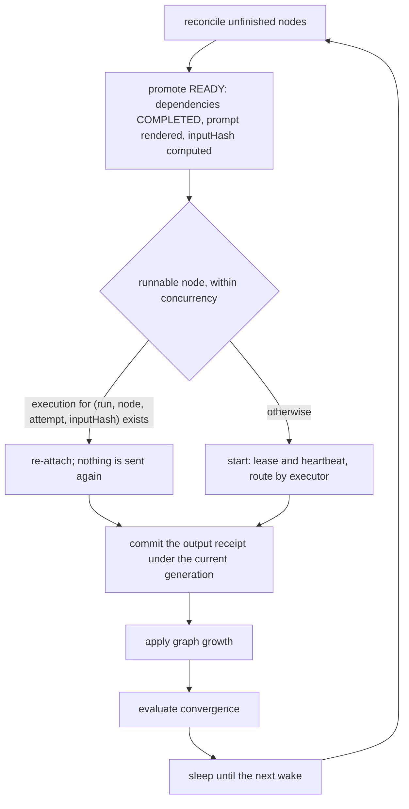
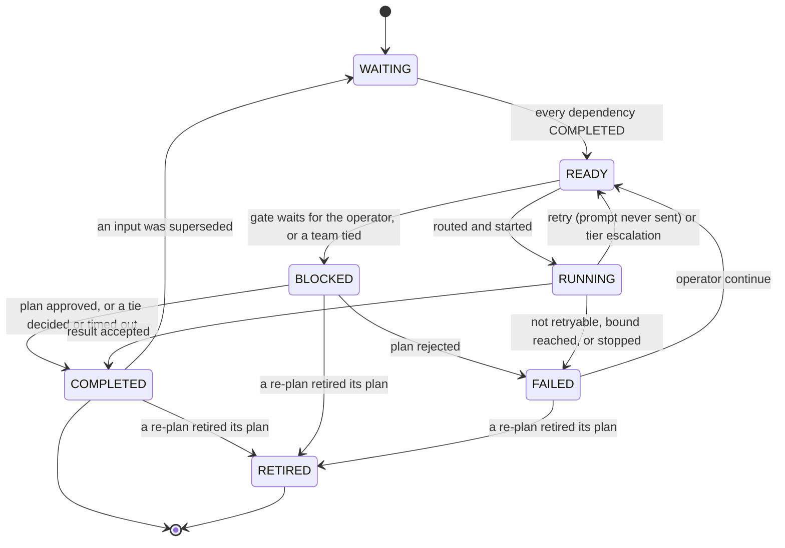
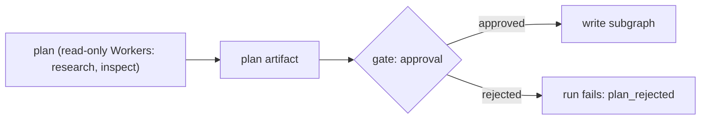

# Workflow engine

> Target state. Boundary: [orchestration](../architecture/components.md#orchestration).
> Requirements: REQ-WF-1..11. Decision: [ADR-0004](../decisions/adr/0004-single-workflow-runtime.md).
> Templates: [workflow templates](../reference/workflow-templates.md).
>
> Implemented in [`workflow`](../../packages/plugins/workflow/README.md); differs from target:
> admission has preflight and a spec hash but no provenance or confirmation step; only `worker`,
> `gate`, and `team` nodes run (a team is unrolled into `worker` steps and its `team` tally and
> decision), and one `effect`, a review's [source step](teams.md#sources); `RECOVERING` is not used;
> a scheduler exception fails the run as `internal` (`CODE_FIX`) instead of blocking it;
> handoff envelopes, the plan's side-effect classes, and convergence blocker reports are
> planned.

There is one engine, and every multi-step job runs on it as an append-only DAG
([ADR-0012](../decisions/adr/0012-dag-execution-model.md)). It combines three
ideas: a **semantic DAG** whose nodes
declare objectives and capability requirements, **durable nodes addressed by
input hash** so completed work is never redone, and **artifact lineage** so
superseded evidence invalidates dependent work.

## Admission

Lifecycle: `draft → preflight → confirm → accepted → active`.

- Each spec value carries its provenance: `user-explicit`, `interpreted`, or
  `policy-default`. Interpreted values that matter are confirmed before acceptance.
- Preflight validates the spec: acyclic, unique node ids, known executors,
  admissible capability requirements, and bounds within limits.
- The accepted spec is canonicalized and hashed. The run binds to that hash and
  to the profile version. A run keeps its resolved spec, so a template removed
  later still answers `explain` and `result` for the runs it started; a new run
  of it is refused as an unknown template.

### Variants

A template node may declare named variants:
`variants: { <name>: { objective?, prompt?, capabilities?, tier?, conversation?, acceptance? } }`.

- The caller names at most one variant at start (MCP `run` `variant`, CLI
  `system run --variant`; `research` also takes `deep`). Its fields replace the node's own before the spec is
  checked and hashed, so the chosen fields are part of the `specHash`.
- A variant the template does not define is refused with `invalid_input`:
  `template <t> has no variant <v> (it has: …)`. Nothing is sent.
- A variant changes only those six fields: it never adds a team, a planner's
  growth policy, or `differentFrom`. Each value is checked: a tier, a conversation,
  non-empty capabilities, non-empty text. Every variant is resolved when the template
  is added, so a broken variant is refused then, not at a run's start. The one variant
  today is `research`'s `deep` ([templates](../reference/workflow-templates.md#research)).

### Conversations

A node's `conversation` is `temporary` (one-shot), `persistent` or `caller` (the run's
one session, or the caller's), or `own`: a new persistent conversation of that node
alone. Nodes on the run's one session take turns. Preflight refuses two that could run
at once (`give one of them conversation: own`), since they would interleave in one
conversation and bind it to one Worker. Parallel steps that each need a persistent
conversation, such as Deep research reviews, use `own`.

### Different provider families

A template node may declare `differentFrom: [nodeId, …]`: its Worker must be of another
provider family than the Workers that served those nodes
([provider diversity](routing.md#provider-diversity), [ADR-0027](../decisions/adr/0027-provider-diversity-in-routing.md)).

- Preflight refuses a node that names itself, an unknown node, or a team node (a team has
  several Workers).
- Preflight also refuses a `differentFrom` that would make a node wait for itself: a
  mutual pair, or a named node that depends on this one.
- The node is promoted together with or after the nodes it names, never before (promotion
  repeats until nothing more is ready, so listing order never serializes branches). It runs
  only beside those nodes and waits until each has a Worker, so parallel branches still
  start together, one routing turn apart. A named node that is not running (it backs off
  before a retry) never holds it: the node gives its turn back to the run loop, and both
  run again.
- The engine reads those Workers' families from their current descriptors and routes the
  node with them as `exclude`, the reason naming the nodes (`differs from node
  literature:1`). The relation holds both ways: a node routing again (a retry, an
  escalation, a `continue`) also excludes the families of the routed nodes that name it.
  A node that routes again forgets its old Worker, so no peer differs from a stale one.
- If a named node failed, the node sends nothing and the run fails on that node. If a named
  node's Worker declares no family or is no longer listed, no Worker can be shown to differ:
  the node fails as `config_error`, with nothing sent (fail closed). With only Workers of the
  excluded families, it fails admission with the `diversity` reasons.

## Graph model

Exact shape: [`workflow-node.v1.json`](../../schemas/workflow-node.v1.json).

```ts
WorkflowNode {
  nodeId;                      // deterministic, e.g. "review:cycle:2:B:round:1:member:2"
  objective; executor: "team" | "worker" | "effect" | "gate";
  requires: CapabilityRequirement[];
  dependsOn: NodeId[];
  state: WAITING | READY | RUNNING | RECOVERING | COMPLETED | FAILED | BLOCKED | RETIRED;
  inputReceipt?:  { inputHash, dependencyOutputHashes };
  outputReceipt?: { resultId, outputHash };
  execution?:     { executionId, attempt, owner, lease, generation };
}
```

`inputHash` covers the canonical node definition, the fully rendered prompt or
input bundle, and the output hashes of its dependencies.

## Execution loop



Node lifecycle (the states of [`workflow-node.v1.json`](../../schemas/workflow-node.v1.json)):



A scheduler exception moves the run to `BLOCKED` with `CODE_FIX_REQUIRED`. It
never crash-loops.

## Graph growth

Each graph snapshot is acyclic. Loops are unrolled into new nodes with ordinal ids. Growth
comes from two sources, and both are recorded as `graph-growth` decision artifacts:

- **`plan` artifacts** emitted by a planner node (dynamic). The engine validates a plan
  (acyclic, admissible capabilities, within bounds) before appending its nodes.
- **Engine rules** (static), the same for every profile. A team's tally appends a
  **debate** and the next tally on a split vote, bounded by `debateRounds`
  ([teams](teams.md#tally-and-debate)). The other rule is **remediation**: when a node that requires the `review` capability is bound to an exact
  subject, its assessment requests changes with blocking findings, and a step it depends on
  wrote the change (`develop`), the engine appends a fix step (on that step's capabilities) and
  a re-review bound to the new subject. Whatever waited for the review waits for both. Cycles are bounded by the engine
  configuration `maxReviewCycles` (default 3, the first review included).

A profile contributes templates only; it declares no growth rules of its own.

## Plan approval gate

A subgraph that holds write authority over a subject
([INV-15](../architecture/invariants.md#inv-15-one-writer-per-subject)) is
preceded by a gate node:



- The plan lists files or targets, intended changes, side-effect classes, and a
  confidence level.
- **Auto-approve** only when policy allows it, confidence is high, and every step
  is `none` or `idempotent`. Otherwise the run waits in `BLOCKED` with
  `USER_ACTION` until the operator approves, edits, or rejects the plan through
  the CLI or Web UI.
- The approval is an `approval` artifact bound to the exact plan id. An edited
  plan is a new artifact that needs a new approval.
- A verdict names the plan the operator read. With several plans waiting, a
  verdict that names none is refused and lists them, so a plan that arrived later
  is never approved unseen. The gate is read and decided under the run's lease.

### Re-planning

A superseded input upstream of a planner, or a superseded plan itself (the
operator's edit), makes the planner plan again
([lineage](artifacts.md#lineage-and-invalidation)):

- What the superseded node, or a node that runs again, grew is **retired**,
  transitively: a planner's plan steps and gate, a review's remediation cycles,
  and what those grew. Origin decides, never the id: each grown node records the
  node that grew it (`grownBy`). A retired node stays in the graph as `RETIRED`
  (append-only, [INV-13](../architecture/invariants.md#inv-13-every-decision-is-an-artifact)),
  never runs again, and no longer counts toward the run's outcome; a
  `graph-growth` decision (`retire`) records each node's state and result, and
  whatever waited for it no longer does. Its results are never reused.
- The grower's next growth is a new generation with new ids (`plan:1:g2:…`).
- The planner reruns on its new input, or its replacement is its new plan, which
  must pass validation before anything changes. The new plan is a new artifact
  that supersedes the old one, behind a new gate, so the old approval never opens
  it ([INV-5](../architecture/invariants.md#inv-5-exact-subject-binding)).
- When a retired step that needed approval had started (it may have written),
  the new plan waits for the operator even where policy would approve it.
- A verdict on a plan that replaces another must name it, so the operator never
  approves a re-plan unseen.
- A plan's gate is never superseded: it is approved or rejected. A plan waiting
  at its gate is edited by rejecting it, then superseding the planner's result.

## Handoffs

A handoff passes an upstream result verbatim to a downstream executor, bound by
SHA-256. Along with the result, the receiver gets the **decision artifacts the
result depends on**, such as chosen options and rejected alternatives, so that
implicit decisions become explicit inputs instead of being lost between
Workers. Delivery is at least once, and acknowledgement is idempotent. Trusted
control messages, such as `START_IMPLEMENTATION` and `APPLY_REVIEWS {
expectedHeadSha }`, are separate from the model payload
([INV-6](../architecture/invariants.md#inv-6-authority-comes-from-trusted-envelopes)).

## Exact-subject gates

A review must report `reviewedSubject === currentSubject`, for example
`reviewedHeadSha === pr.headSha`. Remediation must keep the subject's identity, such
as the same PR, and must advance its version, such as a new head. The next cycle
binds to the new version. Mismatches fail the gate.

For a local agent's change, the subject is the working tree's git subject,
`git:<HEAD>:<hash of every change on top>`. The `assessment` is stored only when it
names that subject and the tree is still it, as an exact-subject `gate` decision;
otherwise the step fails as `stale_subject`.

## Artifacts, lineage, invalidation

Node results, receipts, and every engine decision (spec admission, gate, graph
growth, recovery) are artifacts. Their model, lineage, and invalidation rules are
canonical in [artifacts](artifacts.md). Every node state transition references
the decision artifact that caused it.

## Recovery

| Failure class | Disposition |
|---|---|
| transient provider / network | `IMMEDIATE` or `BACKOFF` |
| browser session or conversation broken | `RECREATE_SESSION` |
| auth lost, confirmation needed, quota; a bound conversation the site no longer has (`conversation_lost`: reopening it cannot help, and a team member's conversation holds its context) | `USER_ACTION` |
| contract violation, scheduler exception, internal programming error (`internal`) | `CODE_FIX` |
| website UI drift that self-heal could not resolve | `CONFIG_FIX` (update the UI map; [UI operations](ui-operations.md)) |
| invalid input, rejected by acceptance | `NONE` |

Attempts are bounded (default 3). The operator command `continue` reopens exactly
one `FAILED` node.

## Convergence

A run is complete only when it has no blockers. Possible blockers are unmet
criteria, open blocking findings, missing deliverables, pending authority gates,
missing receipts, incomplete dependencies, and incomplete plan tasks. Status
reports list the blockers explicitly, not just a percentage.

## Retention

The operator deletes a run at any time: a preview lists it, and deletion is keyed
on the exact `runId` and `updatedAt`. On its own, after `retainDays`, a finished
run's input and rendered prompts are cleared and the run stays. With
`retainRunsDays` set (off by default), a finished run older than that is deleted
as the operator's delete does, except the latest run of a session (a persistent
session has no closed state, and continuing it needs one of its runs); then the
artifacts that only expired runs needed are collected
([storage](artifacts.md#storage)). Each expiry is a `workflow.run.expired` event.
