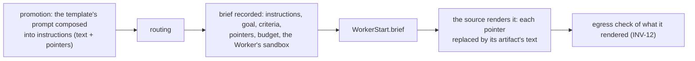
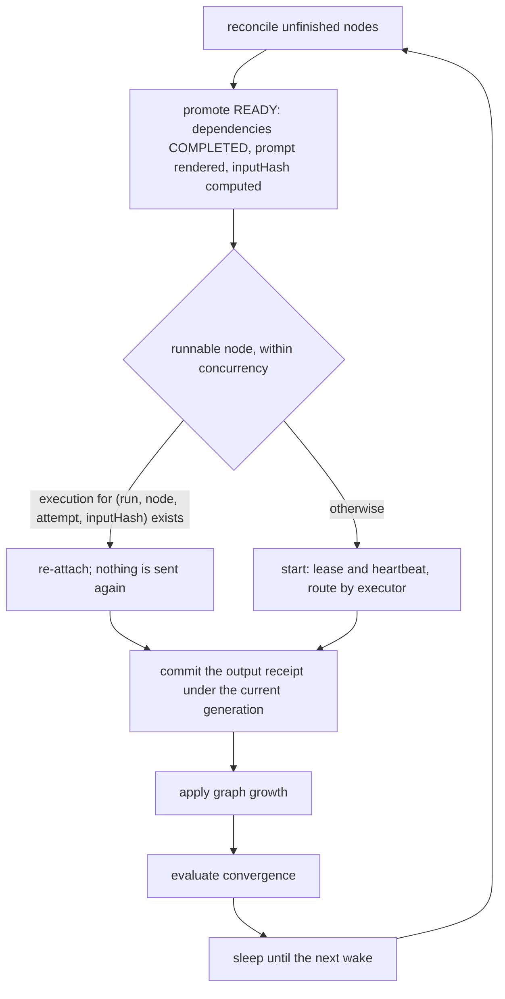
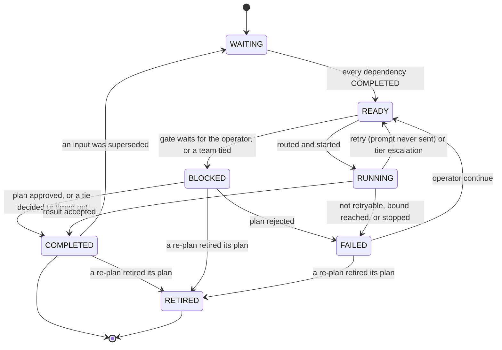
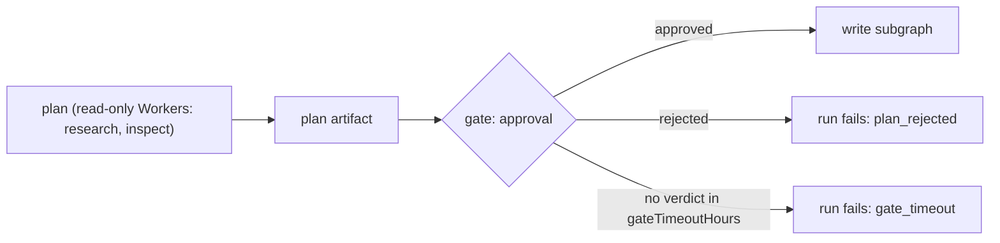
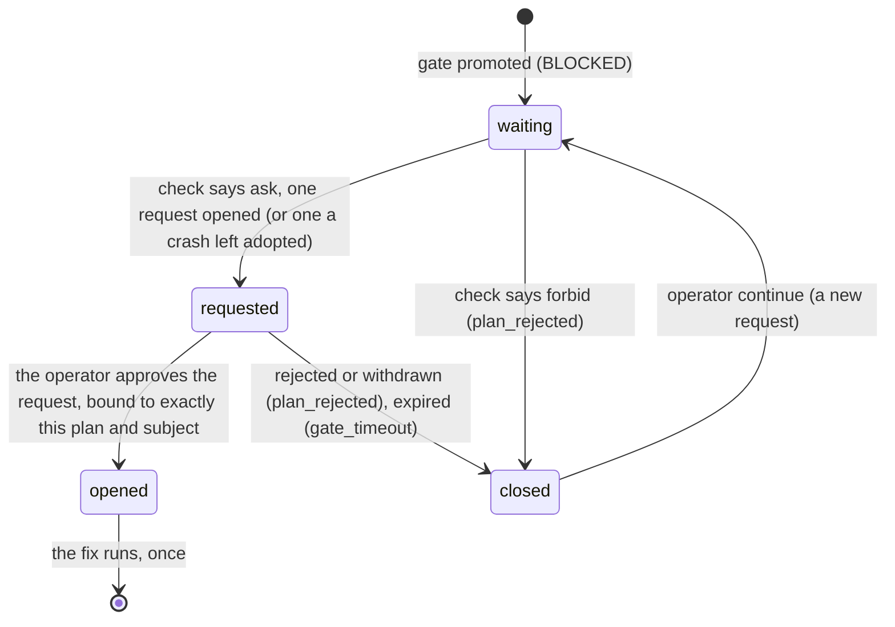
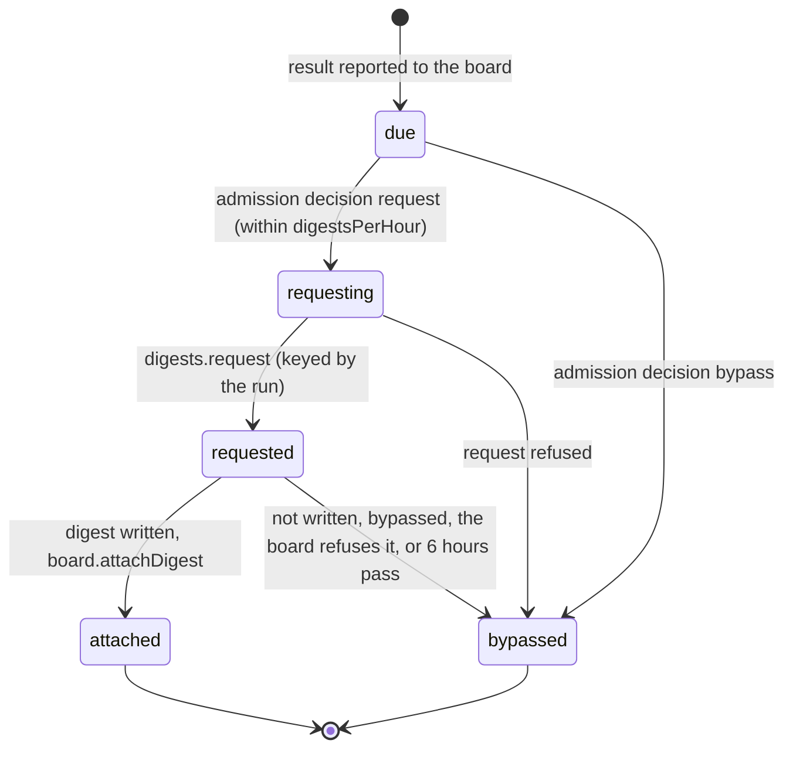

# Workflow engine

> Target state. Boundary: [orchestration](../architecture/components.md#orchestration).
> Requirements: REQ-WF-1..11. Decision: [ADR-0004](../decisions/adr/0004-single-workflow-runtime.md).
> Templates: [workflow templates](../reference/workflow-templates.md).
>
> Implemented in [`workflow`](../../packages/plugins/workflow/README.md); differs from target:
> admission has preflight and a spec hash but no provenance or confirmation step; only `worker`,
> `gate`, and `team` nodes run (a team is unrolled into `worker` steps and its `team` tally and
> decision), and one `effect`, a review's [source step](teams.md#sources); `RECOVERING` is not used;
> a scheduler exception fails the run as `internal` (`CODE_FIX`) instead of blocking it;
> handoff envelopes, the plan's side-effect classes, and convergence blocker reports are
> planned. A board task's `run.brief` is not set: each execution names its own
> [brief](#briefs). Only a remediation fix's gate asks the [approval queue](#remediation-on-the-approval-queue);
> a planner's plan gate is still the operator's `approve`.

There is one engine, and every multi-step job runs on it as an append-only DAG
([ADR-0012](../decisions/adr/0012-dag-execution-model.md)). It combines three
ideas: a **semantic DAG** whose nodes
declare objectives and capability requirements, **durable nodes addressed by
input hash** so completed work is never redone, and **artifact lineage** so
superseded evidence invalidates dependent work.

## Admission

Lifecycle: `draft → preflight → confirm → accepted → active`.

- Each spec value carries its provenance: `user-explicit`, `interpreted`, or
  `policy-default`. Interpreted values that matter are confirmed before acceptance.
- Preflight validates the spec: acyclic, unique node ids, known executors,
  admissible capability requirements, and bounds within limits.
- The accepted spec is canonicalized and hashed. The run binds to that hash and
  to the profile version. A run keeps its resolved spec, so a template removed
  later still answers `explain` and `result` for the runs it started; a new run
  of it is refused as an unknown template.
- Two bounds admit a run (INV-9). Both refuse with `overloaded` and say which one was hit.
  - `maxActiveRuns` bounds the unfinished runs that execute.
  - A run whose only unfinished work waits on someone is not one of them. Such a run has a
    `BLOCKED` node (a gate's approval or a tie's vote) and no `READY` or `RUNNING` node.
    These runs count against `maxWaitingRuns`: with `maxActiveRuns + maxWaitingRuns`
    unfinished runs in all, no new run is admitted.
  - An approval or a vote is never refused to free a slot. A run it resumes can push the
    executing runs above `maxActiveRuns` until they finish, never above the sum.

### Variants

A template node may declare named variants:
`variants: { <name>: { objective?, prompt?, capabilities?, tier?, conversation?, acceptance? } }`.

- The caller names at most one variant at start (MCP `run` `variant`, CLI
  `system run --variant`; `research` also takes `deep`). Its fields replace the node's own before the spec is
  checked and hashed, so the chosen fields are part of the `specHash`.
- A variant the template does not define is refused with `invalid_input`:
  `template <t> has no variant <v> (it has: …)`. Nothing is sent.
- A variant changes only those six fields: it never adds a team, a planner's
  growth policy, or `differentFrom`. Each value is checked: a tier, a conversation,
  non-empty capabilities, non-empty text. Every variant is resolved when the template
  is added, so a broken variant is refused then, not at a run's start. The one variant
  today is `research`'s `deep` ([templates](../reference/workflow-templates.md#research)).

### Conversations

A node's `conversation` is `temporary` (one-shot), `persistent` or `caller` (the run's
one session, or the caller's), or `own`: a new persistent conversation of that node
alone. Nodes on the run's one session take turns. Preflight refuses two that could run
at once (`give one of them conversation: own`), since they would interleave in one
conversation and bind it to one Worker. Parallel steps that each need a persistent
conversation, such as Deep research reviews, use `own`.

### Different provider families

A template node may declare `differentFrom: [nodeId, …]`: its Worker must be of another
provider family than the Workers that served those nodes
([provider diversity](routing.md#provider-diversity), [ADR-0027](../decisions/adr/0027-provider-diversity-in-routing.md)).

- Preflight refuses a node that names itself, an unknown node, or a team node (a team has
  several Workers).
- Preflight also refuses a `differentFrom` that would make a node wait for itself: a
  mutual pair, or a named node that depends on this one.
- The node is promoted together with or after the nodes it names, never before (promotion
  repeats until nothing more is ready, so listing order never serializes branches). It runs
  only beside those nodes and waits until each has a Worker, so parallel branches still
  start together, one routing turn apart. A named node that is not running (it backs off
  before a retry) never holds it: the node gives its turn back to the run loop, and both
  run again.
- The engine reads those Workers' families from their current descriptors and routes the
  node with them as `exclude`, the reason naming the nodes (`differs from node
  literature:1`). The relation holds both ways: a node routing again (a retry, an
  escalation, a `continue`) also excludes the families of the routed nodes that name it.
  A node that routes again forgets its old Worker, so no peer differs from a stale one.
- With `allowSameFamily` on ([ADR-0029](../decisions/adr/0029-opt-in-same-family-fallback.md)), a
  node that no Worker of another family admits routes again without the exclusion (a team
  member, also without the distinct-account rule; a session's own Worker still binds it). The
  fallback is an `admission` decision (`workflow.same-family`, outcome `same-family`) kept among
  the node's decisions, and the run's answer starts with a line naming those steps (`Same
  provider family (allowSameFamily): …`; a team says it in its own answer). Off by default:
  then the node fails as above.
- If a named node failed, the node sends nothing and the run fails on that node. If a named
  node's Worker declares no family or is no longer listed, no Worker can be shown to differ:
  the node fails as `config_error`, with nothing sent (fail closed). With only Workers of the
  excluded families, it fails admission with the `diversity` reasons.

## Briefs

Every Worker execution the engine starts is given a `brief@1.1`
([`brief`](../reference/schemas.md#brief)): an `objective` artifact recorded before the execution
starts, in the transaction that starts it, and named by it (`workflow-node@1.2`
`execution.brief`, the node's view, and the `workflow.node.started` event). The engine composes
the record; the Worker source renders it into its own prompt
([PROP-0010](../proposals/0010-base-version.md),
[ADR-0040](../decisions/adr/0040-briefs-on-the-workers-and-workflow-seams.md)).



- **Composed at promotion.** When a node becomes `READY`, its template's prompt becomes the
  brief's `instructions`: the template's text and the caller's input as text, and every
  dependency's result (`{{node:<id>}}`) and each planned step's result under its objective
  (`{{grown}}`) as a pointer by content id, role `input`. The input hash covers the text these
  instructions render to, so a node's execution key is what it was.
- **Recorded at the start.** After routing, the brief takes the routed Worker's confinement:
  `sandbox` as its source declares it (`WorkerSource.sandbox`), or, for a source that declares
  none, a Worker that runs nothing here: read-only, no commands, network only as the egress
  policy allows. Its `goal` is the node's objective and its `acceptance` names the node's
  contract, result schema, and exact subject; a node of a board task's run takes the task's goal
  and criteria instead ([below](#a-board-tasks-brief)). A node on a session the Worker keeps
  natively names that session (`resume`). Its classification is the run's, raised to the
  strictest artifact it points at, and its envelope's inputs are every pointer, so an unknown
  pointer is refused (INV-12). A plain run's budget is empty.
- **Rendered by the source.** The start names the brief (`WorkerStart.brief`); the source reads
  it at start, resolves each pointer to its artifact's text (the body's `text`, else its
  canonical JSON), and renders its prompt: the website, model, and agent sources share the
  default text rendering (`renderBrief` in [libs](../../packages/libs/README.md)). It checks
  egress on what it rendered at the requirement's classification, the work's own, as for any
  prompt (a brief's record may be stricter for storage: a website answer is stored
  `local-private`, and was always forwarded at the run's classification). A brief it cannot render (a pointer no longer stored) refuses the start as
  `invalid_input`, with nothing sent. Admission measures the length of that rendering
  ([ADR-0032](../decisions/adr/0032-admission-refuses-input-longer-than-a-worker-takes.md)).
- **What the Worker reads.** For a plain run, exactly the prompt the template words: the
  instructions in order, each pointer replaced verbatim and never expanded again. A brief for a
  board task, or one without instructions, first states the task and attempt, the goal, the
  acceptance criteria, and open questions; pointers the instructions do not place follow
  (`Read these too`), each with its role and note.
- **Pointers, never content.** The text of the instructions is the template's, the caller's, and
  what the engine composes: a team's ballot and debate prompt, which quotes its peers' sealed
  records as the [teams](teams.md) protocol does; a remediation step's prompt, which quotes the
  review's findings; a result schema; a review's exact subject with its diff. No dependency's
  result is copied in.
- **Retention.** A finished run's composed instructions are cleared with its prompts after
  `retainDays`. Its briefs are artifacts of the run: they stay until the run is deleted
  (`retainRunsDays`), the caller's input in them included.

### A board task's brief

A run for a [board task](#board-tasks) fixes, when it is admitted, what every brief it writes
adds: the project, the task, and the attempt the run will be; the task's goal and acceptance
criteria; the task's budget lines less the usage spent on the task (with no ledger, the lines as
declared: the brief informs, reservations enforce); and at most 16
pointers, never content: the accepted results of the tasks it depends on (their digests when
they have one, role `input`), and on a later attempt the previous attempt's result (`prior`) and
the decision behind this attempt (`review`: a rejection's reasons, the answers to its questions).

**Usage spent on a task.** The [ledger](resources.md) counts usage by run: a record names the
task (or the run was reserved for it), the workflow run, or the Worker's own execution (an agent
Worker's run id). The engine knows which runs served the task (`workflow_tasks`) and which
executions they started (each start's `workflow.node.started` event, and each node's current
execution), so it reads the ledger for the task and for each of those ids, counts each record
once by its `(source, requestId)`, and totals it per line: `tokens` input plus output, `usd` the
cost, `turns`, `runs` one per record; `minutes` stay as declared. A run deleted by retention no
longer counts. This informs the brief; it reserves and blocks nothing (the engine does not
reserve per task yet).

**Resume from a brief.** A task's next attempt, or the first attempt of a task that depends on
exactly one other (a chain), resumes the session of the run before it when:

- the template keeps a conversation across its steps (a node on the run's session);
- that session's Worker keeps a native session (`ctx.workers.handle`) and can resume it now: it
  is listed, ready or busy, and proves `persistent-conversation`;
- the session has served fewer than `maxSessionRuns` runs (default 5, INV-9).

The run then continues that session, and the new brief is its next message, so the Worker keeps
the context it built (an agent Worker resumes its SDK session). Otherwise the run starts a fresh
session, given the brief, which points at the earlier work. The choice is an `admission`
decision (`workflow.task-session`) whose detail names the run and session it resumed from, made
before the task is taken, so a failure there claims nothing. A caller that names a session keeps
it.

## Graph model

Exact shape: [`workflow-node.v1.json`](../../schemas/workflow-node.v1.json).

```ts
WorkflowNode {
  nodeId;                      // deterministic, e.g. "review:cycle:2:B:round:1:member:2"
  objective; executor: "team" | "worker" | "effect" | "gate";
  requires: CapabilityRequirement[];
  dependsOn: NodeId[];
  state: WAITING | READY | RUNNING | RECOVERING | COMPLETED | FAILED | BLOCKED | RETIRED;
  inputReceipt?:  { inputHash, dependencyOutputHashes };
  outputReceipt?: { resultId, outputHash };
  execution?:     { executionId, attempt, owner, lease, generation };
}
```

`inputHash` covers the canonical node definition, the fully rendered prompt or
input bundle, and the output hashes of its dependencies.

## Execution loop



Node lifecycle (the states of [`workflow-node.v1.json`](../../schemas/workflow-node.v1.json)):



A scheduler exception while a node executes fails that node as `internal` with
disposition `CODE_FIX`, and the run fails on it. Once the code is fixed, the operator's
`continue` reopens the node. It never crash-loops. A node whose Worker source is no longer
registered (its row is off) fails as `config_error`. Its execution is never guessed at. Once
the row is back on, `continue` runs the node again as a new attempt, recorded as the operator's
decision.

## Graph growth

Each graph snapshot is acyclic. Loops are unrolled into new nodes with ordinal ids. Growth
comes from two sources, and both are recorded as `graph-growth` decision artifacts:

- **`plan` artifacts** emitted by a planner node (dynamic). The engine validates a plan
  (acyclic, admissible capabilities, within bounds) before appending its nodes.
- **Engine rules** (static), the same for every profile. A team's tally appends a
  **debate** and the next tally on a split vote, bounded by `debateRounds`
  ([teams](teams.md#tally-and-debate)). The other rule is **remediation**: when a node that requires the `review` capability is bound to an exact
  subject, its assessment requests changes with blocking findings, and a step it depends on
  wrote the change (`develop`), the engine appends a fix step (on that step's capabilities) and
  a re-review bound to the new subject. The fix writes, so it waits behind a gate for a person's
  approval of exactly that fix (a `plan` artifact), never approved by policy
  ([ADR-0028](../decisions/adr/0028-local-lead-final-authority.md), INV-15): through the
  approval queue ([below](#remediation-on-the-approval-queue)), or, with none loaded, the
  operator's plan gate. Each cycle is grown by the review that asked for it, so
  superseding an earlier fix retires the later cycles with the review that runs again.
  Whatever waited for the review waits for all three. Cycles are bounded by the engine
  configuration `maxReviewCycles` (default 3, the first review included).

A profile contributes templates only; it declares no growth rules of its own.

## Plan approval gate

A subgraph that holds write authority over a subject
([INV-15](../architecture/invariants.md#inv-15-one-writer-per-subject)) is
preceded by a gate node:



- The plan lists files or targets, intended changes, side-effect classes, and a
  confidence level.
- **Auto-approve** only when policy allows it, confidence is high, and every step
  is `none` or `idempotent`. Otherwise the run waits in `BLOCKED` with
  `USER_ACTION` until the operator approves, edits, or rejects the plan through
  the CLI or Web UI, for at most `gateTimeoutHours` (default 24; INV-9). Then the
  gate closes by rule and the run fails as `gate_timeout`; `continue` waits again.
- The approval is an `approval` artifact bound to the exact plan id. An edited
  plan is a new artifact that needs a new approval.
- A verdict names the plan the operator read. With several plans waiting, a
  verdict that names none is refused and lists them, so a plan that arrived later
  is never approved unseen. The gate is read and decided under the run's lease.

### Remediation on the approval queue

A remediation fix's gate is the one gate the [approval queue](approvals.md) decides: the
remediation is a `remediation` action, which always asks (`ALWAYS_ASK`). A planner's plan gate
stays the operator's (`approve`).



| Step | Records | On failure |
|---|---|---|
| put to the queue | `approvals.check({ class: 'remediation' })` (the run's project for a board task's run), then one `approvals.request` on the exact subject `{ type: artifact, ref: <plan content id>, version: <the reviewed subject, git:<HEAD>:<hash>> }` (that subject's content id when it is longer than 128 characters), requester `workflow` with the run and the gate; a `gate` decision `wait` (rule `workflow.remediation-approval`) naming the request; the request id on the gate's row; `workflow.gate.requested`. The gate then waits until the request's `expiresAt`, the policy's wait for `remediation` | the queue unreadable: the gate waits, logged, until its deadline closes it (`gate_timeout`); any mode but `ask`: the gate closes (`plan_rejected`), and nothing is asked |
| a crash before the request id is stored | on restart, the gate adopts its own open or approved request on the same subject (requester, run, gate, class) instead of opening a second one (INV-4) | — |
| approved | a `gate` decision `open` naming the request and the operator's `approval@1.0`, which becomes the gate's result; `workflow.gate.opened` (`by: queue`) | a request that does not bind this gate's plan, subject, run, and node closes the gate (`plan_rejected`, INV-5) |
| rejected (verdict, withdrawal) or expired | a `gate` decision `closed`; the run fails as `plan_rejected`, or `gate_timeout` for an expiry; `workflow.gate.closed` (`by: queue`) | — |
| no verdict by the deadline | the gate closes (`gate_timeout`) even if the queue's own sweep has not yet expired the request, and withdraws it | a withdrawal that fails leaves the request to expire on its own |

- The engine reads the queue while the run waits, every `approvalPollSeconds` (default 15,
  INV-9), under the run's lease. Nothing runs on a request that is not approved.
- The gate's view (`blocked`) names `approvalRequest`, and the operator decides it in the queue
  (`/ui`, MCP `approvals_decide`). The engine's `approve` refuses such a gate, so a verdict has
  one channel.
- `continue` on the closed gate reopens it, and it asks again on a new request; `stop` withdraws
  the request nothing waits on any more.
- **Without `ctx.approvals`** the gate is the operator's plan gate below, waiting for `approve`
  until `gateTimeoutHours`: it is never approved by policy, even under `autoApprovePlans` (INV-2).
  The choice is made each time the gate waits, so a queue loaded later takes the gate over.

### Re-planning

A superseded input upstream of a planner, or a superseded plan itself (the
operator's edit), makes the planner plan again
([lineage](artifacts.md#lineage-and-invalidation)):

- What the superseded node, or a node that runs again, grew is **retired**,
  transitively: a planner's plan steps and gate, a review's remediation cycles,
  and what those grew. Origin decides, never the id: each grown node records the
  node that grew it (`grownBy`). A retired node stays in the graph as `RETIRED`
  (append-only, [INV-13](../architecture/invariants.md#inv-13-every-decision-is-an-artifact)),
  never runs again, and no longer counts toward the run's outcome; a
  `graph-growth` decision (`retire`) records each node's state and result, and
  whatever waited for it no longer does. Its results are never reused.
- The grower's next growth is a new generation with new ids (`plan:1:g2:…`).
- The planner reruns on its new input, or its replacement is its new plan, which
  must pass validation before anything changes. The new plan is a new artifact
  that supersedes the old one, behind a new gate, so the old approval never opens
  it ([INV-5](../architecture/invariants.md#inv-5-exact-subject-binding)).
- When a retired step that needed approval had started (it may have written),
  the new plan waits for the operator even where policy would approve it.
- A verdict on a plan that replaces another must name it, so the operator never
  approves a re-plan unseen.
- A plan's gate is never superseded: it is approved or rejected. A plan waiting
  at its gate is edited by rejecting it, then superseding the planner's result.

## Handoffs

A handoff passes an upstream result verbatim to a downstream executor, bound by
SHA-256. Along with the result, the receiver gets the **decision artifacts the
result depends on**, such as chosen options and rejected alternatives, so that
implicit decisions become explicit inputs instead of being lost between
Workers. Delivery is at least once, and acknowledgement is idempotent. Trusted
control messages, such as `START_IMPLEMENTATION` and `APPLY_REVIEWS {
expectedHeadSha }`, are separate from the model payload
([INV-6](../architecture/invariants.md#inv-6-authority-comes-from-trusted-envelopes)).

## Exact-subject gates

A review must report `reviewedSubject === currentSubject`, for example
`reviewedHeadSha === pr.headSha`. Remediation must keep the subject's identity, such
as the same PR, and must advance its version, such as a new head. The next cycle
binds to the new version. Mismatches fail the gate.

For a local agent's change, the subject is the working tree's git subject,
`git:<HEAD>:<hash of every change on top>`. The `assessment` is stored only when it
names that subject and the tree is still it, as an exact-subject `gate` decision;
otherwise the step fails as `stale_subject`. A tree that can no longer be captured
(removed, or no longer a repository) fails the review step as `stale_subject` before it
runs, with an exact-subject `gate` decision of its own: a review never runs unbound.
The working tree is the one the writer's
result names: with agent Workers configured `worktreePerRun`, the run's own git worktree,
which its writers and reviewers share ([workspaces](agent-runtimes.md#workspaces)). Every
execution the engine starts names its run (`WorkerStart.runId`) for this.

## Artifacts, lineage, invalidation

Node results, receipts, and every engine decision (spec admission, gate, graph
growth, recovery) are artifacts. Their model, lineage, and invalidation rules are
canonical in [artifacts](artifacts.md). Every node state transition references
the decision artifact that caused it.

## Recovery

| Failure class | Disposition |
|---|---|
| transient provider / network | `IMMEDIATE` or `BACKOFF` |
| browser session or conversation broken | `RECREATE_SESSION` |
| auth lost, confirmation needed, quota; a bound conversation the site no longer has (`conversation_lost`: reopening it cannot help, and a team member's conversation holds its context) | `USER_ACTION` |
| contract violation, scheduler exception, internal programming error (`internal`) | `CODE_FIX` |
| website UI drift that self-heal could not resolve | `CONFIG_FIX` (update the UI map; [UI operations](ui-operations.md)) |
| invalid input, rejected by acceptance | `NONE` |

Attempts are bounded (default 3). The operator command `continue` reopens exactly
one `FAILED` node.

**Failover** ([ADR-0034](../decisions/adr/0034-unsent-failover-to-a-sibling-account.md)). A
node that failed with `quota_exhausted`, `challenge`, `reauth_required`, or `overloaded` before
anything was sent (the execution reports `submitted: false`) is routed again with the failed
Worker left out, and the Workers that share its runtime (the other tiers of its account, as its
source's `siblings` names them), within its attempts: the `recovery` decision's outcome is `failover`, naming the
Worker it leaves (`from`) and that nothing was sent. The Workers left out are kept on the node
row (`excluded`), so a restart keeps them; `continue` clears them. The router records each as the
`excluded` check. With no Worker left but those, the node routes as before: an overload waits its
back-off and retries there, while an account that hit a limit or needs the operator is refused
by its own state or cooldown, and the node fails with that kind. A node never fails over:

- once its prompt may have been sent: reconciliation and the dispositions above apply (INV-4);
- when its session holds an account: a turn of it was sent, or it has a conversation (a session
  whose turns all failed unsent holds none);
- as a team member, which joins its team bound to the Worker of its first admission (Model A).

A bare `ask` outside a run has no recovery and fails as before.

### A deferred tool call

A Worker whose tool gate deferred a call on an approval request stops there, and its execution
fails as `config_error` naming the request: the workers seam has no waiting status
([approvals](approvals.md#a-deferred-call)). Its node fails, and so does the run. When the
operator approves that request, the engine continues the session by itself, once:

- **Noted when the node fails.** In the transaction that fails the node, the engine reads which
  request the execution deferred on from the Worker gate's own record of it (the
  `agent-workers.tool.deferred` event: the execution and the request id) and keeps it
  (`workflow_deferrals`). Only a sent execution that failed as `config_error`, on a node with a
  session, of a run that serves no board task (the board decides a task's next attempt).
- **Read from the queue** every `approvalPollSeconds` (default 15, INV-9), and once at start,
  through `ctx.approvals.get` only. Open, it waits; rejected (a verdict, an expiry, a
  withdrawal), nothing is continued; with no queue loaded, it waits.
- **Approved**, and the request is exactly that call's (requester `worker`, the deferred
  execution as its run, the node's session, an operator verdict): under the run's lease, in one
  transaction, the deferral is settled, a `recovery` decision `continue` (rule
  `workflow.approved-call`) names the request and the approval, and the node is reopened as a
  new attempt on the same session. Its instructions end with a line saying the operator approved
  the call it stopped at (the request id), so the input hash, the execution key, and the brief
  are new; the Worker resumes its native session and makes the call, which its gate lets run
  once. `workflow.run.continued` (`by: rule`) names the request.
- **At most once per approval:** a settled deferral continues nothing again, here or in another
  process. A run that moved on first (the operator continued, stopped, or deleted it, or another
  node failed beside it) is settled with nothing run; the operator decides it as before.

## Board tasks

A run may serve one attempt of one [board task](board.md): the start names the task, and the
claim a lead hands over (holder and generation): MCP `run`'s `task`, or `system run --task <taskId>
[--holder <owner> --generation <n>]` ([CLI](../reference/cli.md#work)). The engine is that run's owner on `ctx.board`,
an optional seam it reaches through the abstract `Board` only; without a board, a run for a task
is refused (`config_error`), and every other run is unaffected.

- **Taking the task.** Every check that needs no write runs first, and the admission bounds.
  Then the engine adopts the caller's live claim, proven by a renewal the board fences by
  generation, or claims the ready task as `workflow:<runId>`. The choice is an `admission`
  decision (`workflow.task-admission`). A task not ready, a stale claim, or a board refusal is
  one too (`refuse`), and refuses the start with no run left and nothing sent. A task that names
  a template runs only that template, and its run is classified at least as strictly as its
  project ([INV-12](../architecture/invariants.md#inv-12-data-egress-is-explicit)).
- **Briefs.** Every execution of the run is briefed from the task
  ([a board task's brief](#a-board-tasks-brief)); its next attempt may resume this run's session.
- **Run first, then work.** The run is written `starting`, the board records it (`start`, with
  the holder's generation), and only then is it opened and scheduled. A restart in between is
  decided by the board's record: recorded, the run goes on; still claimed under its generation,
  the start is asked again; otherwise the run is abandoned (`task_not_started`), nothing of it
  having run.
- **While it lives**, the engine renews the task's lease at a third of what the board granted
  (`leases.maxTtlMs` caps it), also while the run waits on a gate or a vote. When the board
  refuses the generation (the lease lapsed across a restart, say), a `recovery` decision
  (`workflow.task-holder`, `wind-down`) stops new work: executions in flight are reconciled and
  their results taken, nothing new is routed or started, and what is left fails as
  `holder_lost` ([INV-4](../architecture/invariants.md#inv-4-restart-is-reconciliation-not-replay),
  [INV-15](../architecture/invariants.md#inv-15-one-writer-per-subject)).
- **The result** of a completed run is bound to the exact subject the task leaves: the subject
  it `writes`, at the version the latest result on that type and ref names (still current when
  it names a working tree), else the result artifact itself. A result that binds to none fails
  the run as `stale_subject` (a `gate` decision, `workflow.task-subject`). The engine's
  `acceptance` decision (`workflow.task-acceptance`) names the task, the run, the subject, and
  the checks the run itself ran: `schema` when the final step's answer was checked against its
  result schema, `review` when an exact-subject review of that subject passed its gate (passed
  when it approved). Every result artifact is among its inputs. It accepts unless a check the
  run ran failed, which rejects: the work goes back as another attempt.
- **The report** is the board's own move, read against the board's record first, so a report
  repeated after a crash moves nothing twice. With its holder, a completed run's result is
  submitted, then its acceptance applied; when only the operator may accept it (a required check
  not reported), the board holds the review for the operator
  ([required checks](board.md#required-checks-bind-at-acceptance)). A failed or stopped run, and
  a completed run whose holder was lost, is reported with `reconcileRun`, after a
  `reconciliation` decision. A task that no longer waits on the run takes no report. A board
  that does not answer is asked again, with a bounded backoff.
- A run that served an attempt is that attempt: `continue` and `supersede` refuse it, since the
  board decides the next attempt, which runs as a new run. It is not deleted or expired before
  its outcome is reported.
- **After the report**, a result that reached the board is digested
  ([below](#a-digest-of-a-tasks-result)).

### A digest of a task's result

Every result returned to the lead passes through a digest
([PROP-0008](../proposals/0008-studio-operating-model.md#mechanism-1-the-digest-layer)). Once a
run's result reached its task (the report accepted it, rejected it, held it for the operator, or
`reconcileRun` reported it completed), the engine asks [`ctx.digests`](digests.md), when loaded,
for a digest of the result's artifacts, and sets it on the task's `result.digest` through the
board's own [`attachDigest`](board.md#a-digest-on-a-result). A dependent task's brief, and the
next attempt's, then point at the digest instead of the raw result
([a board task's brief](#a-board-tasks-brief)). A digest is a capability (ADR-0036): it never
blocks, changes, or replaces an acceptance, and a result with none is complete.



| From → to | Records | On failure |
|---|---|---|
| — → due | in the transaction that reports the run: the run's `workflow_tasks` row | — |
| due → requesting / bypassed | an `admission` decision (`workflow.task-digest`, `request` or `bypass`, every candidate with why; inputs: the result's artifacts), and the time that counts against the bound, in one transaction | no digest provider loaded, `digestsPerHour` 0, or as many requested in the last hour: bypassed |
| requesting → requested | the request's id; the request is keyed `workflow-task:<runId>`, so asking again after a crash returns it | a refused request (`invalid`, `overloaded`): bypassed |
| requested → attached | the board's `attachDigest`; the `workflow.task.digest` event naming the digest's settling decision | not written or bypassed (the digest's own decision says why), the board refuses it (a next attempt started, say), or no settlement within 6 hours of asking: bypassed |

- **Bounded** (INV-9): one request per run, which is one attempt; at most `digestsPerHour`
  (default 6) asked for in any hour across runs; a wait of at most 6 hours. A digest seam or board
  that is not loaded is looked for again every 30 seconds within that bound.
- **Fails open** (ADR-0036): every bypass leaves `result.digest` unset and records why, in the
  view's `task.digest` and the `workflow.task.digest` event; nothing waits on it.
- **Restart** (INV-4): where it stands is on the run's row; the bound is taken and the decision
  recorded before the request, and the request is idempotent by its key, so a restart asks once
  and goes on waiting.
- The engine reaches `ctx.digests` and `attachDigest` through their definitions only: with the
  digest row off, or a board at contract 1.0, results keep no digest.

## A plain run's acceptance

A run that serves no board task applies nothing: its result is not accepted onto a task, merged,
or deployed. When such a run wrote (a `develop` step completed), the engine records, before the
run completes, an `acceptance` decision (rule `workflow.run-acceptance`, under the final step,
so `explain` shows it) naming the autonomy policy's required checks it did not pass:

- the policy is asked about `workspace-write` with the checks the run ran on its result, as the
  board's acceptance names them (`schema`, `review` on the subject its writing left); its
  `failedChecks` are recorded as pending (`pendingChecks`), with the policy's `autonomy`
  decision. Under the bundle's studio policy these are `tests` and `lint`, which a Worker's tool
  calls left pending ([approvals](approvals.md#a-verdict-is-not-yet-a-permission));
- they never block the run, and the run is never held for them: they bind where its result is
  applied, as a [board task's acceptance](board.md#required-checks-bind-at-acceptance) binds
  them;
- with no `ctx.approvals` loaded, or one that cannot be read, the decision says the pending
  checks are not known (`pendingChecks: unknown`), and the run completes all the same.

A run that wrote nothing gets no such decision.

## Convergence

A run is complete only when it has no blockers. Possible blockers are unmet
criteria, open blocking findings, missing deliverables, pending authority gates,
missing receipts, incomplete dependencies, and incomplete plan tasks. Status
reports list the blockers explicitly, not just a percentage.

## Retention

The operator deletes a run at any time: a preview lists it, and deletion is keyed
on the exact `runId` and `updatedAt`. On its own, after `retainDays`, a finished
run's input and rendered prompts are cleared and the run stays. After
`retainRunsDays` (default 30, the turns' own retention; 0 keeps every run), a finished run is deleted
as the operator's delete does, except the latest run of a session (a persistent
session has no closed state, and continuing it needs one of its runs); then the
artifacts that only expired runs needed are collected
([storage](artifacts.md#storage)). Each expiry is a `workflow.run.expired` event, and each
sweep that expires runs is one `workflow.retention.swept` event and log line with how many runs
it expired and conversations it released; `system health` notes it (`retention`, never
degraded).
A model Worker's session transcript lives as long as its session: it is deleted when the run's
release reaches it, never by the model calls' own `retainDays`
([models](models.md#sessions)).
A deleted or expired run releases the Worker sessions its nodes used that no remaining run
uses (`ctx.workers.release`), in the same transaction, so the website conversations they
created are deleted on their sites
([conversation ledger](provider-turns.md#conversation-ledger)).
