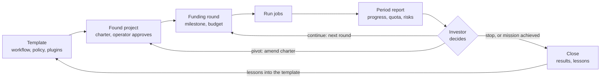
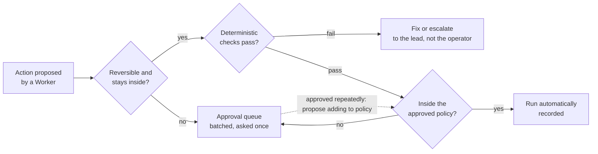

# Proposal: `system` as a startup template — resources, trust, and evolution

## Problem

The operator holds several subscriptions per provider (Claude Max, ChatGPT Plus,
Gemini Pro) plus API access to several providers. Today these are separate tools:
quota on one plan resets unused while another is exhausted; research that runs for
days and algorithm work that iterates for weeks have no shared memory across
sessions; delegating work means either watching it or re-reading everything it
produced; and the tooling that makes agents cheaper changes every few months.

The design already has strong invariants and a working team review, but it has no
first-class notion of resources, no shared board across runs, no rule for when a
person must be asked, and no defined way for better plugins to replace current ones.

## Goals

In priority order:

| # | Goal | What `system` does | Mechanism in this proposal |
|---|---|---|---|
| 1 | Use paid resources fully | knows what each plan has left and when it resets; moves background work into windows about to reset; picks the cheapest source able to do the job | resource ledger, shadow prices, tier taxonomy |
| 2 | Fit existing workflows | each workflow is a plugin template; the core does not change | task board, per-job teams, digests |
| 3 | Delegate with confidence and see progress | plans and policy approved once; one-screen board and digest; interruptions only when needed | autonomy matrix, batched approval queue, Claude as lead |
| 4 | Evolve | Workers, models, optimization plugins, and workflows are replaceable; new plugins enter through a measured gate | plugin manifest, lifecycle from candidate to default, task suite |
| 5 | Optimize the agreed criteria | maximize accepted results per unit of user attention, subject to correctness and context, at minimum token cost | residency cost, token economics |

## Non-goals

- **Not an agent.** `system` does not write code in place of Claude Code or Codex;
  native subagents do local coding.
- **Not a model router or a UI.** Model routing inside one agent is left to tools
  such as claude-code-router; the board exports formats that kanban tools read.
- **Not competing with native features.** `research` and `review` are packaged as a
  Claude Code subagent and a Codex custom agent.

## Evidence and research

- [design-review-2026-10-22.md](../research/design-review-2026-10-22.md): review of the
  current design, production multi-agent lessons (Anthropic, Cognition, Manus, MAST),
  neighbouring projects, and where tokens are wasted.
- [provider-context-and-caching.md](../research/provider-context-and-caching.md): how
  context and prompt caching work at Claude, OpenAI, and Gemini, and the rules that follow.
- [jev-decision-model.md](../research/jev-decision-model.md) and
  [PROP-0002](0002-decision-assisted-routing.md): the decision seam reused by intake.
- [PROP-0007](0007-account-pools.md): account pools and cooldowns, which the resource
  ledger generalizes.

**Terms caution.** Max is a personal plan. One person using several accounts of the
same plan to pool limits may breach the provider's terms. Each plan's terms must be
checked before its accounts enter scheduling, and official channels (CLIs signed in
with a subscription, or APIs) are preferred.

## Proposed design

### Purpose and positioning

`system` turns a scattered set of AI resources into **one continuous working
capacity**: hand work over, know what the system is doing, and receive results that
can be trusted, while every paid plan is used to its full value. Intelligence stays
in agents and plugins; `system` is the layer that coordinates, verifies, and remembers.

| Source | Channel | Proposed role |
|---|---|---|
| Claude Max | app, Claude Code signed in with the plan | lead; coding; architecture and security review |
| ChatGPT Plus | ChatGPT web, Codex CLI | second coding Worker; research; reviewer from another provider |
| Gemini Pro | Gemini app, Gemini CLI | research and long-document reading; reviewer from another provider |
| APIs of several providers | API | tiers `reflex` and `economy`; digest and intake; Workers for `local-private` data where policy allows |

Claude limits are a rolling 5-hour session plus a weekly cap, shared by the web app,
Desktop, and Claude Code; other plans have their own windows. These are inputs to the
resource ledger.

**Two first workflows.**

- *Multi-day research.* One board lives across days; each day ends with a checkpoint
  and a brief for the next. Broad research is split across providers (Deep Research on
  ChatGPT and Gemini, Claude for focused questions) and scheduled into cheap quota
  windows. Every finding passes through a cited digest; code checks that quotes exist
  before synthesis. The final synthesis runs at `frontier`; conflicts between sources
  are stated, not smoothed over.
- *Algorithm development.* Loop: hypothesis → implementation → benchmark → review →
  next hypothesis. Benchmarks and tests are the deterministic judge; a model never
  grades its own result. New directions are brainstormed by a team from different
  providers; each experimental branch has one code writer. The experiment history
  (hypothesis, change, measurements, conclusion) is an artifact, so a new agent reading
  the board knows what was tried and why it was dropped.

New workflows are added as new templates.

### Governance: a startup template

Each project is a startup created from one template; a research direction and a piece
of software for a current workflow are both projects. The operator is the investor and
adviser: sets the mission, funds it, contributes direction. The project's lead is its
CEO and runs it day to day. Shared infrastructure (resource ledger, plugins,
specialist pools) serves every project, like a venture studio.

**The mission is the motive.** A project's drive is the mission it is given. Unlike a
human startup the drive is not self-generated: the system pursues literally what is
written down and measured. Every project charter therefore has four parts:

1. **Intent:** what the project exists to achieve, in words.
2. **Measurable success criteria:** tied to accepted results, not to activity.
3. **Constraints:** budget, egress, deadlines.
4. **Stop or pivot criteria:** set before funds are released.

| Template part | Scope | Notes |
|---|---|---|
| Charter: mission, criteria, constraints, stop criteria | per project | approved once by the operator at founding |
| Board, artifacts, decision records | per project | fully traceable |
| Milestones and funding rounds | per project | — |
| Workflows (research, algorithm, software…) | chosen from a shared library | new workflows join the library |
| Approval policy, autonomy matrix | shared defaults | a project may be stricter, never looser |
| Resource ledger | shared | quota is shared, so shadow prices are studio-wide |
| Plugins, specialist pools | shared | — |
| Knowledge base | shared, by data class | `local-private` data isolated per project |
| Task suite | shared, plus a project suite | — |

**Full transparency, read in layers.** Everything is recorded and traceable:
decisions, reasons, artifacts, costs. The operator reads in layers: the one-screen
report, then the board, then digests, then source artifacts. Nothing is hidden; one
need not read everything to know everything is fine.

**Investor report.** Each period, each project sends one screen: progress against the
milestone; results accepted in the period; resources used per source and remaining
runway; risks and changed assumptions; decisions needed from the operator, batched;
proposal for the next period. At each report the operator reallocates funds between
projects by results, like managing a portfolio.

### Agreed storage decisions

| Topic | Decision | Reason |
|---|---|---|
| Artifact storage | SQLite is the source of truth; a hash-addressed blob store for large bodies; Markdown is only a projection; a knowledge graph is a derived index | transactions and integrity need a database; two sources of truth drift |
| Provenance graph | turn `inputs` into an edge table, queried with recursive CTEs | no graph database needed for one operator |
| INV-13 | enforced in the database with foreign keys or triggers | turns a convention into a guarantee |
| Short runs | plain chat by default; Deep Research only when intake judges high breadth; measure overhead separately from model time | on 1–2 minute runs the fixed cost of `system` matters |
| Agent team cost | short-lived Workers reading a brief, not the whole context; per-run Worker and token budgets | native agent teams are costly because each member is a full session |
| Native features | do not compete; reuse through SDKs and package `system` as a subagent | native integrates tighter and improves monthly |

Order: (1) INV-13 in the database, (2) the edge table, (3) the blob store, (4) the
Markdown projection, starting with the board's `TASKS.md`.

### Mechanism 1: the digest layer

Every result returned to the lead passes through a digest, so the lead only
coordinates. `system` already has the `handoff` artifact and places summarizing at
`economy`; this makes it a mandatory boundary.

1. **Deterministic parsing first.** Test output goes through a parser (JUnit XML, JSON
   reporter) into a structured failure list; a model summarizes only the rest.
2. **A cheap model** produces a `digest@1.0` artifact.
3. **Quote check.** Every claim points to an artifact id and position; code checks the
   quoted span exists, as review already does for quotes.
4. **Escalation** to `standard` when the quote check fails or confidence is low.
5. **The lead receives only the digest**, about 1–2K tokens, with ids to drill down via
   `artifact <id>`.

| `digest@1.0` field | Content |
|---|---|
| `status` | passed, failed, partial, blocked |
| `findings` | key findings, each with `source: {artifact, offset, length}` |
| `openQuestions` | open questions |
| `nextActions` | proposed next steps |
| `dropped` | what was left out and why |
| `confidence` | the summarizer's confidence |

The digest follows the SBAR handover frame (situation, background, assessment,
recommendation). Test logs and local agent output are `local-private`, so their digest
model must be local or an API allowed by policy, never a website.

### Mechanism 2: the task board

The board is shared state across runs, so a new agent knows what the team is doing,
what to do next, and what to update when done. The workflow DAG serves one run, so
this is a separate concept. Compared with Claude Code agent teams' shared task list,
it works across providers, has leases, and binds to the exact commit.

**Each task has:** goal, acceptance criteria, state (`open`, `claimed`,
`in-progress`, `blocked`, `review`, `done`), holder with a generation lease,
dependencies, input and output artifacts, the subject's commit SHA.

| MCP tool | Purpose |
|---|---|
| `board_brief` | one page for a new agent: goal, done, in progress, blocked, conventions, what to read first |
| `board_claim` | claim a task; the lease enforces INV-15 |
| `board_update` | report progress |
| `board_complete` | mark done, with the required items below |

**Moving to `done`** requires, enforced by schema: the result artifact and its digest;
files touched and commit SHA; a proposed next task. Missing any rejects the
transition. The board projects to `TASKS.md` for native agents without MCP.
Workers do not maintain the board themselves: `system` infers updates from artifacts
and digests (see the Manus lesson in the research).

### Mechanism 3: intake

A mandatory intake node runs at two points, job arrival and result arrival, and
answers several typed questions in one call, behind the `ctx.decisions` seam of
[PROP-0002](0002-decision-assisted-routing.md) with Jev as the reference model.

| When | Questions asked together |
|---|---|
| job arrival | What kind of work? Which tier? Web or local data? Deep Research needed? Data class? Does an artifact already answer this? Which artifacts to read? Any risk? |
| result arrival | Criteria met? Escalate? Blocking finding? Which board tasks unlock? Tell the lead now, or only update the board? |

The digest runs before result intake, so intake answers from a compact summary, not
raw logs. Each intake writes a decision artifact (`modelAnswers`, `deterministic:
false`, per PROP-0002). High probability decides; low probability escalates to
`standard` or asks the lead; outcomes are recorded to measure calibration. Jev is an
external API, so jobs with `local-private` data use a local intake.

Where intake, the digest, and the board sit in the full path of a job is shown once,
in [PROP-0009](0009-core-and-plugin-decomposition.md#flow-of-one-job-from-intent-to-result).

### Worker capability and tier taxonomy

Three axes: **work kind** (what to do), **access capability** (what a Worker can
reach), **tier** (how much intelligence). Work kind gives only a default tier; the
actual tier belongs to the job and intake adjusts it. Profiles name tiers and
capabilities, never models ([INV-11](../architecture/invariants.md#inv-11-no-tool-lock-in)).

| Tier | What | Examples |
|---|---|---|
| `none` (new) | deterministic code, no model | test-result parser, test runner, quote check, vote count |
| `reflex` (new) | typed model decisions, no prose | Jev, local classifier |
| `economy` | cheap prose model | instant modes, small models, local models |
| `standard` | default reasoning | default website and coding-agent modes |
| `frontier` | highest reasoning | Pro modes, high effort, Deep Research |

| Work kind | Variant | Default tier | Escalate when | Write access |
|---|---|---|---|---|
| Orchestrate | decide: intake, route, accept | `reflex` | low probability → `standard` | no |
| Orchestrate | plan: split tasks, expand the graph | `frontier` | — | no; plan needs approval |
| Orchestrate | final decision | lead, outside `system` | — | — |
| Research | quick lookup | `economy` | no source found | no |
| Research | focused question | `standard` | sources conflict | no |
| Research | Deep Research | `frontier` | — | no |
| Research | final multi-source synthesis | `frontier` | — | no |
| Brainstorm | voting team | `standard`; `frontier` for architecture | tie → lead | no |
| Update | logic | `standard`; `frontier` for architecture, security | tests fail N times | yes, one writer, plan approval |
| Update | mechanical: rename, format | `economy` | — | yes |
| Update | documentation following logic | `economy`; `standard` for design docs | — | yes |
| Review | first checklist pass | `economy` | blocking finding → `standard` | no |
| Review | normal review | `standard` | disagreement → team | no |
| Review | architecture, security | `frontier` | — | no |
| Test | run tests | `none` | — | no |
| Test | read results | `economy` (digest) | unparseable → `standard` | no |
| Test | write tests | `standard` | — | yes |
| Test | debug failures | `standard` | repeated → `frontier` | yes |
| Process | classify | `reflex` | low probability → `economy` | no |
| Process | read, extract, digest, summarize, format, translate | `economy` | quote check fails → `standard` | no |
| Verify | quotes, schemas, signatures | `none` | — | no |

| Capability | Website Worker | Agent Worker | API model | Local model |
|---|---|---|---|---|
| web search | yes | runtime-dependent | no | no |
| Deep Research, connectors | yes, per plan | no | no | no |
| read a repository | public repositories only, through `source` | yes | no | no |
| write a repository, run commands | no | yes, in a sandbox | no | no |
| `local-private` data | no | yes | per egress policy | yes |

Rules: separate *running* from *understanding* (running tests, parsing, quote checks
are `none`); documentation follows logic (a doc task depends on the logic task, reads
its `delivery` diff, and binds the same commit SHA); the reviewer is not the maker (no
shared context, another provider where possible); the tier belongs to the job.

### Claude as the default lead

Claude is the default lead and the main channel to the operator, because Claude Code
can be driven remotely from the Claude mobile app and is the strongest reasoner in the
system. Consequences: the lead's tokens are the most expensive resource, so it reads
only digests and briefs; every point that needs a person goes through the Claude
session, batched; gateway mode stays off, since it would replace the strongest lead
with another model; Claude uses native subagents for local coding and calls `system`
for research, multi-provider review, and resource coordination; it is a default, not a
lock-in (Codex can lead through MCP, INV-11).

### Organization model

The operator owns; Claude leads; intake coordinates; goal-specific teams form and
dissolve per job; specialist pools supply members; `system` is the platform (quota,
schedule, artifacts, egress). At most 5–7 Workers per lead and at most two levels
(lead → team lead → Worker). Four channels only, and talk outside them is not state:

| Channel | Direction | Form |
|---|---|---|
| Assignment | lead → team, Worker | task spec on the board: intent, criteria, constraints, budget |
| Report | Worker → board → lead | SBAR digest with artifacts |
| Escalation | anyone → lead → operator | typed events: blocked, tie, approval needed, risk |
| Peer collaboration | within a team | a session bounded in time and turns, such as a debate round |

Borrowed from human organizations: mission command (intent, not steps), brief-back
(a Worker restates its plan and `reflex` intake checks it against `intent` before
write access), SBAR, triage, Incident Command span of control, DRI (one owner, INV-15),
Team Topologies, handbook-first async work (`board_brief` instead of a stand-up),
blackboard systems, contract-net bidding (accounts "bid" with remaining quota,
latency, capability), four-eyes review, an approval matrix by risk. Pathologies to
avoid: Brooks's law, telephone-game loss (digests always point to sources),
bureaucracy (meetings cost tokens), Goodhart (criteria include real tests and
independent review; specs carry intent), silos (one board, one brief).

**Where agents differ from people.** The startup analogy holds for the frame, which
is why `system` can scale. The more precise model is **one founder with an unlimited,
tireless pool of contractors**: compute is labor; the operator's attention is the
only scarce capital.

| Agent property | Organizational consequence |
|---|---|
| clonable, context included | fork instead of handover when full context is needed; teams form and dissolve per job |
| has memory, but local | Claude Code or website memory helps one Worker but is tool-local, unshared, unverifiable; artifacts and the board are the shared memory and source of truth |
| reading is dear, writing cheap | pull-based communication: pointers, digests, no meetings |
| same model, same mistakes | diversity must be deliberate: different providers and contexts |
| rerunnable | majority votes, parallel hypotheses, benchmarks as judge |
| models change quarterly | trust by verifying each result; reputation is a calibrated acceptance rate per model and work kind |
| tireless, but sycophantic, overconfident, criterion-gaming | control lives in criteria and verification, not in managing people |

Keep: one owner per task; intent over steps; maker separate from checker; small teams.
Drop: fixed teams; roles tied to identity; meetings; seniority. Add: forks; reruns;
parallel trials; calibrated reputation.

### Fewer approvals, reliable results

The operator approves only decisions that truly need them; everything else must
**prove itself correct**. An action that is both reversible and verifiable needs no
approval. Approvals fall because the system is more trustworthy, not because checks
are removed.

The three questions are answered by code and policy, not a model.

| Action | Reversible | Default | Notes |
|---|---|---|---|
| read, research, analyze, summarize | nothing to reverse | automatic | bounded by egress and budget |
| write in a worktree or own branch | yes, git | automatic if tests, lint, and independent review pass | the operator reviews the diff at leisure, not blocking |
| merge to the main branch | yes, revert | by policy: auto-merge when eligible, or batched approval | policy set once |
| shell command outside the allowlist | depends | approval queue | commands approved repeatedly are proposed for the allowlist |
| external effects: send, deploy, delete data, spend money | no | always ask | even when unattended |
| tie, technical disagreement | — | lead decides | asks the operator only when it touches their intent |

Seven ways to fewer approvals: approve policy, not actions; approve a plan once and
ask again only on deviation; batch questions (at most one per run, each with a
recommended option, consequences, and the default if unanswered by a deadline); work
in a sandbox and present results for later review; turn repeated identical approvals
into policy; one phone screen per approval; measure attention (interruptions per run,
and the rate of "approved unchanged", which when high means over-asking).

| Layer | Guarantees | Mechanism |
|---|---|---|
| deterministic verification | results meet measurable criteria | tests, type checks, lint, schema checks, quote checks, vote counts (tier `none`) |
| independent review | errors tests miss | reviewer with other context, other provider where possible |
| database invariants | state is never wrong | foreign keys, triggers, a state machine rejecting incomplete transitions (INV-13, INV-15) |
| idempotence and reconciliation | restart never does work twice | reconciliation, not replay (INV-4); generation leases |
| confidence thresholds | no guessing when unsure | low-probability intake escalates |
| task suite | changes to `system` or plugins do not break what works | every change reruns a fixed suite, comparing acceptance and tokens |
| records | the operator can audit when needed | every decision is an artifact traceable to sources |

When a check itself fails: an optimization plugin (compression, filtering) is bypassed
and work continues, since losing an optimization does not make results wrong; a safety
layer (egress, approval, invariants) stops.

### Resource management and token optimization

Three directions in priority order: **do not do** unneeded work, **do it cheaper**
with the right tier and source, **do it smaller** with fewer tokens per task. All rest
on a shared resource ledger, so the router schedules by scarcity, not only by tier.

| Resource | Unit | Character |
|---|---|---|
| lead (Claude) tokens | tokens, plan limits | dearest and scarcest; only for coordination and decisions |
| website chat quota | turns per window, per mode | resets periodically; Deep Research and high-thinking modes have separate limits |
| coding-agent Worker quota | per plan, per window | for writing code and running commands |
| API | money per token | no hard cap, rate limits; clear marginal cost |
| local model | machine time | nearly free, slower; the only home for `local-private` data without an allowed API |
| concurrency slots | parallel turns | e.g. 2 turns per website account, a browser cap |
| operator attention | approvals needed | scarcest of all; priced like the rest |

**Ledger.** One row per account × feature × tier: used, estimated remaining, reset
time, cooldown state, converted cost. Data comes from `system`'s own turn counts,
website limit notices (the `quota_exhausted` rules in UI maps already detect them per
feature), API invoices, and the cache fields of each call. Unknown limits are
estimated from history, conservatively.

**Shadow prices.** Each resource has a price reflecting current scarcity, not list
price: it rises as the resource nears exhaustion far from its reset; it falls as reset
nears, since unused subscription quota is lost (use it or lose it); a resource in
cooldown is priced at infinity until it recovers. The router picks the lowest
Σ(shadow price × expected amount) among resources that are capable, of sufficient
tier, and egress-valid: contract-net bidding. Urgent jobs accept high prices;
background jobs (doc updates, non-urgent research, periodic review) wait for cheap
windows. Per-run budgets cap tokens, Workers, and website turns; exceeding a cap stops
the run and escalates instead of continuing silently (INV-9).

**Three layers of token optimization.**

1. *Do not do:* reuse by input hash (exists) plus semantic duplicate search ("does an
   artifact already answer this?" through the FTS index); intake prevents needless
   teams; everything deterministic goes to tier `none`.
2. *Cheaper:* start at the lowest capable tier, escalate on failure, and raise a work
   kind's default when it escalates often; pick the lowest shadow price; the lead reads
   only digests and briefs; questions to the operator are batched.
3. *Smaller:* need-to-know (each Worker receives the brief plus artifacts intake
   selected); pass pointers, not content (Workers read artifacts in windows); send only
   new turns in kept conversations (exists); design for prompt caching (stable parts
   first, shared prefix for a team; see
   [provider-context-and-caching.md](../research/provider-context-and-caching.md));
   bounded output (size-capped digests, schema JSON for machine readers).

**Context by work kind:** a reviewer gets a clean context with only the diff and
criteria; an adviser ("smart friend") gets a fork of the full context; an executor
gets the brief and intent. The lead hands out intent, not steps.

**Short-cut for small jobs.** Intake and digest cost resources too, so **every
optimization layer must pay for itself**. A simple `ask` with clear parameters takes a
short-cut: deterministic rules replace intake and a short result goes straight to the
lead without a digest. The threshold is tuned on measurements.

**Residency.** The router accounts for how long a block will stay in an expensive
context, not only its size (the cost model is in
[design-review-2026-10-22.md](../research/design-review-2026-10-22.md#the-problem-stated)).
Large blocks go to a cheap Worker or a sandbox and the lead gets a pointer. Never
retry automatically on a usage limit: switch account or wait for the window.

| Metric | Meaning |
|---|---|
| tokens per accepted result, by work kind, tier, source | real efficiency, not consumption |
| lead tokens per run | whether digests and briefs do their job |
| escalation rate per work kind | whether default tiers are right |
| calibrated high-tier call rate | whether the router meets its target (RouteLLM-style) |
| reuse rate | how much work is avoided |
| cache hit rate, write-to-read ratio | whether prefixes are stable |
| quota lost at reset | whether cheap-window scheduling works |
| intake and digest cost vs savings | whether optimization layers pay for themselves |
| operator interventions per run | the attention cost |

### Optimization plugin bundle

`system` is a system, not a standalone tool: plugins that prove effective are shipped
and configured, not left to the operator to install. Because `system` launches agent
Workers (Claude Code, Codex sessions), it can attach hooks, MCP servers, and settings
to each Worker at launch. Evidence is in
[design-review-2026-10-22.md](../research/design-review-2026-10-22.md#optimization-plugins).

| Plugin | Seam | Role | Proposed status | Notes |
|---|---|---|---|---|
| Tool Search, `defer_loading` | `context.tools` | on for every agent Worker; API requests `system` builds also mark `defer_loading` | default | verify HTTP MCP servers are really deferred |
| [RTK](https://github.com/rtk-ai/rtk) | `context.output` (shell) | PreToolUse hook for every Worker that runs commands | default | use the `rtk-oss` edition (Apache-2.0): the engine and proxy are BUSL-1.1, which forbids bundling into a product distributed to third parties |
| [Serena](https://pypi.org/project/serena-agent/) | `context.retrieve` | symbol-level retrieval and editing MCP; covers what RTK's hook misses (Read, Grep) | default for large repositories | local, suits `local-private`; skipped for small repositories |
| [context-mode](https://github.com/mksglu/claude-context-mode) | `context.output` (MCP, web, browser) | sandbox for large MCP and browser output | trial | overlaps RTK: RTK for shell, context-mode for MCP; licence to be checked |
| caveman-compress | `context.history` (memory files) | compress CLAUDE.md and AGENTS.md once, keeping the original | optional | the main caveman skill stays off: it adds input every turn for a 1–3% gain |
| claude-context | `context.retrieve` | semantic code search | optional | sends code for embeddings, so blocked for `local-private` |

Each plugin has a **manifest**: seam, tier, egress class, licence, whether it keeps the
cache prefix stable, health check, and bypass on failure. **Lifecycle:** candidate
(manifest, not run) → shadow (runs alongside, results unused, only measured) → canary
(used for a share of jobs) → default (on for every eligible job) → retired (when a
native feature does the same, or measurements decline). Promotion requires, on the
task suite, no drop in acceptance rate and a clear drop in tokens per accepted result.
Native features come first when equivalent; plugins must not place changing content
in the prompt prefix.

Order by leverage: enable measurement; verify Tool Search defers every MCP server;
attach the shell output filter; symbol-level code retrieval; tier and effort routing;
output style last.

### Evolution

Evolution needs **variation** (make something new to try), **selection** (measure and
keep the good), and **inheritance** (record the good for next time). `system` already
has selection (deterministic verification, the task suite, A/B); it lacks deliberate
variation and systematic inheritance.

| Level | Variation | Selection | Inheritance |
|---|---|---|---|
| work results: algorithms, research | parallel hypothesis branches; models propose variants of the best solution | benchmarks, tests, quote checks | experiment history, knowledge base |
| process: routing, playbooks, policy | new models or tiers on a small share of jobs | acceptance rate, tokens, interventions | calibrated routing table, playbooks, policy |
| toolset: plugins, models | periodic scan for new plugins and models | shadow → canary → default | manifests, Worker launch configuration |
| `system` itself | architecture changes proposed from retrospectives | task suite, operator approval | ADRs, invariants |

Near term (uses existing data): (1) a retrospective after each run, written by a cheap
model, turning the costliest steps, failures, and questions into playbook proposals;
(2) a router that learns from acceptance rates by model, work kind, and tier, mostly
exploiting the best known choice and exploring a small share; (3) every real failure
becomes a task-suite test; (4) repeated workflows become skills or templates, approved
once.

Medium term (spare quota as the engine of variation): (5) quota about to reset, priced
near zero, runs shadow plugins, new models on the task suite, research ahead of
upcoming board tasks, or re-review of old results; (6) evolutionary search for the
algorithm workflow: a population of solutions, model-proposed variants, benchmark
scoring across generations, in the spirit of Google DeepMind's AlphaEvolve, where an
automatic scorer exists; (7) a living knowledge base for multi-day research, each
claim with source, date, and confidence, re-checked on expiry; (8) speculative
execution: while waiting for approval, a cheap Worker prepares the next step in a
sandbox, used if approved and dropped otherwise; (9) a periodic plugin scout following
the changelogs of Claude Code, Codex, Gemini CLI, and plugin repositories, feeding
candidates into shadow runs.

Long term (the operator's role changes): (10) the operator manages goals, not agents:
writes intent, acceptance criteria, and budget, and `system` compiles them into plans,
teams, and schedules; (11) the lead is an evaluated position: Claude by default, but
for each job kind the lead is whichever model wins on the task suite; (12) external
subcontractors: agents of other systems through a standard protocol, behind the same
verification and egress gates.

Guardrails: every change `system` proposes for itself passes the same gate (task suite,
then operator approval to become default); the safety layer (egress, autonomy matrix,
invariants) never self-modifies; several cross-checking metrics (acceptance, tokens,
interventions, lost quota) plus random operator spot checks guard against gaming;
every evolutionary step must pay for itself. Start with ideas 1, 2, 3, and 5, then 6
and 7 for the two main workflows.

## Alternatives considered

- **Keep `system` a tool rather than a system.** Leaves plugins to the operator; loses
  launch-time configuration, measurement, and the shared ledger.
- **Website Workers as the foundation.** Rejected: reverse-engineered web access is
  short-lived (revChatGPT) and carries terms risk; `api-first` must be complete.
- **Rebuild native features** (model routing inside Claude Code, kanban UI, simple
  consensus). Rejected: others do them well; effort goes to verified multi-provider
  decisions, subscription-quota scheduling, and durability.
- **Output compression as the main token lever.** Rejected: output is a small share
  of the bill; context residency dominates.

## Validation plan

The test that `system` deserves to exist: take a well-configured Claude Code session
(lean CLAUDE.md, RTK, Serena, subagents) as baseline, run the same task suite with
`system`, and compare:

1. **accepted results per operator intervention:** `system` must be clearly better;
2. **tokens per accepted result:** must not be worse;
3. **quota lost at reset:** must fall.

If `system` does not win on the first, it should not grow. Additionally: measure
`system` overhead on 1–2 minute runs; A/B between `system` and a single agent on a
fixed task set; every plugin promotion and every self-proposed change reruns the suite.

## Rollout and rollback

Ordered work:

- [ ] Fix the `digest@1.0` schema and the quote-check mechanism
- [ ] Design the board tables and the four `board_*` MCP tools; board updates are
  inferred from artifacts and digests, Workers do not update it
- [ ] Define the `ctx.decisions` seam and the intake questions for both points
- [ ] Add tiers `none` and `reflex` to the routing vocabulary
- [ ] Design the resource ledger and the shadow-price rules
- [ ] Enforce INV-13 in the database
- [ ] Measure `system` overhead on 1–2 minute runs
- [ ] A/B `system` against a single agent on a fixed task set
- [ ] Read PAL MCP closely to fix the team feature's difference
- [ ] Add a LICENSE and state the terms risk in the README
- [ ] Define the autonomy matrix, one-time approval policy, and batched approval queue
- [ ] Build the task suite that checks every change to `system` and its plugins
- [ ] Define the plugin manifest and the candidate → shadow → canary → default lifecycle
- [ ] Add Tool Search, RTK (`rtk-oss`), and Serena to the agent Worker launch configuration

Each plugin can be disabled per manifest; each mechanism is introduced in shadow mode
first, as PROP-0002 does for decisions.

**Open questions:** should `reflex` be its own tier or a capability of `economy`?
Should brainstorm default to 3 members to reduce ties? Which model digests
`local-private` data when the machine cannot run a local model? Can official CLIs
(Codex, Gemini) signed in with a subscription replace part of the website Workers?

## Observability and operations

The metrics table above is recorded in the ledger. Each project emits the investor
report; the approval queue and board are the operator's surfaces. Cache fields from
every call feed the cache hit rate.

## Security and privacy

Egress travels with every plugin: plugins that send code or logs out (embeddings,
proxies) are blocked for `local-private` data. Prompt injection from website Workers
is contained by the autonomy matrix (no external effect without a person) and the
approval of write and execute tools. The safety layer never self-modifies.

## Compatibility and migration

Not required by the current specification. The board, digest, and ledger are new
records with versioned schemas (INV-14).

## Decision

Pending review.

## Implementation

None yet. Core and plugin boundaries for this proposal are set out in
[PROP-0009](0009-core-and-plugin-decomposition.md).
