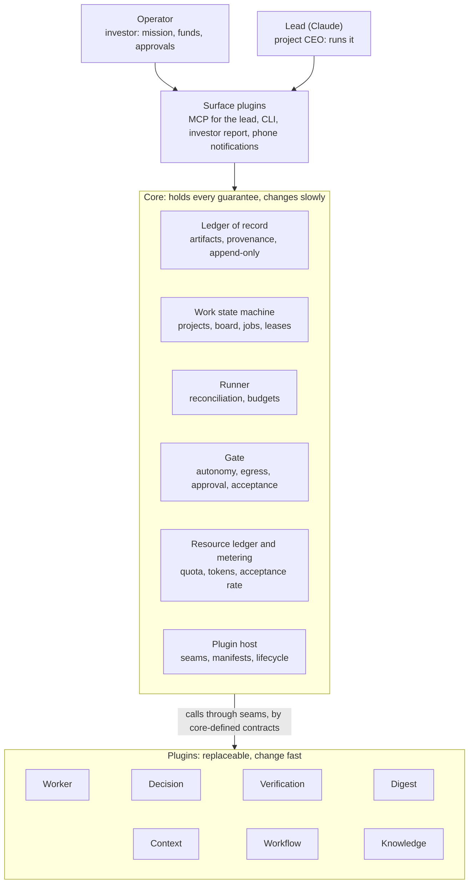
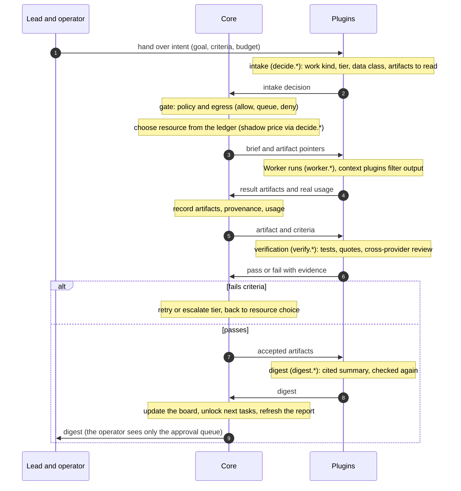

# Proposal: Decompose `system` into a small core and plugin families

## Problem

[INV-10](../architecture/invariants.md#inv-10-everything-is-a-plugin) says everything
is a plugin, but the design does not name which parts are the irreplaceable core and
which are replaceable. Without that line, provider-specific code and correctness
guarantees mix, every change risks the guarantees, and
[PROP-0008](0008-studio-operating-model.md)'s goal of an evolving system has no safe
boundary to evolve behind.

## Goals

- Derive the core from first principles (what must be true whatever model or provider
  is used), not from the current package layout.
- Keep the core **small, stable, and holding every guarantee**; everything that depends
  on a provider or a technique is a plugin.
- Give one test that classifies any component as core or plugin.
- Describe the flow of a job and of a project across core and plugins.

## Non-goals

- Renaming or moving packages in this proposal. The mapping to source is a follow-up.
- Changing any invariant. The invariants are placed into core components, not altered.

## Evidence and research

- [design-review-2026-10-22.md](../research/design-review-2026-10-22.md): where the
  current design is strong and where plugins should replace built-in code.
- [dsh-analysis.md](../research/dsh-analysis.md): Everything Is A Plugin on Cordis.

## Proposed design

### Summary

- **The core has six components:** ledger of record, work state machine, runner,
  gate, resource ledger and metering, plugin host.
- **Plugins fall into eight families** by seam: Worker, decision, verification, digest,
  context, workflow, knowledge, surface.
- **Dividing rule:** if replacing a component with a worse version leaves the system
  **correct** and only less **efficient**, it is a plugin. If the system can become
  incorrect or unsafe, it is core.
- **The core decides *that* something must happen; plugins decide *how*.** The core
  requires every result to pass verification before acceptance; running pytest or
  checking quotes is a plugin.

### First principles

These hold whatever model or provider is used. Each forces a function, and the
function becomes part of the core.

| # | Fact | Required function | Core component |
|---|---|---|---|
| 1 | Work turns intent into an accepted result | a unit of work with a goal and acceptance criteria | work state machine |
| 2 | Models do not remember between sessions; a Worker's memory is local to it | shared memory outside every Worker | ledger of record |
| 3 | Models can be wrong, and one model is wrong in the same way repeatedly | independent verification before a result is accepted | gate |
| 4 | Resources are scarce and reset in windows: quota, money, attention | count and allocate resources | resource ledger and metering |
| 5 | Execution can be interrupted: machine off, quota out, network error | resume without doing work twice | runner |
| 6 | Some actions are irreversible; data has different sensitivities | permission and egress boundaries | gate |
| 7 | Several actors writing one subject conflict | one writer per subject at a time | work state machine |
| 8 | Providers, models, and techniques change quarterly | what depends on them is replaceable without touching the core | plugin host |
| 9 | Without measurement no change can be judged | trustworthy numbers from objective sources, not model self-reports | resource ledger and metering |
| 10 | The operator's attention is the scarcest capital | a person sees only what truly needs them | gate (approval queue) |

Everything else (which model, how to summarize, which workflow, where to display) is a
**choice**, not a fact. Choices should be plugins.

### The test: core or plugin

A component is core if the answer to at least one question is **yes**; if **no** to
all three, it is a plugin.

1. **Correctness:** could a worse version make the system produce wrong results, lose
   data, or do work twice?
2. **Safety:** could a worse version let the system take an irreversible action no one
   approved, or leak data?
3. **Foundation:** does every other component depend on it, so that changing it
   changes everything?

| Component | Correctness | Safety | Foundation | Verdict |
|---|---|---|---|---|
| artifact and provenance storage | yes | — | yes | core |
| mandatory verification before acceptance | yes | — | — | core |
| running pytest, checking quotes | no, if the gate still requires it | — | — | plugin |
| autonomy matrix, egress | — | yes | — | core |
| choosing a model for a job | no, only dearer or slower | — | — | plugin |
| counting quota used | yes, wrong counts exceed limits | — | yes | core |
| the shadow-price formula | no, only worse scheduling | — | — | plugin |
| filtering command output (RTK) | no | — | — | plugin |
| summarizing results (digest) | no, if quotes are checked | — | — | plugin |
| research and algorithm workflows | no | — | — | plugin |

Two consequences: **plugin does not mean third-party** (the core ships standard
plugins, such as the quote checker or the Claude Code adapter, still behind seams so
they can be replaced); **a small core is a feature** (easier to verify, rarely changed,
and safe for the rest to evolve around).

### Core: six components

| Component | Responsibility | Guarantees | Contract offered |
|---|---|---|---|
| **Ledger of record** | artifacts, provenance edges, hash-addressed blobs, decision records | append-only; every decision is an artifact (INV-13); everything traceable to sources | write, read, windowed read, provenance query |
| **Work state machine** | projects (charter, milestones), board tasks, jobs, leases | only valid, complete transitions; one writer per subject (INV-15) | `board_*` tools, job submission, state-change events |
| **Runner** | executes the job graph, calls plugins through seams, timeouts, bounded retries | restart is reconciliation, not replay (INV-4); over budget stops and escalates (INV-9) | run, pause, resume, cancel |
| **Gate** | autonomy matrix, policy, approval queue, data classes and egress, result acceptance | fails closed (INV-2); irreversible actions always go to a person; `local-private` data never leaves on a disallowed channel | check an action: allow, queue for approval, or deny |
| **Resource ledger and metering** | limits by account, feature, and tier; reset windows, cooldowns; tokens, cache, acceptance rate, interventions | numbers come from objective sources (usage fields, invoices, limit notices), never model self-reports | reserve, confirm use, record a measurement, query |
| **Plugin host** | registry, manifests, seams, lifecycle, sandbox, health checks, version pinning | a plugin sees only what its seam allows; a failing plugin cannot damage the core | seam and manifest definitions |

The core deliberately does **not** call models (every model call goes through a
Worker or decision plugin, so changing models never touches the core), does **not**
judge content (it requires verification, it does not know what good research is), and
has **no UI** (boards, reports, and phone notifications are surface plugins reading
from the core).

### Plugins: eight families by seam

Each seam is a core-defined contract with explicit inputs and outputs; plugins that
meet it are interchangeable.

| Family | Seam | Contract | Standard plugins and examples |
|---|---|---|---|
| Worker | `worker.*` | takes a brief and artifact pointers; returns result artifacts with usage | Claude Code, Codex CLI, Gemini CLI, website Workers, each provider's API, local models |
| Decision | `decide.*` | takes state and typed questions; returns typed answers with probabilities | intake, router, classifier, shadow-price formula; implemented with Jev, a cheap schema-bound LLM, or a local classifier |
| Verification | `verify.*` | takes an artifact and criteria; returns pass or fail with evidence | test-result parsers, quote check, schema check, vote count, benchmarks, cross-provider reviewer |
| Digest | `digest.*` | takes raw artifacts; returns a cited `digest@1.0` | an `economy` model with the SBAR frame |
| Context | `context.*` | attached to a Worker at launch; reduces tokens entering context without changing results | Tool Search, RTK (`rtk-oss`), Serena, context-mode, caveman-compress |
| Workflow | `workflow.*` | template: job graph, team kind, sample milestones, default criteria | multi-day research, algorithm development, software building; self-improvement workflows such as retrospectives and plugin scouting |
| Knowledge | `knowledge.*` | indexing and retrieval over the ledger of record | full-text search, local embeddings, a knowledge base with sources and re-check dates |
| Surface | `surface.*` | reads from the core and presents to the operator and lead | MCP server for the lead, CLI, investor report, phone notifications, `TASKS.md` and kanban export |

Self-improvement workflows are plugins too. They run on `system` itself and pass the
same gates as any job, so the system's evolution needs no special authority.

### Overall architecture

A microkernel, as in operating systems: the kernel keeps only what concerns
correctness and safety; drivers, interfaces, and applications live outside. This is
the natural shape for a system that must be both trustworthy and fast-changing.

The operator and the lead touch the core only through surface plugins; the core calls
every other plugin through seams, so replacing one touches neither the core nor other
plugins.

### Flow of one job: from intent to result

Each step sits in exactly one lane. The core holds every correctness decision and
every write; plugins do the work that needs intelligence or provider knowledge.

| Step | Lane | What happens | On failure |
|---|---|---|---|
| 1. Hand over intent | lead | job with goal, acceptance criteria, budget | — |
| 2. Intake | plugin `decide.*` | classify work, choose tier and data class, select artifacts to read | plugin error → the work kind's default tier |
| 3. Policy and egress gate | core | check permissions and data flow | closed: deny or queue for approval |
| 4. Choose resource | core, using `decide.*` for the price formula | reserve on the ledger: account, feature, tier | quota exhausted → wait for the window or switch source |
| 5. Worker runs | plugins `worker.*` and `context.*` | works from the brief and pointers; context plugins filter output | context plugin error → bypass; Worker error → the runner reconciles |
| 6. Record artifacts | core | store results, provenance, real usage | — |
| 7. Verify | plugin `verify.*` | tests, quote checks, cross-provider review | no suitable verifier → not accepted automatically |
| 8. Acceptance gate | core | compare verification with criteria | fail: retry or escalate tier, back to step 4 |
| 9. Digest | plugin `digest.*` | cited summary, checked again | digest error → the lead receives artifact pointers |
| 10. Update board | core | transition state, unlock next tasks, update the report | — |

### Flow of one project: from template to close

At project level `system` runs as a startup template. The lifecycle (charter, funding
rounds, investor decision, lessons back into the template) is defined once, in
[PROP-0008](0008-studio-operating-model.md#governance-a-startup-template). In this
decomposition it touches the core in two places: the work state machine holds the
project, its charter, and its milestones; the resource ledger is shared by every
project, so shadow prices reflect the whole portfolio's demand. Projects are
instances of `workflow.*` templates; nothing project-specific lives in the core.

### Dependency rules

1. **Plugins depend only on core seam contracts**, never on other plugins. Two plugins
   that must cooperate do so through the core, by artifacts or events.
2. **The core knows no specific plugin**, only seams. It contains no provider code.
3. **Data moves between steps as artifact pointers**, not copied content.
4. **Every state change goes through the state machine.** Plugins never write to the
   ledger of record outside their contract.
5. **Seams are versioned.** A contract change bumps the version; the old version stays
   until every plugin has moved.

### Behaviour on failure

A component that affects only efficiency fails open and work continues; a component
that holds correctness or safety fails closed and work stops.

| Component | On failure | Why |
|---|---|---|
| context and digest plugins | bypass, continue, record an event | losing an optimization does not make results wrong |
| decision plugins | deterministic default per work kind | less efficient but still correct |
| Worker plugins | runner reconciles, moves to another source | work is neither lost nor done twice |
| verification plugins | no automatic acceptance; queue for approval or escalate | what cannot be checked is not trusted |
| core: gate, egress | closed: deny | safety before efficiency |
| core: ledger of record, state machine | stop writing, wait for recovery, reconcile on restart | correctness before progress |

### Mapping to the current design

| Invariant | Core component |
|---|---|
| INV-4: restart is reconciliation | runner |
| INV-5: exact-subject binding | work state machine |
| INV-9: everything is bounded | runner, resource ledger |
| INV-11: no tool lock-in | plugin host (seams) |
| INV-12: data egress is explicit | gate |
| INV-13: every decision is an artifact | ledger of record |
| INV-15: one writer per subject | work state machine |

- **Matches:** "everything is a plugin" still holds; what is needed is to name the six
  core components and fix them as the part that is not replaceable.
- **Should become plugins:** website drivers, UI maps, and the browser runtime belong
  to the Worker family; model healing is a decision plugin; team review is a workflow
  plus verification plugins.
- **Missing from the core:** a complete resource ledger, a mandatory acceptance gate,
  a project-level state machine (charter, milestones), plugin manifests and lifecycle.

This mapping is based on the design documents, not on the source.

## Alternatives considered

- **Keep the current layer map as the boundary.** It organizes code by technology, not
  by guarantee, so provider code and guarantees stay mixed.
- **A thin core with guarantees inside plugins.** Rejected: a plugin could then weaken a
  guarantee, and evolution would need special authority.

## Validation plan

- Tests for every core invariant before any plugin is extracted.
- Each extracted plugin runs the task suite before and after; acceptance rate and tokens
  must not regress.
- A module that cannot be placed in the core or a family signals a design to fix.

## Rollout and rollback

- [ ] Write the contract of each of the eight seams: inputs, outputs, version, failure
  behaviour; one page per seam
- [ ] Inventory the current source and assign each module to the core or a plugin family
- [ ] Write tests for core invariants before extracting plugins
- [ ] Extract by rate of change: Worker first (changes most), then decision, then context
- [ ] Keep the core small enough for one person to read in a sitting

Extraction is incremental; each step can be reverted independently.

## Observability and operations

Each seam call records its plugin, version, duration, outcome, and usage in the
resource ledger, so plugin promotions and regressions are measurable.

## Security and privacy

The gate and egress stay in the core and fail closed. Plugins see only what their seam
allows; their manifests declare an egress class, checked by the gate.

## Compatibility and migration

Not required by the current specification. Seam versioning (rule 5) carries plugins
across contract changes.

## Decision

Accepted on 2026-10-22 as
[ADR-0036](../decisions/adr/0036-guarantee-core-and-capability-plugins.md). The ADR refines
dependency rule 1: within one family, providers may build on each other's seams (a website
Worker uses `ctx.browser`); across families, plugins cooperate only through the core. The
classification is applied in the [plugin model](../architecture/plugin-model.md#core-and-plugin-classes).

## Implementation

None yet.
