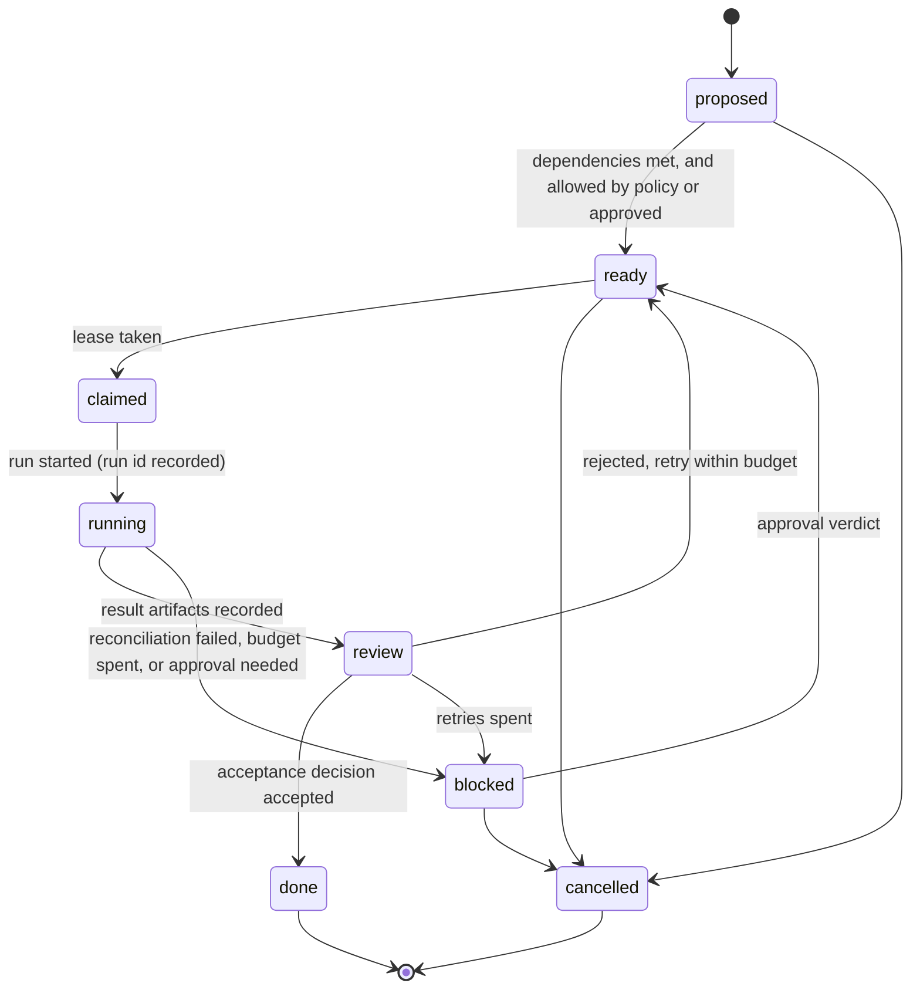
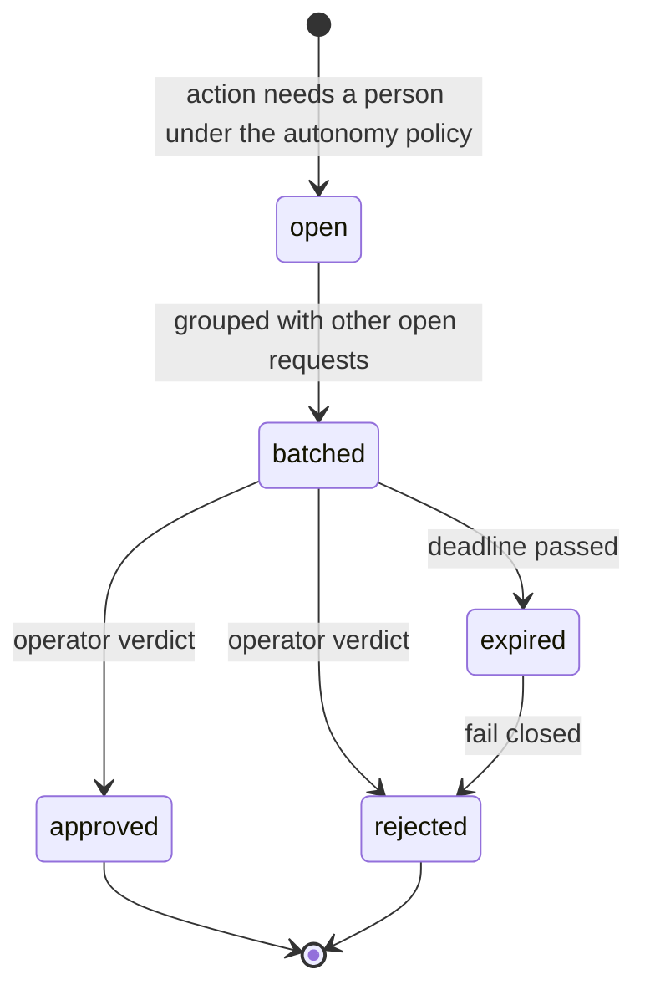
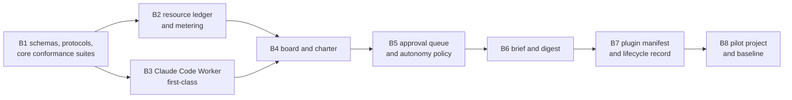

# Proposal: the Base version — close the core, Claude Code Worker first

## Problem

The release stages in [release scope](../requirements/release-scope.md) come from PROP-0001,
which saw `system` as a tool for delegating turns. By that measure the MVP is done and most of
Beta is built. [PROP-0008](0008-studio-operating-model.md) restated the purpose (use the
operator's paid plans fully, take on multi-day work, delegate with confidence, evolve), and
[ADR-0036](../decisions/adr/0036-guarantee-core-and-capability-plugins.md) fixed which seams
carry the guarantees. Against that, three of the six core components are incomplete:

- the **resource ledger** does not exist; only account cooldowns and per-request usage reports do;
- the **gate** has egress and acceptance but no approval queue, so every approval interrupts the operator;
- the **work state machine** knows runs and nodes but no project or task that outlives a run.

Meanwhile most validation time goes to website Workers. A Deep Research run takes tens of
minutes, sites change under the drivers, and none of it makes the core more correct. The
agent Worker rows, which put Claude Code to work on the operator's Claude Max plan, are off by
default and carry a known P1 defect
([follow-ups](roadmap.md#follow-ups-from-the-reliability-review)).

The new mechanisms add records and seams. Unless they are specified first, each one would
invent its own shape and its own failure rules.

## Goals

1. **Close the core.** Each of the six core components has a built guarantee seam with a
   schema, a written protocol, and a conformance suite.
2. **Claude Code is the first Worker.** Claude Code Workers are on by default, safe for writing
   work, able to validate their own changes, and metered.
3. **Schema and protocol first.** Every record and payload has a JSON Schema; every seam has an
   abstract definition, a protocol, and a conformance suite from its first provider
   ([ADR-0037](../decisions/adr/0037-schema-and-protocol-first.md)).
4. **Prove it on real work.** One multi-day project runs from charter to close on Claude Code
   Workers, measured against the baseline of PROP-0008.

After Base, `system` evolves by adding or replacing plugins only. A change that needs a core
contract change needs an ADR (ADR-0036).

## Non-goals

- **Deep Research** on ChatGPT and Gemini is future work. The code stays; its open live checks
  do not gate Base or v1.0.
- **Website Workers and API or local model Workers** get no new work until Base ships. They stay
  built, keep passing their conformance suites, and keep serving the work they already serve.
- Codex and ACP agent Workers: they follow Claude Code once its path is proven.
- Decision-assisted routing (PROP-0002), the knowledge family, RTK, Serena, context-mode,
  automated shadow and canary runs, shadow prices across projects, A2A, new gateway work.

## Evidence and research

- [Design review 2026-10-22](../research/design-review-2026-10-22.md): token economics, the
  waste map, and why operator attention is the scarcest resource.
- [PROP-0009](0009-core-and-plugin-decomposition.md) and ADR-0036: the six core components and
  the eight families.
- [agent-workers](../../packages/plugins/agent-workers/README.md) and
  [runtime-claude-agent-sdk](../../packages/plugins/runtime-claude-agent-sdk/README.md): the
  Claude Code Worker today. It is confined for reads, has no Bash (`executes: false`, so it never
  proves `validate`), stops at a 15-minute deadline, and reports `costUsd` and `turns` but not
  token usage.
- [Roadmap](roadmap.md): which milestones are done, and the P1 follow-up on agent Workers.

## Proposed design

### Definition

**Base** is the version in which:

1. every core component is built, specified, and covered by its conformance suite;
2. each plugin family has at least one provider, or a deterministic default;
3. Claude Code is a first-class Worker;
4. one real project passes the exit criteria below.

### The core in Base

Records are new JSON Schemas in [`schemas/`](../../schemas/README.md). Protocols are written in
a design document when the component is built, with a state diagram and a transition table that
names the failure behaviour of every step.

| Core component | Seam | New records | Protocol | State today |
|---|---|---|---|---|
| ledger of record | `store`, `artifacts`, `eventLog`, `credentials` | new artifact kinds only | existing ([artifacts](../design/artifacts.md)) | built; conformance suites to add |
| work state machine | `workflow`, `workerSessions`, `leases`, **`board`** | `project@1.0` (charter: intent, criteria, constraints, stop rules, budget), `board-task@1.0` | [task states](#protocol-sketch-a-board-task) | runs and nodes built; board new |
| runner | `workflow` engine, `turnReceipts` | `workflow-node@1.x` gains a run budget | budget exhausted → the node blocks and asks the gate | built; crash suite at every reconcile point (M6c) |
| gate | `egress`, `workers` acceptance, **`approvals`** | `autonomy-policy@1.0`, `approval-request@1.0`; verdicts stay `approval@1.x` | [approval requests](#protocol-sketch-an-approval-request) | egress and acceptance built; queue new |
| resource ledger and metering | **`resources`** | `usage-record@1.0`, `limit-state@1.0`; `agent-result@1.2` adds token usage with cache reads and writes | reserve before a run, record after it from the runtime's own usage fields, cool down on a limit notice | new |
| plugin host | host, bundle, conformance | `plugin-manifest@1.0` (seams provided and consumed with versions, family or core component, lifecycle state) | lifecycle states are recorded as decisions; Base records them and automates nothing | host built; manifest new |

Every guarantee seam fails closed (INV-2): with the resource ledger unavailable no new run
starts; with the approval queue unavailable an action that needs a person waits.

#### Protocol sketch: a board task

Only the work state machine moves a task, and each move references the decision or event that
caused it. A started run that cannot be reconciled is never run again (INV-4): its task becomes
`blocked`, and the gate puts one request in the queue to run it again from a resume brief.

#### Protocol sketch: an approval request

The autonomy matrix that decides which actions need a person is defined in
[PROP-0008](0008-studio-operating-model.md#fewer-approvals-reliable-results).

### Claude Code as the first Worker

| Item | Today | Base |
|---|---|---|
| Composition | agent rows off by default (PROP-0004) | `agent-workers`, `agent-runtimes`, `runtime-claude-agent-sdk` on by default; Codex and ACP stay off |
| Writing safety | the P1 follow-up: superseded remediation cycles, an unapproved writing step, hidden paths that name one agent's directory | each writing task runs in its own workspace (a git worktree per task); remediation asks the gate; hidden paths cover every agent's credential directory |
| Validation | no Bash, so no `validate` | commands confined to the workspace with no network, under the same bubblewrap confinement Codex and ACP agents use, proven by `proveConfinement`; decided by its own ADR |
| Metering | `costUsd`, `turns` | `agent-result@1.2`: model, input, output, cache read and cache write tokens, from the SDK's result; one `usage-record` per run |
| Long work | one run, 15 minutes at most | multi-day work is a chain of board tasks; a task resumes the agent's native session from a `brief` |
| Brief | prompt text | `brief@1.0`: goal, acceptance criteria, artifact pointers (never copied content), budget, sandbox |

### Plugin families in Base

| Family | Base provider | After Base |
|---|---|---|
| Worker | Claude Code through the Agent SDK | website Workers and API or local model Workers (built, no new work); Codex |
| decision | the deterministic router; intake defaults by work kind | `ctx.decisions` (PROP-0002) |
| verification | acceptance contracts, quote checks, a read-only Claude Code review Worker, tests through `validate` | cross-provider review on website or API Workers |
| digest | `digest@1.0`, written by a read-only Claude Code Worker on the economy tier and quote-checked ([PROP-0008](0008-studio-operating-model.md#mechanism-1-the-digest-layer)) | other providers through the lifecycle |
| context | briefs carry pointers, not content; tool allow-lists per Worker | RTK, Serena, context-mode, each through the lifecycle |
| workflow | an `algorithm-development` template: charter, milestones, develop, validate, review | research templates on website Workers; Deep Research |
| knowledge | none: artifacts are found by id, kind, and lineage | full-text search, embeddings |
| surface | MCP tools `board_*`, `approvals_*`, `resources_*` with input and output schemas; CLI; the board and queue on `/ui`; a weekly investor report | new gateway work |

### Order of work

Metering comes before the board because the baseline needs numbers from the first run. Until
B5, remediation in B3 uses the existing plan approval (`approval@1.0`); B5 moves it to the
queue.

## Alternatives considered

1. **Finish v1.0 first** (operability, crash suite, live checks of every Worker), then the core.
   Rejected: most of the remaining v1.0 work is live checks of website Workers, which do not
   close any core component.
2. **Website Workers first**, as in the MVP. Rejected: they need the most live testing per
   unit of value, and the operator's Claude Max plan is the largest resource that `system`
   does not use yet.
3. **Specify schemas as each mechanism is coded.** Rejected: the new mechanisms share records
   (a brief references a task, a usage record references a run and an account), and late
   schemas lead to migrations.

## Validation plan

The Base exit criteria are defined in
[release scope](../requirements/release-scope.md#base-exit-criteria): the core specified and
conformant, the crash suite, a pilot project of at least five working days on Claude Code
Workers, attention within the charter's threshold, metered resources, one plugin replaced
without a core change, and the baseline comparison of
[PROP-0008](0008-studio-operating-model.md#validation-plan).

## Rollout and rollback

Each milestone adds plugin rows to the `system` bundle and leaves the website and model rows as
they are. The agent rows turn on by default only after B3's writing-safety fixes pass. Each new
row can be turned off on its own; with `board` off, runs work as today.

## Observability and operations

Usage records, limit states, approval requests, and board transitions are events and artifacts,
so `system explain` and the investor report read them. Runbooks for a blocked task and for an
expired approval request are added with B4 and B5.

## Security and privacy

Confined command execution needs its own ADR and a threat model update before B3 ships. The
`agent` Worker class keeps its egress default: `public` and `operator-shared` work only.

## Compatibility and migration

`agent-result@1.2` and `workflow-node@1.x` are minor versions; readers on `@1.x` keep working.
MVP and Beta keep their definitions. Base is inserted between Beta and v1.0 in
[release scope](../requirements/release-scope.md); Deep Research checks move to future work in
the [roadmap](roadmap.md).

## Decision

Accepted by the operator on 2026-10-22, with three directions: Deep Research is future work;
everything has a schema and a clear protocol
([ADR-0037](../decisions/adr/0037-schema-and-protocol-first.md)); the core and the Claude Code
Worker come first, website and API Workers after.

## Implementation

Not started. Milestones B1 to B8 in the [roadmap](roadmap.md#next-base-v08).
