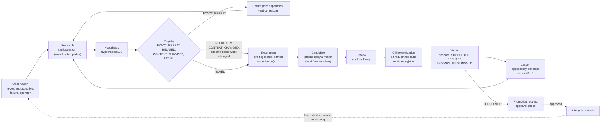
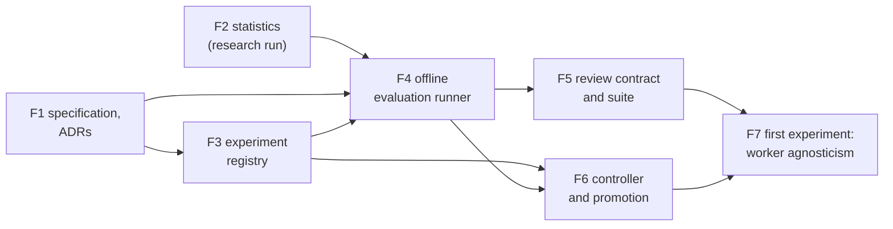

# Proposal: Feedback loop — evidence-driven improvement of `system` and its applications

## Problem

[PROP-0008](0008-studio-operating-model.md#evolution) asks `system` to evolve through variation,
selection, and inheritance, and names the gap: selection exists (verification, the task suite,
A/B), but deliberate variation and systematic inheritance do not. Today:

- **Nothing remembers what was tried.** A change to a template, a team, or a plugin is judged once,
  in a chat or a commit message. The next session cannot ask whether the same idea was already
  tested, under which conditions, and with what result, so ideas are redone blindly or dropped
  for good on one unlucky run.
- **Nothing says what "better" means.** The [baseline report](../design/reports.md) counts
  accepted results, interruptions, and cost, but no record states, before a change is tried,
  which metric it must move, by how much, and which others it must not harm.
- **Nothing keeps the judge apart from the judged.** A change and the evidence about it can come
  from the same provider family, or from the change itself. Routing already refuses this for
  teams ([ADR-0027](../decisions/adr/0027-provider-diversity-in-routing.md)); improvement work has
  no such rule.
- **Promotion has no evidence contract.** The plugin lifecycle records `candidate` and `default`
  ([plugin host](../design/plugin-host.md#lifecycle-states)), but a move between them names no
  evaluation, so a promotion could rest on evidence about another subject
  ([INV-5](../architecture/invariants.md#inv-5-exact-subject-binding)).

The operator asked for a loop that tests hypotheses through research, brainstorm, change, and
feedback, remembers what was tried, and has an explicit evaluation module and objective function.

## Goals

1. **A recorded loop.** Research → hypothesis → experiment → evaluation → lesson, every step a
   typed record in the existing ledger of record, linked by lineage to the artifacts and decisions
   it rests on.
2. **An explicit objective per application.** A versioned objective contract states hard
   constraints, guardrails with non-inferiority margins, one primary metric, and cost, before any
   experiment runs. No global weighted score.
3. **Trustworthy evaluation.** Offline, paired, pre-registered, on pinned tasks in three
   partitions, with predeclared statistics and stopping rules. INCONCLUSIVE is a valid outcome.
4. **Independence.** Maker, reviewer, and evaluator are different provider families; a candidate
   never touches its evaluator, objective contract, task suite, or evidence.
5. **Never redo blindly.** Every experiment is identified exactly and fingerprinted semantically;
   a retry cites the earlier experiment and what changed. Negative and inconclusive results are
   kept.
6. **Promotion on evidence.** A promotion names the exact accepted evaluation and subject, and
   goes through the existing approval queue and plugin lifecycle.

## Non-goals

- A second authority or a separate service: the loop reuses the ledger of record, decisions, the
  board, the approval queue, the resource ledger, and the plugin lifecycle.
- An autonomous optimizer. The controller starts as a deterministic workflow template.
- In v1: automatic hypothesis generation, automatic semantic deduplication, bandits, shadow and
  canary runs, and any self-modification ([v1](#the-minimal-v1)).
- Changing the safety layer through the loop. Invariants, egress, and the autonomy policy are hard
  constraints of every objective contract, never subjects of an experiment run by the loop.

## Evidence and research

- **The operator's decisions of 2026-10-23**, taken on the synthesis below. This proposal states
  them; where they are silent it chooses conservatively and lists the point under
  [open questions](#open-questions).
- **A team brainstorm run by `system` itself** (`run_27a329a23f9e7bb8`): the ChatGPT member's full
  proposal (an experiment-centric loop on the existing artifact and decision records, a
  deterministic evaluation engine, objective contracts, two-key deduplication, the `review`
  workflow first); the Gemini member stalled. The lead's own analysis converged on the same
  architecture, merged with the plugin lifecycle of PROP-0008.
- **[Self-build](../validation/self-build.md#before-the-pilot-team-reviews-of-its-own-code):** two
  team reviews of `system`'s own code whose findings the lead checked against the code. They seed
  the first experiment's task suite.
- **[PROP-0008](0008-studio-operating-model.md):** the evolution levels, the lifecycle
  (candidate → shadow → canary → default → retired), and the guardrails (the safety layer never
  self-modifies; several cross-checking metrics; spot checks; every step pays for itself).
- **Reusable statistics and experiment tooling:** a research run through `system` (GrowthBook's
  statistics engine, MLflow tracking, Optuna, and others) precedes building any statistic. Its
  result is [pending](#statistics-library-pending).

## Proposed design

### The loop

Measurements are observations, verdicts are decisions, lessons are interpretations; none
overwrites another. Every record is append-only: a material change to an experiment is a new
revision that `supersedes` the old one.

### Records

Each record is a new kind of artifact, the body of an existing envelope kind
([ADR-0044](../decisions/adr/0044-feedback-loop-guarantee-seams.md)), with a JSON Schema in
`schemas/`, versioned by the
[schema rules](../reference/schemas.md#versioning). The verdict is not a new record: it is a
`decision` of the existing schema with a new decision type, so it is explained, linked, and
retained like every other decision ([INV-13](../architecture/invariants.md#inv-13-every-decision-is-an-artifact)).
The research profile's [`hypothesis-set`](../reference/schemas.md#hypothesis-set-and-evidence-table)
is a different thing: hypotheses inside one study, not claims about `system` or an application.

| Record | What it is | Main fields | Links |
|---|---|---|---|
| `objective-contract@1.0` | what "better" means for one application, versioned | `application` (the charter or workflow profile that references it); `hardConstraints` (named validators; the invariants, egress, and the autonomy policy are always among them); `primary` (one metric, direction, unit, `minimumPracticalEffect`); `guardrails` (metric, direction, `nonInferiorityMargin` or an absolute floor); `cost` (metrics, unit, ceiling); `comparison` (`constrained-dominance` only: the schema has no weights field); `protocol` defaults ([evaluation](#evaluation)) | referenced by a [`project`](../reference/schemas.md#project) charter or a workflow profile; superseded by its next version |
| `hypothesis@1.0` | a falsifiable claim about one target | `statement`; `target` (kind: template, plugin, seam provider, configuration; ref and version); `mechanism` (a tag from the registry's vocabulary, and text); `intervention`; `expectedEffect` (metric, direction, magnitude); `context` (where it is expected to hold); `priorEvidence` (experiments, lessons, research reports); `source` (research run, brainstorm decision, retrospective, operator); `fingerprint` ([below](#two-keys)) | the research or brainstorm artifacts it came from |
| `experiment@1.0` | an immutable, pre-registered trial specification | `hypothesis`; `objectiveContract` (id, version, hash); `comparison` (`superiority` or `non-inferiority` on the primary, declared here); `baseline` and `candidate` (exact subject: ref and content hash or VCS head); `suite` (id, version, the hash of each partition, the partitions used); `environment` (fingerprint: the composition hash, plugin versions and manifest digests, Worker descriptors and their families, template spec hashes, collector and statistics versions); `protocol` (from the contract, may only be stricter); `budget` (the funding round that pays for it); `stopping`; `seed`; `independence` (the families of maker, reviewers, and model-based validators); `registry` (the answer, the experiments cited, the context predicates that changed); `identity` (hash, [below](#two-keys)); `revision`, `supersedes` | its hypothesis, contract, suite, and subjects; the board milestone that funds it |
| `evaluation@1.0` | measurements and evidence for one experiment | `experiment` and its `identity`; `trials` (per case, arm, and repetition: the board task, the run, the result artifacts, each collector's measurements with the collector's version); the metric vector per arm; paired differences; intervals and test results by the declared method; `cost` (per pool and per phase, sunk and projected, from the resource ledger); `integrity` (each pin checked, partitions sealed, no same-family fallback, missing data and why) | the trial runs and their result artifacts; the usage records it summed |
| `decision@1.7`, type `verdict` | the classification of one evaluation against the pre-registered thresholds | candidates `supported`, `refuted`, `inconclusive`, `invalid`, each with reasons; decider rule `evaluations.verdict`, its `hash` the experiment's protocol hash; `detail`: per metric, the estimate, the interval, and the threshold it was held to; net benefit bounds | inputs: the evaluation, the experiment, the contract |
| `lesson@1.0` | reusable, context-qualified knowledge | `claim`; `outcome` (equal to the outcome of every verdict it cites, checked by the store); `evidence` (verdict decisions and experiments); `applicability` (workload, families and observed model versions, environment, objective and suite versions, date, confidence); `invalidatedBy` (predicates: a model or provider version, an objective or suite version, a mechanism, a measurement defect, a cost structure, an expiry date); `supersedes` | the verdicts and experiments it interprets |

A hypothesis can have many experiments, an experiment many evaluations (each of an exact,
unchanged identity: a changed pin is a new experiment), and a lesson can draw on several
experiments. Whether a lesson still applies is computed when it is read, from its
`invalidatedBy` predicates against the current environment; it is never a stored, mutable status.

### Core and plugins

[ADR-0036](../decisions/adr/0036-guarantee-core-and-capability-plugins.md) asks of each part: could
a worse provider make `system` incorrect or unsafe? An evaluation engine that misreads evidence
could promote a regression, and a registry that loses an experiment's identity breaks the record
the loop rests on, so both are guarantee seams. Everything that produces a candidate or a
measurement only changes how efficient the loop is, so it is a capability.

| Part | Class | Component or family | Seam |
|---|---|---|---|
| the five records and the `verdict` decision | core | ledger of record | `artifacts` (new body schemas; no new seam) |
| experiment registry: an experiment's states, exact identity, the four answers, retry predicates, lessons and their applicability | core | work state machine | **`experiments`** (new) |
| evaluation engine: runs a pinned protocol, seals partitions, schedules paired trials, sums cost, applies the verdict rule; decides no promotion | core | gate | **`evaluations`** (new) |
| cost of every trial and of the work that produced the candidate | core | resource ledger and metering | `resources` (read only) |
| promotion: a request bound to the exact evaluation and subject; the lifecycle record | core | gate, plugin host | `approvals` (a new action class, `promotion`), `pluginHost` |
| identity hashing, fingerprint normalization, the statistics | library | — | none: pure logic with one correct answer ([what is not a plugin](../architecture/plugin-model.md#what-is-not-a-plugin)); versions pinned in each experiment |
| metric collectors and validators (a defect matcher, quote validity, latency, a model-based judge) | capability | verification | registered through `evaluations.collector`, as acceptance contracts register through `workers.contract`; each versioned, with its own conformance scenarios |
| research, brainstorm, producing a candidate | capability | workflow | the existing templates ([research](../reference/workflow-templates.md#research), [brainstorm](../reference/workflow-templates.md#brainstorm), [algorithm-development](../reference/workflow-templates.md#algorithm-development)) |
| improvement controller | capability | workflow | a deterministic template, `improve`: registry check, pre-registration, evaluation, verdict, lesson, promotion request; its core steps are deterministic `effect` steps, as `review`'s [source step](../design/teams.md#sources) is |
| similarity search over hypotheses (advisory) | capability | knowledge | `knowledge` (after v1) |
| MCP tools `experiments_*`, a report section | capability | surface | `mcp`, `report` |

Both new seams follow [ADR-0037](../decisions/adr/0037-schema-and-protocol-first.md) from their
first provider: the schemas above with valid examples; an abstract `Service` in a `*-core`
package (`experiments-core`, `evaluations-core`); a design document with a state diagram and a
transition table; a conformance suite passed by a fake and by the store-backed provider (F1 wrote
them: [experiments](../design/experiments.md), [evaluations](../design/evaluations.md)). Both are
guarantee seams, so they fail closed
([INV-2](../architecture/invariants.md#inv-2-fail-closed)): with the registry unavailable no
experiment is pre-registered; with the engine unavailable no evaluation or verdict is recorded and
no promotion can be asked. A collector fails open in the capability sense only: its metric is
missing, and a trial missing a metric the contract needs makes the evaluation INVALID, never a
pass.

Adding two guarantee seams, the `verdict` decision type, the `promotion` action class (which
joins the classes that always ask, [autonomy policy](../design/approvals.md#the-autonomy-policy)),
and any change to the `workflow` contract the controller or the arms need, changes the core:
each needs an ADR, as [ADR-0039](../decisions/adr/0039-base-guarantee-seam-contract-changes.md)
recorded Base's changes. F1 proposes [ADR-0044](../decisions/adr/0044-feedback-loop-guarantee-seams.md)
for the seams, the decision types, and the action class.

#### Protocol sketch: an experiment

```mermaid
stateDiagram-v2
  [*] --> proposed: register (hypothesis, draft spec)
  proposed --> refused: EXACT_REPEAT, or RELATED with no citation or no changed predicate
  proposed --> preregistered: answer recorded, spec frozen and hashed, budget funded
  preregistered --> running: first trial started
  running --> evaluated: horizon reached, budget spent, or stopped by a stopping rule
  running --> evaluated: integrity breach (the verdict is INVALID)
  evaluated --> closed: verdict recorded; lessons may follow
  preregistered --> superseded: a material change (a new revision)
  refused --> [*]
  closed --> [*]
  superseded --> [*]
```

| From → to | Who | Records | On failure |
|---|---|---|---|
| — → proposed | the controller, the lead, or the operator | the hypothesis and draft experiment artifacts | invalid records refused (INV-14) |
| proposed → refused / preregistered | `experiments` | a registry answer and the frozen experiment with its `identity`; the funding round's approval ([board](../design/board.md#project)) | registry unavailable: nothing is pre-registered |
| preregistered → running | `evaluations` | each trial a board task, recorded before its run starts | the runner refuses an experiment that is not pre-registered, or whose pins no longer match the environment |
| running → evaluated | `evaluations` | the `evaluation`; why it ended | a crash is reconciled: a started trial is never run again ([INV-4](../architecture/invariants.md#inv-4-restart-is-reconciliation-not-replay)) |
| evaluated → closed | `evaluations` | the `verdict` decision | a verdict that cannot be recorded leaves the experiment `evaluated` |

#### Protocol sketch: an evaluation

| Step | Does | Fails closed when |
|---|---|---|
| check pins | compares the experiment's environment fingerprint with the live one | any pinned item differs: no trial starts |
| seal | checks each partition's hash; held-out cases are read only by the engine | a hash differs |
| schedule | orders trials (case × arm × repetition) from the recorded `seed`, interleaving arms | the funded budget cannot cover the next trial (the stopping rule ends the experiment) |
| run | each trial is a board task served by a workflow run, its arm's Workers fixed by a trusted envelope ([open question](#open-questions)) | a run routes outside its arm, or falls back to the same family ([ADR-0029](../decisions/adr/0029-opt-in-same-family-fallback.md)): the trial is invalid |
| measure | each registered collector reads the trial's result artifacts | a required metric is missing |
| cost | sums the usage records the ledger attributes to the trials, and to the runs cited as the candidate's provenance ([counting](../design/resources.md#counting)) | the ledger is unavailable |
| analyse | the declared method, on paired differences per case | — |
| verdict | the rule below, as a `verdict` decision | the decision cannot be recorded |

### Independence across providers

The operator's principle, as in team routing ([ADR-0027](../decisions/adr/0027-provider-diversity-in-routing.md)):

- **Maker ≠ reviewer ≠ evaluator family.** The family that produced a candidate, the families that
  review it, and the families of any model-based validator are pairwise different. A candidate is
  never judged by its own family, and never by itself. A deterministic collector has no family.
- **The engine enforces it,** using the `differentFrom` exclusion and the families recorded in the
  experiment's `independence` field. The same-family fallback
  ([ADR-0029](../decisions/adr/0029-opt-in-same-family-fallback.md)) makes a trial invalid,
  whatever the profile allows elsewhere.
- **A candidate never touches its judge.** The objective contract, the task suite and its labels,
  the collectors, and the evidence are artifacts in the store, outside every Worker's workspace.
  No brief of a maker or a reviewer points at them, and no candidate's diff may name them: the
  runner refuses a candidate subject that changes a contract, suite, collector, or the
  `evaluations` provider. Changes to those go through a separate, operator-approved path
  (a charter amendment for a contract a charter references; the operator's configuration for a
  profile).
- **Families are not independence.** As ADR-0027 says, different families make independent errors
  more likely, not certain. Records say "different provider family", and the
  [Goodhart defences](#goodhart-defences) do not rest on diversity alone.
- **Families follow the Worker source:** one vendor reached as a website and as an agent CLI
  counts as two families ([ADR-0027 consequences](../decisions/adr/0027-provider-diversity-in-routing.md#consequences)),
  as the operator confirmed for this proposal ([open questions](#open-questions)).

### Objective contracts

One versioned `objective-contract` per application, referenced by its charter or workflow profile
([governance](0008-studio-operating-model.md#governance-a-startup-template)). The comparison is
constrained dominance with predeclared margins: a candidate must satisfy every hard constraint,
stay non-inferior on every guardrail, and meet the primary comparison declared in its experiment.
There is never one global weighted score. Hard constraints (invariants, egress, autonomy policy)
are never modified by the loop.

| Application | Primary | Guardrails | Cost | Specific defence |
|---|---|---|---|---|
| software development | validated accepted changes per total cost | regressions, escaped defects (found after acceptance), review findings that held | usage per pool, operator attention | acceptance is independent validation (tests, a review of another family), never the maker's report |
| research | evidence-supported answers per cost | citation validity (quote-checked), calibration, uncertainty stated | usage, turns, wall-clock | a claim counts only with a source a quote check verified |
| algorithm search | held-out objective under a compute budget | generalization gap, robustness, constraint violations, variance across seeds | compute, usage | the held-out benchmark is never in a brief |
| orchestration (`system` itself) | accepted results per operator interruption and cost | safety violations, retry waste, failure rate, operator burden | usage, interruptions ([report](../design/reports.md#what-it-counts)) | interruptions are counted from the queue, not from a Worker's account |
| review workflow (v1) | correctly identified actionable defects per cost | recall of blocking defects at or above a floor; false positives; quote validity; latency; stalls; operator burden | usage per pool, adjudication time | labels come from defects confirmed by a test that fails before the fix, never from a reviewer |

#### Goodhart defences

- independent validation, not the candidate's own report (the
  [resource ledger's rule](../architecture/plugin-model.md#core-and-plugin-classes): numbers from
  objective sources, never model self-reports);
- a held-out partition, refreshed; several metrics that check each other; guardrails with margins;
- random operator spot checks of trials, recorded as evaluation evidence;
- "reported success" kept apart from "independently accepted success";
- the candidate cannot reach its contract, suite, collectors, or evidence ([above](#independence-across-providers));
- the contract changes only on the operator's approval, and an experiment pins its version.

### Evaluation

**Offline first.** Baseline and candidate run on the same pinned cases under the same contract,
paired per case, in an interleaved order drawn from a recorded seed. Shadow and canary runs on the
plugin lifecycle come later; uncontrolled before-and-after comparisons are never evidence.

**Three partitions.**

| Partition | Use | Rule |
|---|---|---|
| development | iterating on a candidate | may be shown to the maker |
| regression | fixed, for comparability across experiments | never changed in place; a new version is a new suite version |
| held-out | evidence for promotion | never enters a brief ([briefs](../design/workflow-engine.md#briefs)); read only by the engine; refreshed with new cases over time |

A candidate that passes development and fails held-out does not advance.

**Pre-registration.** The hypothesis, the comparison, the metrics, the margins, the method, the
sample size, the repetitions, the stopping rule, and the budget are frozen in the experiment
before its first trial. Nothing in them changes after; a change is a new revision.

**Statistics rules.**

- The unit of analysis is the case. Findings and repetitions nest within a case, so resampling and
  permutation are by case, never by finding.
- Each metric has one method, named in advance: an exact or permutation test on paired
  differences (sign-flip, enumerated when small); a bootstrap interval over cases, when the
  protocol's minimum number of cases is met; or a Bayesian posterior with its prior recorded in
  the experiment. Effect sizes with intervals are reported, never a significance label alone.
- A ratio metric (defects per cost) is a ratio of sums over cases, with a paired bootstrap
  interval.
- Every guardrail must pass (an intersection-union test, so no multiplicity correction), and there
  is one primary metric.

**Verdict rule** (the decision `verdict`, deterministic):

| Outcome | When |
|---|---|
| `invalid` | an integrity check failed: a pin, a seal, an arm, a family, a missing metric, a candidate that touched its judge |
| `refuted` | a hard constraint broke; or a guardrail is inferior beyond its margin (its whole interval past it); or the primary's interval excludes the declared effect (superiority: below the minimum practical effect; non-inferiority: past the margin) |
| `supported` | every hard constraint holds, every guardrail is non-inferior, and the primary's interval clears the declared comparison, with the horizon reached |
| `inconclusive` | anything else, including a horizon not reached |

INCONCLUSIVE is never read as equivalence, and a non-significant difference is never "no
difference". A tiny effect with high confidence still fails a superiority comparison below the
minimum practical effect.

**Stopping rules.** v1 has a fixed horizon only: the declared cases × arms × repetitions, and a
maximum budget, with one analysis at the end. No interim look is taken unless a valid sequential
method was pre-registered (not in v1). Early ends: an integrity breach (`invalid`), a broken hard
constraint (`refuted`), or a spent budget (at most `inconclusive`).

**Cost accounting.** The ledger's usage records, attributed to the trials' board tasks
([a task's budget](../design/workflow-engine.md#a-tasks-budget)), and to the research, brainstorm,
implementation, and review runs cited as the candidate's provenance; operator attention
(interruptions, adjudication time); per phase (research, brainstorm, implementation, evaluation,
review, deployment, operations); sunk experiment cost kept apart from projected operating cost.
**Net benefit** is N·s − C over a stated horizon: s is the saving per eligible task at the lower
bound of its interval, N the eligible volume projected low from the ledger's history, and C the
experiment's cost plus the deployment cost at its upper bound. The promotion request shows both
the forward figure (without the sunk experiment cost) and the full one, so the loop is judged on
whether it pays for itself. Net benefit informs the operator's promotion decision; it does not
change the verdict.

#### Statistics library (pending)

> **Pending:** the research run on reusable statistics and experiment tooling (GrowthBook's
> statistics engine, MLflow tracking, Optuna, and others), run through `system`, is in progress.
> Its result chooses what F2 adopts and is recorded in the
> [dependency register](../engineering/dependencies.md). Until then no statistic is built. The
> rules above constrain the choice: paired, case-level methods; recorded priors; deterministic
> output for the same inputs and seed; a version that can be pinned; no data leaving the machine
> ([INV-12](../architecture/invariants.md#inv-12-data-egress-is-explicit)).

### Never redo blindly

#### Two keys

- **Exact identity:** the hash of the canonical JSON of the normalized hypothesis, target,
  intervention, baseline, objective contract, suite, environment, and protocol (the artifacts'
  canonical JSON and hashing library).
- **Semantic fingerprint:** structured fields (target, mechanism, intervention, expected effect),
  each normalized from the registry's vocabulary. Embedding or model similarity may suggest a
  related experiment to the lead or the operator; it never establishes equivalence and never
  refuses an experiment.

#### The four registry answers

| Answer | When | What may follow |
|---|---|---|
| `EXACT_REPEAT` | the identity equals a recorded experiment's | refused; the earlier experiment, its verdict, and its lessons are returned |
| `CONTEXT_CHANGED` | the fingerprint equals a recorded one's, and at least one context predicate differs in the records | pre-registered only if it cites the earlier experiment, names the changed predicates, and says why the earlier evidence may no longer apply |
| `RELATED` | the fingerprint shares target and mechanism with a recorded one, or someone linked them by hand; also an equal fingerprint with no recorded predicate changed | pre-registered only if it cites the related experiments; with an equal fingerprint, also a changed predicate the registry can check, else refused |
| `NOVEL` | none of the above | pre-registered |

**Retry predicates:** a model or provider version; the workload distribution; the objective or
suite version; a new mechanism; a measurement defect found in the earlier experiment; a materially
different cost structure. The registry checks a named predicate against the recorded environments.

**Negative results are first-class.** Refuted, inconclusive, and invalid experiments stay, with
their reasons; a failed change is evidence under its conditions, not a permanent ban.

**Lessons carry an envelope.** Retrieval separates lessons that apply to the current environment
from those whose `invalidatedBy` predicates fired: the latter are history, shown as possibly stale.

### Invariant candidates

Two rules apply [INV-5](../architecture/invariants.md#inv-5-exact-subject-binding) to
self-improvement. Each would need an ADR to join the invariants
([ADR-0045](../decisions/adr/0045-evaluation-and-promotion-integrity.md), proposed):

- **Evaluation integrity.** An evaluation is valid only for its pinned candidate, baseline, suite,
  objective contract, and environment. It never authorizes another candidate, a changed objective,
  or a changed suite.
- **Promotion integrity.** A promotion names the exact accepted evaluation and the subject it
  evaluated. Applying it is atomic, authorized by an approval bound to that pair, and fenced
  against concurrent lifecycle changes (a lease generation, as INV-4 requires).

### The first experiment: worker agnosticism on `review`

The operator's worker-agnosticism question becomes the first experiment record, and running it end
to end is the acceptance test of v1.

| Item | First experiment |
|---|---|
| hypothesis | the [`review`](../reference/workflow-templates.md#review) template is worker-agnostic: a team of a Codex CLI Worker and an Antigravity CLI Worker is non-inferior to a team of a ChatGPT website Worker and a Gemini website Worker on correctly identified actionable defects per cost, with blocking-defect recall at or above the floor |
| baseline arm | the ChatGPT website + Gemini website team (the members of the self-build reviews) |
| candidate arm | the Codex CLI + Antigravity CLI team |
| later | swapping one member (one website and one CLI Worker): a separate experiment, `RELATED` to this one |
| maker | the code under review was written by Claude Code sessions, a family in neither arm |
| evaluator | deterministic collectors; findings that match no label are adjudicated by the operator or the lead, the adjudicator and its family recorded (no model of either arm's families judges) |
| suite | pinned commits with labelled defects. The nine findings the lead checked in [self-build](../validation/self-build.md#before-the-pilot-team-reviews-of-its-own-code) are the first seeded cases: eight held and were fixed (`ef015fb`, `a32e430`), each with a test that fails before the fix; one is the design, a known non-defect |
| partitions | the seeds go to regression, not held-out: they were found by the baseline arm's families and are public, so they favour it. Held-out cases are defects found after pre-registration, each confirmed by a test that fails before its fix |
| primary | correctly identified actionable defects per cost: a finding counts when it is a `defect` whose checked quote ([quote checks](../design/teams.md#quote-checks)) lies in the lines its labelled defect's fix changed |
| guardrails and secondaries | blocking-defect recall floor; false positives (unmatched findings the operator judged not a defect; unadjudicated ones reported as bounds); quote validity; latency; stalls (`provider_stalled`); operator burden |
| offline | the review runs read the pinned commit only ([sources](../design/teams.md#sources)); no web search capability is asked |

With two seeded subjects the first verdict will very likely be INCONCLUSIVE. That is an expected,
valid outcome: v1 is accepted when the loop produces an auditable verdict and lesson, and refuses
an exact repeat, not when one team wins. An informative answer needs more cases
([open questions](#open-questions)).

### The minimal v1

| In v1 | Out of v1 |
|---|---|
| the five schemas and the `verdict` decision type | automatic hypothesis generation |
| one objective contract, for the `review` workflow | automatic semantic deduplication (similarity stays advisory, by hand) |
| one deterministic offline evaluation runner over board tasks and the resource ledger | bandits and adaptive allocation |
| a registry with exact deduplication, structured fingerprints, and manual related links | shadow and canary runs; online evaluation |
| one verdict decision per evaluation | autonomous self-modification |
| promotion through the approval queue | experiments with more than one candidate arm |
| the `improve` template as a fixed sequence | sequential (interim) analysis |

### Milestones

Each milestone ends with its conformance suites passing and its canonical documents updated.

| Milestone | Delivers | Depends on |
|---|---|---|
| **F1** Specification | the five schemas, `decision@1.7` (`verdict`), the `promotion` action class; seam definitions `experiments` and `evaluations` with protocols and conformance suites run against fakes; an ADR for the new guarantee seams and contract changes; an ADR for the two invariants | — |
| **F2** Statistics | the method library chosen from the research run, or built with what was compared, and recorded in the dependency register; pinned by version | the research run |
| **F3** Experiment registry | the store-backed `experiments` provider: states, exact identity, fingerprints, the four answers, manual links, retry predicates, lessons and their applicability; MCP `experiments_*` | F1 |
| **F4** Offline evaluation runner | the store-backed `evaluations` provider: pins and seals, trials as board tasks under a funded milestone, the seeded interleaved schedule, collectors through `evaluations.collector`, cost from the resource ledger, the verdict rule, restart by reconciliation | F1, F2, F3 |
| **F5** Review contract and suite | the review objective contract; the suite in three partitions, seeded from self-build; the collectors (defect match, quote validity, latency, stalls, operator burden); a trial's arm fixed by a trusted envelope | F1, F4 |
| **F6** Controller and promotion | the `improve` template; a promotion request bound to the exact evaluation and subject; the lifecycle record naming it | F1, F3, F4 |
| **F7** First experiment | worker agnosticism on `review`, the acceptance test of v1 | F3 to F6; Codex CLI and Antigravity CLI Workers admitted for review members on the live host |

After v1, each with its own go-ahead: shadow and canary runs on the plugin lifecycle; advisory
similarity through the knowledge family; hypotheses proposed from retrospectives
([PROP-0008](0008-studio-operating-model.md#evolution), ideas 1 to 3); a second application's
contract.

## Failure modes and mitigations

| Failure mode | Mitigation |
|---|---|
| metric gaming | independent validators, several metrics, held-out cases, operator spot checks |
| overfitting to the suite | a frozen regression partition, a refreshed held-out partition |
| a suite biased toward one arm (the seeds were found by the baseline's families) | seeds in regression only; held-out from defects found by other means after pre-registration |
| contamination: the repository and its fixes are public | review runs without web search; held-out cases newer than the subjects; a trial whose answer cites the fix is invalid |
| unobservable provider drift (a site changes its model mid-experiment) | the environment records what each Worker shows; interleaved arms; a changed observed version invalidates the trials after it |
| false confidence from small samples | case-level methods, intervals, INCONCLUSIVE, a fixed horizon |
| an experiment costs more than it can return | a funded maximum budget, net benefit with conservative bounds, at most INCONCLUSIVE on a spent budget |
| duplicate experiments | exact identity, fingerprints, cited retries |
| a wrong semantic match suppresses a useful experiment | similarity is advisory; only exact identity refuses outright |
| a fingerprint worded to avoid a match | manual links by the lead or operator; fingerprints from a controlled vocabulary |
| stale lessons | applicability computed at read time from invalidation predicates |
| evaluation contamination by the candidate | pins, seals, a judge outside every workspace, a candidate that touches its judge refused |
| a same-family fallback slips into a trial | the trial is invalid |
| promotion race or a stale approval | the approval bound to the exact evaluation and subject; a fenced transition |
| self-modification of guardrails | hard constraints outside the loop's reach; contracts change only on the operator's approval |
| survivorship bias | negative and inconclusive results kept |
| hidden operator cost | interruptions and adjudication time counted as cost |
| endless optimization | budgets, stopping rules, net benefit |
| correlated judges (vendors share data and assumptions) | deterministic collectors first; the operator adjudicates; records say "different family", never "independent" |

## Alternatives considered

1. **An independent experimentation service.** A clean boundary, but a second authority: it would
   duplicate persistence, lineage, authorization, and the lifecycle, and its records would drift
   from the ledger of record ([INV-1](../architecture/invariants.md#inv-1-one-authoritative-runtime)).
   Rejected.
2. **An autonomous optimizer** that generates, tests, and promotes changes continuously. High
   cost, uncontrolled search, metric gaming, and attribution that is hard to audit; and it would
   modify its own guardrails unless separately fenced. Rejected for v1; hypotheses proposed by
   models come last, after evaluation integrity is shown.
3. **An external platform as the record** (an experiment tracker or an A/B platform). It would hold
   data `system` must keep local, its records could not bind to `system`'s approvals and exact
   subjects, and it would be a second source of truth. Rejected as the record; its statistics or
   tracking code may still be adopted as a library ([F2](#milestones)).
4. **One global weighted score.** Simple to rank, but it hides trade-offs and invites gaming.
   Rejected for constrained dominance.
5. **Online first (canary on live work).** Real traffic, but side effects, slow evidence, and
   regressions on real work. Deferred until offline evaluation is trusted.

## Validation plan

- **Conformance:** the `experiments` and `evaluations` suites pass against their fakes and the
  store-backed providers, including restart scenarios (a trial started before a crash is
  reconciled, never run again) and every fail-closed row.
- **Integrity tests:** a changed pin, a changed partition hash, a candidate whose diff names the
  suite, an arm routed outside its Workers, and a same-family fallback each make the evaluation
  `invalid`; a lesson whose outcome differs from its verdicts is refused.
- **Registry tests:** an exact repeat is refused; a `CONTEXT_CHANGED` retry without a named
  predicate is refused, with one it is accepted; negative results are returned by lookups.
- **Statistics tests:** fixed inputs and seed give the same evaluation; known datasets give the
  library's reference results.
- **Acceptance of v1 (F7):** the first experiment pre-registered, run offline on its pinned suite,
  its verdict and lesson recorded and explainable, a second identical registration refused, and,
  when SUPPORTED, a promotion request bound to the exact evaluation and subject.

## Rollout and rollback

New bundle rows (`experiments`, `evaluations`, the collectors, the `improve` template) are off by
default and turned on by the operator. With them off, nothing else changes: runs, the board, and
the queue behave as today. Records already written stay readable. Promotions applied through the
lifecycle are reversed the usual way, by the operator's configuration, recorded as a lifecycle
decision.

## Observability and operations

Every record is an artifact, so `system explain` on a verdict shows its evaluation, experiment,
contract, and trials. The baseline report gains a section: experiments closed in the period by
outcome, the cost of experimentation, and net benefit of promotions. Runbooks for a refused
registration, an invalid evaluation, and a promotion request come with F3 to F6.

## Security and privacy

- Suites and labels carry a classification; a case's content reaches a remote Worker only when
  egress allows it ([INV-12](../architecture/invariants.md#inv-12-data-egress-is-explicit)).
- The judge (contracts, suites, collectors, evidence) lives outside every Worker's workspace; the
  existing read confinement and worktree per run keep Workers away from it.
- Promotion always asks the operator; the loop cannot approve its own changes.

## Compatibility and migration

New schemas start at `@1.0`. `decision@1.7` and the new action class are minor additions; readers
in decision paths reject unknown values ([versioning](../reference/schemas.md#versioning)). No
migration.

## Open questions

1. **Statistics library:** pending the research run ([above](#statistics-library-pending)).
2. **How an arm fixes its Workers.** Routing already has a restriction to named Workers
   ([algorithm](../design/routing.md#algorithm)); carrying it from a trial's trusted envelope into
   a run changes the `workflow` contract (an ADR). The alternative, one composition per arm, needs
   no core change but cannot interleave arms. Proposed: the envelope.
3. **Vendor-level families.** Answered by the operator (2026-10-23): Codex CLI and ChatGPT
   website count as two families, as the Worker source makes them today; no vendor-level override
   is needed before F7.
4. **Adjudicating unmatched findings.** Answered by the operator (2026-10-23): for now the
   operator or the lead adjudicates. Each adjudication records who made it and their family; when
   the lead's family made the code under review, the record says so, and the operator spot-checks
   the lead's adjudications.
5. **Suite size and sources.** How many cases, and from where: later defects with failing tests,
   historical fix commits, defects injected by reverting fixes? The minimum per partition, the
   repetitions per case, and the recall floor and margins.
6. **Cost unit.** Per pool in native units, the runtime's cost estimate, or shadow prices (not
   built)? Website turns and agent tokens must be comparable for the first experiment.
7. **Deliberate replication.** Always refused as `EXACT_REPEAT` (proposed), or allowed as a cited
   replication on the operator's approval?
8. **Order against Base.** Answered by the operator (2026-10-23): start F1 now, in parallel with
   the Base pilot (B8).
9. **Experiments on the board.** Proposed: one project per application, a milestone per
   experiment funded by a round that is its maximum budget. Is that the right mapping?
10. **Promotion enforcement.** Should the plugin host refuse a move to `default` that no approved
    promotion names? That changes a guarantee seam (an ADR).
11. **Who writes a lesson:** the lead, a Worker of a family other than the candidate's, or the
    operator?

## Decision

Pending the operator's review. On acceptance, F1 writes the ADRs named above.

## Implementation

F1 (specification) is built; its state and what remains open are in the
[roadmap](roadmap.md#feedback-loop-prop-0011), with F2 to F7.
