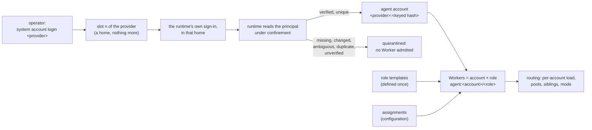

# Proposal: Agent accounts — several sign-ins per agent runtime, identified by their login

## Problem

The operator holds eight agent subscriptions: three Claude Code, two Codex CLI, and three
Antigravity CLI accounts, all personal paid plans (operator, 2026-10-23, D24). They want each one
to serve as a Worker, managed by provider and account, without naming accounts by hand.
[PROP-0007](0007-account-pools.md) made this work for website accounts. Agent Workers cannot do it
today (code read on `base/next`, 2026-10-23):

- **One account per runtime.** Each runtime row has one `home` (Claude Code's
  `CLAUDE_CONFIG_DIR`, Codex's `CODEX_HOME`, the Antigravity CLI's `HOME`; default
  `<DSH_HOME>/system/claude-home`, `codex-home`, `antigravity-home`). The registry refuses a
  second provider of one kind, and `RunSpec` names no home. The probe, and with it the sign-in
  check, is cached per runtime kind. So every Worker of a runtime runs on the one account
  signed in to that home.
- **Hand-made Worker names mix role and account.** A Worker is `agent:<id>` with an id the
  operator picks (`claude-review`, `codex-review`, `agy-review` on the live host). One row holds
  role settings (workspace, sandbox, tools, model, tier) and metering (`pool`, `account`,
  `windows`), and the metering is repeated on every row of the same account.
- **No identity.** Nothing reads who is signed in to a home. A home re-signed as another person,
  or two homes signed in as one person, would not be noticed. Website accounts have an
  `identityHash`, and `ctx.accounts` can list colliding ones (`duplicateIdentities()`), but no
  production code calls it: two catalog entries signed in as one person are routed as two
  accounts.
- **Nothing per account.** Agent runs queue one at a time per Worker (`ProviderScheduler(1)` keyed
  by Worker id). Two Workers on one home run at once on one account. The `agents` source reports
  no `load` and has no `reserve`, so least-busy routing ([ADR-0033](../decisions/adr/0033-least-busy-routing.md))
  does not see agent accounts.
- **Teams count one account twice.** A team member avoids the Workers another member holds,
  through session affinity. For agents, affinity is the single Worker, so two agent Workers on one
  home (a reviewer and a developer role) count as distinct accounts (REQ-TEAM-4). The source has
  no `siblings`, so an unsent failover ([ADR-0034](../decisions/adr/0034-unsent-failover-to-a-sibling-account.md))
  can land on another role of the same exhausted account.
- **A limit with no reading is forgotten.** A Codex or Antigravity run that fails
  `quota_exhausted` reports no limit observation, so the Worker's pool stays open and the next run
  hits the same limit.
- **Schemas lag.** `worker-session@1.0` `binding.runtime` has no `antigravity-cli`: the engine
  records an Antigravity team member's session as `local-tool`. No schema describes an agent
  account.
- **Terms.** All eight accounts are personal subscriptions. Rotating personal accounts to get
  around usage limits is restricted or prohibited by the providers' terms (research H4), and
  [PROP-0008](0008-studio-operating-model.md) already warns that pooling several accounts of one
  personal plan may breach them. PROP-0007's failover moves unsent website work to a sibling
  account when one hits its limit, which is exactly such a rotation.

## Goals

1. **Enroll by provider.** The operator signs in an account with
   `system account login <provider>`. The system gives it a home (an enrollment slot), and derives
   its account id from the verified login principal. No account is named by hand.
2. **Identity is proven or the account is quarantined.** An account whose principal is missing,
   changed, ambiguous, or shared with another account takes no work, and says why. A runtime whose
   principal cannot be read routes none of its accounts.
3. **Workers are account × role.** Role templates are defined once; each Worker is one account in
   one role, derived from configuration. Metering, concurrency, cooldowns, session affinity, and
   siblings are per account.
4. **Distinct accounts mean distinct principals.** Teams and failover see every role of one
   account as one account.
5. **Assigned by default.** A per-provider setting `accounts: assigned | pooled`, `assigned` by
   default and the only one allowed for personal subscriptions. An assigned account serves fixed
   roles or projects; when it hits a limit its work waits for its reset and never moves to another
   account of that provider. The same setting governs website accounts.
6. **Provider family stays separate from account.** Family remains who serves the work (the
   runtime, or the website's provider). The Codex CLI and the ChatGPT website are two families
   (operator, 2026-10-23, [PROP-0011](0011-feedback-loop.md#open-questions) question 3), whatever
   accounts they sign in with.

## Non-goals

- **Rotating accounts around limits** for personal subscriptions. `pooled` exists only for a
  provider whose terms the operator has recorded as allowing it.
- **Linking identities across providers.** A ChatGPT website account and a Codex login of the same
  person, or a Gemini website account and an Antigravity login, are separate accounts of separate
  providers. Identity namespaces never meet.
- **Renaming website accounts.** Website catalog ids stay as they are (REQ-ACC-1); only the
  `accounts` setting, and the quarantine of duplicates, apply to them.
- **Estimating quota.** Limits come from what a runtime reports or a run's failure says, as today
  ([resources](../design/resources.md#fail-closed-rules)).
- **Sharing one login between Workers of different runtimes**, or a runtime reading another
  runtime's home.
- **macOS keychains.** Linux only (PROP-0004); each home keeps its sign-in in its own files.

## Evidence and research

- **Code facts on `base/next` (2026-10-23), checked again for this proposal:**
  - `packages/plugins/agent-workers/src/index.ts`: `AgentWorkerConfig` (lines 42-75: `id`,
    `runtime`, `workspace`, `sandbox`, `tools`, `model`, `maxTurns`, `tier`, `quotaClass`, `pool`,
    `account`, `windows`, `worktreePerRun`, `limitCooldownSeconds`); the Worker id `agent:<id>`
    (line 124); `describe()` gives `family: worker.runtime` and no `load` (lines 264-291); the
    probe cached per `worker.runtime` (lines 386-389); `affinity` returns the session's single
    Worker (lines 236-239); no `siblings`, no `reserve`; one `ProviderScheduler(1)` per Worker id
    (lines 769-774); `observe()` records only reported limit observations (lines 736-765).
  - `packages/plugins/agent-runtimes/src/index.ts` lines 89-90: a second provider of one kind is
    refused. Lines 44 and 51: every coding agent's login and the DSH home are hidden from every
    agent child.
  - `packages/agent-runtime-core/src/index.ts` lines 120-134: `RunSpec` has no home and no
    account.
  - Runtime homes: `runtime-claude-agent-sdk/src/index.ts` line 137, `runtime-codex-sdk/src/index.ts`
    line 136, `runtime-antigravity-cli/src/index.ts` line 150. Sign-in checks: `claude auth
    status` (only `loggedIn` is read), `codex login status`, `agy models`.
  - Website accounts: `turns/src/index.ts` derives `worker:<account>/<tier>` (line 145), keeps
    cooldowns per `(account, feature)` (line 291), and gives `affinity` and `siblings` as the
    account's tiers (lines 303-311); its family is the account's provider (lines 762-763).
    `accounts/src/index.ts`: the catalog entry (lines 28-35), `identityHash` (line 61), and
    `duplicateIdentities()` (lines 186-194, called by tests only). `login/src/index.ts` line 313:
    the hash is `contentId({ provider, identity })` of the driver's identity hint.
  - `workflow/src/teams.ts`: a member's distinct-account restriction is built from the other
    members' `affinity` (lines 743-754); `runtimeOf()` maps an unknown kind to `local-tool`
    (lines 23-28). `workflow/src/recovery.ts` line 147: a failover excludes the failed Worker's
    `siblings`, which default to the Worker itself (`workers/src/index.ts` lines 102-108).
  - `resources/src/index.ts` lines 129-139: pools are configuration `{ pool, account, kind,
    windows, unknown }`; `account` is a free label.
  - `schemas/worker-session.v1.json` line 22 and `worker-sessions/src/index.ts` line 37: the
    runtime vocabulary lacks `antigravity-cli`.
  - The live patch ([live-base.patch.yml](../operations/examples/live-base.patch.yml)) has three
    hand-named read-only Workers on one checkout, `claude-review`, `codex-review`, and
    `agy-review`, one per runtime home. The first experiment's record
    ([review-worker-agnostic-1](../validation/experiments/records/review-worker-agnostic-1.experiment.json))
    pins `agent:codex-review` and `agent:agy-review`.
- **Brainstorm `run_60bb0779084119d1`** (ChatGPT website and Gemini API; both voted for option O1
  with high confidence): ordinal enrollment slots are only isolated credential homes; the account
  id is derived from the verified login principal (provider namespace and a stable hash); slots
  are never identities; each principal is pinned to its home; a missing, changed, ambiguous, or
  duplicate identity is quarantined; role templates are defined once and Workers are account ×
  role; quota pools follow real entitlement boundaries; per-account concurrency, cooldowns, strict
  session affinity, and failover only to a distinct verified account as a new attempt; family
  separate from account; provider-policy eligibility before automation.
- **Research `run_5297953ae346473d`:**
  - **H1 identity: insufficient.** Codex's auth storage exposes account ids (the best evidence).
    Claude account switchers match on email and organization. No way to read an Antigravity
    CLI identity was established. An account whose identity cannot be verified is not routed.
  - **H2 homes: supported.** `CLAUDE_CONFIG_DIR`, `CODEX_HOME`, and a home directory per
    Antigravity login separate the sign-ins. Separate directories are not isolation by
    themselves (a Claude Code keychain collision was reported on macOS); OS-level confinement is
    needed, which `system` already has (bubblewrap read confinement,
    [ADR-0024](../decisions/adr/0024-agent-workers-confined-for-reads.md)).
  - **H3 quota and routing:** the primitives exist elsewhere (window tracking, affinity,
    transcript counters), none complete. An observation is not an authorization, and stale or
    unknown quota never authorizes work.
  - **H4 terms:** rotating personal subscriptions to get around limits is restricted or
    prohibited (OpenAI: circumventing rate limits; Google: bypassing protective limits; Anthropic:
    reported as prohibited, the clause still to be checked). Rotation must be opt-in per provider
    after the operator verifies it is allowed; unresolved is not permitted.
- **Operator decision D24 (2026-10-23):** all eight accounts are personal paid subscriptions. No
  limit-driven rotation: accounts are assigned, not pooled; each serves its own roles or
  projects; a limit makes its work wait for its reset; website accounts get the same per-provider
  setting, assigned by default.
- **Operator decision D23** (this design) is open: this proposal is written for it.

## Proposed design

Every part is generic. Routing, teams, and workflows compare opaque account and group strings for
equality and never name a provider, runtime, or plan
([INV-11](../architecture/invariants.md#inv-11-no-tool-lock-in)).



### Enrollment slots are homes only

- Each agent provider is configured with a number of **slots** (`slots: 3`). A slot is an
  owner-only home directory, `<DSH_HOME>/system/agent-homes/<provider>/<n>`, and nothing more. Its
  number never names, orders, or identifies an account, and appears in no Worker id.
- The **provider** of an agent account is the runtime kind that signs it in and reads its identity
  (`claude-agent-sdk`, `codex-sdk`, `antigravity-cli`). It is the identity namespace: one person
  signed in through two runtimes is two accounts.
- Homes stay under the DSH home, which the read confinement hides from every agent child. A run
  binds back only its own account's home, so the accounts' homes are mutually invisible to the
  agents without new code
  ([credentials and egress](../design/agent-runtimes.md#credentials-and-egress)).
- The runtime row's `home` becomes the provider's default for a run that names none (the
  conformance suites and a probe without an account). Every Worker run names its account's home.

### The account id comes from the verified login

Each runtime provider gains an optional `identity(home)`: it reads who is signed in to that home,
under the same confinement as a run, and returns the principal's parts and where they came from.
It never returns a token; the parts stay inside the runtime and only their hash leaves it
([INV-8](../architecture/invariants.md#inv-8-credentials-never-cross-upward)).

| Runtime | What it stores in its home | Principal read | State of evidence |
|---|---|---|---|
| Codex CLI (`codex-sdk`) | `auth.json` in `CODEX_HOME` with the ChatGPT sign-in's tokens, an account id beside them, and an id token whose claims name the user and the ChatGPT account | the ChatGPT account id and the user id, read from the file after `codex login status` succeeds in the same home | the research's best evidence; to be pinned per version (phase A) |
| Claude Code (`claude-agent-sdk`) | its sign-in in `CLAUDE_CONFIG_DIR` (credentials, and the signed-in account and organization in its state file) | the account and organization ids, from `claude auth status` if its JSON names them on the pinned version, else from the home's state file; never the email alone, which can change | account switchers match on email and organization; the exact fields are pinned in phase A |
| Antigravity CLI (`antigravity-cli`) | its sign-in under `~/.gemini/antigravity-cli` in its own `HOME` | **unknown**: no command or file was shown to name the signed-in Google account | not established: an [open question](#open-questions); until proven, its accounts are not routed |

- **The account id** is `<provider>:<h>`, where `h` is the first 16 hex characters of an HMAC-SHA256
  over the provider and the canonical principal parts, keyed by a per-install key kept in the
  credential vault. A plain hash of an email or account id could be reversed by guessing; the key
  keeps the id from revealing the person. The full HMAC is kept on the record and compared; the
  short form is only the id, and two different full values with one short form are `ambiguous`.
- **Stable by construction.** The same login gives the same id after a restart, a token refresh, a
  re-login, or a move to another slot. A different login gives a different id.
- **Version-pinned, as the tool gate is.** A runtime's identity reader names the CLI versions a
  supervised check verified (as [ADR-0043](../decisions/adr/0043-antigravity-cli-workers-gated-on-a-version-verified-live.md)
  pins agy's hook): which file and fields, that two accounts differ, and that a re-login of one
  stays equal. On another version the principal is `unverified`. Codex and Claude Code readers
  start with the versions phase A checks.
- **Credentials land in the home.** A runtime child starts without D-Bus
  (`childEnvironment` drops `DBUS_SESSION_BUS_ADDRESS`), so a sign-in kept in the desktop keyring
  would be unreadable to the run. The login flow starts the CLI without D-Bus too, so each home
  holds its own sign-in in its own files. A home whose sign-in is not in its files is
  `unverified`.
- **An API key or gateway token is not a login.** A home that signs in through a forwarded API key
  (`forwardEnv`) or the Responses gateway has no person behind it: see the
  [open questions](#open-questions).

### Quarantine

An agent account record (`agent-account@1.0`) holds the slot, the home, the identity (the keyed
hash, the reader and its version, and when it was verified), a masked hint for the operator (the
first letter and the domain of the email, when the runtime shows one), and a status:

| Status | When | Admitted |
|---|---|---|
| `enrolled` | a slot is taken and its sign-in has not been verified yet | no |
| `ready` | the runtime reports a sign-in, its principal is read, and it equals the pinned one | yes |
| `signed-out` | the runtime's own sign-in check fails (`missing`) | no, `reauth-required` |
| `quarantined` | `changed`: the home now signs in as another principal; `ambiguous`: the principal cannot be read whole, or its short id collides with another; `duplicate`: two slots resolve to one principal (both are quarantined); `unverified`: the runtime or its version has no verified reader | no, `unavailable` with the reason |

- The identity is read at enrollment, at each probe (`probeTtlMs`), and again before each run, as
  the sandbox proof is today. A change between probe and run quarantines the account and fails the
  run unsubmitted (`config_error`), and nothing runs ([INV-2](../architecture/invariants.md#inv-2-fail-closed)).
- A quarantine never clears by itself. The operator resolves it: signs the slot in again as the
  pinned principal (`system account login <accountId>`), removes the account
  (`system account remove <accountId>`, which frees the slot), or, for `changed`, accepts the new
  principal as a new account (the old id keeps its history; the slot's home now holds a new
  account id).
- Every enrollment, verification that changes the status, and quarantine is a decision of the new
  type `enrollment` ([INV-13](../architecture/invariants.md#inv-13-every-decision-is-an-artifact)):
  inputs are the slot and the reader's evidence (never the principal), outcome the account id
  and status, detail the reason.
- **Website accounts:** two catalog entries whose `identityHash` collides are treated the same way:
  their Workers read `unavailable` with the reason `duplicate`, and health names both. Today they
  are only listable.

### `system account login <provider>`

1. `system account login codex-sdk` (operator scope). The daemon takes the lowest free slot of that
   provider, creates its home owner-only, and records an `enrollment` decision (status `enrolled`).
   No free slot: refused, naming `slots` and `system account remove`.
2. The CLI prints, and runs in the operator's own terminal, the runtime's sign-in command for that
   home, which the runtime provider supplies (`loginCommand(home)`). For example
   `CODEX_HOME=<home> codex login`, or `CLAUDE_CONFIG_DIR=<home> claude` then
   `/login`. It runs without D-Bus. The daemon runs no interactive sign-in.
3. When the command ends, the CLI calls `account_enroll`. The daemon runs the runtime's sign-in
   check and `identity(home)` under confinement, derives the account id, checks it against every
   other slot of the provider, and records the outcome: `ready`, or `quarantined` with the reason.
4. The CLI prints the account id, its masked hint, and the roles it is assigned (none at first),
   with the configuration lines to assign it.
5. `system account login <accountId>` signs an existing account in again in its own home; the
   result must be the pinned principal, else the account is quarantined `changed`.
6. `system account list` lists agent accounts beside website accounts: provider, account id,
   hint, status and reason, slot, roles, pools and their state.

`system account add` and `remove` are planned in the [CLI reference](../reference/cli.md); this
proposal builds `remove` for agent accounts. An account id never collides with a website catalog
id: catalog ids have no `:`.

### Role templates and Workers = account × role

```yaml
# agent-workers row (sketch)
providers:
  - provider: claude-agent-sdk
    slots: 3
    accounts: assigned            # the default; see below
    maxConcurrentRunsPerAccount: 1
    pool: claude-plan             # a pool template of the resources row
    windows: { five_hour: five-hour, seven_day: weekly }
  - { provider: codex-sdk, slots: 2 }
  - { provider: antigravity-cli, slots: 3 }
roles:
  - id: review
    workspace: /home/me/src/project
    sandbox: read-only
    tier: standard
    worktreePerRun: true
    runtimes:                     # what differs per runtime, never a routing input
      claude-agent-sdk: { maxTurns: 4 }
      antigravity-cli: { model: gemini-3.8-flash-high }
  - id: develop
    workspace: /home/me/src/project
    sandbox: workspace-write
    tier: standard
    worktreePerRun: true
assignments:
  - { account: "claude-agent-sdk:1f0c…", roles: [develop] }
  - { account: "claude-agent-sdk:9b2e…", roles: [review] }
  - { account: "codex-sdk:04aa…", roles: [review] }
```

- A **role template** holds what the work needs: workspace, sandbox, tier, `worktreePerRun`, and
  per-runtime `tools`, `model`, and `maxTurns`. It is defined once.
- An **assignment** gives an account its roles, by account id. It is the trusted envelope for
  account choice ([INV-6](../architecture/invariants.md#inv-6-authority-comes-from-trusted-envelopes)):
  configuration, never model text. An account with no assignment has no Worker.
- **The Worker** is `agent:<accountId>/<role>`, derived. Its family is still the runtime, its
  capabilities still what the probe proves for its sandbox
  ([admission evidence](../design/agent-runtimes.md#admission-evidence)), and it runs in the
  account's home. One writer per workspace holds as today
  ([INV-15](../architecture/invariants.md#inv-15-one-writer-per-subject)).
- An assignment that names an account not `ready` derives Workers that read `unavailable` with the
  account's reason, so routing and `status` say why.

### Per account: concurrency, load, cooldowns, affinity, siblings

The `agents` source does for agent accounts what `turns` does for website accounts:

- **Concurrency.** One scheduler per account, `maxConcurrentRunsPerAccount` (default 1) runs at
  once across all its roles, on top of one run at a time per Worker. In-process, as `turns` does,
  since one daemon owns the runs ([INV-1](../architecture/invariants.md#inv-1-one-authoritative-runtime)).
- **Load and pending admissions.** The source reports each Worker's `load` (its account's running
  and queued runs) and implements `reserve`, so least-busy routing and its pending count
  ([ADR-0033](../decisions/adr/0033-least-busy-routing.md)) apply to agent accounts.
- **Cooldowns.** A limit closes the account's pool, so every role of the account reads
  `quota-exhausted` until it resets. New: a run that fails `quota_exhausted` with no limit
  observation (Codex and the Antigravity CLI report none) records a `limited` reading on every
  window of the account's pool for `limitCooldownSeconds`, as an unmapped `rejected` observation
  already does. A limit is never retried on the same pool unseen.
- **Session affinity.** A session stays on its Worker (account and role), whose home holds its
  native session. It never moves to another role (another sandbox) or another account.
- **Siblings.** `siblings(worker)` returns every Worker of the account: a failover leaves the whole
  account out.

### Distinct accounts in teams, fixed for agents

A team member avoids every account another member holds (REQ-TEAM-4). The engine computes the
held set from the **siblings** of each member's held Worker instead of the Worker alone. For
website Workers the siblings are the account's tiers, which is what affinity gives today, so
nothing changes there. For agent Workers every role of one account is then one account, and two
members can no longer share an account through two roles.

This fix needs no new account model: on today's single home per runtime, the siblings of an agent
Worker are every Worker of that runtime. It is phase C, before anything else.

### Family stays separate from account

`family` remains the runtime for agent Workers and the provider for website Workers
([ADR-0027](../decisions/adr/0027-provider-diversity-in-routing.md)). Accounts are a separate
field, so an account never changes a family, and a later per-account family override never
changes which accounts are siblings. Two accounts of one runtime are two accounts and one family:
a team on them is a one-family team, and says so
([ADR-0035](../decisions/adr/0035-one-family-teams-keep-distinct-accounts.md)).

### The ledger's pools, per account

- The resources row keeps the operator's pool definitions (plan terms change, so they stay
  configuration, [resources](../design/resources.md)). It gains **pool templates**: a template
  names the pool's kind and windows and the provider group whose accounts it applies to.
- The `agents` source declares its `ready` accounts to the ledger. The ledger makes one pool per
  (template, account), with pool id `<template>@<accountId>` and `account` the account id. A
  declared account that matches no template has no pool, and its Workers are `unavailable` when
  metering is required.
- The runtime's window names map to the template's windows once per provider (`windows` on the
  provider), no longer on every Worker row.
- Reservations, records, and readings name the account and its pool, so `resources_pools` shows
  each account's own windows and resets, and a limit on one account never closes another's.

### `accounts: assigned | pooled`, per provider

The setting is per provider: on each agent provider of the `agents` row, and on each website
provider of the `accounts` row. **`assigned` is the default.**

- **`assigned`** (required for personal subscriptions):
  1. An account serves the roles (and, for website accounts, the tiers) its configuration gives
     it.
  2. **A limit never moves work to another account of the provider.** When admission refuses a
     Worker only for its limit (`quota-exhausted`, or a `cooldown` check) and it would otherwise
     be admitted, every other Worker of the same provider group is refused for that requirement
     with the new check `assignment` ("an account of this provider is at its limit until 18:40;
     assigned accounts do not take its work"). Workers of other providers may still be admitted,
     as today.
  3. **The work waits.** A node refused only for limits of assigned accounts is not failed: the
     `recovery` decision chooses the new outcome `wait`, with the earliest reset among those
     limits as `not_before`, persisted on the node row. A wait spends no attempt. It is bounded:
     a node waits at most `maxLimitWaitHours` (default 24) in all; past that, or when no reset
     time is known, it fails `quota_exhausted` as today and the operator decides.
  4. **No failover inside the provider.** An unsent failure fails over only to Workers outside the
     failed Worker's provider group (see [ADR-0034](#what-changes-for-website-accounts-adr-0034)).
  5. Parallel use stays: accounts of one provider still serve different roles at once, and team
     members still keep distinct accounts while they can.
- **`pooled`**: today's PROP-0007 behavior. It is refused at load unless the provider's settings
  carry `pooledTerms` (who confirmed, when, and what terms they read), recorded at start as a `gate`
  decision. Personal subscriptions never qualify (D24).

The descriptor carries what routing needs as opaque values: `account: { id, group, mode,
limitUntil? }` (`capability-descriptor@1.4`). `group` is the provider for website accounts and the
runtime for agent accounts; routing compares it only for equality, as it compares families
([INV-11](../architecture/invariants.md#inv-11-no-tool-lock-in)). A Worker with no `account`
(a model Worker) is routed exactly as today.

#### What changes for website accounts (ADR-0034)

With one account per provider, as on the live host, nothing changes. With two or more accounts of
one provider under `assigned`:

| ADR-0034 today | Under `assigned` |
|---|---|
| an unsent `quota_exhausted` fails over to a sibling account | it waits for that account's reset (`wait`), bounded; it never moves to another account of the provider |
| an unsent `challenge` or `reauth_required` fails over to a sibling account | it fails over only to a Worker of another provider; with none, it fails (`USER_ACTION`) as before ADR-0034 |
| an unsent `overloaded` fails over to a sibling account | it is retried on the same account with back-off, as before ADR-0034 |
| a limit's cooldown steers new work to the least busy sibling | the cooldown stands; new work the limited account could take waits (`assignment` check) |
| least-busy order among accounts ([ADR-0033](../decisions/adr/0033-least-busy-routing.md)) | unchanged |
| one-family teams keep distinct accounts ([ADR-0035](../decisions/adr/0035-one-family-teams-keep-distinct-accounts.md)) | unchanged: a member is bound to its account for the team's life and never moves |

Under `pooled`, ADR-0034 stands as accepted. Cooldowns, their sources, and how they clear are
unchanged in both modes. On acceptance, a new ADR supersedes ADR-0034 in part for assigned
providers; ADR-0034 itself is not rewritten.

### Seams and records touched

Whether each change is additive follows [ADR-0036](../decisions/adr/0036-guarantee-core-and-capability-plugins.md):
a guarantee seam changes only by ADR, and here only by optional fields and new enum values.

| Seam (class) | Change | Additive |
|---|---|---|
| `agentRuntimes` (capability: Worker) | optional `RunSpec.home`; optional `home` on `probe`; optional `identity(home)` and `loginCommand(home)` on a provider; conformance: a provider that reads identity returns equal hashes for one login and different ones for two, and refuses a home it cannot read | yes; versioned definition and suite |
| `workers` (core: gate) | descriptor `account` (optional); admission check `assignment`; `AdmissionFailure.limitUntil` (optional); the `assignment` rule applies only to Workers that declare an assigned `account` | yes, optional fields and an enum value; an ADR |
| `workflow` (core: work state machine, runner) | `recovery` outcome `wait`; under `assigned`, a failover excludes the failed Worker's provider group; a team's held accounts from siblings; scenarios for each | yes, a new outcome value and rules that apply only to Workers with an assigned `account`; the team fix makes REQ-TEAM-4 hold; an ADR |
| `resources` (core: resource ledger) | pool templates in configuration; optional `declare(accounts)` from a Worker source, instantiating templates only | yes, an optional method; an ADR |
| `workerSessions` (core: work state machine) | `binding.runtime` gains `antigravity-cli` | yes, an enum value (`worker-session@1.1`) |
| `accounts`, `turns` (capability: Worker) | per-provider `accounts` setting; descriptor `account`; duplicates' Workers `unavailable` | yes |
| `agentWorkers` source (capability: Worker) | providers, slots, roles, assignments; account records; per-account scheduler, load, `reserve`, `siblings`; derived pools; `account_enroll`, `account_remove` MCP tools | the row's configuration changes shape (below) |
| `mcp` (surface) | `account_enroll`, `account_remove`, agent accounts in `account_list`, each with its schema ([ADR-0037](../decisions/adr/0037-schema-and-protocol-first.md)) | yes |

**Schemas** ([versioning](../reference/schemas.md#versioning)):

- new `agent-account@1.0`: `accountId`, `provider`, `slot`, `home`, `status`, `quarantine` (`reason`,
  `since`, `decision`), `identity` (`hmac`, `reader`, `runtimeVersion`, `verifiedAt`), `hint`,
  `revision`, `updatedAt`;
- `worker-session@1.1`: `binding.runtime` gains `antigravity-cli`;
- `capability-descriptor@1.4`: optional `account`;
- `decision@1.8`: decision type `enrollment`; `recovery` gains the outcome `wait`;
- `limit-state` and `usage-record`: unchanged (their `account` and `pool` are ids already).

### Invariants and requirements

- No invariant changes. The design applies
  [INV-2](../architecture/invariants.md#inv-2-fail-closed) (an unknown identity or quota never
  admits), [INV-4](../architecture/invariants.md#inv-4-restart-is-reconciliation-not-replay) (a
  wait never resends a sent turn; it only delays an unsent node, and the wait survives a restart
  on the node row), [INV-6](../architecture/invariants.md#inv-6-authority-comes-from-trusted-envelopes)
  (assignments are configuration), [INV-8](../architecture/invariants.md#inv-8-credentials-never-cross-upward)
  (only a keyed hash leaves a runtime), [INV-9](../architecture/invariants.md#inv-9-everything-is-bounded)
  (slots and waits are bounded), [INV-11](../architecture/invariants.md#inv-11-no-tool-lock-in),
  [INV-13](../architecture/invariants.md#inv-13-every-decision-is-an-artifact), and
  [INV-14](../architecture/invariants.md#inv-14-every-record-has-a-versioned-schema).
- **Requirements** ([SRS](../requirements/SRS.md)):
  - REQ-ACC-1: agent accounts are identified by their verified login, not named; website accounts
    keep catalog names.
  - REQ-ACC-7: accounts that resolve to one identity are quarantined, not only flagged.
  - new REQ-ACC-10: each provider declares `accounts: assigned | pooled`, assigned by default;
    pooled only on a recorded confirmation of its terms.
  - new REQ-ACC-11: agent accounts are enrolled into slots; an account whose identity is missing,
    changed, ambiguous, duplicate, or unverified takes no work.
  - REQ-WRK-8: under `assigned`, work refused for a limit waits for its reset, bounded.
  - REQ-TEAM-4: distinct accounts are distinct verified principals, across every role of an
    account.

### Migration from hand-named rows

1. **Before the upgrade**, `system account migrate` (read-only) prints the new `agent-workers`
   configuration from the old rows: each runtime's configured `home` becomes slot 1 of its
   provider (the directory is adopted, not moved); the three live rows become one role `review`
   (read-only, standard, the checkout) with per-runtime `maxTurns` and `model`; and an assignment
   of `review` to each slot-1 account, by the id the command derives from that home now. An old
   `pool` and `account` pair becomes a pool template with its windows.
2. **At the upgrade**, an `agent-workers` row in the old shape fails startup with the exact path
   and the migrate command (REQ-HOST-2). There is no second path: one implementation.
3. **Store:** agent runs and sessions of an old Worker id are moved to the new id when the old row
   maps to exactly one new Worker (same home, same role), so a continued session resumes in the
   same home. Records already written keep the old ids and still explain.
4. **Ledger:** usage and readings recorded under old pool ids stay; reports show them under those
   ids.
5. **Antigravity:** its slot-1 account is enrolled but `unverified` until its reader is verified.
   Its Worker then reads `unavailable`, so `agy-review` stops at the cutover unless phase A proved
   its identity ([open questions](#open-questions)).
6. **The first experiment** ([PROP-0011](0011-feedback-loop.md)) pins `agent:codex-review` and
   `agent:agy-review`. Its record is still `proposed`, so it is revised (`revision: 2`,
   `supersedes` 1) with the new ids before it is registered. A changed pin after registration
   would be a new experiment.

## Phased plan

Each phase ends with its suites passing and its canonical documents updated.

| Phase | Delivers | Depends on |
|---|---|---|
| **A** Evidence | a supervised check per runtime, on scratch homes and the operator's real accounts: which file and fields name the principal, on which version; equal across restart, token refresh, and re-login; different for two accounts. Fixtures with the principals redacted, as agy's hook fixture. For Antigravity: a principal source, or the record that none was found. The operator's record of each provider's terms (D24: personal, assigned) | — |
| **B** Specification | the schemas above; the `agentRuntimes` definition and suite (`home`, `identity`, `loginCommand`); the ADRs below; `workers`, `workflow`, and `resources` suites extended and passed by their fakes | A for the identity fields |
| **C** Correctness on today's homes | agent `siblings` (every Worker of the runtime, while there is one home); a team's held accounts from siblings; `antigravity-cli` session records; a `quota_exhausted` run with no observation closes its pool; website duplicates `unavailable` | — (can ship first) |
| **D** Account mode | `accounts: assigned \| pooled` on website and agent providers; descriptor `account`; the `assignment` check; the `wait` outcome; failover inside the group off under `assigned`; `pooledTerms` | B |
| **E** Enrollment and identity | slots and homes; `system account login <provider>`, `account_enroll`, `remove`, `list`; identity readers for Codex and Claude Code; quarantine; `enrollment` decisions; existing homes adopted as slot 1 | A, B |
| **F** Workers = account × role | providers, roles, assignments; per-account scheduler, load, `reserve`; pool templates and `declare`; `system account migrate`; the cutover (old rows refused); the experiment record revised | D, E |
| **G** Live, short first | a second Claude Code account enrolled; two roles on two accounts at once; a two-member review on two accounts of one runtime (a one-family team); a quarantine provoked by signing a slot in as another account; then the second Codex account; a limit's wait when the operator meets one; Antigravity accounts only once their identity is verified | F |

Phase D lands before F: no provider has two routed agent accounts before the assigned rules hold.

**ADRs on acceptance:**

- *Agent accounts are enrolled slots identified by their verified login; Workers are account ×
  role.* Covers the `agentRuntimes` identity, quarantine, siblings, and the team fix.
- *Accounts are assigned unless the operator records that a provider's terms allow pooling.*
  Covers the descriptor `account`, the `assignment` check, the `wait` outcome, failover inside
  a provider group, pool templates, and supersedes ADR-0034 in part for assigned providers.

## Alternatives considered

- **Hand-named accounts per home** (`claude-1`, `claude-2`): the smallest change, but a name says
  nothing about who is signed in. A home re-signed as someone else, or two homes as one person,
  stays invisible, and teams would count them as distinct. Rejected (brainstorm O1, research H1).
- **Slots as identities** (`claude-agent-sdk:1`): stable and simple, but the slot is where a login
  lives, not who it is. Moving a login between slots would change its id and its history. Rejected.
- **One unified accounts seam for websites and agents.** Both have accounts, but a website account
  holds browser state in the vault and an agent account a CLI's own files in a home. One seam
  would mix two storage and sign-in models for one consumer each. Rejected for now (ADR-0006): the
  per-provider setting and the descriptor's `account` already give routing one view.
- **A plain hash of the principal**: no key to keep, but an email or account id could be recovered
  from it by guessing. Rejected for a keyed hash.
- **Pooling by default, with rotation off by a flag**: the operator's plans are all personal, and
  unresolved terms are not permission (H4). Rejected for `assigned` by default.
- **Strict fixed scopes under `assigned`** (no two accounts of one provider may serve the same
  role on one project): it removes every overlap at load time, but forbids parallel use the
  operator kept (D24: accounts still serve parallel roles and team independence). Kept as an
  [open question](#open-questions); the `assignment` check prevents the rotation either way.
- **Treat an Antigravity login as verified by the operator's word**: research H1 says an
  unverifiable account is not routed. Rejected.

## Validation plan

- **`agentRuntimes` conformance** (fake runtimes with scripted homes): one login gives one hash
  across restart and refresh; two logins give two; an unreadable or partial principal is refused;
  `RunSpec.home` is the only home a run's confinement binds back.
- **`agents` source:** derived Worker ids; `unavailable` for every non-`ready` account with its
  reason; a principal changed between probe and run fails the run unsubmitted; duplicates
  quarantine both slots; per-account concurrency across two roles; `load` and `reserve`;
  `siblings`; a limit with no observation closes the pool; pools declared per account.
- **Routing and workflow** (fake Workers with accounts):
  - under `assigned`, a limited account blocks its group's other accounts for that requirement and
    admits other providers; the node waits until the reset and then runs on the same account; the
    wait survives a restart; the bound fails it; no attempt is spent;
  - under `assigned`, an unsent `challenge` fails over only outside the group; an unsent
    `overloaded` retries on the same account;
  - under `pooled`, PROP-0007's failover suite passes unchanged;
  - a team with a reviewer and a developer role on one account gets distinct accounts, or a
    `same-family-shared-account` record when only one account exists;
  - Workers without `account` route exactly as before.
- **Enrollment** (CLI and MCP, fake runtime): slot allocation, no free slot, re-login of the same
  principal, a changed principal, removal freeing the slot, and an `enrollment` decision for each.
- **Migration:** old rows refused with the migrate command; `migrate` output for the live patch;
  sessions moved to the new ids; old runs still explain.
- **Crash suite:** a crash between slot allocation and verification leaves `enrolled`, never
  `ready`; a waiting node resumes its wait after a restart.
- **Live, short first** (phase G).

## Rollout and rollback

- Phase C ships alone and changes only wrong outcomes (two roles of one home counted as two
  accounts).
- Phase D: with one account per provider, as on the live host, routing chooses exactly as before.
  Website providers with two or more accounts become `assigned` on upgrade; the operator sets
  `pooled` with `pooledTerms` only for a provider whose terms allow it.
- Phase F is a cutover, prepared by `system account migrate` and the runbook. Rollback is a release
  downgrade with the previous patch: slot 1 of each provider is the old home, so the old rows find
  their sign-ins where they were. Homes of later slots stay hidden under the DSH home and unused.

## Observability and operations

- `system account list` and `/ui` show every account with provider, id, hint, status and reason,
  roles, and pools. Health names quarantined accounts and duplicates.
- `system explain` shows `enrollment` decisions, the `assignment` refusals with the limit's reset,
  and `recovery` decisions with outcome `wait`.
- **Runbook:** enroll an agent account; assign roles; resolve a quarantine; migrate hand-named
  rows; confirm pooled terms for a provider.
- **Playbook:** "work is waiting for an account's limit": which account, until when, and why it
  does not move (the provider is assigned).

## Security and privacy

- Each account's home is hidden from every other account's runs by the existing confinement; a run
  binds back only its own home.
- The principal is read inside the runtime and leaves it only as a keyed hash; no token is read
  beyond the fields named in the reader, logged, or stored. The masked hint stays local and is
  never sent to a Worker.
- Losing the per-install key changes every derived id: the accounts must be enrolled again (their
  old ids keep their history). The key is backed up with the vault.
- **Terms:** the default never moves work between personal accounts because of a limit. `pooled`
  needs the operator's recorded confirmation per provider.
- A home is writable by its own runs, so a run could alter its sign-in files. Re-reading the
  identity before each run, and quarantining a change, bounds what such an alteration can do.

## Compatibility and migration

New schemas start at `@1.0`; `worker-session@1.1`, `capability-descriptor@1.4`, and `decision@1.8`
are minor additions, and readers in decision paths reject unknown values. The `agent-workers`
configuration changes shape at phase F, with the [migration](#migration-from-hand-named-rows)
above and no compatibility path. Records keep their old Worker and pool ids.

## Open questions

1. **Antigravity CLI identity.** No command or file was shown to name the signed-in Google
   account. Phase A looks for one on the pinned agy version (its sign-in directory, its commands),
   checked live as its hook was. Proposed: until a reader is verified, Antigravity accounts are
   enrolled but `unverified` and route nothing. Since its Worker would then stop at the cutover,
   and PROP-0011's first experiment needs it: does the cutover wait for Antigravity's reader, or
   do Antigravity Workers stop until it exists? Proposed: the cutover waits, so Claude Code and
   Codex get several accounts only once all three runtimes have readers or the operator chooses to
   stop Antigravity.
2. **Claude Code principal.** The account id and organization id (proposed), never the email
   alone. Does `claude auth status` name them on the pinned version, or only the home's state
   file?
3. **Codex principal.** The ChatGPT account id with the user id (proposed): on a workspace plan the
   account id is shared by its members. Is the account id alone enough for personal plans?
4. **Homes signed in by an API key or the gateway.** They have no person behind them. Proposed: an
   account kind `credential`, identified by the provider and the forwarded variable's name, always
   metered, never a subscription. Or out of scope until such a Worker is needed?
5. **Parallel use under `assigned`.** May two accounts of one provider serve the same role on one
   project (parallel capacity, with the `assignment` check stopping rotation; proposed), or must
   each role and project have exactly one account per provider (strict fixed scopes)?
6. **The wait's bound.** `maxLimitWaitHours` 24 (proposed). A weekly limit would then fail to the
   operator rather than hold a node for days. Is that right, or should a board task's attempt wait
   longer?
7. **Recording `pooledTerms`.** Configuration plus a `gate` decision at start (proposed), or a
   `policy-change` through the approval queue
   ([ADR-0041](../decisions/adr/0041-policy-changes-through-the-approval-queue.md))?
8. **Project assignments.** Roles carry a workspace, so assigning a role assigns a project. Should
   website accounts be assignable to projects too? That would carry the run's project into routing
   from a trusted envelope, which no seam does today (ADR-0039 lists it as open).
9. **The masked hint.** Keep a masked email for the operator to tell accounts apart (proposed), or
   only the id?

## Decision

Accepted by the operator on 2026-10-23 (D23), with the answer D24: all eight accounts are personal
paid subscriptions, so accounts are assigned, not pooled, and the website accounts take the same
per-provider setting, assigned by default. Phase B wrote the two ADRs named above, proposed:
[ADR-0051](../decisions/adr/0051-agent-accounts-are-enrolled-slots-identified-by-their-login.md)
and [ADR-0052](../decisions/adr/0052-accounts-are-assigned-unless-pooling-is-recorded.md). Where
an open question below had a proposed answer that phase B or D needed, it was taken as proposed:
parallel use under `assigned` (question 5), `maxLimitWaitHours` 24 (question 6), and `pooledTerms`
as configuration with a `gate` decision at start (question 7).

On 2026-10-24 the operator decided (D33) to pool `chatgpt-web`, `gemini-web`, and
`claude-agent-sdk` although they are personal subscriptions, accepting the risk under their terms;
[ADR-0055](../decisions/adr/0055-personal-accounts-may-be-pooled-on-the-operators-recorded-acceptance.md)
supersedes ADR-0052 in part for it: "personal subscriptions never qualify" above no longer holds.

## Implementation

The state of each phase, and what remains, is in the [roadmap](roadmap.md#done-and-open-milestones). Built:

- **Phase B** (specification): `agent-account@1.0`, `capability-descriptor@1.5` (`account`),
  `decision@1.8` (`enrollment`, the `recovery` outcome `wait`); the `agentRuntimes` additions
  (`RunSpec.home`, `probe({ home })`, `identity(home, key)`, `loginCommand(home)`) with their
  suite, passed by a fake with scripted homes, every runtime refusing a home it does not run in;
  the `workers` and `workflow` (contract 1.5) suites extended. `worker-session@1.1`
  (`antigravity-cli`) is phase C's, and the resource ledger's pool templates and `declare` are
  phase F's.
- **Phase D** (account mode): `accounts: assigned | pooled` on the `accounts` row (website
  providers) and the `agent-workers` row (runtimes), `pooledTerms` required for pooled and recorded
  at start as a `gate` decision; each website and agent Worker names its `account`; the
  `assignment` check; the `wait` outcome bounded by `maxLimitWaitHours`; no failover inside an
  assigned group.
- **Phase C** (2026-10-23 and 2026-10-24):
  - an Antigravity CLI member's session records `antigravity-cli` (`worker-session@1.1`, the
    `workerSessions` contract 1.1,
    [ADR-0015's amendment](../decisions/adr/0015-worker-sessions-and-peer-messaging.md#amendment-2026-10-23-contract-11-names-the-antigravity-cli-runtime));
  - two catalog entries signed in as one person take no work, and health names them (REQ-ACC-7;
    [runbook](../operations/runbooks.md#two-accounts-sign-in-as-one-person));
  - a `quota_exhausted` run with no limit observation closes its Worker's pool, and with no pool
    cools its runtime down ([agent Workers](../../packages/plugins/agent-workers/README.md));
  - agent `siblings`: every Worker of a runtime, while there is one home per runtime, so a
    failover leaves them all out, and a cooldown or a closed pool of any of them holds them all
    (`quota-exhausted`, `limitUntil` the latest reset);
  - a team's held accounts counted by sibling, and by the descriptor's `account`: two roles of one
    home are one account, never two members; a member whose held account cannot be told apart is
    refused with the cause (`workflow` contract 1.5,
    [distinct accounts](../design/teams.md#distinct-accounts)).
- **Phase E** (2026-10-24; [enrollment and quarantine](../design/agent-runtimes.md#enrollment-and-quarantine),
  [runbook](../operations/runbooks.md#enroll-an-agent-account)):
  - enrollment slots (`slots` on an `agent-workers` `providers` entry, default 1), each an
    owner-only home; slot 1 adopts the runtime's own home where it is (the provider's optional
    `home`), later slots are `<DSH_HOME>/system/agent-homes/<provider>/<n>`;
  - `system account login <runtime>` (MCP `account_enroll`, `begin` then `verify`), `login
    <accountId>`, `verify`, `remove`, and agent accounts in `system account list` (MCP
    `account_agents`), operator scope, `mcp-agent-accounts@1.0`;
  - identity readers: Codex (`tokens.account_id` of `auth.json`) and Claude Code
    (`oauthAccount.accountUuid` and `organizationUuid` of `.claude.json`), each pinned to the
    version it was seen on (0.164.0, 2.1.308), against redacted fixtures; Codex and Claude Code run
    and probe in a named home; the Antigravity CLI gives its sign-in command and reads no identity;
  - the account id `<provider>:<16 hex>` of an HMAC keyed by a per-install key in the vault;
    quarantine (`changed`, `ambiguous`, `duplicate` of both slots, `unverified`) and `signed-out`,
    each an `enrollment` decision first; re-read at each probe and before each run, never lifting
    anything; health's `agent-accounts` check;
  - open questions taken as proposed: Codex's principal is its ChatGPT account id alone (question
    3; a workspace plan's shared id then reads as a duplicate, the safe side); Claude Code's is the
    account and organization ids from the home's state file (question 2); the masked hint is kept
    (question 9); an API-key sign-in names no person and is `ambiguous` (question 4, the account
    kind `credential` not built).
  - Until the operator applies phase F's move (its cutover), the hand-named Workers run in their
    runtime's own home: they take work while no
    slot holds it, or while its account is `ready` or `unverified` (Antigravity's slot 1, as before
    enrollment); never beyond slot 1. Owed: phase A's supervised check of both readers on the
    operator's real accounts.
- **Phase F** (2026-10-24; [Workers = account × role](../design/agent-runtimes.md#workers--account--role),
  [migration](../design/agent-runtimes.md#migration-from-hand-named-rows),
  [runbook](../operations/runbooks.md#migrate-agent-workers-to-accounts--roles)):
  - `roles` and `assignments` on the `agent-workers` row; Workers `agent:<accountId>/<role>`,
    derived; admitted only while their account is `ready`; each run in its account's home;
  - per account: `maxConcurrentRunsPerAccount` (default 1), `load` and `reserve`, `siblings`,
    cooldowns; pools from the resources row's `templates` through the ledger's optional `declare`
    (resources contract 1.1), one per template and ready account;
  - `system account migrate` (MCP `account_migrate`, `mcp-agent-accounts@1.1`): planned by default,
    `--apply` recorded as `enrollment` decisions (rule `agent-workers.migration`) with the old
    Workers' agent sessions and runs moved, `--rollback` undoing exactly those moves.
  - Departures, each the conservative reading:
    - **The cutover** (migration step 2) refuses the hand-named rows only once the operator applied
      the move, not at the upgrade: until then both shapes load (one per row), and the hand-named
      Workers route and run exactly as before (tested), so a release with phase F changes nothing
      on the live host by itself;
    - the pool id is `<template>/<accountId>`, not `<template>@<accountId>`: `@` is not an id
      character (`common@1`);
    - open question 1 taken as proposed: the cutover waits for the Antigravity CLI's reader, unless
      the operator stops its Workers at the cutover (`--stop antigravity-cli`);
    - the pools declared are the ready assigned accounts' (ADR-0052), declared again whenever that
      set changes;
    - `maxConcurrentRunsPerAccount` of a migrated runtime is the number of its hand-named rows, so
      as many of its runs run at once as did;
    - **the first experiment's record** (step 6) is not revised here: its new ids are the live
      accounts' keyed hashes, which only the operator's `system account migrate` prints; the
      runbook revises it (`revision: 2`) before it is registered;
    - the `workerSessions` records of team members keep the ids they were written with, as other
      records do; only the `agents` source's own sessions and runs move.

The other phases are listed [above](#phased-plan).
