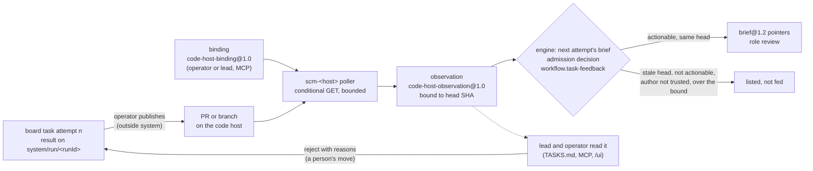

# Proposal: Feedback from work — code-host observations, a completion gate, and a liveness verdict

## Problem

The [`algorithm-development`](../reference/workflow-templates.md#algorithm-development) template
(PROP-0010 B8) gives a board task's attempt one `develop:1`, an exact-subject `review:1`, and a
final `validate:1`. A rejected attempt goes back to the lead, and the next attempt is briefed from
the previous attempt's result and the decision behind it
([a board task's brief](../design/workflow-engine.md#a-board-tasks-brief)). Three kinds of feedback
the work itself produces never reach that loop today:

- **Nothing reads the code host.** An attempt ends on a retained branch `system/run/<runId>`,
  committed at retention and never merged or pushed
  ([workspaces](../design/agent-runtimes.md#workspaces)). When the operator publishes the branch
  as a PR, its CI checks, review comments, and merge conflicts stay on the host. The next attempt
  is briefed without them unless a person copies them in. The `merge` action class exists in the
  policy (`ask` in the studio policy) but no step performs a merge.
- **A Worker reports "done" before its checks run.** The autonomy policy requires `tests` and
  `lint` for `workspace-write`, but they bind only when a result is accepted
  ([required checks bind at acceptance](../design/board.md#required-checks-bind-at-acceptance)).
  `validate:1` runs the tests after the review, and its report is the model's account of what it
  ran, so the engine never reports `tests` from it
  ([`algorithm-development`](../reference/workflow-templates.md#algorithm-development)). A develop
  step whose change breaks the tests still spends a review and a validation before anyone sees
  it, and under the studio policy every result is held for the operator.
- **A failed probe is treated as death.** A durable runner holds its lease through
  `ctx.leases.hold`, which aborts `lost` when a renewal fails, whatever the error
  ([lease generations](../design/scheduling-and-leases.md#lease-generations)). An agent run's
  signal includes `lost`, so a transient store error during a heartbeat stops a live agent. In
  the other direction, nothing states when a run that another process holds is really gone, and
  nothing stops automation from resuming a session that is waiting on an approval: a board task's
  next attempt resumes the session before it without asking whether that session's last run
  stopped on a deferred tool call.

## Goals

1. **Code-host feedback as facts.** CI, review, and mergeability of a bound PR or branch are
   recorded as observations bound to its head SHA; the actionable ones reach the task's next
   attempt as brief pointers. The observer never moves a task, comments, pushes, or merges.
2. **Landing on an exact approval.** Merging an accepted attempt into its base, or applying it for
   the operator to commit, happens only on a `merge` approval bound to the mode, the base SHA, and
   the head SHA, with clean refusals and never a force or a push.
3. **Checks before "done".** A writing step's required checks run at its stop boundary, in its own
   confinement, and a failure goes back into the same session, bounded by rounds, turns, and the
   run's deadline. Each round is a recorded decision; nothing is claimed passed without evidence.
4. **Death only on evidence.** A run is dead only when its holder and its runtime are both
   positively gone and no activity was seen within a bound. A failed probe, a failed renewal, or a
   missing signal is `unknown`, never death.
5. **No automated input to a blocked session.** A session waiting on an approval takes no input
   but that approval's resolution.

## Non-goals

- `system` pushing branches or opening PRs. Publishing is `external-send` and stays the operator's
  for this proposal; a publish step is [later](#phased-plan), with its own go-ahead.
- Acting on the code host: no comment, label, approval, re-run of CI, or merge on the host.
- Webhooks. They need an inbound listener the host can reach, which means a relay or an open port
  ([what not to adopt](#what-not-to-adopt)).
- Nudges: no automated message to a stalled session. A stalled run is reported, not prodded.
- A judge of completion by a model. Checks are commands with exit codes; a model's account of a
  command stays evidence, never a check.
- Changing an invariant. Every rule here applies existing invariants.

## Evidence and research

- **Research notes** (in the coordination repository, not yet under [research](../research/README.md);
  [open question 1](#open-questions)):
  - `paseo-superorchestrator-2026-10-23`, §3 and §4: superorchestrator's review gate (`review:
    true` runs `ci`, `pr_threads`, and orchestrator-only `cmd:` checks, stops at `pending_review`,
    `reject_run(feedback)` resumes the same session) and its land step (`accept_run(merge: true)`
    refuses on a moved base, a dirty tree, a hook failure, or a conflict, and never forces or
    pushes); its stall watcher (no event for 5 minutes, up to 3 nudges, then `escalated`). The note
    ranks a land step "bound to the head SHA (INV-5)" fourth and a no-progress watcher fifth.
  - `orchestrators-survey-2026-10-24`, rows 1, 2, 3, 6, and 8: OrchestratorInc/agent-orchestrator
    (AO) polls PRs, CI, and reviews every 30 s with ETags and feeds the results back to the owning
    session; AO's termination guardrail "failed probes are NOT proof of death"; AO's rule
    "automation must never inject input into a blocked session", with a durable `activity_state`
    whose display status is derived when read; Claude Code agent teams' `TaskCompleted` and
    `TeammateIdle` hooks that exit 2 as a quality gate; container-use's two landing modes,
    `merge` (keeps history) and `apply` (staged; the operator commits); vibe-kanban's inline diff
    comments as the agent's next turn and its "rebase conflicts" task state. The note's
    uncertainty: AO's internals were read only through its documentation.
- **External projects** (ideas only; licences in the notes):
  [agent-orchestrator](https://github.com/OrchestratorInc/agent-orchestrator) (Apache-2.0),
  [superorchestrator](https://github.com/datamonsterr/superorchestrator/blob/main/docs/guide/review.md)
  (MIT), [container-use](https://github.com/dagger/container-use) (Apache-2.0). Conditional
  requests: GitHub's REST guidance says a `304 Not Modified` answer to an `If-None-Match` request
  does not count against the primary rate limit
  ([best practices](https://docs.github.com/en/rest/using-the-rest-api/best-practices-for-using-the-rest-api)).
  Claude Code's `Stop` hook can block a stop with a reason the agent continues from
  ([hooks](https://docs.claude.com/en/docs/claude-code/hooks)); that the SDK version `system`
  pins honours it is to be shown live ([phase C1](#phased-plan)).
- **Code facts on `base/next` (6746444), read for this proposal:**
  - `packages/agent-runtime-core/src/index.ts`: `RuntimeEvidence` (line 26) with `gatesToolCalls`
    (line 47); `RunSpec` (line 120) with `toolGate` (line 133), and no stop-boundary hook; the read
    confinement starts `bwrap` with `--die-with-parent` (line 326), so an agent child does not
    outlive the process that started it.
  - `packages/plugins/runtime-claude-agent-sdk/src/index.ts` lines 213-225: `settingSources: []`,
    `permissionMode: 'dontAsk'`, and the run's tool gate as the one hook (`PreToolUse`); no `Stop`
    hook is registered.
  - `packages/plugins/leases/src/index.ts` lines 111-136: `hold` renews every third of the TTL and
    aborts `lost` on any error the renewal throws (line 123), not only `LeaseLost`; `renew`
    (lines 140-147) throws `LeaseLost` only when no row matched.
  - `packages/plugins/agent-workers/src/index.ts`: the run's signal is
    `AbortSignal.any([lost, stopped, cancel])` (line 604); a run that had started before a stop
    fails as `reconciliation_failed` and is never run again (lines 606-612); the hard deadline
    `runTimeoutMs`, 15 minutes by default (lines 197, 804).
  - `packages/plugins/workflow/src/tasks.ts`: a next attempt's pointers are the previous result
    and its digest (`prior`), the steps a spent budget stopped (`prior`), and the decision behind
    the attempt (`review`), at most `FRAME_POINTERS` (lines 255-275); session resume checks the
    template, the native handle, the Worker's readiness, and `maxSessionRuns`, and nothing about an
    open approval (lines 404-422); `checksOf` reports only `schema` and `review`, "a check the run
    did not run is never claimed" (lines 1144-1166).
  - `packages/plugins/approvals/src/policy.ts` line 11: `merge` is an action class;
    `packages/system-bundle/cordis.patch.yml` lines 60-61: the studio policy gives
    `workspace-write` `auto` with `requires: [tests, lint]` and `merge` `ask`.
  - `packages/plugins/egress/src/index.ts` lines 27-33 and 103: the default Worker classes are
    `website`, `agent`, `model`, and `model-local`; a class with no policy is denied.

## Proposed design

The three ideas share one rule, the one [ADR-0036](../decisions/adr/0036-guarantee-core-and-capability-plugins.md)
draws: the core decides *that* something happens, plugins decide *how*. An observation, a check
result, and a liveness signal are facts. Only the core's existing decision points (the engine's
briefs and acceptance, the board's moves, the approval queue, reconciliation) act on them, each by
a recorded decision ([INV-13](../architecture/invariants.md#inv-13-every-decision-is-an-artifact)).

| Idea | Facts from | Acts on them | Binds to |
|---|---|---|---|
| work feedback | a code-host plugin (`scm-<host>`, capability) | the engine's next-attempt brief; the approval queue for landing | the head SHA, and for landing the base SHA too ([INV-5](../architecture/invariants.md#inv-5-exact-subject-binding)) |
| completion gate | the agent runtime, at its stop boundary (capability: Worker) | the `agents` source (feedback in-session); the engine's acceptance (a reported check) | the working tree's git subject at each stop |
| liveness | leases, the runtime's process, activity events | reconciliation in the source and the engine; session resume | the lease generation ([INV-4](../architecture/invariants.md#inv-4-restart-is-reconciliation-not-replay)) |

### 1. Work feedback from the code host



**The seam.** A new capability seam `codeHost` (definition `CodeHost` in `code-host-core`, the
verification family: it brings evidence and judges nothing), with a fake and a conformance suite
([ADR-0037](../decisions/adr/0037-schema-and-protocol-first.md)). Providers are named
`scm-<host>`; the first would be `scm-github`, and a second (`scm-gitlab`) must be plausible
([INV-11](../architecture/invariants.md#inv-11-no-tool-lock-in)). Routing, templates, and the
engine name the seam, never a host.

| Method | Does |
|---|---|
| `bind(input)` | record a binding of one attempt's result to a host ref; refused unless it binds ([below](#binding)) |
| `unbind(bindingId, reason)` | stop observing |
| `bindings(filter)`, `observations(filter)` | read |
| `poll(at)` | one bounded pass over the live bindings; a test seam, as `sweep(at)` is on the board |

#### Binding

- **Who.** The operator, or the lead through an MCP tool `scm_bind` at lead scope: a structured
  call, never text a Worker wrote ([INV-6](../architecture/invariants.md#inv-6-authority-comes-from-trusted-envelopes)).
  A Worker cannot bind.
- **What.** `{taskId, attempt, subject, host, repository, ref: {kind: pull | branch, id}}`, where
  `subject` is the result's exact subject as the board holds it.
- **Bound to the head.** The provider reads the ref's head commit once, and the binding is
  recorded only when that commit's tree, in the local repository, is the tree of the result's
  exact subject. Otherwise it is refused (`stale_subject`), with nothing recorded. The head SHA is
  part of the binding; a head that later moves is itself an observation (`head`), and every
  observation after it names the new head, which feeds nothing (INV-5).
- **Bounded** (INV-9): at most `maxBindings` live (default 32); a binding ends when its task is
  done or cancelled, when the next attempt starts, or after `bindingMaxDays` (default 14).

#### Observing

- **Polling with conditional requests.** Every `pollSeconds` (default 60, at least 30) the
  provider sends, per binding, the fixed set of read requests its host needs (the PR, its check
  runs on the head, its reviews and review comments, its mergeability), each with the
  `If-None-Match` of the last answer. A `304` records nothing. A changed answer records one
  observation per changed item. A rate-limit answer backs off until the reset the host names,
  capped at `maxBackoffSeconds`; an unknown reset backs off to the cap, never to a guess.
- **Egress** ([INV-12](../architecture/invariants.md#inv-12-data-egress-is-explicit)). The requests
  carry the repository, the ref, and a token. The provider checks the exact request set once per
  binding with `ctx.egress.check` for the Worker class `code-host`, at the project's
  classification; the default policy has no such class, so the plugin sends nothing until the
  operator adds `code-host` to `workerClasses` ([egress](../reference/configuration.md#egress)).
  The requests a binding sends never change while it lives, so one recorded `egress` decision
  covers them; a changed request set is a new check. The manifest declares the plugin's egress
  ([manifests](../design/plugin-host.md#manifests)).
- **Credentials** ([INV-8](../architecture/invariants.md#inv-8-credentials-never-cross-upward)): the
  token is a credential reference resolved in the provider through `ctx.credentials`; nothing above
  it sees it, and it is never in an observation.
- **Each observation is a fact**: an `evidence` artifact `code-host-observation@1.0`, at the
  project's classification, naming the binding, the head SHA it was about, the time, and one item:

| `kind` | Holds | Actionable when |
|---|---|---|
| `check` | name, conclusion, URL, a summary cut at `maxSummaryChars` | conclusion `failure`, `timed_out`, or `action_required` |
| `review` | state, author, author association, body cut at the bound | state `changes_requested`, by a trusted author |
| `comment` | path, line, body cut at the bound, author, association | on the bound head, by a trusted author |
| `mergeability` | mergeable `true`, `false`, or `unknown` | `false` (a conflict with the base) |
| `head` | the new head SHA | never: it ends what the binding can feed |

  "Actionable" is a pure function of the record, pinned by version (`actionableOf` in
  `code-host-core`), never a model's view. A trusted author is one whose association the
  operator's configuration lists (default: owner, member, collaborator); anyone else's text is
  recorded and never fed, so a stranger's comment on a public PR does not become a brief.

#### Feeding the next attempt

When the engine composes the brief of a task's next attempt
([a board task's brief](../design/workflow-engine.md#a-board-tasks-brief)) and `ctx.codeHost` is
loaded, it reads the observations of the bindings on the previous attempt and records an
`admission` decision (`workflow.task-feedback`) whose candidates are those observations, each
selected or not with why: actionable on the head the previous result is bound to, or stale, not
actionable, untrusted, or past the bound. The selected ones become pointers, role `review`
("findings to address"), with a note naming the kind, the item, and the head, within the brief's
pointer bound, after `prior` and the attempt's decision. `brief@1.2` already holds this shape; no
field is added.

- **`ask` stays the Worker's.** A review comment that asks a question is a finding like any other.
  If the Worker cannot go on without a person's answer, it answers with questions through the
  brief's `ask`, as today ([a question from a run](../design/workflow-engine.md#a-question-from-a-run)).
- **Data, not instructions.** The rendered brief says the pointers are text from the code host.
  Nothing in them widens the Worker's sandbox, tools, or egress (INV-6).
- **Nothing moves by itself.** The observer never rejects a review or starts an attempt. The lead
  or the operator rejects a held review, citing what it saw; the board's gate starts the next
  attempt as today. A done task stays done: feedback after acceptance is a new task the lead
  proposes.
- **Fails open** (ADR-0036): with no provider loaded, an egress denial, or a host that does not
  answer, the brief is composed as today and the decision says why.

A later, separate step ([phase W4](#phased-plan), its own ADR) may let the engine report a CI check
as a check at acceptance: a required check the host reports `success` or `failure` on exactly the
result's head. That changes what the core accepts on a capability plugin's report, so it is not
part of the observer.

#### Landing: merge or apply

Landing is the irreversible end of the loop, so it is an approval, not an observation.

| Step | Records | On failure |
|---|---|---|
| asked | the lead or the operator asks to land a done task's result (MCP `land`, or `system land <taskId> --mode merge\|apply`): `ctx.approvals.check` on `merge`, then one request on the subject `git-head` of `system/run/<runId>`, version `landing:<mode>:<baseSha>:<headSha>`, the base being the configured branch at its current head | a task not done, a result with no git subject, or a policy that forbids `merge`: refused, nothing asked |
| approved | the operator's verdict, bound to that exact version: a moved base or head refuses the verdict ([a request](../design/approvals.md#a-request)) | rejected or expired: nothing lands |
| landed | under a lease on the base branch (one writer, [INV-15](../architecture/invariants.md#inv-15-one-writer-per-subject)), an effect classified reconcile-before-repeat (INV-4): the base is checked to be still `baseSha`, the repository's main working tree clean, then `merge` makes a merge commit of the head into the base (history kept), or `apply` applies the change to the main working tree as staged changes and commits nothing; a `delivery` artifact `landing@1.0` names the mode, both SHAs, the commit made (merge), and the outcome | a moved base, a dirty tree, a failing hook, or a conflict: refused, a conflict aborted so the tree is as before, the refusal recorded; never a force, a reset, or a push |
| restart | reconcile before repeating (INV-4): a base that already contains the head (merge), or a working tree already holding the change (apply), is the landing done | anything else unknown goes to the operator, never repeated |

- The `merge` class already exists and the studio policy asks for it. Whether a project policy may
  make it `auto` is [open question 5](#open-questions).
- Landing is done by the plugin that owns the run's worktrees and branches (`agent-workers`, which
  already commits at retention), through a method its definition gains; the engine asks and
  records. A separate plugin is the alternative ([open question 6](#open-questions)).

### 2. A completion gate at the Worker's stop boundary

```mermaid
sequenceDiagram
  participant W as Agent (develop step)
  participant R as Runtime (stop hook)
  participant S as agents source
  W->>R: stop ("done")
  R->>R: capture git subject; run each required check in the run's confinement
  R->>S: completion round (checks, exit codes, subject)
  S->>S: record evidence and a gate decision
  alt all passed, or rounds spent, or the gate unavailable
    S-->>R: done
    R-->>W: stop allowed
  else a check failed, rounds left
    S->>S: egress check of the feedback text
    S-->>R: continue with bounded feedback
    R-->>W: blocked: "these checks failed: ..." (same session)
  end
```

**Where it runs.** `RunSpec` gains an optional `completion` gate, as it has `toolGate`, and
`RuntimeEvidence` an optional `gatesCompletion`. The gate comes from the `agents` source, never from
the agent (INV-6). A runtime reports `gatesCompletion` only when it can ask the gate at its stop
boundary and run commands confined (`executes`, [confined commands](../design/agent-runtimes.md#confined-commands));
one that cannot refuses a run that carries the gate (`config_error`), exactly as for the tool gate
([tool gate](../design/agent-runtimes.md#tool-gate)). Claude Code compiles it to a `Stop` hook, an
in-process callback beside its `PreToolUse` hook, with `settingSources: []` unchanged. Codex and
the Antigravity CLI report `gatesCompletion: false` until a probe proves an equivalent on a version
checked live, as [ADR-0043](../decisions/adr/0043-antigravity-cli-workers-gated-on-a-version-verified-live.md)
did for agy's hook.

**Which steps, which checks.** A step gets the gate when it writes (`workspace-write`) and its
Worker's configuration names commands for check names the policy can require: `tests`,
`typecheck`, `lint` (the `requires` names of [`autonomy-policy`](../reference/schemas.md#autonomy-policy)
that are commands). Each command is an exact argv from operator configuration, and must be on the
studio commands list, so it is judged `workspace-write` like any listed command
([a Worker's tool calls](../design/approvals.md#a-workers-tool-calls)); one that is not refuses the
Worker at start. The checks a step runs are those the policy requires for its class; none required,
no gate.

**The loop.**

| Step | Records | On failure |
|---|---|---|
| the agent stops | the runtime captures the working tree's git subject, then runs each check's argv in the run's own command confinement (the nested sandbox its probe proved: workspace only, no network), each bounded by `checkTimeoutSeconds` and `maxOutputBytes` | a check that cannot start, times out, or whose output cannot be read is `error`, never passed |
| a round is judged | a `completion@1.0` `evidence` artifact (the round, the subject, per check: name, argv hash, exit code, duration, output tail and its hash) and a `gate` decision (`agent-workers.completion`, outcome `done` or `continue`, inputs: the evidence), recorded before the hook answers (INV-13) | a store that cannot record it: the hook answers `done`, and the run's result carries no completion evidence |
| fed back | on `continue`: a feedback text (the failed checks and their output tails, cut at `maxFeedbackChars`) checked with `ctx.egress.check` for the `agent` class at the run's classification, then returned as the hook's block reason; the agent goes on in the same session | an egress denial sends the failed checks' names and exit codes only, and the decision says why |
| bounded | at most `maxRounds` rounds (default 2, at most 5); the run's `maxTurns` and `runTimeoutMs` still bound it, and the task's budget applies before the next step ([ADR-0047](../decisions/adr/0047-a-run-stops-at-a-boundary-once-its-task-budget-is-spent.md)) | rounds spent with checks failing: the hook answers `done`; the last round's evidence says `failed` |

`agent-result@1.4` names the last round's evidence (`completion`), so every reader of the result
sees what the checks said on which subject.

**Fails closed** ([INV-2](../architecture/invariants.md#inv-2-fail-closed)). The gate never claims
a check passed without a recorded exit code 0 on the subject the result names. A gate that throws,
answers late (the hook's bound), or cannot run a check lets the stop happen, because trapping the
agent would be unbounded (INV-9), and it leaves the checks failed or unknown, never passed. A
result with no completion evidence is exactly today's result.

**What a failed gate does to the step.** When the last round failed, the engine fails the step
(`checks_failed`, disposition `NONE`) instead of spending the review and the validation on a
subject known to fail: the run winds down and is reported, and the next attempt goes through the
board's gate as for any failed run. Its brief points at the step's result and its completion
evidence (`prior`), as it points at the steps a spent budget stopped. The alternative, completing
the step and letting acceptance reject, is [below](#alternatives-considered).

**How it relates to `validate:1` and acceptance's required checks.**

- **Checks bind to the exact subject** ([INV-5](../architecture/invariants.md#inv-5-exact-subject-binding)).
  The engine may report `tests`, `typecheck`, or `lint` at acceptance only from completion evidence
  whose subject is the result's exact subject. A review's fix changes the subject, so a fix step
  carries its own gate; when the final subject has no evidence (a fix on a Worker with no
  commands), the check is not reported and the board holds the result for the operator as today
  ([a verdict is not yet a permission](../design/approvals.md#a-verdict-is-not-yet-a-permission)).
- **This changes what the core accepts.** Under the studio policy, a result whose `tests` and
  `lint` evidence passed on its exact subject, and whose review approved it, would be accepted
  without the operator. That is the point of the gate and needs the operator's decision and an ADR
  (`checksOf` reports only `schema` and `review` today). Until then (phase C2) the evidence is
  recorded and shown, and the engine still reports neither.
- **`validate:1` stays.** It runs what the task's criteria name (tests and benchmarks), changing no
  file, and its report stays evidence, never a check. With the gate, the tests are known to pass
  before the review, so `validate:1` measures rather than discovers. Folding it into the gate is
  not proposed.
- **A plain run** records the policy's pending checks on its acceptance decision
  ([a plain run's acceptance](../design/workflow-engine.md#a-plain-runs-acceptance)); with completion
  evidence on its subject, those checks are recorded as passed or failed instead of pending. It
  still never blocks the run.

### 3. A liveness verdict

**Signals.** For an agent run, three, each recorded durably:

| Signal | Source | Recorded |
|---|---|---|
| holder | the `agent-run:<id>` lease, and the holding process (host, pid, start time) on the run's row | at acquire; the lease's own heartbeat |
| runtime | the confined agent process the runtime started (pid and start time), reported by a new optional `onProcess` callback beside `onHandle` | once, when it starts |
| activity | the runtime's native events (stream messages, tool gate asks, stop hook calls), reported by an optional `onActivity` callback | the latest time, written at most once per heartbeat (a bounded write rate) |

A runtime that reports no process or no activity leaves that signal `unknown`; a missing signal is
never read as gone.

**The verdict** is a pure library function (`livenessOf`, beside the reconciliation decision
function in [what is not a plugin](../architecture/plugin-model.md#what-is-not-a-plugin)), pinned by
version, over the signals and two configured bounds, `stallSeconds` and `deadAfterSeconds`:

| Verdict | When |
|---|---|
| `alive` | the holder's lease is live and the runtime's process is present, with activity within `stallSeconds` |
| `stalled` | the process is present, with no activity for `stallSeconds` or more |
| `unknown` | any probe failed (a store error, an unreadable `/proc`, a holder on another host), or a signal was never reported |
| `dead` | the holder is positively gone (its lease expired and its recorded process no longer exists, or exists with another start time), and the runtime's process is positively gone, and no activity was seen within `deadAfterSeconds` |

Only `dead` is death. A failed probe is `unknown`, and so is every combination the table does not
name as `dead`.

**What each verdict does.**

- `alive`: nothing.
- `stalled`: an `agent-workers.run.stalled` event once per stall, shown in `status`, `system
  explain`, and the report. Nothing is sent to the session and nothing is stopped: the run's own
  deadline and turn limit end it. Escalating to the lead is reading this fact.
- `unknown`: looked at again with a bounded backoff. After `maxUnknown` verdicts in a row, the run
  goes to the operator (`USER_ACTION`), with a `reconciliation` decision naming the failed probes;
  it is never declared dead.
- `dead`: reconciled as INV-4 requires, by a `reconciliation` decision that records the verdict and
  its signals: a started agent run fails as `reconciliation_failed` and is never run again, as
  today, and only then are its session and its worktree free for another writer (INV-15).

**Leases and heartbeats.** A failed renewal is not a lost lease. `hold` aborts `lost` only on
positive loss: `LeaseLost` from `renew` (the row is expired, taken over, or invalidated) or the
lease's own expiry passing with no renewal. Any other error is retried at a bounded interval while
the lease is still live. Fencing is unchanged: every commit still presents the lease inside its
transaction ([lease generations](../design/scheduling-and-leases.md#lease-generations)), so a holder
that lost its lease commits nothing. Because the read confinement uses `--die-with-parent`, a holder
that is gone takes its agent with it on that host; the verdict records that rather than assuming it.

**No input to a session blocked on an approval.** A session is blocked when its latest run stopped
on a deferred tool call whose approval request is still open (`agent_tool_requests` and the queue;
the state is derived when read, from those durable facts, never stored as a flag). Then:

- a board task's next attempt does not resume it: the session check gains this condition, and the
  attempt starts a fresh session given the brief, the `admission` decision
  (`workflow.task-session`) saying why ([resume from a brief](../design/workflow-engine.md#a-board-tasks-brief));
- a peer message is kept durable and not delivered until the request is resolved; delivery wakes an
  idle session only ([sessions](../design/sessions-and-messaging.md), REQ-SES-5);
- the only input is the resolution's own: on approval, the engine's single continuation of a run
  outside the board ([a deferred tool call](../design/workflow-engine.md#a-deferred-tool-call)); on
  rejection, expiry, or withdrawal, the session is free again.

A session whose latest run is not yet `dead` or finished is not resumed either, so two processes
never drive one native session.

**Restart** ([INV-4](../architecture/invariants.md#inv-4-restart-is-reconciliation-not-replay)). At
start, a started agent run whose lease lapsed gets a verdict instead of an assumption. On one host
the usual answer is `dead` (the old process and its confined agent are gone), and the run fails as
`reconciliation_failed`, as today, now with its evidence. A run held by a live process elsewhere is
`alive` or `unknown` and is left to that process. Website turns keep their receipts and
reconciliation table ([provider turns](../design/provider-turns.md)); the verdict does not apply to
them.

### Seams and records touched

Whether each change is additive follows ADR-0036: a guarantee seam changes only by ADR, here only
by optional fields, new values, and rules that apply only when the new facts exist.

| Seam (class) | Change | Additive |
|---|---|---|
| `codeHost` (capability: verification), new | definition `CodeHost`, fake, conformance suite; providers `scm-<host>`; MCP `scm_bind`, `scm_observations` | yes: a new seam and plugins, off by default |
| `egress` (core: gate) | a Worker class `code-host`, absent from the default policy | yes: configuration only; the default denies |
| `agentRuntimes` (capability: Worker) | optional `RunSpec.completion`, `RuntimeEvidence.gatesCompletion`; optional `onProcess` and `onActivity` callbacks on `run` | yes: a versioned definition and suite |
| `agentWorkers` source (capability: Worker) | builds the completion gate; records rounds, holder, process, and activity; the liveness verdict before reconciling; `land` for its branches | yes |
| `workflow` (core: work state machine, runner) | `workflow.task-feedback` pointers; a session blocked on an approval is not resumed; a failed completion gate fails the step (`checks_failed`); later, completion evidence reported as checks at acceptance; the `land` effect | the first three are rules that apply only when the new facts exist (an amendment of [ADR-0040](../decisions/adr/0040-briefs-on-the-workers-and-workflow-seams.md) for the brief; an ADR for the step failure); reporting checks at acceptance changes what the core accepts (an ADR) |
| `leases` (core: work state machine) | `hold` aborts `lost` only on positive loss | a narrower rule for an existing behaviour: an ADR |
| `approvals` (core: gate) | none: `merge` exists, and the landing version is a subject version | yes |
| `board` (core: work state machine) | none: landing reads a done task; feedback moves nothing | yes |
| `workerSessions` (core: work state machine) | delivery holds a message for a session blocked on an approval | a rule that applies only to such sessions: an amendment of [ADR-0015](../decisions/adr/0015-worker-sessions-and-peer-messaging.md) |
| `mcp` (surface) | `scm_bind`, `scm_observations`, `land`, each with its schema and scope | yes |

### Schemas

Following the [versioning rules](../reference/schemas.md#versioning):

- new `code-host-binding@1.0` (the provider's record): binding id, task, attempt, subject, host,
  repository, ref, head SHA, egress decision, state, revision;
- new `code-host-observation@1.0` (an `evidence` body): binding, head SHA, observed at, `kind` and
  its item, `actionable` and the rule version, the answer's ETag;
- new `completion@1.0` (an `evidence` body): run, round, subject, checks (name, argv hash, exit
  code or `error`, duration, output tail and hash), outcome;
- new `landing@1.0` (a `delivery` body): task, mode, base before, head, commit made, outcome or
  refusal;
- `agent-result@1.4`: optional `completion`;
- `mcp-code-host@1.0` and the `land` tool's input and output;
- unchanged: `brief@1.2` (pointers with role `review`), `approval-request@1.1` (the landing tuple is
  the subject's version), `decision` (`admission`, `gate`, `reconciliation` cover every decision
  above; their rule ids are new values of free fields), `lease@1.0`.

### Invariants and requirements

- **No invariant changes.** The design applies INV-2 (nothing passes or dies without evidence), INV-3
  ("done" from the agent is not a passed check), INV-4 (verdicts before reconciliation, landing
  reconciled before repeating), INV-5 (observations, checks, and landings bound to exact SHAs and
  subjects), INV-6 (bindings, check commands, and landing from trusted envelopes; host text and
  model text are data), INV-8, INV-9 (every poll, round, wait, and output is bounded), INV-11,
  INV-12 (`code-host` denied by default; feedback text checked before it reaches a remote model),
  INV-13, INV-14, and INV-15 (a session or worktree is free only after `dead`; landing under the
  base branch's lease).
- **Requirements** ([SRS](../requirements/SRS.md)), proposed on acceptance:
  - new REQ-WF-12: a board task's next attempt is briefed with the actionable code-host observations
    on its previous result's exact head, recorded with why each was or was not fed;
  - new REQ-WF-13: an accepted result lands in its base only on an approval bound to the mode and
    the base and head SHAs, never forced or pushed;
  - new REQ-WRK-15: a writing agent step's required checks run at its stop boundary in its own
    confinement, a failure fed back in the same session within bounds; a check is never reported
    passed without its exit code on the result's subject;
  - new REQ-WRK-16: a run is declared dead only when its holder and its runtime are both positively
    gone and no activity was seen within a bound; a failed probe is not death;
  - REQ-SES-5 and REQ-SES-7: a session blocked on an approval takes no automated input.

## Phased plan

Each phase ends with its suites passing and its canonical documents updated, and starts on the
operator's go-ahead. The ideas are independent; the proposed order is by value for cost.

| Phase | Delivers | Depends on |
|---|---|---|
| **L1** Liveness rules | `hold` aborts only on positive loss, with a race test; `livenessOf` and its table tests; holder and process recorded on agent runs; the session check refusing a session blocked on an approval or not yet `dead`; peer delivery held for such a session; the ADR for the lease rule | — |
| **L2** Liveness in reconciliation | verdicts before every reconciliation of an agent run; `stalled` events in `status`, `explain`, and the report; `unknown` to the operator after its bound; the crash suite extended | L1 |
| **C1** Evidence | a supervised check that the pinned Claude Agent SDK honours a `Stop` hook's block with its reason, and that a blocked stop continues the same session within `maxTurns`; the record of what Codex and agy offer | — |
| **C2** Completion gate | `RunSpec.completion`, `gatesCompletion`, the Claude Code `Stop` hook; the `agents` source's rounds, evidence, decisions, and egress check; `agent-result@1.4`; the step failing as `checks_failed`; evidence shown, no check reported | C1 |
| **C3** Checks at acceptance | the engine reports `tests`, `typecheck`, `lint` from completion evidence on the result's exact subject; the ADR and the operator's decision; the board's suite with a result accepted without the operator under the studio policy | C2 |
| **W1** Specification | the code-host schemas, `CodeHost` and its suite passed by a fake; `actionableOf`; the ADR-0040 amendment | — |
| **W2** Observer | `scm-github` (polling, conditional requests, backoff, egress class, credentials), `scm_bind`, `scm_observations`; observations in `TASKS.md` and `/ui`; nothing fed yet | W1; B8 producing branches the operator publishes |
| **W3** Feedback in briefs | `workflow.task-feedback` and the `review` pointers | W2 |
| **W4** CI as a check (optional) | a required CI check on the exact head reported at acceptance, its own ADR | W3, C3 |
| **W5** Landing | `land` with `merge` and `apply`, its refusals, the restart rule, the runbook | B8; the operator's go-ahead |

A publish step (push the run's branch, `external-send`, always asked) is not part of this proposal.

**ADRs on acceptance:** a failed lease renewal is not a lost lease, and death needs a verdict (L1);
a completion gate at the stop boundary and the failed step (C2); completion evidence as checks at
acceptance (C3); code-host observations in briefs, as an ADR-0040 amendment (W1); landing on an
approval bound to the base and head SHAs (W5).

## Alternatives considered

1. **Webhooks instead of polling.** Fresher, and no polls. But the host must reach the machine: a
   hosted relay or an open port. Rejected for now; polling with conditional requests costs little
   at 32 bindings a minute.
2. **The observer moves the task** (rejects a held review on a red check). It would put a
   capability plugin's report into a core decision with no person and no ADR. Rejected; W4 is the
   reviewed path.
3. **Comments as the agent's next turn in a live session** (vibe-kanban, AO). It sends automated
   input into a session, and the session of an attempt has ended when its PR exists. Rejected; the
   next attempt resumes the session through the brief, which keeps the board's gate.
4. **The agent runs the checks and reports them.** A model's account of a command is not a check.
   Rejected.
5. **A source-level loop that resumes the native session after each failed check run.** It works on
   any runtime that resumes, but each round is a new run with its own start, and two mechanisms for
   one gate would be a parallel path. Rejected as the design; it stays a candidate for a runtime
   with resume and no stop hook, decided then.
6. **An `exec` seam to run checks.** Not planned in the [seam catalog](../architecture/plugin-model.md#seam-catalog):
   agent runtimes run commands in their own proven sandbox. The gate uses that sandbox.
7. **Complete the step and let acceptance reject** a failed gate. Simpler, but it spends a review
   and a validation on a subject known to fail. Rejected in favour of failing the step.
8. **Nudges for a stalled run** (superorchestrator: up to 3, then escalate). They send automated
   input to a session and guess at what is wrong. Rejected for now; a stall is reported.
9. **Declare death on a lapsed lease** (today's practical behaviour on renewal errors). Simple, but a
   transient error stops a live agent, and a paused holder's agent may still be writing. Rejected.

### What not to adopt

From the research's "do not adopt" lists, the points that bear on this proposal:

- automatic approval of permission prompts, by a model or by a blanket flag (ccmanager
  `autoApproval`, claude-squad `--autoyes`), and agent teams' automatic approval of a teammate's
  plan: authority from model output, not the tool gate (INV-6, ADR-0038, ADR-0042);
- full-permission children (`--dangerously-skip-permissions`, `danger-full-access`);
- terminal screen-scraping state detectors where SDK and hook events exist: brittle, and a second,
  fallback path;
- hosted relays, a hub, cloud sync, and AO's unauthenticated loopback listener: third-party egress,
  and a weaker control credential than ADR-0023's;
- account failover on a stall or a quota failure (superorchestrator's default): PROP-0012 keeps
  personal accounts `assigned`;
- step caches keyed by prompt hash that replay results (INV-4: reconcile, never replay);
- fixed constants such as "5 minutes, 3 nudges": every bound here is validated configuration;
- any code from AGPL, ELv2, BUSL, or closed projects: ideas only.

## Validation plan

- **`codeHost` conformance** (fake and `scm-github` against a recorded fake host): a binding whose
  head tree differs from the subject is refused; a `304` records nothing; a changed item records one
  observation; a moved head records `head` and makes later observations unfeedable; a rate limit
  backs off to its reset or the cap; an egress denial sends nothing; the token never appears in a
  record or a log.
- **Engine** (fake code host): `workflow.task-feedback` selects only actionable, trusted,
  same-head observations within the pointer bound, with a reason on every candidate; with no
  provider the brief is unchanged.
- **Landing** (a scratch repository): merge and apply on an approved exact version; refusals on a
  moved base, a dirty tree, a failing hook, and a conflict (the tree unchanged after); a verdict on
  a moved head refused; restart after a crash before and after the merge commit; no push in any
  path.
- **Completion gate** (a scripted runtime, then the Claude Code runtime): a passing round stops; a
  failing round continues the same session with the feedback; rounds spent stop with `failed`; a
  throwing or late gate stops with no check passed; a check that cannot start is `error`; an egress
  denial sends names and exit codes only; the step fails as `checks_failed` and the next brief
  points at its evidence; evidence on another subject is never reported (C3).
- **Liveness**: `livenessOf` over every row of its table and every probe failure; a transient
  renewal error does not abort a live run, `LeaseLost` does; two processes on one home with a
  paused holder (no second writer, no resume of its session); a session blocked on an approval is
  not resumed and its peer messages wait; restart with a dead holder gives `reconciliation_failed`
  with its verdict.
- **Live, short first**: C1's `Stop` hook check; then one pilot task with the gate on; then one
  published branch observed for a working day.

## Rollout and rollback

- Every new row (`code-host` providers) and every new behaviour (the completion gate, landing) is
  off by default and turned on by the operator; with them off, runs, briefs, and the board behave as
  today. The `code-host` egress class is absent until the operator adds it.
- L1 changes behaviour on by default, only where today's outcome is wrong (a live run stopped on a
  transient error; a blocked session resumed). Rollback is a release downgrade; no record changes
  meaning.
- C3 and W4 change what the core accepts: each lands behind its ADR and the operator's decision, and
  is reversed by configuration (the engine reports no check from completion evidence).
- Records already written stay readable when a feature is turned off.

## Observability and operations

- `system explain` on a brief shows its `workflow.task-feedback` decision and the observations
  behind it; on a result, its completion rounds; on a reconciled run, its liveness verdict and
  signals.
- `status` lists bindings and their last poll, stalled runs, and runs waiting on an `unknown`
  verdict. Health reports a code-host provider denied by egress or backing off.
- **Runbooks:** bind a published PR to a task; land an accepted result (merge or apply) and what
  each refusal means; a step failed as `checks_failed`; a run reported `unknown` to the operator.

## Security and privacy

- Code-host text is untrusted data. It is fed only from trusted authors, rendered as data, and
  never widens what a Worker may do (INV-6). Observations carry the project's classification.
- The host token stays in the vault and the provider (INV-8). The plugin sends only its fixed read
  requests, after an egress check; it has no write call at all.
- Check output can hold local data. It goes to the agent's remote model only after an egress check
  at the run's classification (INV-12), and is cut to a bound.
- Check commands are operator configuration on the studio commands list, run in the run's own
  sandbox with no network; the tool gate's argv rules apply.
- Landing writes the operator's main working tree only on an approval bound to exact SHAs, under
  the base branch's lease, and never forces or pushes.

## Compatibility and migration

New schemas start at `@1.0`; `agent-result@1.4` is a minor addition. `RunSpec` and
`RuntimeEvidence` gain optional fields, so existing runtimes pass their suites unchanged and report
no completion gate. The lease rule narrows when `lost` fires and changes no record. No migration.

## Open questions

1. **Promote the research.** The two notes live in the coordination repository. Proposed: copy them
   under [research](../research/README.md) before acceptance, so the evidence is readable from here.
2. **Family of `codeHost`.** The verification family fits its contract only in part (it brings
   evidence, it never judges). Is that right, or does an evidence source need a family of its own
   (an ADR-0036 change)?
3. **Who may bind.** The lead at lead scope (proposed), or the operator only?
4. **Feedback after acceptance.** A red check on a done task's head: listed for the lead only
   (proposed), or a proposed follow-up task with the observations as its input?
5. **`merge` as always-ask.** The studio policy asks; should the schema and provider put `merge` in
   the always-ask set (`ALWAYS_ASK`), as for `deploy`, so no project policy can make landing `auto`?
   Proposed: yes, while landing is new.
6. **Who lands.** `agent-workers`, which owns the worktrees and branches (proposed), or a separate
   plugin with its own seam?
7. **Bounds.** `pollSeconds` 60, `maxBindings` 32, `maxRounds` 2, `stallSeconds` and
   `deadAfterSeconds` (proposed: 300 and twice the lease TTL): right for the pilot?
8. **Codex and agy.** Do their hook surfaces offer a stop boundary that a probe can prove (C1)? If
   neither does, their Workers keep no completion gate.
9. **A completion gate on `validate:1`.** It changes no file, so its subject is the develop step's.
   Should its listed commands also produce completion evidence, so a result reaches acceptance with
   its checks even when `develop:1`'s Worker has no commands?

## Decision

Accepted in part by the operator on 2026-10-24 (D32):

- **Accepted, to be built:** the liveness verdict (L1, L2) and the completion gate (C1 to C3),
  first, since they cost little and fix failure modes seen today. Each phase still starts on the
  operator's go-ahead and writes the ADRs named in the [phased plan](#phased-plan); C3 changes what
  the core accepts and keeps its own decision.
- **Deferred:** the code-host observer and landing (W1 to W5), until the pilot (PROP-0010 B8)
  produces PRs. They are decided again then.

The open questions stay open: questions 7 to 9 are answered when the liveness or completion phase
that needs them starts; questions 2 to 6 belong to the deferred parts; question 1, copying the two
research notes under [research](../research/README.md), is not done yet.

## Implementation

None yet. When a phase starts, the [roadmap](roadmap.md#feedback-from-work-prop-0013) gives it a
row of a milestone table.
