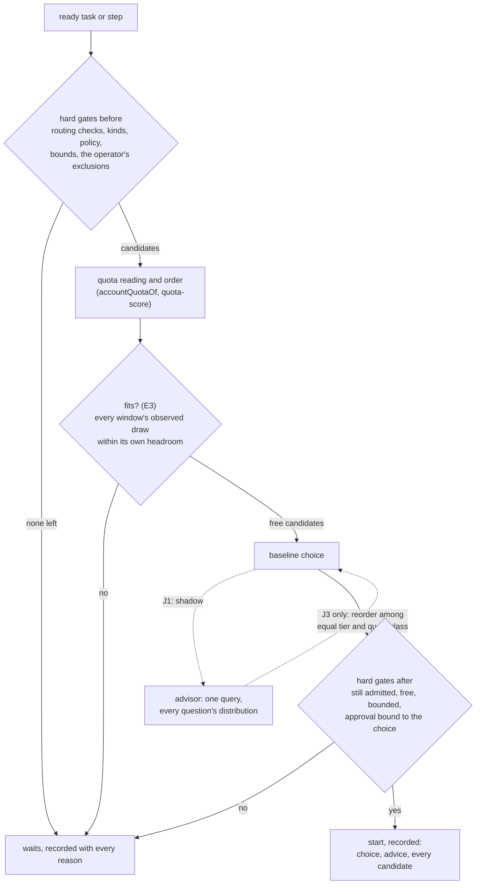

# Proposal: Right worker, right job — quota-aware assignment, measured strengths, operator talk, handoffs, and Jev as an advisor

## Problem

On 2026-10-25 the operator asked how System should change to work efficiently, on five fronts, and
how the Jev decision model could help. What System does today
([T179 audit](../research/efficient-system-inputs-2026-10-25.md#t179-audit-codex-what-system-does-today),
checked against this branch for this proposal):

1. **Quota is read in two ways, and only one start path reads it.**
   - Dispatch (PROP-0014 D1, [ADR-0064](../decisions/adr/0064-system-starts-ready-work-under-the-dispatch-action-class.md))
     chooses the writing step's Worker by `quotaScoreOf` (`quota-score@1`,
     `packages/libs/src/quota.ts`). A window is known only when its latest reading is at most
     `staleReadingSeconds` old, reads `ok`, and gives a used share. Headroom is
     `100 − used − reservePercent`, and a Worker is free only when every window is known with
     headroom above the reserve. With the default 20 % reserve (D63), dispatch starts nothing on an
     account at 80 % or more of any window (`packages/libs/tests/quota.spec.ts` checks 79 % and
     80 %).
   - The roster's capacity summary (T152, `packages/gateway-core/src/capacity.ts`,
     [capacity now](../design/roster.md#capacity-now)) computes its own `quotaOf`. It takes
     `100 − used` with no reserve, ignores a window with no reset, has no staleness bound, and orders
     free Workers by a per-minute urgency (`left / minutes to reset`). An account at 85 % is listed
     free there (its tests do so on purpose) and is not free for dispatch. The lead reads that list
     through MCP `roster` and `system capacity` to give work. The `libs` README says a capacity
     summary reads `accountQuotaOf`, but `capacity.ts` does not import it. Two rules answer
     "how much is left" differently.
   - Ordinary routing (a lead's or the operator's start, and every step after the first) orders by
     tier, quota class, load, priority, and id ([algorithm](../design/routing.md#algorithm)). It
     reads whether a pool is available, not how full it is. PROP-0014's D3 (the score in every route)
     is accepted and not started.
   - Nothing forecasts whether a task fits the quota left. A start with 1 % of headroom is
     admitted, and a window can close mid-run. The run then stops at its next step boundary
     ([fail-closed rules](../design/resources.md#fail-closed-rules)), and the attempt is spent.
2. **Strengths are declared, never measured.** Kinds ([ADR-0057](../decisions/adr/0057-route-work-by-kind.md))
   and roles let the operator say which Worker takes code, docs, tests, or validation. Nothing
   records which Worker's work is accepted, by kind, and no routing key reads such a record.
3. **The operator's attention is spread over several surfaces.** Approvals are in the queue,
   reviews held for the operator and dispatch asks are on Home, and board questions are on the
   Board. Home's waiting count does not list question waits. No notification exists for a board
   question, and the `notify` row ships off.
4. **No Worker can hand work to another.** A configured template passes artifacts down its graph,
   and a planner may grow steps whose capabilities are on its allow-list (`DEFAULT_GROWTH`:
   `reason`, `web-search`, `review`, `local-data`; not `validate`). A running Worker has no way to
   ask for a test or a research and build on its result.
5. **Jev is only a draft.** PROP-0002 (draft, 2026-10-11) proposes a `ctx.decisions` seam with Jev as
   a provider for tier inference. No such seam or package exists. The `decision` schema already
   carries `modelAnswers` (per question: `choice`, `score`, `probability`, `probabilities`,
   `confidence`).

## Goals

1. **Quota used well.** Prefer accounts with much quota left. Keep an account above about 80 % of a
   window to light work or none. Start nothing a window is not expected to fit. One rule says how
   much is left, everywhere.
2. **Right Worker, right job.** The operator's declared split stays configuration (kinds and roles):
   Claude Code writes code, Codex reviews and validates, the Antigravity CLI runs tests once it is
   back, and website Workers research many outside sources. Each Worker's acceptance by kind is
   also **measured** from recorded decisions and shown with its counts.
3. **The operator is asked less, and clearly.** Everything that waits on the operator is in one list,
   each item with its evidence and a direct control. A notice comes only when the operator can act.
4. **Borrow what similar systems proved**, and only what fits System's invariants.
5. **Handoffs through artifacts and ids.** A Worker can give a test or a research to another Worker
   and build on its accepted result. This follows the elephant–goldfish model: an informed author,
   fresh-context reviewers, and the operator accountable.
6. **Jev as an advisor.** One query per decision point asks every question at once: P(accepted)
   per Worker and per tier, P(hits a limit mid-task) per account, which model has the most usable
   quota, the expected quota cost, and P(needs the operator). The whole distribution is recorded, so
   a later outcome scores every probability, not just the winner's.
7. **Every choice is a recorded decision** ([INV-13](../architecture/invariants.md#inv-13-every-decision-is-an-artifact))
   with a reason on every candidate. Every unknown reading fails closed
   ([INV-2](../architecture/invariants.md#inv-2-fail-closed)).

## Non-goals

- **A model choosing.** No model, Jev included, makes a Worker eligible or free, lifts a gate,
  changes a reservation, approves, accepts, or merges. Its advice reorders, at most, among
  candidates the gates already allow, and only after an evaluation shows it helps (J3).
- **Moving a running turn.** As PROP-0014: a turn stays on its Worker. Quota decides before a
  start or a step.
- **Rotating around limits.** Assigned accounts keep D24: a limit never moves work to a sibling
  account.
- **Replacing the engine.** The research found no case for a new workflow framework
  ([T177 H4](../research/efficient-system-inputs-2026-10-25.md#t177-research-quota-capabilities-operator-similar-systems-handoffs)).
- **Worker-to-worker chat.** Handoffs are board tasks and artifacts, never messages that carry
  authority (session messages grant none today).
- **A fixed number not yet measured.** No task-cost multiplier, no 30–50 % review gain, and no
  routing saving from another workload is written into a rule. T177 and T181 found none of them
  supported for System.
- **Changing an invariant.**

## Evidence and research

The inputs are in [efficient-system-inputs-2026-10-25.md](../research/efficient-system-inputs-2026-10-25.md),
whose summary condenses them, and in [jev-decision-model.md](../research/jev-decision-model.md).

| Run | What it found | What this proposal takes |
|---|---|---|
| [Operator guidance](../research/efficient-system-inputs-2026-10-25.md#operator-guidance-on-jev) | One Jev call per decision point asks several questions, each a distribution; record all of it; hard gates before and after | J1's question set and record |
| [T177 research](../research/efficient-system-inputs-2026-10-25.md#t177-research-quota-capabilities-operator-similar-systems-handoffs) | Hard eligibility and quota admission first; an 80 % ceiling and learned routing are unproven, so test them against simple baselines; an evidence-first inbox; provenance at every handoff; selective fresh-context review | E1 to E6; the 80 % band as an open question; shadow before effect |
| [T178 brainstorm](../research/efficient-system-inputs-2026-10-25.md#t178-brainstorm-team-the-five-fronts) | O1 by majority: hard gates before scoring, per-window feasibility, typed handoff artifacts, one inbox, scorecards, then adaptive routing against a pinned baseline. O2's bands (65 % / 80 %) and fixed roles were not chosen | the order of the increments; bands only as configuration |
| [T179 audit](../research/efficient-system-inputs-2026-10-25.md#t179-audit-codex-what-system-does-today) | Two quota rules (`quota.ts` and `capacity.ts`); no quality record; question waits outside Home; no in-step delegation | E1, E4, E5, E6 |
| [T181 research](../research/efficient-system-inputs-2026-10-25.md#t181-research-jev-as-a-decision-model) | Jev exists (announced 2026-09-15, listed by a gateway). Its probabilities are not System's acceptance probabilities until calibrated on System's outcomes. Data permissions are unverified. Stages: feasibility, shadow, visible, bounded, monitored | J0 to J3 |
| [T182 brainstorm](../research/efficient-system-inputs-2026-10-25.md#t182-brainstorm-team-jev-as-an-advisor) | O1: a provider-neutral advisor seam with Jev as an untrusted adapter; Worker ranking and quota forecast first; every candidate's score recorded; fallback to the deterministic score | J1's seam and fallback |
| [jev-decision-model.md](../research/jev-decision-model.md) | Choice, score, and yes/no questions; many in one request; a 32k state bound; English first; not a security boundary; [where a model must not decide](../research/jev-decision-model.md#where-a-decision-model-must-not-be-used) | the question types, the bounds, the deny list |

**What to borrow from similar systems** (front 4, from T177's sources):

| From | Idea | In System |
|---|---|---|
| Kubernetes scheduler | filter, then score | already: routing's checks, then `quota-score` (E1 makes it one order) |
| Slurm multifactor priority | several explicit factors, shown | already lexicographic keys with a reason per candidate; task priority is PROP-0014 D2 |
| LiteLLM routing, AWS backoff | cooldowns per entitlement, bounded retries | already cooldowns per account and feature, and assigned accounts that wait |
| Temporal | durable history, idempotent effects | already INV-4 and the crash suite; handoffs (E6) reuse the board's fenced moves |
| SLSA, in-toto, GitHub artifacts | content-bound provenance checked at each consumer | artifacts have content ids and lineage; E6 makes a handoff a typed, hashed contract |
| Elephant–goldfish model | an informed author, fresh-context critics, a human accountable | E6's child task gets the spec and evidence, never the author's transcript; merge stays the operator's |
| GitHub review, SRE alerting | an inbox of actionable items; alert only on what needs a person | E5 |
| RouteLLM, FrugalGPT | learned routing can trade cost for quality | J1 to J3, in shadow first, against `quota-score` |
| Vibe Kanban, Copilot coding agent | task-centric, reviewable runs | already the board and a worktree per run; a design reference, not a dependency |

## Proposed design

One rule for every design choice: **one implementation per concept.** One rule reads quota
(`accountQuotaOf`), one order ranks free Workers (the `quota-score` keys), one projection gives
outcomes (E4), one seam asks for advice (`ctx.decisions`, from PROP-0002), and one path starts
work (the engine's start).



### Front 1. Quota used well

**E1: one quota rule.** `accountQuotaOf` (in `libs`) becomes the only reading of an account's
windows. The roster's capacity summary drops its own `quotaOf` and `urgency`:

- Capacity is made with the ledger's quota settings (`quota()`) beside the pools it reads now. A
  Worker is in `free` only when its account is free by `accountQuotaOf`: every window known (fresh,
  `ok`, a used share), with headroom above the reserve. That is dispatch's meaning. Without
  `quota()`, as for dispatch, no Worker is free by quota.
- A new list, `inReserve`, shows the Workers that are ready and known but whose account has a window
  at or past the reserve. Their quota is the operator's own; the lead may still start them by hand,
  as routing allows.
- `free` is ordered by the quota score's account keys, exported from `libs` as one function: known
  first, a window about to reset with enough headroom first, headroom in buckets, then load and id.
  The per-minute urgency goes: it is a weighted ratio, which PROP-0014 rejected for being hard to
  explain (alternative 5), and the use-soon key already says "use it before it resets".
- `likely` (the Worker a start would most likely go to) is read in that order. It stays a forecast:
  routing decides at the start.
- `mcp-roster@1.8` adds `inReserve`, each free Worker's binding window and its headroom, and the
  reserve. It is additive. `quota-score@1` does not change: dispatch's behaviour is the same.
- After E1, the `libs` README's statement that capacity reads `accountQuotaOf` is true.

**E2: what an attempt drew.** ADR-0059 already reads an account's usage report after every run of a
derived Worker on a declared pool. E2 records, per agent run, each window's used share in the last
reading before the run and the first reading after it, as a `quota-draw@1.0` evidence record. The
record holds the run, Worker, account, step, kind, and template, and how many other runs on the
account overlapped it. A draw is kept **per account and window** (pool and window name): one
record holds one entry per window, never one figure for the account. A window's draw is recorded
only when both readings are known **and belong to the same window epoch**, that is, carry the same
`resetsAt` (the later of `resetsAt` and `cooldownUntil`, as `accountQuotaOf` reads it). An entry is
marked `reset-crossing`, with no draw, when the epochs differ, when either reading lacks a reset
time, or when the used share decreased; it never enters the figures. It is marked `confounded` when another run
overlapped. Nothing is estimated (resources rule 3): a missing reading leaves no draw, and a draw is
never negative.

**One unit: percentage points of the window's allowance.** A draw is always the rise in the
window's used share, in percentage points, so it compares directly with headroom (also percentage
points, `100 − used − reserve`). When the provider reports authoritative consumption for the run
(tokens or units drawn, not a share), that figure becomes the draw only if the provider also reports
that window's authoritative allowance in the same unit for the same epoch: the draw is then
`100 × consumed ÷ allowance` percentage points, and the entry records the raw figure, the allowance,
and their source. Without such an allowance the entry is marked `units-only`: the raw figure is
kept for the report and never enters the percentiles or a fit forecast. A run whose authoritative
figure spans a reset stays `reset-crossing`, since no single epoch's allowance applies to it. The
report and `system usage` give, per kind, template step, and window, the count of clean draws (all
in percentage points) and their median and 90th percentile, and the count of excluded entries by
reason (`reset-crossing`, `confounded`, `units-only`, missing reading).

**E3: fit before start, and the light band.** A dispatched start, and with PROP-0014's D3 every
route, also needs the step to **fit**, and fit holds **independently for every window** of the
account, not only the binding one: a window with more headroom can still have a much larger draw.
For each window, the forecast is the 90th percentile of that window's clean draws (percentage
points, as E2 defines them; `units-only` entries never count) for that kind and
template step, once that window has at least `quota.fit.minDraws` (default 10); with fewer, the
window's forecast is `quota.fit.unmeasuredPercent` (default 15). A step fits only when every
window's headroom is at least its own forecast; one window that does not fit, or is unknown, makes
the start wait. Between the reserve and `reserve + quota.lightBandPercent` (default 15, which gives
65 % to 80 % used with the defaults), a window takes only steps whose draw in that window is
measured and fits. Unmeasured work does not go there. The decision records every window's headroom,
forecast, and draw count, and names each window that failed. This is the operator's "lighter or no work above ~80 %",
given as configuration and not hard-coded (T177 found no evidence for a fixed band).

- E3 ships in **shadow** first: the `dispatch.choice` decision says "would not fit: 5 h headroom 6,
  p90 draw of docs work 9 (n 14); weekly headroom 40, p90 3 (n 14), fits", and nothing is refused. The gate is turned on per configuration
  after the shadow period ([open question 4](#open-questions-answered)).
- A fit is a forecast from recorded draws, so it lowers the risk of a limit mid-task and does not
  remove it. The measure is limit interruptions per 100 dispatched attempts, before and after.
- Unknown is never capacity. An unknown window is still not free, and a missing draw history takes
  the conservative default, never "fits".

### Front 2. Right Worker, right job

**Declared** strengths stay configuration, as ADR-0057 decided, and no template names a vendor
(INV-11). The operator's split maps onto what exists:

| Work | Kind or capability | Who, by configuration |
|---|---|---|
| source-code changes (`develop:1`) | kind `code` | Claude Code Workers given `code` |
| docs and tests writing | kinds `docs`, `tests` | the operator's choice, by kinds |
| validation (`validate:1`) | kind `validation` (ADR-0057 amendment) | Codex Workers given `validation` |
| review | a read-only `review` step; team review members | Codex review members (ADR-0049) |
| test running on the Antigravity CLI | `validate` needs `executes` | not possible yet: the roadmap records that the Antigravity CLI writes no docs or tests (no commands for `validate:1`); it takes the kind once it proves `validate` |
| research over many outside sources | `web-search` or `deep-research` | website Workers, the only ones that prove them |

**E4: measured strengths.** A read model, like the report, over decisions already recorded. It
needs no new store. For each finished attempt it attributes outcomes to the Worker (account × role)
and kind of each step, taken from that step's `route` decision:

| Worker's step | Outcome counted | From |
|---|---|---|
| writing (`develop`) | accepted on first attempt; accepted eventually; required checks passed on the exact result | the task's `acceptance` decisions, `check-run@1.0` (ADR-0063) |
| validation | agreement of its report with the run's own required checks on the same subject | the validation result and `check-run@1.0` |
| review | its blocking findings, and whether the operator or the checks later confirmed them | the exact-subject review's assessment, the acceptance |
| research, team members | quote checks passed; the team's decision taken by the lead | `vote` decisions, quote checks |

- Each figure is shown with its count, never as a bare rate. Fewer than `strengths.minCount`
  (default 10) reads "too few". The roster's Worker card and the report show it per kind.
- Untried pairs are not failures. A Worker never routed a kind has no figure for it, which keeps
  T181's selective-observation caveat.
- E4 changes no route. Measured strengths reach routing only through an evaluation (J3, or a
  PROP-0011 experiment) that compares them with the declared split.

### Front 3. How the operator talks to System

**E5: one list of what needs the operator.** Home gains *Needs you*. It shows every item the
operator alone can move, ordered by expiry, each with what it is, its evidence (the decision, the
digest, the diff), and its direct control:

| Item | Today | Control in the list |
|---|---|---|
| approval requests, dispatch asks included | the queue, Home | Approve, Reject (the queue's verdicts) |
| reviews held for the operator | Home | Accept, Reject |
| board question waits | Board only | the questions with an answer field each (`board_update` `answers`) |
| spent budgets, lost runs | the queue | the funding or remediation request |

- A new `notify` kind, `board.question`, tells the operator a question wait opened, at most once per
  task and attempt. The `notify` row stays off until the operator turns it on (REQ-HOST-9).
- The report's weekly view gains a "decided for you" section: what started by itself, what was
  accepted without the operator, and why. The operator reads it rather than being interrupted.
- **Talking.** The operator talks to the lead in plain language, and the lead acts through MCP.
  Consequential changes stay typed, previewed, and confirmed (approvals, policy changes). A run's
  questions are batched already (1 to 8 per attempt, answered together). A run should ask the
  operator only what the lead cannot answer; the brief says so, and nothing classifies it by model.

### Front 5. Handoffs between Workers

**E6: a step may hand work off.** A board task's Worker step may end its result with
`{"handoffs": [...]}`, the way it may end with `{"questions": [...]}`
([a question from a run](../design/workflow-engine.md#a-question-from-a-run)). Each handoff is a
`handoff@1.0` body:

```ts
Handoff {                      // handoff@1.0
  title: string;               // bounded
  template: string;            // a template the engine serves, e.g. "algorithm-development" (variant "tests")
  goal: string;                // what to do, bounded
  acceptance: string[];        // criteria the child's result is judged on
  inputs: ContentId[];         // artifacts the child reads, by content id
  subject?: "author-tree";     // run on the exact tree the author's step left
}
```

- **The engine** checks each handoff against the schema and the bounds: at most
  `handoffs.maxPerAttempt` (default 3), and depth 1, so a child's run cannot hand off. It records a
  decision and proposes each handoff as a board task in the same project (`board_propose`, so the
  board's gate on its action class applies). The parent task waits under a new wait reason,
  `handoff`, which names the child tasks.
- **Back to the author.** When every child is `done`, the parent's next attempt goes through the
  gate as after an answered question. Its brief already adds accepted predecessor results by
  pointer, digest first ([a board task's brief](../design/workflow-engine.md#a-board-tasks-brief)),
  so the author builds on the children's accepted results. A cancelled or expired child leaves the
  parent waiting for input, with the reason.
- **Fresh context (the goldfish).** A child's brief carries the handoff's goal, acceptance, input
  pointers, and subject, and never the author's conversation. With `subject: author-tree`, the
  child runs on the exact tree the author's step left, captured as the exact-subject review
  captures it. The child's routing follows its template's kinds, so a validation handoff goes to a
  Worker given `validation`.
- **The human accountable.** A child's result is accepted under the board's rules (required checks
  on its exact result, ADR-0063). Nothing lands without the operator's `merge`.
- A board change of this size (a new wait reason and a run that proposes tasks) needs its own ADR.

### Front 6. Jev as an advisor

**The seam** is PROP-0002's `ctx.decisions` (a decision plugin family,
[ADR-0036](../decisions/adr/0036-guarantee-core-and-capability-plugins.md)). This proposal takes it
up for routing advice. `decisions-rules` is the baseline provider: historical rates from E4 and draws
from E2. `decisions-jev` is the vendor adapter, version-pinned. The seam's caller is the core.
Advice is an input, never authority.

**One query per decision point.** For a dispatch choice (J1's first and only point), after the hard
gates, the engine sends one request. Its state is features, not text, by default ([open question 3](#open-questions-answered)):
the template and step, the kind, each free candidate under an alias (`A`, `B`, …) with its quota
line from `quota-score`, its E4 figures, and its kind's E2 draws. The questions
(`dispatch-advice@1`) are:

| Question | Type | Recorded as |
|---|---|---|
| `accepted:<alias>`, per candidate | yes/no | P(accepted on first attempt \| Worker) |
| `accepted-tier:<tier>`, per admissible tier | yes/no | P(accepted on first attempt \| tier); one independent probability per tier, so two tiers may both be 0.9 |
| `limit:<alias>`, per candidate | yes/no | P(a window closes mid-task \| account) |
| `most-usable-quota` | choice over candidates | which model (Worker) has the most usable quota, a distribution |
| `cost` | score, 5 levels of the binding window's share | expected quota cost in that window |
| `needs-operator` | yes/no | P(the attempt waits on the operator) |

- **Bounds** (INV-9): at most `advisor.maxCandidates` (default 8) candidates and three tiers, so at most 22
  questions; the state within the model's documented bound (32k tokens with the longest question);
  a timeout of `advisor.timeoutMs` (default 2000); at most `advisor.maxPerHour` calls.
- **Gates before and after.** Only candidates the gates already admit are sent. After the advice, the
  chosen Worker is checked again (admitted, free, fits, within bounds), and dispatch's approval binds
  that exact choice (INV-5). Advice can never make a Worker free, lower a tier below the step's
  minimum, or send work to an excluded family or a sibling of a limited assigned account.
- **The whole distribution is recorded.** One `route` decision (rule `advisor.dispatch`, decider
  `model`, `deterministic: false`) carries every answer in `modelAnswers`, each with its
  `probabilities` or `probability`, `confidence`, model version, and question-set version. Its
  inputs are the state's artifact and the `dispatch.choice` decision. "Which model has the most usable
  quota" is recorded beside the deterministic answer from the readings and scored against it. It
  never replaces a reading: missing telemetry is not capacity.
- **Fail closed, with a defined path.** A timeout, an error, a malformed answer, a version not
  pinned, or egress refused is recorded as `advice unavailable` with why, and the deterministic
  choice stands. That is the stated outcome, not a silent fallback (PROP-0002's resolution of INV-2).
- **Calibration.** When an attempt's outcome is known (its acceptance, a limit hit or not, a wait on
  the operator), a scoring pass computes the Brier score and log loss of each question, against the
  `decisions-rules` baseline. It scores the chosen candidate's per-candidate questions only, since
  untried candidates have no outcome (T181).
- **Egress** (INV-12). The state sent to the vendor is egress, checked on the actual payload under
  the adapter's declared class. Task text, file names, and source code are not sent unless the
  operator decides otherwise.

**Stages** (from T181): J0 feasibility on synthetic requests (contract, latency, price, data terms);
J1 shadow (advice recorded, no effect); J2 visible (the advice shown beside each dispatch ask on Home,
the deterministic choice still authoritative); J3 bounded (advice may reorder free candidates of equal
tier and quota class, only after a preregistered evaluation under PROP-0011 shows non-inferior
acceptance and no gate violation, with its own ADR).

### Seams and records touched

| Seam or record | Change | Additive |
|---|---|---|
| `libs` | the quota score's account order exported; `accountQuotaOf` read by capacity | yes |
| roster (`gateway-core`) | capacity from `accountQuotaOf`; `inReserve`; `mcp-roster@1.8` | yes, a minor version |
| `resources` | `quota.fit.*`, `quota.lightBandPercent` settings | yes, configuration |
| `agent-workers` | `quota-draw@1.0` evidence after each run | yes |
| `workflow` (runner) | the fit key (E3); handoffs and their decision (E6); the advisor call (J1) | E3 and E6 need ADRs |
| `board` (work state machine) | wait reason `handoff`, revived when its children are done | needs an ADR (ADR-0036) |
| `report`, `web-ui`, `notify` | draws, strengths, *Needs you*, `board.question` | yes |
| `decisions` (new seam, from PROP-0002) | `decide(state, questions)`; `decisions-rules`, `decisions-jev` | a new capability seam |

## Increments

Each ships alone, ends with its suites passing and its canonical documents updated, and starts on
the operator's go-ahead.

| Increment | Delivers | Depends on |
|---|---|---|
| **E1** One quota rule (buildable now, no new vendor) | capacity reads `accountQuotaOf` with the reserve and the staleness bound; `free` in the quota score's account order; `inReserve`; `mcp-roster@1.8`; the urgency ratio retired; a test proving capacity's free set equals the set dispatch reads as free by quota on the same pools | — |
| **E2** Quota drawn per attempt | `quota-draw@1.0` from the readings before and after each agent run, per account and window; same window epoch required, reset-crossing and decreasing readings excluded; confounded marked; draws by kind and window in the report and `system usage` | — |
| **E3** Fit before start | the fit key (every window must fit) and the light band in `dispatch.choice`, shadow first, then a gate by configuration; in every route once PROP-0014 D3 is built | E1, E2 |
| **E4** Measured strengths | the outcome projection by Worker and kind, with counts; on the Worker card and in the report | — |
| **E5** Needs you | Home's single list with controls; `board.question` notifications; the report's "decided for you" | — |
| **E6** Handoffs | `handoff@1.0`; the `handoffs` result; child tasks; the `handoff` wait; fresh-context briefs; its ADR | E5 (questions on the same surface) |
| **J0** Jev feasibility | synthetic calls only: the request and response contract, latency, price, and data terms checked; no System data sent | — (the operator answered [open question 3](#open-questions-answered): features only, D73) |
| **J1** Advisor in shadow | the `decisions` seam, `decisions-rules`, `decisions-jev`; one query per dispatch choice; the full distribution recorded; calibration scored | J0, E2, E4 |
| **J2** Visible advice | the advice beside each dispatch ask on Home; calibration per question in the report | J1 and its shadow period |
| **J3** Bounded advice | reorder among equal tier and quota class, after a preregistered evaluation; its ADR | J2, PROP-0011 F4 |

**ADRs on acceptance:** one quota rule for capacity and dispatch (E1, amending ADR-0064's
consequences); fit before start (E3); handoffs and the `handoff` wait (E6); a decision advisor seam
whose advice never widens a gate (J1).

## Alternatives considered

1. **Keep two quota rules, documented.** Capacity would stay a "use it or lose it" view and
   dispatch a gate. Rejected: the lead gives work from capacity's list, so two meanings of "free"
   send the lead to accounts dispatch keeps for the operator. The research asked for one meaning.
2. **Fixed bands** (O2: under 65 % normal, 65 % to 80 % light only, over 80 % drain). Rejected as
   hard-coded numbers with no measurement behind them. E3 keeps the shape as configuration, fed by
   E2's draws.
3. **Jev decides now.** It would put an unmeasured, uncalibrated model between the gates and a start.
   T181 found its probabilities unvalidated for System and its data terms unverified. Rejected for
   staged advice.
4. **A weighted score** of headroom, urgency, and quality. Rejected as in PROP-0014: a weight is a
   hidden constant. Every key stays shown in the decision.
5. **Strengths as fixed roles per vendor** (O2: Claude Code only implements, web agents only
   research). Rejected: kinds already express it as configuration without naming a vendor (INV-11),
   and measurement can then confirm or correct it.
6. **Handoffs by session messages** (`session_send`). Messages carry no authority, no contract, and
   no exact subject. Rejected for board tasks with typed, hashed inputs.
7. **A learned router service** (RouteLLM or similar) instead of a seam. It would bind System to one
   method and vendor. Rejected for `ctx.decisions` with replaceable providers.

## Validation plan

- **E1:** table tests in which capacity and `quotaScoreOf` read the same pools and agree on every
  account's free state: 0 %, 79 %, 80 %, 85 %, a stale reading, an `unknown: available` pool, no
  reset, no `quota()`; the account order equal to the score's; `mcp-roster@1.8` schema tests;
  `inReserve` listed and never in `free`.
- **E2:** a draw only with both readings known; one entry per window; a window that reset between
  the readings (different `resetsAt`), a reading with no reset time, and a used share that went down
  each give a `reset-crossing` entry with no draw, never a negative one, and stay out of the
  percentiles; an authoritative consumption figure, when the provider gives one with the window's
  allowance in the same unit and epoch, is converted to percentage points and its source recorded,
  and one without an allowance is `units-only` and stays out of the percentiles and the fit
  forecast; `confounded` on overlap; restart replays nothing (INV-4); the report's
  figures over a fixture that includes a reset-crossing run.
- **E3:** the fit key in shadow changes no choice and records "would not fit"; with the gate on, a
  start whose p90 draw exceeds the headroom of any one window waits, recorded with that window,
  including the case where the binding window fits and another window with more headroom does not; unknown history takes the default; the
  light band admits only measured work.
- **E4:** attribution over a fixture of finished attempts; untried pairs absent; "too few" under
  the minimum count.
- **E5:** every waiting kind listed once with its control; a question answered from Home moves the
  task as `board_update` does; one notification per task and attempt.
- **E6:** schema and bounds; depth 1 refused; the parent waits and resumes when its children are
  done; a cancelled child; a child's brief holds no author transcript; the crash suite after the
  children are proposed and before the parent waits.
- **J1:** a fake provider: timeout, malformed answer, unpinned version, refused egress all give
  `advice unavailable` and the deterministic choice; every answer kept in `modelAnswers`; advice
  never changes the chosen Worker in shadow; calibration over a fixture.
- **Live:** E1 on the live host, the lead's capacity read beside dispatch for a working day, no
  disagreement. The shadow periods of E3 and J1 run on one project ([open question 4](#open-questions-answered)).

## Rollout and rollback

- E1 changes what capacity lists, not what dispatch does. Rolling it back restores the earlier
  capacity rule; records are unchanged.
- E2 only records. E3 ships in shadow (`quota.fit.enforce: false`), and turning the gate on or off
  is configuration.
- E5's list and notifications are surface changes; the notification kind follows the `notify` row.
- E6 ships behind `handoffs.enabled` (off until its ADR is accepted). Off, a `handoffs` object in a
  result is never read as a handoff, as today.
- J1 needs the `decisions-jev` row on and its egress declared. Turning the row off ends every call,
  and decisions record `advice unavailable`. J3's reordering has its own switch.

## Observability and operations

- `system explain` on a dispatched run shows the quota line, the fit, and, from J1, the advice
  decision beside the choice.
- The report gains quota draws by kind, strengths by Worker and kind, advice calibration, and
  limit interruptions per 100 attempts.
- Runbooks: read why a Worker is in reserve; turn the fit gate on; answer a question from Home;
  turn the advisor on or off.

## Security and privacy

- No Worker gains a capability, sandbox, or egress from this proposal. A handoff's child is gated,
  briefed, and checked as any board task.
- Jev is a remote vendor: what it receives is egress, features only by default, never secrets or
  source. Its answers are not a security control (vendor guidance).
- Advice is recorded, versioned, and never authority (INV-6). The operator can turn it off at once.

## Compatibility and migration

`mcp-roster@1.8`, `quota-draw@1.0`, `handoff@1.0`, and the new settings are additive. The board's
`handoff` wait reason and the `decisions` seam come with their ADRs. No migration: E2 starts
recording from its first run, and nothing is back-filled.

## Open questions (answered)

The operator answered every question on 2026-10-25, each as proposed. The answer follows each
question, with its decision number.

1. **The 80 % threshold.** Keep D63's 20 % reserve as the hard line for starts, and add a light band
   (proposed: 15 points, so 65 % to 80 %, measured work only)? Or change the reserve itself, or keep
   one line only?
   **Answered (D71):** the 20 % reserve stays the hard line for starts, and a light band of 15
   points (65 % to 80 % used with the defaults) takes only light work whose draw is measured and
   fits (E3).
2. **The reserve beyond dispatch.** Once PROP-0014's D3 puts the score in every route, should the
   reserve also keep the lead's starts and a run's later steps out of the operator's share
   (proposed: no for a start the operator or lead makes by hand, yes for later steps of a dispatched
   run)?
   **Answered (D72):** yes for the later steps of a dispatched run, which the reserve keeps out of
   the operator's share; no for a start the operator or the lead makes by hand.
3. **What Jev may see.** Features only (proposed: kind, template, step, candidates by alias, quota
   lines, counts), or also the task's title and goal, which may be in Vietnamese and may be private?
   **Answered (D73):** features only. Jev never sees a task's title or goal.
4. **Shadow length.** How long do E3's fit and J1's advice run in shadow before J2 or the gate:
   a number of decisions (proposed: 100 dispatched attempts with outcomes) or a number of days?
   **Answered (D74):** a number of decisions: 100 dispatched attempts with outcomes.
5. **Which fronts first.** Proposed: E1, then E2 and E5, then E4 and E3, then E6; J0 in parallel
   once question 3 is answered.
   **Answered (D75):** E1, then E2 and E5, then E4 and E3, then E6; J0 in parallel (question 3 is
   answered by D73).
6. **Handoffs without the lead.** May a Worker's step propose child tasks itself, under the board's
   gate (proposed: yes, depth 1, at most 3 per attempt), or should the lead approve each?
   **Answered (D76):** yes. A Worker's step may propose child tasks itself under the board's gate,
   depth 1, at most 3 per attempt.
7. **The declared split.** Confirm the mapping in front 2. What should the Antigravity CLI take when
   it is back: `validation` only once it proves `validate`, or also `tests` writing?
   **Answered (D77):** the mapping is confirmed. Claude Code writes code, docs, and tests; Codex
   validates and reviews; website Workers research; the Antigravity CLI takes `validation` only,
   and only once it proves `validate`.
8. **Fresh-context review.** Use the goldfish review (spec and evidence, no transcript) on every
   task, or selectively, as T177 suggests (proposed: selectively, on tasks the lead marks, measured
   against today's review)?
   **Answered (D78):** selectively, on tasks the lead marks, measured against today's review.

## Decision

Accepted by the operator on 2026-10-25, each answer as the proposal recommends. Each increment
starts on the operator's go-ahead; none is built yet.

- **D71** (open question 1): D63's 20 % reserve stays the hard line for starts. A light band of
  `quota.lightBandPercent` (default 15, so 65 % to 80 % used with the defaults) takes only light
  work, that is a step whose draw in that window is measured (E2) and fits (E3). Unmeasured work
  does not go there. The band is configuration, not a hard-coded number.
- **D72** (open question 2): once PROP-0014's D3 puts the quota score in every route, the reserve
  also keeps the later steps of a dispatched run out of the operator's share. It does not hold back
  a start the operator or the lead makes by hand. A running step is never moved (as D63, the reserve
  decides at a start or a step boundary only).
- **D73** (open question 3): Jev sees features only (kind, template, step, candidates by alias,
  quota lines, counts), never a task's title or goal.
- **D74** (open question 4): E3's fit and J1's advice each run in shadow for 100 dispatched
  attempts with outcomes before the gate or J2.
- **D75** (open question 5): the order is E1, then E2 and E5, then E4 and E3, then E6; J0 runs in
  parallel.
- **D76** (open question 6): a Worker's step may propose child tasks itself under the board's gate
  (`board_propose`), depth 1, at most 3 per attempt (`handoffs.maxPerAttempt`).
- **D77** (open question 7): the declared split is confirmed: Claude Code writes code, docs, and
  tests; Codex validates and reviews; website Workers research; the Antigravity CLI takes
  `validation` only, once it proves `validate`.
- **D78** (open question 8): fresh-context (goldfish) review is selective, on tasks the lead marks,
  and measured against today's review.

## Implementation

None yet.
