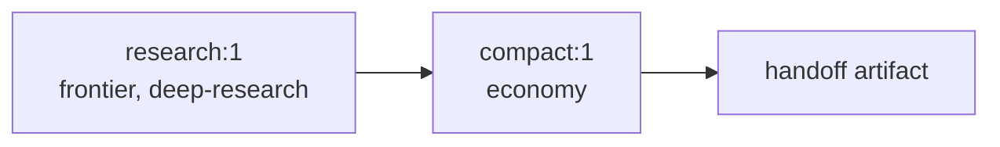

# Release scope: MVP → Beta → Production-ready

This document is the canonical definition of **what each release stage must
deliver** and how its exit is judged. The order of the work lives in the
[roadmap](../proposals/roadmap.md). The full target architecture, which is what
production-ready means, lives in [architecture](../architecture/README.md).

Because everything is a plugin, each stage is a set of plugins (rows of the
`system` bundle) on the seams in the
[seam catalog](../architecture/plugin-model.md#seam-catalog). Moving to the next
stage adds plugins. It does not rewrite the earlier ones. Package names below are
the directories under `packages/` and `packages/plugins/`.

## Overview

| Stage | One-line goal | How clients use it |
|---|---|---|
| **MVP** (v0.1) | prove the four [purposes](purpose.md) end to end with the thinnest durable slice | Claude Code and Codex call `system` **tools over MCP**; operator CLI |
| **Beta** (v0.5) | durable multi-Worker workflows and teams; Claude Code and Codex also as Workers | MCP + CLI + Web UI |
| **Production-ready** (v1.0) | the full target architecture, operated, hardened, and validated | Responses and Anthropic Messages gateways + MCP + CLI + Web UI + DSH bundle |

## MVP (v0.1)

### Goal

A single operator, working inside **Claude Code or Codex**, can delegate research
and reasoning to ChatGPT Web. The delegated work runs on the website's separate
quota (P1), uses Deep Research and web search (P2), never ships local data
without permission (P3), and runs cheap steps on a cheap tier (P4). All of this
is crash-safe.

### Why MCP first

Decided in [ADR-0011](../decisions/adr/0011-mvp-integration-via-mcp.md). MCP is
the one integration that **both** Claude Code and Codex already support.
It satisfies ADR-0009 (both clients) and ADR-0008 (tool-agnostic) at the lowest
cost. The local agent stays the local Worker for code and data, which gives P3
for free. The Responses and Messages gateways, which make `system` look like a
*model*, are the more complex integration and are deferred to production-ready.

### Included plugins

| Layer | Packages |
|---|---|
| host | DSH core rows only (timer, credentials, webserver; no `dsh-base`; one pinned version), `system-bundle`, `cli`, `libs` |
| kernel | `store` (system tables on `node:sqlite`), `event-log`, `leases`, `artifacts`, `credentials-vault` |
| provider | `display-virtual`, `browser-patchright`, `accounts`, `login` (remote login over noVNC, credential login), `providers`, `provider-chatgpt-web`, `turn-receipts`, and the `provider-core` library (scheduler, completion, reconciliation) |
| website Workers | `turns`: the website Worker runtime (durable turns) |
| routing | `egress`, `workers` and the `workers-core` definition (capabilities, tiers, egress policy, quota exclusion) |
| orchestration | `workflow`, MVP subset: static DAG, input-hash reuse, receipts, recovery; no graph growth, teams, or lineage invalidation yet |
| edge | `mcp-server` (Streamable HTTP on the DSH webserver, loopback and token), `cli` |

### Included requirements

| Area | Requirements |
|---|---|
| Platform | Linux x64 only; macOS and Windows in v1.0 |
| Accounts | REQ-ACC-1..9 (ChatGPT Web accounts; multiple accounts; opt-in credential login with local TOTP) |
| Provider turns | REQ-PRV-1..6 (`reason`, `web-search`, `deep-research`) |
| Routing | REQ-WRK-1..4, REQ-WRK-7 (egress), REQ-WRK-8 (quota exclusion), REQ-WRK-9 (tiers: website modes as `economy`, `standard`, and `frontier`) |
| Gateways | REQ-GW-3 (MCP tools: `ask`, `research`, `status`, `result`), REQ-GW-4 (CLI: `account login`, `ask`, `research`, `result`, `usage`, `explain`) |
| Sessions | REQ-SES-1 (`SessionId` bound to the ChatGPT conversation; `ask` and `research` accept a `sessionId` to continue the same session), REQ-SES-8 (`research` returns at once; Deep Research runs for tens of minutes, longer than MCP tool-call timeouts) |
| Workflows | REQ-WF-1, REQ-WF-3, REQ-WF-4, REQ-WF-6, REQ-WF-10 (static DAGs only) |
| Artifacts and schemas | REQ-ART-1..5 (decision artifacts for admission, route, tier, egress, acceptance, reconciliation; `system explain` in the CLI) |
| Host | REQ-HOST-1, REQ-HOST-2, REQ-HOST-4, REQ-HOST-5 |

The MVP research flow is a **static two-node DAG** that runs on the real engine.
It is a subset of the engine, not separate code
([ADR-0012](../decisions/adr/0012-dag-execution-model.md), INV-1). It is now the
built-in `deep-research` template; the name `research` later went to the
scientific-research procedure (production-ready):

Each node has input and output receipts and decision artifacts, so retries and
restarts never resend or recompute a completed step.

### Delivery order: slice 1 first

The MVP ships in two slices. **Slice 1 (`ask` + `research`)** is the first
usable build, delivered at milestone M1.5:

| Slice 1 includes | Detail |
|---|---|
| MCP tools | `ask`, `research`, `status`, `result`. `ask` and `research` take an optional `sessionId`. `research` returns a `runId` and `SessionId` at once. `ask` waits up to `waitSeconds` (≤ 55 s) and otherwise returns its `runId`. `result` long-polls a `runId` ([contract](../design/provider-turns.md#runtime-mvp-slice-1)) |
| CLI | `account login`, `account list`, `account save`, `ask`, `research`, `result`. Accounts are declared in the operator's profile patch; `account add` and `account remove` are planned |
| Platform | **Linux x64 only** |
| Browser | invisible headed Chrome on Xvfb (`virtual`); remote login over noVNC through an SSH tunnel, ported from tsuuanmi/internet ([browser runtime](../design/browser-runtime.md#login-flows)) |
| Accounts | provider-agnostic vault; one or more ChatGPT accounts; saved state survives restarts; optional credential login (email, password, local TOTP) with fallback to the remote view; `system account code <id> <code>` |
| Reliability | turn receipts and reconciliation, two-clock completion, per-account scheduler |
| Routing | minimal: the first `ready` account in configured priority that proves the capability; tier = the selected ChatGPT mode; route and tier decision artifacts recorded |
| Execution | each call is a one-node DAG on the engine core |

Demo scenario: the [motivating example](purpose.md#a-motivating-example-from-building-system-itself),
a reuse survey over the DSH plugin catalog delegated from Claude Code to ChatGPT
Web Deep Research.

Slice 1 exit criteria:

1. From both Claude Code and Codex, `ask` answers and `research` returns a
   Deep Research report, using a saved account and with no browser window
   visible to the operator.
2. Killing the host during a `research` run, then restarting, recovers the
   result without sending the prompt twice.
3. With two saved accounts, marking one `reauth-required` routes new work to the
   other, and the decision artifact shows why.
4. On a Linux server with no display, an operator can sign in through
   `ssh -L` and the noVNC page. An account with credential login re-authenticates
   with TOTP after a forced sign-out, and an email-code challenge falls back to
   the remote view.

**Slice 2** completes the MVP: the `compact` economy node (a two-node DAG), the
egress policy, quota exclusion, `explain`, usage reports, and the remaining exit
criteria below.

### Explicitly out of MVP

Gemini, teams, graph growth and profiles, agent-runtime Workers,
connectors (`connector:*`), API and local model providers, the Responses and
Messages gateways, the operator Web UI, and packaged installers.

### MVP exit criteria

1. From **both** Claude Code and Codex, the two-node research flow (MCP `run`
   with the `deep-research` template) returns a cited, compacted synthesis
   produced by ChatGPT Web Deep Research.
2. Killing the host at every reconcile point (before submit, after submit, during
   generation, after completion) never produces a duplicate provider turn. Every
   case resolves to WAIT, RECOVER, RESUBMIT, or AMBIGUOUS.
3. An egress test shows that a request referencing `local-private` artifacts is
   refused for the website Worker unless policy permits it.
4. The compaction step runs on the `economy` tier, and the research step on
   `frontier`. Both are visible in the event log.
5. A usage report shows, per request, which quota class and tier served it.
   `system explain` shows the full decision chain (route, tier, egress,
   acceptance) for any result.
6. Every record written by the MVP validates against its schema in `schemas/`.
   CI compiles the schemas in strict mode and validates the examples.
7. With fake providers, every seam passes its conformance suite in CI. The
   account-bound checklist passes manually.

## Beta (v0.5)

Adds, as plugins:

- **Orchestration:** the full `workflow` engine, `worker-sessions`, and
  `profile-software-development` (REQ-WF-1..11, REQ-TEAM-1..5, REQ-SES-1..8).
  A team is the `team` option of a workflow node, which the engine unrolls; its
  members are durable sessions that message each other directly.
- **Workers:** `agent-runtimes`, `agent-workers`, `runtime-claude-agent-sdk`,
  `runtime-codex-sdk`, `runtime-acp` (REQ-WRK-5..6). Claude Code and Codex become
  Workers as well as clients.
- **Providers:** `provider-gemini-web`, connectors as capabilities (REQ-PRV-7), and
  an economy-tier model provider for API or local models (P4).
- **Edge:** `web-ui`, the operator page at `/ui`: runs, steps, decision chains,
  and answers; approve or reject a plan, stop, and continue. Remote login stays
  on the `login` plugin's noVNC page.

Beta exit criteria:

1. The full software-development cycle (research team → local implementation →
   validation → exact-head review → bounded remediation) runs across mixed
   Workers. Killing the host mid-workflow never repeats a completed node.
2. A two-member team uses two distinct accounts, and the independent-first
   barrier is proven by test. Members exchange direct messages, and killing the
   host mid-conversation loses or duplicates no message.
3. A long-running session (several hours, past the compaction threshold) survives
   a host restart, keeps its `SessionId`, and continues from its handoff summary.
4. Agent-runtime Workers pass probe, run, resume, cancel, and sandbox-enforcement
   smoke tests.

## Production-ready (v1.0)

Production-ready means **the complete target architecture**
([layer map](../architecture/README.md#layer-map)) with every requirement in the
[SRS](SRS.md) and every [quality attribute](quality-attributes.md) met, plus
operational readiness.

### Functional additions

- `gateway-responses` and `gateway-anthropic`, which share the `gateway-turns`
  library: the text tool protocol
  ([ADR-0022](../decisions/adr/0022-text-protocol-tool-calls-for-website-models.md)),
  conversation threads, and the guard (REQ-GW-1, REQ-GW-2, REQ-GW-5). Codex and
  Claude Code can select `system` Workers *as models*. Client configuration
  edits are journaled (REQ-HOST-3).
- `profile-scientific-research` with typed artifacts and invalidation, running
  with zero engine changes. This is the architecture test (REQ-WF-9).
- Publication of the `system` bundle (`dsh-plugin` topic), so DSH users can
  mount `system` plugins in their own profiles.
- A2A, when the first peer appears that `system` does not drive: `gateway-a2a`
  exposes sessions as A2A agents, and `runtime-a2a` uses remote A2A agents
  ([ADR-0006](../decisions/adr/0006-protocol-introduction-gates.md)). It ships in
  v1.0 if that requirement exists by then, otherwise later.

### Operational readiness

| Concern | Requirement for v1.0 |
|---|---|
| Observability | event log queryable by turn, node, and lease; usage and tier reports; health of each account and plugin; alerts for provider UI drift (fixture or live probe failure) |
| Operations docs | `docs/operations/` with runbooks (login, account re-auth, backup and restore, upgrade with drain, retention cleanup) and playbooks (stuck turn, AMBIGUOUS reconciliation, quota exhaustion, provider UI change) |
| Data safety | store backup and restore tested; versioned, tested migrations; upgrade path from every v0.x release |
| Security | every control in the [threat model](../security/threat-model.md) implemented and tested; secrets audit; `pnpm audit` clean; egress policy covered by tests |
| Validation | `docs/validation/` with acceptance criteria per requirement, traceability from requirement to test, and the recorded manual release checklist |
| Reference | `docs/reference/` with the MCP tool contracts, gateway compatibility notes, configuration catalog generated from plugin `Config` schemas, and the seam definitions |
| Reliability | crash-injection suite across every reconcile point passes repeatedly with zero duplicate effects; every bound in INV-9 configured and tested |
| Platforms | Linux and macOS supported (Windows best-effort): `offscreen` display and visible login join Linux's `virtual` display and noVNC remote login; packaged distribution with checksum-verified artifacts |

### Production-ready exit criteria

1. Every REQ, QA, and INV has linked test or validation evidence.
2. Both gateways pass smoke tests against real Codex and Claude Code binaries:
   streaming, tool round trip, cancel, interrupt, and drain.
3. The scientific-research profile ships without any change to engine packages.
4. The manual release checklist passes on live accounts, and a skipped item
   blocks the release.
