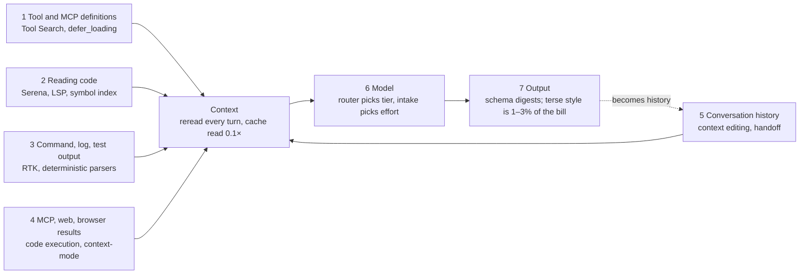

# Design review, multi-agent prior art, and token economics

Non-normative. Reviewed and researched on 2026-10-22. Supports
[PROP-0008](../proposals/0008-studio-operating-model.md) and
[PROP-0009](../proposals/0009-core-and-plugin-decomposition.md). The mechanism behind
the token numbers is explained in
[provider-context-and-caching.md](provider-context-and-caching.md).

> **Source caveat.** The review read the design documents (README, purpose,
> architecture, invariants, plugin model, artifacts, browser runtime, UI operations,
> teams, ADR-0022), not the source in `packages/`. Statements about the
> implementation come from each document's "differs from target" line. Numbers
> marked *self-reported* come from a project's own README or blog and were not
> independently reproduced.

## Review of the current design

The strongest part is the invariants: restart is reconciliation, not replay
([INV-4](../architecture/invariants.md#inv-4-restart-is-reconciliation-not-replay));
exact-subject binding (INV-5); every decision is an artifact (INV-13); one writer
per subject (INV-15). Team review with sealed ballots and deterministic quote
checking is genuinely new compared with other harnesses.

| Risk | Level | Problem | Direction |
|---|---|---|---|
| Provider terms | high | OpenAI's terms forbid automated extraction of output; the driver uses patchright and removes automation markers | state the risk in the README; prefer official channels (MCP connectors, CLIs signed in with a subscription) |
| Egress in gateway mode | high | a client's `Read` results enter the website conversation, which conflicts with INV-12 | document how the egress check behaves in this mode |
| Prompt injection | high | a website model reads a hostile page and proposes shell commands to a local agent | gateway blocklist; mandatory approval for write and execute tools |
| Reading output from the DOM | medium | renderer whitespace collapsing once corrupted a file | a round-trip canary before each session; scheduled `ui doctor` |
| Complexity | medium | 7 layers, 15 invariants, 35+ ADRs for one operator | a plain-language onboarding guide |
| No LICENSE | low | public repository nobody may lawfully use | add a LICENSE |

Implementation gaps against the design: the store does not yet reject a state
transition that lacks a decision id; `sideEffect` does not yet bound healing; model
healing is only parsed; the Gemini driver disables healing.

## Lessons from production multi-agent systems

The industry is converging on **"one writer, many contributors of intelligence"**,
which is INV-15. The largest remaining risks are **context transfer** and
**verification of results**, not the number of agents. (See also
[reference-architectures.md](reference-architectures.md), whose findings this extends.)

**Anthropic, Research system.** Orchestrator–worker: a lead plans and delegates to
parallel subagents. A multi-agent setup (Opus 4 lead, Sonnet 4 subagents) beat a
single agent by 90.2% on an internal research evaluation, at a price: agents use
about 4× the tokens of chat, multi-agent about 15×. Multi-agent works mainly because
it lets enough tokens be spent; its advantage is largest on breadth-first questions.
The plan is persisted so the system does not lose track when context runs out.
*Applies:* multi-agent only for high-value, broad work; intake decides whether to form a team.

**Cognition (Devin), 2025 and the April 2026 update.** In 2025 they argued against
multi-agent because *actions carry implicit decisions*: parallel agents choose
conflicting styles, edge-case handling, and patterns. In 2026 they found a narrower
class that works: many agents contribute intelligence to one task while writes stay
single-threaded.

- **Clean-context review:** a reviewer that does *not* share the coder's context works
  best. Devin Review catches about 2 bugs per PR, about 58% of them severe.
- **"Smart friend" (strong model as adviser):** works when both models are strong;
  between frontier models it becomes *routing by capability*, not escalation by
  difficulty, since each is best at different work (debugging, visual reasoning, tests).
- **Unsolved:** a weak model does not know when it has reached its limit.
- **Manager failure modes:** managers used to small tasks over-specify, and agents
  assume they share state with subagents when they do not.
- **Unstructured swarms** were mostly a distraction; the working shape is
  map-reduce-and-manage.

*Applies:* the team and review design is on track; the smart-friend finding supports
the multi-provider USP; **cheap Workers must not decide their own escalation**; use
external verification (tests, quote checks) plus intake.

**Manus (context engineering).** KV-cache hit rate is their most important production
metric; on Claude Sonnet cached input is 10× cheaper. The agent keeps rewriting
`todo.md` to push the goal to the end of context. Costly lesson: when the executing
agent maintained `todo.md` itself, about a third of its actions went to bookkeeping;
they moved this to a separate planner. Document bodies are dropped from context but
their paths kept. *Applies:* **Workers do not update the task board**; `system` infers
board updates from artifacts and digests; add cache hit rate to metrics; "keep the
path, drop the content" confirms passing pointers.

### MAST: why multi-agent systems fail

"Why Do Multi-Agent LLM Systems Fail?" (NeurIPS 2025) finds multi-agent gains over a
single agent on common benchmarks are often small, and identifies 14 failure modes
in three groups. They map onto `system` mechanisms:

| Failure group | `system` mechanism |
|---|---|
| specification failures | task spec with `intent` and acceptance criteria |
| inter-agent misalignment | shared board, one writer |
| task verification | tier `none`: tests, quote checks |

Invest most in the third, where deterministic code beats a model.

## Neighbouring projects

| Project | What it does | Learn | Avoid |
|---|---|---|---|
| **PAL MCP** (was Zen MCP) | MCP server letting Claude Code consult other models, reach multi-model consensus, review code | the closest competitor to multi-provider review; uses API keys, an official channel | competing on features it has; `system`'s difference must be deterministic vote counting, quote checks, durability |
| **claude-code-router** | proxy routing Claude Code requests to other models by kind (background, thinking, long context) | strong demand (~26k stars); routing by work kind is proven | `system`'s gateway mode duplicates it, through websites; leave this to them |
| **vibe-kanban** | kanban for coding agents: switch agents, parallel or sequential, review | a board is the natural user surface | building our own kanban UI; export the board in formats such tools read |
| **Vibe Board** | kanban assigning work to many agents | ranks agents by tier to switch when a paid agent hits its limit mid-task | — |
| **MetaGPT** | software company simulated through SOPs | agents communicate through structured documents, matching digests and task specs | rigid role sequences; `system` forms teams per job |
| **RouteLLM** | router between strong and weak models with a cost threshold | over 2× cheaper at equal quality; tooling to calibrate the threshold to a target strong-model rate | setting default tiers by intuition without calibration |
| **LiteLLM** | gateway: virtual keys, budgets per key or team, rate limits, fallback, spend tracking | a ready design pattern for the resource ledger | a user reported automatic retries worsened rate limiting; RPM limits alone are not enough, TPM is needed |
| **revChatGPT** | reverse-engineered ChatGPT web API | a lesson in durability | archived August 2023; its README admitted the web version broke the terms; constant token expiry. Do not make website Workers the foundation |

PAL MCP already does "Claude consults another model" through official APIs. If
`system` differs only by spending website quota instead of API, that is a thin USP
with terms risk; if it differs by deterministic voting, quote checks, and
durability, it is a solid one.

## Token economics: where the waste is

Most cost is not output but **context reread every turn**: tool definitions, files
read in full, command output, MCP results, history. Output is 0.6–2.5% of billed
tokens in a typical Claude Code session
([Implicator](https://www.implicator.ai/caveman-claude-code-skill-cuts-output-20-your-bill-barely-notices-2/)).
Priority order: keep it out of context, process it outside context, compress what
must enter, lower the tier, and only last, speak more briefly.

### What to optimize: four quantities that are not peers

The real objective is **accepted results per unit of user attention**. Tokens are a
means, context a capacity limit, correctness a condition.

| Quantity | Role | Why | Measured by |
|---|---|---|---|
| User attention | denominator of the objective | cannot be bought; every interruption costs a human context switch | approvals or answers needed, minutes of reading per run |
| Correctness | constraint: must meet criteria | a wrong result costs twice: rework, and attention to notice it | first-time acceptance rate |
| Agent context | capacity and quality constraint | full context makes models worse: Tool Search took Opus 4 tool selection from 49% to 74% ([Anthropic](https://www.anthropic.com/research/advanced-tool-use)); context editing alone improved performance 29% ([Anthropic](https://www.anthropic.com/news/context-management)) | resident tokens, share of window used |
| Tokens, quota, money | cost, convertible between sources | has a shadow price, a reset window, can be bought | converted tokens per accepted result |

Trade-off rules: **spend tokens to buy attention, never the reverse** (more tests,
independent review, and quote checks cost tokens but save human checking);
**cleaning context wins on both sides** (cheaper and more correct, so it comes
first); **compression must not move cost to the reader** (terse is fine for
machines; a digest for a person must read in one glance).

### The problem stated

Minimize converted cost **per accepted result**, subject to probability of meeting
criteria ≥ threshold, valid egress, and the deadline:

```text
C = Σ_t ( p_in·n_new(t) + p_cw·n_cw(t) + p_cr·n_cr(t) + p_out·(n_out(t) + n_think(t)) ) + C_retry + C_attention
```

With Claude, cache writes cost 1.25× input (5-minute TTL) or 2× (1-hour), cache
reads 0.1×, output about 5× input. A block x entering context at turn t_x therefore
has a **residency cost**:

```text
residency(x) ≈ |x| · ( p_cw + (T − t_x) · p_cr )
```

A 10K-token tool result resident for 30 turns costs about
10K × (1.25 + 30 × 0.1) = 42.5K input-equivalent tokens; saving 300 output tokens per
turn is worth about 1.5K. Measurements agree: Claude Code rereads 16–61 history
tokens per new token, and rereading is 39–65% of the bill
([wmedia](https://wmedia.es/en/tips/claude-code-token-usage-every-turn)); one
session analysis by ccwhy found cache reads were 97.2% of tokens
([ccwhy](https://docs.rs/ccwhy)). The key decision variable is not "which model" but
**"what enters the expensive model's context, and for how long"**.



Interception points 1–5 save the most, because tokens stopped there never pay
residency; output is last because it is a small share of the bill.

### Waste map

| Source | Why it costs | Evidence | Lever | Right tier |
|---|---|---|---|---|
| Tool and MCP definitions loaded up front | paid every turn even if unused | 5 servers, 58 tools ≈ 55K tokens; 134K seen at Anthropic ([Anthropic](https://www.anthropic.com/research/advanced-tool-use)) | Tool Search, `defer_loading`: 77K → 8.7K, −85% | `none` (config) |
| Intermediate tool results through the model | data that only needs filtering, counting, or forwarding enters context | 150K → 2K by writing code that calls MCP ([Anthropic](https://www.anthropic.com/engineering/code-execution-with-mcp)); programmatic tool calling −37% | code execution, sandbox (context-mode) | `none` + code |
| Shell output: git, tests, builds | passing tests, progress bars, repeated logs | RTK −60–90% of bash output, self-reported ([RTK](https://github.com/rtk-ai/rtk)) | deterministic per-command filters | `none` |
| Reading a whole file to find one function | irrelevant bodies enter context | claude-context ~40%, self-reported, not independently checked ([rywalker](https://rywalker.com/research/claude-context)) | symbol retrieval (LSP, AST), index | `none` |
| Browser snapshots, screenshots | every action returns the whole page | login form: ~3.8K tokens as accessibility tree vs 15K+ raw HTML ([TinyFish](https://current.tinyfish.ai/tinyfish/issue/31/foundations/article/18062)) | snapshots to disk, diffs, interactive-only | `none` |
| Old history and tool results | reread on every later turn | context editing −84% on a 100-turn task ([Anthropic](https://www.anthropic.com/news/context-management)) | clear old results; short sessions with handoff | `none` / `economy` |
| Cache misses | 5-minute TTL expires while waiting for approval; a changed prefix is rewritten at 1.25× | — | stable prefix; 1-hour TTL for sessions awaiting approval; batched questions | `none` |
| Memory files, growing skill lists | loaded every session | skill metadata median ~80 tokens, body median ~2K ([SwirlAI](https://www.newsletter.swirlai.com/p/agent-skills-progressive-disclosure)); caveman-compress ~46% of memory files, self-reported | compress memory files, progressive disclosure | `economy`, once |
| High tier for low work | subagents inherit the main session's model | Claude Code does not route models by work ([issue #67898](https://github.com/anthropics/claude-code/issues/67898)) | router by work kind, `model` in agent front matter | decided at `reflex` |
| Overthinking | long thinking on simple work | thinking models 5–20× slower on simple tasks with no accuracy gain ([arXiv 2510.07880](https://arxiv.org/html/2510.07880v2)) | intake sets effort by difficulty | decided at `reflex` |
| Wrong tool parameters, retries | each mistake is another turn | tool use examples took parameter accuracy from 72% to 90% ([Anthropic](https://www.anthropic.com/research/advanced-tool-use)) | tool use examples, strict schemas | `none` |
| Verbose output | preambles, recaps of what was just done | caveman measured independently at 12–23% of output, i.e. 1–3% of the bill ([Implicator](https://www.implicator.ai/caveman-claude-code-skill-cuts-output-20-your-bill-barely-notices-2/)) | schema digests; terse mode | last |

### Low-level work done at a high tier

| Work | Usually done by | Should be | How |
|---|---|---|---|
| run tests, read results, find failures | lead reads raw logs | `none` + `economy` | RTK or a JUnit/JSON parser; a model reads only failures |
| `git status`, `diff`, `log` for orientation | lead reads full output | `none` | deterministic filters; per-file diffs |
| find a file, a definition, the callers of a function | lead reads many files | `none` | LSP, ctags, ast-grep, symbol index |
| rename, format, fix imports, bump versions | model regenerates the file | `none` | formatter, codemod, LSP rename |
| filter, count, aggregate API or MCP data | model reads every record | `none` + code | write a script once, return only the result |
| choose a tool or tier, classify a job | lead reasons it out | `reflex` | typed intake, classifier |
| check quotes, schemas, vote counts | model checks itself | `none` | deterministic code (already designed) |
| wait for CI, poll status | model loops asking | `none` | webhook, cron, scheduled message |
| repeat a browser flow | model looks at each page | `none` after the first time | a model explores once, the flow is saved as a Playwright script and replayed |
| commit messages, PR descriptions, changelogs | lead | `economy` | a cheap Worker reads the filtered diff |
| summarize a web page or long document | lead reads it verbatim | `economy` | a cited digest; the lead reads the digest |
| retry on a rate limit | lead retries | `none` | router switches account or waits for the window |

### Optimization plugins

Each attaches at one interception point. Self-reported numbers are marked; `system`
trusts only measurements on its own task suite.

| Plugin | Interception point | Mechanism | Evidence | Notes |
|---|---|---|---|---|
| [RTK](https://github.com/rtk-ai/rtk) | shell output | PreToolUse hook rewrites commands; filters for 100+ commands | 60–90% of bash output, self-reported; tokens estimated as bytes/4 | does not cover built-in Read, Grep, Glob; engine and proxy are BUSL-1.1; the proxy also routes to cheaper models |
| [context-mode](https://github.com/mksglu/claude-context-mode) | tool and MCP output | sandboxed execution, FTS index, returns summaries | 315 KB → 5.4 KB, self-reported | needs hooks for its best results; ~60% without |
| [caveman](https://github.com/JuliusBrussee/caveman) | output, memory files | skill enforcing a terse style | 65–75% of output self-reported; 12–23% measured independently; beats "be concise" by only 4% | adds ~1–1.5K input tokens per turn; `caveman-compress` is worth more than the main skill |
| [Serena](https://pypi.org/project/serena-agent/) | reading and editing code | symbol-level retrieval and editing through LSP | no reliable independent measurement | runs locally, suits `local-private` data |
| [claude-context](https://rywalker.com/research/claude-context) | reading code | hybrid BM25 + vector search | ~40%, self-reported | sends code out for embeddings: not for `local-private` unless embeddings are local |
| Tool Search, `defer_loading` (native) | tool definitions | load names, search on demand | −85%; better tool selection | on by default in Claude Code; HTTP MCP servers were once not deferred, 120K tokens ([issue #40314](https://github.com/anthropics/claude-code/issues/40314)) |
| Programmatic tool calling, code execution (native) | intermediate results | the model writes code that calls tools | −37% on complex research; −98.7% in a data-transfer example | not worth it for single calls |
| Context editing, memory tool (native API) | history | clear old tool results, store notes in files | −84% on a 100-turn task | API only |
| [LLMLingua](https://www.microsoft.com/en-us/research/project/llmlingua/) | long prompts | a small model drops low-value tokens | up to 20× for a 1.5-point loss | suits reference text, not code |
| ccusage, [ccwhy](https://docs.rs/ccwhy), [tokenview](https://pypi.org/project/tokenview/), [mcp-token-tracker](https://github.com/forbiddenlink/mcp-token-tracker) | measurement | read session logs, split tokens by source | — | inputs for the resource ledger |

Playwright MCP and the Playwright CLI now cost about the same (48–50K vs 45–48K tokens
for one task), because tools load lazily and snapshots go to disk
([Checkly](https://www.checklyhq.com/blog/mcp-vs-cli-token-efficiency/)). Token advice
expires in months, so every plugin must be re-measured periodically.

## Adopted

These are proposed in [PROP-0008](../proposals/0008-studio-operating-model.md):

- one writer, clean-context reviewers from another provider, durable state;
- Workers do not update the board; `system` infers updates from artifacts and digests;
- escalation decided by deterministic verification plus intake, never by the cheap Worker;
- context by work kind: reviewers get only the diff and criteria, an adviser gets a
  fork of the full context, an executor gets the brief and intent;
- the lead hands out intent, not steps;
- cache hit rate and a calibrated high-tier call rate (RouteLLM-style) as metrics;
- no automatic retry on a usage limit: switch account or wait for the window;
- the router accounts for residency, not only token counts;
- interception points become plugin seams; plugins enter through A/B on the task
  suite, not self-reported numbers; native features first when equivalent; egress
  travels with each plugin; plugins must not put changing content into the prefix;
- `api-first` is a complete foundation; website Workers are an optional plugin.

## Not adopted

- Rebuilding model routing inside Claude Code (claude-code-router), a kanban UI
  (vibe-kanban), or simple multi-model consensus (PAL MCP).
- The main caveman skill as a default: it adds input every turn for a 1–3% saving.
- Unstructured agent swarms.

## Sources

- [tsuuanmi/system](https://github.com/tsuuanmi/system), documents in `docs/`
- [OpenAI Terms of Use](https://openai.com/policies/terms-of-use/)
- [Introducing advanced tool use](https://www.anthropic.com/research/advanced-tool-use), Anthropic
- [Code execution with MCP](https://www.anthropic.com/engineering/code-execution-with-mcp), Anthropic
- [Context management](https://www.anthropic.com/news/context-management), Anthropic
- [Caveman skill analysis](https://www.implicator.ai/caveman-claude-code-skill-cuts-output-20-your-bill-barely-notices-2/), Implicator
- [Claude Code token usage every turn](https://wmedia.es/en/tips/claude-code-token-usage-every-turn), wmedia
- [ccwhy](https://docs.rs/ccwhy)
- [RTK](https://github.com/rtk-ai/rtk)
- [MCP vs CLI token efficiency](https://www.checklyhq.com/blog/mcp-vs-cli-token-efficiency/), Checkly
