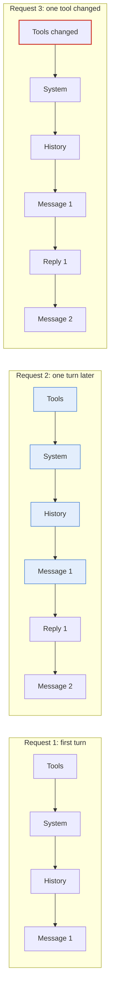

# Context and prompt caching across LLM providers

Non-normative. Researched on 2026-10-22. Supports
[PROP-0008](../proposals/0008-studio-operating-model.md) and the token analysis in
[design-review-2026-10-22.md](design-review-2026-10-22.md).

A model remembers nothing between requests: what we call its "memory" is the
context sent again with every request. The cost and quality of an agent therefore
depend mostly on how that context is ordered and kept small. This note explains
the mechanism at Claude, OpenAI, and Gemini, then derives rules for `system`.

> **Source caveat.** Prices, thresholds, and lifetimes below are from the
> providers' documentation as read on 2026-10-22. They change by model generation;
> check the linked page before relying on a number.

## Five things to remember

1. **Every turn resends the whole conversation.** Turn 10 processes turns 1–9 again.
2. **A cache makes rereading cheap, but only for an identical prefix.** Providers
   keep the computed state of the start of the prompt. A later request with the
   same prefix pays about 0.1× the input price for it, and less on some models.
3. **Changing anything early breaks everything after it.** The order is tools,
   then system, then history. Editing a tool definition, putting a timestamp in the
   system prompt, or changing the effort level can invalidate the whole cache behind it.
4. **A cache changes price, not size.** Cached tokens still occupy the context
   window, and a longer context makes the model worse (context rot) however cheap it is.
5. **Subscriptions follow the same logic.** Claude plan limits depend on
   conversation length times message count, and cached content counts for less. A
   long conversation drains quota faster.

## No memory: every turn resends everything

A request carries, in order: tool definitions, the system prompt, the full history
(messages, tool results, images, documents), and the new message. The model reads
all of it, answers, and forgets. The answer becomes input on the next turn
([Claude: context windows](https://platform.claude.com/docs/en/build-with-claude/context-windows)).

Server-side state does not change the bill. With OpenAI's Responses API,
`previous_response_id` makes the server assemble the history, but every earlier
token is still billed as input
([OpenAI: conversation state](https://developers.openai.com/api/docs/guides/conversation-state)).

### Four kinds of billed token

| Kind | What it is | Relative price (Claude, standard) |
|---|---|---|
| Plain input | not in the cache | 1× |
| Cache write | processed for the first time and stored for reuse | 1.25× (5-minute) or 2× (1-hour) |
| Cache read | matches a stored prefix | 0.1×; 0.05× on Opus 5.5 and Sonnet 5.5 |
| Output | generated by the model, including thinking | 5× (Opus 5.5: $4 input, $20 output per MTok) |

Prices: [Claude prompt caching](https://platform.claude.com/docs/en/build-with-claude/prompt-caching).

### Worked example

A 10-turn session, each turn adding 2K new tokens (output ignored):

- **No cache:** turn k sends 2K × k. The total is 2K × (1 + 2 + … + 10) = 110K input tokens.
- **Cache:** each turn writes 2K new (×1.25) and reads the rest (×0.1). The total is
  10 × 2.5K + 0.2K × (0 + 1 + … + 9) = 25K + 9K = 34K input-equivalent tokens.

Caching is about 3× cheaper at 10 turns and the gap grows with length: without a
cache cost grows with the square of the turn count; with one, the quadratic part
shrinks to 10%.

## Inside a request: prefill, decode, and the KV cache

1. **Prefill.** The model reads the whole input at once and computes a key and a
   value (KV) vector for each token, which later tokens use to look back at it. Cost
   scales with input length.
2. **Decode.** The model generates output one token at a time; each new token reads
   the KV of every token before it, so the KV stays in GPU memory for the request.
   This is why output costs several times more than input.

**Prompt caching keeps the KV of the prompt's prefix across requests.** OpenAI
states that the cache stores KV tensors, not the tokens
([OpenAI prompt caching](https://developers.openai.com/api/docs/guides/prompt-caching)).
A request with the same prefix skips prefill for it, which is cheaper and gives a
faster first token.

**Why only the prefix?** A token's KV depends on every token before it. Changing
token i changes the KV of every token after i, even when the later text is
identical. Caches are therefore prefix caches, and a small change near the start
removes the benefit.

Request 2 reads its first four blocks from cache (about 0.1×) and pays in full only
for the two new ones. Request 3 changed a tool at the start, so nothing matches and
all six blocks are computed and written again.

## Claude prompt caching

Claude caches only when asked, through `cache_control`
([docs](https://platform.claude.com/docs/en/build-with-claude/prompt-caching)):

- **Automatic:** one `cache_control` at the request level. The breakpoint sits on the
  last block and moves forward with the conversation. Suited to multi-turn chat.
- **Explicit:** `cache_control` on individual blocks, at most 4 breakpoints. Suited to
  parts that change at different rates (tools almost never, documents daily,
  conversation every turn).

### Three core rules

1. **Writes happen only at a breakpoint.** Each breakpoint writes one entry: a
   cumulative hash of everything up to that block, in the order tools → system → messages.
2. **Reads look backward.** The system hashes at the breakpoint; on a miss it walks
   back block by block looking for an entry an earlier request wrote. It finds only
   written entries; it does not cache stable content behind your breakpoint.
3. **The lookback is 20 blocks.** A turn that adds 20 or more blocks pushes the old
   entry out of reach; add an intermediate breakpoint. A run of consecutive
   `tool_use` blocks counts as one position, and so does a run of `tool_result` blocks.

**Most common mistake:** a breakpoint on a block with a timestamp or the new
message. The hash changes on every request, so every request pays a write and never
gets a read. Put the breakpoint on the last block that stays identical.

### Lifetime, price, thresholds

| Factor | Value |
|---|---|
| Default TTL | 5 minutes, refreshed free on every hit |
| Long TTL | 1 hour; writes cost 2× input |
| TTL clock | starts when the request **starts**: a reply that streams for 4 minutes leaves about 1 minute for the next turn |
| Write / read | 1.25× / 0.1×; reads 0.05× on Opus 5.5 and Sonnet 5.5, 0.025× on Fable 5.1 and Mythos 5.1 |
| Minimum length | 512 tokens on the new 5.x line (Opus 5.5, Sonnet 5.5, Haiku 5.5, Fable 5.1); below it nothing is cached and no error is returned |
| Parallel requests | an entry exists only after the first response starts; parallel requests must wait for it |
| Scope | isolated per workspace; never shared across organizations |
| Rate limits | cache reads do not count against rate limits |

### What breaks the cache

| Change | Tools | System | Messages |
|---|---|---|---|
| Tool definition (name, description, parameters) | breaks | breaks | breaks |
| Web search, citations, or speed toggled | keeps | breaks | breaks |
| Thinking parameters, effort level | per model | per model | breaks |
| `tool_choice`, images added or removed | keeps | keeps | breaks |

Languages such as Go or Swift may randomize JSON key order, which changes the hash
of identical content.

### Tools that keep the cache

- **Mid-conversation system messages:** on recent models, append a
  `role: "system"` message to `messages` instead of editing the top-level `system`;
  the prefix stays unchanged. Changing effort this way does not break the cache either.
- **Adding a tool mid-conversation** (beta `inline-tools`): send the new definition
  in a system message and leave the original `tools` array as it was.
- **Pre-warming:** a `max_tokens: 0` request writes the prefix before real work.
- **Reading the numbers:** `cache_read_input_tokens`, `cache_creation_input_tokens`,
  and `input_tokens`. `input_tokens` is only the part after the last breakpoint, not
  total input. [Cache diagnostics](https://platform.claude.com/docs/en/build-with-claude/cache-diagnostics)
  compares two consecutive requests and reports where the prefixes diverge.

## OpenAI prompt caching

OpenAI caches **by default**. The cached prefix covers OpenAI's hidden system
message, tool definitions, developer messages, and history
([docs](https://developers.openai.com/api/docs/guides/prompt-caching)).

### GPT-5.6 and later

- **Implicit (default):** a breakpoint at the end of the latest eligible message:
  user messages, the last tool result in a group, the last developer message of the
  initial group.
- **Explicit:** `prompt_cache_breakpoint`, at most 4 writes per request. Explicit-only
  mode does not write content after the last breakpoint, so a changing question costs
  no write.
- **Lookup:** boundaries are tried from longest to shortest: the first 2 and latest 50
  explicit breakpoints, the implicit breakpoint, and up to 20 earlier message ends.
- **Price and lifetime:** write 1.25× with a 30-minute minimum TTL (default) or 2.5×
  with 12 hours; read 0.1×, 0.05× on GPT-6.1 Sol.
- **Minimum:** 1,024 visible tokens.

### Models before GPT-5.6

Implicit only, with breakpoints at fixed intervals (2,048 tokens on GPT-5.5). No
write charge. `prompt_cache_retention` is `in_memory` (typically 5–10 minutes idle,
at most 1 hour) or `24h`. Reported `cached_tokens` is rounded down to a multiple of 128.

### The cache lives on a machine

The largest difference from Claude: KV is held on specific machines, and a request
hits only when routed to the machine that holds the entry.

- Routing depends on machine load, a hash of the initial tokens (including tool
  definitions), and `prompt_cache_key` if set.
- Above about **15 requests per minute** for one prefix, traffic may overflow to
  other machines and miss.
- Before GPT-5.6, use a stable `prompt_cache_key` for requests sharing a prefix and
  split heavy traffic across keys. From GPT-5.6 the key mainly separates accounting
  per customer and prevents cache probing between users.

### Settings that sit in the prefix

Changing `model`, `tools`, `parallel_tool_calls`, `text.format`, `reasoning.effort`,
`text.verbosity`, or enabling compaction can change the prefix. To avoid it:

- **Change effort mid-thread** with a `configuration_update` input item instead of
  editing `reasoning.effort`.
- **Enable or disable tools** with `allowed_tools` or `tool_choice: "none"`, keeping
  the `tools` list stable. Tools found through tool search (`defer_loading`) are
  appended at the **end** of the context and do not break the prefix.
- **Do not extend a sent message** (A becoming A + B); append a new one.

OpenAI reports two real deployments: a single-turn judge at about 70% cache hits and
a multi-turn agent above 90%.

## Gemini: implicit and explicit caching

Gemini 2.5 and later enable **implicit caching** by default, both stateless and with
`previous_interaction_id`. Minimums are 4,096 tokens for Gemini 3.x and Gemini 4
Argon, 2,048 for Gemini 2.5. Hits appear in `usage.total_cached_tokens`
([Gemini API](https://ai.google.dev/gemini-api/docs/caching)).

**Explicit caching** creates a cache object and references it. It remains only on
`generateContent` for Gemini 3 and 2.5; the Interactions API and Gemini 4 Argon onward
are implicit only. Google Cloud documents a 90% discount on cached tokens for Gemini
2.5 and later, with creation billed at the normal input price
([Google Cloud](https://docs.cloud.google.com/gemini-enterprise-agent-platform/models/context-cache/context-cache-overview)).
Google's advice matches the others: large shared content first, and send requests
with the same prefix close together in time.

## Comparison

All three cache prefixes and discount hits by about 90%. They differ in who places
breakpoints, how long entries live, and where they live.

| | Claude | OpenAI (GPT-5.6+) | Gemini |
|---|---|---|---|
| Enabled | on request (`cache_control`), automatic or explicit | implicit by default; explicit optional | implicit by default; explicit on older models |
| Breakpoints | up to 4; 20-block lookback | up to 4 writes; looks up to 50 breakpoints and 20 message ends | chosen by the system |
| Minimum | 512 tokens (new 5.x line) | 1,024 tokens | 2,048–4,096 tokens |
| Lifetime | 5 minutes, refreshed on hit; or 1 hour | at least 30 minutes; or 12 hours | not published for implicit |
| Write price | 1.25× (5 min), 2× (1 h) | 1.25× (30 min), 2.5× (12 h) | normal input |
| Read price | 0.1×; 0.05× Opus/Sonnet 5.5 | 0.1×; 0.05× GPT-6.1 Sol | 90% off |
| Effort change mid-thread | system message inside `messages` | `configuration_update` item | — |
| Caveat | parallel requests wait for the first | per-machine; ~15 req/min may overflow | send same-prefix requests close together |
| Usage field | `cache_read_input_tokens` | `cached_tokens`, `cache_write_tokens` | `total_cached_tokens` |

For `system` the most important difference is the **time window**. Claude's 5
minutes forces an agent loop to run continuously, or pay for 1 hour when it waits on
a person. OpenAI's 30 minutes is more forgiving for turns with an approval in between.

## Context window and quality

The context window is the model's working memory: everything in the request plus
the output being generated, thinking included. Claude 4.6-era and later models have
a 1M-token window and up to 128K output per request
([Claude](https://platform.claude.com/docs/en/build-with-claude/context-windows)).
**Cached tokens still occupy the window.**

### Longer is worse: context rot

Chroma tested 18 leading models on tasks kept deliberately simple, varying only
input length. Every model got worse as input grew, and not uniformly
([Chroma](https://trychroma.com/research/context-rot)). Another study found that even
with the right information always present, performance fell 13.9% to 85% as context
grew ([summary](https://beyondthetraverse.substack.com/p/more-context-is-not-better-context)).
Three things make it worse: on-topic text that does not answer the question; low
lexical overlap between question and answer passage; and relevant information in the
middle of the context. A 1M window is a **ceiling, not a target**.

### Four ways to keep context small

| Method | What it does | Effect on the cache |
|---|---|---|
| Compaction (Claude, OpenAI) | server summarizes the start of the conversation near the limit | prefix changes, so the next turn misses; still worth it when context shrinks a lot |
| Context editing (Claude) | clears old tool results or old thinking blocks | edits inside the prefix: do it only at natural boundaries |
| Memory tool, notes files | stores what must be remembered outside, read on demand | does not touch the prefix |
| New session with a handoff | ends the session, starts fresh with a structured summary | new prefix, but short |

Chat apps such as claude.ai may manage context on a rolling basis. Anthropic's
support pages give the in-app context window as 200K on every plan
([Max plan](https://support.claude.com/en/articles/11014257-about-claude-s-max-plan-usage)).

## Thinking tokens

Thinking is output: billed as output, inside `max_tokens`, and counted against rate
limits. What matters is **whether it stays in context on later turns**, because then
it is reread like any other history.

- **Claude:** Opus 4.5+, Sonnet 4.6+, Haiku 5.5, and Fable 5.1 keep earlier thinking
  blocks by default; they count as input later and are cached with the history.
  Earlier models strip them. During tool use the thinking block that accompanied the
  call must be sent back unmodified (it is signed). *Thinking block clearing* drops it
  deliberately. With adaptive thinking the main lever is `effort`.
- **OpenAI:** the Responses API returns encrypted reasoning items; sending the full
  output back, or `previous_response_id`, keeps them. `reasoning.context: "all_turns"`
  carries earlier reasoning forward on supporting models. Stateless or ZDR use needs
  `reasoning.encrypted_content` in `include`.

Consequences: effort is the main output-cost lever, set per job difficulty; changing
it at request level breaks the cache, so change it with a mid-conversation system
message (Claude) or `configuration_update` (OpenAI); kept thinking grows context, so
long agent sessions should clear old thinking at job boundaries.

## Tools, MCP, and the cache

To the model a tool is a piece of text: name, description, JSON schema. It sits
**at the start of the prefix**: Claude puts tools before system; OpenAI right after
its hidden system message. So:

1. **Tool definitions cost tokens every turn.** Five MCP servers can take about 55K
   tokens before the conversation begins
   ([Anthropic](https://www.anthropic.com/research/advanced-tool-use)). Cached they are
   cheap, but they still occupy the window and reduce tool-selection accuracy.
2. **Changing a tool breaks the whole cache.** Connecting an MCP server mid-session,
   or a server announcing a changed tool list, has this effect.

| Technique | Provider | Effect |
|---|---|---|
| Tool search, `defer_loading` | Claude, OpenAI | names only; found tools are appended at the end, prefix unchanged. Anthropic measured 85% fewer definition tokens |
| `allowed_tools`, `tool_choice: "none"` | OpenAI | restrict callable tools without editing the list |
| Tool added through a mid-conversation system message | Claude (beta) | new tool without editing `tools` |
| Stable JSON key order | all | avoids hash changes from key shuffling |
| Programmatic tool calling | Claude, OpenAI | intermediate results stay in the sandbox, out of history |

**Tool results are the longest part of history.** A 10K-token file read stays in
history and is reread every later turn: at 10% each time with a cache, times the
remaining turns, plus the quality cost. This is why filtering output before it
enters history (RTK, context-mode, parsers) is worth far more than compressing the
model's answers.

## Subscriptions and website chat

Plans do not bill per token, but limits run on the same mechanism.

- **Claude Pro and Max:** a rolling 5-hour session limit plus a weekly limit; the web
  app, Desktop, and Claude Code share one pool
  ([Pro](https://support.claude.com/en/articles/8324991-about-claude-s-pro-plan-usage),
  [Max](https://support.claude.com/en/articles/11014257-about-claude-s-max-plan-usage)).
  Limits depend on total conversation length, message count, model, and features;
  cached content counts for less. A long conversation makes every new message dearer.
- **Website chat is a black box.** The hidden system prompt, enabled tools, app memory,
  and breakpoints are outside our control, and the app may trim old history. Public
  documentation does not describe caching in the ChatGPT or Gemini web apps; assume
  the same prefix principle.

For website Workers: one job, one new conversation; stable instructions in custom or
project instructions (the start of context), not pasted into every message; batch
work around the 5-hour window, which is the basis for shadow-price scheduling in
[PROP-0008](../proposals/0008-studio-operating-model.md).

## Rules for `system`

| Mechanism | Rule |
|---|---|
| Prefix cache | fixed prompt order: tools → conventions and goals → team brief → append-only history → changing part last |
| One byte breaks it | no timestamps, random ids, or changing numbers in system; stable JSON key order |
| Tools lead the prefix | one tool set for the whole session; tool search or `defer_loading`; no new MCP server mid-session |
| Effort is in the prefix | intake chooses effort, fixed for the session; if it must change, use a mid-conversation system message or `configuration_update` |
| 5-minute TTL (Claude) | agent loops run continuously; sessions waiting on a person use the 1-hour TTL, or batch questions before expiry |
| Parallel requests miss | fan out Workers sharing a prefix after the first request has started answering; on older OpenAI models keep under ~15 requests per minute per key |
| Minimum length | a brief shared by several Workers should exceed the minimum (512 Claude, 1,024 OpenAI); a one-off brief need not |
| Caching does not save quality | keep context short; clear old tool results and thinking at job boundaries, not mid-job |
| Compaction changes the prefix | compact only when the reduction pays for the miss |
| Tool results are reread forever | filter output before history (RTK, context-mode, parsers); pass pointers, not content |
| Website is a black box | one thread per job; stable instructions in project instructions |

Record the cache fields of every call in the resource ledger
(`cache_read_input_tokens` and `cache_creation_input_tokens` for Claude;
`cached_tokens` and `cache_write_tokens` for OpenAI; `total_cached_tokens` for
Gemini) and track two numbers: **cache hit rate** (cached input over total input;
good multi-turn agents exceed 90%) and **write-to-read ratio** (high means paying for
writes that are never read: a misplaced breakpoint, an unstable prefix, or an expired
TTL). When the hit rate drops, use
[Claude cache diagnostics](https://platform.claude.com/docs/en/build-with-claude/cache-diagnostics)
or [OpenAI prompt cache diagnostics](https://developers.openai.com/api/docs/guides/prompt-caching/diagnostics).

## Adopted

- Fixed prompt order and append-only history for every model call `system` builds.
- Cache fields recorded per call; cache hit rate and write-to-read ratio as metrics.
- Tool search or `defer_loading` for agent Workers; tool set fixed per session.

## Not adopted

- Relying on the 1M-token window instead of curating context.
- Changing effort or tools at request level mid-session.

## Sources

- [Prompt caching](https://platform.claude.com/docs/en/build-with-claude/prompt-caching), Claude Platform Docs
- [Context windows](https://platform.claude.com/docs/en/build-with-claude/context-windows), Claude Platform Docs
- [Prompt caching](https://developers.openai.com/api/docs/guides/prompt-caching), OpenAI API
- [Conversation state](https://developers.openai.com/api/docs/guides/conversation-state), OpenAI API
- [Context caching](https://ai.google.dev/gemini-api/docs/caching), Gemini API
- [Context cache overview](https://docs.cloud.google.com/gemini-enterprise-agent-platform/models/context-cache/context-cache-overview), Google Cloud
- [Introducing advanced tool use](https://www.anthropic.com/research/advanced-tool-use), Anthropic
- [Context Rot](https://trychroma.com/research/context-rot), Chroma
- [More Context Is Not Better Context](https://beyondthetraverse.substack.com/p/more-context-is-not-better-context)
- [About Claude's Pro Plan Usage](https://support.claude.com/en/articles/8324991-about-claude-s-pro-plan-usage), Anthropic
- [About Claude's Max Plan Usage](https://support.claude.com/en/articles/11014257-about-claude-s-max-plan-usage), Anthropic
